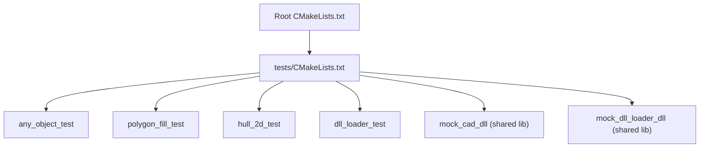
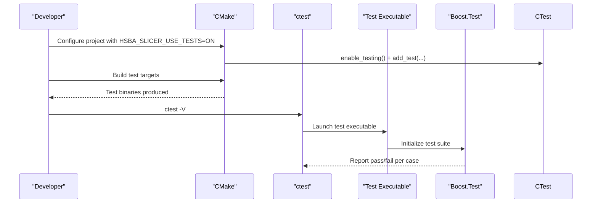
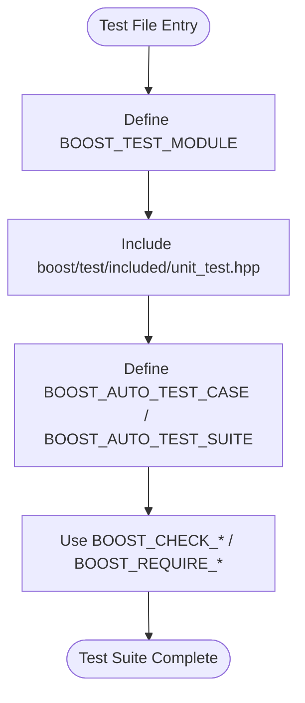
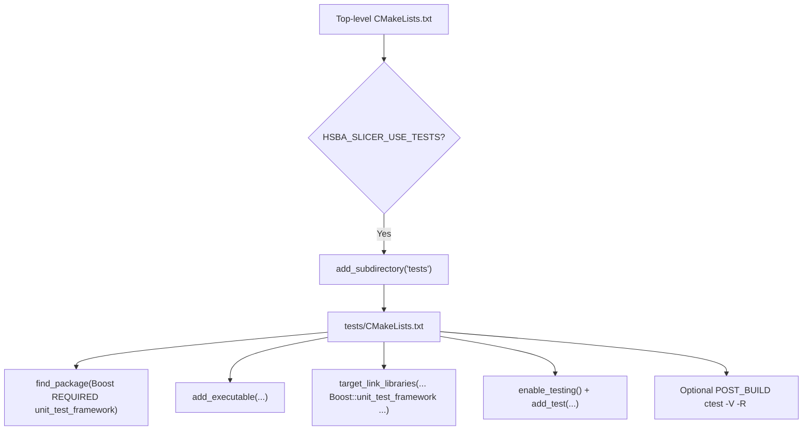
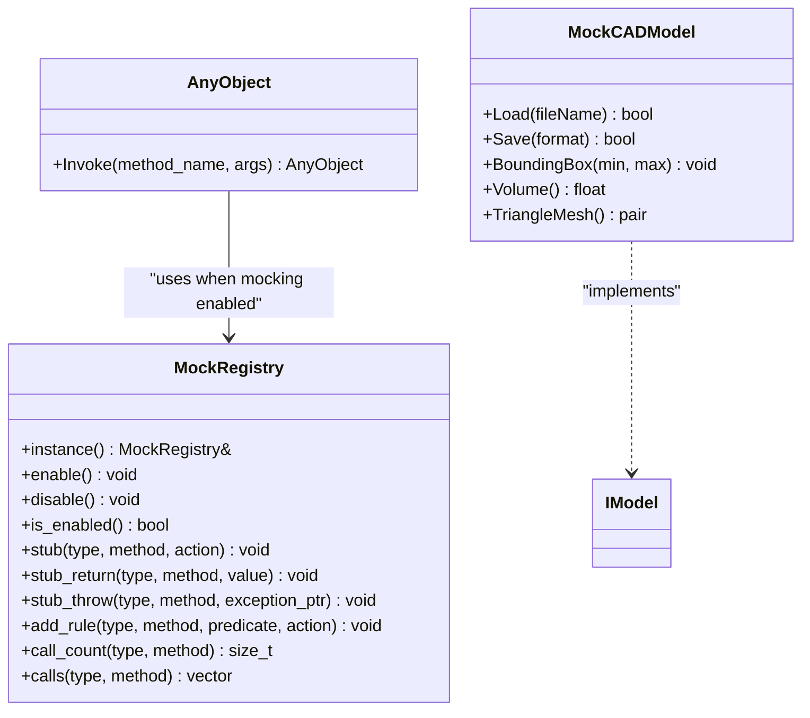
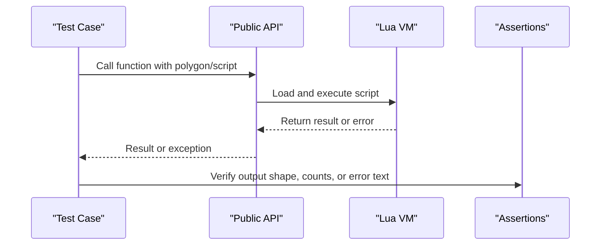
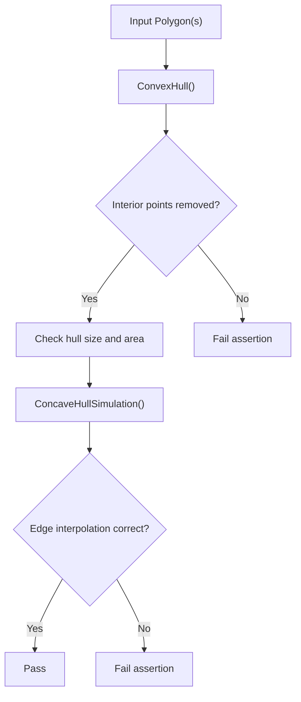
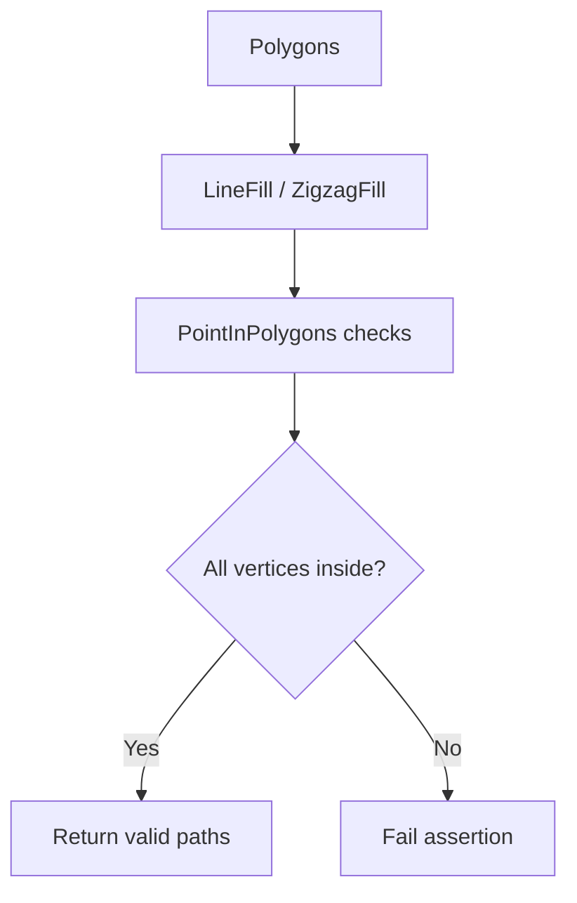
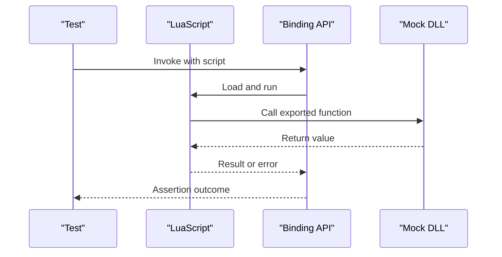
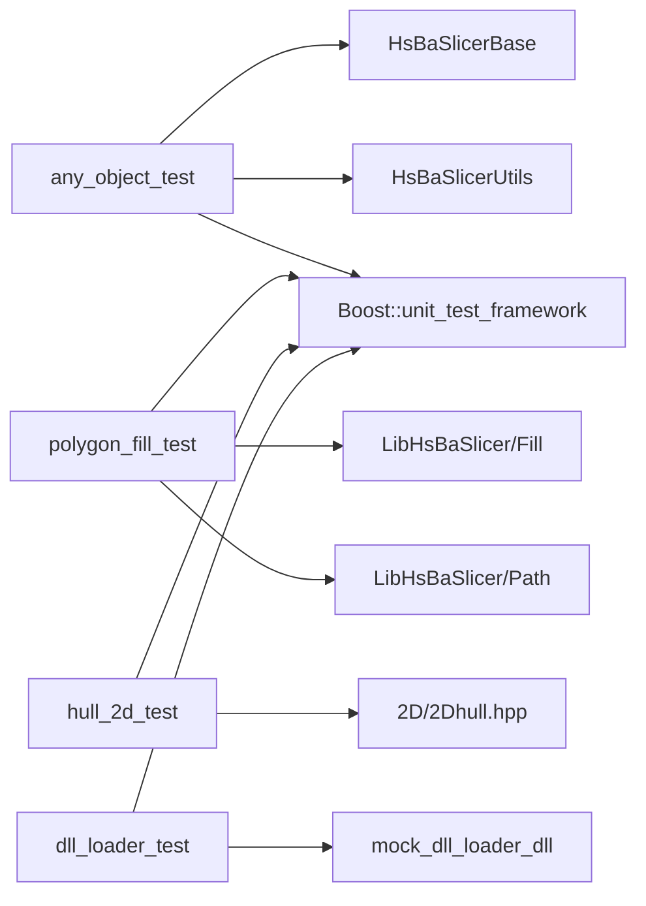

# Unit Testing Framework

<cite>
**Referenced Files in This Document**   
- [CMakeLists.txt](file://CMakeLists.txt)
- [tests/CMakeLists.txt](file://tests/CMakeLists.txt)
- [base/any_object.hpp](file://base/any_object.hpp)
- [tests/AnyObject/any_object_test.cpp](file://tests/AnyObject/any_object_test.cpp)
- [tests/PolygonFill/polygon_fill_test.cpp](file://tests/PolygonFill/polygon_fill_test.cpp)
- [tests/Hull/2dhull_test.cpp](file://tests/Hull/2dhull_test.cpp)
- [tests/CADModel/mock_cad_dll.cpp](file://tests/CADModel/mock_cad_dll.cpp)
- [tests/DllLoader/mock_dll_loader_dll.cpp](file://tests/DllLoader/mock_dll_loader_dll.cpp)
</cite>

## Table of Contents
1. [Introduction](#introduction)
2. [Project Structure](#project-structure)
3. [Core Components](#core-components)
4. [Architecture Overview](#architecture-overview)
5. [Detailed Component Analysis](#detailed-component-analysis)
6. [Dependency Analysis](#dependency-analysis)
7. [Performance Considerations](#performance-considerations)
8. [Troubleshooting Guide](#troubleshooting-guide)
9. [Conclusion](#conclusion)

## Introduction
This document explains how HsBaSlicer uses Boost.Test for unit testing, how tests are organized and built with CMake, and how to write effective tests. It covers:
- Boost.Test integration and test executable structure
- CMake configuration and ctest execution
- Mocking strategies for external dependencies
- Test data management and Lua-based integration scenarios
- Common test patterns such as geometry validation, algorithm correctness, and end-to-end flows

The goal is to help you add new tests confidently while keeping them fast, deterministic, and maintainable.

## Project Structure
Tests live under the `tests` directory. Each feature area has its own subdirectory containing one or more Boost.Test executables. The top-level CMake file enables the test tree when `HSBA_SLICER_USE_TESTS` is ON, and the `tests/CMakeLists.txt` file defines each test target, links Boost.Test, registers tests with ctest, and optionally runs them after build.

**Diagram sources**
- [CMakeLists.txt:392-407](file://CMakeLists.txt#L392-L407)
- [CMakeLists.txt:667-674](file://CMakeLists.txt#L667-L674)
- [tests/CMakeLists.txt:1-39](file://tests/CMakeLists.txt#L1-L39)

**Section sources**
- [CMakeLists.txt:392-407](file://CMakeLists.txt#L392-L407)
- [CMakeLists.txt:667-674](file://CMakeLists.txt#L667-L674)
- [tests/CMakeLists.txt:1-39](file://tests/CMakeLists.txt#L1-L39)

## Core Components
- Boost.Test framework: Every test file starts with a module definition and includes the Boost.Test header. Assertions use macros like `BOOST_CHECK_EQUAL`, `BOOST_CHECK_THROW`, and `BOOST_REQUIRE_EQUAL`.
- Test targets: Each test is an executable target linked against `Boost::unit_test_framework` and the libraries under test.
- ctest integration: `enable_testing()` and `add_test(NAME ... COMMAND ...)` register tests; optional post-build commands run ctest per target.
- Optional automatic execution: When `HSBA_SLICER_RUN_TESTS_AFTER_BUILD` is ON, many targets automatically invoke ctest after building.

Key implementation details:
- Boost.Test discovery: `#define BOOST_TEST_MODULE <name>` followed by `#include <boost/test/included/unit_test.hpp>` creates a self-contained test binary.
- Dynamic linking: Tests define `BOOST_TEST_DYN_LINK` so they link against the dynamic Boost.Test library.
- Test grouping: `BOOST_AUTO_TEST_SUITE(...)` groups related cases.

**Section sources**
- [tests/AnyObject/any_object_test.cpp:1-2](file://tests/AnyObject/any_object_test.cpp#L1-L2)
- [tests/PolygonFill/polygon_fill_test.cpp:1-14](file://tests/PolygonFill/polygon_fill_test.cpp#L1-L14)
- [tests/Hull/2dhull_test.cpp:1-14](file://tests/Hull/2dhull_test.cpp#L1-L14)
- [tests/CMakeLists.txt:1-39](file://tests/CMakeLists.txt#L1-L39)

## Architecture Overview
The testing architecture consists of:
- Test harnesses: One Boost.Test executable per feature area.
- Build system: Top-level CMake toggles tests and includes the test tree; `tests/CMakeLists.txt` defines all test targets and their dependencies.
- Execution: ctest discovers registered tests and can run them automatically after build.
- External dependency isolation: Mock shared libraries and internal mock registries isolate real subsystems during tests.

**Diagram sources**
- [CMakeLists.txt:667-674](file://CMakeLists.txt#L667-L674)
- [tests/CMakeLists.txt:29-39](file://tests/CMakeLists.txt#L29-L39)

## Detailed Component Analysis

### Boost.Test Integration and Test Organization
- Module setup: Each test file defines a module name and includes the included Boost.Test header.
- Assertions: Equality checks, exception checks, and requirement checks are used throughout.
- Suites: Related tests are grouped using `BOOST_AUTO_TEST_SUITE`.

Examples from the codebase:
- Geometry algorithms: Convex/concave hull tests validate vertex removal, area, convexity, and edge cases.
- Polygon fill and path optimization: Tests assert that generated paths lie inside polygons, cover expected regions, and respect join modes and fill modes.
- Lua integration: Tests execute Lua scripts to verify bindings and error propagation.

**Diagram sources**
- [tests/AnyObject/any_object_test.cpp:1-2](file://tests/AnyObject/any_object_test.cpp#L1-L2)
- [tests/Hull/2dhull_test.cpp:56-57](file://tests/Hull/2dhull_test.cpp#L56-L57)
- [tests/PolygonFill/polygon_fill_test.cpp:26-84](file://tests/PolygonFill/polygon_fill_test.cpp#L26-L84)

**Section sources**
- [tests/AnyObject/any_object_test.cpp:103-116](file://tests/AnyObject/any_object_test.cpp#L103-L116)
- [tests/Hull/2dhull_test.cpp:58-112](file://tests/Hull/2dhull_test.cpp#L58-L112)
- [tests/PolygonFill/polygon_fill_test.cpp:26-84](file://tests/PolygonFill/polygon_fill_test.cpp#L26-L84)

### CMake Test Configuration and ctest Execution
- Top-level options:
  - `HSBA_SLICER_USE_TESTS`: Enables the test tree.
  - `HSBA_SLICER_RUN_TESTS_AFTER_BUILD`: Runs ctest after build for selected targets.
- Per-test targets:
  - `add_executable(<test>_test ...)`
  - `target_link_libraries(... Boost::unit_test_framework ...)`
  - `target_compile_definitions(... BOOST_TEST_DYN_LINK ...)`
  - `enable_testing()` and `add_test(NAME ... COMMAND $<TARGET_FILE:...>)`
- Post-build automation: Many targets add a custom command to run ctest with `-V -R <test_name>`.

**Diagram sources**
- [CMakeLists.txt:392-407](file://CMakeLists.txt#L392-L407)
- [CMakeLists.txt:667-674](file://CMakeLists.txt#L667-L674)
- [tests/CMakeLists.txt:1-39](file://tests/CMakeLists.txt#L1-L39)

**Section sources**
- [CMakeLists.txt:392-407](file://CMakeLists.txt#L392-L407)
- [CMakeLists.txt:667-674](file://CMakeLists.txt#L667-L674)
- [tests/CMakeLists.txt:1-39](file://tests/CMakeLists.txt#L1-L39)

### Mocking Strategies for External Dependencies
HsBaSlicer uses two complementary approaches:

1. Internal mock registry for method dispatch
   - The `MockRegistry` class provides thread-safe stubbing and rule-based behavior for `AnyObject::Invoke`.
   - Tests can enable/disable mocking manually or via RAII scopes (`ScopedEnable`, `ScopedStubs`).
   - Stubs can return values, throw exceptions, or inspect arguments. Rules allow conditional behavior based on argument predicates.

2. Shared-library mocks for dynamic loading
   - Separate small shared libraries implement minimal interfaces consumed by tests.
   - Examples:
     - `tests/CADModel/mock_cad_dll.cpp` exports functions mimicking a CAD DLL contract.
     - `tests/DllLoader/mock_dll_loader_dll.cpp` exports simple C functions to exercise runtime function resolution and argument passing.

**Diagram sources**
- [base/any_object.hpp:262-552](file://base/any_object.hpp#L262-L552)
- [tests/CADModel/mock_cad_dll.cpp:22-49](file://tests/CADModel/mock_cad_dll.cpp#L22-L49)

**Section sources**
- [base/any_object.hpp:262-552](file://base/any_object.hpp#L262-L552)
- [tests/AnyObject/any_object_test.cpp:190-372](file://tests/AnyObject/any_object_test.cpp#L190-L372)
- [tests/CADModel/mock_cad_dll.cpp:1-111](file://tests/CADModel/mock_cad_dll.cpp#L1-L111)
- [tests/DllLoader/mock_dll_loader_dll.cpp:1-41](file://tests/DllLoader/mock_dll_loader_dll.cpp#L1-L41)

### Test Data Management and Lua Integration Scenarios
- In-memory geometry: Tests construct polygons and points directly to validate algorithms.
- Script-driven tests: Some tests load Lua scripts from files or inline strings to exercise bindings and user-defined logic.
- Error handling: Tests assert both successful outputs and error conditions (e.g., invalid script names, type mismatches).

Patterns observed:
- Geometry validation: Ensure generated paths remain inside input polygons and satisfy geometric properties (convexity, area).
- Algorithm correctness: Validate hull construction, fill generation, and path optimization order.
- Integration scenarios: Execute Lua scripts through public APIs and verify results and error messages.

**Diagram sources**
- [tests/PolygonFill/polygon_fill_test.cpp:108-175](file://tests/PolygonFill/polygon_fill_test.cpp#L108-L175)
- [tests/PolygonFill/polygon_fill_test.cpp:202-258](file://tests/PolygonFill/polygon_fill_test.cpp#L202-L258)

**Section sources**
- [tests/PolygonFill/polygon_fill_test.cpp:26-84](file://tests/PolygonFill/polygon_fill_test.cpp#L26-L84)
- [tests/PolygonFill/polygon_fill_test.cpp:108-175](file://tests/PolygonFill/polygon_fill_test.cpp#L108-L175)
- [tests/PolygonFill/polygon_fill_test.cpp:202-258](file://tests/PolygonFill/polygon_fill_test.cpp#L202-L258)

### Common Test Patterns in the Codebase

#### Geometry Validation
- Convex hull tests verify interior point removal, area preservation, strict convexity, and multi-polygon inputs.
- Concave hull simulation verifies densification along edges and empty-input behavior.

**Diagram sources**
- [tests/Hull/2dhull_test.cpp:58-112](file://tests/Hull/2dhull_test.cpp#L58-L112)
- [tests/Hull/2dhull_test.cpp:114-155](file://tests/Hull/2dhull_test.cpp#L114-L155)
- [tests/Hull/2dhull_test.cpp:195-204](file://tests/Hull/2dhull_test.cpp#L195-L204)

**Section sources**
- [tests/Hull/2dhull_test.cpp:58-112](file://tests/Hull/2dhull_test.cpp#L58-L112)
- [tests/Hull/2dhull_test.cpp:114-155](file://tests/Hull/2dhull_test.cpp#L114-L155)
- [tests/Hull/2dhull_test.cpp:195-204](file://tests/Hull/2dhull_test.cpp#L195-L204)

#### Algorithm Correctness Testing
- Polygon fill tests validate line and zigzag fills, composite/hybrid fills, offset fills, and Lua custom fills.
- Path optimizer tests ensure region clustering, entry rotation, manual route overrides, and consistent block ordering.

**Diagram sources**
- [tests/PolygonFill/polygon_fill_test.cpp:26-84](file://tests/PolygonFill/polygon_fill_test.cpp#L26-L84)
- [tests/PolygonFill/polygon_fill_test.cpp:325-388](file://tests/PolygonFill/polygon_fill_test.cpp#L325-L388)

**Section sources**
- [tests/PolygonFill/polygon_fill_test.cpp:26-84](file://tests/PolygonFill/polygon_fill_test.cpp#L26-L84)
- [tests/PolygonFill/polygon_fill_test.cpp:325-388](file://tests/PolygonFill/polygon_fill_test.cpp#L325-L388)

#### Integration Scenarios
- Lua binding tests execute scripts to verify parameter conversion, error propagation, and global fallback behaviors.
- Dynamic loader tests use mock shared libraries to validate runtime function resolution and argument passing.

**Diagram sources**
- [tests/DllLoader/mock_dll_loader_dll.cpp:16-40](file://tests/DllLoader/mock_dll_loader_dll.cpp#L16-L40)
- [tests/PolygonFill/polygon_fill_test.cpp:202-258](file://tests/PolygonFill/polygon_fill_test.cpp#L202-L258)

**Section sources**
- [tests/DllLoader/mock_dll_loader_dll.cpp:1-41](file://tests/DllLoader/mock_dll_loader_dll.cpp#L1-L41)
- [tests/PolygonFill/polygon_fill_test.cpp:202-258](file://tests/PolygonFill/polygon_fill_test.cpp#L202-L258)

## Dependency Analysis
- Test targets depend on:
  - `Boost::unit_test_framework`
  - Application libraries under test (e.g., `HsBaSlicerBase`, `HsBaSlicerUtils`, `HsBaPaths`, `HsBaSupport`, etc.)
  - Optional third-party libraries (e.g., Eigen, Lua) when needed
- Conditional compilation:
  - Copyleft kernels (CGAL/OpenCASCADE) are gated by `HSBA_COPL`.
  - Some tests are excluded on mobile/console platforms.
- Cross-compilation disables automatic test execution.

**Diagram sources**
- [tests/CMakeLists.txt:15-39](file://tests/CMakeLists.txt#L15-L39)
- [tests/CMakeLists.txt:686-770](file://tests/CMakeLists.txt#L686-L770)
- [tests/CMakeLists.txt:1481-1508](file://tests/CMakeLists.txt#L1481-L1508)

**Section sources**
- [tests/CMakeLists.txt:15-39](file://tests/CMakeLists.txt#L15-L39)
- [tests/CMakeLists.txt:686-770](file://tests/CMakeLists.txt#L686-L770)
- [tests/CMakeLists.txt:1481-1508](file://tests/CMakeLists.txt#L1481-L1508)

## Performance Considerations
- Avoid heavy operations in Debug builds where possible:
  - Boolean operations with CGAL/IGL are disabled in Debug to prevent slow tests.
- Use targeted assertions and minimal data sets to keep tests fast.
- For performance-sensitive components, prefer deterministic micro-benchmarks outside the main test suite if necessary.

Practical guidance:
- Keep geometry inputs small but representative.
- Prefer in-memory data over disk I/O in unit tests.
- Use mock registries to avoid expensive calls when not required.

[No sources needed since this section provides general guidance]

## Troubleshooting Guide
Common issues and resolutions:
- Missing Boost.Test:
  - Ensure `find_package(Boost REQUIRED unit_test_framework)` succeeds.
- Test not discovered by ctest:
  - Confirm `enable_testing()` and `add_test(NAME ... COMMAND ...)` are present.
- Automatic test execution not running:
  - Check `HSBA_SLICER_RUN_TESTS_AFTER_BUILD` and platform constraints (disabled on cross-compilation).
- Lua-related failures:
  - Validate script syntax and function names; check error messages returned by bindings.
- Mocking not taking effect:
  - Ensure mocking is enabled via `MockRegistry::enable()` or `ScopedEnable`; verify rules and fallback stubs.

**Section sources**
- [tests/CMakeLists.txt:1-39](file://tests/CMakeLists.txt#L1-L39)
- [CMakeLists.txt:392-407](file://CMakeLists.txt#L392-L407)
- [tests/AnyObject/any_object_test.cpp:190-372](file://tests/AnyObject/any_object_test.cpp#L190-L372)

## Conclusion
HsBaSlicer’s testing strategy combines Boost.Test executables, robust CMake configuration, and flexible mocking to validate geometry algorithms, path optimization, and Lua integrations. By following the established patterns—clear module setup, focused test cases, deterministic data, and isolated external dependencies—you can extend coverage effectively while maintaining speed and reliability.

[No sources needed since this section summarizes without analyzing specific files]