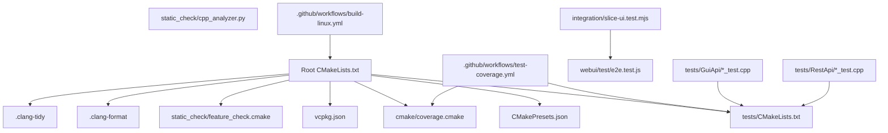
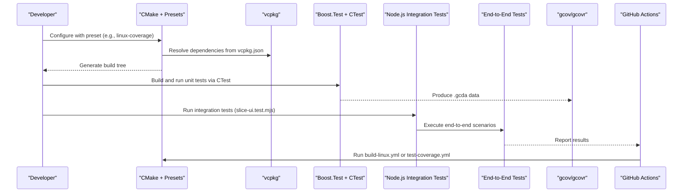
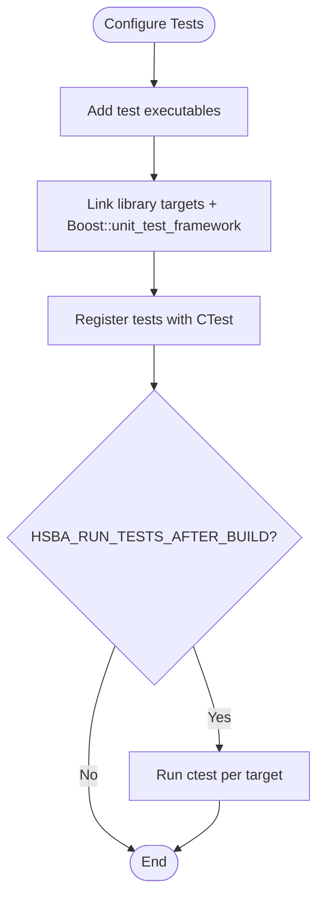
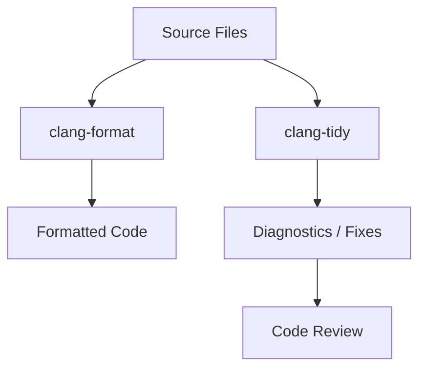
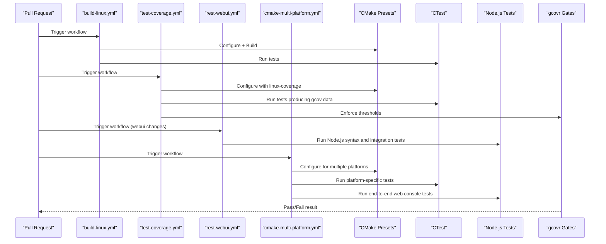
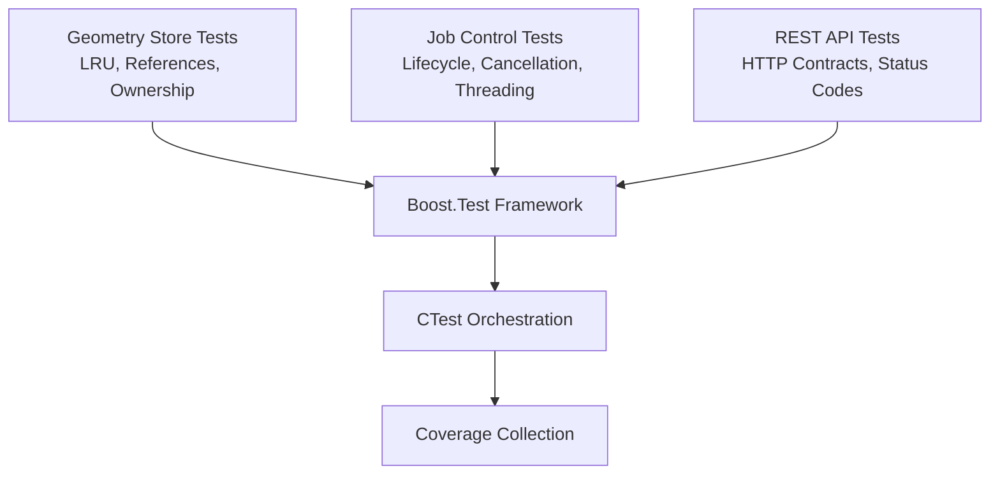
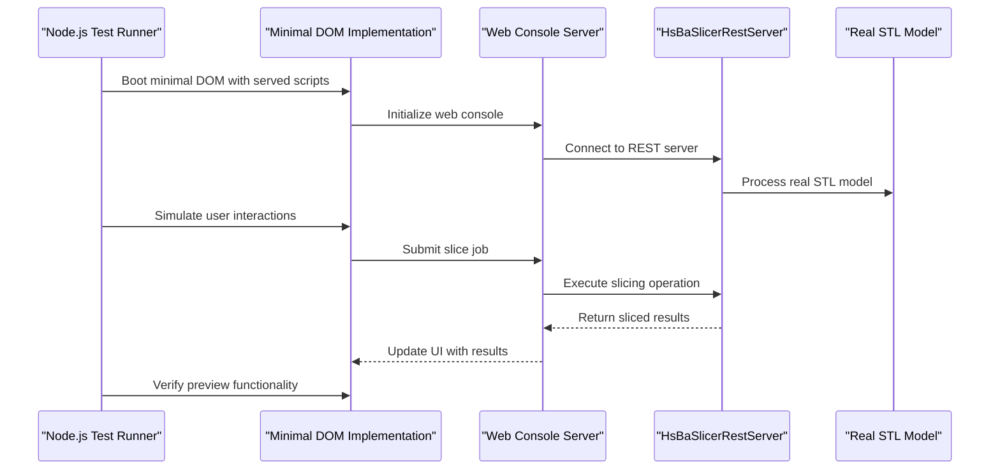
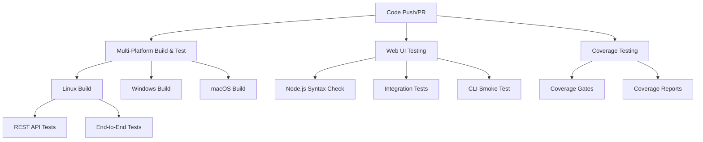

# Development Testing & Contribution

<cite>
**Referenced Files in This Document**
- [CMakeLists.txt](file://CMakeLists.txt)
- [vcpkg.json](file://vcpkg.json)
- [CMakePresets.json](file://CMakePresets.json)
- [.clang-format](file://.clang-format)
- [.clang-tidy](file://.clang-tidy)
- [README.md](file://README.md)
- [tests/CMakeLists.txt](file://tests/CMakeLists.txt)
- [cmake/coverage.cmake](file://cmake/coverage.cmake)
- [static_check/cpp_analyzer.py](file://static_check/cpp_analyzer.py)
- [static_check/feature_check.cmake](file://static_check/feature_check.cmake)
- [.github/workflows/build-linux.yml](file://.github/workflows/build-linux.yml)
- [.github/workflows/test-coverage.yml](file://.github/workflows/test-coverage.yml)
- [.github/workflows/rest-webui.yml](file://.github/workflows/rest-webui.yml)
- [.github/workflows/cmake-multi-platform.yml](file://.github/workflows/cmake-multi-platform.yml)
- [integration/slice-ui.test.mjs](file://integration/slice-ui.test.mjs)
- [tests/GuiApi/geometry_store_test.cpp](file://tests/GuiApi/geometry_store_test.cpp)
- [tests/GuiApi/job_control_test.cpp](file://tests/GuiApi/job_control_test.cpp)
- [tests/RestApi/endpoint_http_test.cpp](file://tests/RestApi/endpoint_http_test.cpp)
- [webui/test/e2e.test.js](file://webui/test/e2e.test.js)
</cite>

## Update Summary
**Changes Made**
- Added comprehensive testing infrastructure section covering integration tests for slice UI, end-to-end tests for web server, and unit tests for new components
- Updated CI/CD pipeline documentation to include automated testing workflows
- Enhanced testing framework documentation with Google Test and Boost.Test coverage
- Added detailed coverage of REST API endpoint testing and GUI component testing
- Included Node.js-based integration testing for web console functionality

## Table of Contents
1. [Introduction](#introduction)
2. [Project Structure](#project-structure)
3. [Core Components](#core-components)
4. [Architecture Overview](#architecture-overview)
5. [Detailed Component Analysis](#detailed-component-analysis)
6. [Testing Infrastructure](#testing-infrastructure)
7. [Dependency Analysis](#dependency-analysis)
8. [Performance Considerations](#performance-considerations)
9. [Troubleshooting Guide](#troubleshooting-guide)
10. [Conclusion](#conclusion)
11. [Appendices](#appendices)

## Introduction
This document describes how to develop, test, and contribute to HsBaSlicer. It focuses on the development environment setup with CMake and vcpkg, IDE recommendations for Visual Studio, CLion, and VS Code, debugging techniques, comprehensive testing strategies using Google Test and Boost.Test, static analysis with clang-tidy and clang-format, code quality standards, contribution workflows, continuous integration, and common troubleshooting steps.

HsBaSlicer is a modular, cross-platform C++ framework for 3D-printing slicers. The repository provides desktop, Android, and iOS build targets, extensive unit tests, integration tests, end-to-end tests, coverage gating, and automated CI/CD pipelines.

**Section sources**
- [README.md:21-23](file://README.md#L21-L23)

## Project Structure
The project uses a top-level CMake configuration that detects compiler capabilities, configures dependencies through vcpkg, and adds subdirectories for core modules, libraries, samples, tests, and documentation. Key development-related areas include:

- Build system: root `CMakeLists.txt`, `CMakePresets.json`, `vcpkg.json`
- Static analysis: `.clang-format`, `.clang-tidy`, `static_check/cpp_analyzer.py`, `static_check/feature_check.cmake`
- Testing: `tests/CMakeLists.txt` and per-feature test executables, integration tests, end-to-end tests
- Coverage: `cmake/coverage.cmake`
- CI: `.github/workflows/*.yml`

**Diagram sources**
- [CMakeLists.txt:1-695](file://CMakeLists.txt#L1-L695)
- [CMakePresets.json:1-239](file://CMakePresets.json#L1-L239)
- [vcpkg.json:1-113](file://vcpkg.json#L1-L113)
- [tests/CMakeLists.txt:1-1673](file://tests/CMakeLists.txt#L1-L1673)
- [cmake/coverage.cmake:1-173](file://cmake/coverage.cmake#L1-L173)
- [static_check/cpp_analyzer.py:1-383](file://static_check/cpp_analyzer.py#L1-L383)
- [static_check/feature_check.cmake:1-123](file://static_check/feature_check.cmake#L1-L123)
- [.clang-format:1-99](file://.clang-format#L1-L99)
- [.clang-tidy:1-96](file://.clang-tidy#L1-L96)
- [.github/workflows/build-linux.yml:1-82](file://.github/workflows/build-linux.yml#L1-L82)
- [.github/workflows/test-coverage.yml:1-136](file://.github/workflows/test-coverage.yml#L1-L136)
- [integration/slice-ui.test.mjs:1-603](file://integration/slice-ui.test.mjs#L1-L603)
- [webui/test/e2e.test.js:370-409](file://webui/test/e2e.test.js#L370-L409)

**Section sources**
- [CMakeLists.txt:1-695](file://CMakeLists.txt#L1-L695)
- [CMakePresets.json:1-239](file://CMakePresets.json#L1-L239)
- [vcpkg.json:1-113](file://vcpkg.json#L1-L113)

## Core Components
This section summarizes the development toolchain components used by contributors:

- CMake and presets:
  - Top-level CMake enforces modern C++ features and sets platform-specific options.
  - Presets define Windows/Linux/macOS/iOS builds, coverage builds, and Android builds.
- Dependency management:
  - vcpkg defines required packages and optional copyleft kernels (CGAL, OpenCascade).
- Static analysis and formatting:
  - clang-format defines Allman-style formatting rules.
  - clang-tidy restricts checks to production code and excludes tests/samples/static_tests.
  - Python analyzer performs additional checks such as memory allocation patterns and complexity thresholds.
- Testing:
  - Boost.Test is used across many test executables; CTest orchestrates execution.
  - Node.js-based integration tests for web console functionality.
  - End-to-end tests for REST API and web UI interaction.
- Coverage:
  - gcov/gcovr instrumentation and threshold gates are configured via CMake.

**Section sources**
- [CMakeLists.txt:1-695](file://CMakeLists.txt#L1-L695)
- [CMakePresets.json:1-239](file://CMakePresets.json#L1-L239)
- [vcpkg.json:1-113](file://vcpkg.json#L1-L113)
- [.clang-format:1-99](file://.clang-format#L1-L99)
- [.clang-tidy:1-96](file://.clang-tidy#L1-L96)
- [static_check/cpp_analyzer.py:1-383](file://static_check/cpp_analyzer.py#L1-L383)
- [tests/CMakeLists.txt:1-1673](file://tests/CMakeLists.txt#L1-L1673)
- [cmake/coverage.cmake:1-173](file://cmake/coverage.cmake#L1-L173)

## Architecture Overview
The development workflow integrates CMake, vcpkg, Boost.Test, Node.js testing, clang-tidy, clang-format, gcov/gcovr, and GitHub Actions.

**Diagram sources**
- [CMakePresets.json:1-239](file://CMakePresets.json#L1-L239)
- [vcpkg.json:1-113](file://vcpkg.json#L1-L113)
- [tests/CMakeLists.txt:1-1673](file://tests/CMakeLists.txt#L1-L1673)
- [integration/slice-ui.test.mjs:1-603](file://integration/slice-ui.test.mjs#L1-L603)
- [webui/test/e2e.test.js:370-409](file://webui/test/e2e.test.js#L370-L409)
- [cmake/coverage.cmake:1-173](file://cmake/coverage.cmake#L1-L173)
- [.github/workflows/build-linux.yml:1-82](file://.github/workflows/build-linux.yml#L1-L82)
- [.github/workflows/test-coverage.yml:1-136](file://.github/workflows/test-coverage.yml#L1-L136)

## Detailed Component Analysis

### Development Environment Setup

#### Build System Configuration with CMake and vcpkg
- Compiler requirements:
  - C++20 is enforced at the top level.
  - Optional C++ features (coroutines, explicit this, C23 constexpr) are detected and conditionally enabled.
- Platform detection:
  - Desktop vs mobile vs game console flags are set based on CMake variables and VCPKG_TARGET_TRIPLET.
- Dependencies:
  - vcpkg manages most third-party libraries.
  - Copyleft kernels (CGAL, OpenCASCADE) are optional and controlled by HSBA_COPL and vcpkg feature "copyleft".
- Output layout:
  - Binaries and libraries are placed under a unified output directory structure.

Recommended commands:
- Use CMake presets for consistent configurations:
  - Windows: x64-debug, x64-release
  - Linux: linux-debug, linux-release, linux-coverage
  - macOS: macos-debug, macos-release
  - iOS: ios-release
  - Android: android-release

**Section sources**
- [CMakeLists.txt:1-695](file://CMakeLists.txt#L1-L695)
- [CMakePresets.json:1-239](file://CMakePresets.json#L1-L239)
- [vcpkg.json:1-113](file://vcpkg.json#L1-L113)

#### IDE Setup Recommendations

- Visual Studio:
  - Use CMake projects with presets defined in `CMakePresets.json`.
  - Select the appropriate preset (e.g., windows-x64-debug or windows-x64-release).
  - Ensure vcpkg is integrated so dependencies resolve automatically.

- CLion:
  - Import the project as a CMake project.
  - Enable clang-tidy diagnostics and use `.clang-tidy` and `.clang-format`.
  - Prefer Ninja generator for faster builds.

- VS Code:
  - Install C/C++ extension and enable clangd.
  - Use CMake Tools to select presets.
  - Integrate clang-format and clang-tidy via workspace settings.

**Section sources**
- [CMakePresets.json:1-239](file://CMakePresets.json#L1-L239)
- [.clang-tidy:1-96](file://.clang-tidy#L1-L96)
- [.clang-format:1-99](file://.clang-format#L1-L99)

#### Debugging Techniques
- Use Debug builds generated by presets (e.g., x64-debug, linux-debug, macos-debug).
- For Linux/WSL coverage builds, run tests and then generate coverage reports to identify untested paths.
- On Windows, ensure symbols are available for debuggers when building Debug configurations.

**Section sources**
- [CMakePresets.json:1-239](file://CMakePresets.json#L1-L239)
- [cmake/coverage.cmake:1-173](file://cmake/coverage.cmake#L1-L173)

### Testing Framework

#### Unit Testing Strategies with Boost.Test
- The test suite uses Boost.Test across multiple test executables.
- Each test target links against relevant library targets and Boost.Test.
- CTest registers each executable and can optionally run tests after build.

Key behaviors:
- Many tests define `BOOST_TEST_DYN_LINK`.
- Some tests pass specific test names or suites to the executable.
- A `RunAllTests` custom target aggregates all test executables when enabled.

**Diagram sources**
- [tests/CMakeLists.txt:1-1673](file://tests/CMakeLists.txt#L1-L1673)

**Section sources**
- [tests/CMakeLists.txt:1-1673](file://tests/CMakeLists.txt#L1-L1673)

#### Integration Testing Approaches
- Integration-style tests link multiple internal libraries (e.g., Lua adapters, path generators, support modules).
- Some tests exercise end-to-end behavior such as G-code generation with Lua scripting.

Examples:
- `gcode_path_test` exercises multi-firmware G-code generation and Lua script callbacks.
- `param_store_test` exercises parameter storage with Lua and SQL adapter interactions.

**Section sources**
- [tests/CMakeLists.txt:1-1673](file://tests/CMakeLists.txt#L1-L1673)

#### Performance Benchmarking Methods
- The repository does not define dedicated benchmark targets in the provided files.
- For performance validation, developers should:
  - Build Release configurations.
  - Use profiling tools (e.g., perf, VTune, Instruments) alongside targeted benchmarks added by contributors.
  - Compare timing results across branches using consistent inputs.

[No sources needed since this section provides general guidance]

### Code Quality Standards

#### Coding Conventions
- Formatting:
  - clang-format enforces Allman-style braces, 4-space indentation, column limit 120, and other style rules.
- Modern C++:
  - C++20 is required; modernize and readability checks are enabled in clang-tidy.
- Namespace usage:
  - The Python static analyzer forbids broad `using namespace` directives except where allowed.

**Section sources**
- [.clang-format:1-99](file://.clang-format#L1-L99)
- [.clang-tidy:1-96](file://.clang-tidy#L1-L96)
- [static_check/cpp_analyzer.py:1-383](file://static_check/cpp_analyzer.py#L1-L383)

#### Static Analysis Setup with clang-tidy and clang-format
- clang-tidy:
  - Applies curated checks from clang-analyzer, bugprone, cert, cppcoreguidelines, misc, modernize, performance, readability.
  - Excludes tests, samples, static_tests, vcpkg, and generated directories via HeaderFilterRegex.
- clang-format:
  - Standardized formatting applied consistently across the codebase.

**Diagram sources**
- [.clang-format:1-99](file://.clang-format#L1-L99)
- [.clang-tidy:1-96](file://.clang-tidy#L1-L96)

**Section sources**
- [.clang-format:1-99](file://.clang-format#L1-L99)
- [.clang-tidy:1-96](file://.clang-tidy#L1-L96)

#### Additional Static Checks
- Python-based analyzer:
  - Skips tests/examples and build artifacts.
  - Detects potential memory leaks around new/malloc/free.
  - Flags unsafe functions, magic numbers, catch-all exceptions, and high cyclomatic complexity.

**Section sources**
- [static_check/cpp_analyzer.py:1-383](file://static_check/cpp_analyzer.py#L1-L383)

#### Code Review Processes
- Contributors should:
  - Run clang-format before committing.
  - Address clang-tidy warnings where applicable.
  - Ensure tests pass locally and in CI.
  - Keep changes focused and explain rationale in pull requests.

[No sources needed since this section provides general guidance]

### Contribution Guidelines

#### Submitting Pull Requests
- Create a branch for your change.
- Ensure local builds succeed with relevant presets.
- Run tests via CTest.
- Update documentation if API or behavior changes.
- Submit a PR with clear description and linked issues.

#### Issue Reporting
- Include:
  - Steps to reproduce.
  - Expected vs actual behavior.
  - Build environment details (compiler, OS, CMake version).
  - Logs or stack traces when available.

#### Community Participation
- Follow coding conventions and static analysis rules.
- Participate in discussions about design decisions.
- Help maintain CI stability and coverage baselines.

[No sources needed since this section provides general guidance]

### Continuous Integration and Automated Testing Pipelines

#### CI Workflows
- `build-linux.yml`:
  - Installs dependencies, bootstraps vcpkg, configures CMake, builds, and runs tests.
- `test-coverage.yml`:
  - Uses the `linux-coverage` preset to instrument builds.
  - Runs tests and enforces coverage thresholds for core and other modules.
  - Uploads coverage reports as artifacts.
- `rest-webui.yml`:
  - Tests Node.js web console independently without C++ dependencies.
  - Runs syntax checks and integration tests for web UI components.
- `cmake-multi-platform.yml`:
  - Multi-platform builds and testing across Windows, Linux, and macOS.
  - Includes REST API endpoint testing and end-to-end web console testing.

**Diagram sources**
- [.github/workflows/build-linux.yml:1-82](file://.github/workflows/build-linux.yml#L1-L82)
- [.github/workflows/test-coverage.yml:1-136](file://.github/workflows/test-coverage.yml#L1-L136)
- [.github/workflows/rest-webui.yml:1-79](file://.github/workflows/rest-webui.yml#L1-L79)
- [.github/workflows/cmake-multi-platform.yml:1-517](file://.github/workflows/cmake-multi-platform.yml#L1-L517)
- [CMakePresets.json:1-239](file://CMakePresets.json#L1-L239)
- [cmake/coverage.cmake:1-173](file://cmake/coverage.cmake#L1-L173)

**Section sources**
- [.github/workflows/build-linux.yml:1-82](file://.github/workflows/build-linux.yml#L1-L82)
- [.github/workflows/test-coverage.yml:1-136](file://.github/workflows/test-coverage.yml#L1-L136)
- [.github/workflows/rest-webui.yml:1-79](file://.github/workflows/rest-webui.yml#L1-L79)
- [.github/workflows/cmake-multi-platform.yml:1-517](file://.github/workflows/cmake-multi-platform.yml#L1-L517)

### Release Procedures
- The repository provides install/export targets and CMake package configuration files.
- Releases typically involve:
  - Building Release configurations.
  - Running full test suites.
  - Verifying coverage thresholds.
  - Installing artifacts to a staging prefix.
  - Packaging headers, libraries, and CMake config files.

**Section sources**
- [CMakeLists.txt:459-665](file://CMakeLists.txt#L459-L665)

## Testing Infrastructure

### Comprehensive Testing Strategy

The HsBaSlicer project implements a multi-layered testing strategy that covers unit testing, integration testing, and end-to-end testing across different components and technologies.

#### Unit Testing with Boost.Test

The core C++ components are tested using Boost.Test framework with comprehensive coverage of:

- **Geometry Store Testing**: Tests the snapshot pool contract including LRU eviction, reference counting, and ownership management
- **Job Control Testing**: Validates job handle lifecycle, cancellation state machine, callback threading, and geometry read-back
- **REST API Endpoint Testing**: HTTP-level contract tests for the real route table with status codes, content negotiation, and multipart uploads

**Diagram sources**
- [tests/GuiApi/geometry_store_test.cpp:1-290](file://tests/GuiApi/geometry_store_test.cpp#L1-L290)
- [tests/GuiApi/job_control_test.cpp:1-523](file://tests/GuiApi/job_control_test.cpp#L1-L523)
- [tests/RestApi/endpoint_http_test.cpp:1-35](file://tests/RestApi/endpoint_http_test.cpp#L1-L35)

**Section sources**
- [tests/GuiApi/geometry_store_test.cpp:1-290](file://tests/GuiApi/geometry_store_test.cpp#L1-L290)
- [tests/GuiApi/job_control_test.cpp:1-523](file://tests/GuiApi/job_control_test.cpp#L1-L523)
- [tests/RestApi/endpoint_http_test.cpp:1-35](file://tests/RestApi/endpoint_http_test.cpp#L1-L35)

#### Integration Testing with Node.js

The project includes sophisticated integration tests that bridge the gap between unit tests and end-to-end scenarios:

- **Slice UI Integration Tests**: Drive the WebUI client against a real HsBaSlicerRestServer process
- **Web Console Testing**: Validate the standalone REST console functionality
- **Model Processing**: Test complete slicing workflows with real STL models

Key features of the integration test suite:
- Minimal DOM implementation faithful to browser semantics
- Real model processing with Stanford Bunny STL file
- Complete submit → poll → Preview workflow validation
- Pipeline kind rendering verification against live server data

**Diagram sources**
- [integration/slice-ui.test.mjs:196-417](file://integration/slice-ui.test.mjs#L196-L417)
- [integration/slice-ui.test.mjs:443-603](file://integration/slice-ui.test.mjs#L443-L603)

**Section sources**
- [integration/slice-ui.test.mjs:1-603](file://integration/slice-ui.test.mjs#L1-L603)

#### End-to-End Testing

The end-to-end test suite validates the complete user experience:

- **Web Server Integration**: Tests the web server's ability to serve the console and proxy API requests
- **Real Server Communication**: Validates communication with actual HsBaSlicerRestServer binary
- **User Workflow Simulation**: Simulates complete user workflows from model upload to result preview

The e2e tests:
- Start a fake HsBaSlicerRestServer with a small route table
- Launch a real console instance on an ephemeral port
- Talk to the console over HTTP to validate the browser contract
- Cover static bundle serving, `/api/*` proxy, credential forwarding, and CLI surface

**Section sources**
- [webui/test/server.test.js:1-47](file://webui/test/server.test.js#L1-L47)
- [webui/test/e2e.test.js:370-409](file://webui/test/e2e.test.js#L370-L409)

### Automated CI/CD Pipelines

#### GitHub Actions Workflows

The project implements comprehensive CI/CD automation across multiple platforms and test types:

##### REST Web Console Testing (`rest-webui.yml`)
- Independent Node.js testing without C++ dependencies
- Syntax checking for all JavaScript files
- Integration test execution with Node.js test runner
- CLI smoke testing for console server functionality

##### Multi-Platform Testing (`cmake-multi-platform.yml`)
- Builds across Windows, Linux, and macOS
- REST API endpoint testing on Linux
- Sample model caching and fetching
- End-to-end web console testing against real server

##### Coverage Testing (`test-coverage.yml`)
- Coverage-instrumented builds with gcov/gcovr
- Threshold enforcement for core and other modules
- Coverage report artifact generation

**Diagram sources**
- [.github/workflows/cmake-multi-platform.yml:1-517](file://.github/workflows/cmake-multi-platform.yml#L1-L517)
- [.github/workflows/rest-webui.yml:1-79](file://.github/workflows/rest-webui.yml#L1-L79)
- [.github/workflows/test-coverage.yml:1-136](file://.github/workflows/test-coverage.yml#L1-L136)

**Section sources**
- [.github/workflows/rest-webui.yml:1-79](file://.github/workflows/rest-webui.yml#L1-L79)
- [.github/workflows/cmake-multi-platform.yml:1-517](file://.github/workflows/cmake-multi-platform.yml#L1-L517)
- [.github/workflows/test-coverage.yml:1-136](file://.github/workflows/test-coverage.yml#L1-L136)

### Testing Best Practices

#### Writing Effective Tests

1. **Unit Tests**: Focus on single component functionality with clear assertions
2. **Integration Tests**: Validate component interactions and external dependencies
3. **End-to-End Tests**: Simulate complete user workflows and system behavior
4. **Mock External Services**: Use fakes and stubs for network calls and file I/O
5. **Parameterized Tests**: Use test data variations to cover edge cases

#### Test Maintenance

- Keep tests fast and reliable by avoiding unnecessary dependencies
- Use fixtures and setup helpers to reduce duplication
- Maintain separate test data files for complex scenarios
- Regularly review and update tests as code evolves

**Section sources**
- [tests/CMakeLists.txt:1513-1673](file://tests/CMakeLists.txt#L1513-L1673)

## Dependency Analysis
The build depends on many third-party libraries managed by vcpkg. The top-level CMake file locates these dependencies and enables platform-specific features.

```mermaid
graph TB
CMake["Top-level CMakeLists.txt"]
VCPKG["vcpkg.json"]
Boost["Boost"]
Clipper2["Clipper2"]
Miniz["miniz"]
Bit7z["bit7z"]
Protobuf["Protobuf"]
RapidJSON["RapidJSON"]
Eigen["Eigen3"]
OpenSSL["OpenSSL"]
OpenCV["OpenCV"]
IGL["libigl"]
CGAL["CGAL (optional)"]
OCCT["OpenCASCADE (optional)"]
OpenVDB["OpenVDB"]
Sqlpp11["sqlpp11"]
Lua["Lua"]
TinyXML2["tinyxml2"]
YAML["yaml-cpp"]
MagicEnum["magic_enum"]
CMake --> VCPKG
CMake --> Boost
CMake --> Clipper2
CMake --> Miniz
CMake --> Bit7z
CMake --> Protobuf
CMake --> RapidJSON
CMake --> Eigen
CMake --> OpenSSL
CMake --> OpenCV
CMake --> IGL
CMake --> CGAL
CMake --> OCCT
CMake --> OpenVDB
CMake --> Sqlpp11
CMake --> Lua
CMake --> TinyXML2
CMake --> YAML
CMake --> MagicEnum
```

**Diagram sources**
- [CMakeLists.txt:206-348](file://CMakeLists.txt#L206-L348)
- [vcpkg.json:1-113](file://vcpkg.json#L1-L113)

**Section sources**
- [CMakeLists.txt:206-348](file://CMakeLists.txt#L206-L348)
- [vcpkg.json:1-113](file://vcpkg.json#L1-L113)

## Performance Considerations
- Avoid Debug builds for performance-sensitive comparisons; use Release configurations.
- Be aware that boolean operations may be disabled or slow in Debug mode due to CGAL/IGL considerations.
- Coverage-instrumented builds add overhead; use them only for quality gates.
- Limit parallelism in CI to avoid OOM on large translation units.

**Section sources**
- [CMakeLists.txt:294-298](file://CMakeLists.txt#L294-L298)
- [.github/workflows/test-coverage.yml:25-33](file://.github/workflows/test-coverage.yml#L25-L33)

## Troubleshooting Guide

### Common Build Issues
- Missing C++20 features:
  - Ensure the compiler supports concepts, ranges, source_location, and template-template matching.
- vcpkg dependency resolution:
  - Verify VCPKG_ROOT and toolchain file are correctly configured.
- Copyleft kernel licensing:
  - If CGAL/OpenCASCADE are not installed or not requested via vcpkg features, copyleft features will be disabled.

**Section sources**
- [static_check/feature_check.cmake:1-123](file://static_check/feature_check.cmake#L1-L123)
- [CMakeLists.txt:48-104](file://CMakeLists.txt#L48-L104)
- [CMakeLists.txt:170-204](file://CMakeLists.txt#L170-L204)

### Test Failures
- If tests do not run after build, check `HSBA_SLICER_RUN_TESTS_AFTER_BUILD` and `HSBA_RUN_TESTS_AFTER_BUILD`.
- Cross-compilation disables automatic test execution.
- Node.js integration tests require proper Node.js installation and PATH configuration.

**Section sources**
- [CMakeLists.txt:392-407](file://CMakeLists.txt#L392-L407)
- [tests/CMakeLists.txt:1-1673](file://tests/CMakeLists.txt#L1-L1673)

### Coverage Threshold Failures
- Coverage gates enforce minimum line coverage for core and other modules.
- If thresholds fail, add tests or adjust exclusions carefully.

**Section sources**
- [cmake/coverage.cmake:27-31](file://cmake/coverage.cmake#L27-L31)
- [cmake/coverage.cmake:158-172](file://cmake/coverage.cmake#L158-L172)

### Static Analysis Warnings
- clang-tidy excludes tests/samples/static_tests; focus fixes on production code.
- clang-format should be run before committing to avoid style diffs.

**Section sources**
- [.clang-tidy:1-96](file://.clang-tidy#L1-L96)
- [.clang-format:1-99](file://.clang-format#L1-L99)

### Integration Test Issues
- REST server binary not found: Ensure `HSBA_REST_SERVER` environment variable points to built binary
- Sample model missing: Download Stanford Bunny STL or set `HSBA_SAMPLE_MODEL` environment variable
- Node.js version compatibility: Use Node.js 20+ for integration tests

**Section sources**
- [integration/slice-ui.test.mjs:440-447](file://integration/slice-ui.test.mjs#L440-L447)
- [integration/slice-ui.test.mjs:170-194](file://integration/slice-ui.test.mjs#L170-L194)

## Conclusion
HsBaSlicer provides a robust development environment built on CMake, vcpkg, Boost.Test, Node.js testing, clang-tidy, clang-format, and comprehensive CI/CD pipelines. The project implements a multi-layered testing strategy covering unit tests, integration tests, and end-to-end tests across different technologies. Developers should follow the preset-driven workflow, adhere to formatting and static analysis rules, write comprehensive tests for new functionality, and rely on automated CI/CD pipelines to ensure consistency across platforms. Contributions are welcomed through pull requests and issue reporting, with automated testing ensuring code quality and reliability.

## Appendices

### Quick Reference Commands
- Configure with preset:
  - `cmake --preset <preset-name>`
- Build:
  - `cmake --build --preset <preset-name>`
- Run tests:
  - `ctest --preset <preset-name>`
- Run integration tests:
  - `node --test integration/slice-ui.test.mjs`
- Run web UI tests:
  - `cd webui && node --test`
- Coverage report:
  - `cmake --build --preset <coverage-preset-report-target>`

**Section sources**
- [CMakePresets.json:1-239](file://CMakePresets.json#L1-L239)
- [.github/workflows/test-coverage.yml:88-102](file://.github/workflows/test-coverage.yml#L88-L102)
- [integration/slice-ui.test.mjs:24](file://integration/slice-ui.test.mjs#L24)
- [.github/workflows/rest-webui.yml:59-60](file://.github/workflows/rest-webui.yml#L59-L60)