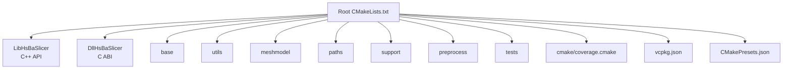
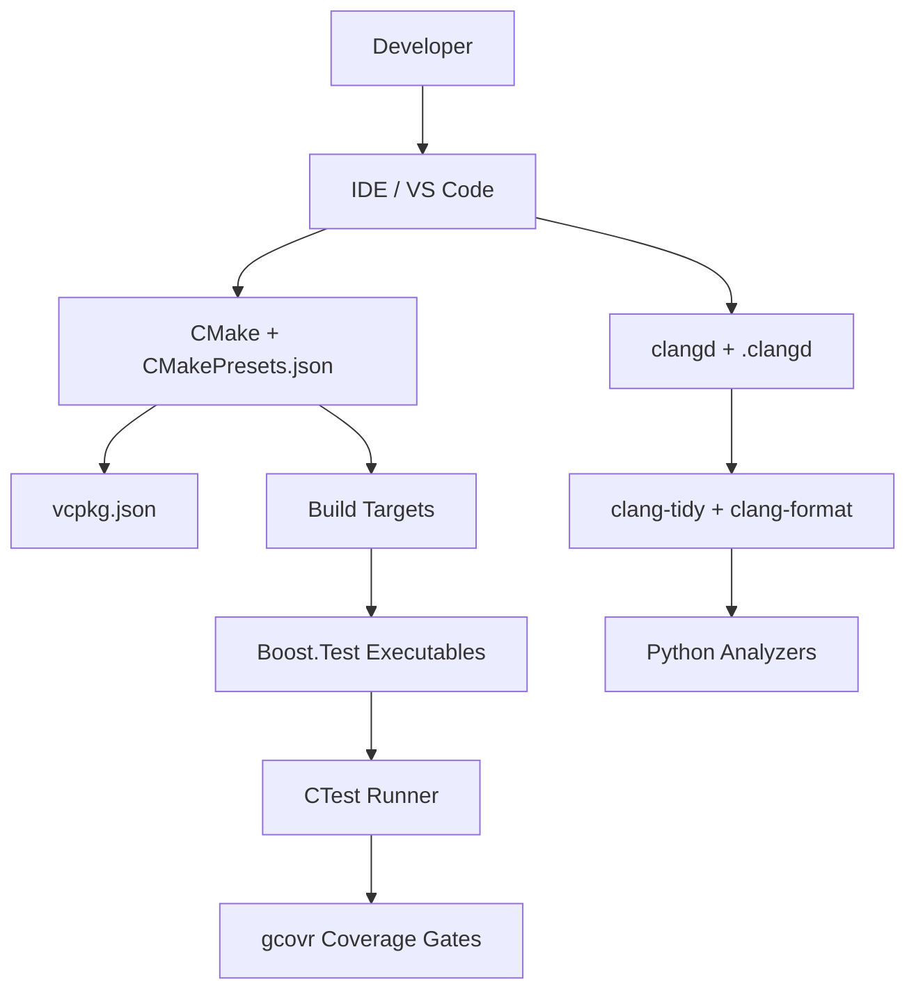
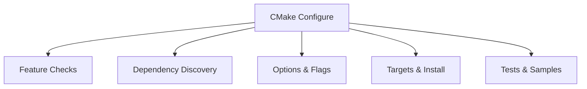
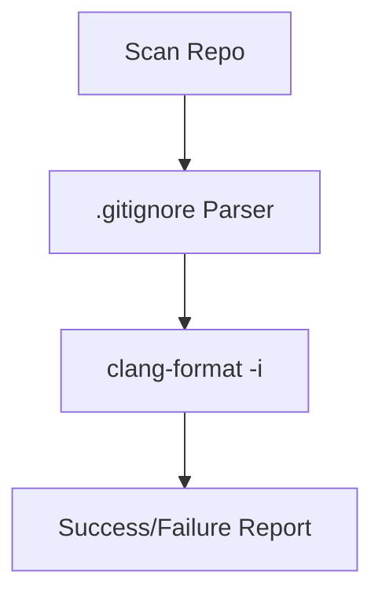
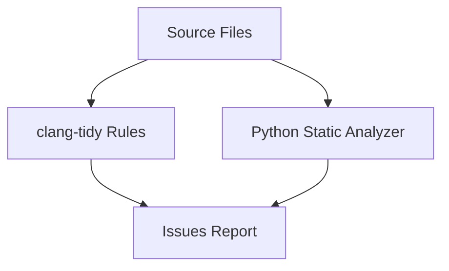
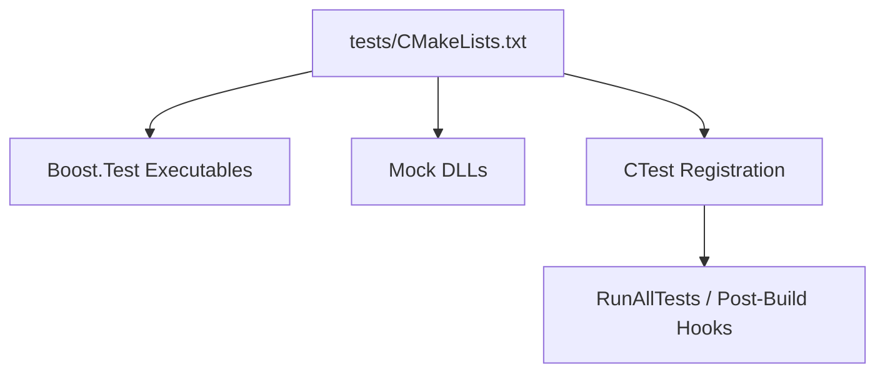
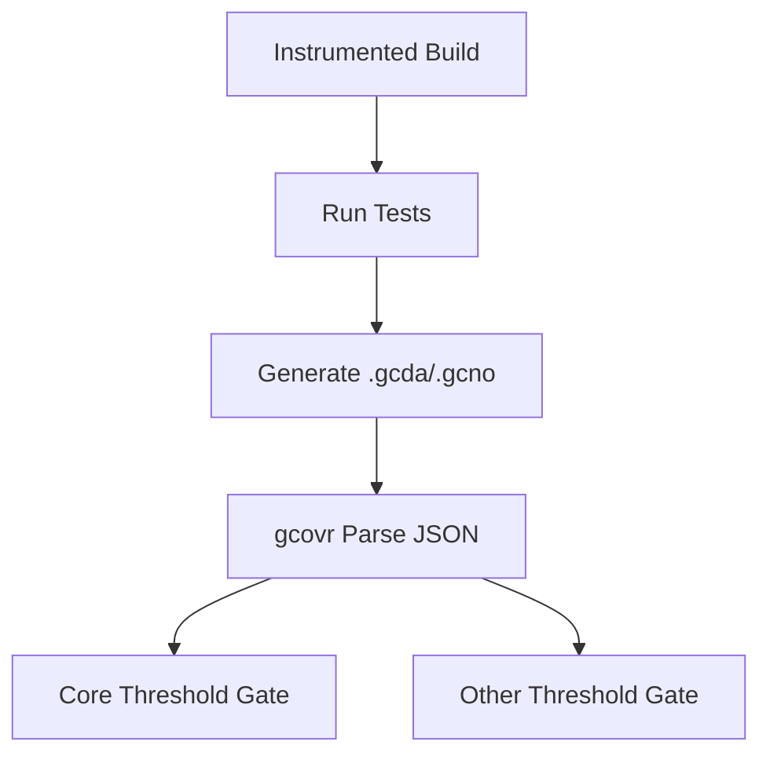
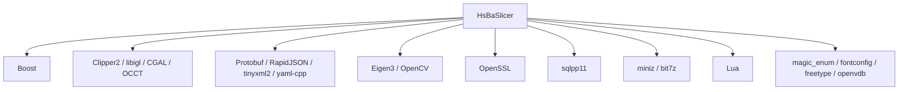

# Development, Testing & Contribution

<cite>
**Referenced Files in This Document**   
- [CMakeLists.txt](file://CMakeLists.txt)
- [CMakePresets.json](file://CMakePresets.json)
- [.clang-format](file://.clang-format)
- [.clang-tidy](file://.clang-tidy)
- [.clangd](file://.clangd)
- [vcpkg.json](file://vcpkg.json)
- [README.md](file://README.md)
- [cmake/coverage.cmake](file://cmake/coverage.cmake)
- [tests/CMakeLists.txt](file://tests/CMakeLists.txt)
- [static_check/cpp_analyzer.py](file://static_check/cpp_analyzer.py)
- [static_check/clang-format-batch.py](file://static_check/clang-format-batch.py)
</cite>

## Table of Contents
1. [Introduction](#introduction)
2. [Project Structure](#project-structure)
3. [Core Components](#core-components)
4. [Architecture Overview](#architecture-overview)
5. [Detailed Component Analysis](#detailed-component-analysis)
6. [Dependency Analysis](#dependency-analysis)
7. [Performance Considerations](#performance-considerations)
8. [Troubleshooting Guide](#troubleshooting-guide)
9. [Conclusion](#conclusion)
10. [Appendices](#appendices)

## Introduction
This document explains how to develop, test, and contribute to HsBaSlicer. It covers the CMake-based build system, IDE and clangd setup, code formatting and static analysis, testing with Boost.Test, coverage gating, performance and memory diagnostics, and contribution workflows. The goal is to help contributors set up a reliable local environment, run tests consistently, maintain code quality, and submit changes that pass automated checks.

HsBaSlicer is a modular, cross-platform C++ framework for 3D-printing slicers. Its build configuration enforces modern C++ standards, optional copyleft kernels, platform-specific features, and comprehensive install/export targets.

**Section sources**
- [README.md:21-39](file://README.md#L21-L39)
- [CMakeLists.txt:4-44](file://CMakeLists.txt#L4-L44)

## Project Structure
The repository is organized by feature modules and build targets:

- Core libraries: `base`, `utils`, `cipher`, `2D`, `paths`, `support`, `preprocess`, `meshmodel`, `pointcloud`, `cadmodel`, `pipelinetypes`, `convert`.
- Public interfaces: `LibHsBaSlicer` (C++ API), `DllHsBaSlicer` (C ABI).
- Tests: `tests` (Boost.Test executables), `static_tests` (compile-time checks).
- Tooling: `.clang-format`, `.clang-tidy`, `.clangd`, `static_check/`, `cmake/coverage.cmake`.
- Dependency manifest: `vcpkg.json`.
- Presets: `CMakePresets.json` for Windows/Linux/macOS/iOS/Android builds.



**Diagram sources**
- [CMakeLists.txt:410-440](file://CMakeLists.txt#L410-L440)
- [CMakeLists.txt:667-694](file://CMakeLists.txt#L667-L694)
- [CMakePresets.json:1-239](file://CMakePresets.json#L1-L239)
- [vcpkg.json:1-113](file://vcpkg.json#L1-L113)

**Section sources**
- [CMakeLists.txt:410-440](file://CMakeLists.txt#L410-L440)
- [CMakeLists.txt:667-694](file://CMakeLists.txt#L667-L694)
- [README.md:25-39](file://README.md#L25-L39)

## Core Components
This section focuses on development tooling components:

- Build system: top-level CMake configuration, presets, vcpkg integration, and install/export.
- Code style and static analysis: clang-format, clang-tidy, clangd.
- Testing: Boost.Test executables, CTest registration, mock DLLs, coverage.
- Quality scripts: Python-based static analyzer and batch formatter.

Key responsibilities:
- Enforce C++20, compiler feature checks, and optional copyleft kernels.
- Provide consistent developer experience across platforms via presets.
- Gate coverage thresholds for core and other modules.
- Keep production code clean while excluding tests/samples from strict checks.

**Section sources**
- [CMakeLists.txt:4-104](file://CMakeLists.txt#L4-L104)
- [CMakeLists.txt:170-204](file://CMakeLists.txt#L170-L204)
- [CMakePresets.json:1-239](file://CMakePresets.json#L1-L239)
- [.clang-format:1-99](file://.clang-format#L1-L99)
- [.clang-tidy:1-96](file://.clang-tidy#L1-L96)
- [.clangd:1-118](file://.clangd#L1-L118)
- [cmake/coverage.cmake:1-173](file://cmake/coverage.cmake#L1-L173)
- [tests/CMakeLists.txt:1-800](file://tests/CMakeLists.txt#L1-L800)
- [tests/CMakeLists.txt:801-1508](file://tests/CMakeLists.txt#L801-L1508)

## Architecture Overview
The development workflow integrates CMake, vcpkg, Boost.Test, clang tools, and coverage gating.



**Diagram sources**
- [.clangd:1-118](file://.clangd#L1-L118)
- [CMakePresets.json:1-239](file://CMakePresets.json#L1-L239)
- [vcpkg.json:1-113](file://vcpkg.json#L1-L113)
- [cmake/coverage.cmake:1-173](file://cmake/coverage.cmake#L1-L173)
- [tests/CMakeLists.txt:1-800](file://tests/CMakeLists.txt#L1-L800)

## Detailed Component Analysis

### Build System Configuration with CMake
Top-level CMake configuration:
- Requires CMake >= 3.28 and sets C++20 as standard; C standard selection depends on compiler version.
- Enables position-independent code and Debug postfixes.
- Runs feature checks for concepts, ranges, source_location, NTTP class/float, template-template matching, coroutines, explicit this, and C23 constexpr. Missing required features fail configuration.
- Optional coverage instrumentation via HSBA_COVERAGE.
- Optional C++20 module wrapper via HSBA_SLICER_MODULE.
- Platform detection flags: desktop/mobile/game console.
- Copyleft kernel toggle (CGAL/OpenCascade) controlled by HSBA_COPL and vcpkg manifest features.
- Dependencies discovered via find_package/pkg-config: Boost, Clipper2, miniz/bit7z, Protobuf, RapidJSON, Eigen3, OpenSSL, OpenCV, libigl, OpenVDB, sqlpp11, Lua, tinyxml2, yaml-cpp, magic_enum.
- Output directories unified under bin/<CONFIG>.
- Install/export targets and headers configured for downstream consumers.
- Test enablement and sample building toggled via options.

Recommended usage:
- Use CMake presets for consistent configurations across platforms.
- For coverage, use the linux-coverage preset and run the coverage target after tests.



**Diagram sources**
- [CMakeLists.txt:4-104](file://CMakeLists.txt#L4-L104)
- [CMakeLists.txt:170-204](file://CMakeLists.txt#L170-L204)
- [CMakeLists.txt:206-350](file://CMakeLists.txt#L206-L350)
- [CMakeLists.txt:356-365](file://CMakeLists.txt#L356-L365)
- [CMakeLists.txt:456-694](file://CMakeLists.txt#L456-L694)

**Section sources**
- [CMakeLists.txt:4-104](file://CMakeLists.txt#L4-L104)
- [CMakeLists.txt:170-204](file://CMakeLists.txt#L170-L204)
- [CMakeLists.txt:206-350](file://CMakeLists.txt#L206-L350)
- [CMakeLists.txt:356-365](file://CMakeLists.txt#L356-L365)
- [CMakeLists.txt:456-694](file://CMakeLists.txt#L456-L694)

### IDE Setup Recommendations and Debugging Configuration
clangd integration:
- Compile database generated by CMake into out/build/<preset>/compile_commands.json.
- Link or configure CompilationDatabase path in .clangd.
- Remove MSVC-only flags incompatible with clangd; enforce C++20 standard.
- Enable clang-tidy diagnostics inside clangd using the project’s .clang-tidy rules.
- Suppress noisy diagnostics from vcpkg/system headers.
- Conditional rule disables clang-tidy in tests/samples/static_tests.

Debugging tips:
- Prefer Debug builds with symbols and disable boolean operations where CGAL/IGL are slow.
- Use CTest outputOnFailure to capture test logs.
- On Windows, ensure query-driver paths for cl.exe/clang-cl are correct if needed.

```mermaid
sequenceDiagram
Dev as "Developer"
VS as "VS Code / IDE"
Clangd as "clangd"
CC as "compile_commands.json"
Tidy as ".clang-tidy"
Dev->>VS : Open project
VS->>Clangd : Start with .clangd
Clangd->>CC : Read compile commands
Clangd->>Tidy : Load tidy rules
Clangd-->>VS : Diagnostics & IntelliSense
```

**Diagram sources**
- [.clangd:1-118](file://.clangd#L1-L118)
- [.clang-tidy:1-96](file://.clang-tidy#L1-L96)

**Section sources**
- [.clangd:1-118](file://.clangd#L1-L118)
- [.clang-tidy:1-96](file://.clang-tidy#L1-L96)

### Code Formatting Standards
clang-format:
- Allman brace style, 4-space indentation, column limit 120.
- Pointer/reference alignment left, include sorting case-sensitive, preserve include blocks.
- Strict spacing and line-break rules for readability.

Batch formatting:
- Script scans C/C++ files, respects .gitignore, excludes specific generated files, and runs clang-format in parallel.
- Supports dry-run mode and custom style overrides.



**Diagram sources**
- [.clang-format:1-99](file://.clang-format#L1-L99)
- [static_check/clang-format-batch.py:1-274](file://static_check/clang-format-batch.py#L1-L274)

**Section sources**
- [.clang-format:1-99](file://.clang-format#L1-L99)
- [static_check/clang-format-batch.py:1-274](file://static_check/clang-format-batch.py#L1-L274)

### Static Analysis and Style Enforcement
clang-tidy:
- Whitelist of check families with many exclusions tailored to the codebase.
- Header filter excludes vcpkg, third_parts, out/, tests/, samples/, static_tests/.
- CheckOptions tune auto usage, nullptr, override, readability, bugprone, performance, cppcoreguidelines, misc.

Custom static analyzer:
- Skips gitignored paths and test/example directories.
- Detects catch-all exceptions, unsafe functions, magic numbers, potential memory leaks near allocations, and high cyclomatic complexity.
- Outputs per-file issues with relative paths.



**Diagram sources**
- [.clang-tidy:1-96](file://.clang-tidy#L1-L96)
- [static_check/cpp_analyzer.py:1-383](file://static_check/cpp_analyzer.py#L1-L383)

**Section sources**
- [.clang-tidy:1-96](file://.clang-tidy#L1-L96)
- [static_check/cpp_analyzer.py:1-383](file://static_check/cpp_analyzer.py#L1-L383)

### Testing Framework Architecture
Testing strategy:
- Each test is a separate executable built against Boost.Test.
- CTest registers each test target; post-build hooks can run individual tests automatically.
- Mock DLLs simulate external plugins (point cloud, CAD model, dynamic loader) for runtime loading scenarios.
- Some tests conditionally build based on platform and feature flags (e.g., HSBA_COPL, HSBA_USE_DLL_LOADER).

Organization patterns:
- Tests mirror module structure: base, utils, cipher, fileoperator, meshmodel, paths, support, preprocess, polygon fill, spiral path, etc.
- Many tests link multiple internal libraries and Lua bindings where applicable.



**Diagram sources**
- [tests/CMakeLists.txt:1-800](file://tests/CMakeLists.txt#L1-L800)
- [tests/CMakeLists.txt:801-1508](file://tests/CMakeLists.txt#L801-L1508)

**Section sources**
- [tests/CMakeLists.txt:1-800](file://tests/CMakeLists.txt#L1-L800)
- [tests/CMakeLists.txt:801-1508](file://tests/CMakeLists.txt#L801-L1508)

### Performance Testing Approaches
Coverage-driven regression gates:
- Instrumentation via --coverage for GCC/Clang.
- gcovr parses data into JSON and enforces thresholds:
  - Core modules threshold (default 45%).
  - Other modules threshold (default 25%).
- Excludes tests, samples, static_tests, static_check, third_party, docs, out, build.
- Parallel workers configurable via HSBA_COVERAGE_JOBS.

Preset integration:
- linux-coverage preset enables coverage, disables samples/docs/static_tests, and turns off automatic test execution so CI can control reporting.



**Diagram sources**
- [cmake/coverage.cmake:1-173](file://cmake/coverage.cmake#L1-L173)
- [CMakePresets.json:86-113](file://CMakePresets.json#L86-L113)

**Section sources**
- [cmake/coverage.cmake:1-173](file://cmake/coverage.cmake#L1-L173)
- [CMakePresets.json:86-113](file://CMakePresets.json#L86-L113)

### Continuous Integration Setup
While CI definitions are not included here, the repository provides strong foundations for CI:
- CMake presets define reproducible configurations for Linux, Windows, macOS, iOS, Android.
- Coverage preset produces instrumented binaries and exposes a coverage target.
- Tests are registered with CTest and can be gated by coverage thresholds.
- Static analysis and formatting tools are available via clang-tidy and clang-format scripts.

Recommended CI steps:
- Select a preset (e.g., linux-release or linux-coverage).
- Build all targets.
- Run ctest.
- Generate coverage report and enforce thresholds.
- Run clang-tidy and clang-format checks.

**Section sources**
- [CMakePresets.json:1-239](file://CMakePresets.json#L1-L239)
- [cmake/coverage.cmake:1-173](file://cmake/coverage.cmake#L1-L173)
- [tests/CMakeLists.txt:1-800](file://tests/CMakeLists.txt#L1-L800)

### Contribution Workflow
Guidelines derived from repository structure and tooling:
- Branching: Create feature branches from main; keep PRs focused.
- Local checks before PR:
  - Format code with clang-format (use the batch script).
  - Run clang-tidy diagnostics via clangd or command line.
  - Build with relevant presets and run tests via ctest.
  - If changing core modules, run coverage and ensure thresholds pass.
- Documentation: Update README-style documentation where appropriate; keep bilingual consistency as per project policy.
- Backward compatibility: Preserve public headers installed under include/HsBaSlicer; avoid breaking C ABI in DllHsBaSlicer unless coordinated.

Best practices:
- Add tests for new functionality following existing patterns.
- Avoid adding dependencies without updating vcpkg.json and explaining rationale.
- Respect copyleft licensing implications when enabling CGAL/OpenCascade.

**Section sources**
- [README.md:192-211](file://README.md#L192-L211)
- [vcpkg.json:1-113](file://vcpkg.json#L1-L113)
- [CMakeLists.txt:456-694](file://CMakeLists.txt#L456-L694)

### Development Best Practices
Adding new features:
- Implement logic in the appropriate module directory.
- Expose APIs through LibHsBaSlicer or DllHsBaSlicer as needed.
- Add corresponding tests under tests/<Feature>.
- Update tests/CMakeLists.txt to register the new test target.

Extending existing modules:
- Keep dependencies minimal; prefer header-only utilities where possible.
- Use existing abstractions (IModel, IPath, etc.) to maintain cohesion.
- Ensure install/export rules reflect new public headers.

Writing tests:
- Follow Boost.Test patterns used throughout tests/CMakeLists.txt.
- Use mock DLLs for runtime-loaded components when necessary.
- Keep tests deterministic; avoid network or filesystem state assumptions.

Maintaining backward compatibility:
- Do not change exported C ABI signatures in DllHsBaSlicer without deprecation planning.
- Keep installed headers stable; add new ones rather than renaming existing ones.

**Section sources**
- [tests/CMakeLists.txt:1-800](file://tests/CMakeLists.txt#L1-L800)
- [tests/CMakeLists.txt:801-1508](file://tests/CMakeLists.txt#L801-L1508)
- [CMakeLists.txt:456-694](file://CMakeLists.txt#L456-L694)

## Dependency Analysis
External dependencies and their roles:
- Boost: logging, locale, dll, multiprecision, date-time, property-tree, test, units, uuid, pfr, graph.
- Geometry and mesh: Clipper2, libigl, CGAL (optional copyleft), OpenCASCADE (optional copyleft).
- Data and serialization: Protobuf, RapidJSON, tinyxml2, yaml-cpp.
- Math and vision: Eigen3, OpenCV.
- Security and crypto: OpenSSL.
- Storage and SQL: sqlpp11 (SQLite3/MySQL/PostgreSQL on desktop; SQLite3 on mobile).
- Compression: miniz, bit7z (optional).
- Scripting: Lua.
- Utilities: magic_enum, fontconfig, freetype, openvdb.



**Diagram sources**
- [vcpkg.json:1-113](file://vcpkg.json#L1-L113)
- [CMakeLists.txt:206-350](file://CMakeLists.txt#L206-L350)

**Section sources**
- [vcpkg.json:1-113](file://vcpkg.json#L1-L113)
- [CMakeLists.txt:206-350](file://CMakeLists.txt#L206-L350)

## Performance Considerations
- Boolean operations may be disabled in Debug builds due to CGAL/IGL slowness and memory pressure.
- Model pool size adapts to copyleft kernel availability.
- Coverage instrumentation adds overhead; use release builds for performance profiling and debug builds for correctness.
- Parallelize gcovr parsing via HSBA_COVERAGE_JOBS on CI runners with limited memory.

Recommendations:
- Profile with Release builds and sanitizers where supported.
- Use targeted tests to isolate hot paths.
- Monitor memory usage with platform profilers and valgrind/AddressSanitizer if enabled.

**Section sources**
- [CMakeLists.txt:294-306](file://CMakeLists.txt#L294-L306)
- [cmake/coverage.cmake:33-36](file://cmake/coverage.cmake#L33-L36)

## Troubleshooting Guide
Common issues and resolutions:
- Compiler feature failures: Ensure a modern compiler supporting C++20 concepts, ranges, source_location, and template-template parameters.
- Missing dependencies: Verify vcpkg installation and manifest features; copyleft kernels require CGAL/OpenCascade.
- clangd diagnostics noise: Confirm .clangd settings and remove MSVC-only flags; rely on HeaderFilterRegex in .clang-tidy.
- Test failures: Check CTest output; some tests require mock DLLs to be present at runtime.
- Coverage gate failures: Increase coverage or add tests; adjust thresholds only with review.

Static analyzer warnings:
- Catch-all exceptions, unsafe functions, magic numbers, potential memory leaks, and high complexity are flagged.
- Use the Python analyzer to generate reports and fix issues systematically.

Formatting issues:
- Run the batch clang-format script to align code style across the repository.

**Section sources**
- [CMakeLists.txt:4-104](file://CMakeLists.txt#L4-L104)
- [.clangd:1-118](file://.clangd#L1-L118)
- [.clang-tidy:1-96](file://.clang-tidy#L1-L96)
- [tests/CMakeLists.txt:1-800](file://tests/CMakeLists.txt#L1-L800)
- [tests/CMakeLists.txt:801-1508](file://tests/CMakeLists.txt#L801-L1508)
- [cmake/coverage.cmake:1-173](file://cmake/coverage.cmake#L1-L173)
- [static_check/cpp_analyzer.py:1-383](file://static_check/cpp_analyzer.py#L1-L383)
- [static_check/clang-format-batch.py:1-274](file://static_check/clang-format-batch.py#L1-L274)

## Conclusion
HsBaSlicer provides a robust, modern C++ development environment with strong tooling for formatting, static analysis, testing, and coverage gating. By following the CMake presets, clangd configuration, and testing patterns, contributors can maintain high code quality and ensure backward compatibility. The repository’s structure and scripts make it straightforward to extend features, write tests, and integrate continuous integration pipelines.

## Appendices

### Quick Commands Reference
- Configure with preset: cmake --preset <presetName>
- Build: cmake --build out/build/<presetName> --config <Config>
- Run tests: ctest --test-dir out/build/<presetName> -V
- Coverage: cmake --preset linux-coverage && cmake --build out/build/linux-coverage && ctest --test-dir out/build/linux-coverage && cmake --build out/build/linux-coverage --target coverage
- Format: python static_check/clang-format-batch.py -p . -j 8
- Static analysis: clang-tidy --p=out/build/<presetName>/compile_commands.json src/*.cpp

**Section sources**
- [CMakePresets.json:1-239](file://CMakePresets.json#L1-L239)
- [cmake/coverage.cmake:1-173](file://cmake/coverage.cmake#L1-L173)
- [static_check/clang-format-batch.py:1-274](file://static_check/clang-format-batch.py#L1-L274)