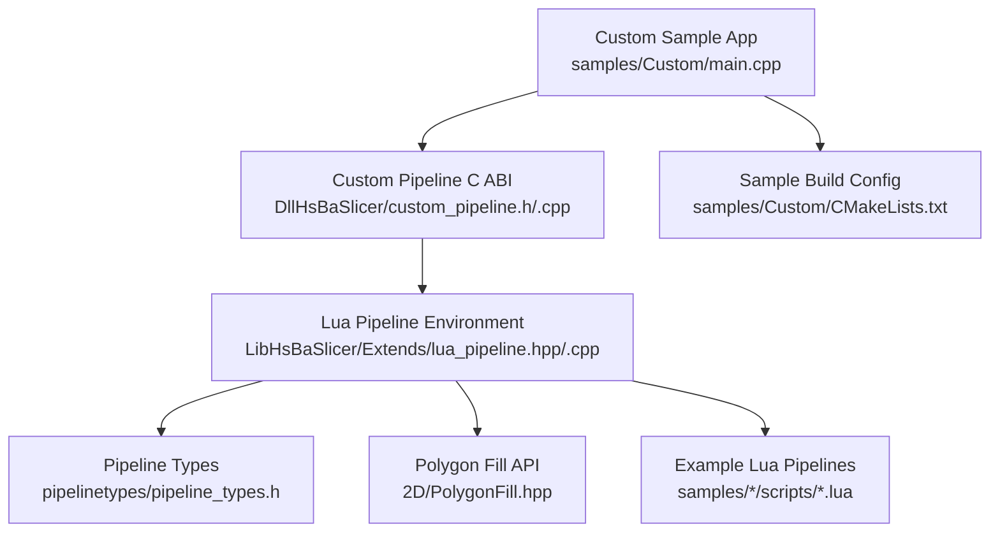
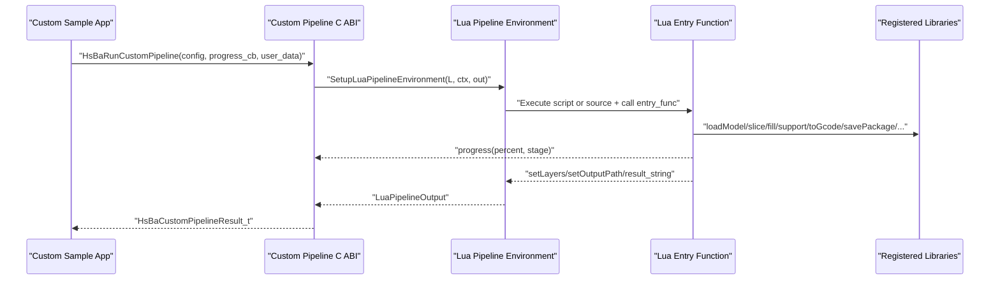
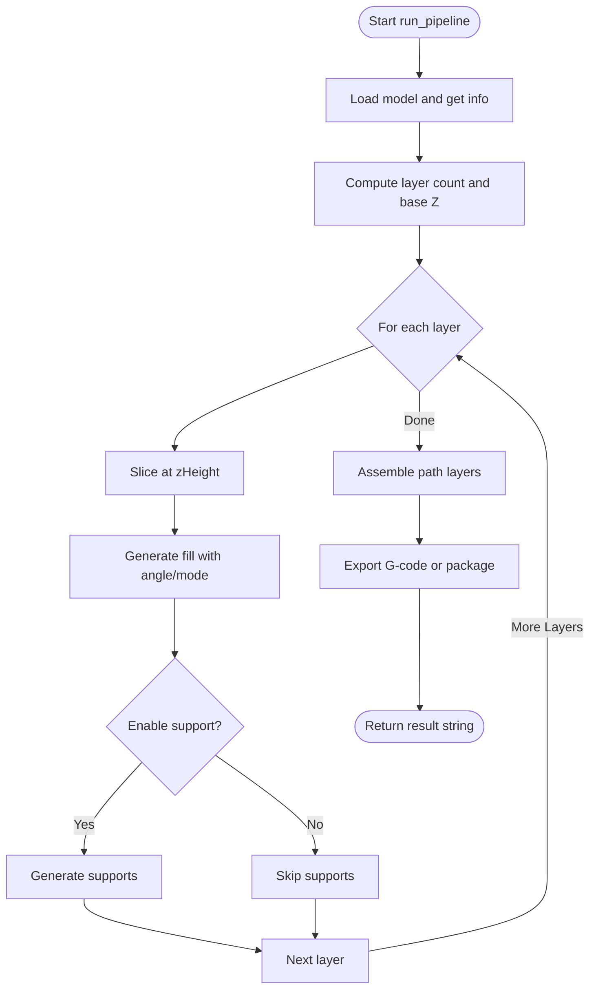
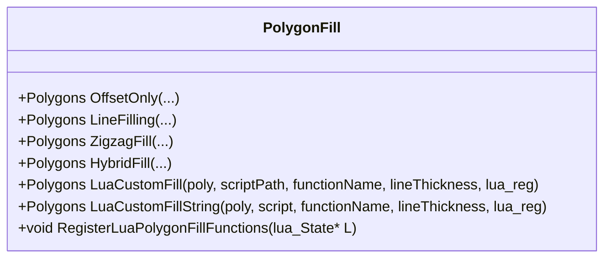
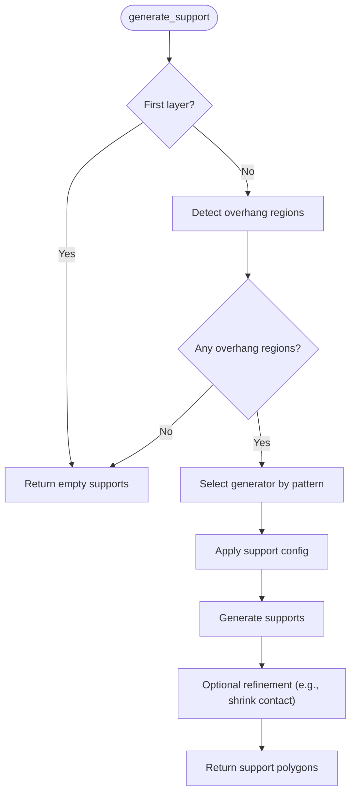
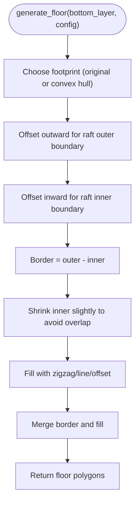
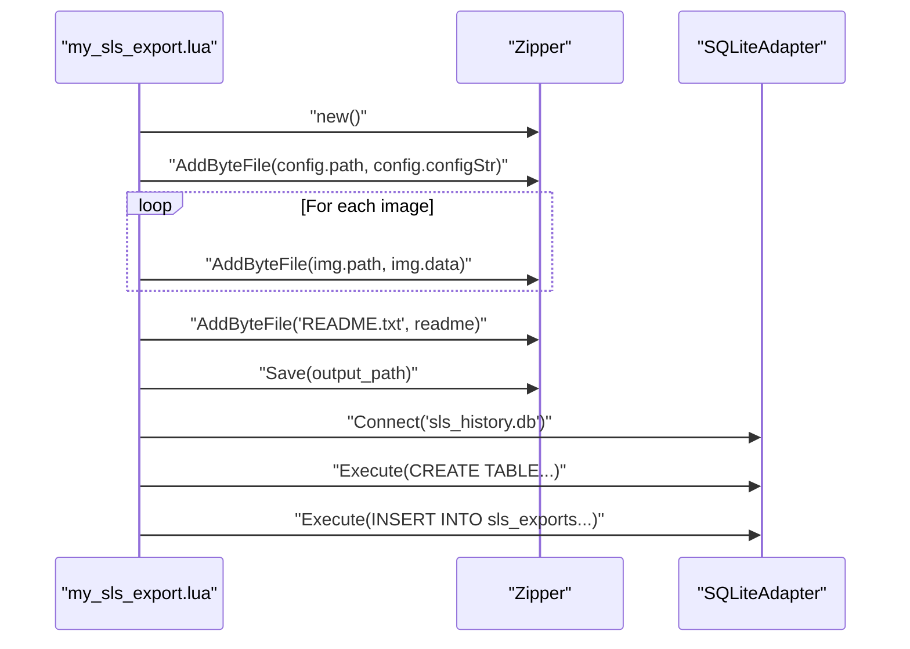
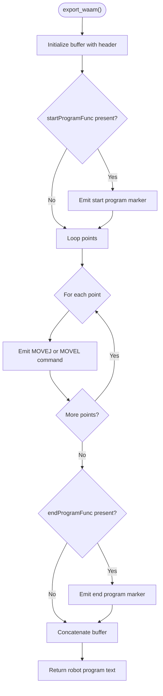
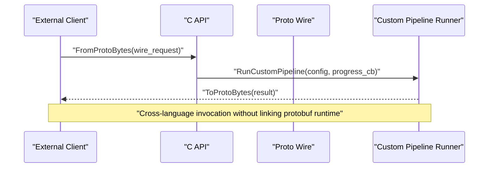
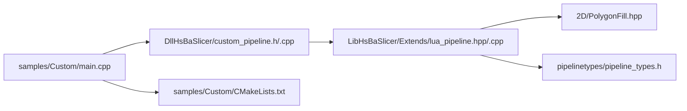

# Advanced Examples

<cite>
**Referenced Files in This Document**   
- [README.md](file://README.md)
- [custom_pipeline.h](file://DllHsBaSlicer/custom_pipeline.h)
- [custom_pipeline.cpp](file://DllHsBaSlicer/custom_pipeline.cpp)
- [lua_pipeline.hpp](file://LibHsBaSlicer/Extends/lua_pipeline.hpp)
- [lua_pipeline.cpp](file://LibHsBaSlicer/Extends/lua_pipeline.cpp)
- [pipeline_types.h](file://pipelinetypes/pipeline_types.h)
- [main.cpp](file://samples/Custom/main.cpp)
- [CMakeLists.txt](file://samples/Custom/CMakeLists.txt)
- [my_fdm_pipeline.lua](file://samples/Custom/scripts/my_fdm_pipeline.lua)
- [my_sls_export.lua](file://samples/SLS/scripts/my_sls_export.lua)
- [my_infill.lua](file://samples/FDM/scripts/my_infill.lua)
- [my_support.lua](file://samples/FDM/scripts/my_support.lua)
- [my_sla_floor.lua](file://samples/SLA/scripts/my_sla_floor.lua)
- [my_sla_support.lua](file://samples/SLA/scripts/my_sla_support.lua)
- [my_waam_path.lua](file://samples/WAAM/scripts/my_waam_path.lua)
- [PolygonFill.hpp](file://2D/PolygonFill.hpp)
- [thread_pool.hpp](file://base/thread_pool.hpp)
- [memory_pool.hpp](file://base/memory_pool.hpp)
</cite>

## Table of Contents
1. [Introduction](#introduction)
2. [Project Structure](#project-structure)
3. [Core Components](#core-components)
4. [Architecture Overview](#architecture-overview)
5. [Detailed Component Analysis](#detailed-component-analysis)
6. [Dependency Analysis](#dependency-analysis)
7. [Performance Considerations](#performance-considerations)
8. [Troubleshooting Guide](#troubleshooting-guide)
9. [Conclusion](#conclusion)
10. [Appendices](#appendices)

## Introduction
This document provides advanced customization and extension examples for HsBaSlicer, focusing on:
- Creating completely new processing workflows through the fully Lua-driven custom pipeline.
- Performance optimization techniques including parallel processing, memory management, and algorithm tuning.
- Multi-threading usage patterns and best practices.
- Custom Lua scripts for fill patterns, support generation, SLA floor generation, export formats, and robot path generation.
- Integration patterns with external systems via C ABI, Protobuf wire serialization, file operations, and database adapters.

HsBaSlicer is a modular, cross-platform 3D printing slicer framework exposing both a C++ static library interface and a C ABI dynamic library for external integration. The custom pipeline allows the entire workflow to be defined by Lua, while C++ exposes model loading, slicing, support, fill, floor, path output, packaging, and utility libraries.

**Section sources**
- [README.md:21-39](file://README.md#L21-L39)

## Project Structure
The advanced examples live primarily under `samples`, with core pipeline glue in `DllHsBaSlicer` and `LibHsBaSlicer`. Key locations:
- Custom pipeline C ABI: `DllHsBaSlicer/custom_pipeline.{h,cpp}`
- Lua pipeline environment: `LibHsBaSlicer/Extends/lua_pipeline.{hpp,cpp}`
- Pipeline types: `pipelinetypes/pipeline_types.h`
- Custom pipeline sample entry point: `samples/Custom/main.cpp`
- Sample build configuration: `samples/Custom/CMakeLists.txt`
- Example Lua pipelines and extensions: `samples/Custom/scripts/*`, `samples/FDM/scripts/*`, `samples/SLA/scripts/*`, `samples/SLS/scripts/*`, `samples/WAAM/scripts/*`
- Polygon fill API surface: `2D/PolygonFill.hpp`
- Threading and memory utilities: `base/thread_pool.hpp`, `base/memory_pool.hpp`

**Diagram sources**
- [main.cpp:1-33](file://samples/Custom/main.cpp#L1-L33)
- [custom_pipeline.h:1-69](file://DllHsBaSlicer/custom_pipeline.h#L1-L69)
- [lua_pipeline.hpp:1-88](file://LibHsBaSlicer/Extends/lua_pipeline.hpp#L1-L88)
- [pipeline_types.h:675-726](file://pipelinetypes/pipeline_types.h#L675-L726)
- [PolygonFill.hpp:96-140](file://2D/PolygonFill.hpp#L96-L140)
- [CMakeLists.txt:1-51](file://samples/Custom/CMakeLists.txt#L1-L51)

**Section sources**
- [README.md:103-124](file://README.md#L103-L124)
- [custom_pipeline.h:1-69](file://DllHsBaSlicer/custom_pipeline.h#L1-L69)
- [lua_pipeline.hpp:1-88](file://LibHsBaSlicer/Extends/lua_pipeline.hpp#L1-L88)
- [pipeline_types.h:675-726](file://pipelinetypes/pipeline_types.h#L675-L726)
- [main.cpp:1-33](file://samples/Custom/main.cpp#L1-L33)
- [CMakeLists.txt:1-51](file://samples/Custom/CMakeLists.txt#L1-L51)

## Core Components
- Custom Pipeline C ABI: Provides synchronous and asynchronous execution of fully Lua-defined workflows, progress callbacks, and result handling.
- Lua Pipeline Environment: Builds a Lua state, registers common types and libraries (polygon operations, support, fill, path generators, file/cipher/database adapters), and exposes the global `HsBa` table.
- Pipeline Types: Defines C-compatible structs for custom pipeline configuration and results, plus progress callback signatures.
- Polygon Fill API: Exposes built-in fill algorithms and Lua-custom fill entry points.
- Sample Application: Demonstrates multiple scenarios including FDM, SLS, SLM, LOM, 3DP, WAAM, inline Lua source, async execution, and Protobuf wire-based invocation.

Key responsibilities:
- C ABI layer converts between C structures and internal Lua pipeline context/output.
- Lua environment wires up all building blocks so scripts can orchestrate arbitrary stage order.
- Samples show how to pass machine parameters via inline Lua source and JSON config strings.

**Section sources**
- [custom_pipeline.h:17-62](file://DllHsBaSlicer/custom_pipeline.h#L17-L62)
- [lua_pipeline.hpp:19-83](file://LibHsBaSlicer/Extends/lua_pipeline.hpp#L19-L83)
- [pipeline_types.h:675-726](file://pipelinetypes/pipeline_types.h#L675-L726)
- [PolygonFill.hpp:106-136](file://2D/PolygonFill.hpp#L106-L136)

## Architecture Overview
The custom pipeline architecture separates control flow (Lua script) from infrastructure (C++). The C++ side prepares the environment and executes the Lua entry function; the Lua script decides which stages to run and in what order.

**Diagram sources**
- [custom_pipeline.cpp:117-126](file://DllHsBaSlicer/custom_pipeline.cpp#L117-L126)
- [lua_pipeline.hpp:53-83](file://LibHsBaSlicer/Extends/lua_pipeline.hpp#L53-L83)
- [main.cpp:100-131](file://samples/Custom/main.cpp#L100-L131)

## Detailed Component Analysis

### Fully Lua-Driven Custom Pipeline
The custom pipeline lets you define an entire workflow in Lua. C++ only provides the environment and building blocks. You can:
- Load models, compute layers, slice at Z heights.
- Generate fills per layer with custom angles and modes.
- Generate supports conditionally based on overhang detection.
- Assemble paths and export G-code or package data.
- Report progress and set output metadata.

**Diagram sources**
- [my_fdm_pipeline.lua:52-170](file://samples/Custom/scripts/my_fdm_pipeline.lua#L52-L170)

**Section sources**
- [custom_pipeline.h:23-40](file://DllHsBaSlicer/custom_pipeline.h#L23-L40)
- [lua_pipeline.hpp:22-38](file://LibHsBaSlicer/Extends/lua_pipeline.hpp#L22-L38)
- [my_fdm_pipeline.lua:1-22](file://samples/Custom/scripts/my_fdm_pipeline.lua#L1-L22)
- [my_fdm_pipeline.lua:52-170](file://samples/Custom/scripts/my_fdm_pipeline.lua#L52-L170)

### Custom Fill Patterns
You can implement custom fill patterns using Lua. The fill API supports:
- Built-in fill functions (offset, line, zigzag, composite, hybrid).
- Lua-custom fill via script file or inline code.
- Access to polygon operations for intersection, union, offset, area, etc.

**Diagram sources**
- [PolygonFill.hpp:96-140](file://2D/PolygonFill.hpp#L96-L140)

**Section sources**
- [PolygonFill.hpp:96-140](file://2D/PolygonFill.hpp#L96-L140)
- [my_infill.lua:1-89](file://samples/FDM/scripts/my_infill.lua#L1-L89)

### Custom Support Generation
Support generation can be customized per layer using built-in detectors and generators:
- Detect overhang regions given current and previous layers.
- Choose generator type (plane, tree, honeycomb, SLA).
- Apply default or tuned configuration.
- Optionally refine support polygons.

**Diagram sources**
- [my_support.lua:32-82](file://samples/FDM/scripts/my_support.lua#L32-L82)
- [my_sla_support.lua:34-75](file://samples/SLA/scripts/my_sla_support.lua#L34-L75)

**Section sources**
- [my_support.lua:1-83](file://samples/FDM/scripts/my_support.lua#L1-L83)
- [my_sla_support.lua:1-76](file://samples/SLA/scripts/my_sla_support.lua#L1-L76)

### SLA Floor Generation
Custom SLA floor generation composes raft borders and internal fills:
- Use convex hull or original footprint.
- Offset outward/inward to create border rings.
- Fill interior with zigzag or other patterns.
- Combine border and fill into final floor polygons.

**Diagram sources**
- [my_sla_floor.lua:35-62](file://samples/SLA/scripts/my_sla_floor.lua#L35-L62)

**Section sources**
- [my_sla_floor.lua:1-64](file://samples/SLA/scripts/my_sla_floor.lua#L1-L64)

### Export Format Customization (SLS Packaging)
SLS export scripts can package layer outlines and configuration into archives and optionally register records in databases:
- Create zip archive.
- Write configuration and per-layer polygon JSON.
- Add README documentation.
- Save archive.
- Optionally connect to SQLite and insert export history.

**Diagram sources**
- [my_sls_export.lua:23-79](file://samples/SLS/scripts/my_sls_export.lua#L23-L79)

**Section sources**
- [my_sls_export.lua:1-80](file://samples/SLS/scripts/my_sls_export.lua#L1-L80)

### Robot Path Customization (WAAM)
WAAM path scripts generate robot program text from point lists:
- Iterate over points with velocity and move type.
- Emit robot commands (MoveJ/MoVEL) with positions and speeds.
- Wrap with start/end program markers if provided.

**Diagram sources**
- [my_waam_path.lua:17-45](file://samples/WAAM/scripts/my_waam_path.lua#L17-L45)

**Section sources**
- [my_waam_path.lua:1-46](file://samples/WAAM/scripts/my_waam_path.lua#L1-L46)

### Integration Patterns with External Systems
Integration patterns include:
- C ABI calls for synchronous/asynchronous pipeline execution.
- Progress callbacks to report percentage and stage descriptions.
- Protobuf wire serialization for cross-language requests/responses.
- File I/O and database adapters within Lua scripts.

**Diagram sources**
- [main.cpp:509-588](file://samples/Custom/main.cpp#L509-L588)
- [custom_pipeline.h:42-55](file://DllHsBaSlicer/custom_pipeline.h#L42-L55)

**Section sources**
- [main.cpp:509-588](file://samples/Custom/main.cpp#L509-L588)
- [custom_pipeline.h:42-55](file://DllHsBaSlicer/custom_pipeline.h#L42-L55)

## Dependency Analysis
The custom pipeline depends on:
- C ABI for configuration/result conversion and async execution.
- Lua environment registration for polygon operations, support, fill, path generators, and file/crypto/db adapters.
- Sample application wiring multiple scenarios and resource copying.

**Diagram sources**
- [main.cpp:1-33](file://samples/Custom/main.cpp#L1-L33)
- [custom_pipeline.h:1-69](file://DllHsBaSlicer/custom_pipeline.h#L1-L69)
- [lua_pipeline.hpp:1-88](file://LibHsBaSlicer/Extends/lua_pipeline.hpp#L1-L88)
- [PolygonFill.hpp:96-140](file://2D/PolygonFill.hpp#L96-L140)
- [pipeline_types.h:675-726](file://pipelinetypes/pipeline_types.h#L675-L726)
- [CMakeLists.txt:1-51](file://samples/Custom/CMakeLists.txt#L1-L51)

**Section sources**
- [main.cpp:1-33](file://samples/Custom/main.cpp#L1-L33)
- [custom_pipeline.h:1-69](file://DllHsBaSlicer/custom_pipeline.h#L1-L69)
- [lua_pipeline.hpp:1-88](file://LibHsBaSlicer/Extends/lua_pipeline.hpp#L1-L88)
- [PolygonFill.hpp:96-140](file://2D/PolygonFill.hpp#L96-L140)
- [pipeline_types.h:675-726](file://pipelinetypes/pipeline_types.h#L675-L726)
- [CMakeLists.txt:1-51](file://samples/Custom/CMakeLists.txt#L1-L51)

## Performance Considerations
Optimization strategies for HsBaSlicer customization:
- Parallel Processing:
  - Use ThreadPool to distribute independent tasks across worker threads.
  - Tune thread count to hardware concurrency or adjust for I/O-bound workloads.
  - Avoid submitting too many short tasks due to queue overhead.
- Memory Management:
  - Prefer MemoryPool/StaticMemoryPool for frequent small allocations.
  - Reuse pools where possible to reduce fragmentation.
  - Monitor used counts and capacity to prevent allocation failures.
- Algorithm Tuning:
  - Adjust fill spacing, angle rotation, and border counts to balance quality and speed.
  - Use convex hull simplification for large footprints when appropriate.
  - Filter support polygons by area thresholds to reduce post-processing cost.

Best practices:
- Batch operations where possible to minimize synchronization overhead.
- Keep Lua scripts efficient; avoid excessive per-layer computation in Lua when C++ alternatives exist.
- Profile critical loops and consider moving heavy computations to C++.

[No sources needed since this section provides general guidance]

## Troubleshooting Guide
Common issues and resolutions:
- Custom pipeline failure:
  - Check Lua error messages returned in result.error_message.
  - Validate that pipeline_lua_script or pipeline_lua_source is set correctly.
  - Ensure progress callbacks are invoked to track stage completion.
- Resource cleanup:
  - Always free custom pipeline results using HsBaFreeCustomPipelineResult.
  - Release strings allocated by FromProtoBytes using HsBaFreeCustomConfigStrings.
- Protobuf wire compatibility:
  - Ensure field numbers and wire types match proto definitions.
  - Avoid linking protobuf runtime in the same process as DllHsBaSlicer to prevent duplicate registration errors.

**Section sources**
- [custom_pipeline.h:57-62](file://DllHsBaSlicer/custom_pipeline.h#L57-L62)
- [main.cpp:554-559](file://samples/Custom/main.cpp#L554-L559)
- [main.cpp:560-588](file://samples/Custom/main.cpp#L560-L588)

## Conclusion
HsBaSlicer’s custom pipeline enables full workflow control via Lua while leveraging robust C++ infrastructure. By combining flexible scripting with performance-oriented C++ components, users can implement domain-specific slicing strategies, optimize throughput and memory usage, and integrate seamlessly with external systems. The provided samples demonstrate practical patterns for FDM, SLA, SLS, SLM, LOM, 3DP, and WAAM workflows, along with advanced techniques for parallelism, memory management, and cross-language communication.

[No sources needed since this section summarizes without analyzing specific files]

## Appendices

### API Reference Highlights
- Custom Pipeline C ABI:
  - HsBaCreateDefaultCustomConfig
  - HsBaRunCustomPipeline
  - HsBaRunCustomPipelineAsync
  - HsBaFreeCustomPipelineResult
- Lua Pipeline Context and Output:
  - LuaPipelineContext fields: script, script_file, entry_func, config_json, output_path, model_name, model_path, progress_cb
  - LuaPipelineOutput fields: success, total_layers, output_path, result_string, error_message
- Pipeline Types:
  - HsBaCustomPipelineConfig_t fields: pipeline_lua_script, pipeline_lua_source, entry_func, config_json, model_name, model_path, output_path
  - HsBaCustomPipelineResult_t fields: success, total_layers, output_path, result_string, error_message, elapsed_seconds

**Section sources**
- [custom_pipeline.h:17-62](file://DllHsBaSlicer/custom_pipeline.h#L17-L62)
- [lua_pipeline.hpp:19-83](file://LibHsBaSlicer/Extends/lua_pipeline.hpp#L19-L83)
- [pipeline_types.h:675-726](file://pipelinetypes/pipeline_types.h#L675-L726)