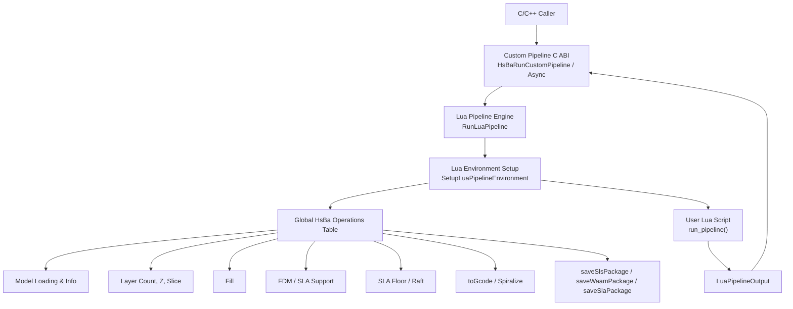
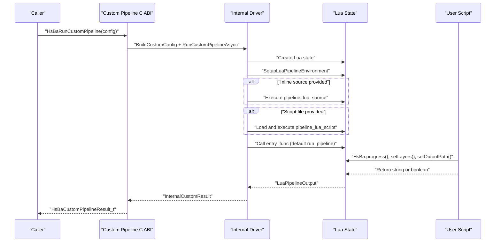
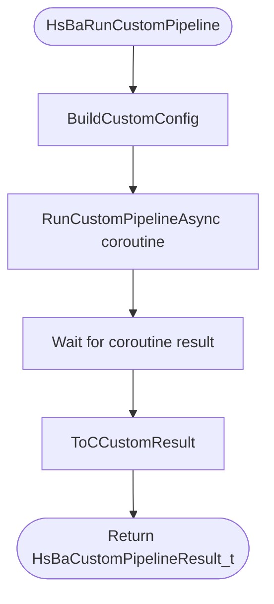
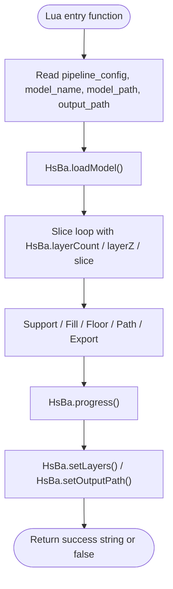
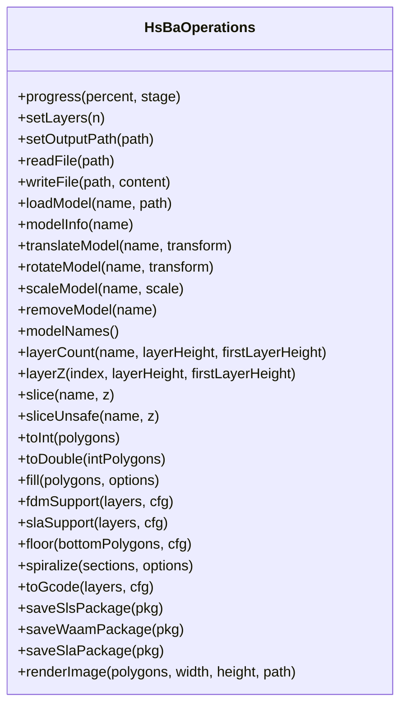
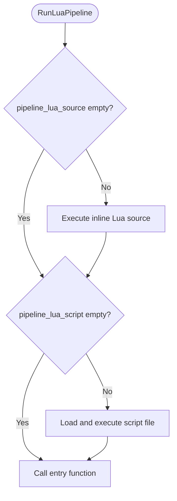
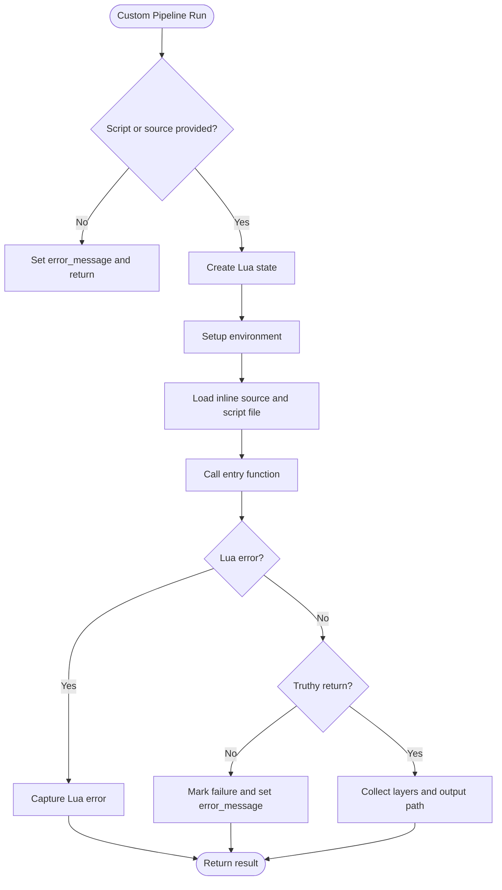
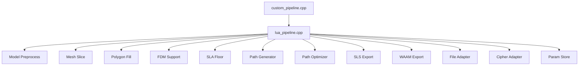

# Custom Pipeline Implementation

<cite>
**Referenced Files in This Document**
- [custom_pipeline.h](file://DllHsBaSlicer/custom_pipeline.h)
- [custom_pipeline.cpp](file://DllHsBaSlicer/custom_pipeline.cpp)
- [lua_pipeline.hpp](file://LibHsBaSlicer/Extends/lua_pipeline.hpp)
- [lua_pipeline.cpp](file://LibHsBaSlicer/Extends/lua_pipeline.cpp)
- [pipeline_types.h](file://pipelinetypes/pipeline_types.h)
- [custom_pipeline.proto](file://proto/custom_pipeline.proto)
- [my_fdm_pipeline.lua](file://samples/Custom/scripts/my_fdm_pipeline.lua)
- [my_sla_pipeline.lua](file://samples/Custom/scripts/my_sla_pipeline.lua)
- [my_sls_pipeline.lua](file://samples/Custom/scripts/my_sls_pipeline.lua)
- [my_lom_pipeline.lua](file://samples/Custom/scripts/my_lom_pipeline.lua)
- [my_tdp_pipeline.lua](file://samples/Custom/scripts/my_tdp_pipeline.lua)
- [my_waam_pipeline.lua](file://samples/Custom/scripts/my_waam_pipeline.lua)
</cite>

## Table of Contents
1. [Introduction](#introduction)
2. [Project Structure](#project-structure)
3. [Core Components](#core-components)
4. [Architecture Overview](#architecture-overview)
5. [Detailed Component Analysis](#detailed-component-analysis)
6. [Dependency Analysis](#dependency-analysis)
7. [Performance Considerations](#performance-considerations)
8. [Troubleshooting Guide](#troubleshooting-guide)
9. [Conclusion](#conclusion)
10. [Appendices](#appendices)

## Introduction
This document explains how to implement completely new processing workflows in HsBaSlicer using Lua scripts instead of fixed C++ pipelines. The custom pipeline lets you define the entire workflow order and content through a Lua entry function, while C++ only provides model loading, slicing, support generation, filling, path generation, packaging, and file operations through a global `HsBa` table.

The key concepts are:
- Use `HsBaCustomPipelineConfig_t` to configure script source or script file, entry function name, configuration JSON, model metadata, and default output path.
- Implement a `run_pipeline()` function in your Lua script; it is the default entry point.
- Call `HsBaRunCustomPipeline()` for synchronous execution or `HsBaRunCustomPipelineAsync()` for asynchronous execution.
- Report progress with `HsBa.progress()`, set layer count with `HsBa.setLayers()`, and set output path with `HsBa.setOutputPath()`.
- Use `HsBaFreeCustomPipelineResult()` to release result strings returned by the C API.

## Project Structure
The custom pipeline spans three layers:

| Layer | Responsibility | Key files |
|---|---|---|
| C ABI layer | Exposes `HsBaCreateDefaultCustomConfig`, `HsBaRunCustomPipeline`, `HsBaRunCustomPipelineAsync`, and `HsBaFreeCustomPipelineResult` | [custom_pipeline.h](file://DllHsBaSlicer/custom_pipeline.h), [custom_pipeline.cpp](file://DllHsBaSlicer/custom_pipeline.cpp) |
| Lua pipeline engine | Creates Lua state, installs environment, executes script, calls entry function, collects results | [lua_pipeline.hpp](file://LibHsBaSlicer/Extends/lua_pipeline.hpp), [lua_pipeline.cpp](file://LibHsBaSlicer/Extends/lua_pipeline.cpp) |
| Type definitions | Defines `HsBaCustomPipelineConfig_t`, `HsBaCustomPipelineResult_t`, callback types, and default initializers | [pipeline_types.h](file://pipelinetypes/pipeline_types.h), [custom_pipeline.proto](file://proto/custom_pipeline.proto) |
| Example scripts | Show FDM, SLA, SLS, LOM, TDP, and WAAM custom pipelines | [my_fdm_pipeline.lua](file://samples/Custom/scripts/my_fdm_pipeline.lua), [my_sla_pipeline.lua](file://samples/Custom/scripts/my_sla_pipeline.lua), [my_sls_pipeline.lua](file://samples/Custom/scripts/my_sls_pipeline.lua), [my_lom_pipeline.lua](file://samples/Custom/scripts/my_lom_pipeline.lua), [my_tdp_pipeline.lua](file://samples/Custom/scripts/my_tdp_pipeline.lua), [my_waam_pipeline.lua](file://samples/Custom/scripts/my_waam_pipeline.lua) |

**Diagram sources**
- [custom_pipeline.cpp:117-163](file://DllHsBaSlicer/custom_pipeline.cpp#L117-L163)
- [lua_pipeline.cpp:903-1043](file://LibHsBaSlicer/Extends/lua_pipeline.cpp#L903-L1043)
- [lua_pipeline.cpp:830-860](file://LibHsBaSlicer/Extends/lua_pipeline.cpp#L830-L860)

**Section sources**
- [custom_pipeline.h:17-62](file://DllHsBaSlicer/custom_pipeline.h#L17-L62)
- [custom_pipeline.cpp:171-212](file://DllHsBaSlicer/custom_pipeline.cpp#L171-L212)
- [lua_pipeline.hpp:19-83](file://LibHsBaSlicer/Extends/lua_pipeline.hpp#L19-L83)
- [pipeline_types.h:676-732](file://pipelinetypes/pipeline_types.h#L676-L732)

## Core Components
The custom pipeline has two main configuration/result structures and one core runtime context.

### HsBaCustomPipelineConfig_t
This structure configures how the fully Lua-driven pipeline is loaded and executed.

| Field | Type | Meaning | Default behavior |
|---|---|---|---|
| `pipeline_lua_script` | `const char*` | Path to the Lua script file containing `run_pipeline()` | Required unless `pipeline_lua_source` is set |
| `pipeline_lua_source` | `const char*` | Inline Lua source executed before the script file | Optional prelude for injecting parameters such as `machine` |
| `entry_func` | `const char*` | Name of the Lua entry function | Defaults to `"run_pipeline"` |
| `config_json` | `const char*` | Free-form JSON string exposed to Lua as `pipeline_config` | Optional |
| `model_name` | `const char*` | Model name exposed to Lua as `model_name` | Optional |
| `model_path` | `const char*` | Model file path exposed to Lua as `model_path` | Optional |
| `output_path` | `const char*` | Default output path exposed to Lua as `output_path` | Optional |

The default initializer is `HsBaCustomConfigDefault()`, which sets all string fields to NULL.

### HsBaCustomPipelineResult_t
This structure reports the outcome of a custom pipeline run.

| Field | Type | Meaning |
|---|---|---|
| `success` | `int` | Success flag (0=false, 1=true) |
| `total_layers` | `int` | Layer count reported by the Lua script via `HsBa.setLayers()` |
| `output_path` | `char*` | Output path reported by the Lua script via `HsBa.setOutputPath()` |
| `result_string` | `char*` | String returned by the Lua entry function |
| `error_message` | `char*` | Error message from Lua or pipeline validation |
| `elapsed_seconds` | `double` | Total elapsed time in seconds |

The caller must call `HsBaFreeCustomPipelineResult()` to free the allocated string fields.

### LuaPipelineContext and LuaPipelineOutput
At the C++ library level, the custom pipeline uses:

- `LuaPipelineContext`: holds inline script, script file, entry function, configuration JSON, model metadata, output path, and progress callback.
- `LuaPipelineOutput`: holds success, total layers, output path, result string, and error message.

These are not directly part of the public C ABI but are used by `RunLuaPipeline()` and wrapped by the C ABI into `HsBaCustomPipelineResult_t`.

**Section sources**
- [pipeline_types.h:676-732](file://pipelinetypes/pipeline_types.h#L676-L732)
- [pipeline_types.h:968-983](file://pipelinetypes/pipeline_types.h#L968-L983)
- [lua_pipeline.hpp:19-51](file://LibHsBaSlicer/Extends/lua_pipeline.hpp#L19-L51)

## Architecture Overview
The custom pipeline architecture separates control flow from implementation:

1. The caller constructs `HsBaCustomPipelineConfig_t`.
2. The C ABI validates that either `pipeline_lua_script` or `pipeline_lua_source` is provided.
3. The C++ driver builds an internal configuration and creates a `LuaPipelineContext`.
4. `RunLuaPipeline()` creates a fresh Lua state, installs standard libraries, registers common types, and exposes the `HsBa` operations table.
5. If `pipeline_lua_source` is present, it is executed first as a prelude.
6. If `pipeline_lua_script` is present, it is then executed.
7. The entry function (default `run_pipeline`) is called.
8. The script may call `HsBa.progress()`, `HsBa.setLayers()`, and `HsBa.setOutputPath()`.
9. The return value determines success; a string return becomes `result_string`.
10. The C ABI converts the internal result into `HsBaCustomPipelineResult_t`.

**Diagram sources**
- [custom_pipeline.cpp:117-163](file://DllHsBaSlicer/custom_pipeline.cpp#L117-L163)
- [lua_pipeline.cpp:960-1043](file://LibHsBaSlicer/Extends/lua_pipeline.cpp#L960-L1043)

**Section sources**
- [custom_pipeline.cpp:86-163](file://DllHsBaSlicer/custom_pipeline.cpp#L86-L163)
- [lua_pipeline.cpp:960-1043](file://LibHsBaSlicer/Extends/lua_pipeline.cpp#L960-L1043)

## Detailed Component Analysis

### HsBa Custom Pipeline C ABI
The C ABI exposes four primary functions:

| Function | Purpose | Notes |
|---|---|---|
| `HsBaCreateDefaultCustomConfig()` | Returns a default-initialized `HsBaCustomPipelineConfig_t` | Delegates to `HsBaCustomConfigDefault()` |
| `HsBaRunCustomPipeline()` | Runs the custom pipeline synchronously | Uses coroutine-based async implementation internally |
| `HsBaRunCustomPipelineAsync()` | Runs the custom pipeline asynchronously | Calls result callback when complete |
| `HsBaFreeCustomPipelineResult()` | Frees allocated strings in `HsBaCustomPipelineResult_t` | Must be called by caller |

The synchronous wrapper builds an internal configuration, runs the coroutine task, waits for completion, and converts the internal result to the C struct. The asynchronous wrapper shares the configuration and invokes the result callback after conversion.

**Diagram sources**
- [custom_pipeline.cpp:171-183](file://DllHsBaSlicer/custom_pipeline.cpp#L171-L183)
- [custom_pipeline.cpp:185-201](file://DllHsBaSlicer/custom_pipeline.cpp#L185-L201)
- [custom_pipeline.cpp:203-212](file://DllHsBaSlicer/custom_pipeline.cpp#L203-L212)

**Section sources**
- [custom_pipeline.h:17-62](file://DllHsBaSlicer/custom_pipeline.h#L17-L62)
- [custom_pipeline.cpp:171-212](file://DllHsBaSlicer/custom_pipeline.cpp#L171-L212)

### Lua Pipeline Environment and Entry Function Pattern
The Lua pipeline environment is created by `SetupLuaPipelineEnvironment()`. It:

1. Opens standard Lua libraries.
2. Installs common AnyObject types.
3. Registers 2D, 3D, and file operation adapters.
4. Registers polygon operations, support, polygon fill, path optimization, zipper, cipher, SQLite adapter, parameter store, optional Bit7z, MySQL, and PostgreSQL adapters.
5. Binds the run state to the Lua registry.
6. Creates the global `HsBa` table.
7. Injects context globals: `pipeline_config`, `output_path`, `model_name`, `model_path`, and `pipeline_entry`.

The entry function pattern is:

- Define a function named `run_pipeline()` unless `entry_func` is changed.
- Optionally read `pipeline_config`, `model_name`, `model_path`, `output_path`, and an optional `machine` table injected by `pipeline_lua_source`.
- Use `HsBa.*` operators to build the workflow.
- Call `HsBa.progress(percent, stage)` to report progress.
- Call `HsBa.setLayers(n)` to report total layers.
- Call `HsBa.setOutputPath(path)` to report the final output path.
- Return a truthy value on success; returning a string makes it available as `result_string`. Returning false or nil marks failure.

**Diagram sources**
- [lua_pipeline.cpp:903-958](file://LibHsBaSlicer/Extends/lua_pipeline.cpp#L903-L958)
- [lua_pipeline.cpp:998-1043](file://LibHsBaSlicer/Extends/lua_pipeline.cpp#L998-L1043)

**Section sources**
- [lua_pipeline.hpp:19-83](file://LibHsBaSlicer/Extends/lua_pipeline.hpp#L19-L83)
- [lua_pipeline.cpp:866-958](file://LibHsBaSlicer/Extends/lua_pipeline.cpp#L866-L958)
- [lua_pipeline.cpp:998-1043](file://LibHsBaSlicer/Extends/lua_pipeline.cpp#L998-L1043)

### Available HsBa Operator Functions
The global `HsBa` table exposes the following operators:

| Category | Operator | Input | Output | Purpose |
|---|---|---|---|---|
| Runtime | `progress(percent, stage?)` | Integer percent, optional stage string | None | Reports progress to the C++ callback |
| Result metadata | `setLayers(n)` | Integer layer count | None | Sets `total_layers` in the result |
| Result metadata | `setOutputPath(path)` | String path | None | Sets `output_path` in the result |
| File I/O | `readFile(path)` | String path | String or nil | Reads binary file content |
| File I/O | `writeFile(path, content)` | String path, string content | Boolean true | Writes binary content |
| Model management | `loadModel(name, path)` | String name, string path | Boolean true | Loads or reuses a model |
| Model management | `modelInfo(name)` | String name | Table with bbox_min, bbox_max, volume, layerHeight, firstLayerHeight | Gets model metadata |
| Model transform | `translateModel(name, {x,y,z})` | String name, vector table | None | Translates model |
| Model transform | `rotateModel(name, {x,y,z,w})` | String name, quaternion table | None | Rotates model |
| Model transform | `scaleModel(name, scalar_or_vector)` | String name, number or vector table | None | Scales model |
| Model management | `removeModel(name)` | String name | None | Removes model from pool |
| Model management | `modelNames()` | None | Array of names | Lists loaded models |
| Slicing helpers | `layerCount(name, layerHeight, firstLayerHeight)` | String name, numbers | Integer | Computes layer count |
| Slicing helpers | `layerZ(index0based, layerHeight, firstLayerHeight)` | Integer index, numbers | Number | Computes Z height |
| Slicing | `slice(name, z)` | String name, number | Polygons table | Safe closed-contour slice |
| Slicing | `sliceUnsafe(name, z)` | String name, number | Polygons table | Normalized slice, may drop open contours |
| Coordinate conversion | `toInt(polygons)` | Double polygons table | Integer polygons table | Converts double polygons to integer |
| Coordinate conversion | `toDouble(intPolygons)` | Integer polygons table | Double polygons table | Converts integer polygons to double |
| Filling | `fill(polygons, options?)` | Polygons table, optional options table | Polygons table | Generates fill paths |
| Support | `fdmSupport(layers, cfg)` | Layer list, FDM support config | Layer list | Generates FDM supports |
| Support | `slaSupport(layers, cfg)` | Layer list, SLA support config | Layer list | Generates SLA supports |
| Floor | `floor(bottomPolygons, cfg?)` | Polygons table, optional floor config | Integer polygons table | Generates SLA floor/raft |
| Path generation | `spiralize(sections, options?)` | Layer sections, optional options | Continuous 3D path array | Generates spiral outer wall |
| Path generation | `toGcode(layers, cfg)` | Layer path data array, G-code config | G-code string | Generates G-code |
| Packaging | `saveSlsPackage(table)` | Outlines, zHeights, config, output, script, func | Boolean | Packages SLS-style output |
| Packaging | `saveWaamPackage(table)` | Outlines, zHeights, weld, robotType, beadWidth, config, output, script, func | Boolean or boolean+error | Generates WAAM robot program |
| Packaging | `saveSlaPackage(table)` | Outlines, supports, floor, config, output, image settings | Boolean | Packages SLA layer images |
| Rendering | `renderImage(polygons, width, height, path)` | Polygons, integers, path | Boolean | Renders polygons to image |

#### Model Management Operators
- `loadModel(name, path)` loads a model if not already present.
- `modelInfo(name)` returns bounding box, volume, and layer-related metadata.
- `translateModel`, `rotateModel`, and `scaleModel` modify the model geometry.
- `removeModel(name)` removes the model from the pool.
- `modelNames()` lists all loaded models.

#### Slicing Operators
- `layerCount()` computes the number of layers based on model height, layer height, and first layer height.
- `layerZ()` computes the Z coordinate for a given layer index.
- `slice()` returns safe, closed contours.
- `sliceUnsafe()` returns normalized slices and may drop open contours.

#### Fill and Support Operators
- `fill()` accepts spacing, mode, angle, and border count. Supported modes include line, simple zigzag, and zigzag.
- `fdmSupport()` generates FDM supports with interface layers and density.
- `slaSupport()` generates SLA supports with tip diameter and raft thickness.

#### Path and Packaging Operators
- `spiralize()` turns per-layer outlines into a continuous rising 3D path.
- `toGcode()` consumes layer path data and printer configuration to produce G-code.
- `saveSlsPackage()` packages outlines and zHeights for powder-bed-like processes.
- `saveWaamPackage()` generates robot language programs for wire arc additive manufacturing.
- `saveSlaPackage()` packages SLA layer images, supports, and floor geometry.

**Diagram sources**
- [lua_pipeline.cpp:228-828](file://LibHsBaSlicer/Extends/lua_pipeline.cpp#L228-L828)
- [lua_pipeline.cpp:830-860](file://LibHsBaSlicer/Extends/lua_pipeline.cpp#L830-L860)

**Section sources**
- [lua_pipeline.cpp:228-828](file://LibHsBaSlicer/Extends/lua_pipeline.cpp#L228-L828)
- [lua_pipeline.cpp:830-860](file://LibHsBaSlicer/Extends/lua_pipeline.cpp#L830-L860)

### Step-by-Step Custom Pipeline Examples

#### FDM Custom Pipeline
The FDM example implements a full extrusion workflow:

1. Load model using `HsBa.loadModel()`.
2. Get model info and compute layer count.
3. Loop over layers, calling `HsBa.slice()` and `HsBa.fill()`.
4. Optionally generate FDM supports using `HsBa.fdmSupport()`.
5. Assemble layer path data with outlines, fills, supports, and z heights.
6. Generate G-code using `HsBa.toGcode()`.
7. Write output using `HsBa.writeFile()`.
8. Set output path and remove model.

Key behaviors:
- Uses `pipeline_config` and optional `machine` table for parameters.
- Rotates fill angles across layers.
- Reports progress during slicing, support generation, path generation, and file writing.

**Section sources**
- [my_fdm_pipeline.lua:1-172](file://samples/Custom/scripts/my_fdm_pipeline.lua#L1-L172)
- [lua_pipeline.cpp:401-447](file://LibHsBaSlicer/Extends/lua_pipeline.cpp#L401-L447)
- [lua_pipeline.cpp:482-508](file://LibHsBaSlicer/Extends/lua_pipeline.cpp#L482-L508)
- [lua_pipeline.cpp:512-526](file://LibHsBaSlicer/Extends/lua_pipeline.cpp#L512-L526)
- [lua_pipeline.cpp:622-691](file://LibHsBaSlicer/Extends/lua_pipeline.cpp#L622-L691)

#### SLA Custom Pipeline
The SLA example implements a resin vat workflow:

1. Load model and compute layers.
2. Slice each layer.
3. Generate SLA supports.
4. Generate floor/raft from the bottom layer.
5. Package layer images, supports, floor, and config using `HsBa.saveSlaPackage()`.
6. Set output path and remove model.

Key behaviors:
- Uses SLA-specific support parameters such as tip diameter and raft thickness.
- Configures image width, height, and extension.

**Section sources**
- [my_sla_pipeline.lua:1-105](file://samples/Custom/scripts/my_sla_pipeline.lua#L1-L105)
- [lua_pipeline.cpp:528-540](file://LibHsBaSlicer/Extends/lua_pipeline.cpp#L528-L540)
- [lua_pipeline.cpp:545-556](file://LibHsBaSlicer/Extends/lua_pipeline.cpp#L545-L556)
- [lua_pipeline.cpp:789-816](file://LibHsBaSlicer/Extends/lua_pipeline.cpp#L789-L816)

#### SLS Custom Pipeline
The SLS example implements a powder-bed laser sintering workflow:

1. Load model and compute layers.
2. Slice each layer.
3. Build process configuration including laser power, scan speed, hatch spacing, and bed temperature.
4. Package using `HsBa.saveSlsPackage()` with a separate export script.

Key behaviors:
- No supports or floor are generated because the powder bed provides support.
- Final format is determined by the export script referenced by `script` and `func`.

**Section sources**
- [my_sls_pipeline.lua:1-102](file://samples/Custom/scripts/my_sls_pipeline.lua#L1-L102)
- [lua_pipeline.cpp:695-728](file://LibHsBaSlicer/Extends/lua_pipeline.cpp#L695-L728)

#### LOM Custom Pipeline
The LOM example implements laminated object manufacturing:

1. Load model and compute layers.
2. Slice each layer.
3. Build cutting and bonding configuration.
4. Package using `HsBa.saveSlsPackage()` with a shared export script.

Key behaviors:
- Reuses the SLS packaging path because both are sheet/powder-based processes.
- Cutting mode can be contour or halftone.

**Section sources**
- [my_lom_pipeline.lua:1-92](file://samples/Custom/scripts/my_lom_pipeline.lua#L1-L92)
- [lua_pipeline.cpp:695-728](file://LibHsBaSlicer/Extends/lua_pipeline.cpp#L695-L728)

#### TDP Custom Pipeline
The TDP example implements binder jetting:

1. Load model and compute layers.
2. Slice each layer.
3. Build binder jetting configuration including head count, drop spacing, saturation, curing time, and binder mode.
4. Package using `HsBa.saveSlsPackage()`.

Key behaviors:
- Powder bed does not require supports or floor.
- Configuration describes print head and binder behavior.

**Section sources**
- [my_tdp_pipeline.lua:1-91](file://samples/Custom/scripts/my_tdp_pipeline.lua#L1-L91)
- [lua_pipeline.cpp:695-728](file://LibHsBaSlicer/Extends/lua_pipeline.cpp#L695-L728)

#### WAAM Custom Pipeline
The WAAM example implements wire arc additive manufacturing:

1. Load model and compute layers.
2. Slice each layer.
3. Build welding configuration including current, voltage, wire feed speed, gas flow rate, travel speed, and process type.
4. Generate robot program using `HsBa.saveWaamPackage()`.

Key behaviors:
- Output is a robot language program rather than a layer zip.
- Supports ABB, KUKA, FANUC, or custom robot code via optional script.
- On failure, `saveWaamPackage()` returns two values: boolean and error detail.

**Section sources**
- [my_waam_pipeline.lua:1-94](file://samples/Custom/scripts/my_waam_pipeline.lua#L1-L94)
- [lua_pipeline.cpp:730-787](file://LibHsBaSlicer/Extends/lua_pipeline.cpp#L730-L787)

### Script Files vs Inline Lua Source
There are two ways to provide the custom pipeline:

| Approach | Configuration field | Execution order | Typical use |
|---|---|---|---|
| Script file | `pipeline_lua_script` | Executed second | Main workflow logic |
| Inline source | `pipeline_lua_source` | Executed first as a prelude | Injecting parameters such as `machine` or helper functions |

The runner first executes inline source, then script file, then calls the entry function. This allows separating machine parameters from workflow logic.

**Diagram sources**
- [lua_pipeline.cpp:972-993](file://LibHsBaSlicer/Extends/lua_pipeline.cpp#L972-L993)

**Section sources**
- [lua_pipeline.cpp:972-993](file://LibHsBaSlicer/Extends/lua_pipeline.cpp#L972-L993)

### Error Handling Patterns
Error handling occurs at multiple levels:

| Level | Behavior |
|---|---|
| C ABI validation | If neither `pipeline_lua_script` nor `pipeline_lua_source` is set, the internal result contains an error message |
| Lua state creation | If Lua state creation fails, `error_message` is set |
| Script loading | If the script file cannot be opened, `error_message` includes the failed path |
| Entry function missing | If the entry function is not found, `error_message` identifies the missing function |
| Lua runtime error | Lua errors are captured and placed into `error_message` |
| Failure return | If the entry function returns false or nil without a result string, `error_message` indicates pipeline failure |
| Result ownership | Caller must call `HsBaFreeCustomPipelineResult()` to avoid memory leaks |

**Diagram sources**
- [custom_pipeline.cpp:127-133](file://DllHsBaSlicer/custom_pipeline.cpp#L127-L133)
- [lua_pipeline.cpp:960-1043](file://LibHsBaSlicer/Extends/lua_pipeline.cpp#L960-L1043)

**Section sources**
- [custom_pipeline.cpp:117-163](file://DllHsBaSlicer/custom_pipeline.cpp#L117-L163)
- [lua_pipeline.cpp:960-1043](file://LibHsBaSlicer/Extends/lua_pipeline.cpp#L960-L1043)

### Progress Reporting and Result Management
Progress reporting is controlled entirely by the Lua script through `HsBa.progress(percent, stage)`. The C++ side forwards this to the configured progress callback. The script should:

- Report early progress during model loading.
- Report incremental progress during slicing loops.
- Report major stages such as support generation, path generation, and export.
- Report completion at 100%.

Result management requires:

- Calling `HsBa.setLayers()` to report layer count.
- Calling `HsBa.setOutputPath()` to report output path.
- Returning a string on success so the caller receives `result_string`.
- Calling `HsBaFreeCustomPipelineResult()` after inspecting the result.

**Section sources**
- [lua_pipeline.cpp:228-256](file://LibHsBaSlicer/Extends/lua_pipeline.cpp#L228-L256)
- [lua_pipeline.cpp:1020-1034](file://LibHsBaSlicer/Extends/lua_pipeline.cpp#L1020-L1034)
- [custom_pipeline.cpp:203-212](file://DllHsBaSlicer/custom_pipeline.cpp#L203-L212)

## Dependency Analysis
The custom pipeline depends on several subsystems:

**Diagram sources**
- [custom_pipeline.cpp:14-16](file://DllHsBaSlicer/custom_pipeline.cpp#L14-L16)
- [lua_pipeline.cpp:17-39](file://LibHsBaSlicer/Extends/lua_pipeline.cpp#L17-L39)

**Section sources**
- [custom_pipeline.cpp:14-16](file://DllHsBaSlicer/custom_pipeline.cpp#L14-L16)
- [lua_pipeline.cpp:17-39](file://LibHsBaSlicer/Extends/lua_pipeline.cpp#L17-L39)

## Performance Considerations
- The custom pipeline runs inside a dedicated Lua state. Avoid keeping large temporary tables alive longer than necessary.
- Slicing and filling operate on polygon arrays; prefer processing layers incrementally rather than holding all layers in memory if possible.
- Use `HsBa.progress()` regularly for long-running loops so callers can detect stalled work.
- For very large models, consider whether `sliceUnsafe()` is appropriate; it normalizes polygons but may drop open contours.
- When generating G-code, keep layer path data minimal and pass only required fields.
- For asynchronous runs, ensure the result callback frees the result strings promptly.

[No sources needed since this section provides general guidance]

## Troubleshooting Guide
Common issues and resolutions:

| Symptom | Likely Cause | Resolution |
|---|---|---|
| Error message says custom pipeline requires script or source | Neither `pipeline_lua_script` nor `pipeline_lua_source` was set | Set at least one of them |
| Lua entry function not found | Entry function name differs from `entry_func` or is missing | Ensure `run_pipeline()` exists or set `entry_func` correctly |
| Failed to open Lua script file | Script path is invalid or inaccessible | Verify absolute or relative path |
| Lua error during execution | Syntax error, missing operator, or runtime exception in script | Inspect `error_message` and fix script |
| Pipeline reported failure | Entry function returned false or nil without a result string | Return a truthy value or string on success |
| Memory leak after run | Caller did not free result strings | Call `HsBaFreeCustomPipelineResult()` |
| No progress updates | Script did not call `HsBa.progress()` | Add progress calls at major steps |
| Wrong layer count | Script did not call `HsBa.setLayers()` | Call `setLayers()` after computing layers |
| Wrong output path | Script did not call `HsBa.setOutputPath()` | Call `setOutputPath()` after writing output |

**Section sources**
- [custom_pipeline.cpp:127-133](file://DllHsBaSlicer/custom_pipeline.cpp#L127-L133)
- [lua_pipeline.cpp:982-1010](file://LibHsBaSlicer/Extends/lua_pipeline.cpp#L982-L1010)
- [lua_pipeline.cpp:1031-1040](file://LibHsBaSlicer/Extends/lua_pipeline.cpp#L1031-L1040)
- [custom_pipeline.cpp:203-212](file://DllHsBaSlicer/custom_pipeline.cpp#L203-L212)

## Conclusion
The HsBaSlicer custom pipeline replaces fixed C++ workflow ordering with a flexible Lua-driven approach. By configuring `HsBaCustomPipelineConfig_t`, implementing `run_pipeline()`, and using the `HsBa` operator table, you can implement FDM, SLA, SLS, LOM, TDP, and WAAM workflows with full control over stage order, parameters, and output format. The C ABI provides synchronous and asynchronous execution, progress callbacks, and structured result management, while the Lua environment exposes model, slicing, support, fill, path, packaging, and file operations.

[No sources needed since this section summarizes without analyzing specific files]

## Appendices

### Quick Reference: Custom Pipeline Workflow Checklist
- Configure `HsBaCustomPipelineConfig_t`.
- Provide `pipeline_lua_script` or `pipeline_lua_source`.
- Implement `run_pipeline()` in Lua.
- Load model with `HsBa.loadModel()`.
- Compute layers with `HsBa.layerCount()` and `HsBa.layerZ()`.
- Slice with `HsBa.slice()` or `HsBa.sliceUnsafe()`.
- Generate supports with `HsBa.fdmSupport()` or `HsBa.slaSupport()`.
- Generate fill with `HsBa.fill()`.
- Generate floor with `HsBa.floor()` for SLA.
- Generate paths with `HsBa.toGcode()` or `HsBa.spiralize()`.
- Export with `HsBa.saveSlsPackage()`, `HsBa.saveWaamPackage()`, or `HsBa.saveSlaPackage()`.
- Report progress with `HsBa.progress()`.
- Set metadata with `HsBa.setLayers()` and `HsBa.setOutputPath()`.
- Free result with `HsBaFreeCustomPipelineResult()`.

**Section sources**
- [pipeline_types.h:676-732](file://pipelinetypes/pipeline_types.h#L676-L732)
- [lua_pipeline.cpp:228-828](file://LibHsBaSlicer/Extends/lua_pipeline.cpp#L228-L828)
- [custom_pipeline.cpp:171-212](file://DllHsBaSlicer/custom_pipeline.cpp#L171-L212)