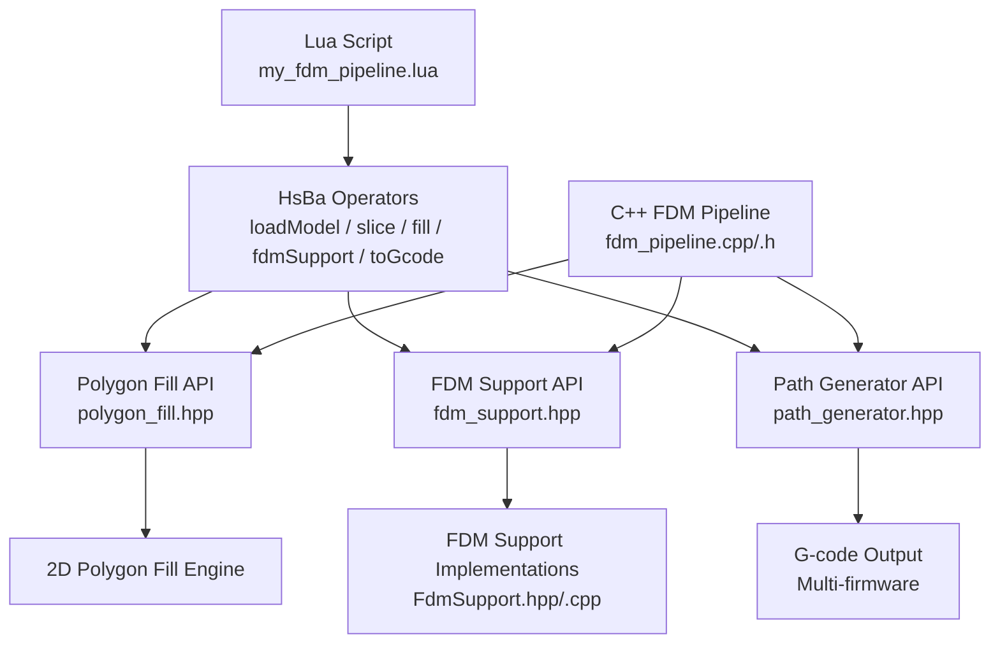
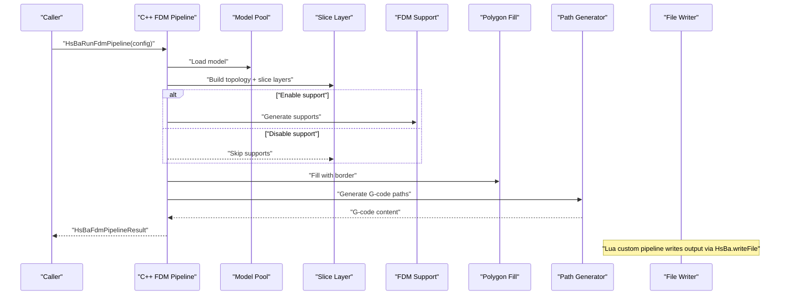
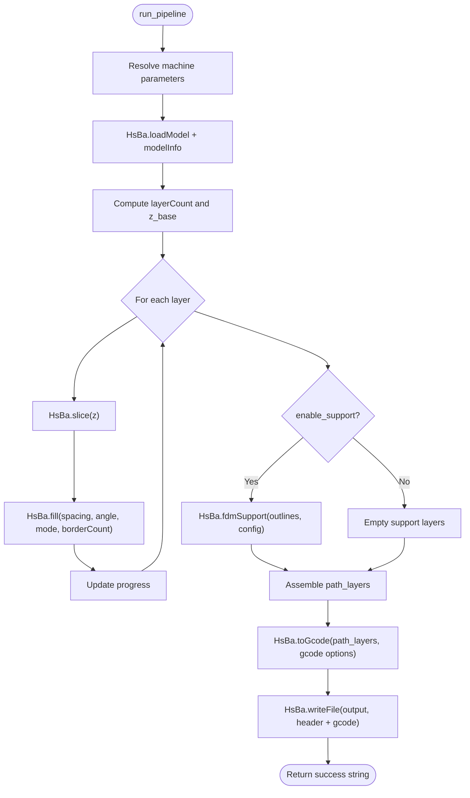
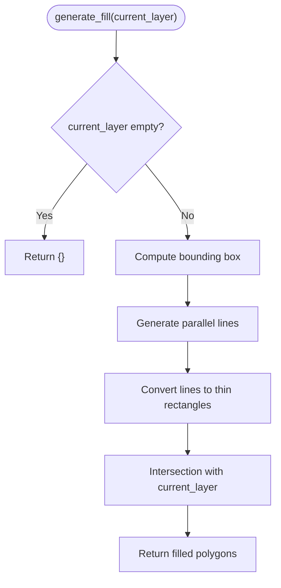
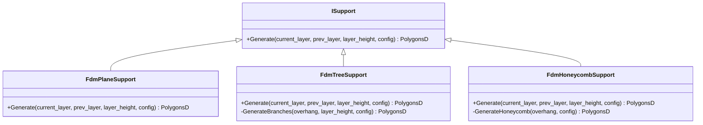
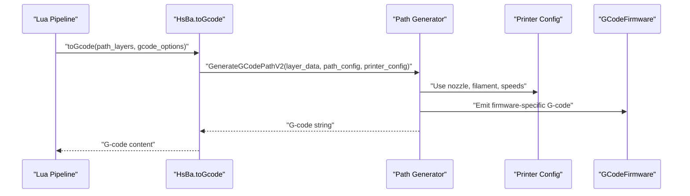
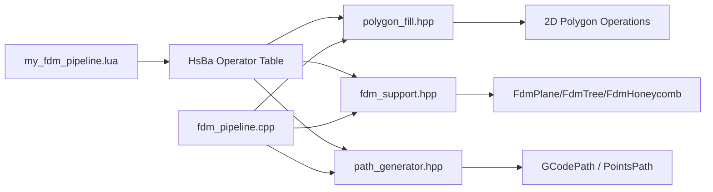

# FDM Custom Pipeline

<cite>
**Referenced Files in This Document**   
- [my_fdm_pipeline.lua](file://samples/Custom/scripts/my_fdm_pipeline.lua)
- [pipeline_types.h](file://pipelinetypes/pipeline_types.h)
- [fdm_pipeline.h](file://DllHsBaSlicer/fdm_pipeline.h)
- [fdm_pipeline.cpp](file://DllHsBaSlicer/fdm_pipeline.cpp)
- [fdm_support.hpp](file://LibHsBaSlicer/Support/fdm_support.hpp)
- [fdm_support.cpp](file://LibHsBaSlicer/Support/fdm_support.cpp)
- [FdmSupport.hpp](file://support/FdmSupport.hpp)
- [FdmSupport.cpp](file://support/FdmSupport.cpp)
- [SupportConfig.hpp](file://support/SupportConfig.hpp)
- [polygon_fill.hpp](file://LibHsBaSlicer/Fill/polygon_fill.hpp)
- [path_generator.hpp](file://LibHsBaSlicer/Path/path_generator.hpp)
- [hsba_pipeline.d.lua](file://types/hsba_pipeline.d.lua)
- [my_infill.lua](file://samples/FDM/scripts/my_infill.lua)
- [my_support.lua](file://samples/FDM/scripts/my_support.lua)
</cite>

## Table of Contents
1. [Introduction](#introduction)
2. [Project Structure](#project-structure)
3. [Core Components](#core-components)
4. [Architecture Overview](#architecture-overview)
5. [Detailed Component Analysis](#detailed-component-analysis)
6. [Dependency Analysis](#dependency-analysis)
7. [Performance Considerations](#performance-considerations)
8. [Troubleshooting Guide](#troubleshooting-guide)
9. [Conclusion](#conclusion)
10. [Appendices](#appendices)

## Introduction
This document explains how to implement a complete Fused Deposition Modeling custom pipeline in HsBaSlicer using the Lua-driven `my_fdm_pipeline.lua` script. It covers model loading, slicing with layer height configuration, wall generation, infill patterns, support structure creation, and G-code export. It also documents the machine parameter structure used by both the C++ FDM pipeline and the Lua custom pipeline, including `layer_height`, `first_layer_height`, `fill_spacing`, `wall_count`, `enable_support`, `print_speed`, and firmware settings. Finally, it shows how to use HsBa operators such as `loadModel`, `slice`, `fill`, `fdmSupport`, and `toGcode`, and provides examples of different infill patterns, support strategies, and G-code optimization techniques specific to FDM printing.

## Project Structure
The FDM custom pipeline is implemented through two complementary layers:

- **Lua custom pipeline**: `samples/Custom/scripts/my_fdm_pipeline.lua` defines the full workflow end-to-end, including model loading, per-layer slicing, fill generation, optional support generation, path assembly, G-code generation, and file writing.
- **C++ FDM pipeline**: `DllHsBaSlicer/fdm_pipeline.cpp` and `DllHsBaSlicer/fdm_pipeline.h` expose a C ABI for synchronous and asynchronous execution of a built-in FDM pipeline that follows Preprocess → Slice → Support → Fill → Path Generation.
- **Support system**: `LibHsBaSlicer/Support/fdm_support.*` and `support/FdmSupport.*` provide plane, tree, and honeycomb support generators, plus Lua-based custom support.
- **Fill system**: `LibHsBaSlicer/Fill/polygon_fill.hpp` wraps 2D polygon filling, including border-aware fills and Lua custom fills.
- **Path generation**: `LibHsBaSlicer/Path/path_generator.hpp` generates G-code paths from per-layer outlines, fills, and supports, including spiral/vase mode.
- **Type definitions**: `pipelinetypes/pipeline_types.h` defines the C-compatible FDM configuration and result structures; `types/hsba_pipeline.d.lua` provides IDE type hints for the Lua API.

**Diagram sources**
- [my_fdm_pipeline.lua:52-170](file://samples/Custom/scripts/my_fdm_pipeline.lua#L52-L170)
- [fdm_pipeline.cpp:219-446](file://DllHsBaSlicer/fdm_pipeline.cpp#L219-L446)
- [fdm_support.hpp:19-67](file://LibHsBaSlicer/Support/fdm_support.hpp#L19-L67)
- [polygon_fill.hpp:17-53](file://LibHsBaSlicer/Fill/polygon_fill.hpp#L17-L53)
- [path_generator.hpp:20-80](file://LibHsBaSlicer/Path/path_generator.hpp#L20-L80)

**Section sources**
- [my_fdm_pipeline.lua:1-172](file://samples/Custom/scripts/my_fdm_pipeline.lua#L1-L172)
- [fdm_pipeline.h:1-68](file://DllHsBaSlicer/fdm_pipeline.h#L1-L68)
- [fdm_pipeline.cpp:1-497](file://DllHsBaSlicer/fdm_pipeline.cpp#L1-L497)
- [pipeline_types.h:53-127](file://pipelinetypes/pipeline_types.h#L53-L127)
- [hsba_pipeline.d.lua:290-438](file://types/hsba_pipeline.d.lua#L290-L438)

## Core Components
The core components of an FDM custom pipeline are:

| Component | Responsibility | Key APIs or Files |
|---|---|---|
| Model Loading | Load CAD models into the model pool and query bounding box and volume | `HsBa.loadModel`, `HsBa.modelInfo`, `HsBa.removeModel` |
| Slicing | Compute layer count, Z heights, and per-layer polygons | `HsBa.layerCount`, `HsBa.layerZ`, `HsBa.slice` |
| Wall Generation | Generate perimeter walls via border-aware fill | `HsBa.fill` with `borderCount` |
| Infill Patterns | Generate internal fill patterns such as line, zigzag, or custom Lua fills | `HsBa.fill`, `polygon_fill.hpp`, `my_infill.lua` |
| Support Structures | Detect overhangs and generate plane, tree, or honeycomb supports | `HsBa.fdmSupport`, `fdm_support.hpp`, `FdmSupport.hpp` |
| G-code Export | Convert layered paths into firmware-specific G-code | `HsBa.toGcode`, `path_generator.hpp` |
| Machine Parameters | Configure layer height, first layer height, fill spacing, wall count, support flags, print speed, and firmware | `HsBaFdmPipelineConfig_t`, `GcodeOptions` |

**Section sources**
- [my_fdm_pipeline.lua:52-170](file://samples/Custom/scripts/my_fdm_pipeline.lua#L52-L170)
- [pipeline_types.h:53-127](file://pipelinetypes/pipeline_types.h#L53-L127)
- [hsba_pipeline.d.lua:193-247](file://types/hsba_pipeline.d.lua#L193-L247)

## Architecture Overview
The FDM pipeline can be used in two modes:

1. **Built-in C++ FDM pipeline**: The caller sets `HsBaFdmPipelineConfig_t`, calls `HsBaRunFdmPipeline` or `HsBaRunFdmPipelineAsync`, and receives `HsBaFdmPipelineResult_t`. Internally, the pipeline loads the model, slices layers in parallel, generates supports (built-in or Lua), computes fills (built-in or Lua), and generates G-code.
2. **Lua custom FDM pipeline**: The script `my_fdm_pipeline.lua` controls the entire flow using the global `HsBa` operator table. It decides when to load the model, how many layers to compute, how to slice, how to fill, whether to enable supports, how to assemble path layers, and how to write the final G-code file.

**Diagram sources**
- [fdm_pipeline.cpp:219-446](file://DllHsBaSlicer/fdm_pipeline.cpp#L219-L446)
- [fdm_support.cpp:14-52](file://LibHsBaSlicer/Support/fdm_support.cpp#L14-L52)
- [polygon_fill.hpp:25-53](file://LibHsBaSlicer/Fill/polygon_fill.hpp#L25-L53)
- [path_generator.hpp:50-80](file://LibHsBaSlicer/Path/path_generator.hpp#L50-L80)

**Section sources**
- [fdm_pipeline.h:17-61](file://DllHsBaSlicer/fdm_pipeline.h#L17-L61)
- [fdm_pipeline.cpp:453-496](file://DllHsBaSlicer/fdm_pipeline.cpp#L453-L496)
- [pipeline_types.h:53-127](file://pipelinetypes/pipeline_types.h#L53-L127)

## Detailed Component Analysis

### Lua Custom FDM Pipeline Workflow
The `my_fdm_pipeline.lua` script implements a fully Lua-controlled FDM workflow:

1. **Parameter resolution**: Uses a helper function to read machine parameters from the injected `machine` table or fall back to defaults.
2. **Model loading**: Calls `HsBa.loadModel`, queries model info, computes height and volume, and determines total layers using `HsBa.layerCount`.
3. **Per-layer slicing and filling**: Iterates from layer zero to `layers - 1`, computes Z height with `HsBa.layerZ`, slices polygons with `HsBa.slice`, and fills them with `HsBa.fill`. The script rotates fill angle every three layers and uses configurable `fill_spacing` and `wall_count`.
4. **Optional support generation**: If `enable_support` is true, calls `HsBa.fdmSupport` with layer height, overhang angle, gap, diameter, density, interface layers, and interface density. Otherwise, it creates empty support lists.
5. **Path assembly and G-code export**: Builds `path_layers` with outlines, fills, supports, and Z heights, then calls `HsBa.toGcode` with layer height, line width, print speed, travel speed, extrusion multiplier, firmware, nozzle diameter, filament diameter, nozzle temperature, and bed temperature.
6. **File writing**: Prepends a header with model name, layer count, layer heights, model size, and pipeline config, then writes the combined header and G-code via `HsBa.writeFile`.

**Diagram sources**
- [my_fdm_pipeline.lua:24-170](file://samples/Custom/scripts/my_fdm_pipeline.lua#L24-L170)

**Section sources**
- [my_fdm_pipeline.lua:24-170](file://samples/Custom/scripts/my_fdm_pipeline.lua#L24-L170)

### Machine Parameter Structure
The machine parameter structure is defined in the C-compatible FDM pipeline configuration and is mirrored in Lua through `GcodeOptions` and `SupportOptions`.

| Category | Field | Type | Default | Meaning |
|---|---|---|---:|---|
| Model | `model_name` | string | null | Model identifier |
| Model | `model_path` | string | null | Model file path |
| Slice | `layer_height` | float | 0.2 mm | Standard layer height |
| Slice | `first_layer_height` | float | 0.25 mm | First layer height |
| Fill | `fill_spacing` | double | 0.4 mm | Fill line spacing |
| Fill | `fill_mode` | enum | Zigzag | Fill pattern mode |
| Fill | `fill_angle` | double | 45.0 degrees | Fill rotation angle |
| Fill | `wall_count` | int | 3 | Number of wall perimeters |
| Fill | `top_layer_count` | int | 3 | Top solid layers |
| Fill | `bottom_layer_count` | int | 3 | Bottom solid layers |
| Fill | `infill_density` | double | 0.2 | Target infill density |
| Support | `enable_support` | int | 1 | Enable support generation |
| Support | `overhang_angle` | float | 45.0 degrees | Overhang detection threshold |
| Support | `support_gap` | float | 0.5 mm | Gap between model and support |
| Support | `support_diameter` | float | 2.0 mm | Support column diameter |
| Support | `support_density` | float | 0.3 | Support fill density |
| Support | `support_pattern` | enum | Plane | Plane, Tree, or Honeycomb |
| Support | `interface_layers` | int | 2 | Interface layers between model and support |
| Support | `interface_density` | float | 0.5 | Interface layer density |
| Path | `line_width` | float | 0.4 mm | Extrusion line width |
| Path | `print_speed` | float | 50.0 mm/s | Print travel speed |
| Path | `travel_speed` | float | 100.0 mm/s | Non-extrusion travel speed |
| Path | `extrusion_multiplier` | float | 1.0 | Extrusion scaling factor |
| Path | `spiral_mode` | int | 0 | Vase/spiral outer wall mode |
| Firmware | `gcode_firmware` | enum | Marlin | Marlin, RepRap, or Klipper |
| Firmware | `nozzle_diameter` | float | 0.4 mm | Nozzle diameter |
| Firmware | `filament_diameter` | float | 1.75 mm | Filament diameter |
| Firmware | `nozzle_temp` | float | 200.0 °C | Nozzle temperature |
| Firmware | `bed_temp` | float | 60.0 °C | Bed temperature |
| Firmware | `retract_length` | float | 1.0 mm | Retraction distance |
| Firmware | `retract_speed` | float | 40.0 mm/s | Retraction speed |
| Firmware | `first_layer_speed` | float | 20.0 mm/s | First layer print speed |

**Section sources**
- [pipeline_types.h:53-127](file://pipelinetypes/pipeline_types.h#L53-L127)
- [pipeline_types.h:742-783](file://pipelinetypes/pipeline_types.h#L742-L783)
- [hsba_pipeline.d.lua:228-247](file://types/hsba_pipeline.d.lua#L228-L247)

### HsBa Operators for FDM Custom Pipelines
The Lua custom pipeline uses the following HsBa operators:

| Operator | Purpose | Input | Output | Notes |
|---|---|---|---|---|
| `HsBa.progress(percent, stage)` | Report pipeline progress | integer percent, optional stage string | void | Used to update UI or logs |
| `HsBa.setLayers(n)` | Set total layer count | integer n | void | Optional metadata reporting |
| `HsBa.setOutputPath(path)` | Set default output path | string path | void | Used by custom pipeline results |
| `HsBa.readFile(path)` | Read file contents | string path | string or nil | File access in Lua |
| `HsBa.writeFile(path, content)` | Write file contents | string path, string content | boolean | Used to write G-code |
| `HsBa.loadModel(name, path)` | Load model into pool | string name, string path | boolean | Preprocess step |
| `HsBa.modelInfo(name)` | Query model metadata | string name | ModelInfo | Bounding box and volume |
| `HsBa.translateModel(name, offset)` | Translate model | string name, Point3D offset | void | Geometry transform |
| `HsBa.rotateModel(name, quaternion)` | Rotate model | string name, Quaternion | void | Geometry transform |
| `HsBa.scaleModel(name, scale)` | Scale model | string name, number or Point3D | void | Geometry transform |
| `HsBa.removeModel(name)` | Remove model from pool | string name | void | Cleanup |
| `HsBa.modelNames()` | List loaded models | none | string[] | Debugging |
| `HsBa.layerCount(name, layerHeight, firstLayerHeight)` | Compute total layers | string name, numbers | integer | Slice setup |
| `HsBa.layerZ(index, layerHeight, firstLayerHeight)` | Compute Z height | integer index, numbers | number | Per-layer Z |
| `HsBa.slice(name, z)` | Slice at Z height | string name, number | Polygons | Closed contours |
| `HsBa.sliceUnsafe(name, z)` | Slice allowing open contours | string name, number | Polygons | Unsafe variant |
| `HsBa.toInt(polys)` | Convert to integer polygons | Polygons | Polygons | Precision conversion |
| `HsBa.toDouble(polys)` | Convert to floating polygons | Polygons | Polygons | Precision conversion |
| `HsBa.fill(polys, options)` | Fill polygons | Polygons, FillOptions | Polygons | Spacing, mode, angle, borderCount |
| `HsBa.fdmSupport(layers, config)` | Generate FDM supports | LayerList, SupportOptions | LayerList | Built-in or Lua support |
| `HsBa.slaSupport(layers, config)` | Generate SLA supports | LayerList, SupportOptions | LayerList | Resin printing |
| `HsBa.floor(bottomPolygons, config)` | Generate SLA floor/raft | Polygons, FloorConfig | Polygons | SLA only |
| `HsBa.spiralize(sections, options)` | Spiralize outer wall | LayerList, SpiralizeOptions | Point3D[] | Vase mode |
| `HsBa.toGcode(layers, config)` | Generate G-code | LayerPathInput[], GcodeOptions | string | Multi-firmware output |
| `HsBa.saveSlsPackage(input)` | Package SLS output | SlsPackageInput | boolean | Export packaging |
| `HsBa.saveWaamPackage(input)` | Package WAAM output | WaamPackageInput | boolean, string? | Robot path packaging |
| `HsBa.saveSlaPackage(input)` | Package SLA output | SlaPackageInput | boolean | SLA packaging |
| `HsBa.renderImage(polys, width, height, path)` | Render polygons to image | Polygons, integers, string | boolean | Visualization |

**Section sources**
- [hsba_pipeline.d.lua:290-438](file://types/hsba_pipeline.d.lua#L290-L438)
- [my_fdm_pipeline.lua:52-170](file://samples/Custom/scripts/my_fdm_pipeline.lua#L52-L170)

### Infill Patterns and Custom Fill Scripts
The built-in fill system supports multiple modes:

| Mode | Description | Use Case |
|---|---|---|
| Line | Parallel line fill | Simple directional infill |
| SimpleZigzag | Basic zigzag pattern | Faster but less stable infill |
| Zigzag | Advanced zigzag with direction changes | Better structural stability |
| Custom Lua | User-defined fill algorithm | Specialized patterns or research algorithms |

The `my_infill.lua` example demonstrates a custom fill generator that:

- Computes the bounding box of the current layer.
- Generates parallel lines at a configurable angle and spacing.
- Converts lines into thin rectangles.
- Intersects the generated lines with the current layer polygons to clip them to valid regions.

**Diagram sources**
- [my_infill.lua:20-87](file://samples/FDM/scripts/my_infill.lua#L20-L87)

**Section sources**
- [polygon_fill.hpp:17-53](file://LibHsBaSlicer/Fill/polygon_fill.hpp#L17-L53)
- [my_infill.lua:1-89](file://samples/FDM/scripts/my_infill.lua#L1-L89)

### Support Strategies and Custom Support Scripts
The FDM support system includes three built-in strategies:

| Strategy | Behavior | Configuration Focus |
|---|---|---|
| Plane | Column supports from overhang regions | `support_gap`, `support_diameter` |
| Tree | Branching supports growing upward | `tree_branch_angle`, `tree_max_branch_radius` |
| Honeycomb | Hexagonal cell support within overhangs | `honeycomb_cell_size` |

The `my_support.lua` example demonstrates how to:

- Detect overhang regions using `Support.detect_overhang`.
- Select a generator based on `config.support_pattern`.
- Apply a default support configuration and optionally refine results with polygon operations.

**Diagram sources**
- [FdmSupport.hpp:13-63](file://support/FdmSupport.hpp#L13-L63)

**Section sources**
- [fdm_support.hpp:19-67](file://LibHsBaSlicer/Support/fdm_support.hpp#L19-L67)
- [fdm_support.cpp:14-52](file://LibHsBaSlicer/Support/fdm_support.cpp#L14-L52)
- [FdmSupport.hpp:13-63](file://support/FdmSupport.hpp#L13-L63)
- [FdmSupport.cpp:46-267](file://support/FdmSupport.cpp#L46-L267)
- [SupportConfig.hpp:14-43](file://support/SupportConfig.hpp#L14-L43)
- [my_support.lua:32-82](file://samples/FDM/scripts/my_support.lua#L32-L82)

### G-code Export and Firmware Settings
The G-code export stage converts layered path data into firmware-specific G-code. The key inputs are:

- `LayerPathInput[]`: Each layer contains outlines, fills, supports, and Z height.
- `GcodeOptions`: Includes layer height, line width, print speed, travel speed, extrusion multiplier, firmware target, nozzle diameter, filament diameter, nozzle temperature, bed temperature, retraction length, and retraction speed.

The C++ pipeline supports:

- Standard multi-layer G-code generation via `GenerateGCodePathV2`.
- Spiral/vase mode via `GenerateGCodePathSpiral`, which merges outer walls into a continuous rising helix without per-layer infill or support.
- Multi-firmware output through `GCodeFirmware` values: Marlin, RepRap, and Klipper.

**Diagram sources**
- [path_generator.hpp:50-80](file://LibHsBaSlicer/Path/path_generator.hpp#L50-L80)
- [fdm_pipeline.cpp:385-433](file://DllHsBaSlicer/fdm_pipeline.cpp#L385-L433)
- [pipeline_types.h:43-51](file://pipelinetypes/pipeline_types.h#L43-L51)

**Section sources**
- [path_generator.hpp:20-91](file://LibHsBaSlicer/Path/path_generator.hpp#L20-L91)
- [fdm_pipeline.cpp:385-433](file://DllHsBaSlicer/fdm_pipeline.cpp#L385-L433)
- [pipeline_types.h:43-51](file://pipelinetypes/pipeline_types.h#L43-L51)

## Dependency Analysis
The FDM custom pipeline has clear dependency boundaries:

- The Lua script depends on the `HsBa` operator table exposed by the runtime.
- The C++ FDM pipeline depends on LibHsBaSlicer modules for slicing, support, fill, and path generation.
- Support generation depends on overhang detection and geometric operations.
- Fill generation depends on 2D polygon operations and optional Lua scripts.
- G-code export depends on printer configuration and firmware targets.

**Diagram sources**
- [my_fdm_pipeline.lua:52-170](file://samples/Custom/scripts/my_fdm_pipeline.lua#L52-L170)
- [fdm_pipeline.cpp:17-26](file://DllHsBaSlicer/fdm_pipeline.cpp#L17-L26)
- [fdm_support.hpp:19-67](file://LibHsBaSlicer/Support/fdm_support.hpp#L19-L67)
- [polygon_fill.hpp:17-53](file://LibHsBaSlicer/Fill/polygon_fill.hpp#L17-L53)
- [path_generator.hpp:20-91](file://LibHsBaSlicer/Path/path_generator.hpp#L20-L91)

**Section sources**
- [fdm_pipeline.cpp:17-26](file://DllHsBaSlicer/fdm_pipeline.cpp#L17-L26)
- [fdm_support.cpp:14-52](file://LibHsBaSlicer/Support/fdm_support.cpp#L14-L52)
- [polygon_fill.hpp:17-53](file://LibHsBaSlicer/Fill/polygon_fill.hpp#L17-L53)
- [path_generator.hpp:20-91](file://LibHsBaSlicer/Path/path_generator.hpp#L20-L91)

## Performance Considerations
Several performance characteristics are relevant when implementing FDM custom pipelines:

- **Parallel slicing**: The C++ pipeline builds slice topology once and slices layers in parallel, reducing total slicing time for tall models.
- **Parallel fill**: Built-in fill computation is safe to parallelize across layers because it does not share mutable state.
- **Serial Lua fill**: Lua custom fill runs serially because the Lua interpreter state is not shared across threads.
- **Spiral mode**: Disables infill and support generation, generating only a continuous outer wall, which significantly reduces computation and print time for vase-like models.
- **Layer count sensitivity**: Very small layer heights increase layer count and memory usage; choose layer height based on model complexity and desired surface quality.
- **Infill density vs spacing**: Lower density increases spacing, reducing material and time but potentially weakening the part.
- **Support strategy cost**: Tree supports are more complex than plane supports; honeycomb supports add geometric computation overhead.

[No sources needed since this section provides general guidance]

## Troubleshooting Guide
Common issues and their likely causes:

| Symptom | Likely Cause | Resolution |
|---|---|---|
| Model fails to load | Invalid path or unsupported format | Verify `model_path` and model file integrity |
| Zero layers computed | Model height is zero or negative | Check bounding box and ensure valid geometry |
| No supports generated | Overhang angle too low or no overhangs | Increase `overhang_angle` or inspect layer geometry |
| Excessive support material | High `support_density` or large `support_diameter` | Reduce density or diameter |
| Poor infill coverage | Incorrect `fill_spacing` or angle | Adjust spacing and rotate angle between layers |
| G-code contains errors | Mismatched printer or firmware settings | Align `nozzle_diameter`, `filament_diameter`, and firmware target |
| Slow custom pipeline | Heavy Lua logic or many layers | Optimize Lua functions or reduce layer count |
| Memory exhaustion | Too many layers or large polygons | Reduce resolution or process in batches |

**Section sources**
- [fdm_pipeline.cpp:231-257](file://DllHsBaSlicer/fdm_pipeline.cpp#L231-L257)
- [fdm_pipeline.cpp:437-446](file://DllHsBaSlicer/fdm_pipeline.cpp#L437-L446)
- [my_fdm_pipeline.lua:52-170](file://samples/Custom/scripts/my_fdm_pipeline.lua#L52-L170)

## Conclusion
The HsBaSlicer FDM custom pipeline provides two complementary approaches: a flexible Lua-driven workflow controlled entirely by `my_fdm_pipeline.lua`, and a robust C++ pipeline with well-defined configuration structures. Both approaches share the same core concepts: model loading, slicing, wall generation, infill patterns, support structures, and G-code export. By understanding the machine parameter structure, HsBa operators, and underlying C++ modules, developers can implement custom FDM workflows tailored to specific materials, printers, and printing strategies.

[No sources needed since this section summarizes without analyzing specific files]

## Appendices

### Example: Minimal Lua FDM Pipeline Steps
A minimal Lua FDM pipeline should include:

1. Resolve `layer_height` and `first_layer_height`.
2. Load the model and compute layer count.
3. Iterate layers, slice polygons, and generate fills.
4. Optionally generate supports.
5. Assemble path layers and call `toGcode`.
6. Write the output file.

**Section sources**
- [my_fdm_pipeline.lua:52-170](file://samples/Custom/scripts/my_fdm_pipeline.lua#L52-L170)

### Example: Supported Firmware Targets
| Firmware | Enum Value | Typical Use |
|---|---|---|
| Marlin | `HSBA_GCODE_MARLIN` | Most common desktop FDM printers |
| RepRap | `HSBA_GCODE_REPRAP` | RepRap firmware and related hosts |
| Klipper | `HSBA_GCODE_KLIPPER` | Klipper-based high-performance printers |

**Section sources**
- [pipeline_types.h:43-51](file://pipelinetypes/pipeline_types.h#L43-L51)