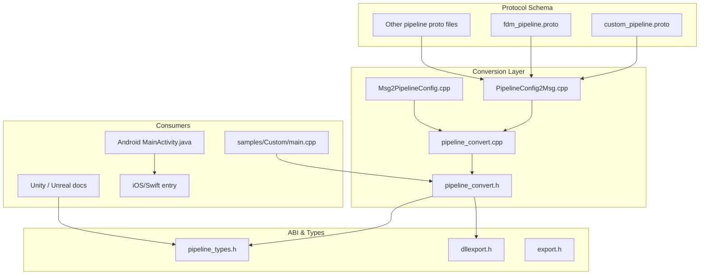
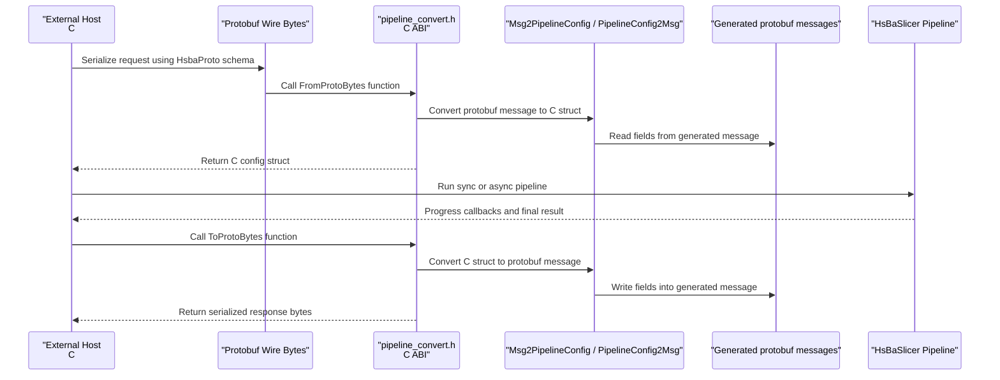
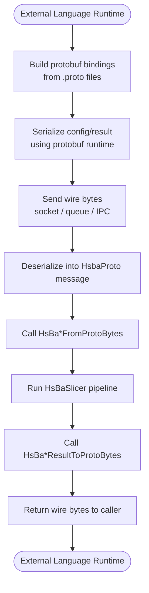
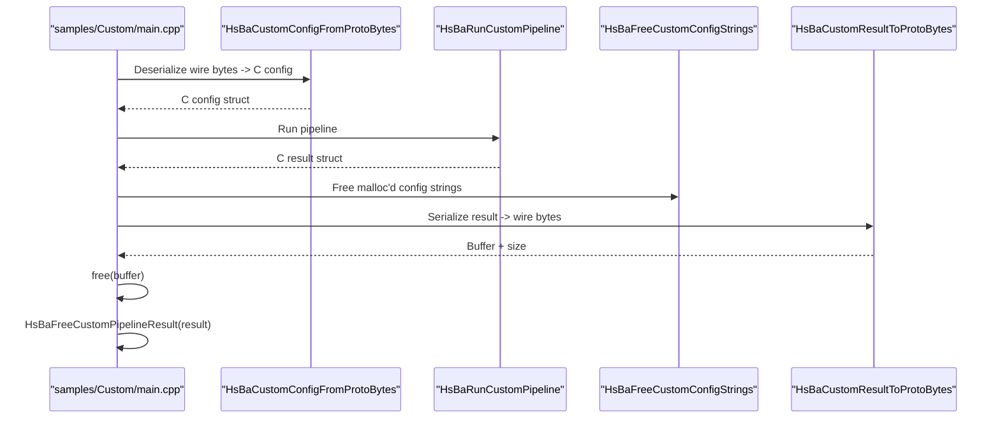
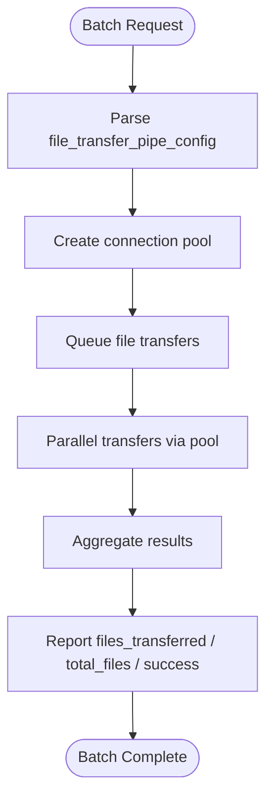
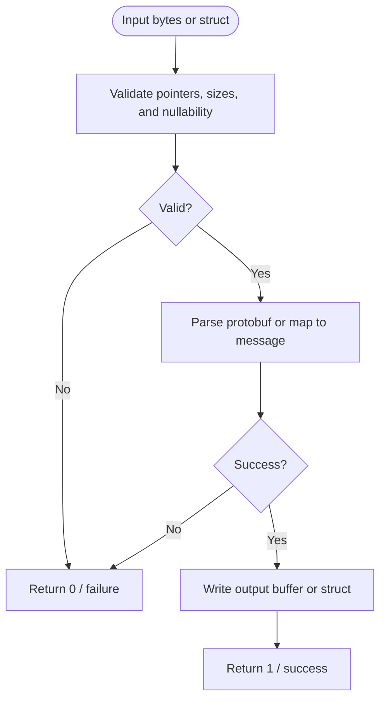
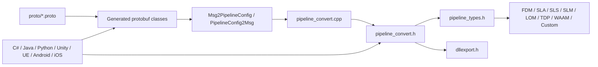

# External System Integration Patterns

<cite>
**Referenced Files in This Document**   
- [pipeline_types.h](file://pipelinetypes/pipeline_types.h)
- [dllexport.h](file://DllHsBaSlicer/dllexport.h)
- [export.h](file://LibHsBaSlicer/export.h)
- [pipeline_convert.h](file://DllHsBaSlicer/pipeline_convert.h)
- [pipeline_convert.cpp](file://DllHsBaSlicer/pipeline_convert.cpp)
- [PipelineConfig2Msg.cpp](file://convert/PipelineConfig2Msg.cpp)
- [Msg2PipelineConfig.cpp](file://convert/Msg2PipelineConfig.cpp)
- [custom_pipeline.proto](file://proto/custom_pipeline.proto)
- [fdm_pipeline.proto](file://proto/fdm_pipeline.proto)
- [CMakeLists.txt](file://CMakeLists.txt)
- [proto/CMakeLists.txt](file://proto/CMakeLists.txt)
- [samples/Custom/main.cpp](file://samples/Custom/main.cpp)
- [game_engine_integration.md](file://docs/en/DllHsBaSlicer/game_engine_integration.md)
- [MainActivity.java](file://android/app/src/main/java/com/hsmbanlance/hsbaslicer/example/MainActivity.java)
- [HsBaSlicer.cpp](file://HsBaSlicer/HsBaSlicer.cpp)
</cite>

## Table of Contents
1. [Introduction](#introduction)
2. [Project Structure](#project-structure)
3. [Core Components](#core-components)
4. [Architecture Overview](#architecture-overview)
5. [Detailed Component Analysis](#detailed-component-analysis)
6. [Dependency Analysis](#dependency-analysis)
7. [Performance Considerations](#performance-considerations)
8. [Troubleshooting Guide](#troubleshooting-guide)
9. [Conclusion](#conclusion)

## Introduction
This document explains how to integrate HsBaSlicer with external systems and libraries. It focuses on three integration surfaces:

- **Protobuf-based cross-language communication**: serialize and deserialize pipeline configurations and results using the `HsbaProto` schema, suitable for C#, Python, Java, or any language that can produce protobuf wire bytes.
- **C ABI usage**: call exported C functions from native host applications, game engines, Android JNI, Swift/Objective-C, or other languages.
- **Real-time streaming and batch processing patterns**: use progress/result callbacks, async execution, file transfer pipelines, and Lua-driven custom pipelines.

The repository exposes two main integration layers:

| Layer | Purpose | Typical Consumer |
|---|---|---|
| `LibHsBaSlicer` | C++ API for embedding slicing logic inside a C++ application. | C++ modules, C++20 module consumers, samples. |
| `DllHsBaSlicer` | Stable C ABI shared library plus Protobuf conversion helpers. | C#, Java, Python, Unity, Unreal Engine, Android, iOS, remote services. |

For cross-language calls, the recommended boundary is the C ABI combined with protobuf serialization. The C ABI avoids C++ name mangling and ABI drift, while protobuf provides a stable wire format across languages.

**Section sources**
- [pipeline_types.h:5-12](file://pipelinetypes/pipeline_types.h#L5-L12)
- [dllexport.h:1-23](file://DllHsBaSlicer/dllexport.h#L1-L23)
- [export.h:1-22](file://LibHsBaSlicer/export.h#L1-L22)

## Project Structure
The integration-relevant parts of the repository are organized around types, converters, protocols, and platform entry points.

**Diagram sources**
- [custom_pipeline.proto:1-31](file://proto/custom_pipeline.proto#L1-L31)
- [fdm_pipeline.proto:1-81](file://proto/fdm_pipeline.proto#L1-L81)
- [PipelineConfig2Msg.cpp:1-543](file://convert/PipelineConfig2Msg.cpp#L1-L543)
- [Msg2PipelineConfig.cpp:1-386](file://convert/Msg2PipelineConfig.cpp#L1-L386)
- [pipeline_convert.h:1-219](file://DllHsBaSlicer/pipeline_convert.h#L1-L219)
- [pipeline_convert.cpp:1-948](file://DllHsBaSlicer/pipeline_convert.cpp#L1-L948)
- [pipeline_types.h:5-12](file://pipelinetypes/pipeline_types.h#L5-L12)
- [dllexport.h:1-23](file://DllHsBaSlicer/dllexport.h#L1-L23)
- [export.h:1-22](file://LibHsBaSlicer/export.h#L1-L22)
- [samples/Custom/main.cpp:1-616](file://samples/Custom/main.cpp#L1-L616)
- [MainActivity.java:1-46](file://android/app/src/main/java/com/hsmbanlance/hsbaslicer/example/MainActivity.java#L1-L46)

**Section sources**
- [CMakeLists.txt:594-635](file://CMakeLists.txt#L594-L635)
- [proto/CMakeLists.txt:34-70](file://proto/CMakeLists.txt#L34-L70)

## Core Components
The integration surface is built from four core components:

1. **C-compatible pipeline types**: `pipeline_types.h` defines all configuration and result structs used by the C ABI. These structs are intentionally free of DLL export macros so they can be included by downstream code without depending on the shared library.
2. **Export macros**: `dllexport.h` defines `HSBA_SLICER_API` for the DllHsBaSlicer C ABI; `export.h` defines `HSBA_SLICER_LIB_API` for the LibHsBaSlicer C++ API.
3. **Protobuf conversion layer**: `pipeline_convert.h` and `pipeline_convert.cpp` expose C functions that convert between protobuf wire bytes and C config/result structs.
4. **Message mapping implementations**: `PipelineConfig2Msg.cpp` and `Msg2PipelineConfig.cpp` map between internal C structs and generated protobuf message objects.

### C-Compatible Pipeline Types
`pipeline_types.h` defines:

- FDM, SLA, SLS, SLM, LOM, 3DP (TDP), WAAM, File Transfer, and Custom Lua pipeline configs and results.
- Progress callback function types and async result callback types.
- Default initializer functions such as `HsBaFdmConfigDefault`, `HsBaSlaConfigDefault`, etc.

These types are the contract between host applications and HsBaSlicer. For example, the FDM result contains success, total layers, G-code content, error message, and elapsed time.

**Section sources**
- [pipeline_types.h:53-127](file://pipelinetypes/pipeline_types.h#L53-L127)
- [pipeline_types.h:165-232](file://pipelinetypes/pipeline_types.h#L165-L232)
- [pipeline_types.h:259-310](file://pipelinetypes/pipeline_types.h#L259-L310)
- [pipeline_types.h:359-401](file://pipelinetypes/pipeline_types.h#L359-L401)
- [pipeline_types.h:419-461](file://pipelinetypes/pipeline_types.h#L419-L461)
- [pipeline_types.h:480-521](file://pipelinetypes/pipeline_types.h#L480-L521)
- [pipeline_types.h:578-625](file://pipelinetypes/pipeline_types.h#L578-L625)
- [pipeline_types.h:636-674](file://pipelinetypes/pipeline_types.h#L636-L674)
- [pipeline_types.h:689-732](file://pipelinetypes/pipeline_types.h#L689-L732)
- [pipeline_types.h:742-800](file://pipelinetypes/pipeline_types.h#L742-L800)

### Export Macros
`dllexport.h` defines `HSBA_SLICER_API`:

- On Windows, it uses `__declspec(dllexport)` when building the DLL and `__declspec(dllimport)` when consuming it.
- On non-Windows platforms, it expands to nothing because default visibility is sufficient.

`export.h` defines `HSBA_SLICER_LIB_API` for the LibHsBaSlicer C++ API with the same Windows/non-Windows behavior.

**Section sources**
- [dllexport.h:1-23](file://DllHsBaSlicer/dllexport.h#L1-L23)
- [export.h:1-22](file://LibHsBaSlicer/export.h#L1-L22)

## Architecture Overview
The external integration architecture separates protocol definitions, serialization, C ABI, and pipeline execution.

**Diagram sources**
- [pipeline_convert.h:17-22](file://DllHsBaSlicer/pipeline_convert.h#L17-L22)
- [pipeline_convert.cpp:27-42](file://DllHsBaSlicer/pipeline_convert.cpp#L27-L42)
- [pipeline_convert.cpp:44-70](file://DllHsBaSlicer/pipeline_convert.cpp#L44-L70)
- [Msg2PipelineConfig.cpp:35-83](file://convert/Msg2PipelineConfig.cpp#L35-L83)
- [PipelineConfig2Msg.cpp:10-77](file://convert/PipelineConfig2Msg.cpp#L10-L77)

At runtime, the host can also bypass protobuf entirely and pass C structs directly through the C ABI. However, protobuf is preferred for cross-process or cross-language boundaries because it decouples the host’s memory layout from the C++ side.

**Section sources**
- [pipeline_convert.h:17-22](file://DllHsBaSlicer/pipeline_convert.h#L17-L22)
- [samples/Custom/main.cpp:356-588](file://samples/Custom/main.cpp#L356-L588)

## Detailed Component Analysis

### Protobuf-Based Communication
The repository defines protobuf schemas under `proto/`. Two representative schemas are:

- `custom_pipeline.proto`: describes the fully Lua-driven custom pipeline configuration and result.
- `fdm_pipeline.proto`: describes FDM-specific fill modes, support patterns, firmware targets, and slice parameters.

#### Custom Pipeline Schema
The custom pipeline schema is intentionally small because the workflow definition lives in Lua. It carries:

- Script path or inline Lua source.
- Entry function name.
- Free-form JSON passed to Lua as `pipeline_config`.
- Model name, model path, and output path.

The result carries success, layer count, output path, return string from the Lua entry function, error message, and elapsed seconds.

#### FDM Pipeline Schema
The FDM schema includes:

- Model name and path.
- Layer height and first layer height.
- Fill spacing, fill type, fill angle.
- Wall count, top/bottom layer counts.
- Support enable, overhang angle, gap, diameter, density, pattern.
- Interface layers and interface density.
- Line width, print speed, travel speed, extrusion multiplier.
- Firmware target, nozzle diameter, filament diameter, temperatures, retraction settings.
- Optional Lua scripts/functions for support and infill.
- Output path and spiral mode.

#### Cross-Language Serialization
The build system generates protobuf sources for multiple languages, including C++, C#, Java, Python, and PHP. Consumers can serialize requests and deserialize responses using their own protobuf runtime.

**Diagram sources**
- [proto/CMakeLists.txt:42-70](file://proto/CMakeLists.txt#L42-L70)
- [CMakeLists.txt:603-635](file://CMakeLists.txt#L603-L635)
- [pipeline_convert.cpp:27-70](file://DllHsBaSlicer/pipeline_convert.cpp#L27-L70)

**Section sources**
- [custom_pipeline.proto:1-31](file://proto/custom_pipeline.proto#L1-L31)
- [fdm_pipeline.proto:1-81](file://proto/fdm_pipeline.proto#L1-L81)
- [CMakeLists.txt:603-635](file://CMakeLists.txt#L603-L635)
- [proto/CMakeLists.txt:42-70](file://proto/CMakeLists.txt#L42-L70)

### C ABI Usage
The C ABI is the primary integration point for non-C++ languages. It is defined by:

- `pipeline_types.h`: C-compatible structs and enums.
- `dllexport.h`: `HSBA_SLICER_API` macro.
- `pipeline_convert.h`: C functions for protobuf conversion.
- Additional pipeline headers in `DllHsBaSlicer` for FDM, SLA, SLS, SLM, LOM, TDP, WAAM, file transfer, and custom pipelines.

#### Memory Ownership Rules
The C ABI follows clear ownership rules:

- Config structs deserialized from protobuf contain `malloc`-allocated strings.
- Consumers must free those strings using the corresponding `HsBaFree*ConfigStrings` function.
- Results returned by pipeline functions may contain allocated strings.
- Consumers must free results using the corresponding `HsBaFree*PipelineResult` function.
- Protobuf serialization functions allocate output buffers with `malloc`; callers must `free` them.

#### Example: Protobuf-Driven Custom Pipeline
The sample demonstrates a minimal protobuf wire encoder/decoder and then uses the official C ABI conversion functions:

1. Build a protobuf wire payload for `custom_pipe_config`.
2. Deserialize into `HsBaCustomPipelineConfig_t`.
3. Execute the pipeline synchronously.
4. Release deserialized config strings.
5. Serialize the result into protobuf wire bytes.
6. Free the serialized buffer and the result.

**Diagram sources**
- [samples/Custom/main.cpp:516-588](file://samples/Custom/main.cpp#L516-L588)
- [pipeline_convert.cpp:399-491](file://DllHsBaSlicer/pipeline_convert.cpp#L399-L491)

**Section sources**
- [pipeline_convert.h:17-22](file://DllHsBaSlicer/pipeline_convert.h#L17-L22)
- [pipeline_convert.cpp:18-23](file://DllHsBaSlicer/pipeline_convert.cpp#L18-L23)
- [samples/Custom/main.cpp:516-588](file://samples/Custom/main.cpp#L516-L588)

### Real-Time Streaming and Batch Processing
HsBaSlicer supports both synchronous and asynchronous execution.

#### Progress Callbacks
Each pipeline defines a progress callback type. The callback receives:

- A percentage value.
- A UTF-8 stage description.
- A user-defined pointer.

This enables real-time UI updates, telemetry, cancellation coordination, and streaming logs.

#### Async Execution
Async functions return immediately and invoke a result callback when complete. The result callback receives the full result struct and user data.

#### File Transfer Pipeline
The file transfer pipeline is useful for batch operations:

- It accepts a host, port, connection pool size, and an array of file paths.
- It reports the number of transferred files, total files, success flag, error message, and elapsed time.
- It uses a connection pool for concurrent transfers.

**Diagram sources**
- [pipeline_types.h:636-674](file://pipelinetypes/pipeline_types.h#L636-L674)
- [PipelineConfig2Msg.cpp:228-262](file://convert/PipelineConfig2Msg.cpp#L228-L262)
- [Msg2PipelineConfig.cpp:178-208](file://convert/Msg2PipelineConfig.cpp#L178-L208)

**Section sources**
- [pipeline_types.h:130-140](file://pipelinetypes/pipeline_types.h#L130-L140)
- [pipeline_types.h:234-245](file://pipelinetypes/pipeline_types.h#L234-L245)
- [pipeline_types.h:299-310](file://pipelinetypes/pipeline_types.h#L299-L310)
- [pipeline_types.h:390-401](file://pipelinetypes/pipeline_types.h#L390-L401)
- [pipeline_types.h:450-461](file://pipelinetypes/pipeline_types.h#L450-L461)
- [pipeline_types.h:510-521](file://pipelinetypes/pipeline_types.h#L510-L521)
- [pipeline_types.h:614-625](file://pipelinetypes/pipeline_types.h#L614-L625)
- [pipeline_types.h:663-674](file://pipelinetypes/pipeline_types.h#L663-L674)
- [pipeline_types.h:721-732](file://pipelinetypes/pipeline_types.h#L721-L732)
- [samples/Custom/main.cpp:316-354](file://samples/Custom/main.cpp#L316-L354)

### Error Handling Across System Boundaries
Error handling is consistent across the C ABI and protobuf boundaries:

- Functions returning status codes use integer success flags.
- Config/result structs include explicit `success` fields.
- Human-readable diagnostics are carried in `error_message` or `result_string`.
- Deserialization failures return zero from `FromProtoBytes` functions.
- Serialization failures return zero from `ToProtoBytes` functions.

**Diagram sources**
- [pipeline_convert.cpp:27-42](file://DllHsBaSlicer/pipeline_convert.cpp#L27-L42)
- [pipeline_convert.cpp:44-70](file://DllHsBaSlicer/pipeline_convert.cpp#L44-L70)
- [pipeline_convert.cpp:399-444](file://DllHsBaSlicer/pipeline_convert.cpp#L399-L444)

**Section sources**
- [pipeline_convert.cpp:27-42](file://DllHsBaSlicer/pipeline_convert.cpp#L27-L42)
- [pipeline_convert.cpp:44-70](file://DllHsBaSlicer/pipeline_convert.cpp#L44-L70)
- [pipeline_convert.cpp:399-491](file://DllHsBaSlicer/pipeline_convert.cpp#L399-L491)

### Platform-Specific Integration Examples

#### Unity and Unreal Engine
The documentation shows how to bind the C ABI from C# using P/Invoke and from Unreal Engine using a third-party module. Key considerations include:

- Struct field order and types must match `pipeline_types.h`.
- Delegates passed to native code must be kept alive.
- Native callbacks run off the UI thread and must be marshalled back to the engine’s main thread.
- String encoding must be handled carefully (UTF-8 across the boundary).

**Section sources**
- [game_engine_integration.md:21-124](file://docs/en/DllHsBaSlicer/game_engine_integration.md#L21-L124)
- [game_engine_integration.md:128-213](file://docs/en/DllHsBaSlicer/game_engine_integration.md#L128-L213)
- [game_engine_integration.md:216-362](file://docs/en/DllHsBaSlicer/game_engine_integration.md#L216-L362)
- [game_engine_integration.md:366-462](file://docs/en/DllHsBaSlicer/game_engine_integration.md#L366-L462)

#### Android JNI
The Android example loads the native library and calls a JNI entry point that initializes HsBaSlicer and runs pipeline examples. The native entry point is implemented in the HsBaSlicer binary and delegates to the pipeline example runner.

**Section sources**
- [MainActivity.java:1-46](file://android/app/src/main/java/com/hsmbanlance/hsbaslicer/example/MainActivity.java#L1-L46)
- [HsBaSlicer.cpp:227-240](file://HsBaSlicer/HsBaSlicer.cpp#L227-L240)

#### iOS and Swift
The iOS path exports a C function for Swift/Objective-C initialization and execution. This complements the Android JNI path and the Unity/Unreal integration guides.

**Section sources**
- [HsBaSlicer.cpp:242-253](file://HsBaSlicer/HsBaSlicer.cpp#L242-L253)

## Dependency Analysis
The integration dependencies form a layered structure.

**Diagram sources**
- [proto/CMakeLists.txt:34-70](file://proto/CMakeLists.txt#L34-L70)
- [pipeline_convert.cpp:1-14](file://DllHsBaSlicer/pipeline_convert.cpp#L1-L14)
- [pipeline_convert.h:1-219](file://DllHsBaSlicer/pipeline_convert.h#L1-L219)
- [pipeline_types.h:5-12](file://pipelinetypes/pipeline_types.h#L5-L12)
- [dllexport.h:1-23](file://DllHsBaSlicer/dllexport.h#L1-L23)

Key observations:

- The protobuf schema is the canonical contract for cross-language communication.
- The C ABI is the canonical contract for cross-process and cross-language memory exchange.
- The converter layer isolates protobuf-generated types from the stable C ABI.
- `pipeline_types.h` is deliberately independent of DLL export macros, allowing downstream modules to reference the types without linking the shared library.

**Section sources**
- [CMakeLists.txt:594-635](file://CMakeLists.txt#L594-L635)
- [proto/CMakeLists.txt:34-70](file://proto/CMakeLists.txt#L34-L70)
- [pipeline_types.h:5-12](file://pipelinetypes/pipeline_types.h#L5-L12)

## Performance Considerations
When integrating HsBaSlicer externally, consider these performance factors:

| Area | Recommendation |
|---|---|
| Inter-process communication | Prefer protobuf wire bytes over passing large C structs across process boundaries. Avoid sending entire G-code contents in tight loops; stream or chunk large outputs where possible. |
| Serialization cost | Reuse protobuf messages where your runtime allows it. Avoid repeatedly allocating and freeing large byte buffers. |
| Callback overhead | Use progress callbacks sparingly in hot paths. Coalesce frequent progress events if the UI does not need per-layer updates. |
| Threading | Keep long-running slicing work off the UI thread. Use async APIs and marshal callbacks back to the UI thread only for display. |
| Memory management | Always pair `FromProtoBytes` with the matching `Free*ConfigStrings`, and always free pipeline results. Never mix allocators across language boundaries. |
| Large payloads | For batch file transfer, tune the connection pool size according to network bandwidth and disk I/O. |
| Debugging distributed workflows | Log request/response sizes, protobuf message versions, and elapsed times at each boundary. Capture `error_message` before converting or discarding results. |

[No sources needed since this section provides general guidance]

## Troubleshooting Guide

### Common Integration Problems

| Symptom | Likely Cause | Resolution |
|---|---|---|
| Cross-language parse failure | Mismatched protobuf schema version or invalid wire bytes. | Verify that the sender and receiver use the same `.proto` files and field numbers. Check `FromProtoBytes` return values. |
| Null pointer crash after deserialization | Caller did not initialize the output struct or ignored optional fields. | Initialize configs with default initializers or set required fields before calling pipeline functions. |
| Memory leak | Caller did not free `malloc`-allocated strings or result buffers. | Call `HsBaFree*ConfigStrings` and `HsBaFree*PipelineResult`. Also `free` buffers returned by `ToProtoBytes`. |
| Unity callback crash | Delegate was garbage-collected. | Store delegate references in static or member fields so they remain alive during native execution. |
| iOS link failure | Using dynamic library instead of static library. | Use the static library and `DllImport("__Internal")` as documented. |
| Android crash | Calling pipeline work on the UI thread or loading wrong ABI. | Move slicing to background threads and ensure the correct native library ABI is loaded. |
| Duplicate protobuf registration | Both consumer and HsBaSlicer register the same `.pb.cc` symbols in one process. | Do not link the generated protobuf implementation into the same process as the DllHsBaSlicer consumer when using the minimal wire example. |

**Section sources**
- [samples/Custom/main.cpp:356-364](file://samples/Custom/main.cpp#L356-L364)
- [pipeline_convert.cpp:27-42](file://DllHsBaSlicer/pipeline_convert.cpp#L27-L42)
- [pipeline_convert.cpp:44-70](file://DllHsBaSlicer/pipeline_convert.cpp#L44-L70)
- [game_engine_integration.md:453-462](file://docs/en/DllHsBaSlicer/game_engine_integration.md#L453-L462)
- [MainActivity.java:37-43](file://android/app/src/main/java/com/hsmbanlance/hsbaslicer/example/MainActivity.java#L37-L43)

## Conclusion
HsBaSlicer provides a clean separation between stable integration contracts and internal implementation details:

- Use **protobuf schemas** for cross-language serialization.
- Use the **C ABI** for cross-process and cross-language calls.
- Use **progress and result callbacks** for real-time streaming.
- Use **async APIs** for non-blocking execution.
- Use **Lua-driven custom pipelines** for flexible workflows that do not fit fixed FDM/SLA/SLS templates.
- Follow the documented **memory ownership rules** to avoid leaks and crashes.
- Apply the provided **platform integration patterns** for Unity, Unreal Engine, Android, and iOS.

By treating protobuf as the wire contract and the C ABI as the process boundary, external systems can integrate HsBaSlicer reliably across languages and platforms.