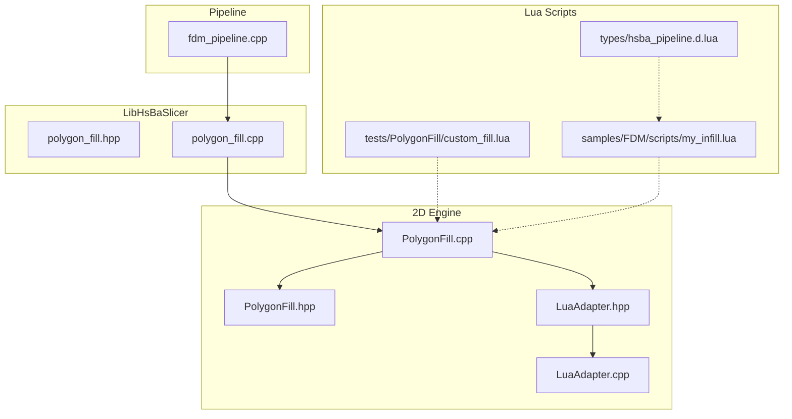
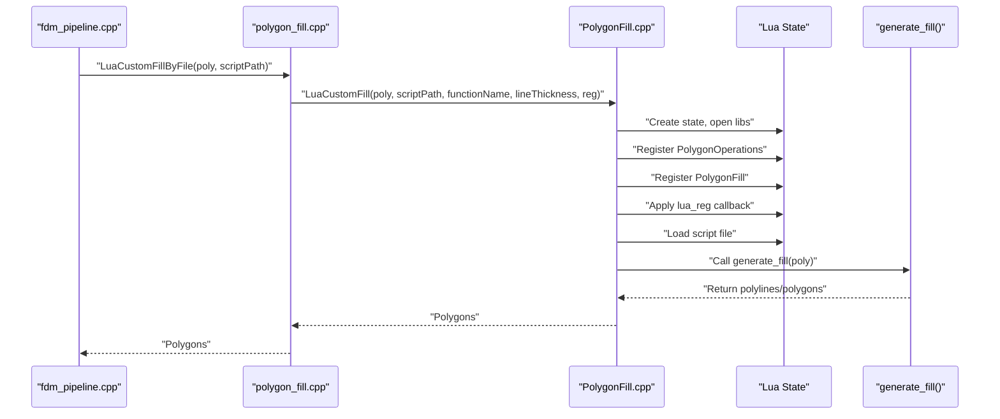
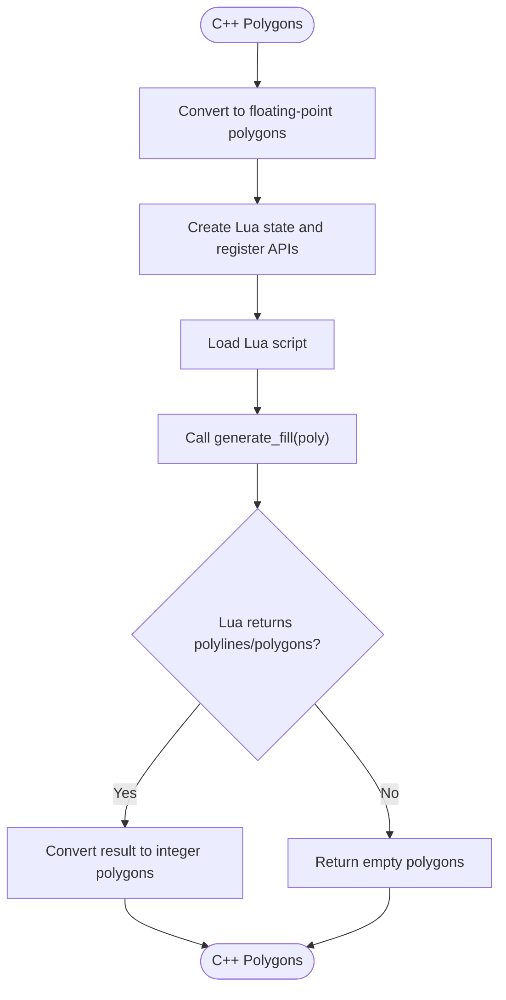
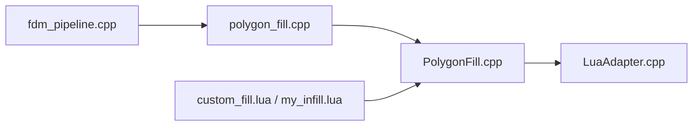
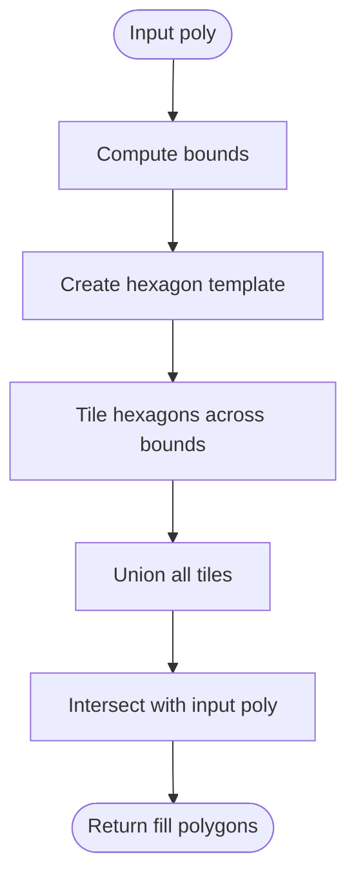
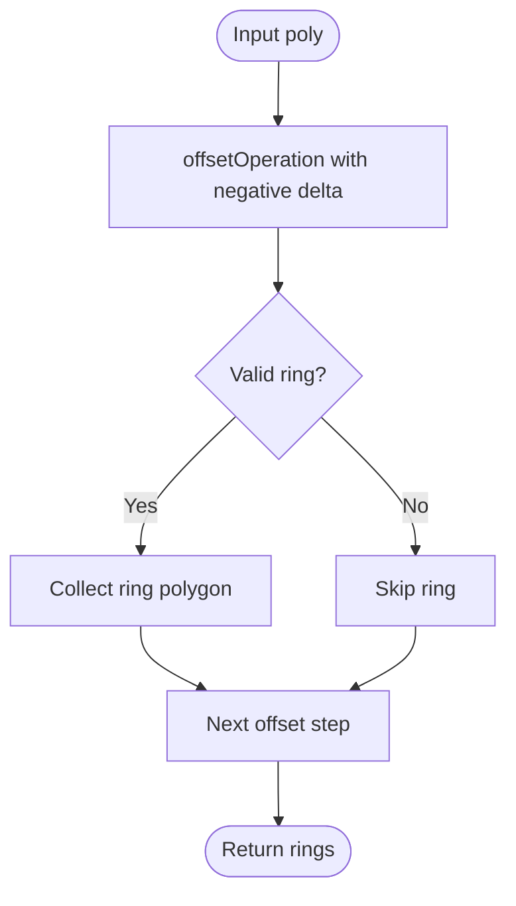
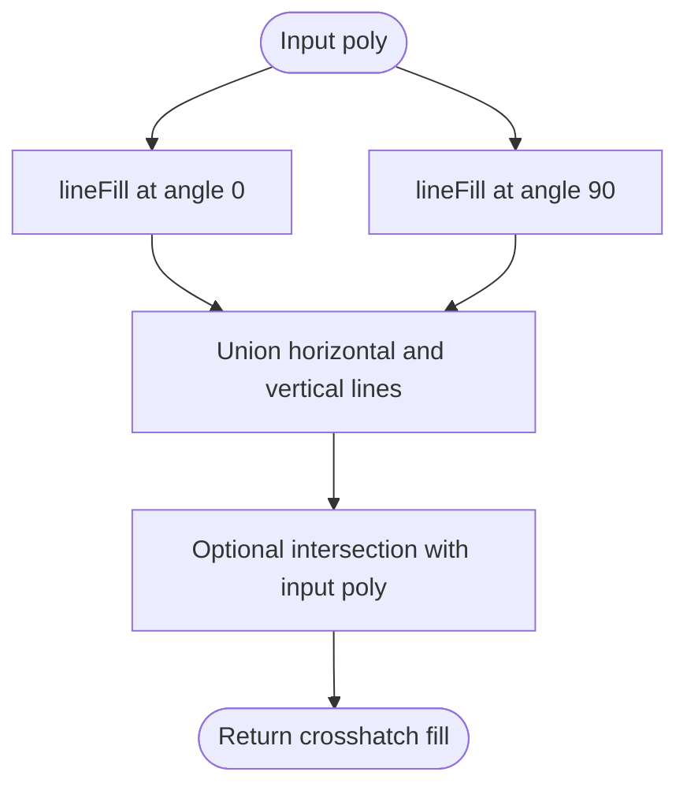

# Custom Fill Patterns

<cite>
**Referenced Files in This Document**
- [PolygonFill.hpp](file://2D/PolygonFill.hpp)
- [PolygonFill.cpp](file://2D/PolygonFill.cpp)
- [LuaAdapter.hpp](file://2D/LuaAdapter.hpp)
- [LuaAdapter.cpp](file://2D/LuaAdapter.cpp)
- [polygon_fill.hpp](file://LibHsBaSlicer/Fill/polygon_fill.hpp)
- [polygon_fill.cpp](file://LibHsBaSlicer/Fill/polygon_fill.cpp)
- [custom_fill.lua](file://tests/PolygonFill/custom_fill.lua)
- [my_infill.lua](file://samples/FDM/scripts/my_infill.lua)
- [hsba_pipeline.d.lua](file://types/hsba_pipeline.d.lua)
- [fdm_pipeline.cpp](file://DllHsBaSlicer/fdm_pipeline.cpp)
</cite>

## Table of Contents
1. [Introduction](#introduction)
2. [Project Structure](#project-structure)
3. [Core Components](#core-components)
4. [Architecture Overview](#architecture-overview)
5. [Detailed Component Analysis](#detailed-component-analysis)
6. [Dependency Analysis](#dependency-analysis)
7. [Performance Considerations](#performance-considerations)
8. [Troubleshooting Guide](#troubleshooting-guide)
9. [Conclusion](#conclusion)
10. [Appendices](#appendices)

## Introduction
This document explains how to implement custom fill patterns in HsBaSlicer using Lua scripting. It focuses on the PolygonFill API, including `offsetFill()`, `lineFill()`, `simpleZigzagFill()`, and `zigzagFill()`, and shows how to build custom algorithms that work with the existing polygon data structures. It also provides guidance for creating unique patterns such as honeycomb or concentric fills, optimizing performance for complex patterns, managing memory across C++ and Lua, and debugging fill generation issues.

The core idea is simple: a Lua script defines a function named `generate_fill(poly)` that receives the current layer polygons and returns an array of polylines or polygons representing the desired fill. The C++ engine converts between integer and floating-point polygon types, calls your Lua function, and integrates the result into the slicing pipeline.

## Project Structure
Custom fill functionality spans several layers:

- 2D geometry and fill engine:
  - `2D/PolygonFill.hpp` and `2D/PolygonFill.cpp`: built-in fill algorithms and Lua glue functions.
  - `2D/LuaAdapter.hpp` and `2D/LuaAdapter.cpp`: conversion helpers and `PolygonOperations` registration.
- LibHsBaSlicer wrapper:
  - `LibHsBaSlicer/Fill/polygon_fill.hpp` and `polygon_fill.cpp`: public C++ API for filling and Lua-based custom fills.
- Pipeline integration:
  - `DllHsBaSlicer/fdm_pipeline.cpp`: uses `FillWithBorder` and `LuaCustomFillByFile` during FDM infill.
- Lua examples and type definitions:
  - `tests/PolygonFill/custom_fill.lua`: minimal test script.
  - `samples/FDM/scripts/my_infill.lua`: sample FDM infill script.
  - `types/hsba_pipeline.d.lua`: Lua type declarations for pipeline scripts.

**Diagram sources**
- [PolygonFill.hpp:16-136](file://2D/PolygonFill.hpp#L16-L136)
- [PolygonFill.cpp:223-502](file://2D/PolygonFill.cpp#L223-L502)
- [LuaAdapter.hpp:76-81](file://2D/LuaAdapter.hpp#L76-L81)
- [LuaAdapter.cpp:311-490](file://2D/LuaAdapter.cpp#L311-L490)
- [polygon_fill.hpp:17-53](file://LibHsBaSlicer/Fill/polygon_fill.hpp#L17-L53)
- [polygon_fill.cpp:13-49](file://LibHsBaSlicer/Fill/polygon_fill.cpp#L13-L49)
- [fdm_pipeline.cpp:334-362](file://DllHsBaSlicer/fdm_pipeline.cpp#L334-L362)

**Section sources**
- [PolygonFill.hpp:16-136](file://2D/PolygonFill.hpp#L16-L136)
- [polygon_fill.hpp:17-53](file://LibHsBaSlicer/Fill/polygon_fill.hpp#L17-L53)
- [fdm_pipeline.cpp:334-362](file://DllHsBaSlicer/fdm_pipeline.cpp#L334-L362)

## Core Components
The custom fill system has three main responsibilities:

1. Built-in fill algorithms:
   - Offset-based fills.
   - Line fills.
   - Zigzag fills.
   - Composite and hybrid fills combining borders and interior patterns.
2. Lua integration:
   - A global `PolygonFill` table exposing fill helpers.
   - A global `PolygonOperations` table exposing boolean operations, offsets, hulls, area, shape generators, and text-to-polygons.
   - A required `generate_fill(poly)` entry point returning polylines or polygons.
3. Public API:
   - `FillPolygon()` selects a built-in mode.
   - `FillWithBorder()` adds offset borders around the interior fill.
   - `LuaCustomFillByFile()` loads a Lua script and runs `generate_fill`.

Key implementation details:

- `RegisterLuaPolygonFillFunctions()` registers the `PolygonFill` table with functions like `offsetFill`, `lineFill`, `simpleZigzagFill`, `zigzagFill`, `compositeOffsetFill`, `hybridFill`, and `offsetOnly`.
- `RegisterLuaPolygonOperations()` registers the `PolygonOperations` table with boolean operations, offset, convex/concave hulls, area, rectangle/circle/ellipse/regular polygon generators, and optional dump utilities.
- `LuaCustomFill()` creates a Lua state, opens standard libraries, registers polygon operations and fill functions, optionally applies a user-provided registration callback, loads the script, and calls the configured function name.

**Section sources**
- [PolygonFill.hpp:60-136](file://2D/PolygonFill.hpp#L60-L136)
- [PolygonFill.cpp:223-502](file://2D/PolygonFill.cpp#L223-L502)
- [LuaAdapter.cpp:311-490](file://2D/LuaAdapter.cpp#L311-L490)
- [polygon_fill.cpp:13-49](file://LibHsBaSlicer/Fill/polygon_fill.cpp#L13-L49)

## Architecture Overview
The custom fill flow connects the slicing pipeline, the LibHsBaSlicer API, the 2D fill engine, and the Lua script.

**Diagram sources**
- [fdm_pipeline.cpp:334-362](file://DllHsBaSlicer/fdm_pipeline.cpp#L334-L362)
- [polygon_fill.cpp:35-49](file://LibHsBaSlicer/Fill/polygon_fill.cpp#L35-L49)
- [PolygonFill.cpp:1493-1518](file://2D/PolygonFill.cpp#L1493-L1518)

## Detailed Component Analysis

### PolygonFill API
The `PolygonFill` Lua table exposes built-in fill helpers that can be used inside `generate_fill()` to compose custom patterns.

| Function | Parameters | Description |
|---|---|---|
| `offsetFill(poly, spacing, options)` | `poly`: polygon table `spacing`: number `options.join_type`: string | Generates offset-based fill loops inward from the input polygon boundary. Supports join types such as Square, Bevel, Round, and Miter. |
| `lineFill(poly, spacing, angle_deg, lineThickness)` | `poly`: polygon table `spacing`: number `angle_deg`: number `lineThickness`: number | Generates parallel straight-line segments at the given angle and spacing. |
| `simpleZigzagFill(poly, spacing, angle_deg, lineThickness)` | `poly`: polygon table `spacing`: number `angle_deg`: number `lineThickness`: number | Generates a zigzag pattern by connecting centers of scanline segments across rows. |
| `zigzagFill(poly, spacing, angle_deg, lineThickness)` | `poly`: polygon table `spacing`: number `angle_deg`: number `lineThickness`: number | Advanced zigzag fill with improved corner handling. |
| `compositeOffsetFill(...)` | Multiple parameters including spacing, offsetStep, outwardCount, inwardCount, mode, angle, thickness, join_type | Combines border offsets with internal fill modes. |
| `hybridFill(...)` | Same parameter family as composite offset fill | Applies offsets first, then fills the last offset region. |
| `offsetOnly(delta, inner, outer, options)` | `delta`: number `inner`: size_t `outer`: size_t `options.join_type`: string | Returns offset rings and optionally the final inner/outer regions for advanced composition. |

Important notes:

- All polygon inputs are tables where each polygon is an array of points `{x=..., y=...}`.
- Floating-point coordinates are used in Lua; C++ converts them to integer precision internally for geometric operations.
- Some functions accept an optional `join_type` field when performing offset operations.

**Section sources**
- [PolygonFill.cpp:231-495](file://2D/PolygonFill.cpp#L231-L495)
- [PolygonFill.hpp:20-102](file://2D/PolygonFill.hpp#L20-L102)

### PolygonOperations API
The `PolygonOperations` table provides geometric primitives useful for building algorithmic fills.

| Function | Parameters | Description |
|---|---|---|
| `booleanOperation(left, right, op)` | `left`: polygon table `right`: polygon table `op`: string | Performs union, intersection, difference, or xor between two polygon sets. |
| `union(left, right)` | Two polygon tables | Computes the union of two polygon sets. |
| `intersection(left, right)` | Two polygon tables | Computes the intersection of two polygon sets. |
| `difference(left, right)` | Two polygon tables | Subtracts the right polygon set from the left. |
| `xor(left, right)` | Two polygon tables | Computes exclusive-or between polygon sets. |
| `offsetOperation(polys, delta)` | `polys`: polygon table `delta`: number | Offsets polygons by a signed distance. |
| `convexHullOperation(polys)` | `polys`: polygon table | Computes convex hulls for each polygon. |
| `concaveHullOperation(polys, additionalPoints)` | `polys`: polygon table `additionalPoints`: integer | Simulates concave hull behavior with extra points. |
| `area(poly)` | `poly`: polygon table | Returns the area of a single polygon. |
| `makeRectangle(x, y, width, height)` | Four numbers | Creates a rectangular polygon. |
| `makeCircle(cx, cy, radius, segments)` | Center, radius, optional segment count | Creates a circular polygon. |
| `makeEllipse(cx, cy, rx, ry, segments, rotation)` | Ellipse parameters | Creates an elliptical polygon. |
| `makeRegularPolygon(cx, cy, radius, sides, rotation)` | Regular polygon parameters | Creates a regular n-sided polygon. |
| `textToPolygons(text, font_file, font_size, x, y, curve_segments)` | Text and font parameters | Converts text to polygon outlines. |

These functions return polygon tables compatible with other `PolygonOperations` calls or with the final output expected by `generate_fill()`.

**Section sources**
- [LuaAdapter.cpp:22-329](file://2D/LuaAdapter.cpp#L22-L329)
- [LuaAdapter.cpp:487-490](file://2D/LuaAdapter.cpp#L487-L490)

### Custom Fill Entry Point
A custom fill script must define a function named `generate_fill(poly)`. The C++ engine passes the current layer polygons and expects an array of polylines or polygons.

Example contract:

- Input: `poly` is a table of polygons, where each polygon is a table of `{x, y}` points.
- Output: a table containing one or more polylines or polygons.
- Optional helper usage: call `PolygonFill.*` or `PolygonOperations.*` to compute intermediate shapes.

Reference example:

- `tests/PolygonFill/custom_fill.lua` defines `generate_fill(poly)` and returns two diagonal polylines.
- `samples/FDM/scripts/my_infill.lua` demonstrates a more complete FDM infill script using `PolygonOperations`.

**Section sources**
- [custom_fill.lua:1-16](file://tests/PolygonFill/custom_fill.lua#L1-L16)
- [my_infill.lua:1-38](file://samples/FDM/scripts/my_infill.lua#L1-L38)
- [hsba_pipeline.d.lua:518-525](file://types/hsba_pipeline.d.lua#L518-L525)

### C++ Public API for Custom Fills
LibHsBaSlicer exposes a small public API for filling and invoking Lua scripts.

| Function | Purpose |
|---|---|
| `FillPolygon(poly, spacing, mode, angle_deg)` | Selects a built-in fill mode: Line, SimpleZigzag, or Zigzag. |
| `FillWithBorder(poly, spacing, border_count, fill_mode, angle_deg)` | Adds border offset loops and fills the remaining interior region. |
| `LuaCustomFillByFile(poly, scriptPath, functionName, lineThickness)` | Loads a Lua script file and calls `functionName`, defaulting to `generate_fill`. |

The LibHsBaSlicer wrapper composes external 2D functions and path optimization functions into the Lua environment so custom scripts can optimize regions before path output.

**Section sources**
- [polygon_fill.hpp:17-53](file://LibHsBaSlicer/Fill/polygon_fill.hpp#L17-L53)
- [polygon_fill.cpp:13-49](file://LibHsBaSlicer/Fill/polygon_fill.cpp#L13-L49)

### Data Flow Between C++ and Lua
The engine performs coordinate conversions between integer and floating-point representations:

- C++ stores geometry as integer polygons for robust geometric operations.
- Before calling Lua, it converts to floating-point polygons.
- After Lua returns results, it converts back to integer polygons for downstream processing.

**Diagram sources**
- [PolygonFill.cpp:1493-1518](file://2D/PolygonFill.cpp#L1493-L1518)
- [LuaAdapter.cpp:332-484](file://2D/LuaAdapter.cpp#L332-L484)

## Dependency Analysis
The custom fill system depends on several modules:

- `2D/PolygonFill.*`: implements built-in fills and Lua glue.
- `2D/LuaAdapter.*`: handles polygon-to-Lua conversion and registers `PolygonOperations`.
- `LibHsBaSlicer/Fill/polygon_fill.*`: wraps 2D fill logic and exposes public API.
- `DllHsBaSlicer/fdm_pipeline.cpp`: invokes fill APIs during FDM processing.
- Lua scripts: provide custom fill logic through `generate_fill()`.

**Diagram sources**
- [fdm_pipeline.cpp:334-362](file://DllHsBaSlicer/fdm_pipeline.cpp#L334-L362)
- [polygon_fill.cpp:13-49](file://LibHsBaSlicer/Fill/polygon_fill.cpp#L13-L49)
- [PolygonFill.cpp:1493-1518](file://2D/PolygonFill.cpp#L1493-L1518)
- [LuaAdapter.cpp:487-490](file://2D/LuaAdapter.cpp#L487-L490)

**Section sources**
- [fdm_pipeline.cpp:334-362](file://DllHsBaSlicer/fdm_pipeline.cpp#L334-L362)
- [polygon_fill.cpp:13-49](file://LibHsBaSlicer/Fill/polygon_fill.cpp#L13-L49)
- [PolygonFill.cpp:1493-1518](file://2D/PolygonFill.cpp#L1493-L1518)

## Performance Considerations
When implementing complex custom fills, consider these performance strategies:

1. Prefer vectorized geometric operations:
   - Use `PolygonOperations.union`, `intersection`, `difference`, and `offsetOperation` instead of manually iterating over every vertex.
   - Boolean operations and offsets are implemented in C++ and optimized for large polygon sets.

2. Limit expensive computations:
   - Avoid recomputing the same shape repeatedly inside per-layer loops.
   - Cache reusable templates such as honeycomb cells or concentric ring generators if they do not depend on layer-specific geometry.

3. Control polygon complexity:
   - Reduce unnecessary vertices in generated shapes.
   - Use reasonable segment counts for circles and ellipses.
   - Filter out tiny polygons or very short segments before returning results.

4. Tune spacing and angles:
   - Smaller spacing increases the number of fill lines.
   - Extreme angles may increase computational overhead due to scanline intersections.

5. Use built-in fills where possible:
   - If your pattern can be approximated by `lineFill`, `simpleZigzagFill`, or `zigzagFill`, prefer those over fully manual construction.

6. Memory management:
   - Keep intermediate polygon tables small.
   - Release temporary tables promptly.
   - Avoid storing large global polygon caches unless necessary.

7. Debugging early:
   - Validate intermediate outputs using available dump utilities when enabled.
   - Check areas and bounds before applying expensive operations.

[No sources needed since this section provides general guidance]

## Troubleshooting Guide
Common issues and debugging strategies:

1. Script does not define `generate_fill`:
   - Ensure the script exports a function named `generate_fill`.
   - Verify the function name passed to `LuaCustomFillByFile` matches the script definition.

2. Wrong polygon format:
   - Each polygon must be a table of `{x, y}` points.
   - Each element of the returned table must be a polyline or polygon table.

3. Invalid parameters:
   - Functions like `offsetFill`, `lineFill`, and zigzag functions expect numeric spacing, angle, and thickness values.
   - Boolean operations require two polygon tables and a valid operation string.

4. Unexpected empty results:
   - Check whether the input polygon is empty.
   - Validate that boolean operations produce non-empty results.
   - Inspect areas and bounding boxes of intermediate shapes.

5. Performance problems:
   - Profile the script to identify repeated expensive operations.
   - Reduce polygon complexity and avoid excessive nested loops.

6. Using debug dumps:
   - When compiled with dump support, use `dumpPolygon` and `dumpPolygons` to inspect generated shapes.
   - Compare expected and actual polygon outputs to locate errors.

**Section sources**
- [LuaAdapter.cpp:16-54](file://2D/LuaAdapter.cpp#L16-L54)
- [LuaAdapter.cpp:108-165](file://2D/LuaAdapter.cpp#L108-L165)
- [LuaAdapter.cpp:275-309](file://2D/LuaAdapter.cpp#L275-L309)
- [custom_fill.lua:1-16](file://tests/PolygonFill/custom_fill.lua#L1-L16)

## Conclusion
Custom fill patterns in HsBaSlicer are implemented by writing a Lua script that defines `generate_fill(poly)` and returns polylines or polygons. The `PolygonFill` table provides built-in helpers for offset, line, and zigzag fills, while `PolygonOperations` provides geometric primitives for constructing algorithmic patterns. For production pipelines, prefer vectorized operations, limit polygon complexity, reuse computed templates, and validate intermediate results. The LibHsBaSlicer API and FDM pipeline integrate these components cleanly, allowing you to replace or extend default infill behavior without modifying core C++ code.

[No sources needed since this section summarizes without analyzing specific files]

## Appendices

### Example: Building a Honeycomb Pattern
Conceptual approach:

1. Compute the bounding box of the input polygon.
2. Generate a hexagon template using `makeRegularPolygon`.
3. Tile the hexagons across the bounding box.
4. Use `booleanOperation("union", ...)` to merge overlapping tiles.
5. Intersect the merged grid with the original polygon using `booleanOperation("intersection", ...)`.
6. Return the resulting polygons as the fill.

[No sources needed since this diagram shows conceptual workflow, not actual code structure]

### Example: Building Concentric Rings
Conceptual approach:

1. Use `offsetOperation` to generate multiple inward offset rings.
2. Optionally filter rings by area or minimum dimension.
3. Convert each ring into a closed polygon or polyline.
4. Return the rings as the fill pattern.

[No sources needed since this diagram shows conceptual workflow, not actual code structure]

### Example: Algorithmic Crosshatch
Conceptual approach:

1. Generate horizontal lines using `lineFill`.
2. Rotate or regenerate vertical lines using a different angle.
3. Combine both directions using `booleanOperation("union", ...)`.
4. Optionally intersect with the original polygon to constrain the pattern.

[No sources needed since this diagram shows conceptual workflow, not actual code structure]