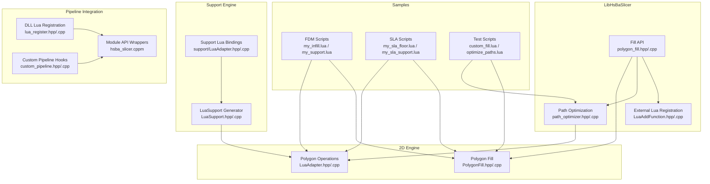
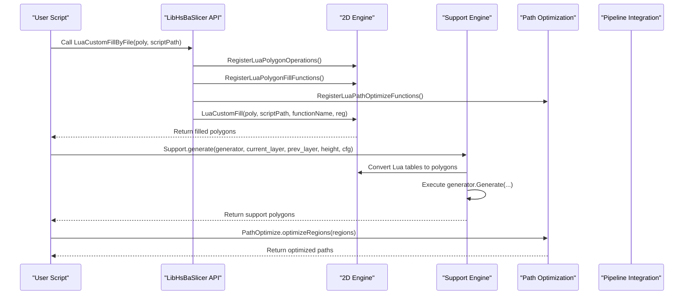
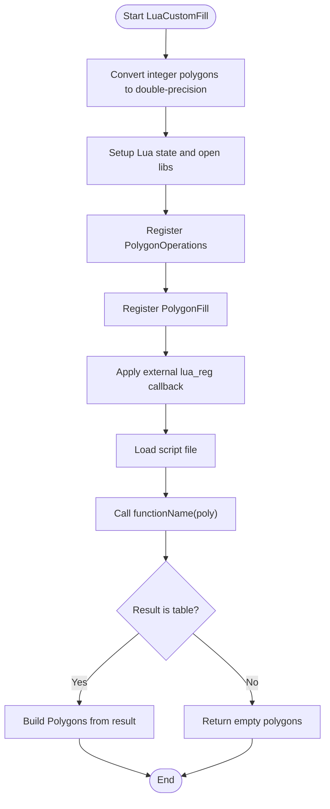
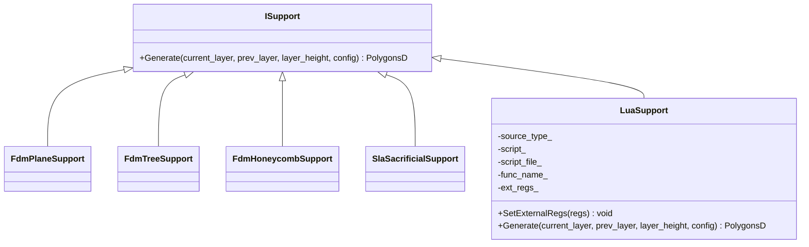
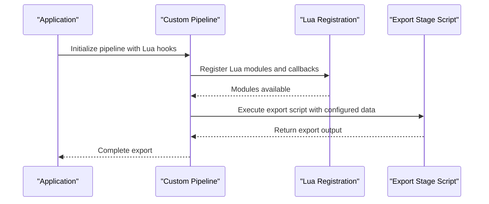
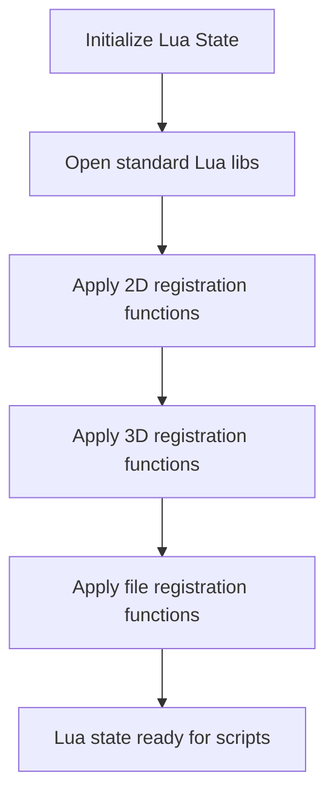
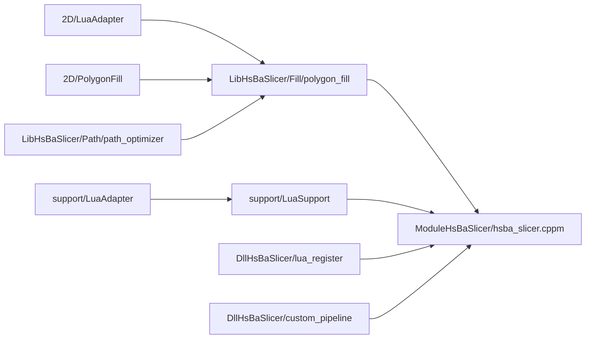

# Lua Script Extension Examples

<cite>
**Referenced Files in This Document**   
- [LuaAdapter.hpp](file://2D/LuaAdapter.hpp)
- [LuaAdapter.cpp](file://2D/LuaAdapter.cpp)
- [PolygonFill.hpp](file://2D/PolygonFill.hpp)
- [PolygonFill.cpp](file://2D/PolygonFill.cpp)
- [lua_register.h](file://DllHsBaSlicer/lua_register.h)
- [lua_register.cpp](file://DllHsBaSlicer/lua_register.cpp)
- [custom_pipeline.h](file://DllHsBaSlicer/custom_pipeline.h)
- [custom_pipeline.cpp](file://DllHsBaSlicer/custom_pipeline.cpp)
- [lua_pipeline.hpp](file://LibHsBaSlicer/Extends/lua_pipeline.hpp)
- [lua_pipeline.cpp](file://LibHsBaSlicer/Extends/lua_pipeline.cpp)
- [LuaAddFunction.hpp](file://LibHsBaSlicer/Extends/LuaAddFunction.hpp)
- [LuaAddFunction.cpp](file://LibHsBaSlicer/Extends/LuaAddFunction.cpp)
- [polygon_fill.hpp](file://LibHsBaSlicer/Fill/polygon_fill.hpp)
- [polygon_fill.cpp](file://LibHsBaSlicer/Fill/polygon_fill.cpp)
- [path_optimizer.hpp](file://LibHsBaSlicer/Path/path_optimizer.hpp)
- [path_optimizer.cpp](file://LibHsBaSlicer/Path/path_optimizer.cpp)
- [LuaSupport.hpp](file://support/LuaSupport.hpp)
- [LuaSupport.cpp](file://support/LuaSupport.cpp)
- [LuaAdapter.hpp](file://support/LuaAdapter.hpp)
- [LuaAdapter.cpp](file://support/LuaAdapter.cpp)
- [my_infill.lua](file://samples/FDM/scripts/my_infill.lua)
- [my_support.lua](file://samples/FDM/scripts/my_support.lua)
- [my_sla_floor.lua](file://samples/SLA/scripts/my_sla_floor.lua)
- [my_sla_support.lua](file://samples/SLA/scripts/my_sla_support.lua)
- [custom_fill.lua](file://tests/PolygonFill/custom_fill.lua)
- [optimize_paths.lua](file://tests/PolygonFill/optimize_paths.lua)
- [hsba_slicer.cppm](file://ModuleHsBaSlicer/hsba_slicer.cppm)
</cite>

## Table of Contents
1. [Introduction](#introduction)
2. [Project Structure](#project-structure)
3. [Core Components](#core-components)
4. [Architecture Overview](#architecture-overview)
5. [Detailed Component Analysis](#detailed-component-analysis)
6. [Dependency Analysis](#dependency-analysis)
7. [Performance Considerations](#performance-considerations)
8. [Troubleshooting Guide](#troubleshooting-guide)
9. [Conclusion](#conclusion)
10. [Appendices](#appendices)

## Introduction
This document provides comprehensive Lua script extension examples for HsBaSlicer customization. It demonstrates how to implement custom fill patterns, generate support structures through Lua scripts, and customize export formats by integrating with the HsBaSlicer pipeline. The complete Lua API surface is documented, including PolygonOperations, Support, PolygonFill, and PathOptimize libraries. Practical examples are drawn from FDM and SLA sample scripts, test scripts, and core C++ adapters that expose these capabilities to Lua.

The goal is to help both new and experienced users write maintainable, high-performance Lua extensions while understanding how the underlying C++ engine integrates with Lua at each stage: polygon operations, filling, support generation, path optimization, and export.

## Project Structure
HsBaSlicer exposes its geometry, filling, support, and path optimization engines to Lua through dedicated adapter layers. Sample scripts under samples and tests demonstrate real usage patterns.

**Diagram sources**
- [LuaAdapter.hpp:1-84](file://2D/LuaAdapter.hpp#L1-L84)
- [LuaAdapter.cpp:311-329](file://2D/LuaAdapter.cpp#L311-L329)
- [PolygonFill.hpp:104-136](file://2D/PolygonFill.hpp#L104-L136)
- [polygon_fill.hpp:1-58](file://LibHsBaSlicer/Fill/polygon_fill.hpp#L1-L58)
- [path_optimizer.hpp:102-170](file://LibHsBaSlicer/Path/path_optimizer.hpp#L102-L170)
- [LuaAdapter.hpp:1-33](file://support/LuaAdapter.hpp#L1-L33)
- [LuaSupport.hpp:21-81](file://support/LuaSupport.hpp#L21-L81)
- [lua_register.h:1-120](file://DllHsBaSlicer/lua_register.h#L1-L120)
- [custom_pipeline.h:1-120](file://DllHsBaSlicer/custom_pipeline.h#L1-L120)
- [hsba_slicer.cppm:1183-1214](file://ModuleHsBaSlicer/hsba_slicer.cppm#L1183-L1214)

**Section sources**
- [LuaAdapter.hpp:1-84](file://2D/LuaAdapter.hpp#L1-L84)
- [LuaAdapter.cpp:311-329](file://2D/LuaAdapter.cpp#L311-L329)
- [PolygonFill.hpp:104-136](file://2D/PolygonFill.hpp#L104-L136)
- [polygon_fill.hpp:1-58](file://LibHsBaSlicer/Fill/polygon_fill.hpp#L1-L58)
- [path_optimizer.hpp:102-170](file://LibHsBaSlicer/Path/path_optimizer.hpp#L102-L170)
- [LuaAdapter.hpp:1-33](file://support/LuaAdapter.hpp#L1-L33)
- [LuaSupport.hpp:21-81](file://support/LuaSupport.hpp#L21-L81)
- [lua_register.h:1-120](file://DllHsBaSlicer/lua_register.h#L1-L120)
- [custom_pipeline.h:1-120](file://DllHsBaSlicer/custom_pipeline.h#L1-L120)
- [hsba_slicer.cppm:1183-1214](file://ModuleHsBaSlicer/hsba_slicer.cppm#L1183-L1214)

## Core Components
This section documents the primary Lua-accessible components used for HsBaSlicer customization:

- PolygonOperations: Boolean operations, offset, hulls, area, shape generators, text-to-polygons, and optional dump utilities.
- PolygonFill: Built-in fill algorithms (line, zigzag, composite offset, hybrid), plus Lua-based custom fill entry points.
- Support: Factory functions for plane, tree, honeycomb, SLA, and Lua-based support generators; overhang detection; default configuration.
- PathOptimize: Region ordering optimization for fill paths or polygons, supporting one-shot APIs and manual optimizer construction.
- External Lua registration: Mechanisms to add 2D, 3D, file, and event callbacks into the Lua environment across stages.

Key responsibilities:
- 2D/LuaAdapter converts between Lua tables and polygon types and registers PolygonOperations.
- 2D/PolygonFill implements fill algorithms and exposes them via RegisterLuaPolygonFillFunctions.
- LibHsBaSlicer/Fill/polygon_fill wraps 2D fill and adds LuaCustomFillByFile integration with external registrations.
- LibHsBaSlicer/Path/path_optimizer exposes PathOptimize to Lua and provides region optimization helpers.
- support/LuaAdapter and support/LuaSupport provide the Support module and Lua-driven support generation.
- DllHsBaSlicer/lua_register and custom_pipeline integrate Lua scripts into the main pipeline.
- ModuleHsBaSlicer/hsba_slicer.cppm exposes convenient wrappers like luaCustomFill, luaCustomFloor, luaCustomSupport, and add2DFunction/add3DFunction.

**Section sources**
- [LuaAdapter.cpp:311-329](file://2D/LuaAdapter.cpp#L311-L329)
- [PolygonFill.cpp:488-502](file://2D/PolygonFill.cpp#L488-L502)
- [polygon_fill.cpp:35-49](file://LibHsBaSlicer/Fill/polygon_fill.cpp#L35-L49)
- [path_optimizer.hpp:102-170](file://LibHsBaSlicer/Path/path_optimizer.hpp#L102-L170)
- [LuaAdapter.cpp:253-276](file://support/LuaAdapter.cpp#L253-L276)
- [LuaSupport.cpp:67-90](file://support/LuaSupport.cpp#L67-L90)
- [lua_register.h:1-120](file://DllHsBaSlicer/lua_register.h#L1-L120)
- [custom_pipeline.h:1-120](file://DllHsBaSlicer/custom_pipeline.h#L1-L120)
- [hsba_slicer.cppm:1183-1214](file://ModuleHsBaSlicer/hsba_slicer.cppm#L1183-L1214)

## Architecture Overview
The Lua scripting system integrates with HsBaSlicer through a layered architecture:

- Samples and tests call into C++ APIs or use Lua scripts that rely on registered modules.
- LibHsBaSlicer provides stable C++ APIs that wrap 2D geometry and path optimization.
- 2D engine provides core polygon operations and fill algorithms.
- Support engine provides support generation strategies and Lua bindings.
- DLL layer registers Lua modules and hooks into the pipeline.
- Module wrapper exposes convenience functions for common tasks.

**Diagram sources**
- [polygon_fill.cpp:35-49](file://LibHsBaSlicer/Fill/polygon_fill.cpp#L35-L49)
- [PolygonFill.cpp:1493-1518](file://2D/PolygonFill.cpp#L1493-L1518)
- [LuaAdapter.cpp:487-491](file://2D/LuaAdapter.cpp#L487-L491)
- [path_optimizer.hpp:102-170](file://LibHsBaSlicer/Path/path_optimizer.hpp#L102-L170)
- [LuaAdapter.cpp:253-276](file://support/LuaAdapter.cpp#L253-L276)
- [LuaSupport.cpp:113-178](file://support/LuaSupport.cpp#L113-L178)

## Detailed Component Analysis

### Custom Fill Pattern Implementation
Custom fills are implemented by providing a Lua function that returns an array of polylines or polygons. The fill engine converts input polygons to double-precision coordinates, sets up the Lua environment, and calls the user-defined function.

Example references:
- FDM custom infill script defines generate_fill(current_layer) and uses PolygonOperations to compute parallel lines and intersect with the current layer.
- Test custom fill script returns diagonal polylines across a square.

**Diagram sources**
- [PolygonFill.cpp:1493-1518](file://2D/PolygonFill.cpp#L1493-L1518)
- [polygon_fill.cpp:35-49](file://LibHsBaSlicer/Fill/polygon_fill.cpp#L35-L49)

**Section sources**
- [my_infill.lua:1-89](file://samples/FDM/scripts/my_infill.lua#L1-L89)
- [custom_fill.lua:1-16](file://tests/PolygonFill/custom_fill.lua#L1-L16)
- [PolygonFill.hpp:104-136](file://2D/PolygonFill.hpp#L104-L136)
- [PolygonFill.cpp:1493-1518](file://2D/PolygonFill.cpp#L1493-L1518)
- [polygon_fill.cpp:35-49](file://LibHsBaSlicer/Fill/polygon_fill.cpp#L35-L49)

### Support Structure Generation Algorithms
The Support module exposes factory functions for different support generators and allows Lua scripts to replace built-in algorithms entirely. Scripts receive current_layer, prev_layer, layer_height, and config globals, and can return support polygons.

**Diagram sources**
- [LuaSupport.hpp:21-81](file://support/LuaSupport.hpp#L21-L81)
- [LuaAdapter.cpp:23-40](file://support/LuaAdapter.cpp#L23-L40)

**Section sources**
- [LuaSupport.hpp:21-81](file://support/LuaSupport.hpp#L21-L81)
- [LuaSupport.cpp:67-90](file://support/LuaSupport.cpp#L67-L90)
- [LuaSupport.cpp:113-178](file://support/LuaSupport.cpp#L113-L178)
- [LuaAdapter.cpp:253-276](file://support/LuaAdapter.cpp#L253-L276)
- [my_support.lua:1-83](file://samples/FDM/scripts/my_support.lua#L1-L83)
- [my_sla_support.lua:1-76](file://samples/SLA/scripts/my_sla_support.lua#L1-L76)

### Export Format Customization Through Lua
Export customization is achieved by integrating Lua scripts into the pipeline via DLL registration and custom pipeline hooks. The pipeline can load Lua scripts for specific export stages and pass data structures defined by the pipeline configuration.

**Diagram sources**
- [lua_register.h:1-120](file://DllHsBaSlicer/lua_register.h#L1-L120)
- [custom_pipeline.h:1-120](file://DllHsBaSlicer/custom_pipeline.h#L1-L120)

**Section sources**
- [lua_register.h:1-120](file://DllHsBaSlicer/lua_register.h#L1-L120)
- [custom_pipeline.h:1-120](file://DllHsBaSlicer/custom_pipeline.h#L1-L120)

### Complete Lua API Surface
The following summarizes the Lua API available within HsBaSlicer:

- PolygonOperations:
  - booleanOperation(polys_a, polys_b, op)
  - union(polys_a, polys_b)
  - intersection(polys_a, polys_b)
  - difference(polys_a, polys_b)
  - xor(polys_a, polys_b)
  - offsetOperation(polys, delta)
  - convexHullOperation(polys)
  - concaveHullOperation(polys, additional_points)
  - area(poly)
  - makeRectangle(x, y, width, height)
  - makeCircle(cx, cy, radius [, segments])
  - makeEllipse(cx, cy, rx, ry [, segments [, rotation]])
  - makeRegularPolygon(cx, cy, radius, sides [, rotation])
  - textToPolygons(text, font_file, font_size [, x [, y [, curve_segments]]])
  - Optional: dumpPolygon, dumpPolygons (when HSBA_POLYGON_DUMP is enabled)

- PolygonFill:
  - offsetFill(polys, spacing, options)
  - lineFill(polys, spacing, angle_deg, lineThickness)
  - simpleZigzagFill(polys, spacing, angle_deg, lineThickness)
  - zigzagFill(polys, spacing, angle_deg, lineThickness)
  - compositeOffsetFill(polys, spacing, offsetStep, outwardCount, inwardCount, mode, angle_deg, lineThickness, options)
  - hybridFill(polys, spacing, offsetStep, outwardCount, inwardCount, mode, angle_deg, lineThickness, options)
  - offsetOnly(polys, step, outwardCount, inwardCount, options)

- Support:
  - Support.new_plane()
  - Support.new_tree()
  - Support.new_honeycomb()
  - Support.new_sla()
  - Support.new_lua(script [, funcName])
  - Support.new_lua_file(path, funcName)
  - Support.generate(obj, current_layer, prev_layer, layer_height, cfg)
  - Support.detect_overhang(current, prev, height, angle)
  - Support.default_config()

- PathOptimize:
  - PathOptimize.new()
  - addRegion(id, paths)
  - addPolygons(id, polys)
  - addRoute(fromId, toId, cost)
  - optimizeOrder()
  - buildPaths()
  - buildPolygons()
  - PathOptimize.optimizeRegions(regions)
  - PathOptimize.optimizePolygons(regions)

- External registration:
  - add2DFunction(func)
  - add3DFunction(func)
  - addFileFunction(func)
  - addEventCallback(event_name, func)

**Section sources**
- [LuaAdapter.cpp:311-329](file://2D/LuaAdapter.cpp#L311-L329)
- [PolygonFill.cpp:488-502](file://2D/PolygonFill.cpp#L488-L502)
- [LuaAdapter.cpp:253-276](file://support/LuaAdapter.cpp#L253-L276)
- [path_optimizer.hpp:102-170](file://LibHsBaSlicer/Path/path_optimizer.hpp#L102-L170)
- [hsba_slicer.cppm:1208-1214](file://ModuleHsBaSlicer/hsba_slicer.cppm#L1208-L1214)

### Integrating External Libraries and Complex Data Structures
External libraries can be integrated by registering C++ functions into the Lua state during initialization. The LuaAddFunction mechanism maintains lists of 2D, 3D, and file-related registration functions. These are applied when creating Lua states for fill, support, and export stages.

Complex data structures such as polygons and configurations are converted between Lua tables and C++ types using helper functions in LuaAdapter. For example, PushPolygonsDToLua and LuaTableToPolygonsD handle nested arrays of point tables with x and y fields.

**Diagram sources**
- [LuaAddFunction.hpp:1-120](file://LibHsBaSlicer/Extends/LuaAddFunction.hpp#L1-L120)
- [LuaAddFunction.cpp:1-120](file://LibHsBaSlicer/Extends/LuaAddFunction.cpp#L1-L120)
- [LuaAdapter.cpp:332-491](file://2D/LuaAdapter.cpp#L332-L491)

**Section sources**
- [LuaAddFunction.hpp:1-120](file://LibHsBaSlicer/Extends/LuaAddFunction.hpp#L1-L120)
- [LuaAddFunction.cpp:1-120](file://LibHsBaSlicer/Extends/LuaAddFunction.cpp#L1-L120)
- [LuaAdapter.cpp:332-491](file://2D/LuaAdapter.cpp#L332-L491)

### Implementing Custom Algorithms
Custom algorithms can be implemented in Lua and invoked through the provided APIs:

- Custom fill algorithm: define generate_fill(poly) returning polylines/polygons.
- Custom support algorithm: define generate_support() using global variables and Support module.
- Path optimization algorithm: define optimize_paths(regions) or optimize_polygons(regions) using PathOptimize.

Examples:
- FDM my_infill.lua computes parallel lines and intersects with the current layer.
- FDM my_support.lua detects overhangs and selects a generator based on configuration.
- SLA my_sla_floor.lua builds raft, border, and internal fill using PolygonOperations and PolygonFill.
- SLA my_sla_support.lua uses SLA sacrificial support generator and filters results by area.
- Test optimize_paths.lua demonstrates both one-shot and manual optimization modes.

**Section sources**
- [my_infill.lua:1-89](file://samples/FDM/scripts/my_infill.lua#L1-L89)
- [my_support.lua:1-83](file://samples/FDM/scripts/my_support.lua#L1-L83)
- [my_sla_floor.lua:1-64](file://samples/SLA/scripts/my_sla_floor.lua#L1-L64)
- [my_sla_support.lua:1-76](file://samples/SLA/scripts/my_sla_support.lua#L1-L76)
- [optimize_paths.lua:1-34](file://tests/PolygonFill/optimize_paths.lua#L1-L34)

## Dependency Analysis
The Lua scripting system depends on several layers:

- 2D/LuaAdapter provides polygon conversion and PolygonOperations registration.
- 2D/PolygonFill provides fill algorithms and PolygonFill registration.
- LibHsBaSlicer/Fill/polygon_fill wraps 2D fill and composes external registrations.
- LibHsBaSlicer/Path/path_optimizer exposes PathOptimize to Lua.
- support/LuaAdapter and support/LuaSupport provide Support module and Lua-driven support generation.
- DllHsBaSlicer/lua_register and custom_pipeline integrate Lua scripts into the pipeline.
- ModuleHsBaSlicer/hsba_slicer.cppm exposes convenience wrappers.

**Diagram sources**
- [LuaAdapter.cpp:487-491](file://2D/LuaAdapter.cpp#L487-L491)
- [PolygonFill.cpp:488-502](file://2D/PolygonFill.cpp#L488-L502)
- [polygon_fill.cpp:35-49](file://LibHsBaSlicer/Fill/polygon_fill.cpp#L35-L49)
- [path_optimizer.hpp:102-170](file://LibHsBaSlicer/Path/path_optimizer.hpp#L102-L170)
- [LuaAdapter.cpp:253-276](file://support/LuaAdapter.cpp#L253-L276)
- [LuaSupport.cpp:113-178](file://support/LuaSupport.cpp#L113-L178)
- [lua_register.h:1-120](file://DllHsBaSlicer/lua_register.h#L1-L120)
- [custom_pipeline.h:1-120](file://DllHsBaSlicer/custom_pipeline.h#L1-L120)
- [hsba_slicer.cppm:1183-1214](file://ModuleHsBaSlicer/hsba_slicer.cppm#L1183-L1214)

**Section sources**
- [LuaAdapter.cpp:487-491](file://2D/LuaAdapter.cpp#L487-L491)
- [PolygonFill.cpp:488-502](file://2D/PolygonFill.cpp#L488-L502)
- [polygon_fill.cpp:35-49](file://LibHsBaSlicer/Fill/polygon_fill.cpp#L35-L49)
- [path_optimizer.hpp:102-170](file://LibHsBaSlicer/Path/path_optimizer.hpp#L102-L170)
- [LuaAdapter.cpp:253-276](file://support/LuaAdapter.cpp#L253-L276)
- [LuaSupport.cpp:113-178](file://support/LuaSupport.cpp#L113-L178)
- [lua_register.h:1-120](file://DllHsBaSlicer/lua_register.h#L1-L120)
- [custom_pipeline.h:1-120](file://DllHsBaSlicer/custom_pipeline.h#L1-L120)
- [hsba_slicer.cppm:1183-1214](file://ModuleHsBaSlicer/hsba_slicer.cppm#L1183-L1214)

## Performance Considerations
- Prefer vectorized operations where possible; avoid excessive per-point loops in Lua.
- Use built-in PolygonOperations and PolygonFill functions instead of reimplementing geometry operations in Lua.
- Minimize Lua-C++ boundary crossings by batching polygon conversions.
- For large models, consider precomputing constants and caching repeated computations in Lua.
- Use PathOptimize.optimizeRegions or optimizePolygons to reduce travel distance and improve print efficiency.
- Profile Lua scripts using Lua’s built-in profiling tools or external profilers to identify hotspots.
- Avoid heavy string processing in tight loops; precompute strings and reuse them.

[No sources needed since this section provides general guidance]

## Troubleshooting Guide
Common issues and debugging techniques:

- Lua script loading errors: Check script path and syntax; inspect error messages returned by luaL_loadfile or luaL_loadbuffer.
- Function name mismatch: Ensure the function name matches what the pipeline expects (e.g., generate_fill, generate_support, optimize_paths).
- Invalid polygon format: Verify that polygons are arrays of point tables with x and y numeric fields.
- Missing global variables: In support scripts, ensure current_layer, prev_layer, layer_height, and config are present.
- Unsupported operation: Confirm that the operation passed to booleanOperation is one of union, intersection, difference, xor.
- Overhang detection failures: Validate layer_height and angle parameters; check that prev_layer is non-empty for meaningful detection.
- Path optimization errors: Ensure regions are correctly structured as arrays of polylines or polygons.

Recommended debugging steps:
- Log intermediate results using Lua print or external logging if available.
- Use dumpPolygon/dumpPolygons (if compiled with HSBA_POLYGON_DUMP) to visualize polygon outputs.
- Simplify scripts incrementally to isolate problematic logic.
- Validate inputs before calling C++ functions to catch type mismatches early.

**Section sources**
- [LuaAdapter.cpp:16-19](file://2D/LuaAdapter.cpp#L16-L19)
- [LuaSupport.cpp:141-178](file://support/LuaSupport.cpp#L141-L178)
- [PolygonFill.cpp:1493-1518](file://2D/PolygonFill.cpp#L1493-L1518)

## Conclusion
HsBaSlicer provides a robust Lua scripting environment for customizing fill patterns, support generation, and export formats. By leveraging PolygonOperations, PolygonFill, Support, and PathOptimize, users can implement sophisticated algorithms while maintaining performance and maintainability. The modular architecture allows seamless integration of external libraries and complex data structures, and the provided examples serve as a solid foundation for further customization.

[No sources needed since this section summarizes without analyzing specific files]

## Appendices

### Appendix A: Lua API Reference Summary
- PolygonOperations: Boolean operations, offset, hulls, area, shape generators, text-to-polygons.
- PolygonFill: Line, zigzag, composite offset, hybrid, offset-only fills.
- Support: Generators for plane, tree, honeycomb, SLA, and Lua-based support; overhang detection; default config.
- PathOptimize: Region ordering optimization for fill paths or polygons.
- External registration: add2DFunction, add3DFunction, addFileFunction, addEventCallback.

**Section sources**
- [LuaAdapter.cpp:311-329](file://2D/LuaAdapter.cpp#L311-L329)
- [PolygonFill.cpp:488-502](file://2D/PolygonFill.cpp#L488-L502)
- [LuaAdapter.cpp:253-276](file://support/LuaAdapter.cpp#L253-L276)
- [path_optimizer.hpp:102-170](file://LibHsBaSlicer/Path/path_optimizer.hpp#L102-L170)
- [hsba_slicer.cppm:1208-1214](file://ModuleHsBaSlicer/hsba_slicer.cppm#L1208-L1214)

### Appendix B: Example Script References
- FDM custom infill: [my_infill.lua](file://samples/FDM/scripts/my_infill.lua)
- FDM custom support: [my_support.lua](file://samples/FDM/scripts/my_support.lua)
- SLA custom floor: [my_sla_floor.lua](file://samples/SLA/scripts/my_sla_floor.lua)
- SLA custom support: [my_sla_support.lua](file://samples/SLA/scripts/my_sla_support.lua)
- Test custom fill: [custom_fill.lua](file://tests/PolygonFill/custom_fill.lua)
- Test path optimization: [optimize_paths.lua](file://tests/PolygonFill/optimize_paths.lua)

**Section sources**
- [my_infill.lua:1-89](file://samples/FDM/scripts/my_infill.lua#L1-L89)
- [my_support.lua:1-83](file://samples/FDM/scripts/my_support.lua#L1-L83)
- [my_sla_floor.lua:1-64](file://samples/SLA/scripts/my_sla_floor.lua#L1-L64)
- [my_sla_support.lua:1-76](file://samples/SLA/scripts/my_sla_support.lua#L1-L76)
- [custom_fill.lua:1-16](file://tests/PolygonFill/custom_fill.lua#L1-L16)
- [optimize_paths.lua:1-34](file://tests/PolygonFill/optimize_paths.lua#L1-L34)