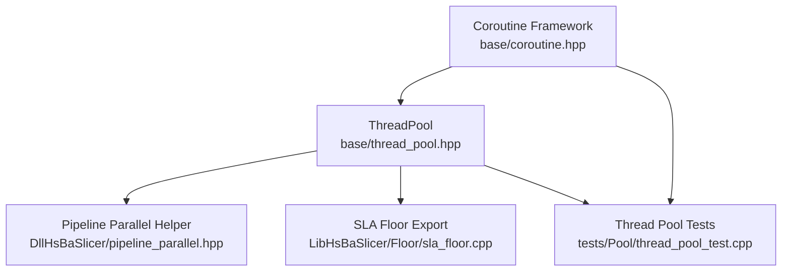
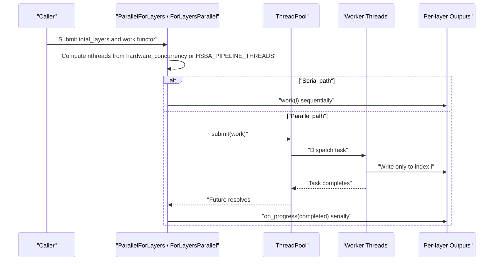
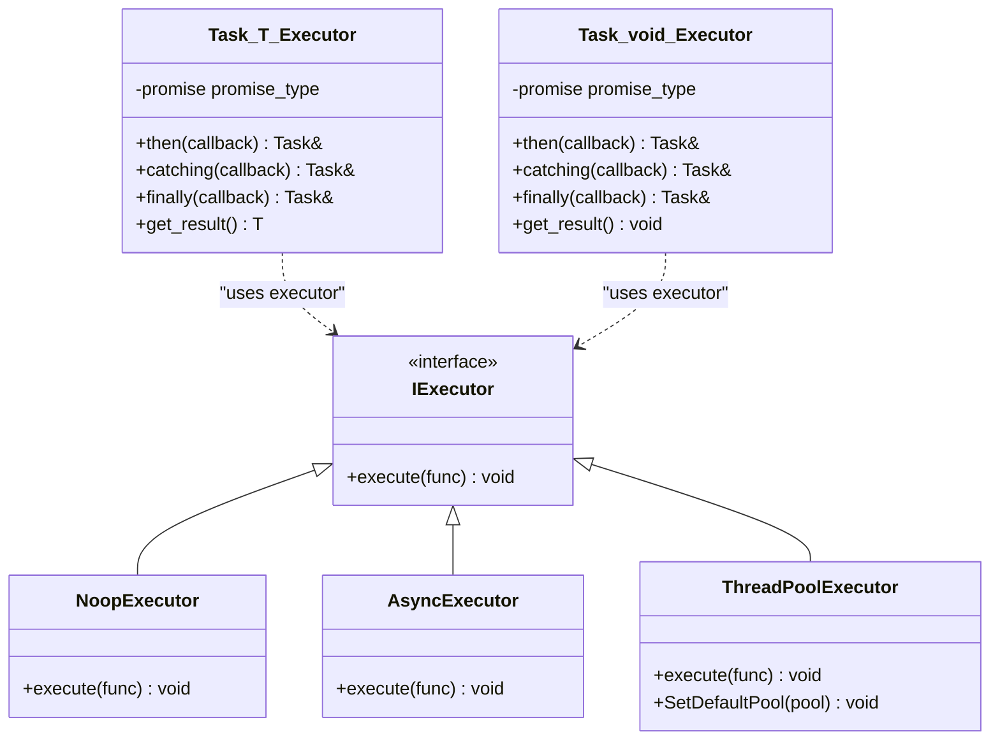
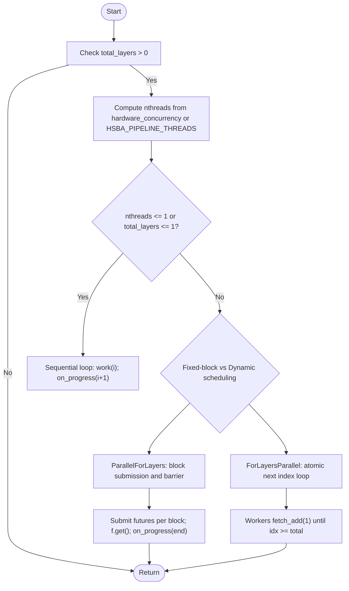
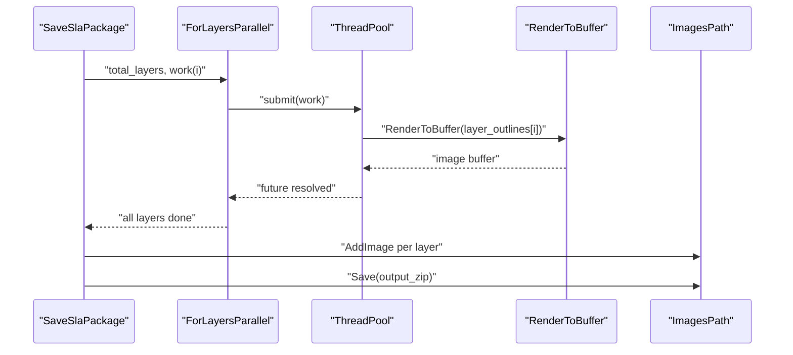
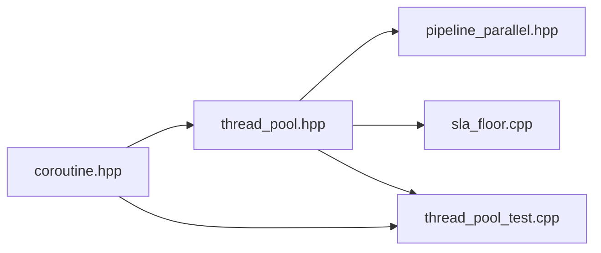

# Multi-threading Patterns and Best Practices

<cite>
**Referenced Files in This Document**
- [thread_pool.hpp](file://base/thread_pool.hpp)
- [coroutine.hpp](file://base/coroutine.hpp)
- [pipeline_parallel.hpp](file://DllHsBaSlicer/pipeline_parallel.hpp)
- [sla_floor.cpp](file://LibHsBaSlicer/Floor/sla_floor.cpp)
- [thread_pool_test.cpp](file://tests/Pool/thread_pool_test.cpp)
</cite>

## Table of Contents
1. [Introduction](#introduction)
2. [Project Structure](#project-structure)
3. [Core Components](#core-components)
4. [Architecture Overview](#architecture-overview)
5. [Detailed Component Analysis](#detailed-component-analysis)
6. [Dependency Analysis](#dependency-analysis)
7. [Performance Considerations](#performance-considerations)
8. [Troubleshooting Guide](#troubleshooting-guide)
9. [Conclusion](#conclusion)

## Introduction
This document explains how HsBaSlicer implements multi-threading for slicing, layer processing, model analysis, and file operations. It focuses on:
- Thread pool usage for parallel task execution
- Coroutine-based async programming patterns
- Thread-safe data access strategies
- Synchronization mechanisms, resource sharing, and deadlock prevention
- Practical examples such as parallelizing independent layers and image rendering
- Performance tuning, thread safety best practices, and debugging techniques

The goal is to help developers safely extend the pipeline with new parallel work while preserving correctness and performance.

## Project Structure
The multi-threading surface area relevant to this topic spans three main areas:
- Base concurrency primitives: thread pool and coroutine framework
- Pipeline-level parallel helpers for hot paths
- Concrete usage in SLA floor export and tests



**Diagram sources**
- [thread_pool.hpp:29-162](file://base/thread_pool.hpp#L29-L162)
- [pipeline_parallel.hpp:19-117](file://DllHsBaSlicer/pipeline_parallel.hpp#L19-L117)
- [sla_floor.cpp:400-465](file://LibHsBaSlicer/Floor/sla_floor.cpp#L400-L465)
- [thread_pool_test.cpp:14-85](file://tests/Pool/thread_pool_test.cpp#L14-L85)
- [coroutine.hpp:47-73](file://base/coroutine.hpp#L47-L73)

**Section sources**
- [thread_pool.hpp:1-214](file://base/thread_pool.hpp#L1-L214)
- [pipeline_parallel.hpp:1-122](file://DllHsBaSlicer/pipeline_parallel.hpp#L1-L122)
- [sla_floor.cpp:400-599](file://LibHsBaSlicer/Floor/sla_floor.cpp#L400-L599)
- [thread_pool_test.cpp:1-87](file://tests/Pool/thread_pool_test.cpp#L1-L87)
- [coroutine.hpp:1-1091](file://base/coroutine.hpp#L1-L1091)

## Core Components
HsBaSlicer provides two complementary concurrency abstractions:
- A thread pool that executes tasks concurrently and integrates with C++20 coroutines through an executor interface
- A coroutine framework that models asynchronous tasks, generators, executors, and chaining utilities

Key responsibilities:
- ThreadPool manages worker threads, a task queue, synchronization primitives, and optional coroutine integration
- Coroutine framework defines Task types, executors (NoopExecutor, AsyncExecutor), and a ThreadPoolExecutor adapter
- Pipeline helper ParallelForLayers exposes a safe, block-based parallel loop for independent layers
- SLA floor export demonstrates dynamic scheduling over layers and per-layer image rendering

**Section sources**
- [thread_pool.hpp:29-162](file://base/thread_pool.hpp#L29-L162)
- [coroutine.hpp:47-73](file://base/coroutine.hpp#L47-L73)
- [pipeline_parallel.hpp:22-42](file://DllHsBaSlicer/pipeline_parallel.hpp#L22-L42)
- [sla_floor.cpp:400-465](file://LibHsBaSlicer/Floor/sla_floor.cpp#L400-L465)

## Architecture Overview
At runtime, high-level pipelines submit independent work items to ThreadPool. For layer-wise work, higher-level helpers distribute indices either by fixed blocks or via atomic counters. Coroutine-based code can be scheduled onto the same pool using ThreadPoolExecutor.



**Diagram sources**
- [pipeline_parallel.hpp:41-117](file://DllHsBaSlicer/pipeline_parallel.hpp#L41-L117)
- [sla_floor.cpp:400-465](file://LibHsBaSlicer/Floor/sla_floor.cpp#L400-L465)
- [thread_pool.hpp:67-111](file://base/thread_pool.hpp#L67-L111)

## Detailed Component Analysis

### ThreadPool: Concurrent Task Execution
ThreadPool is a bounded worker-pool implementation with:
- A constructor that validates thread count and starts worker threads
- A destructor that signals shutdown, joins workers, and ensures clean termination
- submit() returning std::future for each task
- PendingTasks(), ActiveTasks(), and WaitAll() for monitoring and synchronization
- Internal state protected by a mutex and condition variables
- Optional coroutine executor integration via ThreadPoolExecutor when enabled

```mermaid
classDiagram
class ThreadPool {
+ThreadPool(num_threads)
+~ThreadPool()
+submit(f, args...) future
+PendingTasks() size_t
+ActiveTasks() size_t
+WaitAll() void
-WorkerLoop() void
-workers_ vector<thread>
-tasks_ queue<function<void()>>
-queue_mutex_ mutex
-condition_ condition_variable
-finished_condition_ condition_variable
-stop_ atomic<bool>
-active_tasks_ atomic<size_t>
}
class ThreadPoolExecutor {
+ThreadPoolExecutor()
+explicit ThreadPoolExecutor(pool)
+execute(func) void
+SetDefaultPool(pool) void
-default_pool_ ThreadPool*
-pool_ ThreadPool*
-get_pool() ThreadPool*
}
ThreadPoolExecutor --> ThreadPool : "submits tasks"
```

**Diagram sources**
- [thread_pool.hpp:29-162](file://base/thread_pool.hpp#L29-L162)
- [thread_pool.hpp:164-210](file://base/thread_pool.hpp#L164-L210)

Implementation highlights:
- Task submission wraps work into packaged_task and stores futures
- Workers wait on a condition variable until stop or a task is available
- Exceptions inside tasks are caught internally; active_tasks decrements and completion is signaled
- WaitAll uses a second condition variable to observe empty queue and zero active tasks

Thread-safety notes:
- All shared state is guarded by queue_mutex_
- Stop flag and active counter are atomic where appropriate
- No external locks are held while executing user tasks, reducing lock contention

Deadlock prevention:
- Worker loop never holds queue_mutex_ during task execution
- Shutdown sets stop_ under lock and notifies all workers before joining

**Section sources**
- [thread_pool.hpp:37-61](file://base/thread_pool.hpp#L37-L61)
- [thread_pool.hpp:67-111](file://base/thread_pool.hpp#L67-L111)
- [thread_pool.hpp:117-162](file://base/thread_pool.hpp#L117-L162)

### Coroutine Framework: Async Tasks and Executors
The coroutine framework provides:
- IExecutor interface with NoopExecutor and AsyncExecutor implementations
- Task<T, Executor> and Task<void, Executor> with promise-based result handling
- Awaiters for co_await composition
- DispatchAwaiter to schedule resumption on a specific executor
- Custom allocator support for Task variants



**Diagram sources**
- [coroutine.hpp:47-73](file://base/coroutine.hpp#L47-L73)
- [coroutine.hpp:205-382](file://base/coroutine.hpp#L205-L382)
- [coroutine.hpp:384-555](file://base/coroutine.hpp#L384-L555)
- [thread_pool.hpp:164-210](file://base/thread_pool.hpp#L164-L210)

Key behaviors:
- initial_suspend dispatches first resume to the executor
- final_suspend keeps the coroutine alive until awaited or destroyed
- Result encapsulates value or exception pointer; get_or_throw rethrows exceptions
- then/catching/finally register callbacks invoked after completion
- ThreadPoolExecutor forwards execute calls to ThreadPool.submit

Coroutines and thread pools:
- When HSBA_ENABLE_THREAD_POOL_COROUTINE is defined, ThreadPoolExecutor bridges coroutines to ThreadPool
- Tests demonstrate setting a default pool and mixing futures with co_await tasks

**Section sources**
- [coroutine.hpp:47-73](file://base/coroutine.hpp#L47-L73)
- [coroutine.hpp:205-382](file://base/coroutine.hpp#L205-L382)
- [coroutine.hpp:384-555](file://base/coroutine.hpp#L384-L555)
- [thread_pool.hpp:164-210](file://base/thread_pool.hpp#L164-L210)
- [thread_pool_test.cpp:39-85](file://tests/Pool/thread_pool_test.cpp#L39-L85)

### Pipeline Parallel Helpers: Safe Layer Processing
Two helpers expose parallel iteration over independent layers:

- ParallelForLayers (header-only):
  - Computes worker count from hardware_concurrency or HSBA_PIPELINE_THREADS
  - Falls back to serial loop when single-threaded or single-layer
  - Processes layers in blocks to reduce progress callback frequency
  - Ensures on_progress runs on the calling thread

- ForLayersParallel (SLA floor module):
  - Uses dynamic scheduling with an atomic next index
  - Each worker pulls indices until exhausted
  - Suitable when per-layer cost varies significantly



**Diagram sources**
- [pipeline_parallel.hpp:41-117](file://DllHsBaSlicer/pipeline_parallel.hpp#L41-L117)
- [sla_floor.cpp:400-465](file://LibHsBaSlicer/Floor/sla_floor.cpp#L400-L465)

Practical example: SLA package saving
- Render layer images in parallel using ForLayersParallel
- Serialize results into per-index buffers
- Insert images into output archive serially



**Diagram sources**
- [sla_floor.cpp:468-529](file://LibHsBaSlicer/Floor/sla_floor.cpp#L468-L529)
- [sla_floor.cpp:400-465](file://LibHsBaSlicer/Floor/sla_floor.cpp#L400-L465)

**Section sources**
- [pipeline_parallel.hpp:22-117](file://DllHsBaSlicer/pipeline_parallel.hpp#L22-L117)
- [sla_floor.cpp:400-529](file://LibHsBaSlicer/Floor/sla_floor.cpp#L400-L529)

### Thread-Safe Data Access Strategies
Observed patterns in HsBaSlicer:
- Per-task isolation: work functions write only to their own output slot (e.g., layer_images[i])
- Atomic counters for dynamic scheduling: next.fetch_add(1) avoids locks in hot loops
- Minimal shared state: ThreadPool owns internal queue and counters; callers avoid global mutable state
- Progress callbacks run on the caller thread to avoid UI or logging races

Best practices derived from the codebase:
- Partition outputs by task identity (index, ID, or unique key)
- Prefer immutable inputs passed by value or const reference
- Use atomics for simple counters; use mutexes for complex shared structures
- Keep critical sections small; do not hold locks while doing heavy computation
- Avoid nested locking across unrelated resources to prevent deadlocks

**Section sources**
- [sla_floor.cpp:400-465](file://LibHsBaSlicer/Floor/sla_floor.cpp#L400-L465)
- [thread_pool.hpp:117-162](file://base/thread_pool.hpp#L117-L162)

### Synchronization Mechanisms and Deadlock Prevention
Mechanisms used:
- std::mutex and std::unique_lock around task queue and state updates
- std::condition_variable for worker wake-up and completion signaling
- std::atomic<bool> stop_ and std::atomic<size_t> active_tasks_ for lightweight coordination
- Futures returned by submit() to propagate exceptions and synchronize completion

Deadlock prevention techniques:
- Never call submit() while holding a lock that another worker might need
- Do not perform blocking I/O or long computations under locks
- Ensure destruction order: stop flag set before joining threads
- Use RAII locks to guarantee unlock even on exceptions
- Avoid circular dependencies between components that acquire multiple locks

**Section sources**
- [thread_pool.hpp:47-61](file://base/thread_pool.hpp#L47-L61)
- [thread_pool.hpp:67-111](file://base/thread_pool.hpp#L67-L111)
- [thread_pool.hpp:117-162](file://base/thread_pool.hpp#L117-L162)

### Practical Examples

#### Parallelizing Independent Layers
Use ParallelForLayers or ForLayersParallel to process layers independently:
- Compute nthreads from hardware_concurrency or environment override
- Submit work(i) that writes only to index i
- Aggregate results serially after parallel phase

Example references:
- [pipeline_parallel.hpp:41-117](file://DllHsBaSlicer/pipeline_parallel.hpp#L41-L117)
- [sla_floor.cpp:400-465](file://LibHsBaSlicer/Floor/sla_floor.cpp#L400-L465)

#### Model Analysis and File Operations
- Model analysis should be partitioned by mesh regions or layers and submitted to ThreadPool
- File operations should be batched and serialized where necessary (e.g., writing to a single archive)
- Use ForLayersParallel for per-layer image generation and then serialize results

Example references:
- [sla_floor.cpp:468-529](file://LibHsBaSlicer/Floor/sla_floor.cpp#L468-L529)

#### Coroutine-Based Async Workflows
- Define Task-returning functions for async steps
- Use co_await to compose steps without manual threading
- Schedule tasks on ThreadPoolExecutor for controlled concurrency

Example references:
- [coroutine.hpp:205-382](file://base/coroutine.hpp#L205-L382)
- [thread_pool_test.cpp:39-85](file://tests/Pool/thread_pool_test.cpp#L39-L85)

## Dependency Analysis
The following diagram shows how the core concurrency components depend on each other:



**Diagram sources**
- [coroutine.hpp:47-73](file://base/coroutine.hpp#L47-L73)
- [thread_pool.hpp:164-210](file://base/thread_pool.hpp#L164-L210)
- [pipeline_parallel.hpp:17-117](file://DllHsBaSlicer/pipeline_parallel.hpp#L17-L117)
- [sla_floor.cpp:400-465](file://LibHsBaSlicer/Floor/sla_floor.cpp#L400-L465)
- [thread_pool_test.cpp:1-87](file://tests/Pool/thread_pool_test.cpp#L1-L87)

Coupling and cohesion:
- ThreadPool is cohesive and self-contained; it exposes minimal interfaces
- Coroutine framework is decoupled from ThreadPool via IExecutor
- Pipeline helpers depend on ThreadPool but remain thin orchestration layers
- SLA floor module depends on both ThreadPool and coroutine-enabled tests

Potential risks:
- If ThreadPoolExecutor is enabled, coroutine code may implicitly depend on a configured default pool
- Misuse of shared state in work functors can introduce data races
- Excessive progress callbacks or large per-layer work can degrade throughput

**Section sources**
- [thread_pool.hpp:29-210](file://base/thread_pool.hpp#L29-L210)
- [coroutine.hpp:47-73](file://base/coroutine.hpp#L47-L73)
- [pipeline_parallel.hpp:17-117](file://DllHsBaSlicer/pipeline_parallel.hpp#L17-L117)
- [sla_floor.cpp:400-465](file://LibHsBaSlicer/Floor/sla_floor.cpp#L400-L465)
- [thread_pool_test.cpp:1-87](file://tests/Pool/thread_pool_test.cpp#L1-L87)

## Performance Considerations
- Worker count selection:
  - Default to hardware_concurrency
  - Allow HSBA_PIPELINE_THREADS override for reproducible comparisons
  - Cap nthreads by total_layers to avoid unnecessary overhead

- Work distribution strategy:
  - Fixed-block parallelism reduces progress callback overhead and simplifies ordering
  - Dynamic scheduling balances uneven per-layer costs

- Memory and allocation:
  - Pass large read-only data by const reference
  - Avoid allocations inside tight loops; preallocate per-layer output containers

- Lock contention:
  - Minimize shared state; prefer per-task buffers
  - Use atomics for simple counters; avoid mutexes in hot inner loops

- Exception handling:
  - Let futures propagate exceptions to the caller
  - Avoid swallowing exceptions in worker loops unless intentional

- I/O and serialization:
  - Batch file writes; avoid per-layer file opens
  - Serialize output insertion after parallel phases

[No sources needed since this section provides general guidance]

## Troubleshooting Guide
Common issues and remedies:
- Submitter throws after pool destruction:
  - Ensure no submit() calls occur after ThreadPool lifetime ends
  - Reference: [thread_pool.hpp:77-89](file://base/thread_pool.hpp#L77-L89)

- Deadlocks or hangs:
  - Verify no nested locks; ensure locks are released before heavy work
  - Confirm destruction sequence: stop flag set before join
  - Reference: [thread_pool.hpp:47-61](file://base/thread_pool.hpp#L47-L61)

- Incorrect progress reporting:
  - Ensure on_progress is called on the caller thread
  - Reference: [pipeline_parallel.hpp:90-116](file://DllHsBaSlicer/pipeline_parallel.hpp#L90-L116)

- Coroutine not running on expected thread:
  - Set ThreadPoolExecutor default pool and verify HSBA_ENABLE_THREAD_POOL_COROUTINE
  - Reference: [thread_pool.hpp:164-210](file://base/thread_pool.hpp#L164-L210)

- Data races in per-layer outputs:
  - Guarantee each worker writes only to its own index
  - Reference: [sla_floor.cpp:400-465](file://LibHsBaSlicer/Floor/sla_floor.cpp#L400-L465)

Debugging tips:
- Use HSBA_PIPELINE_THREADS=1 to force serial execution for validation
- Add logging around submit/future.get boundaries
- Validate atomic counters and progress counts match total_layers
- Run unit tests covering normal, coroutine, and mixed scenarios

**Section sources**
- [thread_pool.hpp:77-89](file://base/thread_pool.hpp#L77-L89)
- [thread_pool.hpp:47-61](file://base/thread_pool.hpp#L47-L61)
- [pipeline_parallel.hpp:90-116](file://DllHsBaSlicer/pipeline_parallel.hpp#L90-L116)
- [thread_pool.hpp:164-210](file://base/thread_pool.hpp#L164-L210)
- [sla_floor.cpp:400-465](file://LibHsBaSlicer/Floor/sla_floor.cpp#L400-L465)
- [thread_pool_test.cpp:14-85](file://tests/Pool/thread_pool_test.cpp#L14-L85)

## Conclusion
HsBaSlicer’s multi-threading design centers on a robust ThreadPool, a flexible coroutine framework, and thin pipeline helpers that make parallelizing independent work straightforward. By isolating per-task outputs, using atomics for simple coordination, and keeping synchronization scopes small, the codebase achieves safe and efficient parallel execution. The provided patterns—fixed-block distribution, dynamic scheduling, and coroutine-driven workflows—serve as templates for extending the slicer with new parallel stages while avoiding common pitfalls like data races and deadlocks.

[No sources needed since this section summarizes without analyzing specific files]