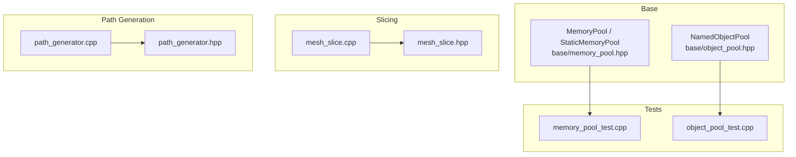
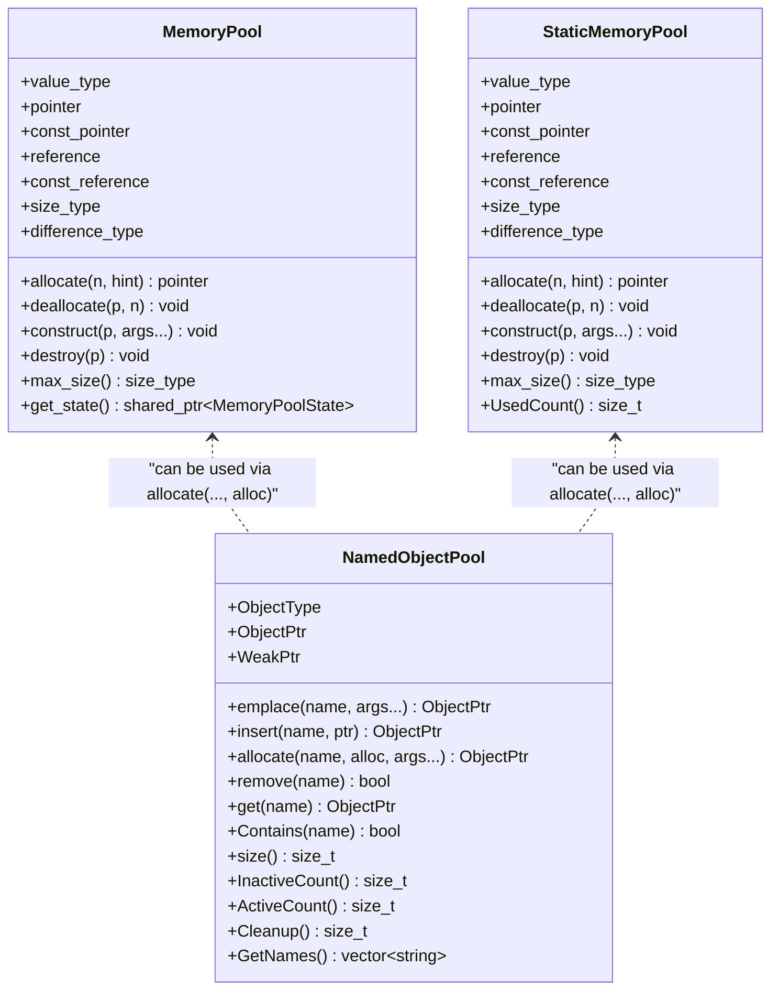
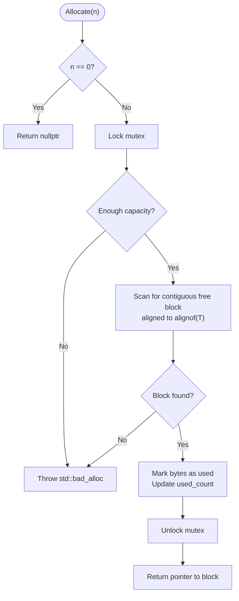
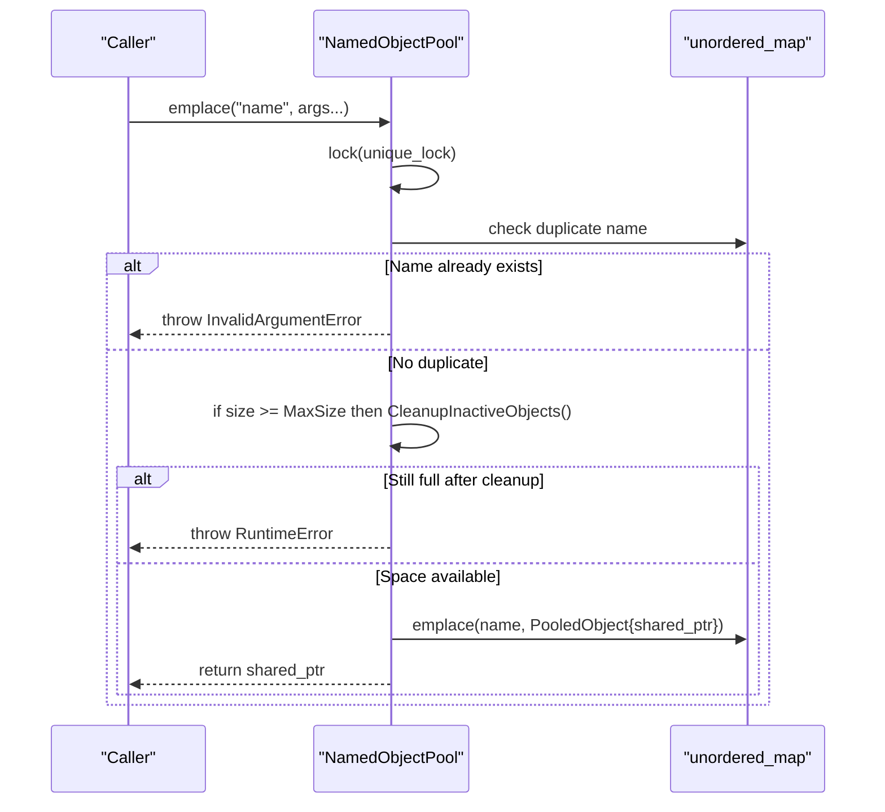
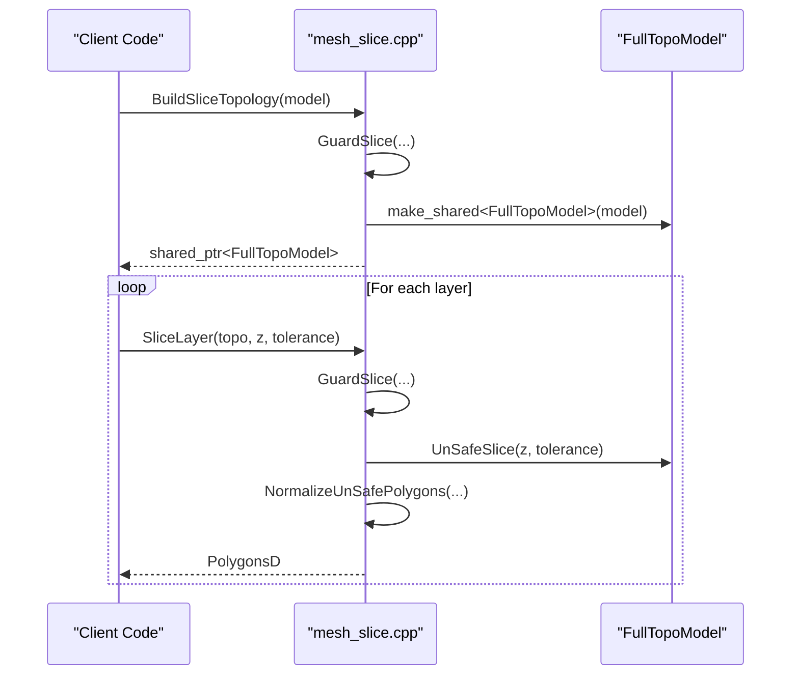
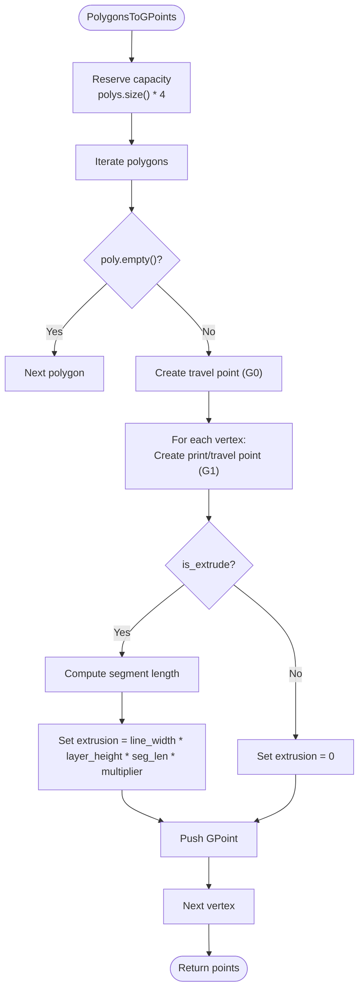
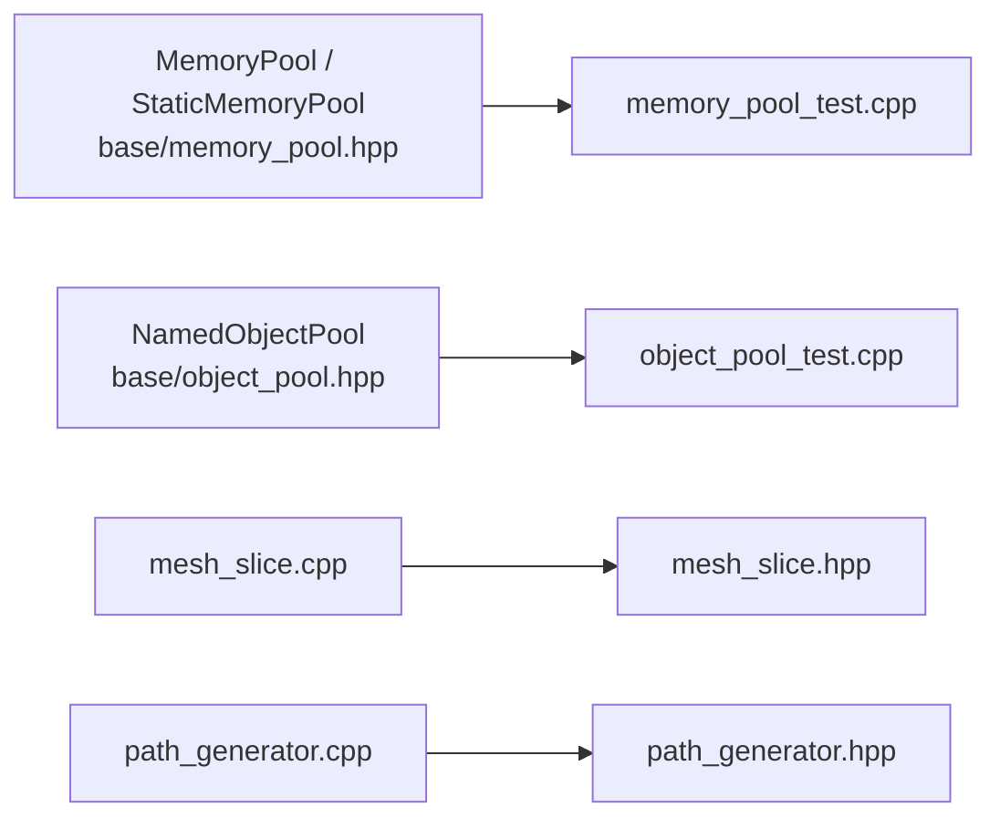

# Memory Management and Optimization

<cite>
**Referenced Files in This Document**
- [memory_pool.hpp](file://base/memory_pool.hpp)
- [object_pool.hpp](file://base/object_pool.hpp)
- [memory_pool_test.cpp](file://tests/Pool/memory_pool_test.cpp)
- [object_pool_test.cpp](file://tests/Pool/object_pool_test.cpp)
- [mesh_slice.hpp](file://LibHsBaSlicer/Slice/mesh_slice.hpp)
- [mesh_slice.cpp](file://LibHsBaSlicer/Slice/mesh_slice.cpp)
- [path_generator.hpp](file://LibHsBaSlicer/Path/path_generator.hpp)
- [path_generator.cpp](file://LibHsBaSlicer/Path/path_generator.cpp)
</cite>

## Table of Contents
1. [Introduction](#introduction)
2. [Project Structure](#project-structure)
3. [Core Components](#core-components)
4. [Architecture Overview](#architecture-overview)
5. [Detailed Component Analysis](#detailed-component-analysis)
6. [Dependency Analysis](#dependency-analysis)
7. [Performance Considerations](#performance-considerations)
8. [Troubleshooting Guide](#troubleshooting-guide)
9. [Conclusion](#conclusion)
10. [Appendices](#appendices)

## Introduction
This document explains memory optimization strategies in HsBaSlicer with a focus on custom allocators, object pooling, and memory reuse patterns. It covers the `MemoryPool` and `StaticMemoryPool` allocators, the named `NamedObjectPool`, and how these mechanisms can be applied to slicing algorithms and path generation for large datasets such as meshes and polygons. The goal is to reduce allocation overhead, minimize memory fragmentation, and improve performance while keeping the code safe and maintainable.

## Project Structure
The memory-related infrastructure lives primarily under `base/`, while usage examples are demonstrated in tests and core processing modules:

- Custom allocators and pools:
  - `base/memory_pool.hpp`: `MemoryPool` and `StaticMemoryPool` STL-compatible allocators.
  - `base/object_pool.hpp`: `NamedObjectPool` for named shared-object lifecycle management.
- Slicing subsystem:
  - `LibHsBaSlicer/Slice/mesh_slice.hpp` and `.cpp`: planar slicing API and reusable topology building.
- Path generation subsystem:
  - `LibHsBaSlicer/Path/path_generator.hpp` and `.cpp`: per-layer G-code path generation and spiral/vase mode.
- Tests:
  - `tests/Pool/memory_pool_test.cpp`: demonstrates allocator usage with STL containers and smart pointers.
  - `tests/Pool/object_pool_test.cpp`: demonstrates named object pool behavior, capacity limits, and cleanup.

**Diagram sources**
- [memory_pool.hpp:43-208](file://base/memory_pool.hpp#L43-L208)
- [object_pool.hpp:22-283](file://base/object_pool.hpp#L22-L283)
- [mesh_slice.hpp:22-99](file://LibHsBaSlicer/Slice/mesh_slice.hpp#L22-L99)
- [mesh_slice.cpp:46-116](file://LibHsBaSlicer/Slice/mesh_slice.cpp#L46-L116)
- [path_generator.hpp:23-91](file://LibHsBaSlicer/Path/path_generator.hpp#L23-L91)
- [path_generator.cpp:14-140](file://LibHsBaSlicer/Path/path_generator.cpp#L14-L140)

**Section sources**
- [memory_pool.hpp:1-375](file://base/memory_pool.hpp#L1-L375)
- [object_pool.hpp:1-286](file://base/object_pool.hpp#L1-L286)
- [mesh_slice.hpp:1-99](file://LibHsBaSlicer/Slice/mesh_slice.hpp#L1-L99)
- [mesh_slice.cpp:1-119](file://LibHsBaSlicer/Slice/mesh_slice.cpp#L1-L119)
- [path_generator.hpp:1-96](file://LibHsBaSlicer/Path/path_generator.hpp#L1-L96)
- [path_generator.cpp:1-143](file://LibHsBaSlicer/Path/path_generator.cpp#L1-L143)
- [memory_pool_test.cpp:1-100](file://tests/Pool/memory_pool_test.cpp#L1-L100)
- [object_pool_test.cpp:1-162](file://tests/Pool/object_pool_test.cpp#L1-L162)

## Core Components
This section summarizes the key memory components and their roles.

- `MemoryPool<T, PoolSize>`: A thread-safe, fixed-size byte pool allocator that supports arbitrary types via alignment-aware scanning. It shares state across copies using `std::shared_ptr`.
- `StaticMemoryPool<T, PoolSize>`: A globally shared static pool with zero instance overhead; all instances are considered equal and share one static buffer.
- `NamedObjectPool<T, MaxSize>`: A named object registry managing `std::shared_ptr<T>` objects with lazy cleanup of inactive entries when capacity is reached.

Key characteristics:
- Both memory pools implement the STL Allocator interface (`allocate`, `deallocate`, `construct`, `destroy`, `max_size`, `rebind`).
- Allocation uses a first-fit strategy over a byte array with an `used[]` bitmap and a `used_count` tracker.
- Thread safety is provided by mutexes; `NamedObjectPool` uses a `shared_mutex` for concurrent reads and exclusive writes.

**Section sources**
- [memory_pool.hpp:28-208](file://base/memory_pool.hpp#L28-L208)
- [memory_pool.hpp:215-372](file://base/memory_pool.hpp#L215-L372)
- [object_pool.hpp:22-283](file://base/object_pool.hpp#L22-L283)

## Architecture Overview
At a high level, HsBaSlicer’s memory architecture separates low-level allocation (custom allocators) from higher-level resource management (named object pool). Slicing and path generation consume geometry data structures and may benefit from pre-reserved buffers, pooled temporary allocations, or shared object lifetimes.

**Diagram sources**
- [memory_pool.hpp:43-208](file://base/memory_pool.hpp#L43-L208)
- [memory_pool.hpp:215-372](file://base/memory_pool.hpp#L215-L372)
- [object_pool.hpp:22-283](file://base/object_pool.hpp#L22-L283)

## Detailed Component Analysis

### MemoryPool and StaticMemoryPool
Both allocators provide STL-compatible interfaces and use a contiguous byte buffer with a boolean occupancy map. They ensure alignment through `alignas(std::max_align_t)` and protect operations with a mutex.

Implementation highlights:
- `MemoryPool` stores its state in a shared `MemoryPoolState`, enabling multiple instances to share the same underlying buffer.
- `StaticMemoryPool` uses static members for the buffer, occupancy map, count, and mutex, making all instances equivalent.
- Allocation scans for a contiguous free region sized `n * sizeof(T)` and marks bytes as used; deallocation clears those bits and updates `used_count`.
- Exceptions:
  - `std::bad_alloc` when insufficient space exists.
  - `std::invalid_argument` if a pointer is out of bounds during deallocation.

Complexity considerations:
- Allocation is O(PoolSize) in the worst case due to linear scan of the byte array.
- Deallocation is O(n * sizeof(T)) to clear occupancy bits.
- For very large pools or frequent small allocations, consider batching or specialized arenas to reduce scanning overhead.

Usage patterns validated by tests:
- Using allocators with `std::vector` and `std::list`.
- Using `std::allocate_shared` with custom allocators.
- Integrating with coroutine utilities via custom allocator tasks/generators.

**Diagram sources**
- [memory_pool.hpp:111-142](file://base/memory_pool.hpp#L111-L142)
- [memory_pool.hpp:266-296](file://base/memory_pool.hpp#L266-L296)

**Section sources**
- [memory_pool.hpp:28-208](file://base/memory_pool.hpp#L28-L208)
- [memory_pool.hpp:215-372](file://base/memory_pool.hpp#L215-L372)
- [memory_pool_test.cpp:30-74](file://tests/Pool/memory_pool_test.cpp#L30-L74)

### NamedObjectPool
`NamedObjectPool` manages named `std::shared_ptr<T>` objects with capacity control and lazy cleanup. It is useful for caching or reusing expensive-to-create objects across pipeline stages.

Key behaviors:
- `emplace`, `insert`, and `allocate` insert objects under unique names.
- When the pool reaches `MaxSize`, it attempts to clean up inactive objects before inserting new ones.
- An object is considered inactive when only the pool holds a strong reference (`use_count() == 1`).
- Read operations (`get`, `Contains`, `size`, `InactiveCount`) use shared locks; write operations use exclusive locks.
- `Cleanup()` removes inactive entries and returns the number cleaned.

Thread-safety and concurrency:
- Uses `std::shared_mutex` to allow concurrent reads and exclusive writes.
- Avoids unnecessary cleanup unless adding a new object would exceed capacity.

**Diagram sources**
- [object_pool.hpp:66-92](file://base/object_pool.hpp#L66-L92)
- [object_pool.hpp:261-279](file://base/object_pool.hpp#L261-L279)

**Section sources**
- [object_pool.hpp:22-283](file://base/object_pool.hpp#L22-L283)
- [object_pool_test.cpp:9-160](file://tests/Pool/object_pool_test.cpp#L9-L160)

### Slicing Algorithms and Memory Reuse
The slicing API provides both direct slicing and a reusable topology approach. Building the topology once avoids repeated reconstruction costs across layers.

API overview:
- `Slice(model, height, tolerance)`: Returns closed-contour polygons.
- `UnSafeSlice(model, height, tolerance)`: Includes open contours.
- `BuildSliceTopology(model)`: Builds a self-contained topology independent of the source model lifetime.
- `SliceLayer(topo, z, tolerance)`: Normalizes unsafe polygons into double-precision polygons suitable for downstream processing.

Memory implications:
- `BuildSliceTopology` creates a `FullTopoModel` that owns vertex/face copies, decoupling subsequent slices from the original model.
- `NormalizeUnSafePolygons` reserves capacity based on input size to reduce reallocations.

**Diagram sources**
- [mesh_slice.cpp:106-116](file://LibHsBaSlicer/Slice/mesh_slice.cpp#L106-L116)
- [mesh_slice.cpp:86-104](file://LibHsBaSlicer/Slice/mesh_slice.cpp#L86-L104)

**Section sources**
- [mesh_slice.hpp:22-99](file://LibHsBaSlicer/Slice/mesh_slice.hpp#L22-L99)
- [mesh_slice.cpp:46-116](file://LibHsBaSlicer/Slice/mesh_slice.cpp#L46-L116)

### Path Generation and Memory Efficiency
Path generation converts polygonal data into G-code points or paths. Efficient pre-allocation reduces dynamic resizing overhead.

Key functions:
- `PolygonsToGPoints(polys, z, config, is_extrude)`: Converts polygons to a sequence of GPoints, reserving capacity upfront.
- `GenerateGCodePath(layer_data, config)`: Produces a `PointsPath` by iterating layers and appending generated points.
- `GenerateGCodePathV2(layer_data, printer_config)`: Produces a `GCodePath` with firmware-specific output, combining polygons per layer.
- `GenerateGCodePathSpiral(layer_outlines, layer_zs, printer_config)`: Generates a continuous helical wall for vase mode.

Optimization notes:
- Pre-reserve vectors where possible (e.g., `points.reserve(polys.size() * 4)`).
- Combine polygons per layer to reduce intermediate allocations.
- Use appropriate container types depending on whether you need ordered traversal or fast lookup.

**Diagram sources**
- [path_generator.cpp:14-61](file://LibHsBaSlicer/Path/path_generator.cpp#L14-L61)

**Section sources**
- [path_generator.hpp:23-91](file://LibHsBaSlicer/Path/path_generator.hpp#L23-L91)
- [path_generator.cpp:14-140](file://LibHsBaSlicer/Path/path_generator.cpp#L14-L140)

## Dependency Analysis
The following diagram shows how the memory components relate to the slicing and path generation modules, as well as tests validating their behavior.

**Diagram sources**
- [memory_pool.hpp:43-208](file://base/memory_pool.hpp#L43-L208)
- [object_pool.hpp:22-283](file://base/object_pool.hpp#L22-L283)
- [mesh_slice.cpp:46-116](file://LibHsBaSlicer/Slice/mesh_slice.cpp#L46-L116)
- [path_generator.cpp:14-140](file://LibHsBaSlicer/Path/path_generator.cpp#L14-L140)

**Section sources**
- [memory_pool_test.cpp:1-100](file://tests/Pool/memory_pool_test.cpp#L1-L100)
- [object_pool_test.cpp:1-162](file://tests/Pool/object_pool_test.cpp#L1-L162)

## Performance Considerations
Guidelines derived from the implementations and usage patterns:

- Prefer `MemoryPool` or `StaticMemoryPool` for frequent allocations of small, short-lived objects within a bounded scope.
- Use `StaticMemoryPool` when you want global sharing without per-instance overhead; all instances are equal and share one static buffer.
- Use `NamedObjectPool` for caching or reusing expensive objects identified by stable names; rely on RAII semantics and lazy cleanup.
- Pre-reserve container capacities where the expected size is known (e.g., `points.reserve(polys.size() * 4)`).
- Batch operations to reduce locking contention in pools; avoid many tiny allocations inside tight loops if possible.
- For slicing, build the topology once with `BuildSliceTopology` and reuse it across layers to avoid repeated mesh reconstruction.
- For path generation, combine polygons per layer and avoid unnecessary intermediate copies.

[No sources needed since this section provides general guidance]

## Troubleshooting Guide
Common issues and resolutions:

- Out-of-memory errors:
  - `std::bad_alloc` thrown by memory pools indicates insufficient capacity. Increase `PoolSize` or reduce allocation volume.
  - In `NamedObjectPool`, `RuntimeError` occurs when the pool is full and no inactive objects are available; call `Cleanup()` or reset external references to mark objects inactive.
- Invalid pointer errors:
  - `std::invalid_argument` during deallocation means the pointer is outside the pool bounds. Ensure pointers come from the same pool instance and are not reused incorrectly.
- Duplicate names:
  - `InvalidArgumentError` in `NamedObjectPool` when inserting an object with an existing name; choose unique names or remove the previous entry.
- Concurrency pitfalls:
  - Memory pools use mutexes; excessive contention can degrade performance. Minimize cross-thread allocations or partition pools by thread.
  - `NamedObjectPool` allows concurrent reads; avoid holding long-lived locks while performing heavy work.

**Section sources**
- [memory_pool.hpp:111-175](file://base/memory_pool.hpp#L111-L175)
- [memory_pool.hpp:266-324](file://base/memory_pool.hpp#L266-L324)
- [object_pool.hpp:66-155](file://base/object_pool.hpp#L66-L155)

## Conclusion
HsBaSlicer provides robust memory optimization tools through `MemoryPool`, `StaticMemoryPool`, and `NamedObjectPool`. By applying these allocators and pooling strategies alongside careful pre-allocation and topology reuse, slicing and path generation pipelines can achieve lower allocation overhead, reduced fragmentation, and improved throughput. Tests validate correct integration with STL containers, smart pointers, and coroutine utilities, ensuring reliability in production workflows.

[No sources needed since this section summarizes without analyzing specific files]

## Appendices

### Practical Guidelines for Minimizing Fragmentation and Overhead
- Choose allocator type based on lifetime and sharing needs:
  - `MemoryPool`: Shared state across instances; good for scoped pools.
  - `StaticMemoryPool`: Global singleton-like behavior; minimal overhead.
- Align expectations with pool capacity:
  - Estimate maximum allocation sizes and set `PoolSize` accordingly.
- Reduce allocation churn:
  - Reuse containers and pre-reserve capacity.
  - Batch allocations and deallocations.
- Monitor pool usage:
  - Use `UsedCount()` for `StaticMemoryPool` to detect leaks or overflows.
  - Track active/inactive counts in `NamedObjectPool` to tune cleanup policies.

[No sources needed since this section provides general guidance]