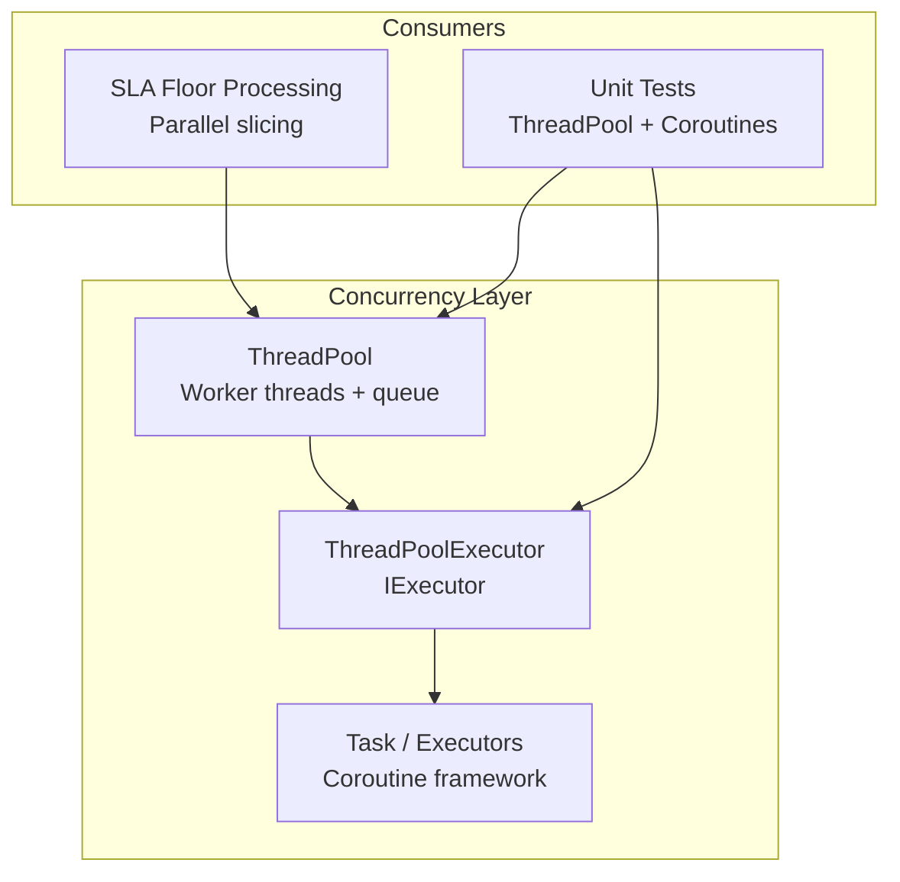
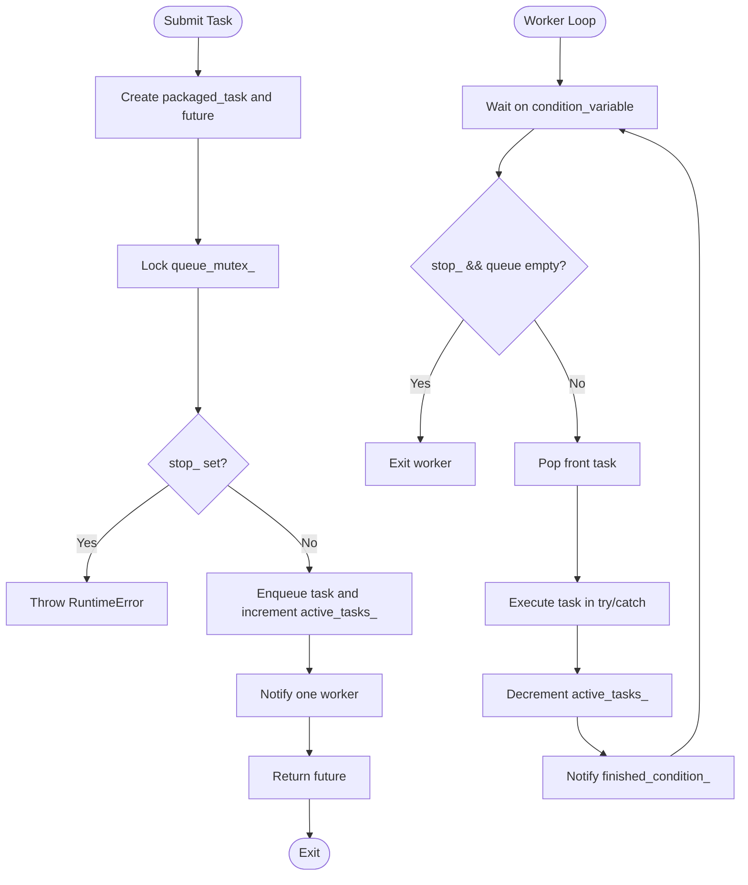
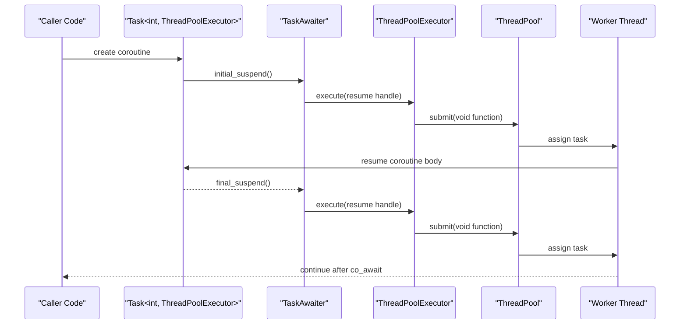
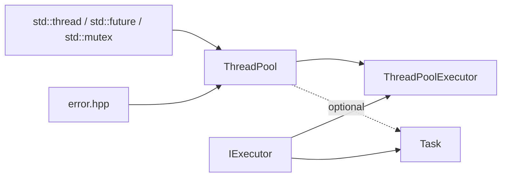

# Parallel Processing and Thread Management

<cite>
**Referenced Files in This Document**
- [thread_pool.hpp](file://base/thread_pool.hpp)
- [coroutine.hpp](file://base/coroutine.hpp)
- [thread_pool_test.cpp](file://tests/Pool/thread_pool_test.cpp)
- [sla_floor.cpp](file://LibHsBaSlicer/Floor/sla_floor.cpp)
- [thread_pool.md](file://docs/en/base/thread_pool.md)
- [coroutine.md](file://docs/en/base/coroutine.md)
</cite>

## Table of Contents
1. [Introduction](#introduction)
2. [Project Structure](#project-structure)
3. [Core Components](#core-components)
4. [Architecture Overview](#architecture-overview)
5. [Detailed Component Analysis](#detailed-component-analysis)
6. [Dependency Analysis](#dependency-analysis)
7. [Performance Considerations](#performance-considerations)
8. [Troubleshooting Guide](#troubleshooting-guide)
9. [Conclusion](#conclusion)
10. [Appendices](#appendices)

## Introduction
This document explains the parallel processing capabilities in HsBaSlicer with a focus on the ThreadPool implementation, coroutine integration through ThreadPoolExecutor, thread safety patterns, resource management, and performance considerations. It also provides practical guidance for parallelizing mesh processing, polygon operations, and file I/O tasks using the existing concurrency primitives.

The core concurrency layer consists of:
- A worker-thread-based ThreadPool that submits tasks and returns std::future results.
- A C++20 coroutine Task system with multiple executors, including ThreadPoolExecutor, which schedules coroutine work onto a ThreadPool.
- Tests and documentation that demonstrate normal task submission, coroutine execution, and mixed usage.

## Project Structure
The parallel processing features are primarily implemented under base/, with tests under tests/ and example usage in LibHsBaSlicer/. The relevant files are:
- base/thread_pool.hpp: ThreadPool class and optional ThreadPoolExecutor coroutine executor.
- base/coroutine.hpp: Coroutine framework, executors, Task types, generators, and awaiters.
- tests/Pool/thread_pool_test.cpp: Unit tests for ThreadPool and ThreadPoolExecutor.
- LibHsBaSlicer/Floor/sla_floor.cpp: Real-world usage of ThreadPool in slicing logic.
- docs/en/base/thread_pool.md and docs/en/base/coroutine.md: User-facing documentation.



**Diagram sources**
- [thread_pool.hpp:29-162](file://base/thread_pool.hpp#L29-L162)
- [thread_pool.hpp:164-207](file://base/thread_pool.hpp#L164-L207)
- [coroutine.hpp:47-70](file://base/coroutine.hpp#L47-L70)
- [sla_floor.cpp:444-444](file://LibHsBaSlicer/Floor/sla_floor.cpp#L444-L444)
- [thread_pool_test.cpp:14-84](file://tests/Pool/thread_pool_test.cpp#L14-L84)

**Section sources**
- [thread_pool.hpp:1-214](file://base/thread_pool.hpp#L1-L214)
- [coroutine.hpp:1-1091](file://base/coroutine.hpp#L1-L1091)
- [thread_pool_test.cpp:1-87](file://tests/Pool/thread_pool_test.cpp#L1-L87)
- [sla_floor.cpp:444-444](file://LibHsBaSlicer/Floor/sla_floor.cpp#L444-L444)

## Core Components
- ThreadPool: Manages a fixed number of worker threads, a task queue, synchronization primitives, and lifecycle control. It exposes submit(), PendingTasks(), ActiveTasks(), and WaitAll().
- ThreadPoolExecutor: Implements IExecutor to dispatch coroutine work to a ThreadPool. Supports a default pool and per-instance pool binding.
- Coroutine Task System: Provides Task<T, Executor>, executors (NoopExecutor, AsyncExecutor), and awaiters that integrate with co_await.

Key responsibilities:
- ThreadPool handles worker thread lifecycle, task scheduling, exception propagation via futures, and completion signaling.
- ThreadPoolExecutor bridges coroutines to the thread pool by submitting void functions.
- Task and executors provide structured asynchronous programming with chaining callbacks and controlled execution context.

**Section sources**
- [thread_pool.hpp:29-162](file://base/thread_pool.hpp#L29-L162)
- [thread_pool.hpp:164-207](file://base/thread_pool.hpp#L164-L207)
- [coroutine.hpp:47-70](file://base/coroutine.hpp#L47-L70)
- [coroutine.hpp:205-382](file://base/coroutine.hpp#L205-L382)

## Architecture Overview
The architecture layers separate concerns between low-level threading and high-level async abstractions:

```mermaid
classDiagram
class ThreadPool {
+submit(f, args) future
+PendingTasks() size_t
+ActiveTasks() size_t
+WaitAll() void
-WorkerLoop() void
-workers_ vector<thread>
-tasks_ queue<function<void()>>
-queue_mutex_ mutex
-condition_ condition_variable
-finished_condition_ condition_variable
-stop_ atomic<bool>
-active_tasks_ atomic<size_t>
}
class IExecutor {
<<interface>>
+execute(func) void
}
class ThreadPoolExecutor {
+execute(func) void
+SetDefaultPool(pool) void
-pool_ ThreadPool*
-default_pool_ ThreadPool*
-get_pool() ThreadPool*
}
class Task_T_Executor {
+then(callback) Task&
+catching(callback) Task&
+finally(callback) Task&
+get_result() T
}
ThreadPoolExecutor --> IExecutor : "implements"
ThreadPoolExecutor --> ThreadPool : "submits tasks"
Task_T_Executor --> IExecutor : "uses executor"
```

**Diagram sources**
- [thread_pool.hpp:29-162](file://base/thread_pool.hpp#L29-L162)
- [thread_pool.hpp:164-207](file://base/thread_pool.hpp#L164-L207)
- [coroutine.hpp:47-70](file://base/coroutine.hpp#L47-L70)
- [coroutine.hpp:205-382](file://base/coroutine.hpp#L205-L382)

## Detailed Component Analysis

### ThreadPool Implementation
ThreadPool is a bounded worker-pool executor:
- Construction validates thread count and spawns workers running WorkerLoop.
- submit wraps callable into packaged_task, enqueues it, increments active_tasks_, and notifies one worker.
- WorkerLoop waits on condition_variable, pops tasks, executes them, decrements active_tasks_, and signals finished_condition_.
- WaitAll blocks until the queue is empty and no active tasks remain.
- Destruction sets stop flag, wakes all workers, and joins threads.

Thread safety:
- Queue access is protected by queue_mutex_.
- active_tasks_ is atomic.
- stop_ is atomic.
- Exceptions thrown inside tasks are caught; active_tasks_ still decrements, ensuring progress.

Lifecycle:
- Workers exit when stop_ is true and queue is empty.
- Destructor ensures orderly shutdown.



**Diagram sources**
- [thread_pool.hpp:67-90](file://base/thread_pool.hpp#L67-L90)
- [thread_pool.hpp:117-154](file://base/thread_pool.hpp#L117-L154)

Practical usage examples:
- Basic task submission and result retrieval.
- Batch tasks with WaitAll.
- Exception handling via future.get().
- Monitoring pending and active counts.

These patterns are demonstrated in the documentation and unit tests.

**Section sources**
- [thread_pool.hpp:37-61](file://base/thread_pool.hpp#L37-L61)
- [thread_pool.hpp:67-111](file://base/thread_pool.hpp#L67-L111)
- [thread_pool.hpp:117-162](file://base/thread_pool.hpp#L117-L162)
- [thread_pool.md:52-200](file://docs/en/base/thread_pool.md#L52-L200)
- [thread_pool_test.cpp:14-37](file://tests/Pool/thread_pool_test.cpp#L14-L37)

### ThreadPoolExecutor and Coroutine Integration
ThreadPoolExecutor implements IExecutor and forwards execute calls to a ThreadPool:
- If constructed with a specific ThreadPool pointer, it uses that pool.
- Otherwise, it falls back to a static default pool.
- If neither is provided, it lazily creates a default ThreadPool based on hardware_concurrency.

Coroutine integration:
- Task<T, Executor> uses an executor to schedule continuation resumption.
- DispatchAwaiter and TaskAwaiter coordinate initial suspension and resumption on the executor’s thread.
- ThreadPoolExecutor enables co_await chains to run on the thread pool.



**Diagram sources**
- [coroutine.hpp:184-198](file://base/coroutine.hpp#L184-L198)
- [coroutine.hpp:81-122](file://base/coroutine.hpp#L81-L122)
- [thread_pool.hpp:164-207](file://base/thread_pool.hpp#L164-L207)

Usage patterns:
- Set default pool or bind executor to a specific pool.
- Use Task<T, ThreadPoolExecutor> with co_await.
- Mix ThreadPool.submit and coroutine tasks in the same pool.

**Section sources**
- [thread_pool.hpp:164-207](file://base/thread_pool.hpp#L164-L207)
- [coroutine.hpp:47-70](file://base/coroutine.hpp#L47-L70)
- [coroutine.hpp:184-198](file://base/coroutine.hpp#L184-L198)
- [coroutine.hpp:205-382](file://base/coroutine.hpp#L205-L382)
- [thread_pool_test.cpp:39-84](file://tests/Pool/thread_pool_test.cpp#L39-L84)

### Thread Safety Patterns
- Mutex-protected task queue: All enqueue/dequeue operations lock queue_mutex_.
- Atomic counters: active_tasks_ tracks running tasks without locks.
- Condition variables: condition_ coordinates worker wake-ups; finished_condition_ coordinates WaitAll.
- Exception isolation: Tasks catch exceptions so they do not crash workers; active_tasks_ still decrements.
- Lifecycle guards: stop_ prevents new submissions after shutdown; destructor joins all workers.

Best practices derived from implementation:
- Avoid sharing mutable state across tasks unless protected.
- Prefer immutable data passed by value or const references.
- Use atomic operations for shared counters.
- Ensure long-running tasks do not block the executor’s callback chain.

**Section sources**
- [thread_pool.hpp:67-90](file://base/thread_pool.hpp#L67-L90)
- [thread_pool.hpp:117-154](file://base/thread_pool.hpp#L117-L154)

### Resource Management
- ThreadPool owns worker threads and must outlive submitted tasks.
- Destructor guarantees orderly shutdown by setting stop_ and joining threads.
- ThreadPoolExecutor may own a default pool instance if none is provided; lifetime rules apply accordingly.
- Task objects manage coroutine handles and destroy them upon destruction.

Guidelines:
- Keep ThreadPool at application scope or ensure it lives longer than any outstanding futures/tasks.
- Do not copy or move ThreadPool; it is non-copyable and non-movable.
- When using ThreadPoolExecutor, prefer explicit pool binding to avoid implicit default pool lifetimes.

**Section sources**
- [thread_pool.hpp:37-61](file://base/thread_pool.hpp#L37-L61)
- [thread_pool.hpp:164-207](file://base/thread_pool.hpp#L164-L207)
- [coroutine.hpp:361-382](file://base/coroutine.hpp#L361-L382)

### Performance Considerations
- CPU-bound tasks: Set thread count equal to hardware_concurrency for optimal throughput.
- I/O-bound tasks: Consider increasing thread count beyond cores to overlap I/O latency.
- Task granularity: Avoid excessive tiny tasks due to queue overhead; batch work where possible.
- Contention: Minimize shared mutable state; use local variables and atomic counters.
- Monitoring: Use PendingTasks() and ActiveTasks() to detect backlog and adjust batching or pool size.

Real-world usage:
- SLA floor processing uses ThreadPool to parallelize slicing operations.

**Section sources**
- [thread_pool.md:293-316](file://docs/en/base/thread_pool.md#L293-L316)
- [sla_floor.cpp:444-444](file://LibHsBaSlicer/Floor/sla_floor.cpp#L444-L444)

## Dependency Analysis
The concurrency subsystem has clear dependencies:
- ThreadPool depends on standard threading/future primitives and error types.
- ThreadPoolExecutor depends on ThreadPool and IExecutor.
- Task system depends on IExecutor and coroutine support macros.



**Diagram sources**
- [thread_pool.hpp:13-23](file://base/thread_pool.hpp#L13-L23)
- [thread_pool.hpp:29-162](file://base/thread_pool.hpp#L29-L162)
- [thread_pool.hpp:164-207](file://base/thread_pool.hpp#L164-L207)
- [coroutine.hpp:47-70](file://base/coroutine.hpp#L47-L70)
- [coroutine.hpp:205-382](file://base/coroutine.hpp#L205-L382)

**Section sources**
- [thread_pool.hpp:1-214](file://base/thread_pool.hpp#L1-L214)
- [coroutine.hpp:1-1091](file://base/coroutine.hpp#L1-L1091)

## Performance Considerations
- Choose appropriate thread pool size based on workload characteristics.
- Batch independent operations to reduce queue contention.
- Monitor PendingTasks() and ActiveTasks() to tune concurrency levels.
- Avoid blocking operations inside short-lived tasks; offload to dedicated I/O pools if needed.
- For mesh and polygon processing, partition geometry into chunks and process each chunk concurrently.
- For file I/O, consider combining ThreadPool with asynchronous I/O libraries to maximize throughput.

[No sources needed since this section provides general guidance]

## Troubleshooting Guide
Common issues and resolutions:
- Submitting to stopped pool: Throws RuntimeError. Ensure ThreadPool is alive and not destroyed while tasks are pending.
- Deadlocks: Avoid holding locks while submitting tasks; minimize critical sections.
- Starvation: Very small tasks can saturate the queue; increase task granularity.
- Coroutine resumption on wrong thread: Ensure Task uses ThreadPoolExecutor and that the executor points to a valid pool.
- Unhandled exceptions: Catch exceptions in tasks or use catching callbacks on Task.

Verification strategies:
- Use unit tests to validate basic submission, waiting, and coroutine integration.
- Add logging around PendingTasks() and ActiveTasks() to observe utilization.
- Validate that WaitAll() returns only after all futures are ready.

**Section sources**
- [thread_pool.hpp:77-89](file://base/thread_pool.hpp#L77-L89)
- [thread_pool.hpp:117-154](file://base/thread_pool.hpp#L117-L154)
- [thread_pool_test.cpp:14-84](file://tests/Pool/thread_pool_test.cpp#L14-L84)

## Conclusion
HsBaSlicer’s parallel processing stack combines a robust ThreadPool with a flexible coroutine Task system. ThreadPool provides safe, efficient worker-thread execution with clear lifecycle and synchronization semantics. ThreadPoolExecutor integrates coroutines with the thread pool, enabling structured asynchronous workflows. By following the thread safety patterns, resource management guidelines, and performance recommendations outlined here, developers can safely parallelize mesh processing, polygon operations, and file I/O tasks while avoiding race conditions and managing thread lifecycles effectively.

[No sources needed since this section summarizes without analyzing specific files]

## Appendices

### Practical Examples

#### Parallelizing Mesh Processing
- Partition mesh faces or vertices into chunks.
- Submit each chunk to ThreadPool.submit for independent processing.
- Aggregate results after WaitAll or individual future.get().

Reference pattern:
- See batch task submission and aggregation in the thread pool documentation.

**Section sources**
- [thread_pool.md:120-163](file://docs/en/base/thread_pool.md#L120-L163)

#### Parallelizing Polygon Operations
- Split polygon lists into batches.
- Run boolean operations, offsets, or fills concurrently.
- Merge outputs and validate consistency.

Reference pattern:
- Use ThreadPool.submit with lambdas capturing polygon ranges.

**Section sources**
- [thread_pool.md:120-163](file://docs/en/base/thread_pool.md#L120-L163)

#### Parallelizing File I/O Tasks
- Offload read/write operations to ThreadPool.
- Combine with buffering strategies to reduce I/O contention.
- Monitor ActiveTasks() to avoid overwhelming disk subsystem.

Reference pattern:
- Use ThreadPool.submit for I/O-bound workloads and aggregate results.

**Section sources**
- [thread_pool.md:293-316](file://docs/en/base/thread_pool.md#L293-L316)

### Best Practices Checklist
- Always validate thread count > 0 during ThreadPool construction.
- Avoid sharing mutable state across tasks; use local variables or atomics.
- Prefer batched tasks over many tiny tasks.
- Use WaitAll() to synchronize batch completion.
- Bind ThreadPoolExecutor to a known pool or set default pool explicitly.
- Handle exceptions in tasks or via Task.catching callbacks.
- Monitor PendingTasks() and ActiveTasks() for capacity planning.

**Section sources**
- [thread_pool.hpp:37-41](file://base/thread_pool.hpp#L37-L41)
- [thread_pool.hpp:67-90](file://base/thread_pool.hpp#L67-L90)
- [thread_pool.hpp:117-154](file://base/thread_pool.hpp#L117-L154)
- [thread_pool.md:293-316](file://docs/en/base/thread_pool.md#L293-L316)