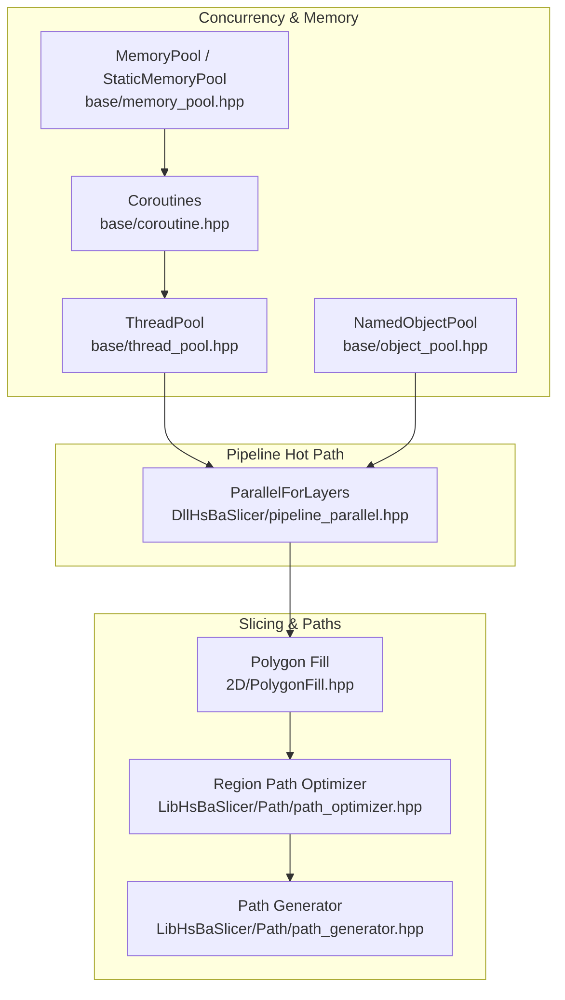
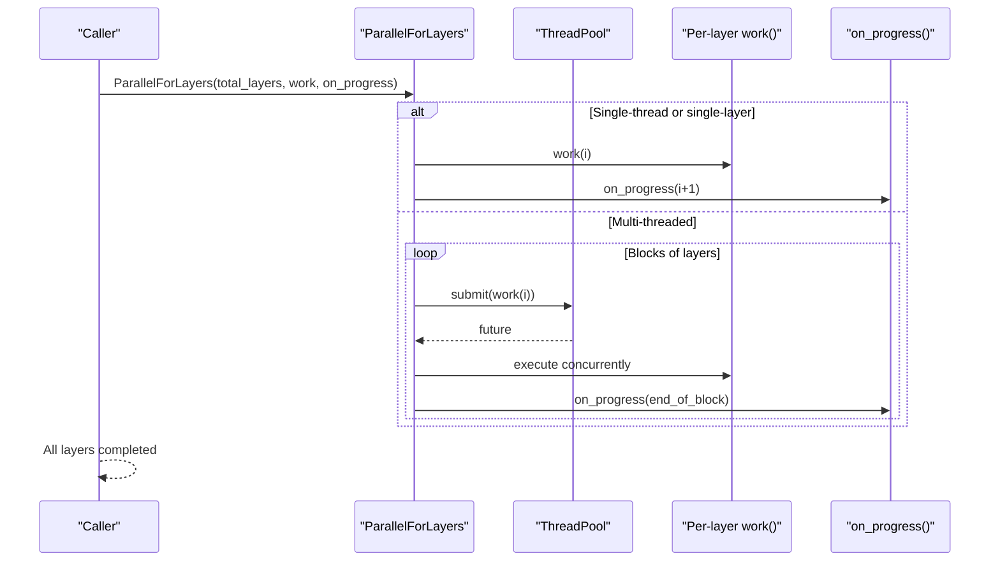
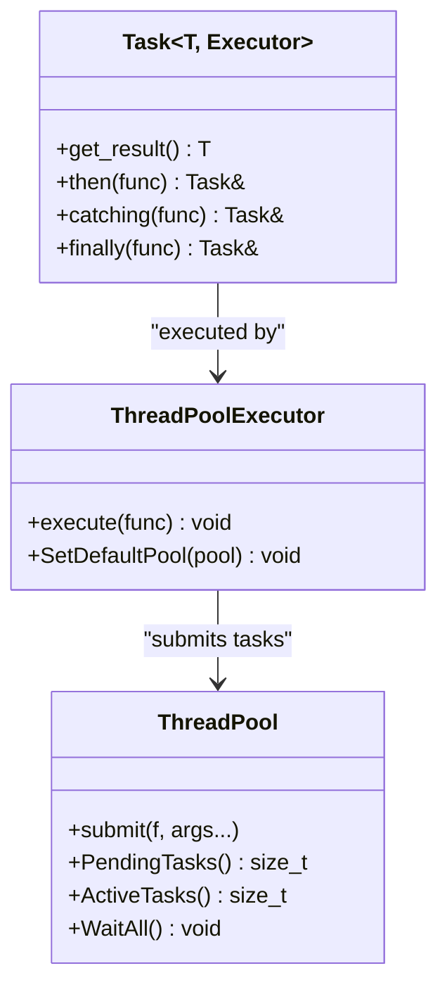
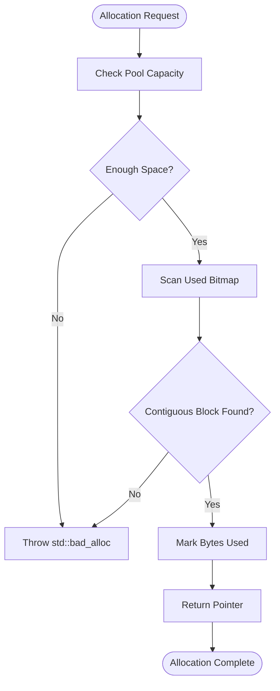
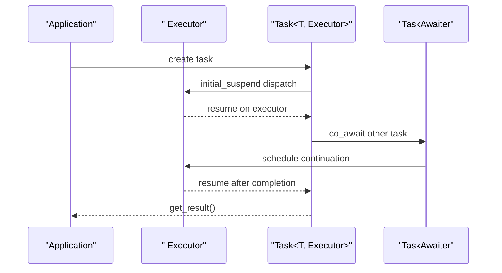
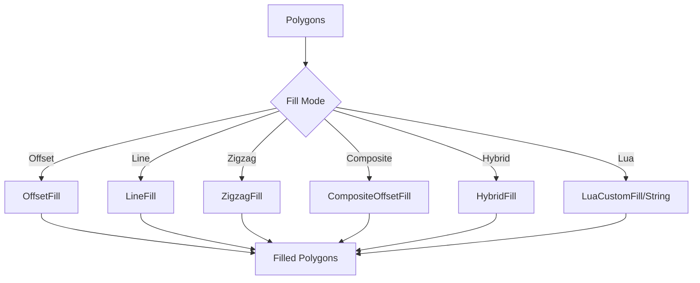
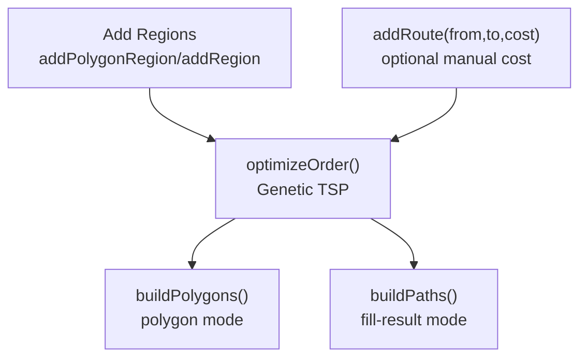
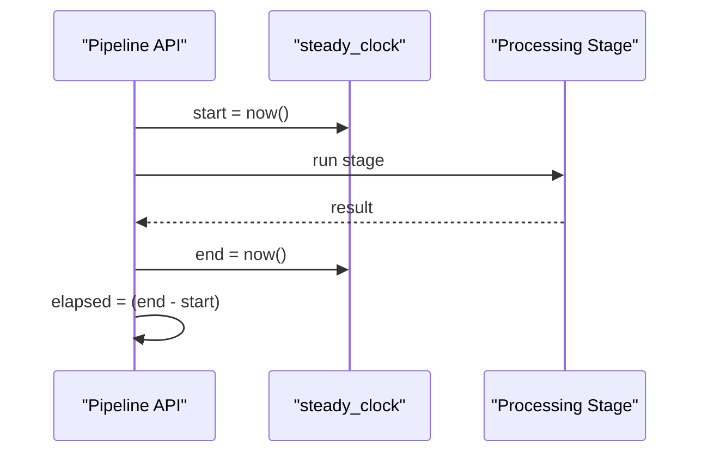
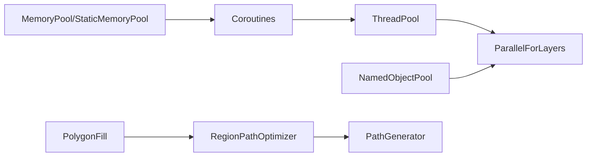

# Performance Optimization Techniques

<cite>
**Referenced Files in This Document**
- [README.md](file://README.md)
- [thread_pool.hpp](file://base/thread_pool.hpp)
- [coroutine.hpp](file://base/coroutine.hpp)
- [memory_pool.hpp](file://base/memory_pool.hpp)
- [object_pool.hpp](file://base/object_pool.hpp)
- [pipeline_parallel.hpp](file://DllHsBaSlicer/pipeline_parallel.hpp)
- [path_optimizer.hpp](file://LibHsBaSlicer/Path/path_optimizer.hpp)
- [path_generator.hpp](file://LibHsBaSlicer/Path/path_generator.hpp)
- [PolygonFill.hpp](file://2D/PolygonFill.hpp)
- [thread_pool_test.cpp](file://tests/Pool/thread_pool_test.cpp)
- [memory_pool_test.cpp](file://tests/Pool/memory_pool_test.cpp)
- [fdm_pipeline.cpp](file://DllHsBaSlicer/fdm_pipeline.cpp)
</cite>

## Table of Contents
1. [Introduction](#introduction)
2. [Project Structure](#project-structure)
3. [Core Components](#core-components)
4. [Architecture Overview](#architecture-overview)
5. [Detailed Component Analysis](#detailed-component-analysis)
6. [Dependency Analysis](#dependency-analysis)
7. [Performance Considerations](#performance-considerations)
8. [Troubleshooting Guide](#troubleshooting-guide)
9. [Conclusion](#conclusion)
10. [Appendices](#appendices)

## Introduction
This document provides performance optimization guidance for HsBaSlicer applications, focusing on:
- Parallel processing with thread pools and layer-level parallelism
- Memory management using custom allocators and object pools
- Coroutine-based asynchronous operations
- Algorithm tuning for slicing, polygon filling, and path optimization
- Benchmarking, profiling, and monitoring strategies
- Practical examples targeting mesh processing, polygon operations, and file I/O hot paths

The repository is a modular, cross-platform C++ framework for 3D-printing slicers, exposing both a static library API and a dynamic library C ABI for external integration.

**Section sources**
- [README.md:21-39](file://README.md#L21-L39)

## Project Structure
At a high level, performance-critical components are organized as follows:
- base: concurrency primitives (thread pool), coroutines, memory/object pools
- DllHsBaSlicer: runtime pipelines and per-layer parallel execution helper
- LibHsBaSlicer: core slicing APIs including path generation and path optimization
- 2D: polygon fill algorithms and related data types
- tests: unit tests validating thread pool, memory pool, and coroutine behavior

**Diagram sources**
- [thread_pool.hpp:29-162](file://base/thread_pool.hpp#L29-L162)
- [coroutine.hpp:47-73](file://base/coroutine.hpp#L47-L73)
- [memory_pool.hpp:43-208](file://base/memory_pool.hpp#L43-L208)
- [object_pool.hpp:22-59](file://base/object_pool.hpp#L22-L59)
- [pipeline_parallel.hpp:41-117](file://DllHsBaSlicer/pipeline_parallel.hpp#L41-L117)
- [path_generator.hpp:23-91](file://LibHsBaSlicer/Path/path_generator.hpp#L23-L91)
- [path_optimizer.hpp:44-99](file://LibHsBaSlicer/Path/path_optimizer.hpp#L44-L99)
- [PolygonFill.hpp:20-136](file://2D/PolygonFill.hpp#L20-L136)

**Section sources**
- [README.md:29-39](file://README.md#L29-L39)

## Core Components
This section summarizes the primary building blocks used to optimize performance across slicing workflows.

- ThreadPool: A worker-thread pool that submits tasks returning futures, tracks active/pending tasks, and supports waiting for completion. It also integrates with C++20 coroutines via an executor interface when enabled.
- Coroutines: Task abstractions with executors (noop, async, thread-pool-backed), awaiters, and optional custom allocators for promise allocation.
- MemoryPool and StaticMemoryPool: Fixed-capacity allocators for predictable allocation patterns; StaticMemoryPool is shared across instances and propagates equality.
- NamedObjectPool: Thread-safe named object registry with read/write lock separation, lazy cleanup of inactive objects, and capacity management.
- Pipeline Parallelism: Layer-parallel execution helper that distributes independent layers over a thread pool, batches progress callbacks, and falls back to serial execution when appropriate.
- Polygon Fill: Multiple fill pattern generators (offset, line, zigzag, composite, hybrid) with Lua extensibility.
- Path Optimization: Region-based pre-optimizer minimizing air-move cost by solving region visit order and intra-region gate ordering.
- Path Generation: FDM G-code path generation utilities and spiral/vase mode support.

**Section sources**
- [thread_pool.hpp:29-162](file://base/thread_pool.hpp#L29-L162)
- [coroutine.hpp:47-73](file://base/coroutine.hpp#L47-L73)
- [memory_pool.hpp:43-208](file://base/memory_pool.hpp#L43-L208)
- [object_pool.hpp:22-59](file://base/object_pool.hpp#L22-L59)
- [pipeline_parallel.hpp:41-117](file://DllHsBaSlicer/pipeline_parallel.hpp#L41-L117)
- [PolygonFill.hpp:20-136](file://2D/PolygonFill.hpp#L20-L136)
- [path_optimizer.hpp:44-99](file://LibHsBaSlicer/Path/path_optimizer.hpp#L44-L99)
- [path_generator.hpp:23-91](file://LibHsBaSlicer/Path/path_generator.hpp#L23-L91)

## Architecture Overview
The performance architecture centers around three pillars:
1. Concurrency: ThreadPool and coroutines provide structured parallelism and asynchronous composition.
2. Memory: Custom allocators and object pools reduce allocation overhead and fragmentation.
3. Algorithms: Slicing and path stages are tuned for locality, batching, and reduced travel distance.

**Diagram sources**
- [pipeline_parallel.hpp:41-117](file://DllHsBaSlicer/pipeline_parallel.hpp#L41-L117)
- [thread_pool.hpp:67-111](file://base/thread_pool.hpp#L67-L111)

## Detailed Component Analysis

### Parallel Processing Strategies Using Thread Pools
Key points:
- Use ThreadPool to distribute CPU-bound work across workers.
- Prefer batched submissions to reduce queue overhead.
- For I/O-heavy work, consider increasing thread count beyond hardware concurrency cautiously.
- Integrate coroutines via ThreadPoolExecutor when available.

**Diagram sources**
- [thread_pool.hpp:29-162](file://base/thread_pool.hpp#L29-L162)
- [thread_pool.hpp:164-207](file://base/thread_pool.hpp#L164-L207)
- [coroutine.hpp:205-382](file://base/coroutine.hpp#L205-L382)

Practical guidance:
- Set thread count to hardware_concurrency for CPU-bound tasks.
- Avoid submitting too many tiny tasks; batch them.
- Use WaitAll to synchronize pipeline stages.
- Validate behavior with unit tests that exercise futures and coroutines.

**Section sources**
- [thread_pool.hpp:29-162](file://base/thread_pool.hpp#L29-L162)
- [thread_pool.hpp:164-207](file://base/thread_pool.hpp#L164-L207)
- [thread_pool_test.cpp:14-37](file://tests/Pool/thread_pool_test.cpp#L14-L37)
- [thread_pool_test.cpp:39-84](file://tests/Pool/thread_pool_test.cpp#L39-L84)

### Memory Management Optimization with Custom Allocators and Object Pools
Key points:
- MemoryPool and StaticMemoryPool provide fixed-capacity allocation to avoid heap churn.
- StaticMemoryPool is globally shared and always equal; useful for allocator-aware containers and coroutines.
- NamedObjectPool manages shared objects with read/write lock separation and lazy cleanup.

**Diagram sources**
- [memory_pool.hpp:111-142](file://base/memory_pool.hpp#L111-L142)

Optimization tips:
- Use MemoryPool for short-lived, same-sized allocations during intensive loops.
- Use StaticMemoryPool for global allocator state and coroutine promises/generators.
- Use NamedObjectPool for long-lived reusable resources (e.g., caches, buffers).
- Monitor used_count and InactiveCount to tune pool sizes and cleanup policies.

**Section sources**
- [memory_pool.hpp:43-208](file://base/memory_pool.hpp#L43-L208)
- [memory_pool.hpp:215-372](file://base/memory_pool.hpp#L215-L372)
- [object_pool.hpp:22-59](file://base/object_pool.hpp#L22-L59)
- [memory_pool_test.cpp:30-74](file://tests/Pool/memory_pool_test.cpp#L30-L74)
- [memory_pool_test.cpp:76-98](file://tests/Pool/memory_pool_test.cpp#L76-L98)

### Coroutine-Based Asynchronous Operations
Key points:
- Task<T, Executor> models asynchronous computations with then/catching/finally chaining.
- Executors abstract where work runs (noop, async, thread-pool-backed).
- CustomAllocatorTask allows coroutine promises to be allocated from a custom allocator.

**Diagram sources**
- [coroutine.hpp:47-73](file://base/coroutine.hpp#L47-L73)
- [coroutine.hpp:81-122](file://base/coroutine.hpp#L81-L122)
- [coroutine.hpp:205-382](file://base/coroutine.hpp#L205-L382)
- [coroutine.hpp:563-772](file://base/coroutine.hpp#L563-L772)

Best practices:
- Use ThreadPoolExecutor for CPU-bound coroutine workloads.
- Keep coroutine bodies small and composable; chain results with then/catching.
- Configure custom allocators for heavy coroutine usage to reduce heap pressure.

**Section sources**
- [coroutine.hpp:47-73](file://base/coroutine.hpp#L47-L73)
- [coroutine.hpp:81-122](file://base/coroutine.hpp#L81-L122)
- [coroutine.hpp:205-382](file://base/coroutine.hpp#L205-L382)
- [coroutine.hpp:563-772](file://base/coroutine.hpp#L563-L772)
- [thread_pool_test.cpp:39-84](file://tests/Pool/thread_pool_test.cpp#L39-L84)

### Algorithm Tuning for Slicing and Polygon Operations
Key points:
- Polygon fill functions offer multiple strategies (offset, line, zigzag, composite, hybrid) with tunable spacing, angle, thickness, and join type.
- Composite/Hybrid fills combine offset borders with internal patterns to improve structural quality and printability.
- Use Lua scripts for custom fill patterns when built-in modes are insufficient.

**Diagram sources**
- [PolygonFill.hpp:20-136](file://2D/PolygonFill.hpp#L20-L136)

Tuning recommendations:
- Reduce spacing for denser infill at the cost of time and material.
- Adjust angle_deg to minimize weak directions and improve mechanical properties.
- Tune lineThickness to match printer capabilities and desired surface quality.
- Prefer Composite/Hybrid fills for robust walls plus efficient interiors.

**Section sources**
- [PolygonFill.hpp:20-136](file://2D/PolygonFill.hpp#L20-L136)

### Path Optimization Algorithms
Key points:
- RegionPathOptimizer treats independent regions as graph vertices and solves a TSP-like order to minimize air-move cost.
- Two modes:
  - Polygon mode (pre-fill): optimizes polygon visit order.
  - Fill-result mode (post-fill): optimizes complete fill paths with multi-point polylines.
- Intra-region gate-to-gate ordering uses greedy nearest-neighbor heuristics.

**Diagram sources**
- [path_optimizer.hpp:44-99](file://LibHsBaSlicer/Path/path_optimizer.hpp#L44-L99)

Optimization tips:
- Run optimizer before fill to reorder polygons for minimal entry/exit jumps.
- After fill, use buildPaths to reorder polylines and reduce inter-path travel.
- Provide manual route costs for known bottlenecks between specific regions.

**Section sources**
- [path_optimizer.hpp:44-99](file://LibHsBaSlicer/Path/path_optimizer.hpp#L44-L99)

### File I/O and Pipeline Timing
Key points:
- Pipelines record elapsed_seconds using steady_clock around major phases.
- Use these timings to identify slow stages and validate optimizations.

**Diagram sources**
- [fdm_pipeline.cpp:227-227](file://DllHsBaSlicer/fdm_pipeline.cpp#L227-L227)
- [fdm_pipeline.cpp:443-444](file://DllHsBaSlicer/fdm_pipeline.cpp#L443-L444)

Monitoring strategy:
- Wrap critical sections with timing instrumentation.
- Compare serial vs parallel runs using environment overrides (e.g., HSBA_PIPELINE_THREADS=1).
- Track elapsed_seconds in exported results for regression detection.

**Section sources**
- [fdm_pipeline.cpp:227-227](file://DllHsBaSlicer/fdm_pipeline.cpp#L227-L227)
- [fdm_pipeline.cpp:443-444](file://DllHsBaSlicer/fdm_pipeline.cpp#L443-L444)

## Dependency Analysis
High-level dependencies among performance-critical modules:

**Diagram sources**
- [thread_pool.hpp:29-162](file://base/thread_pool.hpp#L29-L162)
- [coroutine.hpp:47-73](file://base/coroutine.hpp#L47-L73)
- [memory_pool.hpp:43-208](file://base/memory_pool.hpp#L43-L208)
- [object_pool.hpp:22-59](file://base/object_pool.hpp#L22-L59)
- [pipeline_parallel.hpp:41-117](file://DllHsBaSlicer/pipeline_parallel.hpp#L41-L117)
- [PolygonFill.hpp:20-136](file://2D/PolygonFill.hpp#L20-L136)
- [path_optimizer.hpp:44-99](file://LibHsBaSlicer/Path/path_optimizer.hpp#L44-L99)
- [path_generator.hpp:23-91](file://LibHsBaSlicer/Path/path_generator.hpp#L23-L91)

Coupling notes:
- Pipeline parallelism depends on ThreadPool and benefits from NamedObjectPool for shared resources.
- Coroutines integrate with executors and can leverage custom allocators.
- Polygon fill outputs feed into path optimizer, which influences path generator output.

**Section sources**
- [thread_pool.hpp:29-162](file://base/thread_pool.hpp#L29-L162)
- [coroutine.hpp:47-73](file://base/coroutine.hpp#L47-L73)
- [memory_pool.hpp:43-208](file://base/memory_pool.hpp#L43-L208)
- [object_pool.hpp:22-59](file://base/object_pool.hpp#L22-L59)
- [pipeline_parallel.hpp:41-117](file://DllHsBaSlicer/pipeline_parallel.hpp#L41-L117)
- [PolygonFill.hpp:20-136](file://2D/PolygonFill.hpp#L20-L136)
- [path_optimizer.hpp:44-99](file://LibHsBaSlicer/Path/path_optimizer.hpp#L44-L99)
- [path_generator.hpp:23-91](file://LibHsBaSlicer/Path/path_generator.hpp#L23-L91)

## Performance Considerations
- Parallelism
  - Use ThreadPool for CPU-bound tasks; set thread count to hardware_concurrency.
  - Batch tasks to reduce queue overhead; prefer block-wise processing.
  - For I/O-bound tasks, increase thread count judiciously; monitor contention.
- Memory
  - Replace frequent new/delete with MemoryPool/StaticMemoryPool for hot loops.
  - Use NamedObjectPool for reusable resources; rely on lazy cleanup to avoid constant maintenance.
  - Monitor UsedCount and InactiveCount to right-size pools.
- Algorithms
  - Choose fill patterns based on model geometry and print requirements; tune spacing, angle, thickness.
  - Apply RegionPathOptimizer before fill (polygon mode) or after fill (fill-result mode) to reduce air moves.
  - Use SpiralizeOuterWall for vase-mode prints to eliminate per-layer travel.
- I/O
  - Time pipeline stages with steady_clock; compare serial vs parallel configurations.
  - Use environment variables to force serial runs for apples-to-apples comparisons.

[No sources needed since this section provides general guidance]

## Troubleshooting Guide
Common issues and resolutions:
- ThreadPool submission errors
  - Symptom: Exceptions thrown when submitting to a stopped pool.
  - Resolution: Ensure the pool is not destroyed while tasks are still being submitted; use WaitAll to drain.
- Coroutines not executing
  - Symptom: Tasks never resume or results not observed.
  - Resolution: Verify executor is configured (e.g., ThreadPoolExecutor default pool set); ensure co_await chains are awaited or get_result called.
- Memory pool exhaustion
  - Symptom: std::bad_alloc during allocate.
  - Resolution: Increase PoolSize or reuse pools; avoid mixing allocations outside the pool.
- Object pool full
  - Symptom: RuntimeError indicating pool is full and no inactive objects available.
  - Resolution: Trigger Cleanup or design lifecycle to release shared_ptr references earlier.
- Slow polygon fill
  - Symptom: High CPU time in fill routines.
  - Resolution: Reduce spacing, simplify patterns, or switch to faster fill modes; profile to confirm hotspot.
- Excessive air moves
  - Symptom: Long travel distances in final G-code.
  - Resolution: Enable RegionPathOptimizer; tune addRoute for known bottlenecks.

**Section sources**
- [thread_pool.hpp:77-89](file://base/thread_pool.hpp#L77-L89)
- [memory_pool.hpp:111-142](file://base/memory_pool.hpp#L111-L142)
- [object_pool.hpp:75-85](file://base/object_pool.hpp#L75-L85)
- [PolygonFill.hpp:20-136](file://2D/PolygonFill.hpp#L20-L136)
- [path_optimizer.hpp:44-99](file://LibHsBaSlicer/Path/path_optimizer.hpp#L44-L99)

## Conclusion
By combining structured parallelism, predictable memory allocation, and algorithmic tuning, HsBaSlicer applications can achieve significant performance gains across slicing, polygon operations, and path generation. The provided components—ThreadPool, coroutines, custom allocators, object pools, and optimized algorithms—form a cohesive foundation for scalable, production-grade slicing pipelines.

[No sources needed since this section summarizes without analyzing specific files]

## Appendices

### Benchmarking Methodologies
- Use steady_clock to measure stage durations in pipelines.
- Force serial execution via environment variables to compare against parallel runs.
- Leverage unit tests to assert correctness while measuring performance regressions.

**Section sources**
- [fdm_pipeline.cpp:227-227](file://DllHsBaSlicer/fdm_pipeline.cpp#L227-L227)
- [fdm_pipeline.cpp:443-444](file://DllHsBaSlicer/fdm_pipeline.cpp#L443-L444)
- [pipeline_parallel.hpp:49-61](file://DllHsBaSlicer/pipeline_parallel.hpp#L49-L61)

### Profiling Tools Integration
- Compile with profiling flags supported by your toolchain (e.g., perf, VTune, Instruments).
- Instrument hot loops in fill and path generation; correlate with timeline traces.
- Use logging to export metrics (elapsed_seconds) alongside trace data.

[No sources needed since this section provides general guidance]

### Monitoring Strategies
- Export elapsed_seconds from pipeline results for continuous monitoring.
- Track thread pool metrics (PendingTasks, ActiveTasks) to detect saturation.
- Monitor memory pool usage (UsedCount) and object pool activity (InactiveCount) to prevent leaks and underutilization.

**Section sources**
- [fdm_pipeline.cpp:443-444](file://DllHsBaSlicer/fdm_pipeline.cpp#L443-L444)
- [thread_pool.hpp:94-111](file://base/thread_pool.hpp#L94-L111)
- [memory_pool.hpp:358-365](file://base/memory_pool.hpp#L358-L365)
- [object_pool.hpp:219-245](file://base/object_pool.hpp#L219-L245)