# Basic Examples

<cite>
**Referenced Files in This Document**   
- [README.md](file://README.md)
- [samples/FDM/main.cpp](file://samples/FDM/main.cpp)
- [samples/SLA/main.cpp](file://samples/SLA/main.cpp)
- [samples/SLS/main.cpp](file://samples/SLS/main.cpp)
- [samples/WAAM/main.cpp](file://samples/WAAM/main.cpp)
- [samples/Custom/main.cpp](file://samples/Custom/main.cpp)
- [samples/LibHsBaSlicer/main_header.cpp](file://samples/LibHsBaSlicer/main_header.cpp)
- [samples/LibHsBaSlicer/main_module.cpp](file://samples/LibHsBaSlicer/main_module.cpp)
- [ModuleHsBaSlicer/hsba_slicer.cppm](file://ModuleHsBaSlicer/hsba_slicer.cppm)
- [DllHsBaSlicer/initialize.h](file://DllHsBaSlicer/initialize.h)
</cite>

## Table of Contents
1. [Introduction](#introduction)
2. [Project Structure for Beginners](#project-structure-for-beginners)
3. [Two Ways to Use HsBaSlicer](#two-ways-to-use-hsbaslicer)
4. [Step-by-Step FDM Tutorial](#step-by-step-fdm-tutorial)
5. [Step-by-Step SLA Tutorial](#step-by-step-sla-tutorial)
6. [Other Slicing Workflows](#other-slicing-workflows)
7. [Lua Custom Pipeline Overview](#lua-custom-pipeline-overview)
8. [Configuration Options Reference](#configuration-options-reference)
9. [Error Handling and Progress Monitoring](#error-handling-and-progress-monitoring)
10. [Integration Guide](#integration-guide)
11. [Troubleshooting Guide](#troubleshooting-guide)
12. [Conclusion](#conclusion)

## Introduction
This document provides beginner-friendly examples for using HsBaSlicer. It focuses on the most common starting points:

- Loading a model file.
- Creating a slicing configuration.
- Running a complete pipeline.
- Reading results such as G-code, images, or robot programs.
- Handling progress callbacks and errors.
- Choosing between the C ABI module interface and the C++ library API.

HsBaSlicer is described as a high-performance C++ framework for 3D-printing slicers that is modular and cross-platform. The repository ships multiple sample applications showing how to use different printing technologies, including FDM, SLA, SLS, LOM, SLM, TDP, WAAM, and fully Lua-driven custom pipelines.

**Section sources**
- [README.md:21-39](file://README.md#L21-L39)

## Project Structure for Beginners
For beginners, you do not need to understand every directory at once. Focus on these parts first:

| Area | Purpose for beginners |
|---|---|
| `samples/FDM` | Basic FDM slicing with G-code output |
| `samples/SLA` | SLA resin slicing with image-based layer export |
| `samples/SLS` | Powder-bed slicing with Lua-driven export |
| `samples/WAAM` | Wire arc deposition with robot program output |
| `samples/Custom` | Fully Lua-defined workflows |
| `samples/LibHsBaSlicer` | Direct C++ library usage without modules |
| `ModuleHsBaSlicer` | C++20 module wrapper around the library |
| `DllHsBaSlicer` | DLL entry point and initialization |

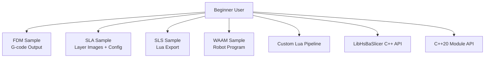

[No sources needed since this diagram shows conceptual workflow, not actual code structure]

**Section sources**
- [README.md:29-38](file://README.md#L29-L38)

## Two Ways to Use HsBaSlicer
There are two main integration styles shown by the samples:

### 1. Module Interface (C++20 module)
The module interface wraps the core library into a class-based API. It is designed for modern C++ consumers who want RAII-style model handling and pipeline classes.

Key concepts:
- `Model`: loads a model and manages its lifecycle.
- `FdmPipeline`, `SlaPipeline`, and other pipeline classes run complete workflows.
- `CustomLuaPipeline` runs a fully Lua-defined workflow.
- Errors are thrown as `SlicerError`.

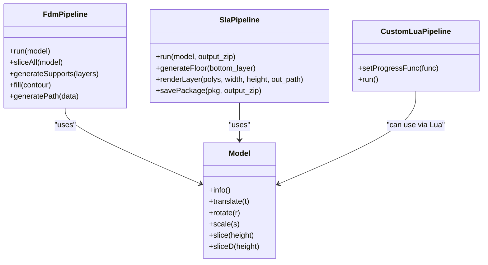

**Diagram sources**
- [ModuleHsBaSlicer/hsba_slicer.cppm:152-191](file://ModuleHsBaSlicer/hsba_slicer.cppm#L152-L191)
- [ModuleHsBaSlicer/hsba_slicer.cppm:204-225](file://ModuleHsBaSlicer/hsba_slicer.cppm#L204-L225)
- [ModuleHsBaSlicer/hsba_slicer.cppm:239-258](file://ModuleHsBaSlicer/hsba_slicer.cppm#L239-L258)
- [ModuleHsBaSlicer/hsba_slicer.cppm:464-479](file://ModuleHsBaSlicer/hsba_slicer.cppm#L464-L479)

### 2. Module Interface (DLL C ABI)
The DLL interface exposes C functions for external languages and runtime environments. Its initialization function registers Lua functions, pipelines, and one-time runtime setup.

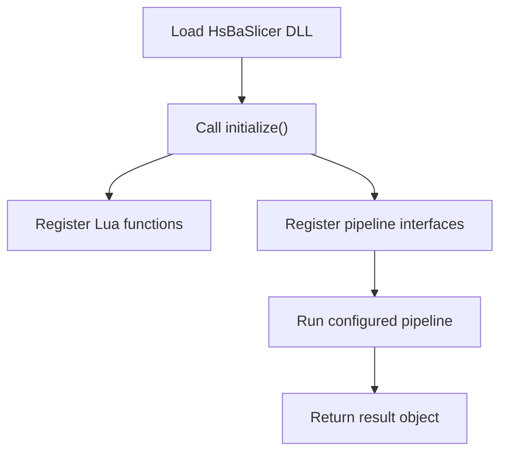

**Diagram sources**
- [DllHsBaSlicer/initialize.h:14-19](file://DllHsBaSlicer/initialize.h#L14-L19)

**Section sources**
- [ModuleHsBaSlicer/hsba_slicer.cppm:74-79](file://ModuleHsBaSlicer/hsba_slicer.cppm#L74-L79)
- [ModuleHsBaSlicer/hsba_slicer.cppm:152-191](file://ModuleHsBaSlicer/hsba_slicer.cppm#L152-L191)
- [ModuleHsBaSlicer/hsba_slicer.cppm:204-225](file://ModuleHsBaSlicer/hsba_slicer.cppm#L204-L225)
- [ModuleHsBaSlicer/hsba_slicer.cppm:239-258](file://ModuleHsBaSlicer/hsba_slicer.cppm#L239-L258)
- [ModuleHsBaSlicer/hsba_slicer.cppm:464-479](file://ModuleHsBaSlicer/hsba_slicer.cppm#L464-L479)
- [DllHsBaSlicer/initialize.h:14-19](file://DllHsBaSlicer/initialize.h#L14-L19)

## Step-by-Step FDM Tutorial
FDM stands for fused deposition modeling. In HsBaSlicer, the FDM sample demonstrates:

- Default configuration.
- Custom process parameters.
- Lua-based support and infill customization.
- Synchronous execution.
- Asynchronous execution.
- Spiral or vase mode.

### Example 1: Basic FDM Workflow
The basic example shows the minimal steps:

1. Create default FDM configuration.
2. Set model name and model path.
3. Run the FDM pipeline synchronously.
4. Check whether the result is successful.
5. Write G-code to a file if available.
6. Free the result memory.

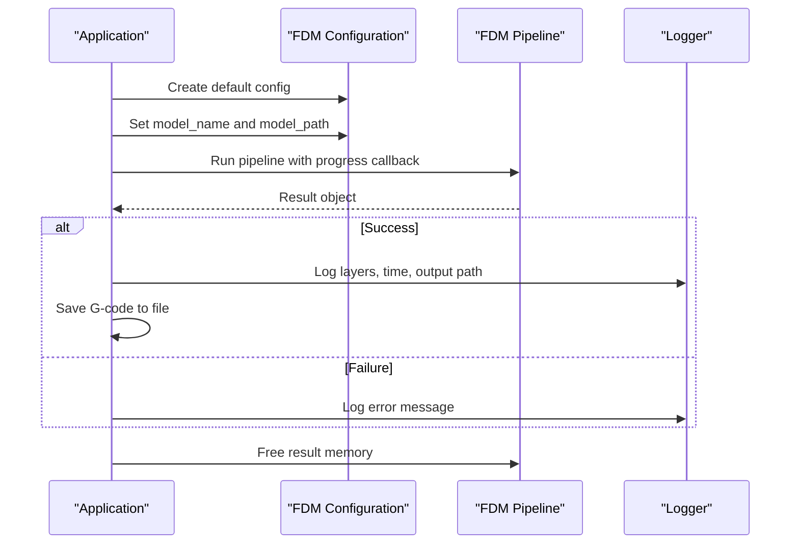

**Diagram sources**
- [samples/FDM/main.cpp:53-96](file://samples/FDM/main.cpp#L53-L96)

### Example 2: Custom Process Parameters
The custom parameter example shows how to control:

- Layer height and first-layer height.
- Fill spacing, fill mode, fill angle.
- Wall count, top/bottom solid layers, infill density.
- Support enable flag, overhang angle, support pattern.
- Line width, print speed, travel speed, extrusion multiplier.
- Output path.

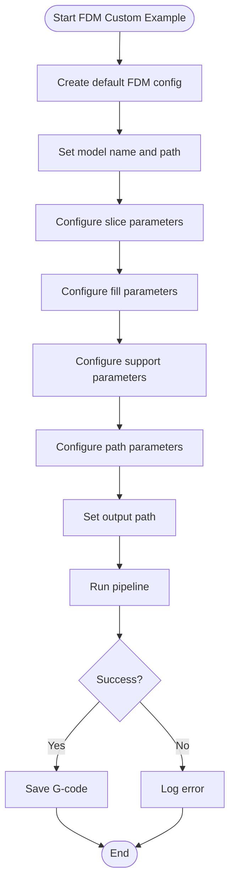

**Diagram sources**
- [samples/FDM/main.cpp:101-165](file://samples/FDM/main.cpp#L101-L165)

### Example 3: Lua Custom Support and Infill
The Lua customization example shows how to replace built-in support and infill stages with scripts.

Important fields used in the sample:

| Field | Meaning |
|---|---|
| `support_lua_script` | Path to the Lua script providing support generation |
| `support_lua_func` | Function name inside the script |
| `infill_lua_script` | Path to the Lua script providing infill generation |
| `infill_lua_func` | Function name inside the script |

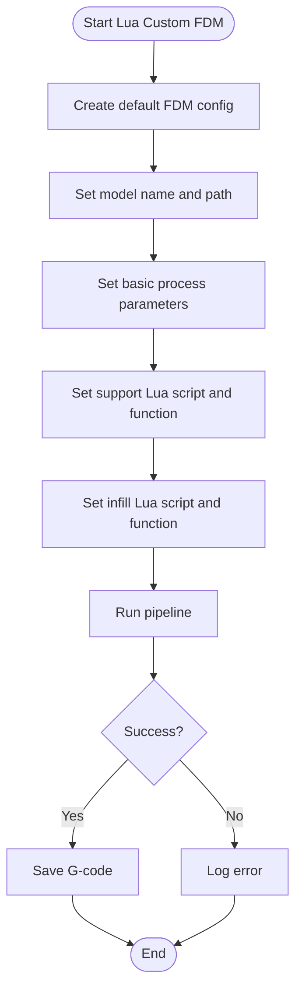

**Diagram sources**
- [samples/FDM/main.cpp:170-220](file://samples/FDM/main.cpp#L170-L220)

### Example 4: Asynchronous FDM Execution
The asynchronous example starts the pipeline without blocking the caller. A completion callback receives the final result.

Key behavior:
- `HsBaRunFdmPipelineAsync` returns immediately.
- The application can wait on a flag or perform other work.
- The completion callback frees the result object.

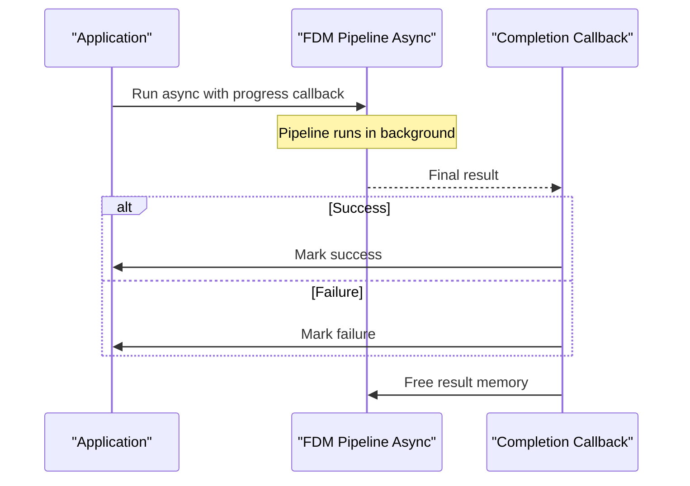

**Diagram sources**
- [samples/FDM/main.cpp:227-269](file://samples/FDM/main.cpp#L227-L269)

### Example 5: Spiral or Vase Mode
Spiral mode merges outer walls into a single continuous path that rises in Z. It skips per-layer travel moves and retraction where supported.

Relevant configuration:
- `spiral_mode = 1` enables spiral/vase behavior.

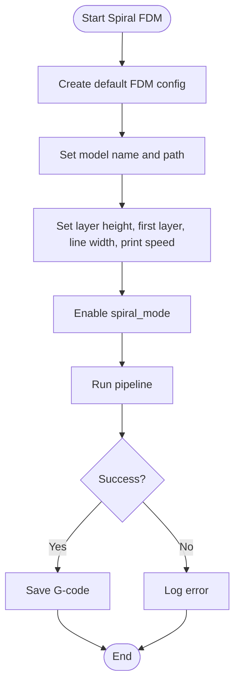

**Diagram sources**
- [samples/FDM/main.cpp:274-318](file://samples/FDM/main.cpp#L274-L318)

**Section sources**
- [samples/FDM/main.cpp:53-96](file://samples/FDM/main.cpp#L53-L96)
- [samples/FDM/main.cpp:101-165](file://samples/FDM/main.cpp#L101-L165)
- [samples/FDM/main.cpp:170-220](file://samples/FDM/main.cpp#L170-L220)
- [samples/FDM/main.cpp:227-269](file://samples/FDM/main.cpp#L227-L269)
- [samples/FDM/main.cpp:274-318](file://samples/FDM/main.cpp#L274-L318)

## Step-by-Step SLA Tutorial
SLA stands for stereolithography. The SLA sample demonstrates:

- Default SLA configuration.
- Exposure settings such as bottom exposure time, normal exposure time, lift distance, and lift speed.
- Floor/raft generation.
- Support generation.
- Zip export containing configuration and layer images.
- Lua customization for floor, support, and export.
- Synchronous and asynchronous execution.

### Example 1: Basic SLA Workflow
The basic SLA example follows the same general pattern as FDM:

1. Create default SLA configuration.
2. Set model name and model path.
3. Set output zip path.
4. Run pipeline synchronously.
5. Check result.
6. Free result memory.

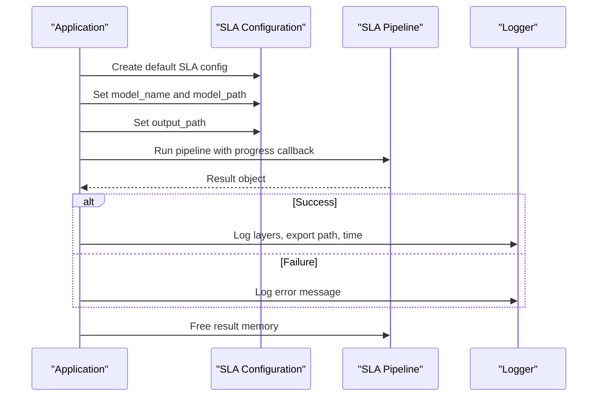

**Diagram sources**
- [samples/SLA/main.cpp:52-84](file://samples/SLA/main.cpp#L52-L84)

### Example 2: Custom SLA Parameters
The custom parameter example covers:

- Slice parameters: layer height and first-layer height.
- Exposure parameters: bottom exposure time, normal exposure time, bottom lift distance, lift distance, lift speed, retract speed.
- Floor/raft parameters: raft offset, border width, fill spacing, border count, convex hull option.
- Support parameters: enable flag, overhang angle, gap, diameter, density, pattern.
- Output path.

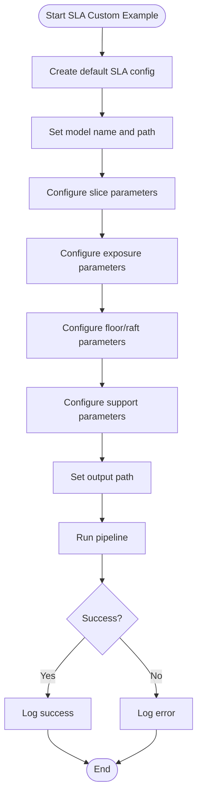

**Diagram sources**
- [samples/SLA/main.cpp:89-144](file://samples/SLA/main.cpp#L89-L144)

### Example 3: Lua Custom Floor, Support, and Export
The Lua customization example shows:

- `floor_lua_script` and `floor_lua_func` for custom floor generation.
- `support_lua_script` and `support_lua_func` for custom support generation.
- Optional `export_lua_script` and `export_lua_func` for custom export logic.

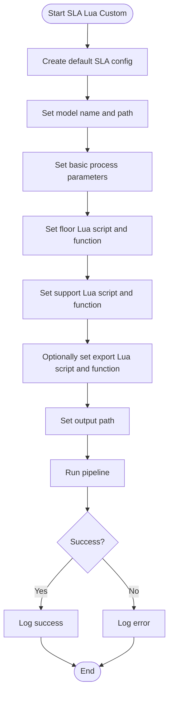

**Diagram sources**
- [samples/SLA/main.cpp:149-191](file://samples/SLA/main.cpp#L149-L191)

### Example 4: Asynchronous SLA Execution
As with FDM, the SLA sample supports asynchronous execution through a completion callback.

**Diagram sources**
- [samples/SLA/main.cpp:197-239](file://samples/SLA/main.cpp#L197-L239)

**Section sources**
- [samples/SLA/main.cpp:52-84](file://samples/SLA/main.cpp#L52-L84)
- [samples/SLA/main.cpp:89-144](file://samples/SLA/main.cpp#L89-L144)
- [samples/SLA/main.cpp:149-191](file://samples/SLA/main.cpp#L149-L191)
- [samples/SLA/main.cpp:197-239](file://samples/SLA/main.cpp#L197-L239)

## Other Slicing Workflows
HsBaSlicer includes additional workflows beyond FDM and SLA.

### SLS: Selective Laser Sintering
SLS is a powder-bed process. The sample emphasizes:

- No floor or raft is required.
- No support structures are required because powder supports the model.
- Output format is controlled by a Lua export script.
- Typical output is a zip archive plus optional database registration.

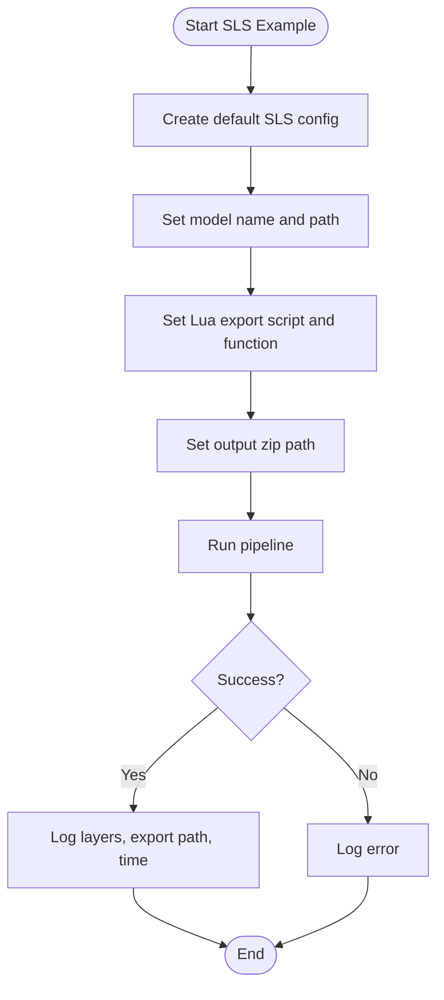

**Diagram sources**
- [samples/SLS/main.cpp:56-92](file://samples/SLS/main.cpp#L56-L92)

### WAAM: Wire Arc Additive Manufacturing
WAAM generates robot programs rather than standard G-code. The sample demonstrates:

- Built-in robot generators for ABB, KUKA, and FANUC.
- Custom welding parameters.
- Custom Lua path generator.
- Spiral mode producing a continuous rising weld bead.

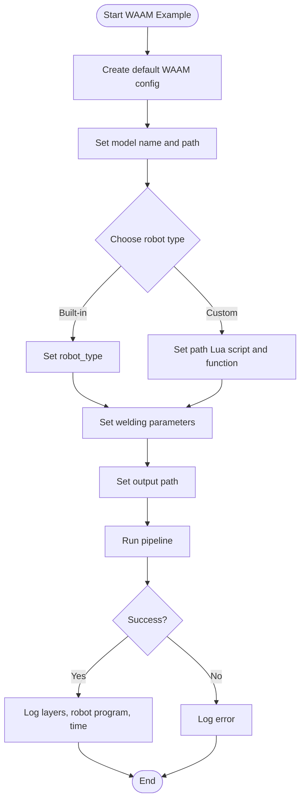

**Diagram sources**
- [samples/WAAM/main.cpp:54-81](file://samples/WAAM/main.cpp#L54-L81)
- [samples/WAAM/main.cpp:86-131](file://samples/WAAM/main.cpp#L86-L131)
- [samples/WAAM/main.cpp:155-178](file://samples/WAAM/main.cpp#L155-L178)
- [samples/WAAM/main.cpp:183-217](file://samples/WAAM/main.cpp#L183-L217)

**Section sources**
- [samples/SLS/main.cpp:56-92](file://samples/SLS/main.cpp#L56-L92)
- [samples/SLS/main.cpp:97-140](file://samples/SLS/main.cpp#L97-L140)
- [samples/SLS/main.cpp:147-190](file://samples/SLS/main.cpp#L147-L190)
- [samples/WAAM/main.cpp:54-81](file://samples/WAAM/main.cpp#L54-L81)
- [samples/WAAM/main.cpp:86-131](file://samples/WAAM/main.cpp#L86-L131)
- [samples/WAAM/main.cpp:155-178](file://samples/WAAM/main.cpp#L155-L178)
- [samples/WAAM/main.cpp:183-217](file://samples/WAAM/main.cpp#L183-L217)

## Lua Custom Pipeline Overview
The Custom sample shows the most flexible approach: the entire workflow is defined by Lua. C++ only provides the operator environment and entry point.

Key ideas:

- The global Lua table `HsBa` exposes operations such as loading models, slicing, filling, support generation, G-code conversion, package saving, and image rendering.
- The C++ side sets configuration fields like script path, inline source, model name, model path, and output path.
- The Lua script controls stage order and behavior.
- Results include total layers, output path, elapsed time, success flag, error message, and an optional string returned by the Lua entry function.

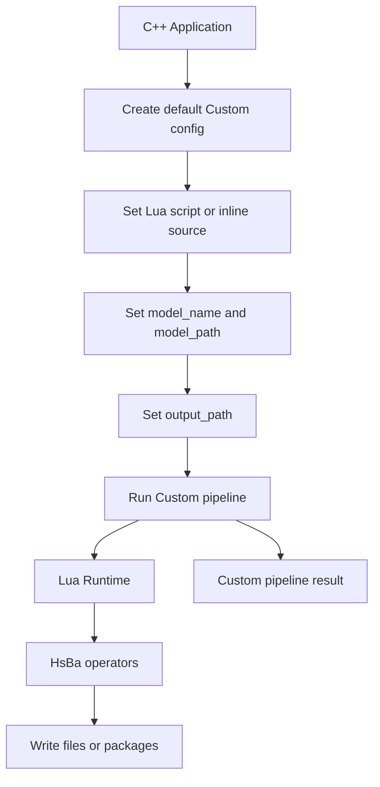

**Diagram sources**
- [samples/Custom/main.cpp:100-132](file://samples/Custom/main.cpp#L100-L132)
- [samples/Custom/main.cpp:140-165](file://samples/Custom/main.cpp#L140-L165)
- [samples/Custom/main.cpp:174-265](file://samples/Custom/main.cpp#L174-L265)
- [samples/Custom/main.cpp:270-314](file://samples/Custom/main.cpp#L270-L314)
- [samples/Custom/main.cpp:331-354](file://samples/Custom/main.cpp#L331-L354)

**Section sources**
- [samples/Custom/main.cpp:100-132](file://samples/Custom/main.cpp#L100-L132)
- [samples/Custom/main.cpp:140-165](file://samples/Custom/main.cpp#L140-L165)
- [samples/Custom/main.cpp:174-265](file://samples/Custom/main.cpp#L174-L265)
- [samples/Custom/main.cpp:270-314](file://samples/Custom/main.cpp#L270-L314)
- [samples/Custom/main.cpp:331-354](file://samples/Custom/main.cpp#L331-L354)

## Configuration Options Reference
The following tables summarize the most important configuration options shown in the beginner samples. They are grouped by technology.

### FDM Configuration Options
| Option Group | Example Fields | Effect |
|---|---|---|
| Model | `model_name`, `model_path` | Identifies and locates the input model |
| Slice | `layer_height`, `first_layer_height` | Controls layer thickness and first-layer thickness |
| Fill | `fill_spacing`, `fill_mode`, `fill_angle`, `wall_count`, `top_layer_count`, `bottom_layer_count`, `infill_density` | Controls wall loops, solid top/bottom layers, and infill density/mode |
| Support | `enable_support`, `overhang_angle`, `support_pattern`, `support_density`, `support_gap`, `support_diameter` | Enables and configures support generation |
| Path | `line_width`, `print_speed`, `travel_speed`, `extrusion_multiplier` | Controls G-code path generation |
| Output | `output_path` | Writes G-code to a file |
| Special | `spiral_mode` | Merges outer walls into a continuous rising path |
| Lua | `support_lua_script`, `support_lua_func`, `infill_lua_script`, `infill_lua_func` | Replaces built-in support/infill with Lua scripts |

**Section sources**
- [samples/FDM/main.cpp:53-96](file://samples/FDM/main.cpp#L53-L96)
- [samples/FDM/main.cpp:101-165](file://samples/FDM/main.cpp#L101-L165)
- [samples/FDM/main.cpp:170-220](file://samples/FDM/main.cpp#L170-L220)
- [samples/FDM/main.cpp:274-318](file://samples/FDM/main.cpp#L274-L318)

### SLA Configuration Options
| Option Group | Example Fields | Effect |
|---|---|---|
| Model | `model_name`, `model_path` | Identifies and locates the input model |
| Slice | `layer_height`, `first_layer_height` | Controls layer thickness and first-layer thickness |
| Exposure | `bottom_exposure_time`, `normal_exposure_time`, `bottom_lift_distance`, `lift_distance`, `lift_speed`, `retract_speed` | Controls resin curing and peel/lift behavior |
| Floor/Raft | `floor_raft_offset`, `floor_border_width`, `floor_fill_spacing`, `floor_border_count`, `floor_use_convex_hull` | Generates bottom floor or raft geometry |
| Support | `enable_support`, `overhang_angle`, `support_gap`, `support_diameter`, `support_density`, `support_pattern` | Enables and configures SLA support generation |
| Output | `output_path` | Exports SLA package, typically a zip |
| Lua | `floor_lua_script`, `floor_lua_func`, `support_lua_script`, `support_lua_func`, `export_lua_script`, `export_lua_func` | Replaces floor/support/export with Lua scripts |

**Section sources**
- [samples/SLA/main.cpp:52-84](file://samples/SLA/main.cpp#L52-L84)
- [samples/SLA/main.cpp:89-144](file://samples/SLA/main.cpp#L89-L144)
- [samples/SLA/main.cpp:149-191](file://samples/SLA/main.cpp#L149-L191)

### SLS Configuration Options
| Option Group | Example Fields | Effect |
|---|---|---|
| Model | `model_name`, `model_path` | Identifies and locates the input model |
| Slice | `layer_height`, `first_layer_height` | Controls layer thickness and first-layer thickness |
| Laser | `laser_power`, `scan_speed`, `hatch_spacing`, `hatch_rotation`, `bed_temperature` | Controls laser sintering parameters |
| Export | `export_lua_script`, `export_lua_func` | Defines SLS output format |
| Output | `output_path` | Usually a zip archive |

**Section sources**
- [samples/SLS/main.cpp:56-92](file://samples/SLS/main.cpp#L56-L92)
- [samples/SLS/main.cpp:97-140](file://samples/SLS/main.cpp#L97-L140)

### WAAM Configuration Options
| Option Group | Example Fields | Effect |
|---|---|---|
| Model | `model_name`, `model_path` | Identifies and locates the input model |
| Geometry | `layer_height`, `first_layer_height`, `bead_width`, `travel_speed` | Controls deposited layer geometry |
| Welding | `material`, `welding_process`, `protection`, `protect_gas`, `arc_current`, `arc_voltage`, `wire_feed_speed`, `gas_flow_rate`, `interpass_temperature` | Controls welding parameters |
| Robot | `robot_type` | Selects built-in robot code generator |
| Lua | `path_lua_script`, `path_lua_func` | Replaces built-in robot code generator |
| Output | `output_path` | Writes robot program |
| Special | `spiral_mode` | Produces a continuous rising weld bead |

**Section sources**
- [samples/WAAM/main.cpp:54-81](file://samples/WAAM/main.cpp#L54-L81)
- [samples/WAAM/main.cpp:86-131](file://samples/WAAM/main.cpp#L86-L131)
- [samples/WAAM/main.cpp:155-178](file://samples/WAAM/main.cpp#L155-L178)
- [samples/WAAM/main.cpp:183-217](file://samples/WAAM/main.cpp#L183-L217)

## Error Handling and Progress Monitoring
HsBaSlicer provides two main mechanisms for monitoring and error handling:

### Progress Callbacks
Most pipeline functions accept a progress callback. The samples show:

- A progress callback receiving percentage, stage name, and user data.
- Logging progress messages during slicing.
- Using progress callbacks for both synchronous and asynchronous pipelines.

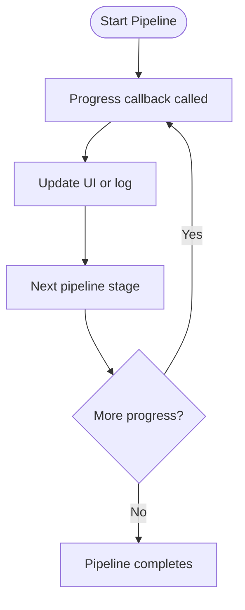

**Diagram sources**
- [samples/FDM/main.cpp:38-48](file://samples/FDM/main.cpp#L38-L48)
- [samples/SLA/main.cpp:37-47](file://samples/SLA/main.cpp#L37-L47)
- [samples/SLS/main.cpp:41-51](file://samples/SLS/main.cpp#L41-L51)
- [samples/WAAM/main.cpp:40-49](file://samples/WAAM/main.cpp#L40-L49)

### Result Objects
Pipeline results generally contain:

- `success`: whether the pipeline completed successfully.
- `total_layers`: number of processed layers.
- `elapsed_seconds`: processing time.
- `error_message`: error description when failed.
- Output-specific fields such as G-code content, export path, or output path.

Always check `success` before reading output fields, and free result objects when using the C ABI.

### C++ Module Exceptions
When using the C++ module API, failures throw `SlicerError`. The module sample catches it explicitly.

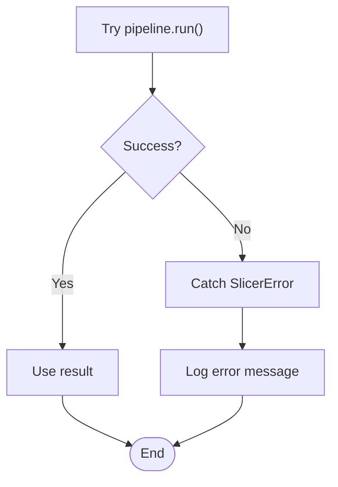

**Diagram sources**
- [ModuleHsBaSlicer/hsba_slicer.cppm:74-79](file://ModuleHsBaSlicer/hsba_slicer.cppm#L74-L79)
- [samples/LibHsBaSlicer/main_module.cpp:129-138](file://samples/LibHsBaSlicer/main_module.cpp#L129-L138)

**Section sources**
- [samples/FDM/main.cpp:38-48](file://samples/FDM/main.cpp#L38-L48)
- [samples/SLA/main.cpp:37-47](file://samples/SLA/main.cpp#L37-L47)
- [samples/SLS/main.cpp:41-51](file://samples/SLS/main.cpp#L41-L51)
- [samples/WAAM/main.cpp:40-49](file://samples/WAAM/main.cpp#L40-L49)
- [ModuleHsBaSlicer/hsba_slicer.cppm:74-79](file://ModuleHsBaSlicer/hsba_slicer.cppm#L74-L79)
- [samples/LibHsBaSlicer/main_module.cpp:129-138](file://samples/LibHsBaSlicer/main_module.cpp#L129-L138)

## Integration Guide
This section explains how to integrate HsBaSlicer into existing applications with minimal setup.

### Build and Install
According to the project README:

- Required tools include CMake, a C++ compiler with C++20 support, vcpkg, and PowerShell on Windows.
- The project supports Windows, Linux, macOS, Android, and iOS.
- Installation exports targets under the `HsBaSlicer::` namespace.
- Downstream projects can use `find_package(HsBaSlicer CONFIG REQUIRED)` and link against exported targets.

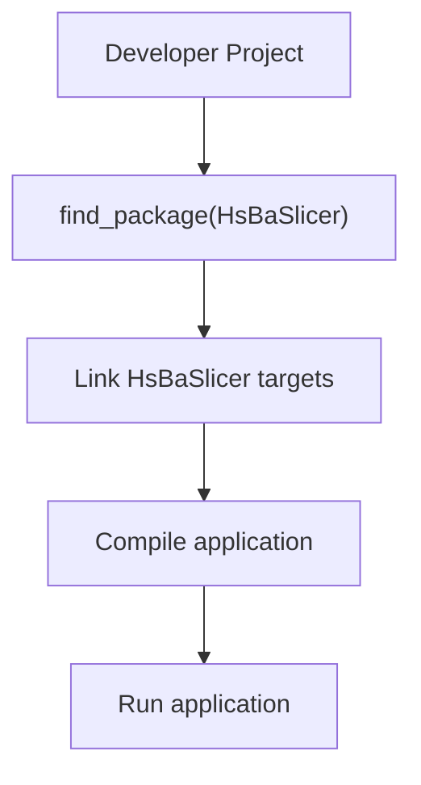

**Diagram sources**
- [README.md:100-124](file://README.md#L100-L124)
- [README.md:174-179](file://README.md#L174-L179)

### Choose Your Integration Style
| Integration Style | Best For | Key Entry Point |
|---|---|---|
| DLL C ABI | External languages, game engines, scripting hosts | `initialize()` and pipeline functions |
| LibHsBaSlicer headers | Traditional C++ projects without modules | Preprocess, slice, support, fill, path functions |
| C++20 module | Modern C++ projects | `import hsba.slicer;` and pipeline classes |
| Custom Lua pipeline | Flexible workflows controlled by scripts | `HsBaRunCustomPipeline` |

**Section sources**
- [README.md:41-98](file://README.md#L41-L98)
- [README.md:100-124](file://README.md#L100-L124)
- [README.md:174-179](file://README.md#L174-L179)
- [DllHsBaSlicer/initialize.h:14-19](file://DllHsBaSlicer/initialize.h#L14-L19)
- [samples/LibHsBaSlicer/main_header.cpp:20-28](file://samples/LibHsBaSlicer/main_header.cpp#L20-L28)
- [samples/LibHsBaSlicer/main_module.cpp:27-29](file://samples/LibHsBaSlicer/main_module.cpp#L27-L29)
- [samples/Custom/main.cpp:100-132](file://samples/Custom/main.cpp#L100-L132)

## Troubleshooting Guide
Common beginner issues and their typical causes:

| Problem | Likely Cause | Resolution |
|---|---|---|
| Model file not found | Missing STL file or wrong relative path | Place the model in the expected directory and verify the path |
| Pipeline fails silently | Not checking `success` field | Always check result.success before reading output |
| Memory leak in C ABI | Not freeing result object | Call the corresponding `HsBaFree*PipelineResult` function |
| Module build fails | Compiler does not support C++20 modules | Use a compiler version mentioned in the module sample header |
| Lua script not found | Wrong script path or missing script file | Verify `pipeline_lua_script`, `support_lua_script`, `infill_lua_script`, or export script paths |
| Spiral mode produces unexpected output | Spiral mode changes wall behavior | Confirm `spiral_mode` is enabled intentionally |
| Progress callback not called | Callback not passed or logging disabled | Pass progress callback and ensure logger is available |

**Section sources**
- [samples/LibHsBaSlicer/main_header.cpp:53-59](file://samples/LibHsBaSlicer/main_header.cpp#L53-L59)
- [samples/LibHsBaSlicer/main_module.cpp:37-43](file://samples/LibHsBaSlicer/main_module.cpp#L37-L43)
- [samples/FDM/main.cpp:69-95](file://samples/FDM/main.cpp#L69-L95)
- [samples/SLA/main.cpp:69-83](file://samples/SLA/main.cpp#L69-L83)
- [samples/SLS/main.cpp:77-91](file://samples/SLS/main.cpp#L77-L91)
- [samples/WAAM/main.cpp:69-80](file://samples/WAAM/main.cpp#L69-L80)

## Conclusion
For beginners, the recommended learning path is:

1. Start with the FDM sample to understand model loading, configuration, slicing, support, infill, and G-code output.
2. Move to the SLA sample to learn exposure, floor/raft, and image-based layer export.
3. Explore SLS and WAAM to see how output formats change for different manufacturing processes.
4. Use the Custom Lua pipeline when you need full control over workflow stages.
5. Choose the integration style that matches your application: DLL C ABI for external languages, LibHsBaSlicer headers for traditional C++, or the C++20 module for modern C++.

The samples already provide complete working patterns for initialization, configuration, execution, progress monitoring, error handling, and output generation. Use them as templates and adjust only the configuration fields relevant to your printer, material, and output requirements.

[No sources needed since this section summarizes without analyzing specific files]