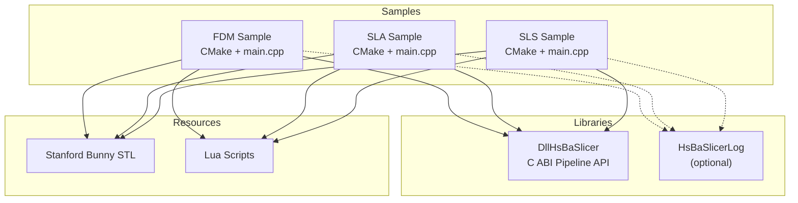
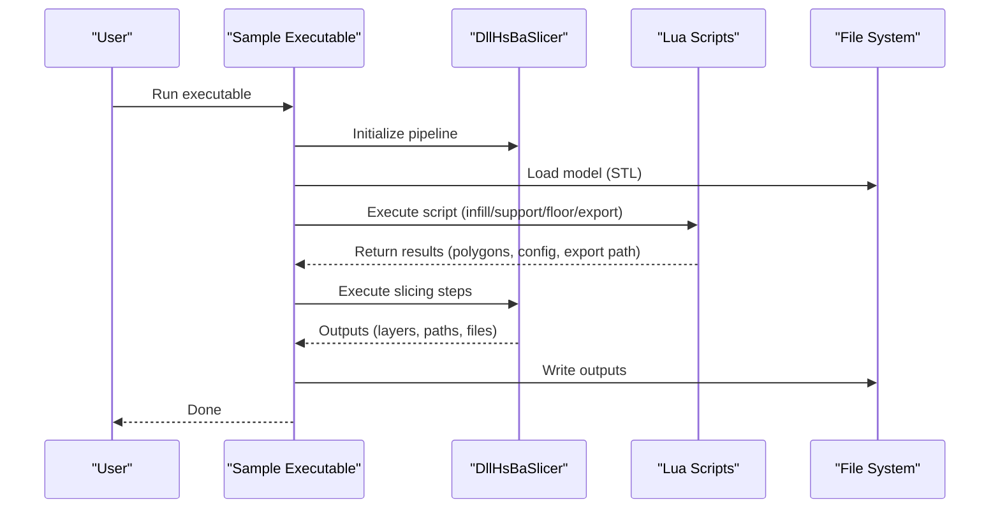
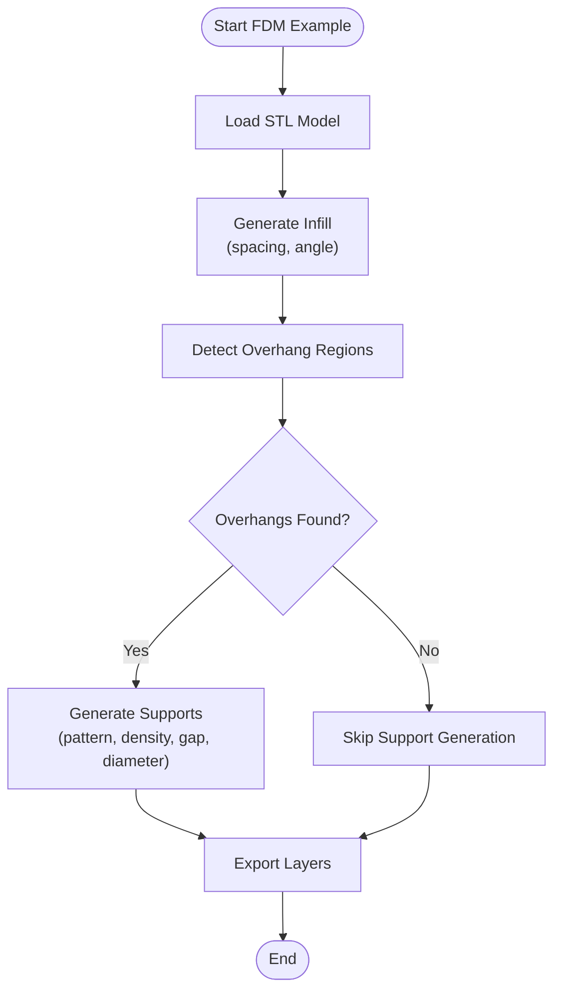
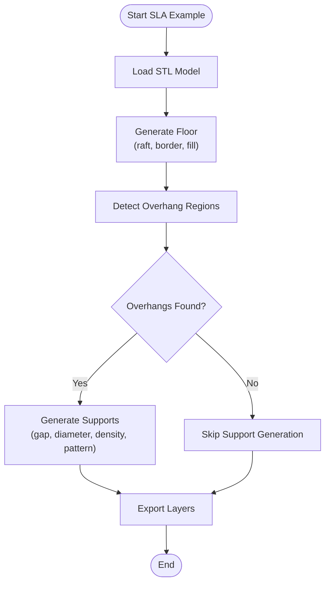
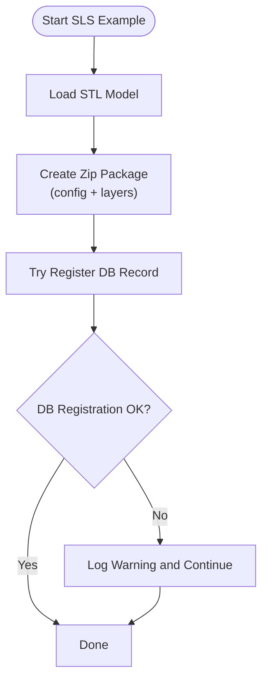
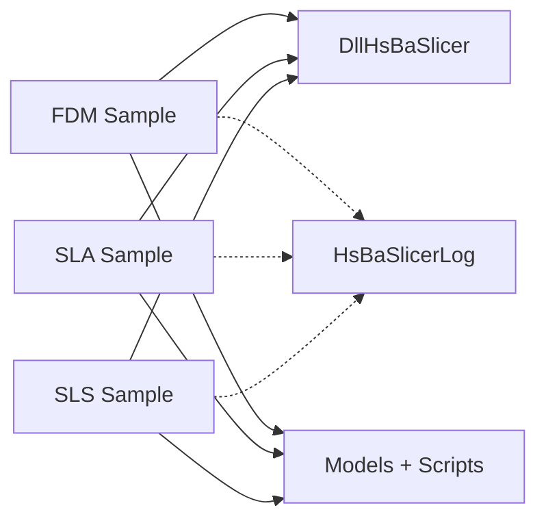

# Basic Examples

<cite>
**Referenced Files in This Document**
- [README.md](file://README.md)
- [samples/FDM/CMakeLists.txt](file://samples/FDM/CMakeLists.txt)
- [samples/SLA/CMakeLists.txt](file://samples/SLA/CMakeLists.txt)
- [samples/SLS/CMakeLists.txt](file://samples/SLS/CMakeLists.txt)
- [samples/FDM/scripts/my_infill.lua](file://samples/FDM/scripts/my_infill.lua)
- [samples/FDM/scripts/my_support.lua](file://samples/FDM/scripts/my_support.lua)
- [samples/SLA/scripts/my_sla_floor.lua](file://samples/SLA/scripts/my_sla_floor.lua)
- [samples/SLA/scripts/my_sla_support.lua](file://samples/SLA/scripts/my_sla_support.lua)
- [samples/SLS/scripts/my_sls_export.lua](file://samples/SLS/scripts/my_sls_export.lua)
</cite>

## Table of Contents
1. [Introduction](#introduction)
2. [Project Structure](#project-structure)
3. [Core Components](#core-components)
4. [Architecture Overview](#architecture-overview)
5. [Detailed Component Analysis](#detailed-component-analysis)
6. [Dependency Analysis](#dependency-analysis)
7. [Performance Considerations](#performance-considerations)
8. [Troubleshooting Guide](#troubleshooting-guide)
9. [Conclusion](#conclusion)
10. [Appendices](#appendices)

## Introduction
This document provides basic examples and step-by-step tutorials for HsBaSlicer using three manufacturing technologies: Fused Deposition Modeling (FDM), Stereolithography (SLA), and Selective Laser Sintering (SLS). It focuses on simple slicing workflows, including model loading, parameter configuration, pipeline execution, and result output. You will learn how to modify sample parameters, understand the outputs, and apply basic error handling patterns.

HsBaSlicer is a modular, cross-platform C++ framework for 3D-printing slicers intended for research and production-level pipelines. The samples demonstrate how to build and run example executables that use the DllHsBaSlicer interface and Lua scripts for customization.

**Section sources**
- [README.md:21-39](file://README.md#L21-L39)

## Project Structure
The examples are organized under `samples/<Technology>/`. Each technology has:
- A CMake target that builds an executable or static library (on mobile platforms).
- A link to `DllHsBaSlicer` for the public C ABI pipeline interface.
- Optional logging via `HsBaSlicerLog`.
- Resource management that copies models and Lua scripts into the runtime directory.

**Diagram sources**
- [samples/FDM/CMakeLists.txt:1-24](file://samples/FDM/CMakeLists.txt#L1-L24)
- [samples/SLA/CMakeLists.txt:1-24](file://samples/SLA/CMakeLists.txt#L1-L24)
- [samples/SLS/CMakeLists.txt:1-24](file://samples/SLS/CMakeLists.txt#L1-L24)

**Section sources**
- [samples/FDM/CMakeLists.txt:1-24](file://samples/FDM/CMakeLists.txt#L1-L24)
- [samples/SLA/CMakeLists.txt:1-24](file://samples/SLA/CMakeLists.txt#L1-L24)
- [samples/SLS/CMakeLists.txt:1-24](file://samples/SLS/CMakeLists.txt#L1-L24)

## Core Components
This section introduces the core components you will interact with in each example:
- Model input: The Stanford Bunny STL file is used by all samples.
- Lua scripts: Provide custom logic for infill, support, floor generation, and export.
- Pipeline execution: Performed through the DllHsBaSlicer interface from the sample main programs.
- Output: Layer polygons, generated paths, and exported artifacts depending on the technology.

Key responsibilities:
- FDM: Infill pattern generation and support generation.
- SLA: Floor generation and support generation.
- SLS: Custom export of layer data and optional database registration.

**Section sources**
- [samples/FDM/scripts/my_infill.lua:1-89](file://samples/FDM/scripts/my_infill.lua#L1-L89)
- [samples/FDM/scripts/my_support.lua:1-83](file://samples/FDM/scripts/my_support.lua#L1-L83)
- [samples/SLA/scripts/my_sla_floor.lua:1-64](file://samples/SLA/scripts/my_sla_floor.lua#L1-L64)
- [samples/SLA/scripts/my_sla_support.lua:1-76](file://samples/SLA/scripts/my_sla_support.lua#L1-L76)
- [samples/SLS/scripts/my_sls_export.lua:1-80](file://samples/SLS/scripts/my_sls_export.lua#L1-L80)

## Architecture Overview
The following sequence diagram shows a typical workflow for running one of the sample executables:

[No sources needed since this diagram shows conceptual workflow, not actual code structure]

## Detailed Component Analysis

### FDM Workflow Tutorial
Objective: Slice a model using FDM, generate infill and supports, and produce layer outputs.

Steps:
1. Build the FDM sample.
2. Ensure the Stanford Bunny STL is available at runtime.
3. Run the executable; it loads the model and executes Lua scripts for infill and support.
4. Inspect the generated outputs (layer polygons and any exported artifacts).

Parameter modification tips:
- Infill spacing and angle can be adjusted in the Lua script.
- Support density, gap, diameter, and pattern can be tuned in the support script.

Expected outputs:
- Layer polygon data for each slice.
- Generated support structures based on overhang detection.

Error handling patterns:
- If no overhang regions are detected, the support generator returns empty results.
- If the current layer is empty, the infill generator returns an empty list.

**Diagram sources**
- [samples/FDM/scripts/my_infill.lua:20-87](file://samples/FDM/scripts/my_infill.lua#L20-L87)
- [samples/FDM/scripts/my_support.lua:32-79](file://samples/FDM/scripts/my_support.lua#L32-L79)

**Section sources**
- [samples/FDM/CMakeLists.txt:1-72](file://samples/FDM/CMakeLists.txt#L1-L72)
- [samples/FDM/scripts/my_infill.lua:1-89](file://samples/FDM/scripts/my_infill.lua#L1-L89)
- [samples/FDM/scripts/my_support.lua:1-83](file://samples/FDM/scripts/my_support.lua#L1-L83)

### SLA Workflow Tutorial
Objective: Slice a model using SLA, generate a raft/border/floor, and create supports.

Steps:
1. Build the SLA sample.
2. Ensure the Stanford Bunny STL is available at runtime.
3. Run the executable; it loads the model and executes Lua scripts for floor and support generation.
4. Inspect the generated outputs (floor polygons and support structures).

Parameter modification tips:
- Raft offset, border width, fill spacing, fill angle, and convex hull usage can be adjusted in the floor script.
- Support gap, diameter, density, and pattern can be tuned in the support script.

Expected outputs:
- Floor polygons combining border and fill.
- Support structures optimized for SLA processes.

Error handling patterns:
- If no overhang regions are detected, the support generator returns empty results.
- Convex hull simplification can be toggled to reduce complexity.

**Diagram sources**
- [samples/SLA/scripts/my_sla_floor.lua:35-62](file://samples/SLA/scripts/my_sla_floor.lua#L35-L62)
- [samples/SLA/scripts/my_sla_support.lua:34-72](file://samples/SLA/scripts/my_sla_support.lua#L34-L72)

**Section sources**
- [samples/SLA/CMakeLists.txt:1-48](file://samples/SLA/CMakeLists.txt#L1-L48)
- [samples/SLA/scripts/my_sla_floor.lua:1-64](file://samples/SLA/scripts/my_sla_floor.lua#L1-L64)
- [samples/SLA/scripts/my_sla_support.lua:1-76](file://samples/SLA/scripts/my_sla_support.lua#L1-L76)

### SLS Workflow Tutorial
Objective: Slice a model using SLS and export layer data to a zip package, optionally registering records in a database.

Steps:
1. Build the SLS sample.
2. Ensure the Stanford Bunny STL is available at runtime.
3. Run the executable; it loads the model and executes the SLS export script.
4. Inspect the generated zip package and optional database entries.

Parameter modification tips:
- Adjust the output path and included files in the export script.
- Toggle database registration on/off based on environment availability.

Expected outputs:
- A zip file containing configuration and per-layer polygon outlines.
- Optional SQLite database record of the export.

Error handling patterns:
- Database registration failure is non-fatal and logged as a warning.
- The export function always returns success status and export path.

**Diagram sources**
- [samples/SLS/scripts/my_sls_export.lua:23-76](file://samples/SLS/scripts/my_sls_export.lua#L23-L76)

**Section sources**
- [samples/SLS/CMakeLists.txt:1-48](file://samples/SLS/CMakeLists.txt#L1-L48)
- [samples/SLS/scripts/my_sls_export.lua:1-80](file://samples/SLS/scripts/my_sls_export.lua#L1-L80)

## Dependency Analysis
The samples depend on:
- DllHsBaSlicer for the public C ABI pipeline interface.
- HsBaSlicerLog for logging (optional on non-game-console platforms).
- Resources such as the Stanford Bunny STL and Lua scripts copied to the runtime directory.

**Diagram sources**
- [samples/FDM/CMakeLists.txt:1-24](file://samples/FDM/CMakeLists.txt#L1-L24)
- [samples/SLA/CMakeLists.txt:1-24](file://samples/SLA/CMakeLists.txt#L1-L24)
- [samples/SLS/CMakeLists.txt:1-24](file://samples/SLS/CMakeLists.txt#L1-L24)

**Section sources**
- [samples/FDM/CMakeLists.txt:1-72](file://samples/FDM/CMakeLists.txt#L1-L72)
- [samples/SLA/CMakeLists.txt:1-48](file://samples/SLA/CMakeLists.txt#L1-L48)
- [samples/SLS/CMakeLists.txt:1-48](file://samples/SLS/CMakeLists.txt#L1-L48)

## Performance Considerations
- Use convex hull simplification in SLA floor generation to reduce polygon complexity when appropriate.
- Tune infill spacing and angle to balance print time and mechanical strength in FDM.
- Filter small support areas by area threshold to avoid unnecessary material usage in SLA.
- Avoid unnecessary database operations if not required; the SLS export treats DB registration as optional.

[No sources needed since this section provides general guidance]

## Troubleshooting Guide
Common issues and resolutions:
- Missing model file: Ensure the Stanford Bunny STL is downloaded or manually placed in the expected location. The FDM CMake script attempts to download it and warns if the download fails.
- Script errors: Validate Lua syntax and ensure functions return the expected types (polygons, tables).
- Database registration failures in SLS export: These are non-fatal; check logs for warnings and verify SQLite availability.

Build and resource notes:
- On Android/iOS, samples build as static libraries to keep code verified even without console executables.
- Resources are copied to the executable’s output directory during post-build steps.

**Section sources**
- [samples/FDM/CMakeLists.txt:26-72](file://samples/FDM/CMakeLists.txt#L26-L72)
- [samples/SLA/CMakeLists.txt:26-48](file://samples/SLA/CMakeLists.txt#L26-L48)
- [samples/SLS/CMakeLists.txt:26-48](file://samples/SLS/CMakeLists.txt#L26-L48)
- [samples/SLS/scripts/my_sls_export.lua:50-71](file://samples/SLS/scripts/my_sls_export.lua#L50-L71)

## Conclusion
You now have practical, step-by-step examples for FDM, SLA, and SLS workflows in HsBaSlicer. By modifying Lua parameters and understanding the generated outputs, you can tailor slicing behavior to your manufacturing needs. Use the troubleshooting tips to resolve common setup issues and leverage the architecture overview to extend or integrate these examples into larger systems.

[No sources needed since this section summarizes without analyzing specific files]

## Appendices

### Build Instructions
Requirements:
- CMake >= 3.28
- A C++ compiler with C++20 support
- vcpkg (recommended)
- PowerShell (Windows recommended)

Recommended Windows setup:
- Install Visual Studio 2022 or later with “Desktop development with C++”, CMake tools, and vcpkg.
- Use the `windows-release` preset for release builds.

Linux/macOS example:
- Install dependencies and vcpkg.
- Configure and build using CMake presets or manual commands.

Install and export:
- Use `cmake --install` to install targets.
- Downstream projects can find HsBaSlicer via `find_package(HsBaSlicer CONFIG REQUIRED)` and link against `HsBaSlicer::DllHsBaSlicer`.

**Section sources**
- [README.md:41-98](file://README.md#L41-L98)
- [README.md:100-179](file://README.md#L100-L179)