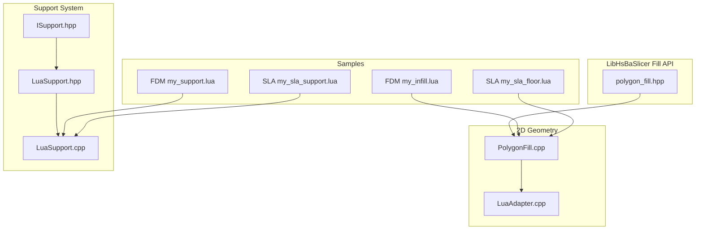
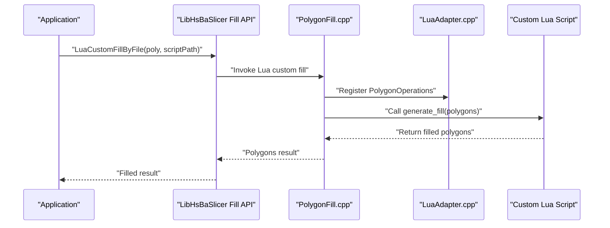
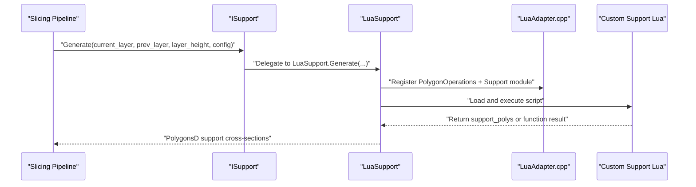
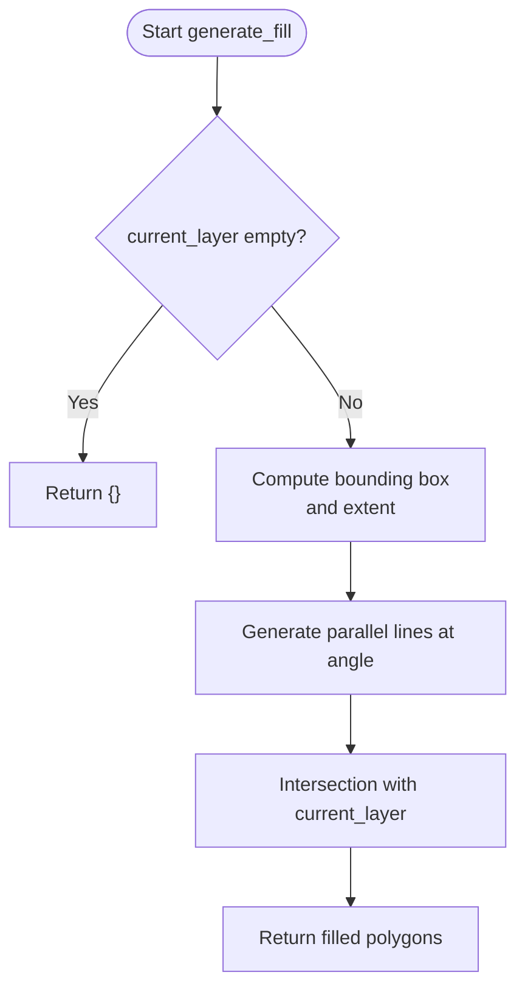
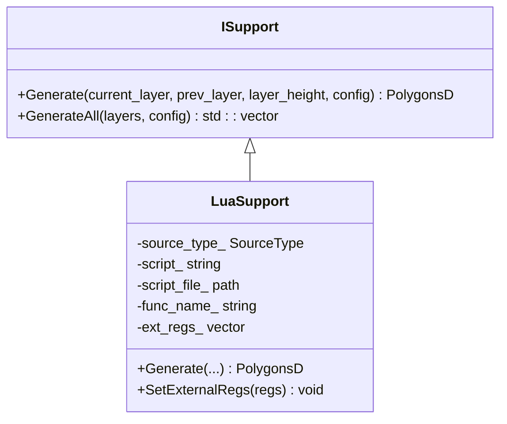
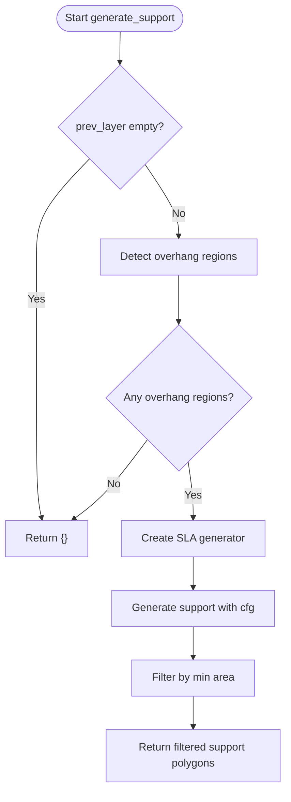
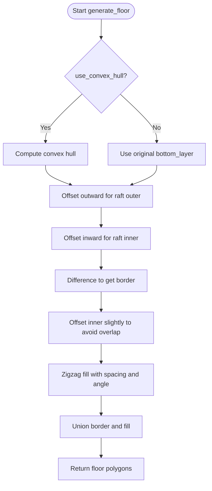
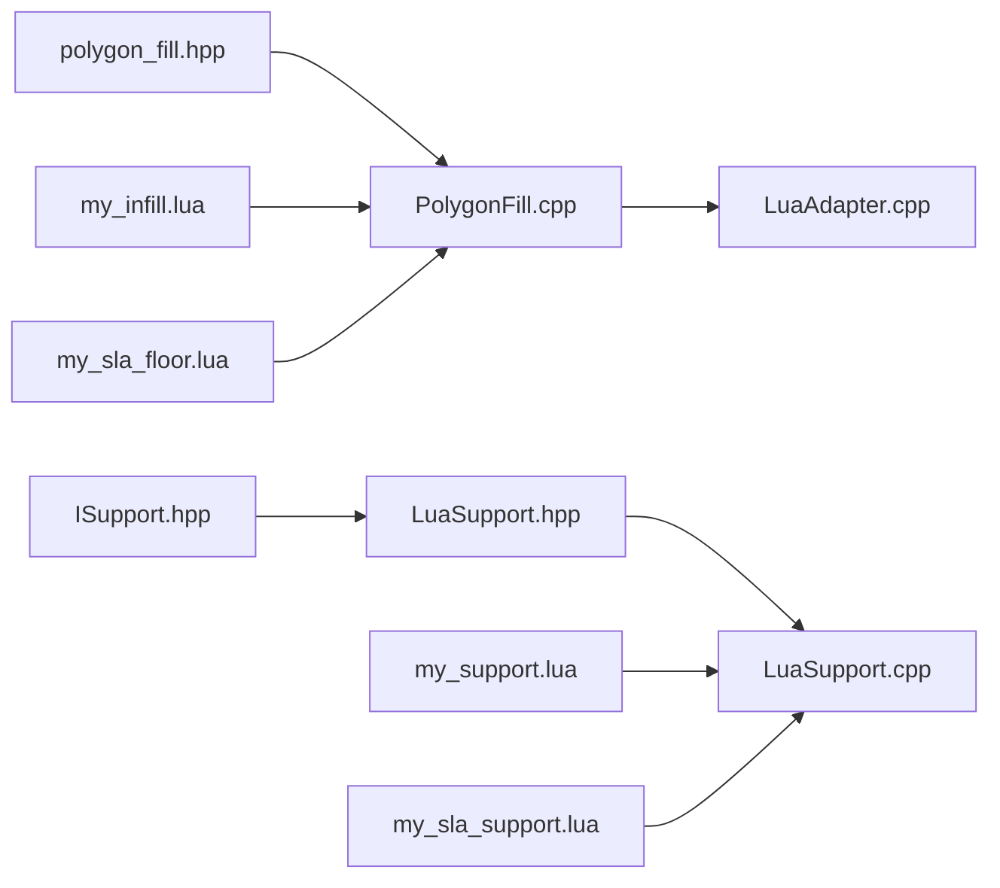

# Custom Algorithm Examples

<cite>
**Referenced Files in This Document**   
- [README.md](file://README.md)
- [polygon_fill.hpp](file://LibHsBaSlicer/Fill/polygon_fill.hpp)
- [PolygonFill.cpp](file://2D/PolygonFill.cpp)
- [LuaAdapter.cpp](file://2D/LuaAdapter.cpp)
- [ISupport.hpp](file://support/ISupport.hpp)
- [LuaSupport.hpp](file://support/LuaSupport.hpp)
- [LuaSupport.cpp](file://support/LuaSupport.cpp)
- [my_infill.lua](file://samples/FDM/scripts/my_infill.lua)
- [my_support.lua](file://samples/FDM/scripts/my_support.lua)
- [my_sla_floor.lua](file://samples/SLA/scripts/my_sla_floor.lua)
- [my_sla_support.lua](file://samples/SLA/scripts/my_sla_support.lua)
</cite>

## Table of Contents
1. [Introduction](#introduction)
2. [Project Structure](#project-structure)
3. [Core Components](#core-components)
4. [Architecture Overview](#architecture-overview)
5. [Detailed Component Analysis](#detailed-component-analysis)
6. [Dependency Analysis](#dependency-analysis)
7. [Performance Considerations](#performance-considerations)
8. [Troubleshooting Guide](#troubleshooting-guide)
9. [Conclusion](#conclusion)
10. [Appendices](#appendices)

## Introduction
This document provides comprehensive examples for developing custom algorithms in HsBaSlicer, focusing on:
- Custom infill patterns via the polygon fill system and Lua scripts.
- Custom support generation for FDM and SLA processes.
- Custom floor generation for SLA printing.
- Algorithm interfaces, data structures, integration points with the core slicing engine.
- Performance optimization techniques, debugging approaches, testing strategies.
- Registration and usage of custom algorithms within pipelines.

The repository is a modular C++ framework for 3D-printing slicers, exposing both C++ APIs and Lua scripting hooks for extensibility. The samples under `samples/FDM` and `samples/SLA` demonstrate how to implement custom algorithms using Lua while integrating with built-in geometry and support engines.

**Section sources**
- [README.md:21-39](file://README.md#L21-L39)

## Project Structure
For custom algorithm development, the relevant parts of the project are:
- `2D`: Polygon operations and Lua adapter for polygon manipulation.
- `LibHsBaSlicer/Fill`: Public C++ API for polygon filling, including Lua custom fills.
- `support`: Support generation interfaces and Lua-based custom support generator.
- `samples/FDM` and `samples/SLA`: Example Lua scripts for infill, support, and SLA floor generation.

**Diagram sources**
- [PolygonFill.cpp:1-20](file://2D/PolygonFill.cpp#L1-L20)
- [LuaAdapter.cpp:1-15](file://2D/LuaAdapter.cpp#L1-L15)
- [polygon_fill.hpp:1-58](file://LibHsBaSlicer/Fill/polygon_fill.hpp#L1-L58)
- [ISupport.hpp:1-49](file://support/ISupport.hpp#L1-L49)
- [LuaSupport.hpp:1-85](file://support/LuaSupport.hpp#L1-L85)
- [LuaSupport.cpp:1-20](file://support/LuaSupport.cpp#L1-L20)
- [my_infill.lua:1-20](file://samples/FDM/scripts/my_infill.lua#L1-L20)
- [my_support.lua:1-30](file://samples/FDM/scripts/my_support.lua#L1-L30)
- [my_sla_floor.lua:1-32](file://samples/SLA/scripts/my_sla_floor.lua#L1-L32)
- [my_sla_support.lua:1-31](file://samples/SLA/scripts/my_sla_support.lua#L1-L31)

**Section sources**
- [README.md:25-39](file://README.md#L25-L39)

## Core Components
Key components for custom algorithm development:
- Polygon fill system: Built-in fill modes (line, zigzag, offset, composite, hybrid) plus Lua custom fill entry point.
- Lua polygon operations: Boolean operations, offsets, hulls, area, shape generators, text-to-polygons.
- Support generation interface: Abstract `ISupport` with default iteration over layers; Lua-based `LuaSupport` implementation.
- Sample scripts: FDM infill and support, SLA floor and support.

Important public API:
- `FillPolygon`, `FillWithBorder`, `LuaCustomFillByFile` provide C++ access to polygon fill and Lua custom fill.

Data types:
- Polygons and PolygonsD represent integer and double precision polygon sets.
- SupportConfig carries parameters like overhang angle threshold, layer height, gap, diameter, density, pattern, etc.

**Section sources**
- [polygon_fill.hpp:17-53](file://LibHsBaSlicer/Fill/polygon_fill.hpp#L17-L53)
- [ISupport.hpp:16-45](file://support/ISupport.hpp#L16-L45)
- [LuaSupport.hpp:21-40](file://support/LuaSupport.hpp#L21-L40)

## Architecture Overview
The architecture supports two main extension points:
- Polygon fill customization via Lua scripts that receive current layer polygons and return filled polygons.
- Support generation customization via Lua scripts that receive current/previous layer contours, layer height, and configuration, returning support cross-sections.

**Diagram sources**
- [polygon_fill.hpp:40-53](file://LibHsBaSlicer/Fill/polygon_fill.hpp#L40-L53)
- [PolygonFill.cpp:488-502](file://2D/PolygonFill.cpp#L488-L502)
- [LuaAdapter.cpp:487-491](file://2D/LuaAdapter.cpp#L487-L491)

**Diagram sources**
- [ISupport.hpp:27-45](file://support/ISupport.hpp#L27-L45)
- [LuaSupport.hpp:63-67](file://support/LuaSupport.hpp#L63-L67)
- [LuaSupport.cpp:113-178](file://support/LuaSupport.cpp#L113-L178)
- [LuaAdapter.cpp:487-491](file://2D/LuaAdapter.cpp#L487-L491)

## Detailed Component Analysis

### Custom Infill Patterns via Polygon Fill and Lua
The polygon fill system exposes built-in fill modes and a Lua custom fill mechanism:
- Built-in modes include line, simple zigzag, zigzag, offset, composite offset, and hybrid fills.
- Lua custom fill is invoked through `LuaCustomFillByFile`, which calls a user-defined function (default name: `generate_fill`) with the current layer polygons.

Implementation highlights:
- `PolygonFill.cpp` registers Lua functions for built-in fills and integrates with Lua table conversions.
- `LuaAdapter.cpp` provides polygon operations exposed to Lua scripts (`PolygonOperations`).

Example script:
- `samples/FDM/scripts/my_infill.lua` defines `generate_fill(current_layer)` and uses `PolygonOperations` to compute parallel lines intersected with the current layer.

**Diagram sources**
- [my_infill.lua:20-88](file://samples/FDM/scripts/my_infill.lua#L20-L88)
- [LuaAdapter.cpp:311-329](file://2D/LuaAdapter.cpp#L311-L329)

Integration points:
- Use `LibHsBaSlicer::LuaCustomFillByFile` to invoke the script from C++.
- Ensure the script returns a table of polygons matching the expected format.

**Section sources**
- [polygon_fill.hpp:40-53](file://LibHsBaSlicer/Fill/polygon_fill.hpp#L40-L53)
- [PolygonFill.cpp:488-502](file://2D/PolygonFill.cpp#L488-L502)
- [LuaAdapter.cpp:311-329](file://2D/LuaAdapter.cpp#L311-L329)
- [my_infill.lua:1-89](file://samples/FDM/scripts/my_infill.lua#L1-L89)

### Custom Support Generation for FDM
The support system defines an abstract interface `ISupport` with a default `GenerateAll` method iterating over layers. `LuaSupport` implements this interface to run a Lua script per layer.

Key aspects:
- `ISupport::Generate` receives current and previous layer contours, layer height, and `SupportConfig`.
- `LuaSupport::Generate` sets up the Lua environment, registers polygon operations and the `Support` module, loads the script, executes it, and retrieves results.

Example script:
- `samples/FDM/scripts/my_support.lua` demonstrates detecting overhang regions and selecting a generator (plane, tree, honeycomb), then generating support cross-sections.

**Diagram sources**
- [ISupport.hpp:22-45](file://support/ISupport.hpp#L22-L45)
- [LuaSupport.hpp:40-81](file://support/LuaSupport.hpp#L40-L81)

Execution flow:
- The pipeline calls `ISupport::Generate`, which delegates to `LuaSupport::Generate`.
- The Lua script can use `Support.detect_overhang`, `Support.new_plane/tree/honeycomb`, and `Support.generate`.

**Section sources**
- [ISupport.hpp:16-45](file://support/ISupport.hpp#L16-L45)
- [LuaSupport.hpp:21-81](file://support/LuaSupport.hpp#L21-L81)
- [LuaSupport.cpp:19-90](file://support/LuaSupport.cpp#L19-L90)
- [LuaSupport.cpp:113-178](file://support/LuaSupport.cpp#L113-L178)
- [my_support.lua:32-83](file://samples/FDM/scripts/my_support.lua#L32-L83)

### Custom Support Generation for SLA
SLA-specific support generation follows the same interface but typically uses different strategies (e.g., sacrificial columns).

Example script:
- `samples/SLA/scripts/my_sla_support.lua` detects overhangs, creates an SLA generator via `Support.new_sla`, generates support, and optionally filters by area.

**Diagram sources**
- [my_sla_support.lua:34-76](file://samples/SLA/scripts/my_sla_support.lua#L34-L76)

**Section sources**
- [my_sla_support.lua:1-76](file://samples/SLA/scripts/my_sla_support.lua#L1-L76)

### Custom Floor Generation for SLA
SLA floor generation is implemented via a Lua script that computes raft, border, and internal fill.

Example script:
- `samples/SLA/scripts/my_sla_floor.lua` defines `generate_floor(bottom_layer, config)` and uses `PolygonOperations` and `PolygonFill` to build the floor.

**Diagram sources**
- [my_sla_floor.lua:35-64](file://samples/SLA/scripts/my_sla_floor.lua#L35-L64)

**Section sources**
- [my_sla_floor.lua:1-64](file://samples/SLA/scripts/my_sla_floor.lua#L1-L64)

## Dependency Analysis
The custom algorithm system depends on:
- Polygon operations and Lua adapter for geometry manipulation.
- Support interface and Lua support implementation for per-layer support generation.
- Sample scripts demonstrating integration patterns.

**Diagram sources**
- [PolygonFill.cpp:1-20](file://2D/PolygonFill.cpp#L1-L20)
- [LuaAdapter.cpp:1-15](file://2D/LuaAdapter.cpp#L1-L15)
- [polygon_fill.hpp:1-58](file://LibHsBaSlicer/Fill/polygon_fill.hpp#L1-L58)
- [ISupport.hpp:1-49](file://support/ISupport.hpp#L1-L49)
- [LuaSupport.hpp:1-85](file://support/LuaSupport.hpp#L1-L85)
- [LuaSupport.cpp:1-20](file://support/LuaSupport.cpp#L1-L20)
- [my_infill.lua:1-20](file://samples/FDM/scripts/my_infill.lua#L1-L20)
- [my_support.lua:1-30](file://samples/FDM/scripts/my_support.lua#L1-L30)
- [my_sla_floor.lua:1-32](file://samples/SLA/scripts/my_sla_floor.lua#L1-L32)
- [my_sla_support.lua:1-31](file://samples/SLA/scripts/my_sla_support.lua#L1-L31)

**Section sources**
- [README.md:25-39](file://README.md#L25-L39)

## Performance Considerations
- Prefer built-in fill modes when possible; they are optimized in C++.
- For Lua custom fills, minimize polygon complexity and avoid excessive boolean operations.
- Use appropriate spacing and angles to reduce computational load.
- For support generation, tune overhang thresholds and densities to balance quality and performance.
- Reuse computed geometries where feasible and avoid redundant transformations.

[No sources needed since this section provides general guidance]

## Troubleshooting Guide
Common issues and resolutions:
- Lua script errors: Check error messages from `LuaSupport` during load or runtime execution.
- Missing polygon operations: Ensure `PolygonOperations` is registered before calling geometry functions.
- Incorrect return formats: Verify that scripts return tables of polygons with `x` and `y` fields.
- Configuration mismatches: Validate `SupportConfig` fields passed to the script.

Debugging tips:
- Use `dumpPolygon` and `dumpPolygons` (when enabled) to inspect intermediate results.
- Log values of `layer_height`, `config`, and polygon counts in scripts.
- Test scripts independently by invoking them through the provided C++ API.

**Section sources**
- [LuaSupport.cpp:130-178](file://support/LuaSupport.cpp#L130-L178)
- [LuaAdapter.cpp:275-309](file://2D/LuaAdapter.cpp#L275-L309)

## Conclusion
HsBaSlicer provides robust mechanisms for extending the slicing engine with custom algorithms:
- Polygon fill customization via Lua scripts integrates seamlessly with built-in geometry operations.
- Support generation customization leverages the `ISupport` interface and `LuaSupport` implementation.
- Sample scripts demonstrate practical implementations for FDM and SLA processes.
- By following the documented interfaces and best practices, developers can create efficient, maintainable custom algorithms tailored to specific printing requirements.

[No sources needed since this section summarizes without analyzing specific files]

## Appendices
- Refer to sample scripts for concrete usage patterns.
- Consult the public API headers for detailed function signatures and parameters.
- Explore the test suites for additional validation strategies.

[No sources needed since this section provides general guidance]