# Custom Pipeline Examples

<cite>
**Referenced Files in This Document**
- [lua_pipeline.hpp](file://LibHsBaSlicer/Extends/lua_pipeline.hpp)
- [lua_pipeline.cpp](file://LibHsBaSlicer/Extends/lua_pipeline.cpp)
- [custom_pipeline.h](file://DllHsBaSlicer/custom_pipeline.h)
- [custom_pipeline.cpp](file://DllHsBaSlicer/custom_pipeline.cpp)
- [hsba_pipeline.d.lua](file://types/hsba_pipeline.d.lua)
- [my_fdm_pipeline.lua](file://samples/Custom/scripts/my_fdm_pipeline.lua)
- [my_sla_pipeline.lua](file://samples/Custom/scripts/my_sla_pipeline.lua)
- [my_sls_export.lua](file://samples/Custom/scripts/my_sls_export.lua)
- [my_waam_pipeline.lua](file://samples/Custom/scripts/my_waam_pipeline.lua)
- [my_support.lua](file://samples/FDM/scripts/my_support.lua)
- [my_infill.lua](file://samples/FDM/scripts/my_infill.lua)
- [my_sla_floor.lua](file://samples/SLA/scripts/my_sla_floor.lua)
</cite>

## Table of Contents
1. [Introduction](#introduction)
2. [Project Structure](#project-structure)
3. [Core Components](#core-components)
4. [Architecture Overview](#architecture-overview)
5. [Detailed Component Analysis](#detailed-component-analysis)
6. [Dependency Analysis](#dependency-analysis)
7. [Performance Considerations](#performance-considerations)
8. [Troubleshooting Guide](#troubleshooting-guide)
9. [Conclusion](#conclusion)
10. [Appendices](#appendices)

## Introduction
This document provides comprehensive examples and best practices for building custom pipelines in HsBaSlicer using Lua scripting. It shows how to define complete processing workflows from model input to final output, including mesh preprocessing, slicing, support generation, filling, path planning, packaging, and export. It also documents pipeline architecture patterns, event handling through progress callbacks, error management, configuration validation, execution control, reusable component templates, and integration with the main application.

The repository supports two Lua environments:
- **Custom pipeline**: a fully Lua-driven workflow where the script controls the entire stage order and data flow.
- **Built-in stage hooks**: scripts that replace only one algorithm inside a fixed C++ pipeline (support, fill, floor, or export).

## Project Structure
The custom pipeline system spans three layers:
- **C ABI layer**: exposes synchronous and asynchronous entry points for external applications.
- **Lua runtime layer**: builds the `HsBa` operation table, registers shared libraries, and executes the user script.
- **User script layer**: contains process-specific pipelines and stage replacement scripts.

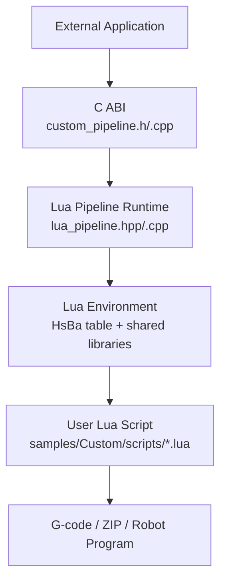

**Diagram sources**
- [custom_pipeline.h:17-62](file://DllHsBaSlicer/custom_pipeline.h#L17-L62)
- [custom_pipeline.cpp:117-163](file://DllHsBaSlicer/custom_pipeline.cpp#L117-L163)
- [lua_pipeline.hpp:19-83](file://LibHsBaSlicer/Extends/lua_pipeline.hpp#L19-L83)

**Section sources**
- [custom_pipeline.h:17-62](file://DllHsBaSlicer/custom_pipeline.h#L17-L62)
- [custom_pipeline.cpp:117-163](file://DllHsBaSlicer/custom_pipeline.cpp#L117-L163)
- [lua_pipeline.hpp:19-83](file://LibHsBaSlicer/Extends/lua_pipeline.hpp#L19-L83)

## Core Components
The core components are:
- **LuaPipelineContext**: describes the Lua source or file, entry function name, JSON config, default output path, model metadata, and progress callback.
- **LuaPipelineOutput**: captures success, total layers, output path, result string, and error message.
- **C ABI functions**: create default config, run synchronously, run asynchronously, and free results.
- **HsBa Lua operations**: model loading, transformation, slicing, coordinate conversion, filling, support generation, floor generation, spiralization, G-code generation, and packaging/export.

Key responsibilities:
- The C ABI translates external calls into internal configuration and coroutine-based execution.
- The Lua runtime installs common types, geometry libraries, and the `HsBa` table.
- The user script orchestrates stages and reports progress via `HsBa.progress`.

**Section sources**
- [lua_pipeline.hpp:19-83](file://LibHsBaSlicer/Extends/lua_pipeline.hpp#L19-L83)
- [custom_pipeline.h:17-62](file://DllHsBaSlicer/custom_pipeline.h#L17-L62)
- [custom_pipeline.cpp:86-163](file://DllHsBaSlicer/custom_pipeline.cpp#L86-L163)

## Architecture Overview
The end-to-end flow for a custom pipeline is:

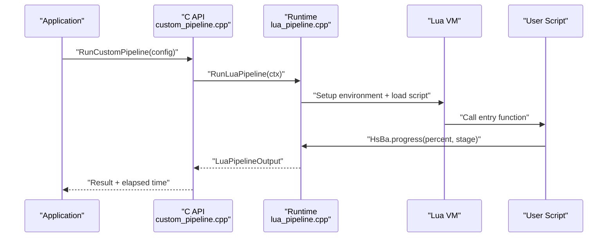

**Diagram sources**
- [custom_pipeline.cpp:117-163](file://DllHsBaSlicer/custom_pipeline.cpp#L117-L163)
- [lua_pipeline.cpp:228-238](file://LibHsBaSlicer/Extends/lua_pipeline.cpp#L228-L238)
- [lua_pipeline.hpp:69-83](file://LibHsBaSlicer/Extends/lua_pipeline.hpp#L69-L83)

## Detailed Component Analysis

### Custom Pipeline Entry Points
The C ABI provides:
- Default configuration creation.
- Synchronous execution returning a result structure.
- Asynchronous execution using coroutines with completion callbacks.
- Result memory cleanup.

Best practices:
- Always set either `pipeline_lua_script` or `pipeline_lua_source`; otherwise the runtime returns an error.
- Use `entry_func` to override the default `run_pipeline`.
- Provide a progress callback to receive percentage and stage updates.

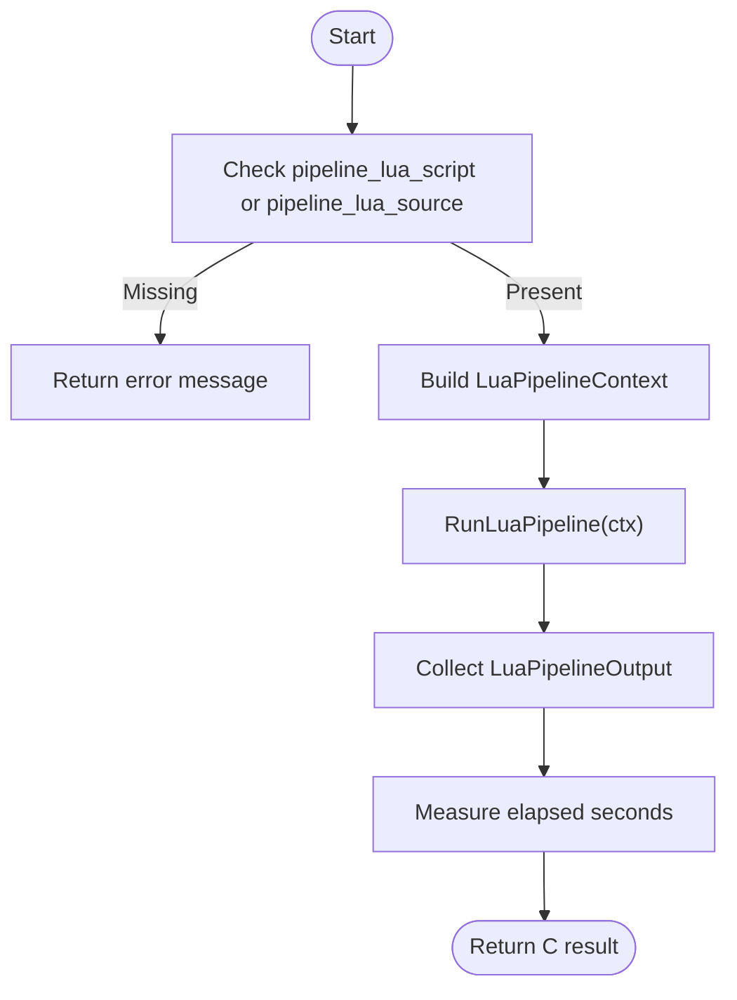

**Diagram sources**
- [custom_pipeline.cpp:117-163](file://DllHsBaSlicer/custom_pipeline.cpp#L117-L163)

**Section sources**
- [custom_pipeline.h:17-62](file://DllHsBaSlicer/custom_pipeline.h#L17-L62)
- [custom_pipeline.cpp:86-163](file://DllHsBaSlicer/custom_pipeline.cpp#L86-L163)

### Lua Pipeline Context and Output
The context carries:
- Inline Lua source (`script`) and script file path (`script_file`).
- Entry function name (`entry_func`).
- Free-form JSON config (`config_json`).
- Default output path, model name, and model path.
- Progress callback.

The output carries:
- Success flag.
- Total layers reported by the script.
- Actual output path reported by the script.
- Result string returned by the entry function.
- Error message on failure.

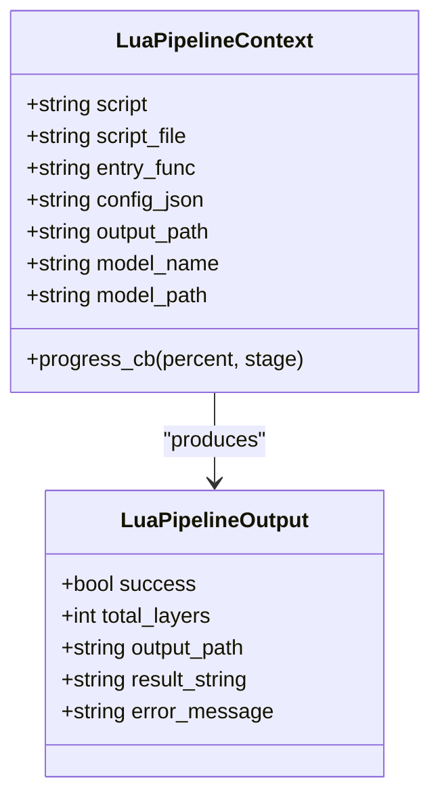

**Diagram sources**
- [lua_pipeline.hpp:29-51](file://LibHsBaSlicer/Extends/lua_pipeline.hpp#L29-L51)

**Section sources**
- [lua_pipeline.hpp:29-51](file://LibHsBaSlicer/Extends/lua_pipeline.hpp#L29-L51)

### HsBa Operation Table
The `HsBa` table exposes:
- Control and file IO: `progress`, `setLayers`, `setOutputPath`, `readFile`, `writeFile`.
- Model management: `loadModel`, `modelInfo`, `translateModel`, `rotateModel`, `scaleModel`, `removeModel`, `modelNames`.
- Slicing: `layerCount`, `layerZ`, `slice`, `sliceUnsafe`.
- Coordinate conversion: `toInt`, `toDouble`.
- Filling: `fill`.
- Support and floor: `fdmSupport`, `slaSupport`, `floor`.
- Path and G-code: `spiralize`, `toGcode`.
- Packaging and export: `saveSlsPackage`, `saveWaamPackage`, `saveSlaPackage`, `renderImage`.

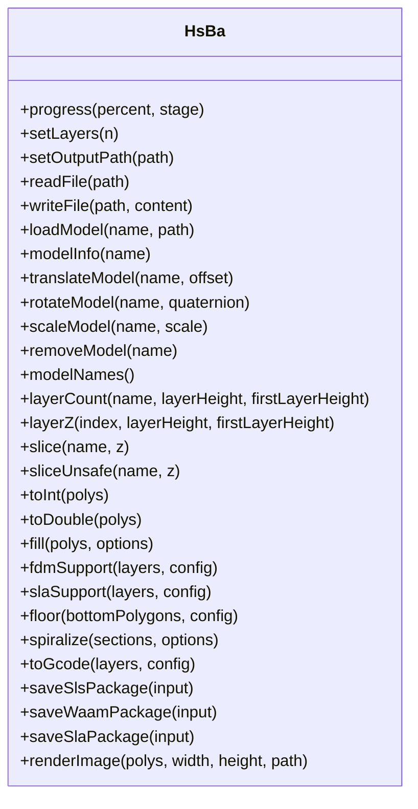

**Diagram sources**
- [lua_pipeline.cpp:228-800](file://LibHsBaSlicer/Extends/lua_pipeline.cpp#L228-L800)
- [hsba_pipeline.d.lua:290-463](file://types/hsba_pipeline.d.lua#L290-L463)

**Section sources**
- [lua_pipeline.cpp:228-800](file://LibHsBaSlicer/Extends/lua_pipeline.cpp#L228-L800)
- [hsba_pipeline.d.lua:290-463](file://types/hsba_pipeline.d.lua#L290-L463)

### Shared Libraries
Shared libraries available in both custom pipelines and built-in stage scripts include:
- `PolygonOperations`: boolean operations, offsets, hulls, area, primitives, text-to-polygons.
- `PolygonFill`: offset, line, zigzag, composite, hybrid, and offset-only fills.
- `PathOptimize`: region/polygon optimization and route building.
- `Support`: plane/tree/honeycomb/SLA generators, overhang detection, default config.
- `Cipher`: base64 and hex encoding/decoding.
- `Zipper` / `Bit7zZipper`: archive creation.
- Database adapters: SQLite, MySQL, PostgreSQL.
- `ParamStore`: reflection-based parameter persistence.

These libraries enable reusable components such as support generators, fill algorithms, and export packagers.

**Section sources**
- [hsba_pipeline.d.lua:35-187](file://types/hsba_pipeline.d.lua#L35-L187)

### Example: Fully Lua-Driven FDM Pipeline
The FDM example demonstrates:
- Loading a model and computing layer count.
- Iterating layers to slice and fill.
- Optionally generating FDM support.
- Building per-layer path data.
- Generating G-code.
- Writing output and reporting progress.

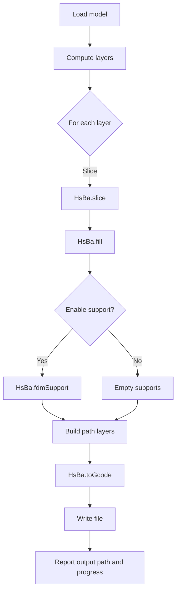

**Diagram sources**
- [my_fdm_pipeline.lua:52-171](file://samples/Custom/scripts/my_fdm_pipeline.lua#L52-L171)

**Section sources**
- [my_fdm_pipeline.lua:52-171](file://samples/Custom/scripts/my_fdm_pipeline.lua#L52-L171)

### Example: Fully Lua-Driven SLA Pipeline
The SLA example demonstrates:
- Loading a model and slicing.
- Generating SLA support.
- Generating floor/raft from the bottom layer.
- Packaging outlines, supports, floor, and config into a ZIP.

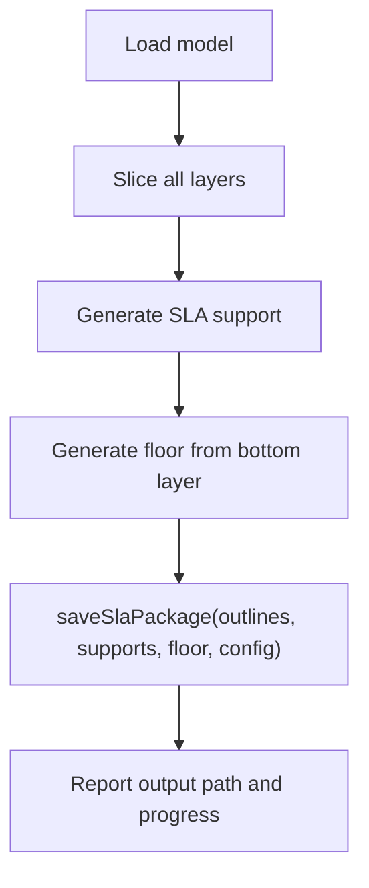

**Diagram sources**
- [my_sla_pipeline.lua:27-104](file://samples/Custom/scripts/my_sla_pipeline.lua#L27-L104)

**Section sources**
- [my_sla_pipeline.lua:27-104](file://samples/Custom/scripts/my_sla_pipeline.lua#L27-L104)

### Example: SLS Export Script
The SLS export script demonstrates:
- Creating a ZIP package.
- Writing configuration and per-layer polygon JSON.
- Adding documentation.
- Saving the archive.
- Returning the required `{success, export_path}` table.

Important rule: do not return a string from an export script; it would overwrite the ZIP file.

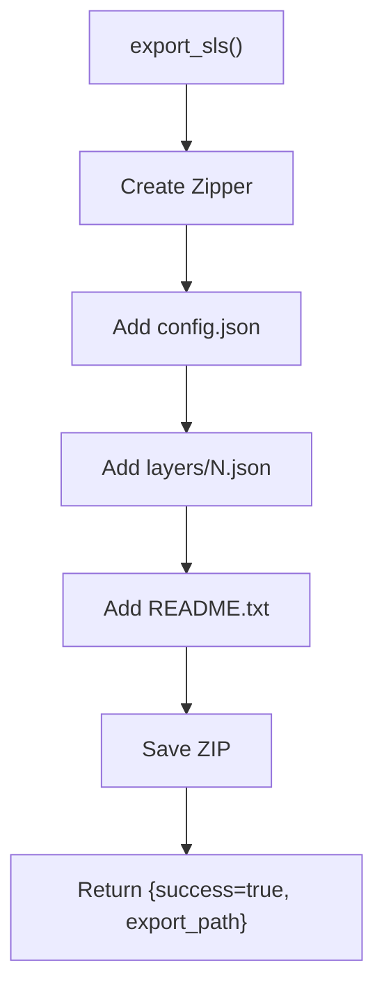

**Diagram sources**
- [my_sls_export.lua:21-75](file://samples/Custom/scripts/my_sls_export.lua#L21-L75)

**Section sources**
- [my_sls_export.lua:21-75](file://samples/Custom/scripts/my_sls_export.lua#L21-L75)

### Example: WAAM Robot Path Pipeline
The WAAM example demonstrates:
- Loading a model and slicing.
- Building welding parameters.
- Calling `saveWaamPackage` to generate robot program output.
- Handling success/failure and reporting progress.

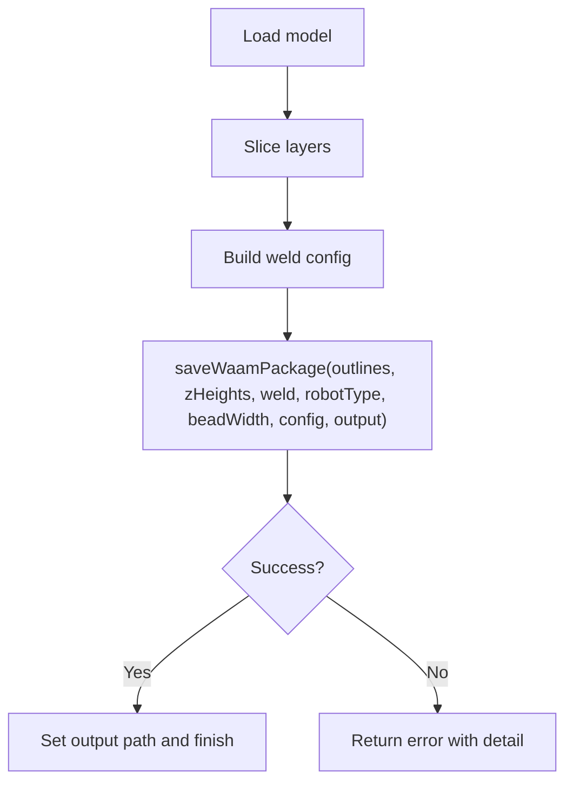

**Diagram sources**
- [my_waam_pipeline.lua:22-93](file://samples/Custom/scripts/my_waam_pipeline.lua#L22-L93)

**Section sources**
- [my_waam_pipeline.lua:22-93](file://samples/Custom/scripts/my_waam_pipeline.lua#L22-L93)

### Built-in Stage Hook: Custom FDM Support
The support hook demonstrates:
- Detecting overhang regions.
- Selecting a generator based on configuration.
- Generating support polygons.
- Optionally refining support contact areas.

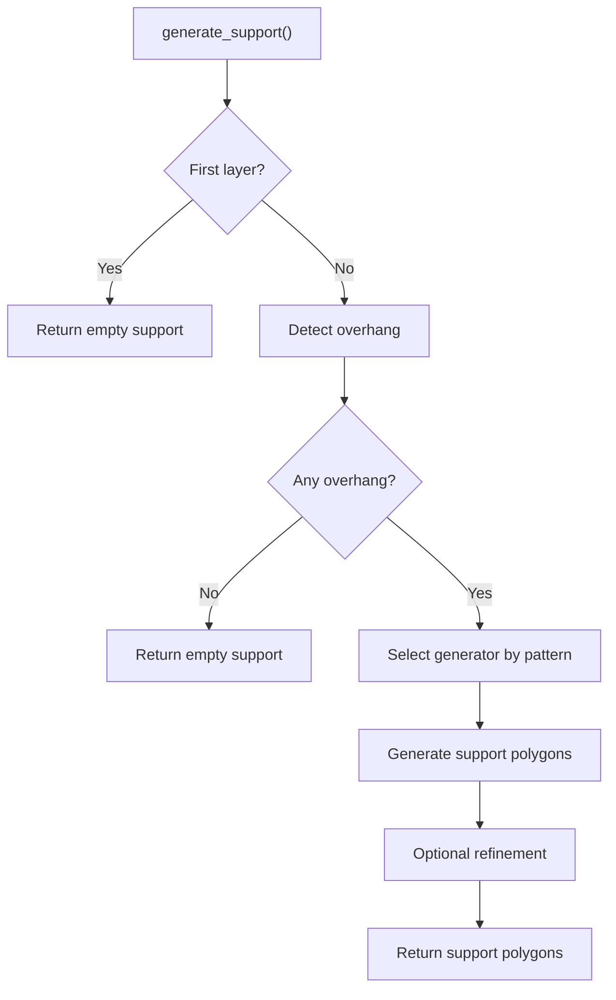

**Diagram sources**
- [my_support.lua:32-82](file://samples/FDM/scripts/my_support.lua#L32-L82)

**Section sources**
- [my_support.lua:32-82](file://samples/FDM/scripts/my_support.lua#L32-L82)

### Built-in Stage Hook: Custom FDM Fill
The fill hook demonstrates:
- Computing bounding box and scan range.
- Generating parallel lines at a given angle.
- Intersecting generated lines with current-layer polygons.

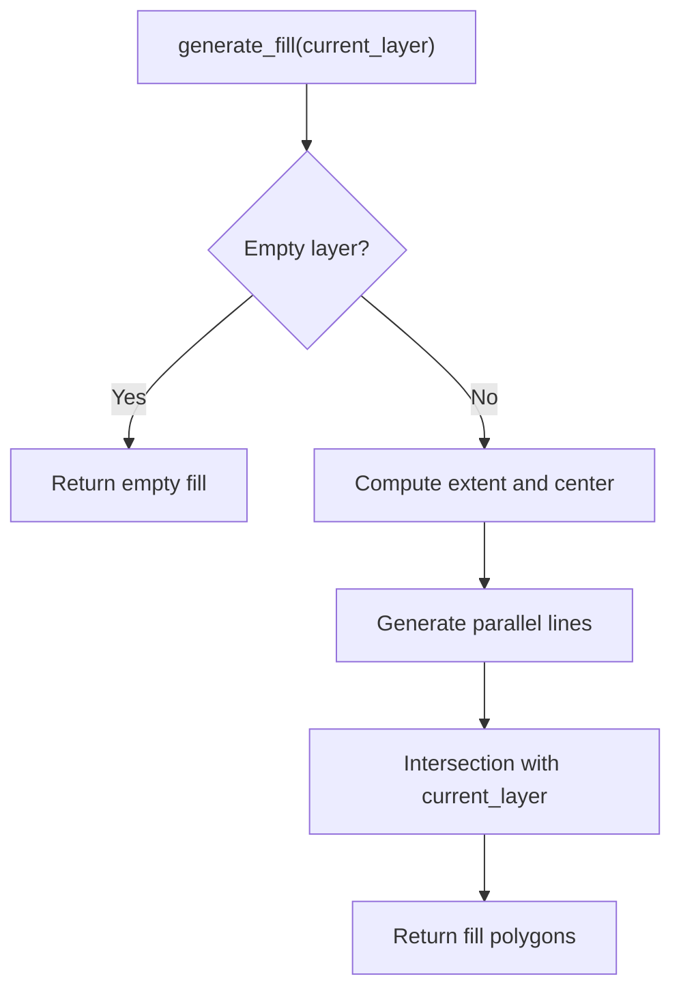

**Diagram sources**
- [my_infill.lua:20-88](file://samples/FDM/scripts/my_infill.lua#L20-L88)

**Section sources**
- [my_infill.lua:20-88](file://samples/FDM/scripts/my_infill.lua#L20-L88)

### Built-in Stage Hook: Custom SLA Floor
The floor hook demonstrates:
- Using convex hull or original footprint.
- Offsetting to create raft boundaries.
- Generating border rings and internal fill.
- Merging border and fill.

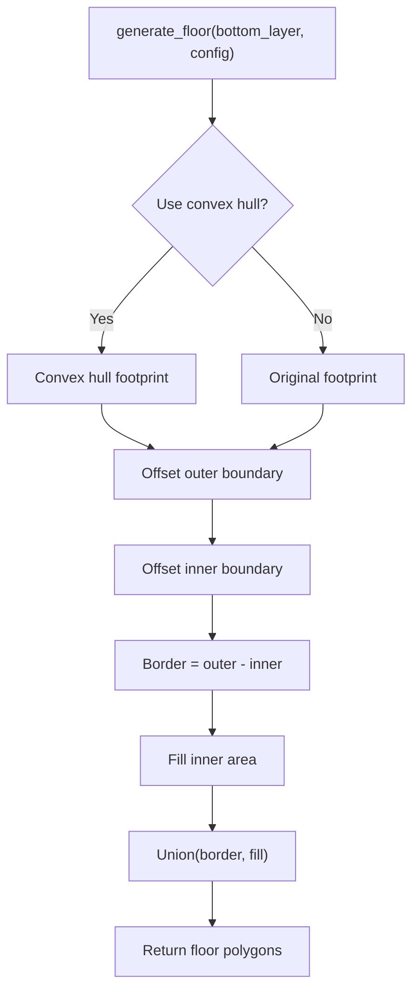

**Diagram sources**
- [my_sla_floor.lua:35-63](file://samples/SLA/scripts/my_sla_floor.lua#L35-L63)

**Section sources**
- [my_sla_floor.lua:35-63](file://samples/SLA/scripts/my_sla_floor.lua#L35-L63)

## Dependency Analysis
The custom pipeline depends on:
- **C ABI**: converts external configuration into internal context and coordinates async execution.
- **Lua runtime**: binds geometry, support, fill, path, and export functionality to Lua.
- **User scripts**: implement process-specific logic and reuse shared libraries.

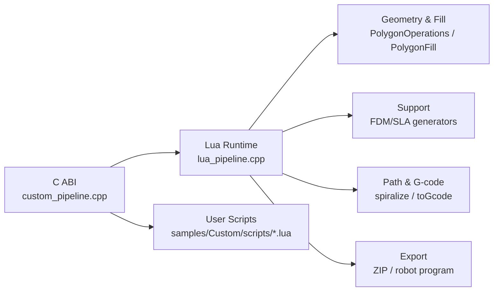

**Diagram sources**
- [custom_pipeline.cpp:117-163](file://DllHsBaSlicer/custom_pipeline.cpp#L117-L163)
- [lua_pipeline.cpp:17-39](file://LibHsBaSlicer/Extends/lua_pipeline.cpp#L17-L39)

**Section sources**
- [custom_pipeline.cpp:117-163](file://DllHsBaSlicer/custom_pipeline.cpp#L117-L163)
- [lua_pipeline.cpp:17-39](file://LibHsBaSlicer/Extends/lua_pipeline.cpp#L17-L39)

## Performance Considerations
- Prefer streaming progress updates via `HsBa.progress` to keep UI responsive during long runs.
- Avoid unnecessary conversions between integer and floating-point polygons; use `HsBa.toInt` and `HsBa.toDouble` only when required by algorithms.
- Reuse models in the pool by name; call `removeModel` after finishing to free resources.
- For large layer sets, batch progress reporting (for example, every N layers) instead of reporting every layer.
- Use built-in fill and support generators rather than pure-Lua loops for heavy geometric computation.

[No sources needed since this section provides general guidance]

## Troubleshooting Guide
Common issues and resolutions:
- **Missing script input**: The runtime requires `pipeline_lua_script` or `pipeline_lua_source`. If neither is provided, the result contains an error message.
- **Wrong export return type**: Export scripts must return `{success, export_path}`; returning a string can overwrite the ZIP file.
- **Invalid model name**: `loadModel` fails if the file cannot be loaded; `modelInfo` throws an error if the model is not in the pool.
- **Invalid slicing parameters**: `layerCount` validates model presence and positive layer height.
- **Unsupported firmware string**: `toGcode` parses firmware names; unknown values fall back to defaults but should still be validated.
- **File write failures**: `writeFile` raises a Lua error when the file cannot be opened.

Recommended debugging steps:
- Log `pipeline_config` and machine parameters before running.
- Print layer counts and Z heights to verify slicing math.
- Validate optional parameters with defaults before calling expensive operations.
- Wrap database or network calls in `pcall` to avoid failing the whole pipeline.

**Section sources**
- [custom_pipeline.cpp:127-133](file://DllHsBaSlicer/custom_pipeline.cpp#L127-L133)
- [lua_pipeline.cpp:302-308](file://LibHsBaSlicer/Extends/lua_pipeline.cpp#L302-L308)
- [lua_pipeline.cpp:402-422](file://LibHsBaSlicer/Extends/lua_pipeline.cpp#L402-L422)
- [lua_pipeline.cpp:683-690](file://LibHsBaSlicer/Extends/lua_pipeline.cpp#L683-L690)
- [lua_pipeline.cpp:275-288](file://LibHsBaSlicer/Extends/lua_pipeline.cpp#L275-L288)

## Conclusion
HsBaSlicer’s custom pipeline system gives full control to Lua scripts while providing robust C++ infrastructure for execution, progress reporting, and resource management. By combining the `HsBa` operation table with shared libraries, you can build reusable, multi-stage workflows for FDM, SLA, SLS, WAAM, and other processes. Follow the examples, validate configuration early, report progress consistently, and handle errors explicitly to produce reliable pipelines.

[No sources needed since this section summarizes without analyzing specific files]

## Appendices

### Configuration Validation Checklist
- Ensure `pipeline_lua_script` or `pipeline_lua_source` is set.
- Validate model path and name before loading.
- Validate layer height and first layer height.
- Validate optional parameters with safe defaults.
- Validate export outputs and return structures.

**Section sources**
- [custom_pipeline.cpp:127-133](file://DllHsBaSlicer/custom_pipeline.cpp#L127-L133)
- [lua_pipeline.cpp:402-422](file://LibHsBaSlicer/Extends/lua_pipeline.cpp#L402-L422)

### Reusable Component Templates
- **Parameter helper**: read from injected `machine` table or fallback to defaults.
- **Extent calculator**: compute XY bounds from layer lists.
- **Progress reporter**: update percentage and stage name at key milestones.
- **Export template**: create ZIP, add config and images, save, and return required table.

**Section sources**
- [my_fdm_pipeline.lua:24-50](file://samples/Custom/scripts/my_fdm_pipeline.lua#L24-L50)
- [my_sls_export.lua:21-75](file://samples/Custom/scripts/my_sls_export.lua#L21-L75)