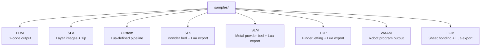
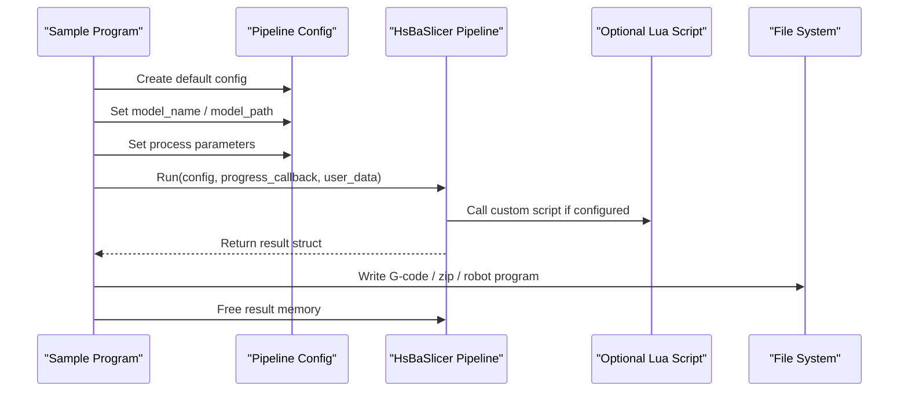
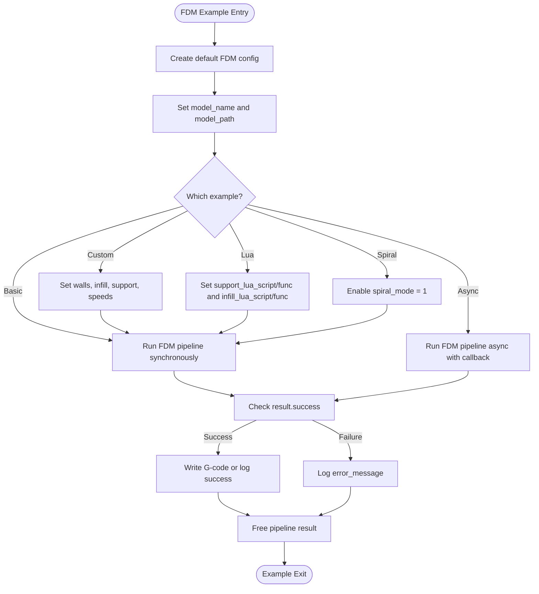
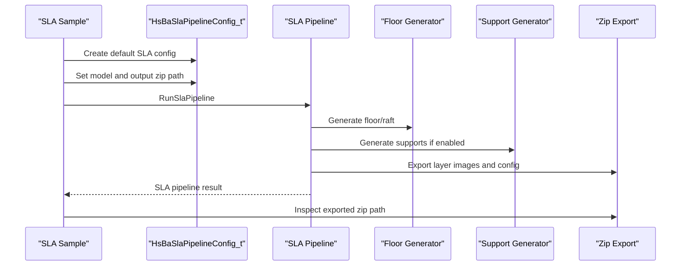
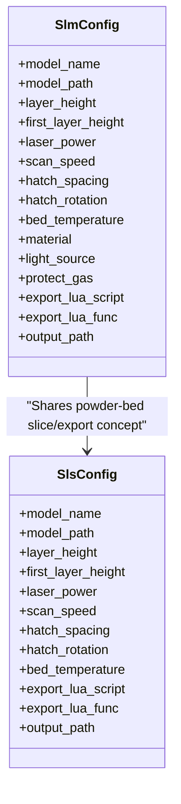
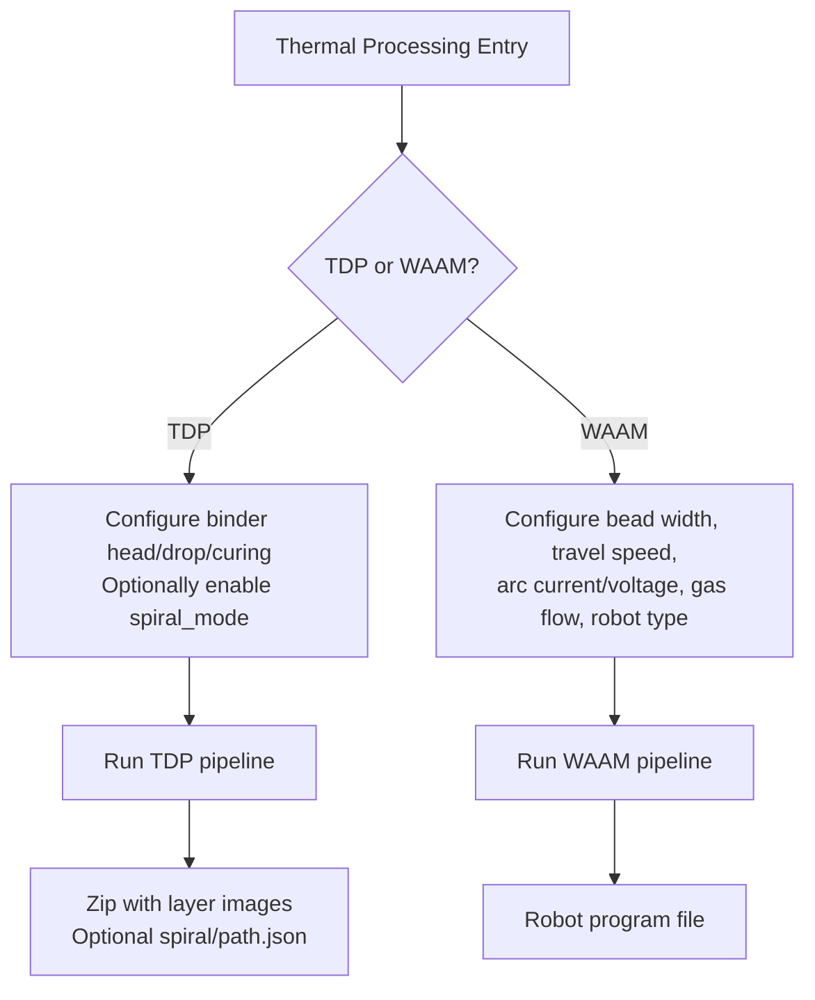
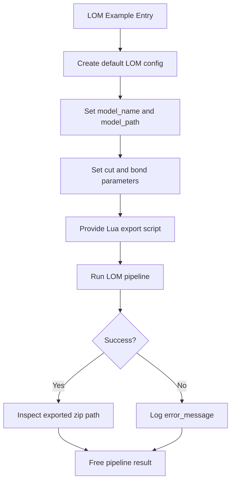
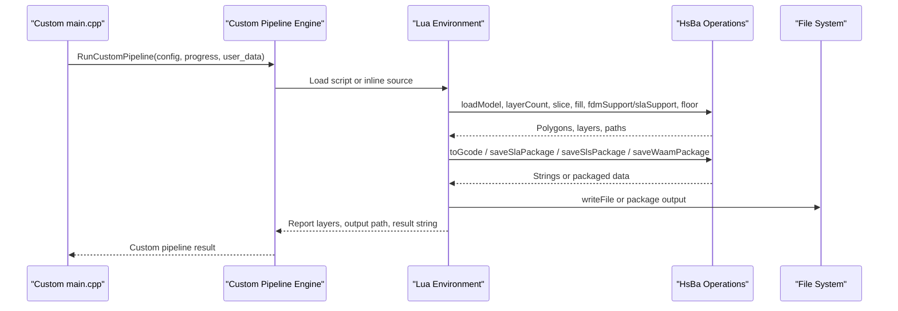
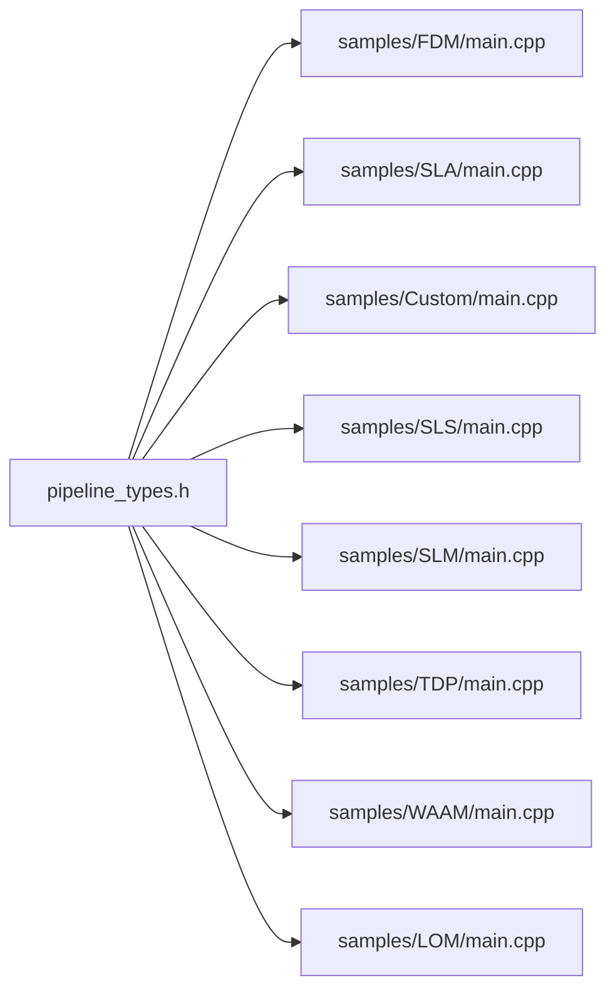

# Examples & Samples

<cite>
**Referenced Files in This Document**   
- [README.md](file://README.md)
- [pipeline_types.h](file://pipelinetypes/pipeline_types.h)
- [samples/FDM/main.cpp](file://samples/FDM/main.cpp)
- [samples/SLA/main.cpp](file://samples/SLA/main.cpp)
- [samples/Custom/main.cpp](file://samples/Custom/main.cpp)
- [samples/SLS/main.cpp](file://samples/SLS/main.cpp)
- [samples/SLM/main.cpp](file://samples/SLM/main.cpp)
- [samples/TDP/main.cpp](file://samples/TDP/main.cpp)
- [samples/WAAM/main.cpp](file://samples/WAAM/main.cpp)
- [samples/LOM/main.cpp](file://samples/LOM/main.cpp)
</cite>

## Table of Contents
1. [Introduction](#introduction)
2. [Project Structure](#project-structure)
3. [Core Components](#core-components)
4. [Architecture Overview](#architecture-overview)
5. [Detailed Component Analysis](#detailed-component-analysis)
6. [Dependency Analysis](#dependency-analysis)
7. [Performance Considerations](#performance-considerations)
8. [Troubleshooting Guide](#troubleshooting-guide)
9. [Conclusion](#conclusion)
10. [Appendices](#appendices)

## Introduction
This document is the practical tutorial and examples page for HsBaSlicer. It focuses on how to use the provided sample programs to run slicing workflows, configure process parameters, customize behavior with Lua scripts, and handle errors. The samples cover:

- Basic FDM slicing with G-code output.
- SLA processing with floor/raft and sacrificial supports.
- Metal powder-bed processes SLM and SLS with Lua-driven export.
- Thermal binder jetting TDP and wire deposition WAAM.
- Laminated object manufacturing LOM.
- Fully custom Lua pipelines that replace the entire workflow.

The repository README explains that HsBaSlicer is a modular, cross-platform C++ framework for production-level slicing pipelines, provides shared-library and static-library targets, and installs CMake configuration files so downstream projects can link against `HsBaSlicer::DllHsBaSlicer` or `HsBaSlicer::LibHsBaSlicer`.

**Section sources**
- [README.md:21-39](file://README.md#L21-L39)
- [README.md:100-124](file://README.md#L100-L124)

## Project Structure
The example code lives under `samples/`, with one subdirectory per major printing technology. Each sample program follows the same pattern:

1. Create a default pipeline configuration.
2. Set model name and model path.
3. Adjust process-specific parameters.
4. Optionally set Lua script paths and function names.
5. Run the pipeline synchronously or asynchronously.
6. Check `success`, layer count, elapsed time, and output path.
7. Free the returned result structure.

**Diagram sources**
- [samples/FDM/main.cpp:1-10](file://samples/FDM/main.cpp#L1-L10)
- [samples/SLA/main.cpp:1-10](file://samples/SLA/main.cpp#L1-L10)
- [samples/Custom/main.cpp:1-33](file://samples/Custom/main.cpp#L1-L33)
- [samples/SLS/main.cpp:1-14](file://samples/SLS/main.cpp#L1-L14)
- [samples/SLM/main.cpp:1-14](file://samples/SLM/main.cpp#L1-L14)
- [samples/TDP/main.cpp:1-14](file://samples/TDP/main.cpp#L1-L14)
- [samples/WAAM/main.cpp:1-13](file://samples/WAAM/main.cpp#L1-L13)
- [samples/LOM/main.cpp:1-14](file://samples/LOM/main.cpp#L1-L14)

**Section sources**
- [samples/FDM/main.cpp:1-10](file://samples/FDM/main.cpp#L1-L10)
- [samples/SLA/main.cpp:1-10](file://samples/SLA/main.cpp#L1-L10)
- [samples/Custom/main.cpp:1-33](file://samples/Custom/main.cpp#L1-L33)
- [samples/SLS/main.cpp:1-14](file://samples/SLS/main.cpp#L1-L14)
- [samples/SLM/main.cpp:1-14](file://samples/SLM/main.cpp#L1-L14)
- [samples/TDP/main.cpp:1-14](file://samples/TDP/main.cpp#L1-L14)
- [samples/WAAM/main.cpp:1-13](file://samples/WAAM/main.cpp#L1-L13)
- [samples/LOM/main.cpp:1-14](file://samples/LOM/main.cpp#L1-L14)

## Core Components
The core configuration and result types are defined as C-compatible structs and enums in `pipelinetypes/pipeline_types.h`. This header intentionally avoids DLL export macros so downstream modules can reference the type definitions without depending on the shared library.

Key components used by the samples:

| Component | Purpose | Key Fields / Behavior |
|---|---|---|
| `HsBaFdmPipelineConfig_t` | FDM slicing configuration | Layer height, wall count, top/bottom layers, infill density, support options, line width, print speed, spiral mode, firmware, nozzle/filament settings, Lua support/infill scripts, G-code output. |
| `HsBaFdmPipelineResult_t` | FDM result | Success flag, total layers, G-code content, error message, elapsed seconds. |
| `HsBaSlaPipelineConfig_t` | SLA slicing configuration | Layer height, exposure/lift/retract, floor/raft, support, image format/size, Lua floor/support/export scripts, zip output. |
| `HsBaSlsPipelineConfig_t` | SLS configuration | Layer height, laser power, scan speed, hatch spacing/rotation, bed temperature, required Lua export script. |
| `HsBaSlmPipelineConfig_t` | SLM metal configuration | Mirrors SLS plus material, light source, shielding gas. |
| `HsBaTdpPipelineConfig_t` | 3DP binder jetting configuration | Head count, drop spacing, binder saturation, curing time, bed temperature, binder mode, optional spiral mode. |
| `HsBaWaamPipelineConfig_t` | WAAM robot deposition configuration | Bead width, travel/wire speeds, arc current/voltage, gas flow, protection, robot controller type, optional Lua path generator, spiral mode. |
| `HsBaLomPipelineConfig_t` | LOM sheet-bonding configuration | Sheet thickness, cut speed/margin/power, bond temperature/pressure/time, seal contour, cut mode, Lua export. |
| `HsBaCustomPipelineConfig_t` | Fully Lua-defined pipeline | Script file or inline Lua source, entry function, free-form JSON config, model fields, output path. |

All result structures include an `elapsed_seconds` field, which is useful for simple performance tracking across examples.

**Section sources**
- [pipeline_types.h:19-140](file://pipelinetypes/pipeline_types.h#L19-L140)
- [pipeline_types.h:142-245](file://pipelinetypes/pipeline_types.h#L142-L245)
- [pipeline_types.h:247-310](file://pipelinetypes/pipeline_types.h#L247-L310)
- [pipeline_types.h:312-401](file://pipelinetypes/pipeline_types.h#L312-L401)
- [pipeline_types.h:403-461](file://pipelinetypes/pipeline_types.h#L403-L461)
- [pipeline_types.h:463-521](file://pipelinetypes/pipeline_types.h#L463-L521)
- [pipeline_types.h:523-625](file://pipelinetypes/pipeline_types.h#L523-L625)
- [pipeline_types.h:627-732](file://pipelinetypes/pipeline_types.h#L627-L732)

## Architecture Overview
Each sample demonstrates a consistent API shape:

- **Default configuration**: A constructor-like helper returns a fully initialized struct with documented defaults.
- **Model input**: `model_name` and `model_path` identify the mesh.
- **Process parameters**: Geometry, thermal, laser, or robot parameters are filled into the config.
- **Lua customization**: Optional script paths and function names allow replacing support, fill, floor, export, or the entire pipeline.
- **Execution**: Synchronous functions return results directly; asynchronous functions invoke completion callbacks.
- **Resource cleanup**: Result strings must be freed through the corresponding `HsBaFree*PipelineResult` function.

**Diagram sources**
- [samples/FDM/main.cpp:53-96](file://samples/FDM/main.cpp#L53-L96)
- [samples/SLA/main.cpp:52-84](file://samples/SLA/main.cpp#L52-L84)
- [samples/Custom/main.cpp:100-131](file://samples/Custom/main.cpp#L100-L131)
- [samples/SLS/main.cpp:56-92](file://samples/SLS/main.cpp#L56-L92)
- [samples/SLM/main.cpp:56-84](file://samples/SLM/main.cpp#L56-L84)
- [samples/TDP/main.cpp:55-82](file://samples/TDP/main.cpp#L55-L82)
- [samples/WAAM/main.cpp:54-81](file://samples/WAAM/main.cpp#L54-L81)
- [samples/LOM/main.cpp:55-82](file://samples/LOM/main.cpp#L55-L82)

## Detailed Component Analysis

### FDM Slicing Examples
The FDM sample demonstrates five common workflows:

1. **Basic pipeline**: Use default config, set model, run synchronously, write G-code to disk.
2. **Custom process parameters**: Configure layer height, wall count, top/bottom solid layers, infill density, support pattern, print/travel speeds, and output path.
3. **Lua custom support and fill**: Point `support_lua_script`/`support_lua_func` and `infill_lua_script`/`infill_lua_func` to custom Lua algorithms.
4. **Asynchronous pipeline**: Start non-blocking execution and poll a completion flag.
5. **Spiral/vase mode**: Enable `spiral_mode` so the outer wall becomes one continuous rising extrusion, skipping per-layer infill and support.

**Diagram sources**
- [samples/FDM/main.cpp:53-96](file://samples/FDM/main.cpp#L53-L96)
- [samples/FDM/main.cpp:101-165](file://samples/FDM/main.cpp#L101-L165)
- [samples/FDM/main.cpp:170-220](file://samples/FDM/main.cpp#L170-L220)
- [samples/FDM/main.cpp:227-269](file://samples/FDM/main.cpp#L227-L269)
- [samples/FDM/main.cpp:274-318](file://samples/FDM/main.cpp#L274-L318)

#### Beginner Workflow: Basic FDM Slicing
- Create default config with `HsBaCreateDefaultConfig`.
- Set `model_name` and `model_path`.
- Call `HsBaRunFdmPipeline`.
- If `result.success` is true, write `gcode_content` to a `.gcode` file.
- Always call `HsBaFreePipelineResult`.

Expected outputs:
- Console logs showing progress percentage and stage.
- A generated G-code file under the `output` directory.
- Total layer count and elapsed time in the result.

#### Advanced Workflow: Lua Custom Support and Fill
- Keep built-in slicing and path generation.
- Replace only support generation via `support_lua_script` and `support_lua_func`.
- Replace only infill generation via `infill_lua_script` and `infill_lua_func`.
- This is the recommended extension point when you want custom algorithms without rewriting the whole pipeline.

**Section sources**
- [samples/FDM/main.cpp:53-96](file://samples/FDM/main.cpp#L53-L96)
- [samples/FDM/main.cpp:101-165](file://samples/FDM/main.cpp#L101-L165)
- [samples/FDM/main.cpp:170-220](file://samples/FDM/main.cpp#L170-L220)
- [samples/FDM/main.cpp:227-269](file://samples/FDM/main.cpp#L227-L269)
- [samples/FDM/main.cpp:274-318](file://samples/FDM/main.cpp#L274-L318)
- [pipeline_types.h:23-140](file://pipelinetypes/pipeline_types.h#L23-L140)

### SLA Processing Examples
The SLA sample covers:

1. **Basic SLA pipeline**: Default config, model, zip output.
2. **Custom exposure, floor, raft, and support**: Fine layer height, bottom/normal exposure, lift distance/speed, floor offset/border/fill, convex hull floor, sacrificial support pattern.
3. **Lua custom floor, support, and export**: Replace floor generation, support generation, and optionally the export step.
4. **Asynchronous SLA pipeline**: Non-blocking execution with completion callback.

**Diagram sources**
- [samples/SLA/main.cpp:52-84](file://samples/SLA/main.cpp#L52-L84)
- [samples/SLA/main.cpp:89-144](file://samples/SLA/main.cpp#L89-L144)
- [samples/SLA/main.cpp:149-191](file://samples/SLA/main.cpp#L149-L191)
- [samples/SLA/main.cpp:198-239](file://samples/SLA/main.cpp#L198-L239)
- [pipeline_types.h:142-245](file://pipelinetypes/pipeline_types.h#L142-L245)

#### Process-Specific Notes
- SLA output is a zip containing configuration and layer images.
- Image format can be PNG, JPEG, or SVG.
- Floor/raft is separate from model supports.
- Sacrificial supports are thin columns; cone-shaped supports are also available.

**Section sources**
- [samples/SLA/main.cpp:52-84](file://samples/SLA/main.cpp#L52-L84)
- [samples/SLA/main.cpp:89-144](file://samples/SLA/main.cpp#L89-L144)
- [samples/SLA/main.cpp:149-191](file://samples/SLA/main.cpp#L149-L191)
- [samples/SLA/main.cpp:198-239](file://samples/SLA/main.cpp#L198-L239)
- [pipeline_types.h:142-245](file://pipelinetypes/pipeline_types.h#L142-L245)

### Metal Processing: SLM and SLS
Both SLM and SLS are powder-bed processes where the powder bed itself provides support. They do not generate floor/raft or traditional supports in the same way as FDM/SLA. Their output format is controlled by a Lua export script.

| Aspect | SLS | SLM |
|---|---|---|
| Process family | Powder bed sintering | Metal powder bed melting |
| Floor/raft | Not needed | Not needed |
| Supports | Not needed | Not needed |
| Laser/scanner | Power, scan speed, hatch spacing/rotation, bed temperature | Same geometry parameters plus metal-specific metadata |
| Material metadata | Not part of the basic config struct | Material enum, light source enum, shielding gas |
| Output | Lua-driven export (zip + database registration) | Lua-driven export (zip + database registration) |

**Diagram sources**
- [pipeline_types.h:247-310](file://pipelinetypes/pipeline_types.h#L247-L310)
- [pipeline_types.h:312-401](file://pipelinetypes/pipeline_types.h#L312-L401)
- [samples/SLS/main.cpp:56-92](file://samples/SLS/main.cpp#L56-L92)
- [samples/SLM/main.cpp:56-84](file://samples/SLM/main.cpp#L56-L84)

#### SLS Tutorial Steps
1. Create default SLS config.
2. Set model name and path.
3. Provide `export_lua_script` and `export_lua_func`.
4. Optionally adjust layer height, laser power, scan speed, hatch spacing, hatch rotation, and bed temperature.
5. Run synchronously or asynchronously.
6. Inspect `export_path` and `elapsed_seconds`.

#### SLM Tutorial Steps
1. Create default SLM config.
2. Set model name and path.
3. Provide `export_lua_script` and `export_lua_func`.
4. Set metal material, energy source, and shielding gas.
5. Optionally adjust laser/scanner and bed temperature.
6. Run synchronously or asynchronously.
7. Inspect `export_path` and `elapsed_seconds`.

**Section sources**
- [samples/SLS/main.cpp:56-92](file://samples/SLS/main.cpp#L56-L92)
- [samples/SLS/main.cpp:97-140](file://samples/SLS/main.cpp#L97-L140)
- [samples/SLS/main.cpp:147-190](file://samples/SLS/main.cpp#L147-L190)
- [samples/SLM/main.cpp:56-84](file://samples/SLM/main.cpp#L56-L84)
- [samples/SLM/main.cpp:89-132](file://samples/SLM/main.cpp#L89-L132)
- [samples/SLM/main.cpp:137-177](file://samples/SLM/main.cpp#L137-L177)
- [pipeline_types.h:247-401](file://pipelinetypes/pipeline_types.h#L247-L401)

### Thermal Processing: TDP and WAAM
TDP and WAAM represent two very different thermal/additive families.

- **TDP (3DP binder jetting)**: Liquid binder is jetted onto a powder bed. The sample includes a spiral mode that exposes a continuous rising outer-wall path to the export script while still keeping per-layer images.
- **WAAM (wire arc additive manufacturing)**: Metal is deposited bead-by-bead along contours. The output is a robot language program, not a layer zip. Built-in generators exist for ABB, KUKA, and FANUC, or you can supply a custom Lua path generator.

**Diagram sources**
- [samples/TDP/main.cpp:55-82](file://samples/TDP/main.cpp#L55-L82)
- [samples/TDP/main.cpp:87-125](file://samples/TDP/main.cpp#L87-L125)
- [samples/TDP/main.cpp:175-205](file://samples/TDP/main.cpp#L175-L205)
- [samples/WAAM/main.cpp:54-81](file://samples/WAAM/main.cpp#L54-L81)
- [samples/WAAM/main.cpp:86-131](file://samples/WAAM/main.cpp#L86-L131)
- [samples/WAAM/main.cpp:183-217](file://samples/WAAM/main.cpp#L183-L217)
- [pipeline_types.h:463-625](file://pipelinetypes/pipeline_types.h#L463-L625)

#### TDP Tutorial Steps
1. Create default TDP config.
2. Set model name and path.
3. Provide `export_lua_script` and `export_lua_func`.
4. Optionally set head count, drop spacing, binder saturation, curing time, bed temperature, and binder mode.
5. For continuous deposition-style export, enable `spiral_mode`.
6. Run synchronously or asynchronously.
7. Inspect `export_path` and `elapsed_seconds`.

#### WAAM Tutorial Steps
1. Create default WAAM config.
2. Set model name and path.
3. Choose a built-in robot type or provide a custom Lua path generator.
4. Set bead width, travel speed, welding process, protection method, shielding gas, arc current/voltage, wire feed speed, gas flow rate, and interpass temperature.
5. Optionally enable `spiral_mode` to produce one continuous rising weld bead.
6. Run synchronously or asynchronously.
7. Inspect `output_path` and `elapsed_seconds`.

**Section sources**
- [samples/TDP/main.cpp:55-82](file://samples/TDP/main.cpp#L55-L82)
- [samples/TDP/main.cpp:87-125](file://samples/TDP/main.cpp#L87-L125)
- [samples/TDP/main.cpp:175-205](file://samples/TDP/main.cpp#L175-L205)
- [samples/WAAM/main.cpp:54-81](file://samples/WAAM/main.cpp#L54-L81)
- [samples/WAAM/main.cpp:86-131](file://samples/WAAM/main.cpp#L86-L131)
- [samples/WAAM/main.cpp:183-217](file://samples/WAAM/main.cpp#L183-L217)
- [pipeline_types.h:463-625](file://pipelinetypes/pipeline_types.h#L463-L625)

### LOM Processing
LOM uses sheet bonding and cutting. There is no floor/raft or support in the conventional sense; instead, the sample configures cut speed, cut margin, cut power, sealing, cut mode, and bonding temperature/pressure/time.

**Diagram sources**
- [samples/LOM/main.cpp:55-82](file://samples/LOM/main.cpp#L55-L82)
- [samples/LOM/main.cpp:87-130](file://samples/LOM/main.cpp#L87-L130)
- [samples/LOM/main.cpp:135-175](file://samples/LOM/main.cpp#L135-L175)
- [pipeline_types.h:403-461](file://pipelinetypes/pipeline_types.h#L403-L461)

**Section sources**
- [samples/LOM/main.cpp:55-82](file://samples/LOM/main.cpp#L55-L82)
- [samples/LOM/main.cpp:87-130](file://samples/LOM/main.cpp#L87-L130)
- [samples/LOM/main.cpp:135-175](file://samples/LOM/main.cpp#L135-L175)
- [pipeline_types.h:403-461](file://pipelinetypes/pipeline_types.h#L403-L461)

### Custom Lua Pipelines
The Custom sample is the most powerful extension surface. Instead of fixing the stage order in C++, it gives Lua full control over the workflow. The C++ side exposes a global `HsBa` table with operations such as:

- Progress reporting.
- Model loading, transformation, and removal.
- Layer counting and slicing.
- Polygon conversion, filling, support generation, floor generation.
- G-code generation.
- Packaging helpers for SLA, SLS, WAAM, and image rendering.
- Access to registered libraries like polygon operations, support, polygon fill, path optimization, zipper, cipher, and SQLite adapter.

**Diagram sources**
- [samples/Custom/main.cpp:1-33](file://samples/Custom/main.cpp#L1-L33)
- [samples/Custom/main.cpp:100-131](file://samples/Custom/main.cpp#L100-L131)
- [samples/Custom/main.cpp:140-165](file://samples/Custom/main.cpp#L140-L165)
- [samples/Custom/main.cpp:174-265](file://samples/Custom/main.cpp#L174-L265)
- [samples/Custom/main.cpp:270-314](file://samples/Custom/main.cpp#L270-L314)
- [samples/Custom/main.cpp:331-354](file://samples/Custom/main.cpp#L331-L354)
- [samples/Custom/main.cpp:516-589](file://samples/Custom/main.cpp#L516-L589)
- [pipeline_types.h:627-732](file://pipelinetypes/pipeline_types.h#L627-L732)

#### Custom Pipeline Scenarios Covered
- Pure Lua FDM pipeline from a script file.
- Pure Lua SLS packaging pipeline.
- Pure Lua SLM, LOM, 3DP, and WAAM pipelines.
- Inline Lua source without a script file.
- Asynchronous Lua pipeline.
- Protobuf wire-format request/response for cross-process or cross-language integration.

**Section sources**
- [samples/Custom/main.cpp:1-33](file://samples/Custom/main.cpp#L1-L33)
- [samples/Custom/main.cpp:100-131](file://samples/Custom/main.cpp#L100-L131)
- [samples/Custom/main.cpp:140-165](file://samples/Custom/main.cpp#L140-L165)
- [samples/Custom/main.cpp:174-265](file://samples/Custom/main.cpp#L174-L265)
- [samples/Custom/main.cpp:270-314](file://samples/Custom/main.cpp#L270-L314)
- [samples/Custom/main.cpp:331-354](file://samples/Custom/main.cpp#L331-L354)
- [samples/Custom/main.cpp:516-589](file://samples/Custom/main.cpp#L516-L589)
- [pipeline_types.h:627-732](file://pipelinetypes/pipeline_types.h#L627-L732)

## Dependency Analysis
At the sample level, dependencies are straightforward:

- Each sample links against its own pipeline header.
- All samples share the same result-handling pattern: check `success`, read `total_layers`, inspect `elapsed_seconds`, and free the result.
- The C ABI types live in `pipelinetypes/pipeline_types.h`, allowing downstream modules and converters to reference them without depending on the shared library.

**Diagram sources**
- [pipeline_types.h:19-732](file://pipelinetypes/pipeline_types.h#L19-L732)
- [samples/FDM/main.cpp:17-18](file://samples/FDM/main.cpp#L17-L18)
- [samples/SLA/main.cpp:16-17](file://samples/SLA/main.cpp#L16-L17)
- [samples/Custom/main.cpp:47-48](file://samples/Custom/main.cpp#L47-L48)
- [samples/SLS/main.cpp:20-21](file://samples/SLS/main.cpp#L20-L21)
- [samples/SLM/main.cpp:20-21](file://samples/SLM/main.cpp#L20-L21)
- [samples/TDP/main.cpp:20-21](file://samples/TDP/main.cpp#L20-L21)
- [samples/WAAM/main.cpp:19-20](file://samples/WAAM/main.cpp#L19-L20)
- [samples/LOM/main.cpp:20-21](file://samples/LOM/main.cpp#L20-L21)

**Section sources**
- [pipeline_types.h:19-732](file://pipelinetypes/pipeline_types.h#L19-L732)
- [samples/FDM/main.cpp:17-18](file://samples/FDM/main.cpp#L17-L18)
- [samples/SLA/main.cpp:16-17](file://samples/SLA/main.cpp#L16-L17)
- [samples/Custom/main.cpp:47-48](file://samples/Custom/main.cpp#L47-L48)
- [samples/SLS/main.cpp:20-21](file://samples/SLS/main.cpp#L20-L21)
- [samples/SLM/main.cpp:20-21](file://samples/SLM/main.cpp#L20-L21)
- [samples/TDP/main.cpp:20-21](file://samples/TDP/main.cpp#L20-L21)
- [samples/WAAM/main.cpp:19-20](file://samples/WAAM/main.cpp#L19-L20)
- [samples/LOM/main.cpp:20-21](file://samples/LOM/main.cpp#L20-L21)

## Performance Considerations
The samples consistently expose timing information through `elapsed_seconds` in each pipeline result. This makes it easy to compare configurations and modes.

Practical guidance based on the samples:

- **Use asynchronous execution for UI-heavy applications**: The FDM, SLA, SLS, SLM, TDP, WAAM, and Custom samples all show how to start a pipeline without blocking the caller.
- **Prefer default configs as baselines**: Each sample starts from a default configuration, then changes only what is necessary.
- **Avoid unnecessary support and infill for vase/spiral modes**: FDM and WAAM demonstrate `spiral_mode`, which merges outer walls into a continuous rising path and skips per-layer infill/support where applicable.
- **Keep Lua scripts focused**: In Custom pipelines, the comment explicitly states that the C++ side provides pipeline building blocks and the Lua script decides stage order and content.
- **Track layer counts and elapsed time**: All result structs report `total_layers` and `elapsed_seconds`, enabling simple benchmarking across parameter sets.

[No sources needed since this section provides general guidance]

## Troubleshooting Guide
Common issues visible in the sample patterns:

| Symptom | Likely Cause | Resolution |
|---|---|---|
| Pipeline reports failure | Invalid model path, missing Lua script, or invalid parameters | Check `error_message` in the result and verify `model_path`, `output_path`, and Lua script paths. |
| No output file created | Output path is invalid or writing failed | Ensure the output directory exists and the path is writable. |
| Memory leak after pipeline | Result not freed | Always call the matching `HsBaFree*PipelineResult` function. |
| Custom pipeline does nothing | Wrong entry function or missing Lua source/script | Verify `entry_func`, `pipeline_lua_script`, and `pipeline_lua_source`. |
| Cross-language Custom pipeline fails | Wire format mismatch | Ensure the protobuf wire encoding matches `custom_pipeline.proto` field numbers and wire types. |

**Section sources**
- [samples/FDM/main.cpp:69-96](file://samples/FDM/main.cpp#L69-L96)
- [samples/SLA/main.cpp:69-84](file://samples/SLA/main.cpp#L69-L84)
- [samples/Custom/main.cpp:80-94](file://samples/Custom/main.cpp#L80-L94)
- [samples/Custom/main.cpp:534-559](file://samples/Custom/main.cpp#L534-L559)
- [pipeline_types.h:115-140](file://pipelinetypes/pipeline_types.h#L115-L140)
- [pipeline_types.h:220-245](file://pipelinetypes/pipeline_types.h#L220-L245)
- [pipeline_types.h:706-732](file://pipelinetypes/pipeline_types.h#L706-L732)

## Conclusion
The HsBaSlicer samples provide a complete progression from beginner-friendly workflows to advanced customization:

- Beginners should start with the basic FDM and SLA examples.
- Intermediate users should explore Lua-based support, fill, floor, and export customization.
- Advanced users should use the Custom pipeline to define entirely new workflows, integrate with other languages via Protobuf wire formats, and extend thermal and metal processes like TDP, WAAM, SLS, and SLM.

The consistent API design across samples makes it straightforward to switch between technologies while reusing the same configuration, progress, result, and resource-cleanup patterns.

[No sources needed since this section summarizes without analyzing specific files]

## Appendices

### Quick Reference: Configuration Defaults
The following table summarizes representative default values and key options exposed by the C-compatible types.

| Pipeline | Default Layer Height | Default First Layer | Key Customization Options |
|---|---:|---:|---|
| FDM | 0.2 mm | 0.25 mm | Wall count, top/bottom layers, infill density, support pattern, line width, print/travel speed, spiral mode, firmware, nozzle/filament settings. |
| SLA | 0.05 mm | 0.1 mm | Exposure times, lift distances/speeds, floor/raft, support pattern, image format/size, Lua floor/support/export. |
| SLS | 0.1 mm | 0.15 mm | Laser power, scan speed, hatch spacing/rotation, bed temperature, Lua export script. |
| SLM | Varies by config | Varies by config | Same as SLS plus material, light source, shielding gas. |
| TDP | Varies by config | Varies by config | Head count, drop spacing, binder saturation, curing time, bed temperature, binder mode, spiral mode. |
| WAAM | Varies by config | Varies by config | Bead width, travel/wire speeds, arc current/voltage, gas flow, protection, robot type, path Lua generator, spiral mode. |
| LOM | Varies by config | Varies by config | Cut speed/margin/power, bond temperature/pressure/time, seal contour, cut mode. |
| Custom | N/A | N/A | Lua script or inline source, entry function, free-form JSON config, model/output fields. |

**Section sources**
- [pipeline_types.h:53-113](file://pipelinetypes/pipeline_types.h#L53-L113)
- [pipeline_types.h:165-218](file://pipelinetypes/pipeline_types.h#L165-L218)
- [pipeline_types.h:259-283](file://pipelinetypes/pipeline_types.h#L259-L283)
- [pipeline_types.h:359-376](file://pipelinetypes/pipeline_types.h#L359-L376)
- [pipeline_types.h:419-436](file://pipelinetypes/pipeline_types.h#L419-L436)
- [pipeline_types.h:480-496](file://pipelinetypes/pipeline_types.h#L480-L496)
- [pipeline_types.h:578-600](file://pipelinetypes/pipeline_types.h#L578-L600)
- [pipeline_types.h:689-704](file://pipelinetypes/pipeline_types.h#L689-L704)