# Examples & Samples

<cite>
**Referenced Files in This Document**   
- [README.md](file://README.md)
- [samples/FDM/main.cpp](file://samples/FDM/main.cpp)
- [samples/FDM/CMakeLists.txt](file://samples/FDM/CMakeLists.txt)
- [samples/SLA/main.cpp](file://samples/SLA/main.cpp)
- [samples/SLA/CMakeLists.txt](file://samples/SLA/CMakeLists.txt)
- [samples/SLS/main.cpp](file://samples/SLS/main.cpp)
- [samples/SLS/CMakeLists.txt](file://samples/SLS/CMakeLists.txt)
- [samples/LOM/main.cpp](file://samples/LOM/main.cpp)
- [samples/LOM/CMakeLists.txt](file://samples/LOM/CMakeLists.txt)
- [samples/TDP/main.cpp](file://samples/TDP/main.cpp)
- [samples/TDP/CMakeLists.txt](file://samples/TDP/CMakeLists.txt)
- [samples/WAAM/main.cpp](file://samples/WAAM/main.cpp)
- [samples/WAAM/CMakeLists.txt](file://samples/WAAM/CMakeLists.txt)
- [samples/Custom/main.cpp](file://samples/Custom/main.cpp)
- [samples/LibHsBaSlicer/main_header.cpp](file://samples/LibHsBaSlicer/main_header.cpp)
- [samples/LibHsBaSlicer/main_module.cpp](file://samples/LibHsBaSlicer/main_module.cpp)
</cite>

## Table of Contents
1. [Introduction](#introduction)
2. [Project Structure](#project-structure)
3. [Core Components](#core-components)
4. [Architecture Overview](#architecture-overview)
5. [Detailed Component Analysis](#detailed-component-analysis)
6. [Dependency Analysis](#dependency-analysis)
7. [Performance Considerations](#performance-considerations)
8. [Troubleshooting Guide](#troubleshooting-guide)
9. [Conclusion](#conclusion)
10. [Appendices](#appendices)

## Introduction
This document provides complete, working examples for HsBaSlicer across manufacturing technologies and integration targets. It covers:
- Basic slicing workflows for FDM, SLA, SLS, LOM, TDP, and WAAM.
- Configuration management patterns using C++ pipeline configuration structures.
- Error handling and result cleanup patterns.
- Advanced customization through Lua scripts and the Custom pipeline.
- Performance techniques such as asynchronous execution and spiral/vase mode.
- Platform-specific notes for Android, iOS, and desktop applications.
- Sample Lua scripts for custom fill, support, floor, export, and robot path generation.

The repository includes sample executables under `samples/`, each with a `main.cpp` demonstrating one or more pipelines, and a `CMakeLists.txt` that links against `DllHsBaSlicer`. The root README also documents build requirements, installation, and platform notes.

**Section sources**
- [README.md:21-23](file://README.md#L21-L23)
- [README.md:41-98](file://README.md#L41-L98)
- [README.md:100-124](file://README.md#L100-L124)

## Project Structure
The samples are organized by technology and integration target:
- `samples/FDM`: FDM G-code slicing with sync/async, Lua infill/support, spiral mode.
- `samples/SLA`: SLA layer SVG + config zip export with floor/support customization.
- `samples/SLS`: Powder-bed SLS with Lua-driven export.
- `samples/LOM`: Sheet-bonding LOM with cut/bond parameters and Lua export.
- `samples/TDP`: Binder-jetting 3DP with head/drop/curing parameters and Lua export.
- `samples/WAAM`: Wire arc additive manufacturing robot program generation (ABB/KUKA/FANUC), optional Lua path generator.
- `samples/Custom`: Full workflow defined in Lua via the Custom pipeline API.
- `samples/LibHsBaSlicer`: Direct C++ API usage via headers and C++20 modules.

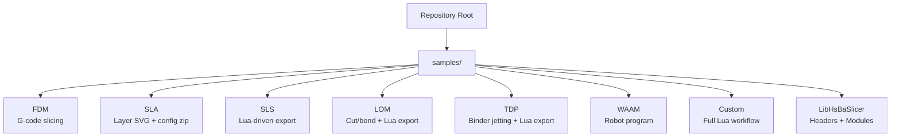

**Diagram sources**
- [samples/FDM/main.cpp:1-10](file://samples/FDM/main.cpp#L1-L10)
- [samples/SLA/main.cpp:1-10](file://samples/SLA/main.cpp#L1-L10)
- [samples/SLS/main.cpp:1-14](file://samples/SLS/main.cpp#L1-L14)
- [samples/LOM/main.cpp:1-14](file://samples/LOM/main.cpp#L1-L14)
- [samples/TDP/main.cpp:1-14](file://samples/TDP/main.cpp#L1-L14)
- [samples/WAAM/main.cpp:1-13](file://samples/WAAM/main.cpp#L1-L13)
- [samples/Custom/main.cpp:1-33](file://samples/Custom/main.cpp#L1-L33)
- [samples/LibHsBaSlicer/main_header.cpp:1-11](file://samples/LibHsBaSlicer/main_header.cpp#L1-L11)
- [samples/LibHsBaSlicer/main_module.cpp:1-12](file://samples/LibHsBaSlicer/main_module.cpp#L1-L12)

**Section sources**
- [samples/FDM/CMakeLists.txt:1-11](file://samples/FDM/CMakeLists.txt#L1-L11)
- [samples/SLA/CMakeLists.txt:1-11](file://samples/SLA/CMakeLists.txt#L1-L11)
- [samples/SLS/CMakeLists.txt:1-11](file://samples/SLS/CMakeLists.txt#L1-L11)
- [samples/LOM/CMakeLists.txt:1-9](file://samples/LOM/CMakeLists.txt#L1-L9)
- [samples/TDP/CMakeLists.txt:1-9](file://samples/TDP/CMakeLists.txt#L1-L9)
- [samples/WAAM/CMakeLists.txt:1-11](file://samples/WAAM/CMakeLists.txt#L1-L11)

## Core Components
Each technology sample demonstrates:
- Creating a default configuration object for the relevant pipeline.
- Setting model name and path.
- Configuring process parameters (layer height, first layer height, material/process settings).
- Running the pipeline synchronously or asynchronously.
- Handling success/failure and freeing results.
- Writing outputs to an `output/` directory.

Common output types:
- FDM: `.gcode` text file.
- SLA: `.zip` containing config JSON and per-layer contour images.
- SLS/LOM/TDP: `.zip` generated by Lua export scripts.
- WAAM: Robot language program text file (ABB/KUKA/FANUC or custom Lua).

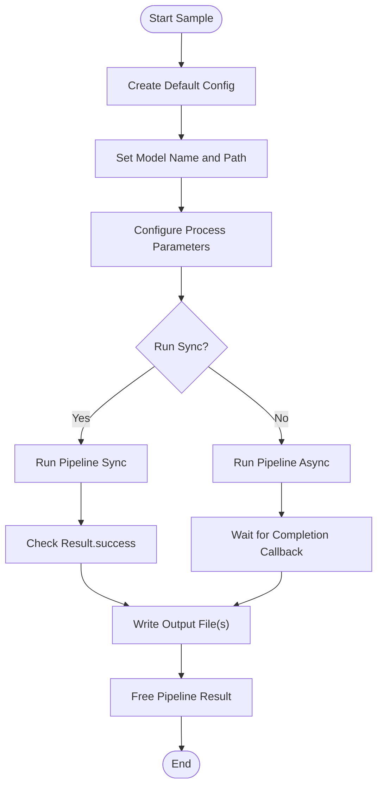

**Diagram sources**
- [samples/FDM/main.cpp:53-96](file://samples/FDM/main.cpp#L53-L96)
- [samples/SLA/main.cpp:52-84](file://samples/SLA/main.cpp#L52-L84)
- [samples/SLS/main.cpp:56-92](file://samples/SLS/main.cpp#L56-L92)
- [samples/LOM/main.cpp:55-82](file://samples/LOM/main.cpp#L55-L82)
- [samples/TDP/main.cpp:55-82](file://samples/TDP/main.cpp#L55-L82)
- [samples/WAAM/main.cpp:54-81](file://samples/WAAM/main.cpp#L54-L81)

**Section sources**
- [samples/FDM/main.cpp:53-96](file://samples/FDM/main.cpp#L53-L96)
- [samples/SLA/main.cpp:52-84](file://samples/SLA/main.cpp#L52-L84)
- [samples/SLS/main.cpp:56-92](file://samples/SLS/main.cpp#L56-L92)
- [samples/LOM/main.cpp:55-82](file://samples/LOM/main.cpp#L55-L82)
- [samples/TDP/main.cpp:55-82](file://samples/TDP/main.cpp#L55-L82)
- [samples/WAAM/main.cpp:54-81](file://samples/WAAM/main.cpp#L54-L81)

## Architecture Overview
The samples demonstrate two primary integration styles:
- C ABI via `DllHsBaSlicer`: Each technology has a dedicated pipeline function family (e.g., `HsBaRunFdmPipeline`, `HsBaRunSlaPipeline`, etc.).
- C++ API via `LibHsBaSlicer`: Direct header-based usage or C++20 module usage with class-based APIs (`Model`, `FdmPipeline`, `CustomLuaPipeline`).

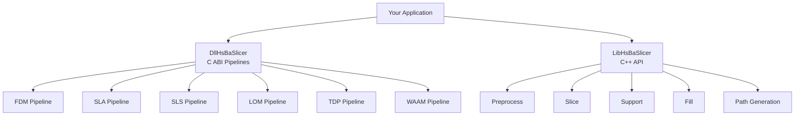

**Diagram sources**
- [samples/FDM/main.cpp:17-22](file://samples/FDM/main.cpp#L17-L22)
- [samples/SLA/main.cpp:16-21](file://samples/SLA/main.cpp#L16-L21)
- [samples/SLS/main.cpp:20-25](file://samples/SLS/main.cpp#L20-L25)
- [samples/LOM/main.cpp:20-25](file://samples/LOM/main.cpp#L20-L25)
- [samples/TDP/main.cpp:20-25](file://samples/TDP/main.cpp#L20-L25)
- [samples/WAAM/main.cpp:19-24](file://samples/WAAM/main.cpp#L19-L24)
- [samples/LibHsBaSlicer/main_header.cpp:20-27](file://samples/LibHsBaSlicer/main_header.cpp#L20-L27)
- [samples/LibHsBaSlicer/main_module.cpp:22-29](file://samples/LibHsBaSlicer/main_module.cpp#L22-L29)

## Detailed Component Analysis

### FDM Pipeline Examples
Purpose: Demonstrate FDM slicing with G-code output, including basic usage, custom parameters, Lua infill/support, async execution, and spiral/vase mode.

Prerequisites:
- Build system configured (CMake >= 3.12, C++20 compiler).
- Optional: Logger linked on non-game-console platforms.
- Model file: `models/stanford_bunny.stl` (downloaded automatically if missing).

Build instructions:
- Build the `fdm_sample` target; on mobile platforms it builds as a static library.
- Resources (model and scripts) are copied to the executable’s output directory at post-build.

Expected output:
- `output/stanford_bunny_basic.gcode`
- `output/stanford_bunny_custom.gcode`
- `output/stanford_bunny_lua.gcode`
- `output/stanford_bunny_spiral.gcode`

Key patterns:
- Default config creation and field assignment.
- Progress callback and error message handling.
- Asynchronous execution with completion callback.
- Spiral mode enabling continuous outer-wall path without per-layer retraction.

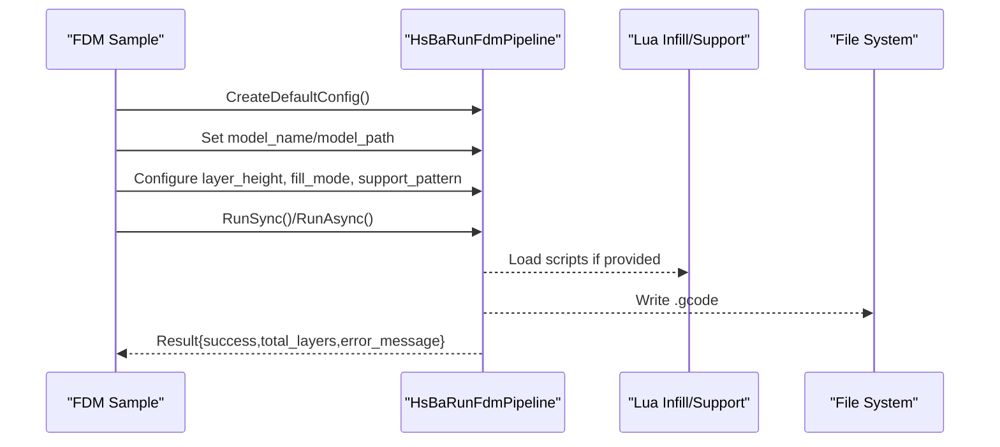

**Diagram sources**
- [samples/FDM/main.cpp:53-96](file://samples/FDM/main.cpp#L53-L96)
- [samples/FDM/main.cpp:101-165](file://samples/FDM/main.cpp#L101-L165)
- [samples/FDM/main.cpp:170-220](file://samples/FDM/main.cpp#L170-L220)
- [samples/FDM/main.cpp:245-269](file://samples/FDM/main.cpp#L245-L269)
- [samples/FDM/main.cpp:274-318](file://samples/FDM/main.cpp#L274-L318)

**Section sources**
- [samples/FDM/main.cpp:53-96](file://samples/FDM/main.cpp#L53-L96)
- [samples/FDM/main.cpp:101-165](file://samples/FDM/main.cpp#L101-L165)
- [samples/FDM/main.cpp:170-220](file://samples/FDM/main.cpp#L170-L220)
- [samples/FDM/main.cpp:245-269](file://samples/FDM/main.cpp#L245-L269)
- [samples/FDM/main.cpp:274-318](file://samples/FDM/main.cpp#L274-L318)
- [samples/FDM/CMakeLists.txt:1-72](file://samples/FDM/CMakeLists.txt#L1-L72)

### SLA Pipeline Examples
Purpose: Demonstrate SLA slicing producing a zip archive with config JSON and per-layer contour images, including floor/support customization via Lua.

Prerequisites:
- Same build requirements as FDM.
- Model file reused from FDM sample.

Build instructions:
- Build the `sla_sample` target; resources are copied to the output directory.

Expected output:
- `output/sla_basic_output.zip`
- `output/sla_custom_output.zip`
- `output/sla_lua_custom_output.zip`
- `output/sla_async_output.zip`

Key patterns:
- Exposure/lift/retract parameter configuration.
- Floor/raft generation options.
- Support pattern selection and density/gap tuning.
- Lua hooks for floor and support generation.

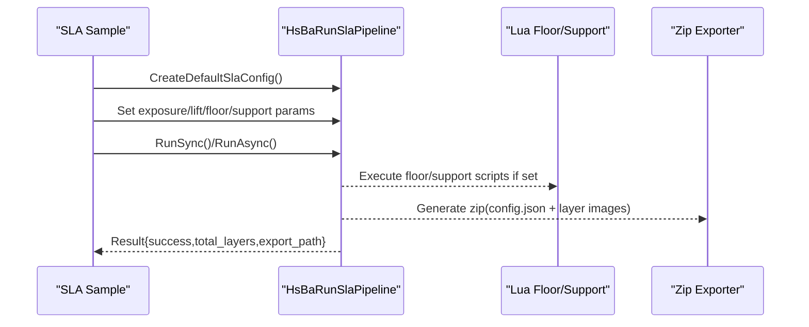

**Diagram sources**
- [samples/SLA/main.cpp:52-84](file://samples/SLA/main.cpp#L52-L84)
- [samples/SLA/main.cpp:89-144](file://samples/SLA/main.cpp#L89-L144)
- [samples/SLA/main.cpp:149-191](file://samples/SLA/main.cpp#L149-L191)
- [samples/SLA/main.cpp:217-239](file://samples/SLA/main.cpp#L217-L239)

**Section sources**
- [samples/SLA/main.cpp:52-84](file://samples/SLA/main.cpp#L52-L84)
- [samples/SLA/main.cpp:89-144](file://samples/SLA/main.cpp#L89-L144)
- [samples/SLA/main.cpp:149-191](file://samples/SLA/main.cpp#L149-L191)
- [samples/SLA/main.cpp:217-239](file://samples/SLA/main.cpp#L217-L239)
- [samples/SLA/CMakeLists.txt:1-48](file://samples/SLA/CMakeLists.txt#L1-L48)

### SLS Pipeline Examples
Purpose: Demonstrate powder-bed SLS slicing where output format is fully controlled by a Lua export script.

Prerequisites:
- Same build requirements as FDM.
- Lua export script: `scripts/my_sls_export.lua`.

Build instructions:
- Build the `sls_sample` target; resources are copied to the output directory.

Expected output:
- `output/sls_basic_output.zip`
- `output/sls_custom_output.zip`
- `output/sls_async_output.zip`

Key patterns:
- Laser power, scan speed, hatch spacing/rotation, bed temperature.
- No floor/support needed; Lua export handles packaging and database registration.

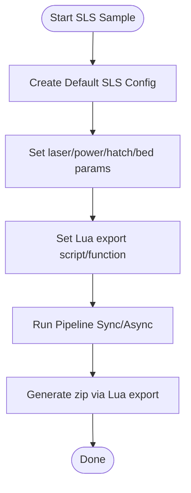

**Diagram sources**
- [samples/SLS/main.cpp:56-92](file://samples/SLS/main.cpp#L56-L92)
- [samples/SLS/main.cpp:97-140](file://samples/SLS/main.cpp#L97-L140)
- [samples/SLS/main.cpp:166-190](file://samples/SLS/main.cpp#L166-L190)

**Section sources**
- [samples/SLS/main.cpp:56-92](file://samples/SLS/main.cpp#L56-L92)
- [samples/SLS/main.cpp:97-140](file://samples/SLS/main.cpp#L97-L140)
- [samples/SLS/main.cpp:166-190](file://samples/SLS/main.cpp#L166-L190)
- [samples/SLS/CMakeLists.txt:1-48](file://samples/SLS/CMakeLists.txt#L1-L48)

### LOM Pipeline Examples
Purpose: Demonstrate sheet-bonding LOM slicing with cut/bond parameters and Lua-driven export.

Prerequisites:
- Same build requirements as FDM.
- Lua export script: `scripts/my_lom_export.lua`.

Build instructions:
- Build the `lom_sample` target; resources are copied to the output directory.

Expected output:
- `output/lom_basic_output.zip`
- `output/lom_custom_output.zip`
- `output/lom_async_output.zip`

Key patterns:
- Sheet thickness, cut speed/margin/power, seal contour, cut mode.
- Bond temperature/pressure/time.
- Lua export receives cut/bond parameters via config JSON.

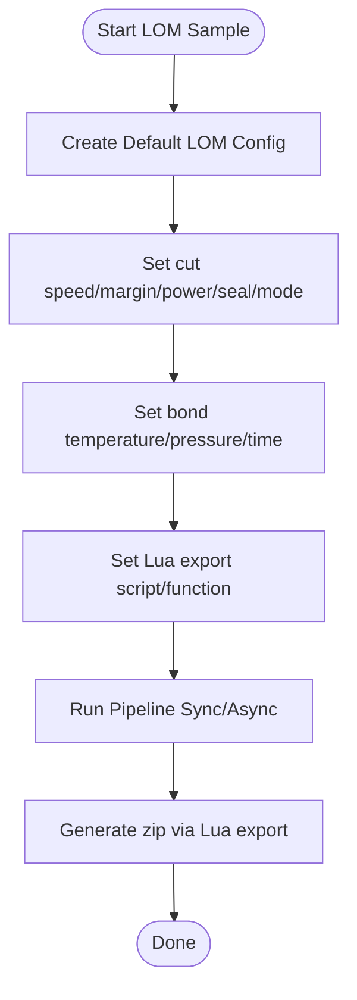

**Diagram sources**
- [samples/LOM/main.cpp:55-82](file://samples/LOM/main.cpp#L55-L82)
- [samples/LOM/main.cpp:87-130](file://samples/LOM/main.cpp#L87-L130)
- [samples/LOM/main.cpp:154-175](file://samples/LOM/main.cpp#L154-L175)

**Section sources**
- [samples/LOM/main.cpp:55-82](file://samples/LOM/main.cpp#L55-L82)
- [samples/LOM/main.cpp:87-130](file://samples/LOM/main.cpp#L87-L130)
- [samples/LOM/main.cpp:154-175](file://samples/LOM/main.cpp#L154-L175)
- [samples/LOM/CMakeLists.txt:1-42](file://samples/LOM/CMakeLists.txt#L1-L42)

### TDP Pipeline Examples
Purpose: Demonstrate binder-jetting 3DP slicing with head/drop/curing parameters and Lua-driven export.

Prerequisites:
- Same build requirements as FDM.
- Lua export script: `scripts/my_tdp_export.lua`.

Build instructions:
- Build the `tdp_sample` target; resources are copied to the output directory.

Expected output:
- `output/3dp_basic_output.zip`
- `output/3dp_custom_output.zip`
- `output/3dp_async_output.zip`
- `output/3dp_spiral_output.zip`

Key patterns:
- Head count, drop spacing, binder saturation, curing time, bed temperature.
- Spiral mode exposes a continuous Z-rising outer-wall path to the export script.

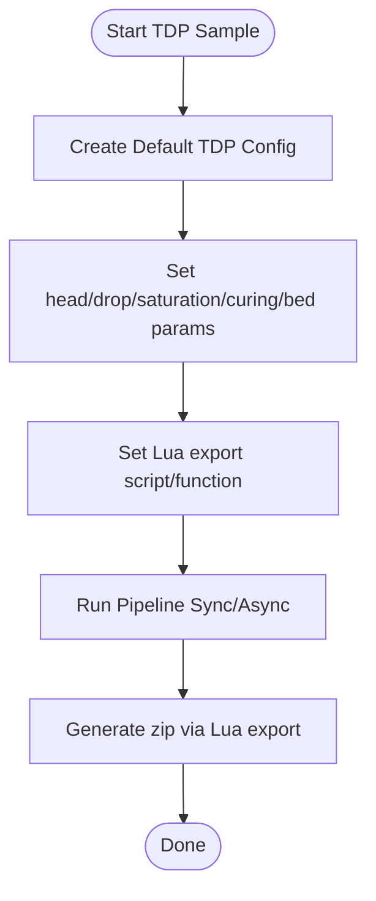

**Diagram sources**
- [samples/TDP/main.cpp:55-82](file://samples/TDP/main.cpp#L55-L82)
- [samples/TDP/main.cpp:87-125](file://samples/TDP/main.cpp#L87-L125)
- [samples/TDP/main.cpp:149-170](file://samples/TDP/main.cpp#L149-L170)
- [samples/TDP/main.cpp:175-205](file://samples/TDP/main.cpp#L175-L205)

**Section sources**
- [samples/TDP/main.cpp:55-82](file://samples/TDP/main.cpp#L55-L82)
- [samples/TDP/main.cpp:87-125](file://samples/TDP/main.cpp#L87-L125)
- [samples/TDP/main.cpp:149-170](file://samples/TDP/main.cpp#L149-L170)
- [samples/TDP/main.cpp:175-205](file://samples/TDP/main.cpp#L175-L205)
- [samples/TDP/CMakeLists.txt:1-42](file://samples/TDP/CMakeLists.txt#L1-L42)

### WAAM Pipeline Examples
Purpose: Demonstrate wire arc additive manufacturing robot program generation (ABB/KUKA/FANUC), with optional Lua path generator and spiral/vase mode.

Prerequisites:
- Same build requirements as FDM.
- Optional Lua path script: `scripts/my_waam_path.lua`.

Build instructions:
- Build the `waam_sample` target; resources are copied to the output directory.

Expected output:
- `output/waam_basic_output.txt`
- `output/waam_custom_output.txt`
- `output/waam_async_output.txt`
- `output/waam_spiral_output.txt`

Key patterns:
- Material, welding process, protection gas, arc current/voltage, wire feed speed, gas flow rate, interpass temperature.
- Built-in robot code generators vs. custom Lua path generator.
- Spiral mode merges outer walls into one continuous rising bead.

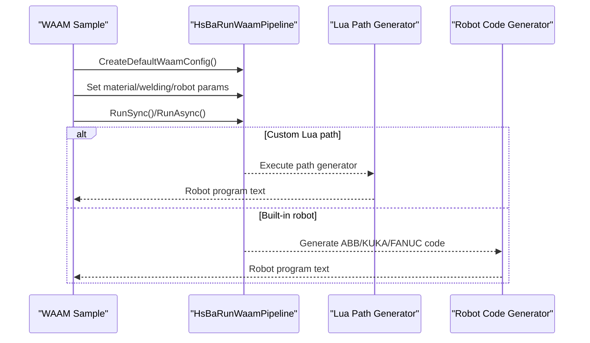

**Diagram sources**
- [samples/WAAM/main.cpp:54-81](file://samples/WAAM/main.cpp#L54-L81)
- [samples/WAAM/main.cpp:86-131](file://samples/WAAM/main.cpp#L86-L131)
- [samples/WAAM/main.cpp:155-178](file://samples/WAAM/main.cpp#L155-L178)
- [samples/WAAM/main.cpp:183-217](file://samples/WAAM/main.cpp#L183-L217)

**Section sources**
- [samples/WAAM/main.cpp:54-81](file://samples/WAAM/main.cpp#L54-L81)
- [samples/WAAM/main.cpp:86-131](file://samples/WAAM/main.cpp#L86-L131)
- [samples/WAAM/main.cpp:155-178](file://samples/WAAM/main.cpp#L155-L178)
- [samples/WAAM/main.cpp:183-217](file://samples/WAAM/main.cpp#L183-L217)
- [samples/WAAM/CMakeLists.txt:1-46](file://samples/WAAM/CMakeLists.txt#L1-L46)

### Custom Lua Pipeline Examples
Purpose: Demonstrate full workflow definition in Lua via the Custom pipeline API, covering FDM, SLS, SLM, LOM, TDP, WAAM, inline Lua source, async execution, and Protobuf wire serialization.

Prerequisites:
- Same build requirements as FDM.
- Lua scripts under `samples/Custom/scripts/`.

Build instructions:
- Build the `custom_sample` target; resources are copied to the output directory.

Expected output:
- Various `.gcode`, `.zip`, and `.txt` files depending on the selected Lua pipeline.
- CSV report when running the inline Lua example.

Key patterns:
- `HsBa` operator table exposed to Lua: progress reporting, model loading/slicing, fill/support/floor generation, G-code conversion, package saving, image rendering.
- Inline Lua source executed before the script file for parameter preloading.
- Protobuf wire encoding/decoding for cross-language calls.

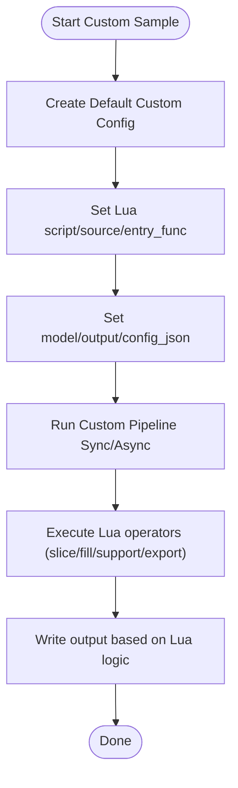

**Diagram sources**
- [samples/Custom/main.cpp:100-132](file://samples/Custom/main.cpp#L100-L132)
- [samples/Custom/main.cpp:140-165](file://samples/Custom/main.cpp#L140-L165)
- [samples/Custom/main.cpp:174-265](file://samples/Custom/main.cpp#L174-L265)
- [samples/Custom/main.cpp:270-314](file://samples/Custom/main.cpp#L270-L314)
- [samples/Custom/main.cpp:331-354](file://samples/Custom/main.cpp#L331-L354)
- [samples/Custom/main.cpp:516-589](file://samples/Custom/main.cpp#L516-L589)

**Section sources**
- [samples/Custom/main.cpp:100-132](file://samples/Custom/main.cpp#L100-L132)
- [samples/Custom/main.cpp:140-165](file://samples/Custom/main.cpp#L140-L165)
- [samples/Custom/main.cpp:174-265](file://samples/Custom/main.cpp#L174-L265)
- [samples/Custom/main.cpp:270-314](file://samples/Custom/main.cpp#L270-L314)
- [samples/Custom/main.cpp:331-354](file://samples/Custom/main.cpp#L331-L354)
- [samples/Custom/main.cpp:516-589](file://samples/Custom/main.cpp#L516-L589)

### LibHsBaSlicer Integration Examples
Purpose: Demonstrate direct C++ API usage via traditional headers and C++20 modules.

Prerequisites:
- C++20 compatible compiler.
- For module version: HSBA_SLICER_MODULE=ON (default).

Build instructions:
- Build the `lib_header_sample` and `lib_module_sample` targets.

Expected output:
- `output/lib_header_sample.gcode`
- `output/lib_module_sample.gcode`
- `output/lib_module_lua.gcode` (if Lua script exists)

Key patterns:
- Header-based workflow: LoadModel -> Slice -> Support -> Fill -> GenerateGCodePath.
- Module-based workflow: `Model`, `FdmPipeline`, `CustomLuaPipeline` classes.
- Exception handling for `SlicerError` and standard exceptions.

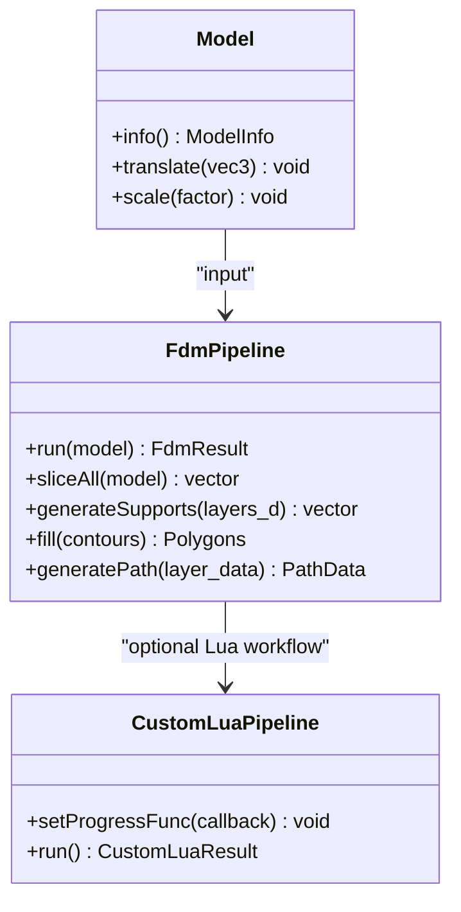

**Diagram sources**
- [samples/LibHsBaSlicer/main_header.cpp:46-185](file://samples/LibHsBaSlicer/main_header.cpp#L46-L185)
- [samples/LibHsBaSlicer/main_module.cpp:31-161](file://samples/LibHsBaSlicer/main_module.cpp#L31-L161)

**Section sources**
- [samples/LibHsBaSlicer/main_header.cpp:46-185](file://samples/LibHsBaSlicer/main_header.cpp#L46-L185)
- [samples/LibHsBaSlicer/main_module.cpp:31-161](file://samples/LibHsBaSlicer/main_module.cpp#L31-L161)

## Dependency Analysis
Samples depend on:
- `DllHsBaSlicer` for C ABI pipeline functions.
- Optional `HsBaSlicerLog` for logging on non-game-console platforms.
- Model files downloaded/copied during build/post-build.
- Lua scripts for customization (infill, support, floor, export, path generation).

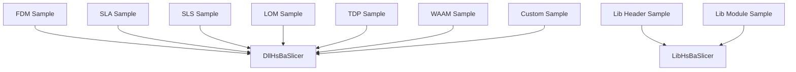

**Diagram sources**
- [samples/FDM/CMakeLists.txt:13-24](file://samples/FDM/CMakeLists.txt#L13-L24)
- [samples/SLA/CMakeLists.txt:13-24](file://samples/SLA/CMakeLists.txt#L13-L24)
- [samples/SLS/CMakeLists.txt:13-24](file://samples/SLS/CMakeLists.txt#L13-L24)
- [samples/LOM/CMakeLists.txt:11-20](file://samples/LOM/CMakeLists.txt#L11-L20)
- [samples/TDP/CMakeLists.txt:11-20](file://samples/TDP/CMakeLists.txt#L11-L20)
- [samples/WAAM/CMakeLists.txt:13-24](file://samples/WAAM/CMakeLists.txt#L13-L24)

**Section sources**
- [samples/FDM/CMakeLists.txt:13-24](file://samples/FDM/CMakeLists.txt#L13-L24)
- [samples/SLA/CMakeLists.txt:13-24](file://samples/SLA/CMakeLists.txt#L13-L24)
- [samples/SLS/CMakeLists.txt:13-24](file://samples/SLS/CMakeLists.txt#L13-L24)
- [samples/LOM/CMakeLists.txt:11-20](file://samples/LOM/CMakeLists.txt#L11-L20)
- [samples/TDP/CMakeLists.txt:11-20](file://samples/TDP/CMakeLists.txt#L11-L20)
- [samples/WAAM/CMakeLists.txt:13-24](file://samples/WAAM/CMakeLists.txt#L13-L24)

## Performance Considerations
- Asynchronous execution: All samples demonstrate async pipeline calls with completion callbacks, allowing UI updates or background processing.
- Spiral/vase mode: Reduces travel moves and retractions by merging outer walls into a continuous path (FDM, TDP, WAAM).
- Resource copying: Post-build commands copy models and scripts to the executable directory to avoid runtime path issues.
- Mobile platforms: Samples compile as static libraries on Android/iOS to keep code verified even without console executables.

[No sources needed since this section provides general guidance]

## Troubleshooting Guide
Common issues and resolutions:
- Missing model file: Ensure `models/stanford_bunny.stl` exists or allow automatic download during build.
- Lua script not found: Verify script paths relative to the executable’s output directory.
- Logging disabled on game consoles: Logger is conditionally linked; logs may be suppressed on `HSBA_GAME_CONSOLE`.
- Protobuf conflicts: Avoid linking protobuf runtime in both C++ caller and DllHsBaSlicer simultaneously to prevent duplicate proto registration errors.

**Section sources**
- [samples/FDM/CMakeLists.txt:34-54](file://samples/FDM/CMakeLists.txt#L34-L54)
- [samples/Custom/main.cpp:357-364](file://samples/Custom/main.cpp#L357-L364)

## Conclusion
The HsBaSlicer samples provide comprehensive, working examples for all major manufacturing technologies and integration targets. They demonstrate:
- Basic and advanced slicing workflows.
- Configuration management and error handling.
- Lua-driven customization for fill, support, floor, export, and robot path generation.
- Asynchronous execution and performance optimizations like spiral mode.
- Cross-platform considerations for Android, iOS, and desktop applications.

These samples serve as a foundation for extending HsBaSlicer with custom algorithms, optimization techniques, and multi-threading strategies tailored to specific production needs.

[No sources needed since this section summarizes without analyzing specific files]

## Appendices

### Platform-Specific Notes
- Desktop (Windows/Linux/macOS): All library targets participate in installation; samples build as executables.
- Android/iOS: Samples build as static libraries; model/script resources are handled differently due to platform constraints.
- Game consoles: Logger is conditionally excluded; samples still compile and verify core logic.

**Section sources**
- [README.md:187-191](file://README.md#L187-L191)
- [samples/FDM/CMakeLists.txt:5-11](file://samples/FDM/CMakeLists.txt#L5-L11)
- [samples/SLA/CMakeLists.txt:5-11](file://samples/SLA/CMakeLists.txt#L5-L11)
- [samples/SLS/CMakeLists.txt:5-11](file://samples/SLS/CMakeLists.txt#L5-L11)
- [samples/LOM/CMakeLists.txt:5-9](file://samples/LOM/CMakeLists.txt#L5-L9)
- [samples/TDP/CMakeLists.txt:5-9](file://samples/TDP/CMakeLists.txt#L5-L9)
- [samples/WAAM/CMakeLists.txt:5-11](file://samples/WAAM/CMakeLists.txt#L5-L11)