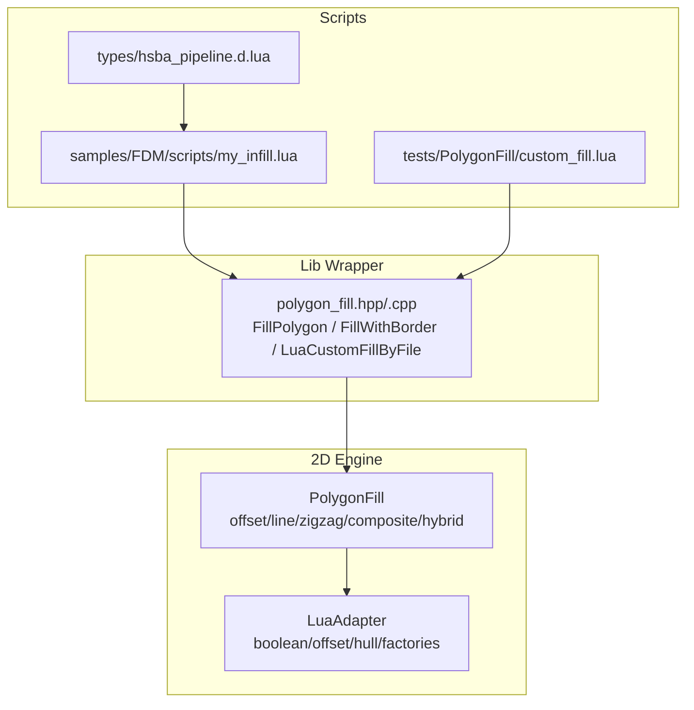
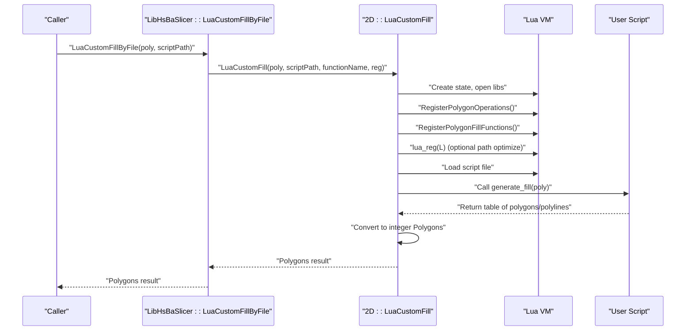
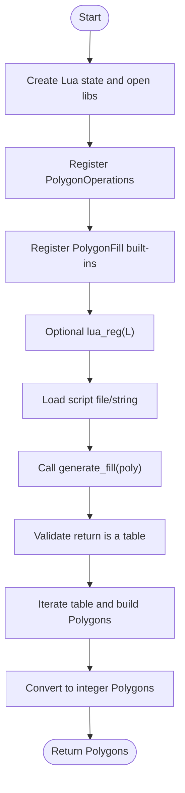
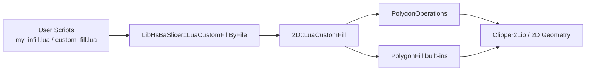

# FDM Fill Scripts

<cite>
**Referenced Files in This Document**
- [PolygonFill.hpp](file://2D/PolygonFill.hpp)
- [PolygonFill.cpp](file://2D/PolygonFill.cpp)
- [LuaAdapter.hpp](file://2D/LuaAdapter.hpp)
- [LuaAdapter.cpp](file://2D/LuaAdapter.cpp)
- [polygon_fill.hpp](file://LibHsBaSlicer/Fill/polygon_fill.hpp)
- [polygon_fill.cpp](file://LibHsBaSlicer/Fill/polygon_fill.cpp)
- [my_infill.lua](file://samples/FDM/scripts/my_infill.lua)
- [custom_fill.lua](file://tests/PolygonFill/custom_fill.lua)
- [hsba_pipeline.d.lua](file://types/hsba_pipeline.d.lua)
</cite>

## Table of Contents
1. [Introduction](#introduction)
2. [Project Structure](#project-structure)
3. [Core Components](#core-components)
4. [Architecture Overview](#architecture-overview)
5. [Detailed Component Analysis](#detailed-component-analysis)
6. [Dependency Analysis](#dependency-analysis)
7. [Performance Considerations](#performance-considerations)
8. [Troubleshooting Guide](#troubleshooting-guide)
9. [Conclusion](#conclusion)
10. [Appendices](#appendices)

## Introduction
This document explains the FDM fill pattern Lua scripting system and the underlying C++ fill engine. It covers:
- The custom fill generation workflow, including the expected `generate_fill` function signature, input polygon structures, and output requirements.
- The PolygonOperations API for geometric calculations, offset operations, and boolean operations.
- Step-by-step examples for implementing grid, honeycomb, and line fills using Lua scripts.
- Performance optimization techniques, memory management considerations, and debugging strategies for complex fill algorithms.

The documentation is grounded in the repository’s 2D geometry engine, Lua adapter, and sample/test scripts.

## Project Structure
FDM fill functionality spans several modules:
- 2D geometry and fill algorithms are implemented under `2D/`.
- Lua bindings for polygon operations live in `2D/LuaAdapter.*`.
- A LibHsBaSlicer wrapper exposes a simple C++ API over the 2D fill engine.
- Sample and test scripts demonstrate how to implement custom fills via Lua.
- Type declarations describe the expected pipeline entry points.

**Diagram sources**
- [PolygonFill.hpp:20-136](file://2D/PolygonFill.hpp#L20-L136)
- [LuaAdapter.cpp:22-329](file://2D/LuaAdapter.cpp#L22-L329)
- [polygon_fill.hpp:17-53](file://LibHsBaSlicer/Fill/polygon_fill.hpp#L17-L53)
- [my_infill.lua:1-89](file://samples/FDM/scripts/my_infill.lua#L1-L89)
- [custom_fill.lua:1-16](file://tests/PolygonFill/custom_fill.lua#L1-L16)
- [hsba_pipeline.d.lua:518-525](file://types/hsba_pipeline.d.lua#L518-L525)

**Section sources**
- [PolygonFill.hpp:20-136](file://2D/PolygonFill.hpp#L20-L136)
- [LuaAdapter.cpp:22-329](file://2D/LuaAdapter.cpp#L22-L329)
- [polygon_fill.hpp:17-53](file://LibHsBaSlicer/Fill/polygon_fill.hpp#L17-L53)
- [my_infill.lua:1-89](file://samples/FDM/scripts/my_infill.lua#L1-L89)
- [custom_fill.lua:1-16](file://tests/PolygonFill/custom_fill.lua#L1-L16)
- [hsba_pipeline.d.lua:518-525](file://types/hsba_pipeline.d.lua#L518-L525)

## Core Components
- Fill algorithms:
  - Offset-based fills (inward rings).
  - Line fills (parallel lines).
  - Zigzag fills (simple and advanced with bridges).
  - Composite and hybrid fills (offset borders plus interior fill).
- Lua integration:
  - `PolygonOperations`: boolean ops, offset, hulls, area, shape factories.
  - `PolygonFill`: built-in fill functions exposed to Lua.
  - Custom fill via `LuaCustomFill` or `LuaCustomFillString`, calling user-defined `generate_fill(poly)`.
- LibHsBaSlicer API:
  - `FillPolygon`, `FillWithBorder`, `LuaCustomFillByFile`.

Key responsibilities:
- `2D/PolygonFill.*`: core fill implementations and Lua glue for built-ins.
- `2D/LuaAdapter.*`: conversion helpers and registration of `PolygonOperations`.
- `LibHsBaSlicer/Fill/*`: thin wrappers exposing fill capabilities to higher layers.
- Scripts: example custom fills demonstrating the contract.

**Section sources**
- [PolygonFill.hpp:20-136](file://2D/PolygonFill.hpp#L20-L136)
- [PolygonFill.cpp:223-502](file://2D/PolygonFill.cpp#L223-L502)
- [LuaAdapter.hpp:16-81](file://2D/LuaAdapter.hpp#L16-L81)
- [LuaAdapter.cpp:22-329](file://2D/LuaAdapter.cpp#L22-L329)
- [polygon_fill.hpp:17-53](file://LibHsBaSlicer/Fill/polygon_fill.hpp#L17-L53)
- [polygon_fill.cpp:13-49](file://LibHsBaSlicer/Fill/polygon_fill.cpp#L13-L49)

## Architecture Overview
The custom fill workflow connects the C++ fill engine with Lua scripts through a well-defined contract.

**Diagram sources**
- [polygon_fill.cpp:35-49](file://LibHsBaSlicer/Fill/polygon_fill.cpp#L35-L49)
- [PolygonFill.cpp:1493-1585](file://2D/PolygonFill.cpp#L1493-L1585)
- [LuaAdapter.cpp:487-491](file://2D/LuaAdapter.cpp#L487-L491)

## Detailed Component Analysis

### Custom Fill Generation Workflow
- Entry point:
  - LibHsBaSlicer: `LuaCustomFillByFile(poly, scriptPath, functionName = "generate_fill", lineThickness = 0.5)`.
  - 2D engine: `LuaCustomFill(poly, scriptPath, functionName, lineThickness, lua_reg)`.
- Input:
  - `poly`: list of polygons (double precision when passed to Lua; converted back to integer internally).
- Output:
  - Lua function must return a table of polygons or polylines where each polyline is an array of `{x, y}` points.
  - The engine converts returned coordinates to integer polygons before returning to the caller.
- Environment:
  - `PolygonOperations` is always registered.
  - `PolygonFill` built-ins are registered.
  - Optional `lua_reg` callback can register additional functions (e.g., path optimization).

**Diagram sources**
- [PolygonFill.cpp:1493-1585](file://2D/PolygonFill.cpp#L1493-L1585)
- [PolygonFill.cpp:1587-1666](file://2D/PolygonFill.cpp#L1587-L1666)

**Section sources**
- [polygon_fill.cpp:35-49](file://LibHsBaSlicer/Fill/polygon_fill.cpp#L35-L49)
- [PolygonFill.cpp:1493-1666](file://2D/PolygonFill.cpp#L1493-L1666)

### generate_fill Function Signature and Contract
- Expected function name: `generate_fill`.
- Parameters:
  - `polys`: current layer polygons (already subtracted from wall thickness), represented as a table of polygons. Each polygon is a table of points `{x, y}`.
- Return value:
  - A table of polygons or polylines. Polylines are arrays of `{x, y}` points; polygons are arrays of such points.
- Environment:
  - Available libraries: `PolygonOperations`, `PolygonFill`, and optionally `PathOptimize` if registered by the caller.

Type declaration reference:
- `generate_fill(polys)` returns `Polygons`.

**Section sources**
- [hsba_pipeline.d.lua:518-525](file://types/hsba_pipeline.d.lua#L518-L525)
- [my_infill.lua:18-87](file://samples/FDM/scripts/my_infill.lua#L18-L87)
- [custom_fill.lua:7-13](file://tests/PolygonFill/custom_fill.lua#L7-L13)

### PolygonOperations API
Available functions exposed to Lua scripts:
- Boolean operations:
  - `union(a, b)`
  - `intersection(a, b)`
  - `difference(a, b)`
  - `xor(a, b)`
  - `booleanOperation(a, b, opName)`
- Offset:
  - `offsetOperation(polys, delta)`
- Hulls:
  - `convexHullOperation(polys)`
  - `concaveHullOperation(polys, numAdditionalPoints)`
- Area:
  - `area(poly)`
- Shape factories:
  - `makeRectangle(x, y, width, height)`
  - `makeCircle(cx, cy, radius, segments?)`
  - `makeEllipse(cx, cy, rx, ry, segments?, rotation?)`
  - `makeRegularPolygon(cx, cy, radius, sides, rotation?)`
- Text:
  - `textToPolygons(text, font_file, font_size, x?, y?, curve_segments?)`
- Debugging (when enabled):
  - `dumpPolygon(poly, filename, close_path?)`
  - `dumpPolygons(polys, filename, close_path?)`

Notes on coordinate systems:
- Most boolean/hull/area operations work on double-precision polygon tables.
- `offsetOperation` routes through integerized coordinates; its delta is in integer units (1.0 mm corresponds to 1e6).

**Section sources**
- [LuaAdapter.cpp:22-329](file://2D/LuaAdapter.cpp#L22-L329)
- [LuaAdapter.cpp:487-491](file://2D/LuaAdapter.cpp#L487-L491)

### Built-in Fill Functions Exposed to Lua
- `PolygonFill.offsetFill(poly_table, spacing, options?)`
- `PolygonFill.lineFill(poly_table, spacing, angle_deg, lineThickness)`
- `PolygonFill.simpleZigzagFill(poly_table, spacing, angle_deg, lineThickness)`
- `PolygonFill.zigzagFill(poly_table, spacing, angle_deg, lineThickness)`
- `PolygonFill.compositeOffsetFill(...)`
- `PolygonFill.hybridFill(...)`
- `PolygonFill.offsetOnly(poly_table, delta, inner, outer, options?)`

These functions accept polygon tables and return polygon tables. Internally they convert between double-precision and integer coordinates.

**Section sources**
- [PolygonFill.cpp:231-495](file://2D/PolygonFill.cpp#L231-L495)
- [PolygonFill.hpp:20-136](file://2D/PolygonFill.hpp#L20-L136)

### Implementing Different Fill Patterns

#### Grid Fill
Concept:
- Generate horizontal and vertical parallel lines across the bounding box of the input polygons.
- Intersect generated lines with the input polygons to clip them to valid regions.

Steps:
1. Compute bounding box of input polygons.
2. Generate horizontal lines at fixed spacing across the width.
3. Generate vertical lines at fixed spacing across the height.
4. Represent each line as a thin rectangle or polyline.
5. Use `PolygonOperations.intersection` to clip lines to the input polygons.
6. Return the clipped lines as the fill result.

References:
- Bounding box computation and line generation logic similar to the sample script.
- Intersection usage via `PolygonOperations.intersection`.

**Section sources**
- [my_infill.lua:31-85](file://samples/FDM/scripts/my_infill.lua#L31-L85)
- [LuaAdapter.cpp:69-79](file://2D/LuaAdapter.cpp#L69-L79)

#### Honeycomb Fill
Concept:
- Construct hexagonal cells that tile the plane.
- Clip the tiling to the input polygon boundaries.

Steps:
1. Determine cell size based on desired spacing.
2. Generate a repeating set of hexagon centers within the bounding box.
3. For each center, create a hexagon polygon using `PolygonOperations.makeRegularPolygon`.
4. Union all hexagons into a single polygonal region.
5. Intersect the union with the input polygons to obtain the final honeycomb fill.

Implementation hints:
- Use `PolygonOperations.union` to merge hexagons efficiently.
- Use `PolygonOperations.intersection` to clip to the actual layer shape.

**Section sources**
- [LuaAdapter.cpp:226-244](file://2D/LuaAdapter.cpp#L226-L244)
- [LuaAdapter.cpp:32-53](file://2D/LuaAdapter.cpp#L32-L53)

#### Line Fill
Concept:
- Generate parallel lines at a given angle and spacing.
- Clip lines to the input polygons.

Steps:
1. Compute angle in radians and perpendicular direction.
2. Generate scan lines across the bounding box.
3. Represent each line as a thin rectangle or polyline.
4. Intersect with input polygons using `PolygonOperations.intersection`.
5. Return clipped lines.

Reference:
- The sample script demonstrates generating angled lines and intersecting them with the layer.

**Section sources**
- [my_infill.lua:29-85](file://samples/FDM/scripts/my_infill.lua#L29-L85)
- [LuaAdapter.cpp:69-79](file://2D/LuaAdapter.cpp#L69-L79)

### Algorithmic Details of Built-in Fills

#### Offset-Based Fill
- Repeatedly apply inward offsets until no more polygons remain.
- Close paths and collect offset contours as fill lines.

Complexity:
- Proportional to number of offset iterations bounded by a maximum iteration count.

**Section sources**
- [PolygonFill.cpp:504-541](file://2D/PolygonFill.cpp#L504-L541)

#### Line Fill
- Computes scan rows along the specified angle.
- Extracts segments inside the polygon and outputs independent line segments.

**Section sources**
- [PolygonFill.cpp:44-160](file://2D/PolygonFill.cpp#L44-L160)
- [PolygonFill.cpp:543-564](file://2D/PolygonFill.cpp#L543-L564)

#### Simple Zigzag Fill
- Builds connected zigzag paths by connecting segment centers across adjacent rows.
- Uses binary search to clamp endpoints to inside/outside boundaries.

**Section sources**
- [PolygonFill.cpp:566-800](file://2D/PolygonFill.cpp#L566-L800)

#### Advanced Zigzag Fill
- Sorts segments per row, flattens into a global list, and computes connectivity using a union-find structure.
- Bridges components across rows when necessary, preferring shortest boundary arcs.

**Section sources**
- [PolygonFill.cpp:803-1370](file://2D/PolygonFill.cpp#L803-L1370)

#### Composite and Hybrid Fills
- Composite: base fill + outward/inward offset fills.
- Hybrid: outline offsets + fill only the final inward island.

**Section sources**
- [PolygonFill.cpp:1372-1491](file://2D/PolygonFill.cpp#L1372-L1491)

## Dependency Analysis
High-level dependencies among components:

**Diagram sources**
- [polygon_fill.cpp:35-49](file://LibHsBaSlicer/Fill/polygon_fill.cpp#L35-L49)
- [PolygonFill.cpp:1493-1585](file://2D/PolygonFill.cpp#L1493-L1585)
- [LuaAdapter.cpp:487-491](file://2D/LuaAdapter.cpp#L487-L491)

**Section sources**
- [polygon_fill.cpp:35-49](file://LibHsBaSlicer/Fill/polygon_fill.cpp#L35-L49)
- [PolygonFill.cpp:1493-1585](file://2D/PolygonFill.cpp#L1493-L1585)
- [LuaAdapter.cpp:487-491](file://2D/LuaAdapter.cpp#L487-L491)

## Performance Considerations
- Avoid excessive offset iterations:
  - Offset-based fills use a maximum iteration limit to prevent runaway loops.
- Prefer vectorized operations:
  - Use `PolygonOperations.union` to merge many small shapes before intersection to reduce repeated clipping.
- Minimize coordinate conversions:
  - Keep computations in double precision in Lua; let the engine handle integerization once at the boundary.
- Limit polygon complexity:
  - Simplify generated shapes where possible (e.g., fewer vertices for rectangles/circles).
- Use appropriate join types:
  - Choose `Square`, `Bevel`, `Round`, or `Miter` based on desired corner behavior; simpler joins may be faster.
- Batch intersections:
  - Group multiple line rectangles and intersect them together rather than one-by-one.

[No sources needed since this section provides general guidance]

## Troubleshooting Guide
Common issues and resolutions:
- Lua function not found:
  - Ensure your script defines `generate_fill` and does not call it at load time.
- Wrong return type:
  - The function must return a table of polygons/polylines; non-table returns will cause errors.
- Coordinate scaling confusion:
  - Remember that `offsetOperation` uses integerized coordinates; a delta of 1.0 mm equals 1e6.
- Empty results:
  - Verify that generated lines or shapes actually intersect the input polygons.
- Memory pressure:
  - Reduce the number of generated primitives and avoid unnecessary intermediate unions.

Error handling locations:
- Script loading and execution errors are wrapped with descriptive messages.
- Argument validation in Lua bindings raises clear errors.

**Section sources**
- [PolygonFill.cpp:1517-1536](file://2D/PolygonFill.cpp#L1517-L1536)
- [PolygonFill.cpp:1606-1628](file://2D/PolygonFill.cpp#L1606-L1628)
- [LuaAdapter.cpp:16-53](file://2D/LuaAdapter.cpp#L16-L53)

## Conclusion
The FDM fill scripting system provides a flexible and powerful way to generate custom infill patterns. By combining the robust 2D geometry engine with Lua scripting, users can implement a wide variety of fills—from simple grids to complex honeycombs—while leveraging built-in operations for boolean math, offsets, and shape creation. Following the documented contract for `generate_fill`, using `PolygonOperations` effectively, and applying the performance tips above will help you build efficient and reliable fill algorithms.

[No sources needed since this section summarizes without analyzing specific files]

## Appendices

### API Reference Summary

#### LibHsBaSlicer Fill API
- `FillPolygon(poly, spacing, mode, angle_deg)`
- `FillWithBorder(poly, spacing, border_count, fill_mode, angle_deg)`
- `LuaCustomFillByFile(poly, scriptPath, functionName = "generate_fill", lineThickness = 0.5)`

**Section sources**
- [polygon_fill.hpp:17-53](file://LibHsBaSlicer/Fill/polygon_fill.hpp#L17-L53)
- [polygon_fill.cpp:13-49](file://LibHsBaSlicer/Fill/polygon_fill.cpp#L13-L49)

#### 2D Fill API
- `OffsetFill`, `LineFill`, `SimpleZigzagFill`, `ZigzagFill`
- `CompositeOffsetFill`, `HybridFill`
- `LuaCustomFill`, `LuaCustomFillString`
- `RegisterLuaPolygonFillFunctions`

**Section sources**
- [PolygonFill.hpp:20-136](file://2D/PolygonFill.hpp#L20-L136)

#### Lua PolygonOperations API
- Boolean: `union`, `intersection`, `difference`, `xor`, `booleanOperation`
- Offset: `offsetOperation`
- Hulls: `convexHullOperation`, `concaveHullOperation`
- Area: `area`
- Factories: `makeRectangle`, `makeCircle`, `makeEllipse`, `makeRegularPolygon`
- Text: `textToPolygons`
- Debug: `dumpPolygon`, `dumpPolygons` (conditional)

**Section sources**
- [LuaAdapter.cpp:22-329](file://2D/LuaAdapter.cpp#L22-L329)
- [LuaAdapter.cpp:487-491](file://2D/LuaAdapter.cpp#L487-L491)