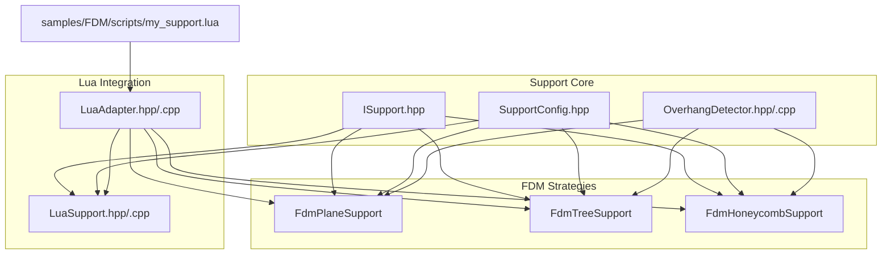
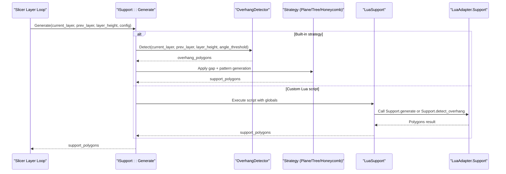
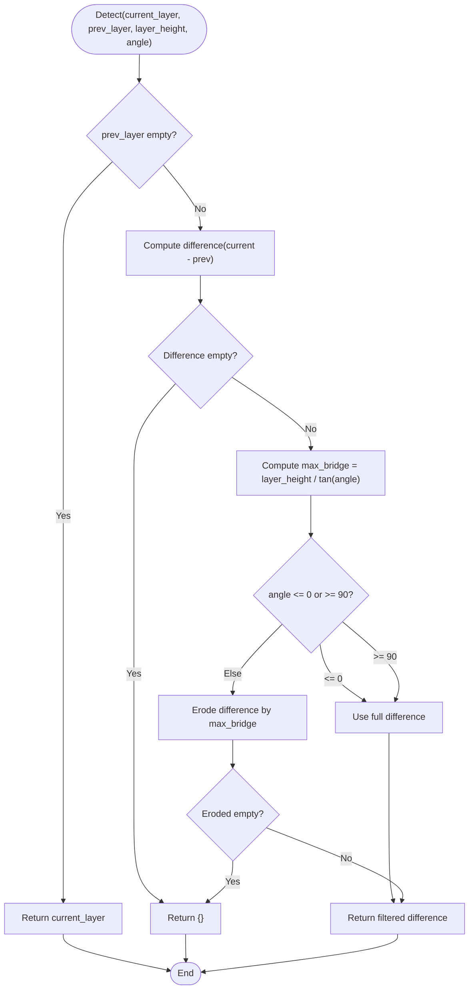
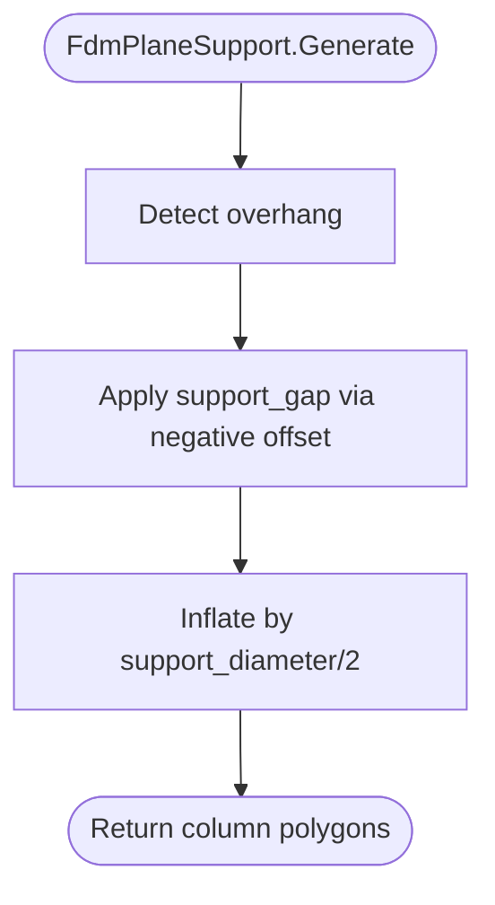
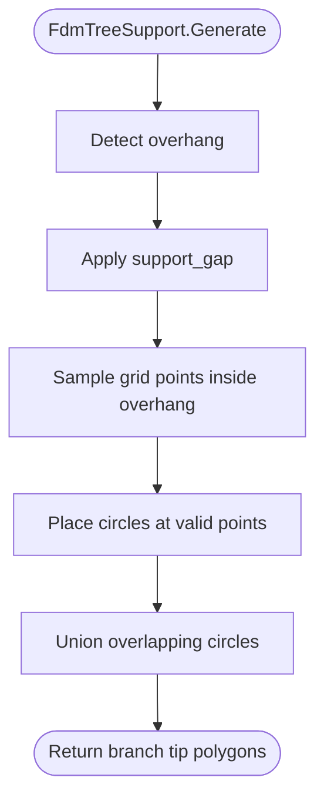
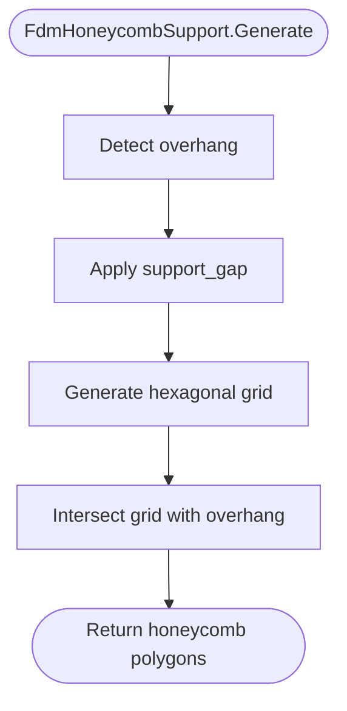
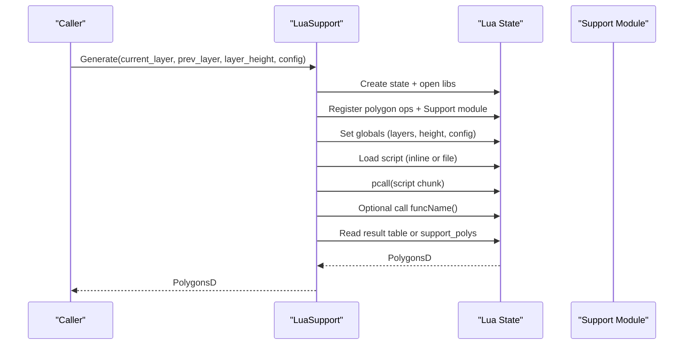
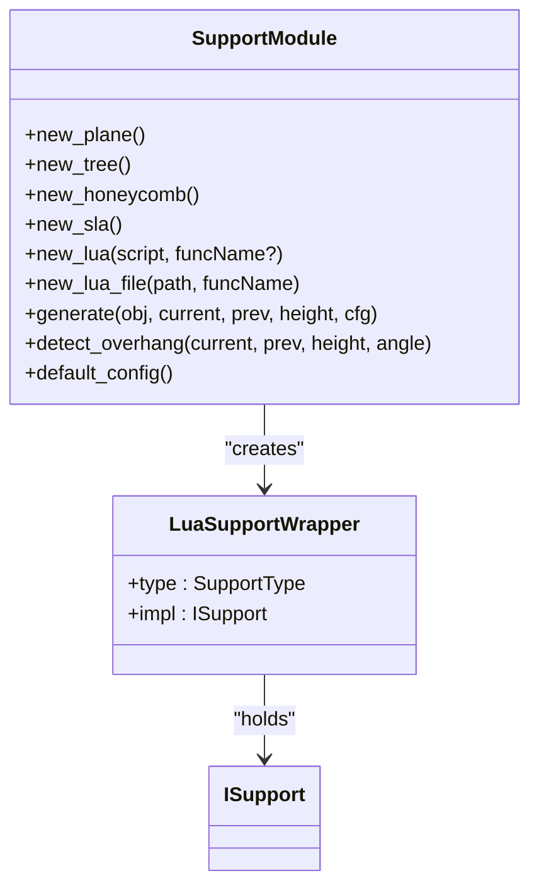
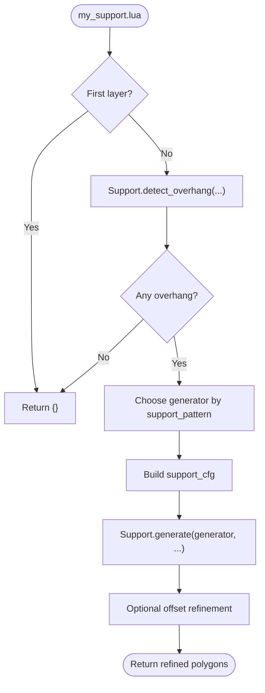
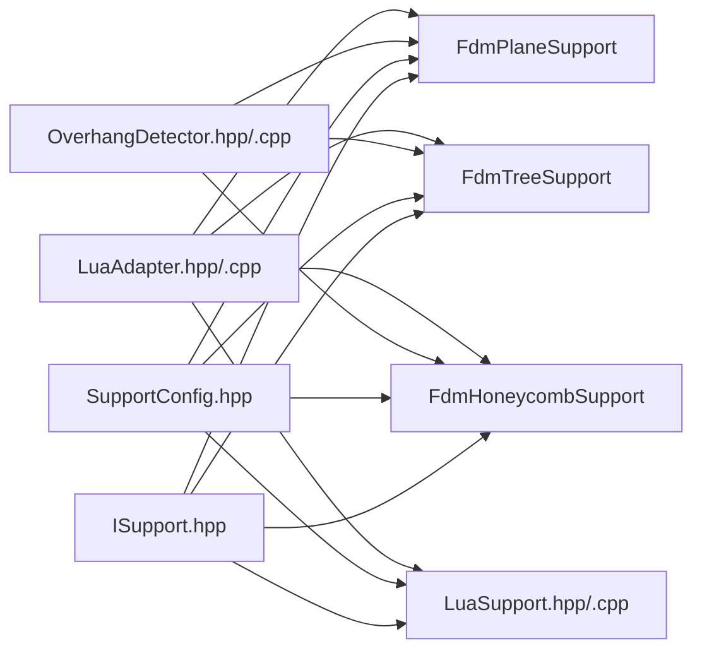

# FDM Support Scripts

<cite>
**Referenced Files in This Document**
- [ISupport.hpp](file://support/ISupport.hpp)
- [SupportConfig.hpp](file://support/SupportConfig.hpp)
- [OverhangDetector.hpp](file://support/OverhangDetector.hpp)
- [OverhangDetector.cpp](file://support/OverhangDetector.cpp)
- [FdmSupport.hpp](file://support/FdmSupport.hpp)
- [FdmSupport.cpp](file://support/FdmSupport.cpp)
- [LuaSupport.hpp](file://support/LuaSupport.hpp)
- [LuaSupport.cpp](file://support/LuaSupport.cpp)
- [LuaAdapter.hpp](file://support/LuaAdapter.hpp)
- [LuaAdapter.cpp](file://support/LuaAdapter.cpp)
- [my_support.lua](file://samples/FDM/scripts/my_support.lua)
</cite>

## Table of Contents
1. [Introduction](#introduction)
2. [Project Structure](#project-structure)
3. [Core Components](#core-components)
4. [Architecture Overview](#architecture-overview)
5. [Detailed Component Analysis](#detailed-component-analysis)
6. [Dependency Analysis](#dependency-analysis)
7. [Performance Considerations](#performance-considerations)
8. [Troubleshooting Guide](#troubleshooting-guide)
9. [Conclusion](#conclusion)
10. [Appendices](#appendices)

## Introduction
This document explains the FDM support structure system and its Lua scripting interface. It covers how overhangs are detected, how support cross-sections are generated per layer, and how density and pattern control influence the final support geometry. It also documents the C++ support generator interface, the Lua-based custom support pipeline, and the available APIs for creating supports, connecting them to model layers, and optimizing results. Finally, it provides practical guidance for implementing tree supports, dense supports, and custom patterns while balancing strength, printability, and material usage.

## Project Structure
The FDM support system is implemented under the `support` directory with a clear separation between:
- Abstract generator interface and shared configuration
- Built-in FDM strategies (plane, tree, honeycomb)
- Overhang detection logic
- Lua integration for custom scripts and built-in helpers

**Diagram sources**
- [ISupport.hpp:14-45](file://support/ISupport.hpp#L14-L45)
- [SupportConfig.hpp:14-43](file://support/SupportConfig.hpp#L14-L43)
- [OverhangDetector.hpp:20-49](file://support/OverhangDetector.hpp#L20-L49)
- [FdmSupport.hpp:19-63](file://support/FdmSupport.hpp#L19-L63)
- [LuaSupport.hpp:40-81](file://support/LuaSupport.hpp#L40-L81)
- [LuaAdapter.hpp:13-30](file://support/LuaAdapter.hpp#L13-L30)
- [my_support.lua:1-28](file://samples/FDM/scripts/my_support.lua#L1-L28)

**Section sources**
- [ISupport.hpp:14-45](file://support/ISupport.hpp#L14-L45)
- [SupportConfig.hpp:14-43](file://support/SupportConfig.hpp#L14-L43)
- [OverhangDetector.hpp:20-49](file://support/OverhangDetector.hpp#L20-L49)
- [FdmSupport.hpp:19-63](file://support/FdmSupport.hpp#L19-L63)
- [LuaSupport.hpp:40-81](file://support/LuaSupport.hpp#L40-L81)
- [LuaAdapter.hpp:13-30](file://support/LuaAdapter.hpp#L13-L30)
- [my_support.lua:1-28](file://samples/FDM/scripts/my_support.lua#L1-L28)

## Core Components
- ISupport: Abstract interface for per-layer support generators. Implementations receive current and previous layer polygons and return support polygons for that layer. A default `GenerateAll` iterates over all layers.
- SupportConfig: Shared configuration including overhang angle threshold, layer height, gap, diameter, density, pattern selection, tree-specific parameters, and honeycomb cell size.
- OverhangDetector: Computes overhang regions by comparing current and previous layers, filtering by bridge distance derived from the angle threshold.
- FdmPlaneSupport, FdmTreeSupport, FdmHoneycombSupport: Built-in FDM strategies that detect overhangs, apply gaps, and generate cross-sections using offsetting, branching grids, or hexagonal cells.
- LuaSupport: Executes user-provided Lua code to compute support polygons, exposing polygon operations and a Support module for built-in generators.
- LuaAdapter: Registers the Support module in Lua, providing constructors for each generator type, helper functions like `generate` and `detect_overhang`, and default config creation.

Key responsibilities:
- Overhang detection drives where supports are needed.
- Strategy classes define how supports look at each layer.
- Configuration controls spacing, density, and pattern behavior.
- Lua integration enables fully custom generation while reusing built-in helpers.

**Section sources**
- [ISupport.hpp:14-45](file://support/ISupport.hpp#L14-L45)
- [SupportConfig.hpp:14-43](file://support/SupportConfig.hpp#L14-L43)
- [OverhangDetector.hpp:20-49](file://support/OverhangDetector.hpp#L20-L49)
- [FdmSupport.hpp:19-63](file://support/FdmSupport.hpp#L19-L63)
- [LuaSupport.hpp:40-81](file://support/LuaSupport.hpp#L40-L81)
- [LuaAdapter.hpp:13-30](file://support/LuaAdapter.hpp#L13-L30)

## Architecture Overview
The support generation pipeline operates per slice layer:

**Diagram sources**
- [ISupport.hpp:27-44](file://support/ISupport.hpp#L27-L44)
- [OverhangDetector.cpp:41-87](file://support/OverhangDetector.cpp#L41-L87)
- [FdmSupport.cpp:48-75](file://support/FdmSupport.cpp#L48-L75)
- [FdmSupport.cpp:145-167](file://support/FdmSupport.cpp#L145-L167)
- [FdmSupport.cpp:244-266](file://support/FdmSupport.cpp#L244-L266)
- [LuaSupport.cpp:113-177](file://support/LuaSupport.cpp#L113-L177)
- [LuaAdapter.cpp:174-213](file://support/LuaAdapter.cpp#L174-L213)

## Detailed Component Analysis

### Overhang Detection
Overhang detection compares the current layer with the previous layer:
- If there is no previous layer, the entire current layer is considered an overhang.
- Otherwise, it computes the difference between current and previous layers.
- The difference is eroded by a maximum bridge distance derived from the angle threshold and layer height.
- The resulting polygons represent areas requiring support.

**Diagram sources**
- [OverhangDetector.cpp:23-39](file://support/OverhangDetector.cpp#L23-L39)
- [OverhangDetector.cpp:41-87](file://support/OverhangDetector.cpp#L41-L87)

**Section sources**
- [OverhangDetector.hpp:20-49](file://support/OverhangDetector.hpp#L20-L49)
- [OverhangDetector.cpp:23-87](file://support/OverhangDetector.cpp#L23-L87)

### FDM Plane Support
Plane support generates simple column-like supports:
- Detect overhang regions.
- Apply a gap to separate support from the model.
- Inflate the gapped region by half the support diameter to create circular columns.
- Return the unioned column cross-sections.

**Diagram sources**
- [FdmSupport.cpp:48-75](file://support/FdmSupport.cpp#L48-L75)

**Section sources**
- [FdmSupport.hpp:19-24](file://support/FdmSupport.hpp#L19-L24)
- [FdmSupport.cpp:48-75](file://support/FdmSupport.cpp#L48-L75)

### FDM Tree Support
Tree support places branch tips within overhang regions:
- Detect overhang regions and apply gap.
- Sample candidate points on a grid spaced by approximately 1.5 times the support diameter.
- For each point inside the overhang, place a circle with radius equal to half the support diameter.
- Union overlapping circles to form connected branch tips.
- Branch expansion across layers is handled by higher-level logic; this step produces per-layer cross-sections.

**Diagram sources**
- [FdmSupport.cpp:81-143](file://support/FdmSupport.cpp#L81-L143)
- [FdmSupport.cpp:145-167](file://support/FdmSupport.cpp#L145-L167)

**Section sources**
- [FdmSupport.hpp:26-44](file://support/FdmSupport.hpp#L26-L44)
- [FdmSupport.cpp:81-167](file://support/FdmSupport.cpp#L81-L167)

### FDM Honeycomb Support
Honeycomb support fills overhang regions with hexagonal cells:
- Detect overhang regions and apply gap.
- Generate flat-top hexagons based on configured cell size.
- Intersect the hexagon grid with the overhang region to produce lightweight but rigid support structures.

**Diagram sources**
- [FdmSupport.cpp:173-241](file://support/FdmSupport.cpp#L173-L241)
- [FdmSupport.cpp:244-266](file://support/FdmSupport.cpp#L244-L266)

**Section sources**
- [FdmSupport.hpp:46-63](file://support/FdmSupport.hpp#L46-L63)
- [FdmSupport.cpp:173-266](file://support/FdmSupport.cpp#L173-L266)

### Lua Support Generator
LuaSupport allows users to replace built-in algorithms with custom logic:
- Creates a fresh Lua state per call.
- Registers polygon operations and the Support module.
- Exposes global variables: `current_layer`, `prev_layer`, `layer_height`, and `config`.
- Loads either inline script text or a file path.
- Optionally calls a named function (default: `generate_support`).
- Reads the returned table or a global `support_polys` as the result.

**Diagram sources**
- [LuaSupport.cpp:19-49](file://support/LuaSupport.cpp#L19-L49)
- [LuaSupport.cpp:67-90](file://support/LuaSupport.cpp#L67-L90)
- [LuaSupport.cpp:113-177](file://support/LuaSupport.cpp#L113-L177)

**Section sources**
- [LuaSupport.hpp:40-81](file://support/LuaSupport.hpp#L40-L81)
- [LuaSupport.cpp:19-177](file://support/LuaSupport.cpp#L19-L177)

### Lua Adapter and Support Module
LuaAdapter registers the `Support` module in Lua:
- Constructors: `new_plane`, `new_tree`, `new_honeycomb`, `new_sla`, `new_lua`, `new_lua_file`.
- Helpers: `generate(support_obj, current_layer, prev_layer, layer_height, config_table)` and `detect_overhang(current_layer, prev_layer, layer_height, angle_deg)`.
- Utility: `default_config()` returns a table with default values.

**Diagram sources**
- [LuaAdapter.cpp:23-39](file://support/LuaAdapter.cpp#L23-L39)
- [LuaAdapter.cpp:110-172](file://support/LuaAdapter.cpp#L110-L172)
- [LuaAdapter.cpp:174-241](file://support/LuaAdapter.cpp#L174-L241)
- [LuaAdapter.cpp:253-276](file://support/LuaAdapter.cpp#L253-L276)

**Section sources**
- [LuaAdapter.hpp:13-30](file://support/LuaAdapter.hpp#L13-L30)
- [LuaAdapter.cpp:110-276](file://support/LuaAdapter.cpp#L110-L276)

### Example Script: my_support.lua
The sample script demonstrates:
- Using built-in overhang detection.
- Selecting a generator based on `config.support_pattern`.
- Building a configuration table and calling `Support.generate`.
- Optionally refining support polygons with polygon operations.

**Diagram sources**
- [my_support.lua:32-82](file://samples/FDM/scripts/my_support.lua#L32-L82)

**Section sources**
- [my_support.lua:1-82](file://samples/FDM/scripts/my_support.lua#L1-L82)

## Dependency Analysis
The following diagram shows key dependencies among core components:

**Diagram sources**
- [ISupport.hpp:14-45](file://support/ISupport.hpp#L14-L45)
- [SupportConfig.hpp:14-43](file://support/SupportConfig.hpp#L14-L43)
- [OverhangDetector.hpp:20-49](file://support/OverhangDetector.hpp#L20-L49)
- [FdmSupport.hpp:19-63](file://support/FdmSupport.hpp#L19-L63)
- [LuaSupport.hpp:40-81](file://support/LuaSupport.hpp#L40-L81)
- [LuaAdapter.hpp:13-30](file://support/LuaAdapter.hpp#L13-L30)

**Section sources**
- [ISupport.hpp:14-45](file://support/ISupport.hpp#L14-L45)
- [SupportConfig.hpp:14-43](file://support/SupportConfig.hpp#L14-L43)
- [OverhangDetector.hpp:20-49](file://support/OverhangDetector.hpp#L20-L49)
- [FdmSupport.hpp:19-63](file://support/FdmSupport.hpp#L19-L63)
- [LuaSupport.hpp:40-81](file://support/LuaSupport.hpp#L40-L81)
- [LuaAdapter.hpp:13-30](file://support/LuaAdapter.hpp#L13-L30)

## Performance Considerations
- Overhang detection uses geometric difference and erosion; large models benefit from reasonable angle thresholds to avoid excessive erosion or overly broad overhang regions.
- Tree support grid sampling scales with bounding box area and spacing; increasing spacing reduces computation and output complexity.
- Honeycomb generation creates many hexagons; larger cell sizes reduce polygon count and intersection cost.
- Gap inflation/erosion operations are computationally intensive; tune `support_gap` to balance printability and performance.
- Density (`support_density`) influences downstream infill and path generation; higher densities increase material and time.

[No sources needed since this section provides general guidance]

## Troubleshooting Guide
Common issues and remedies:
- No supports generated:
  - Verify overhang angle threshold and layer height; too high an angle may eliminate overhangs.
  - Ensure previous layer data is provided correctly; first layer has no previous layer.
- Supports too sparse or weak:
  - Increase `support_density` or decrease `support_diameter` to add more contact points.
  - Switch to tree or honeycomb patterns for better coverage.
- Supports touching the model:
  - Increase `support_gap`; ensure gap is positive and appropriate for your printer tolerances.
- Lua script errors:
  - Check syntax and runtime errors thrown by Lua; inspect error messages from `LuaSupport`.
  - Confirm that the script returns a table of polygons or sets `support_polys`.
  - Validate that `Support.generate` arguments match expected types and order.

**Section sources**
- [OverhangDetector.cpp:41-87](file://support/OverhangDetector.cpp#L41-L87)
- [LuaSupport.cpp:113-177](file://support/LuaSupport.cpp#L113-L177)
- [LuaAdapter.cpp:174-213](file://support/LuaAdapter.cpp#L174-L213)

## Conclusion
The FDM support system combines robust overhang detection with flexible per-layer strategies and a powerful Lua scripting interface. Users can select built-in plane, tree, or honeycomb supports or implement custom patterns through Lua. Configuration fields such as gap, diameter, density, and pattern provide fine-grained control over support strength, printability, and material usage. By understanding the pipeline and APIs documented here, you can design supports that balance structural integrity with efficient printing.

[No sources needed since this section summarizes without analyzing specific files]

## Appendices

### API Reference Summary

- ISupport
  - Purpose: Abstract interface for per-layer support generation.
  - Key methods:
    - `Generate(current_layer, prev_layer, layer_height, config)`
    - `GenerateAll(layers, config)`

- SupportConfig
  - Fields:
    - `overhang_angle_threshold`
    - `layer_height`
    - `support_gap`
    - `support_diameter`
    - `support_density`
    - `support_pattern`
    - `tree_branch_angle`
    - `tree_max_branch_radius`
    - `honeycomb_cell_size`

- OverhangDetector
  - Methods:
    - `Detect(current_layer, prev_layer, layer_height, angle_threshold_deg)`
    - `Detect(current_layer, prev_layer, config)`
    - `MaxBridgeDistance(layer_height, angle_deg)`

- FdmPlaneSupport, FdmTreeSupport, FdmHoneycombSupport
  - All implement `Generate(...)` returning per-layer support polygons.

- LuaSupport
  - Constructors:
    - Inline script
    - Inline script with function name
    - File path with function name
  - Method:
    - `Generate(current_layer, prev_layer, layer_height, config)`

- LuaAdapter.Support Module
  - Constructors:
    - `new_plane()`
    - `new_tree()`
    - `new_honeycomb()`
    - `new_sla()`
    - `new_lua(script [, funcName])`
    - `new_lua_file(path, funcName)`
  - Helpers:
    - `generate(support_obj, current_layer, prev_layer, layer_height, config_table)`
    - `detect_overhang(current_layer, prev_layer, layer_height, angle_deg)`
    - `default_config()`

**Section sources**
- [ISupport.hpp:14-45](file://support/ISupport.hpp#L14-L45)
- [SupportConfig.hpp:14-43](file://support/SupportConfig.hpp#L14-L43)
- [OverhangDetector.hpp:20-49](file://support/OverhangDetector.hpp#L20-L49)
- [FdmSupport.hpp:19-63](file://support/FdmSupport.hpp#L19-L63)
- [LuaSupport.hpp:40-81](file://support/LuaSupport.hpp#L40-L81)
- [LuaAdapter.hpp:13-30](file://support/LuaAdapter.hpp#L13-L30)