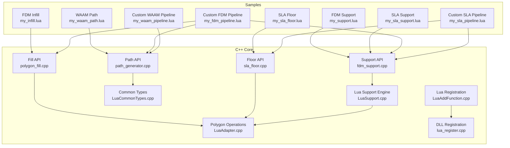
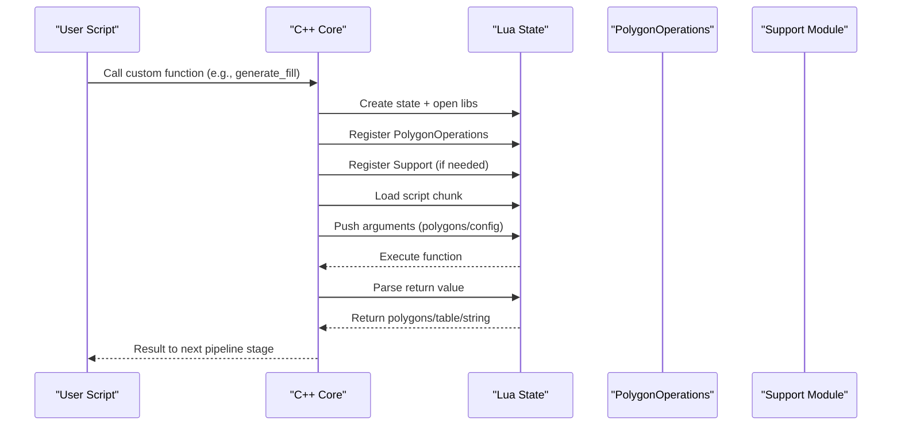
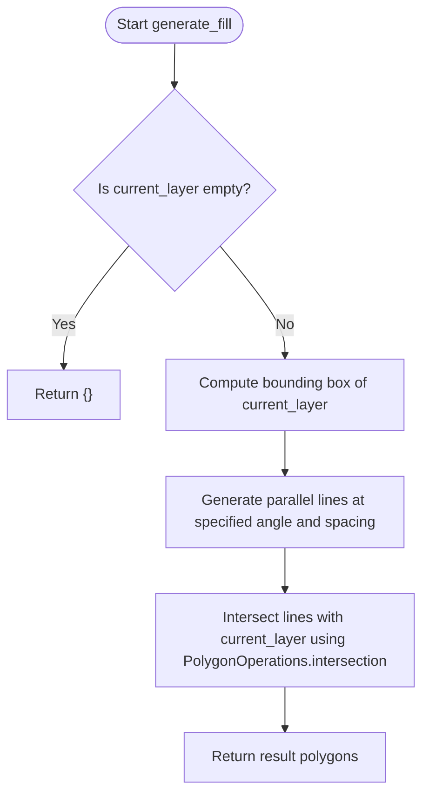
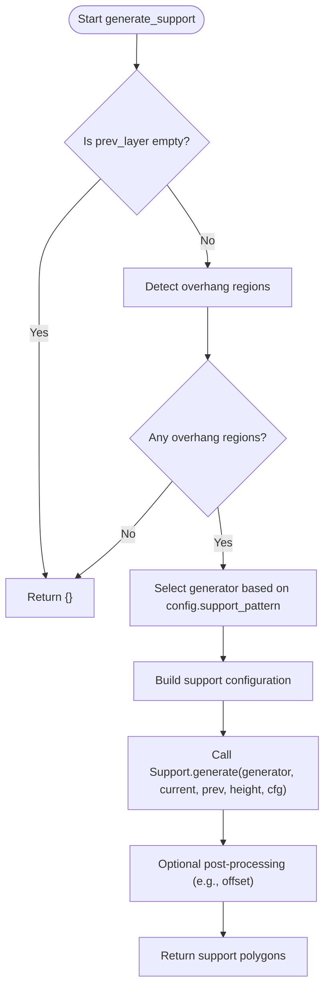
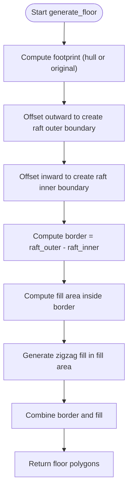
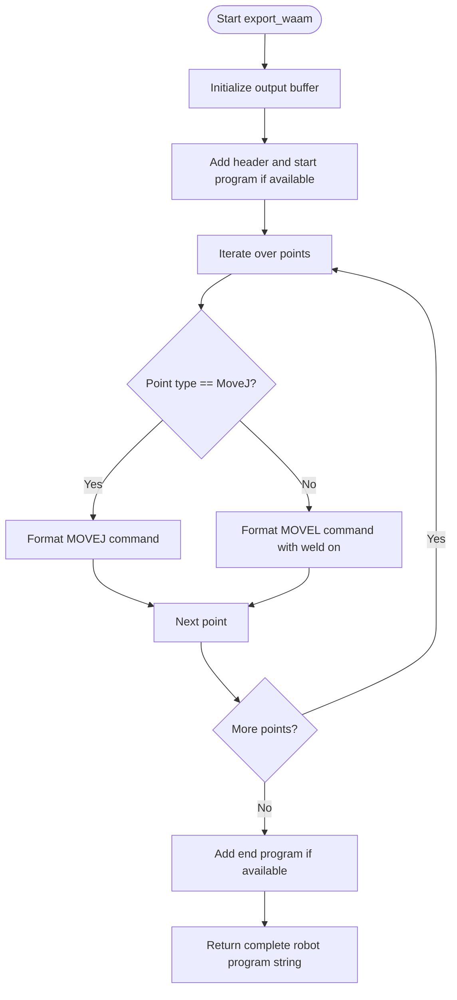
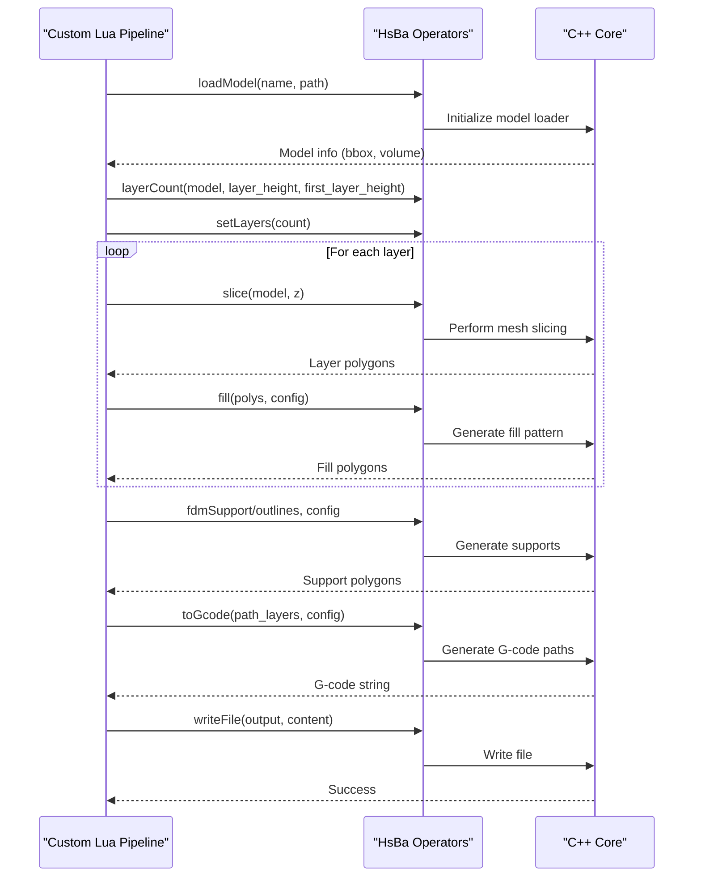
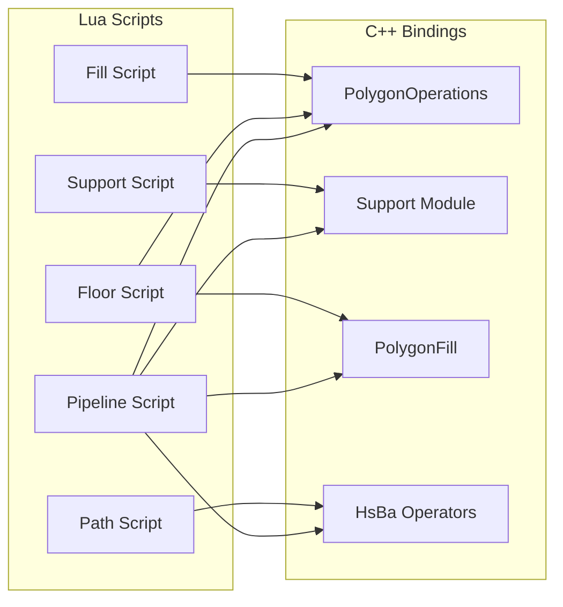

# Lua Script Examples

<cite>
**Referenced Files in This Document**   
- [my_infill.lua](file://samples/FDM/scripts/my_infill.lua)
- [my_support.lua](file://samples/FDM/scripts/my_support.lua)
- [my_sla_floor.lua](file://samples/SLA/scripts/my_sla_floor.lua)
- [my_sla_support.lua](file://samples/SLA/scripts/my_sla_support.lua)
- [my_waam_path.lua](file://samples/WAAM/scripts/my_waam_path.lua)
- [my_fdm_pipeline.lua](file://samples/Custom/scripts/my_fdm_pipeline.lua)
- [my_sla_pipeline.lua](file://samples/Custom/scripts/my_sla_pipeline.lua)
- [my_waam_pipeline.lua](file://samples/Custom/scripts/my_waam_pipeline.lua)
- [polygon_fill.cpp](file://LibHsBaSlicer/Fill/polygon_fill.cpp)
- [sla_floor.cpp](file://LibHsBaSlicer/Floor/sla_floor.cpp)
- [fdm_support.cpp](file://LibHsBaSlicer/Support/fdm_support.cpp)
- [path_generator.cpp](file://LibHsBaSlicer/Path/path_generator.cpp)
- [LuaAddFunction.cpp](file://LibHsBaSlicer/Extends/LuaAddFunction.cpp)
- [LuaCommonTypes.cpp](file://LibHsBaSlicer/Extends/LuaCommonTypes.cpp)
- [LuaAdapter.cpp](file://2D/LuaAdapter.cpp)
- [LuaSupport.cpp](file://support/LuaSupport.cpp)
- [lua_register.cpp](file://DllHsBaSlicer/lua_register.cpp)
</cite>

## Table of Contents
1. [Introduction](#introduction)
2. [Project Structure](#project-structure)
3. [Core Components](#core-components)
4. [Architecture Overview](#architecture-overview)
5. [Detailed Component Analysis](#detailed-component-analysis)
6. [Dependency Analysis](#dependency-analysis)
7. [Performance Considerations](#performance-considerations)
8. [Troubleshooting Guide](#troubleshooting-guide)
9. [Conclusion](#conclusion)
10. [Appendices](#appendices)

## Introduction
This document provides comprehensive Lua scripting examples for HsBaSlicer customization. It covers:
- Custom fill patterns for FDM slicing
- Support structure generation for FDM and SLA
- Floor creation for SLA processes
- Path generation for WAAM robot programs
- Full custom pipeline orchestration in Lua
- Available APIs, data structures, event registration, debugging techniques, and performance considerations

The goal is to help both new and experienced users extend the slicer through Lua scripts while understanding how these scripts integrate with the C++ core pipeline.

## Project Structure
HsBaSlicer exposes multiple extension points for Lua:
- Fill scripts: replace or customize polygon filling per layer
- Support scripts: generate support geometry per layer
- Floor scripts: generate raft/floor geometry for SLA
- Export/path scripts: generate robot code or other outputs
- Full pipelines: control model loading, slicing, support, path generation, and output writing

**Diagram sources**
- [my_infill.lua:1-89](file://samples/FDM/scripts/my_infill.lua#L1-L89)
- [my_support.lua:1-83](file://samples/FDM/scripts/my_support.lua#L1-L83)
- [my_sla_floor.lua:1-64](file://samples/SLA/scripts/my_sla_floor.lua#L1-L64)
- [my_sla_support.lua:1-76](file://samples/SLA/scripts/my_sla_support.lua#L1-L76)
- [my_waam_path.lua:1-46](file://samples/WAAM/scripts/my_waam_path.lua#L1-L46)
- [my_fdm_pipeline.lua:1-172](file://samples/Custom/scripts/my_fdm_pipeline.lua#L1-L172)
- [my_sla_pipeline.lua:1-105](file://samples/Custom/scripts/my_sla_pipeline.lua#L1-L105)
- [my_waam_pipeline.lua:1-94](file://samples/Custom/scripts/my_waam_pipeline.lua#L1-L94)
- [polygon_fill.cpp:1-52](file://LibHsBaSlicer/Fill/polygon_fill.cpp#L1-L52)
- [sla_floor.cpp:1-609](file://LibHsBaSlicer/Floor/sla_floor.cpp#L1-L609)
- [fdm_support.cpp:1-78](file://LibHsBaSlicer/Support/fdm_support.cpp#L1-L78)
- [path_generator.cpp:1-143](file://LibHsBaSlicer/Path/path_generator.cpp#L1-L143)
- [LuaAddFunction.cpp:1-68](file://LibHsBaSlicer/Extends/LuaAddFunction.cpp#L1-L68)
- [LuaCommonTypes.cpp:1-534](file://LibHsBaSlicer/Extends/LuaCommonTypes.cpp#L1-L534)
- [LuaAdapter.cpp:1-493](file://2D/LuaAdapter.cpp#L1-L493)
- [LuaSupport.cpp:1-180](file://support/LuaSupport.cpp#L1-L180)
- [lua_register.cpp:1-43](file://DllHsBaSlicer/lua_register.cpp#L1-L43)

**Section sources**
- [my_infill.lua:1-89](file://samples/FDM/scripts/my_infill.lua#L1-L89)
- [my_support.lua:1-83](file://samples/FDM/scripts/my_support.lua#L1-L83)
- [my_sla_floor.lua:1-64](file://samples/SLA/scripts/my_sla_floor.lua#L1-L64)
- [my_sla_support.lua:1-76](file://samples/SLA/scripts/my_sla_support.lua#L1-L76)
- [my_waam_path.lua:1-46](file://samples/WAAM/scripts/my_waam_path.lua#L1-L46)
- [my_fdm_pipeline.lua:1-172](file://samples/Custom/scripts/my_fdm_pipeline.lua#L1-L172)
- [my_sla_pipeline.lua:1-105](file://samples/Custom/scripts/my_sla_pipeline.lua#L1-L105)
- [my_waam_pipeline.lua:1-94](file://samples/Custom/scripts/my_waam_pipeline.lua#L1-L94)

## Core Components
This section summarizes the main Lua extension points and their responsibilities:

- Custom fill pattern (FDM):
  - Function contract: `generate_fill(current_layer)` returns a table of polygons
  - Uses `PolygonOperations` for boolean operations, offsets, hulls, area, and shape creation
  - Example script: [my_infill.lua](file://samples/FDM/scripts/my_infill.lua)

- Custom support generation (FDM/SLA):
  - Global environment includes `current_layer`, `prev_layer`, `layer_height`, `config`
  - Uses `Support` module to detect overhangs and generate supports
  - Example scripts: [my_support.lua](file://samples/FDM/scripts/my_support.lua), [my_sla_support.lua](file://samples/SLA/scripts/my_sla_support.lua)

- Custom floor generation (SLA):
  - Function contract: `generate_floor(bottom_layer, config)` returns raft/border/fill polygons
  - Uses `PolygonOperations` and `PolygonFill` utilities
  - Example script: [my_sla_floor.lua](file://samples/SLA/scripts/my_sla_floor.lua)

- Custom path generation (WAAM):
  - Function contract: `export_waam()` returns a string containing robot program text
  - Global environment includes `header`, `startProgramFunc`, `endProgramFunc`, `points`
  - Example script: [my_waam_path.lua](file://samples/WAAM/scripts/my_waam_path.lua)

- Full custom pipelines:
  - Orchestrate model loading, slicing, support, fill, path generation, and file output
  - Use global `HsBa` operator table and optional `machine` parameters
  - Example scripts: [my_fdm_pipeline.lua](file://samples/Custom/scripts/my_fdm_pipeline.lua), [my_sla_pipeline.lua](file://samples/Custom/scripts/my_sla_pipeline.lua), [my_waam_pipeline.lua](file://samples/Custom/scripts/my_waam_pipeline.lua)

**Section sources**
- [my_infill.lua:1-89](file://samples/FDM/scripts/my_infill.lua#L1-L89)
- [my_support.lua:1-83](file://samples/FDM/scripts/my_support.lua#L1-L83)
- [my_sla_floor.lua:1-64](file://samples/SLA/scripts/my_sla_floor.lua#L1-L64)
- [my_sla_support.lua:1-76](file://samples/SLA/scripts/my_sla_support.lua#L1-L76)
- [my_waam_path.lua:1-46](file://samples/WAAM/scripts/my_waam_path.lua#L1-L46)
- [my_fdm_pipeline.lua:1-172](file://samples/Custom/scripts/my_fdm_pipeline.lua#L1-L172)
- [my_sla_pipeline.lua:1-105](file://samples/Custom/scripts/my_sla_pipeline.lua#L1-L105)
- [my_waam_pipeline.lua:1-94](file://samples/Custom/scripts/my_waam_pipeline.lua#L1-L94)

## Architecture Overview
The Lua scripting system integrates with the C++ core through several layers:

- Lua state initialization:
  - Standard libraries are opened
  - Polygon operations are registered under `PolygonOperations`
  - Support modules are registered for support scripts
  - Optional external functions can be added via registration callbacks

- Data exchange:
  - Polygons are passed as Lua tables of points with `x` and `y` fields
  - Configuration tables are passed as Lua tables with named keys
  - Return values are parsed back into C++ polygon structures

- Event and function registration:
  - External modules register 2D, 3D, and file functions
  - Event callbacks can be attached by name

**Diagram sources**
- [LuaAdapter.cpp:487-491](file://2D/LuaAdapter.cpp#L487-L491)
- [LuaSupport.cpp:67-90](file://support/LuaSupport.cpp#L67-L90)
- [sla_floor.cpp:148-228](file://LibHsBaSlicer/Floor/sla_floor.cpp#L148-L228)
- [polygon_fill.cpp:35-49](file://LibHsBaSlicer/Fill/polygon_fill.cpp#L35-L49)

**Section sources**
- [LuaAdapter.cpp:1-493](file://2D/LuaAdapter.cpp#L1-L493)
- [LuaSupport.cpp:1-180](file://support/LuaSupport.cpp#L1-L180)
- [sla_floor.cpp:148-228](file://LibHsBaSlicer/Floor/sla_floor.cpp#L148-L228)
- [polygon_fill.cpp:35-49](file://LibHsBaSlicer/Fill/polygon_fill.cpp#L35-L49)

## Detailed Component Analysis

### Custom Fill Patterns (FDM)
The FDM custom fill example demonstrates generating parallel-line infill and intersecting it with the current layer boundary.

Key aspects:
- Function signature: `generate_fill(current_layer)`
- Input: table of polygons representing the current layer after wall subtraction
- Output: table of polygons representing the fill pattern
- Utilities used:
  - `PolygonOperations.intersection` to clip fill lines to valid regions
  - Manual geometry calculations for line spacing and angle

**Diagram sources**
- [my_infill.lua:20-87](file://samples/FDM/scripts/my_infill.lua#L20-L87)

**Section sources**
- [my_infill.lua:1-89](file://samples/FDM/scripts/my_infill.lua#L1-L89)
- [polygon_fill.cpp:35-49](file://LibHsBaSlicer/Fill/polygon_fill.cpp#L35-L49)

### Custom Support Generation (FDM and SLA)
Both FDM and SLA support scripts follow a similar pattern:
- Detect overhang regions using `Support.detect_overhang`
- Select a generator based on configuration
- Generate support polygons using `Support.generate`
- Optionally post-process results (e.g., offsetting contact areas)

**Diagram sources**
- [my_support.lua:32-79](file://samples/FDM/scripts/my_support.lua#L32-L79)
- [my_sla_support.lua:34-72](file://samples/SLA/scripts/my_sla_support.lua#L34-L72)

**Section sources**
- [my_support.lua:1-83](file://samples/FDM/scripts/my_support.lua#L1-L83)
- [my_sla_support.lua:1-76](file://samples/SLA/scripts/my_sla_support.lua#L1-L76)
- [fdm_support.cpp:14-75](file://LibHsBaSlicer/Support/fdm_support.cpp#L14-L75)
- [LuaSupport.cpp:113-178](file://support/LuaSupport.cpp#L113-L178)

### Custom Floor Creation (SLA)
The SLA floor script generates raft, border, and internal fill based on the bottom layer footprint.

Key steps:
- Compute footprint (convex hull or original contour)
- Offset outward to create raft boundary
- Offset inward to carve out border region
- Generate border loops and internal zigzag fill
- Combine border and fill into final result

**Diagram sources**
- [my_sla_floor.lua:35-62](file://samples/SLA/scripts/my_sla_floor.lua#L35-L62)

**Section sources**
- [my_sla_floor.lua:1-64](file://samples/SLA/scripts/my_sla_floor.lua#L1-L64)
- [sla_floor.cpp:49-117](file://LibHsBaSlicer/Floor/sla_floor.cpp#L49-L117)

### Custom Path Generation (WAAM)
The WAAM path script generates robot program text from precomputed path points.

Key aspects:
- Function signature: `export_waam()` returns a string
- Global variables include `header`, `startProgramFunc`, `endProgramFunc`, and `points`
- Each point contains `end`, `middle`, `velocity`, and `type`
- The script formats robot commands based on point type (`MoveJ` vs. welding moves)

**Diagram sources**
- [my_waam_path.lua:17-43](file://samples/WAAM/scripts/my_waam_path.lua#L17-L43)

**Section sources**
- [my_waam_path.lua:1-46](file://samples/WAAM/scripts/my_waam_path.lua#L1-L46)
- [path_generator.cpp:63-118](file://LibHsBaSlicer/Path/path_generator.cpp#L63-L118)

### Full Custom Pipelines
The custom pipeline scripts demonstrate full control over the slicing workflow:

- FDM pipeline:
  - Loads model, computes layers, slices per layer, generates fills with rotating angles, optionally generates supports, builds path data, and writes G-code
  - Uses `HsBa.progress` for progress reporting
  - Example: [my_fdm_pipeline.lua](file://samples/Custom/scripts/my_fdm_pipeline.lua)

- SLA pipeline:
  - Loads model, slices layers, generates SLA supports, creates floor/raft, and packages everything into a zip with images
  - Example: [my_sla_pipeline.lua](file://samples/Custom/scripts/my_sla_pipeline.lua)

- WAAM pipeline:
  - Loads model, slices layers, generates robot program using `HsBa.saveWaamPackage`
  - Supports different robot types and welding parameters
  - Example: [my_waam_pipeline.lua](file://samples/Custom/scripts/my_waam_pipeline.lua)

**Diagram sources**
- [my_fdm_pipeline.lua:52-170](file://samples/Custom/scripts/my_fdm_pipeline.lua#L52-L170)
- [my_sla_pipeline.lua:27-103](file://samples/Custom/scripts/my_sla_pipeline.lua#L27-L103)
- [my_waam_pipeline.lua:22-92](file://samples/Custom/scripts/my_waam_pipeline.lua#L22-L92)

**Section sources**
- [my_fdm_pipeline.lua:1-172](file://samples/Custom/scripts/my_fdm_pipeline.lua#L1-L172)
- [my_sla_pipeline.lua:1-105](file://samples/Custom/scripts/my_sla_pipeline.lua#L1-L105)
- [my_waam_pipeline.lua:1-94](file://samples/Custom/scripts/my_waam_pipeline.lua#L1-L94)

## Dependency Analysis
The Lua scripting system has clear dependency relationships:

- Scripts depend on:
  - `PolygonOperations` for 2D geometry manipulation
  - `Support` module for support generation
  - `PolygonFill` for fill algorithms
  - `HsBa` operators for pipeline orchestration

- C++ core provides:
  - Polygon operation bindings
  - Support generation engines
  - Path generation utilities
  - File I/O and packaging

**Diagram sources**
- [my_infill.lua:18-87](file://samples/FDM/scripts/my_infill.lua#L18-L87)
- [my_support.lua:30-79](file://samples/FDM/scripts/my_support.lua#L30-L79)
- [my_sla_floor.lua:33-62](file://samples/SLA/scripts/my_sla_floor.lua#L33-L62)
- [my_waam_path.lua:17-43](file://samples/WAAM/scripts/my_waam_path.lua#L17-L43)
- [my_fdm_pipeline.lua:52-170](file://samples/Custom/scripts/my_fdm_pipeline.lua#L52-L170)

**Section sources**
- [LuaAddFunction.cpp:1-68](file://LibHsBaSlicer/Extends/LuaAddFunction.cpp#L1-L68)
- [LuaCommonTypes.cpp:438-531](file://LibHsBaSlicer/Extends/LuaCommonTypes.cpp#L438-L531)
- [LuaAdapter.cpp:311-329](file://2D/LuaAdapter.cpp#L311-L329)

## Performance Considerations
When writing Lua scripts for HsBaSlicer, consider the following performance guidelines:

- Minimize polygon operations:
  - Each call to `PolygonOperations` involves C++ interop overhead
  - Batch operations where possible
  - Avoid unnecessary intermediate polygon copies

- Use efficient algorithms:
  - Prefer built-in functions like `offsetOperation`, `union`, `intersection` over manual implementations
  - Use appropriate fill algorithms for your use case

- Control thread usage:
  - Some operations run in parallel (e.g., SLA package rendering)
  - Environment variable `HSBA_PIPELINE_THREADS` controls parallelism

- Memory management:
  - Large polygon sets consume significant memory
  - Clean up models using `HsBa.removeModel` when done
  - Avoid keeping references to large data structures longer than necessary

- Debugging efficiency:
  - Use `HsBa.progress` to track long-running operations
  - Log important intermediate results sparingly to avoid I/O bottlenecks

[No sources needed since this section provides general guidance]

## Troubleshooting Guide
Common issues and solutions when working with HsBaSlicer Lua scripts:

- Script loading errors:
  - Ensure the script file exists and is readable
  - Check syntax errors in Lua code
  - Verify function names match expected contracts

- Polygon data format errors:
  - Polygons must be tables of points with `x` and `y` fields
  - Points should be numeric values
  - Empty polygons are valid but may cause unexpected behavior

- Configuration parameter errors:
  - Validate all required configuration fields
  - Use default values as fallbacks
  - Check parameter ranges and units

- Performance issues:
  - Monitor memory usage during long runs
  - Reduce polygon complexity where possible
  - Use appropriate layer heights and fill densities

- Integration problems:
  - Ensure proper registration of custom functions
  - Verify event callback names match expectations
  - Check that all required modules are loaded

**Section sources**
- [LuaSupport.cpp:130-178](file://support/LuaSupport.cpp#L130-L178)
- [sla_floor.cpp:167-228](file://LibHsBaSlicer/Floor/sla_floor.cpp#L167-L228)
- [LuaAdapter.cpp:16-54](file://2D/LuaAdapter.cpp#L16-L54)

## Conclusion
HsBaSlicer provides a powerful Lua scripting interface for customizing every aspect of the slicing pipeline. From simple fill patterns to complete custom workflows, the system offers flexibility while maintaining performance through efficient C++ integration. By understanding the available APIs, data structures, and best practices, users can create sophisticated customizations tailored to their specific manufacturing needs.

The key takeaways are:
- Use the provided sample scripts as templates for your own customizations
- Leverage built-in `PolygonOperations` and `Support` modules for common tasks
- Follow the established function contracts for seamless integration
- Pay attention to performance implications when processing large datasets
- Utilize debugging tools and logging to troubleshoot issues effectively

[No sources needed since this section summarizes without analyzing specific files]

## Appendices

### Available Lua APIs Summary

#### PolygonOperations
- `booleanOperation(polygons_a, polygons_b, operation)` - Boolean operations (union, intersection, difference, xor)
- `offsetOperation(polygons, delta)` - Offset polygons by distance
- `convexHullOperation(polygons)` - Compute convex hull
- `concaveHullOperation(polygons, additional_points)` - Compute concave hull
- `area(polygon)` - Calculate polygon area
- `makeRectangle(x, y, width, height)` - Create rectangle polygon
- `makeCircle(cx, cy, radius, segments)` - Create circle polygon
- `makeEllipse(cx, cy, rx, ry, segments, rotation)` - Create ellipse polygon
- `makeRegularPolygon(cx, cy, radius, sides, rotation)` - Create regular polygon
- `textToPolygons(text, font_file, font_size, x, y, curve_segments)` - Convert text to polygons

#### Support Module
- `new_plane()` - Create plane support generator
- `new_tree()` - Create tree support generator
- `new_honeycomb()` - Create honeycomb support generator
- `new_sla()` - Create SLA support generator
- `generate(generator, current_layer, prev_layer, layer_height, config)` - Generate supports
- `detect_overhang(current_layer, prev_layer, layer_height, angle)` - Detect overhang regions
- `default_config()` - Get default support configuration

#### HsBa Operators (Full Pipeline)
- `loadModel(name, path)` - Load CAD model
- `modelInfo(name)` - Get model information
- `layerCount(name, layer_height, first_layer_height)` - Calculate number of layers
- `setLayers(count)` - Set layer count
- `layerZ(index, layer_height, first_layer_height)` - Get Z height for layer index
- `slice(name, z)` - Slice model at height z
- `fill(polygons, config)` - Generate fill pattern
- `fdmSupport(outlines, config)` - Generate FDM supports
- `slaSupport(outlines, config)` - Generate SLA supports
- `floor(bottom_layer, config)` - Generate SLA floor
- `toGcode(path_layers, config)` - Generate G-code
- `saveSlaPackage(config)` - Save SLA package
- `saveWaamPackage(config)` - Save WAAM robot program
- `writeFile(path, content)` - Write file
- `setOutputPath(path)` - Set output path
- `removeModel(name)` - Remove model from memory
- `progress(percent, message)` - Update progress

**Section sources**
- [LuaAdapter.cpp:311-329](file://2D/LuaAdapter.cpp#L311-L329)
- [LuaSupport.cpp:67-90](file://support/LuaSupport.cpp#L67-L90)
- [my_fdm_pipeline.lua:52-170](file://samples/Custom/scripts/my_fdm_pipeline.lua#L52-L170)
- [my_sla_pipeline.lua:27-103](file://samples/Custom/scripts/my_sla_pipeline.lua#L27-L103)
- [my_waam_pipeline.lua:22-92](file://samples/Custom/scripts/my_waam_pipeline.lua#L22-L92)