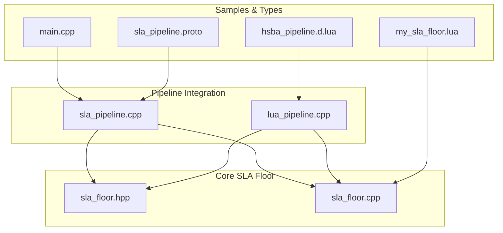
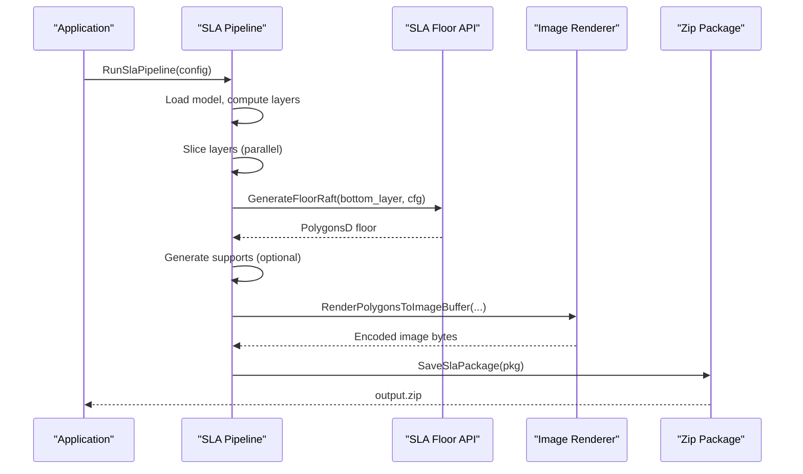
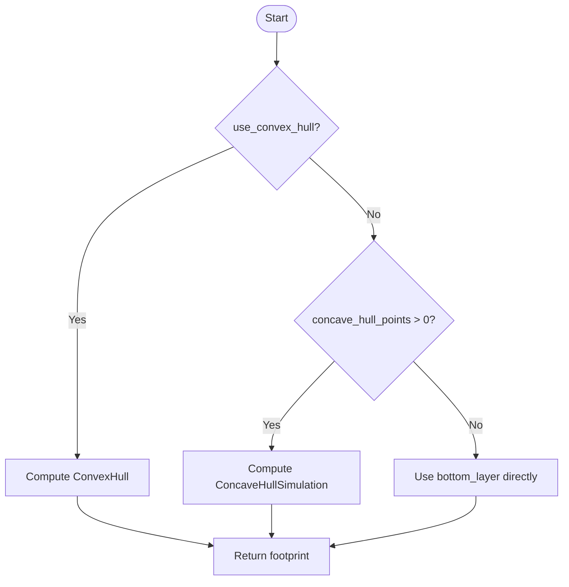
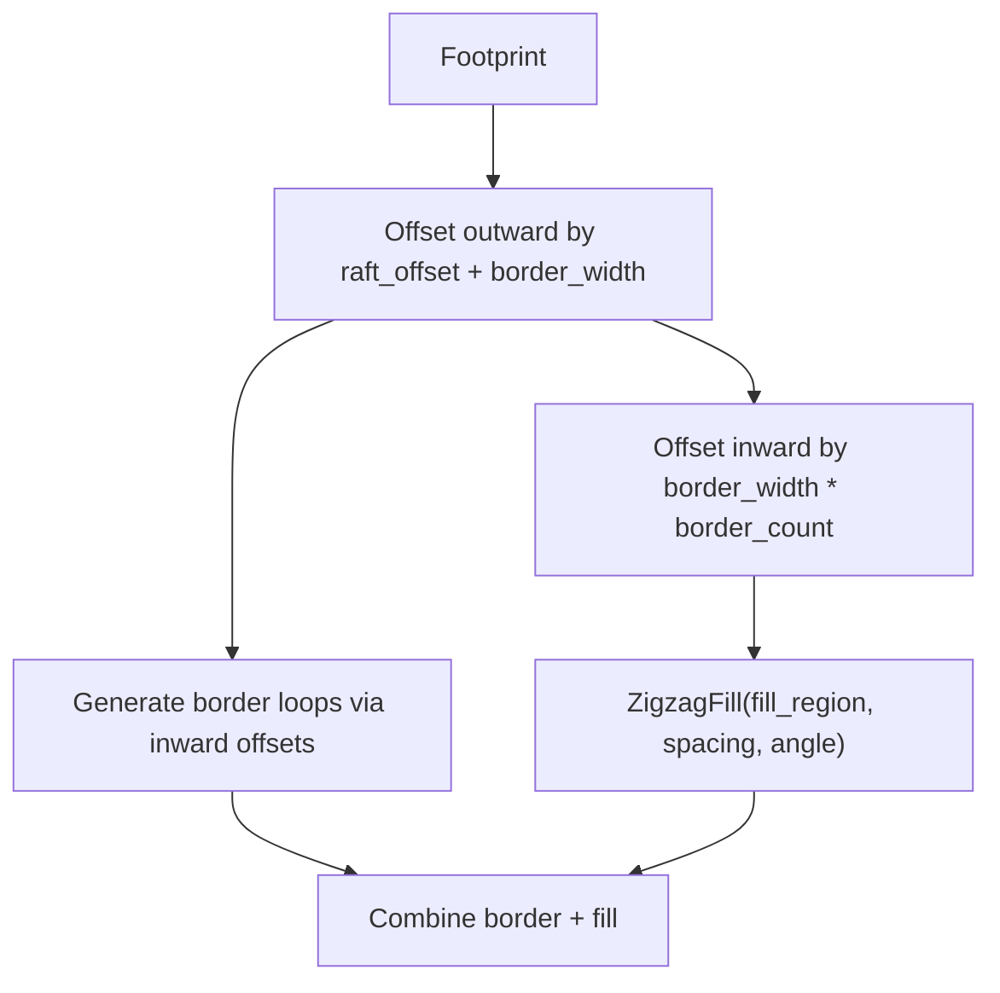
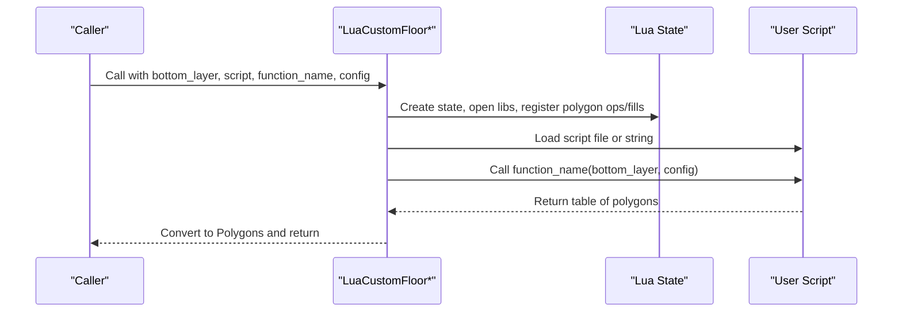
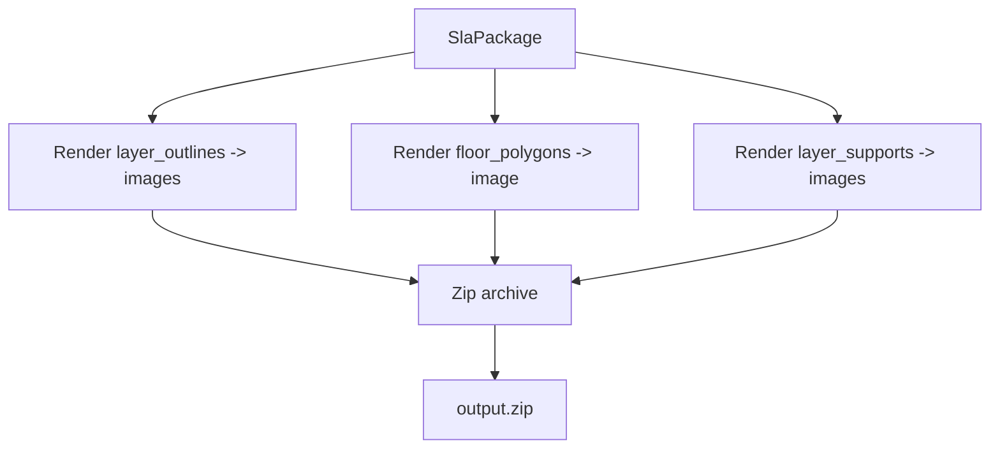
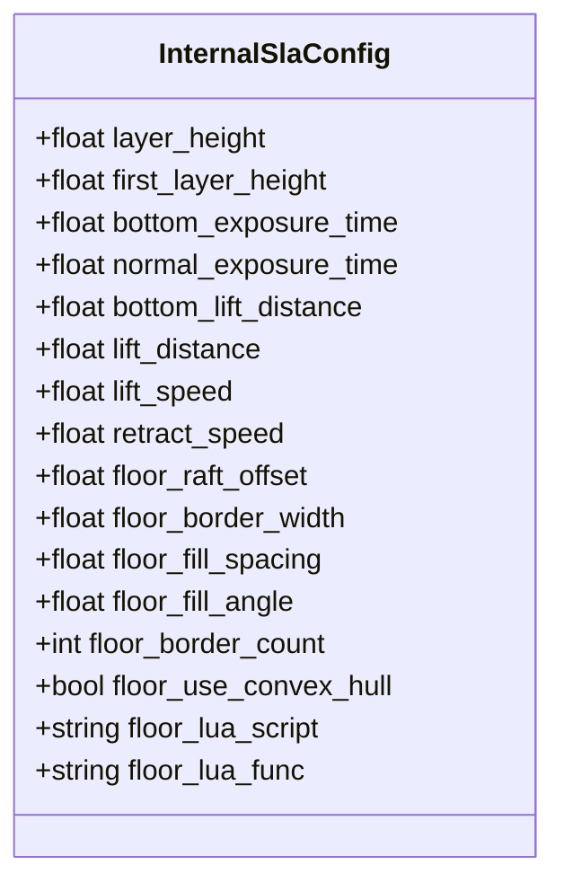
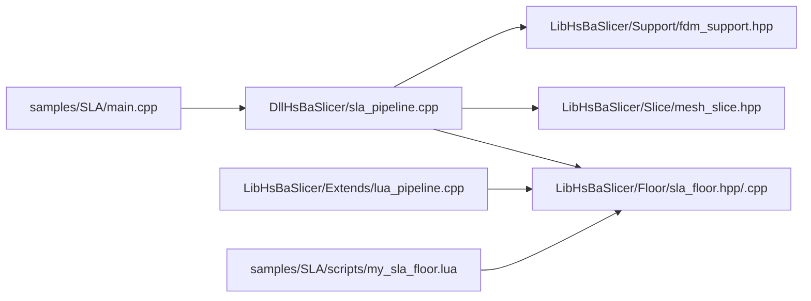

# SLA Floor Scripts

<cite>
**Referenced Files in This Document**
- [sla_floor.hpp](file://LibHsBaSlicer/Floor/sla_floor.hpp)
- [sla_floor.cpp](file://LibHsBaSlicer/Floor/sla_floor.cpp)
- [lua_pipeline.cpp](file://LibHsBaSlicer/Extends/lua_pipeline.cpp)
- [sla_pipeline.cpp](file://DllHsBaSlicer/sla_pipeline.cpp)
- [sla_pipeline.proto](file://proto/sla_pipeline.proto)
- [my_sla_floor.lua](file://samples/SLA/scripts/my_sla_floor.lua)
- [main.cpp](file://samples/SLA/main.cpp)
- [hsba_pipeline.d.lua](file://types/hsba_pipeline.d.lua)
</cite>

## Table of Contents
1. [Introduction](#introduction)
2. [Project Structure](#project-structure)
3. [Core Components](#core-components)
4. [Architecture Overview](#architecture-overview)
5. [Detailed Component Analysis](#detailed-component-analysis)
6. [Dependency Analysis](#dependency-analysis)
7. [Performance Considerations](#performance-considerations)
8. [Troubleshooting Guide](#troubleshooting-guide)
9. [Conclusion](#conclusion)
10. [Appendices](#appendices)

## Introduction
This document explains how HsBaSlicer generates SLA floor (raft) geometry and how Lua scripts can customize that process. It covers:
- The bottom layer footprint computation and raft construction pipeline.
- Surface quality optimization through border loops, fill spacing, and angle control.
- Adhesion enhancement via convex/concave hull simplification and outward offsetting.
- The specialized C++ and Lua APIs for SLA floor generation, image rendering, and package export.
- Practical examples for solid floors, textured floors, and adaptive thickness floors.
- Best practices for reliable builds and optimal surface finish.

## Project Structure
The SLA floor system spans three layers:
- Core API and implementation: `LibHsBaSlicer/Floor/sla_floor.{hpp,cpp}`
- Pipeline integration: `DllHsBaSlicer/sla_pipeline.cpp` and `LibHsBaSlicer/Extends/lua_pipeline.cpp`
- Protocol and samples: `proto/sla_pipeline.proto`, `samples/SLA/scripts/my_sla_floor.lua`, `samples/SLA/main.cpp`

**Diagram sources**
- [sla_pipeline.cpp:360-383](file://DllHsBaSlicer/sla_pipeline.cpp#L360-L383)
- [lua_pipeline.cpp:543-556](file://LibHsBaSlicer/Extends/lua_pipeline.cpp#L543-L556)
- [sla_floor.hpp:21-116](file://LibHsBaSlicer/Floor/sla_floor.hpp#L21-L116)
- [sla_floor.cpp:33-117](file://LibHsBaSlicer/Floor/sla_floor.cpp#L33-L117)
- [my_sla_floor.lua:35-62](file://samples/SLA/scripts/my_sla_floor.lua#L35-L62)
- [main.cpp:149-190](file://samples/SLA/main.cpp#L149-L190)
- [hsba_pipeline.d.lua:527-538](file://types/hsba_pipeline.d.lua#L527-L538)
- [sla_pipeline.proto:18-58](file://proto/sla_pipeline.proto#L18-L58)

**Section sources**
- [sla_floor.hpp:21-116](file://LibHsBaSlicer/Floor/sla_floor.hpp#L21-L116)
- [sla_floor.cpp:33-117](file://LibHsBaSlicer/Floor/sla_floor.cpp#L33-L117)
- [lua_pipeline.cpp:543-556](file://LibHsBaSlicer/Extends/lua_pipeline.cpp#L543-L556)
- [sla_pipeline.cpp:360-383](file://DllHsBaSlicer/sla_pipeline.cpp#L360-L383)
- [my_sla_floor.lua:35-62](file://samples/SLA/scripts/my_sla_floor.lua#L35-L62)
- [main.cpp:149-190](file://samples/SLA/main.cpp#L149-L190)
- [hsba_pipeline.d.lua:527-538](file://types/hsba_pipeline.d.lua#L527-L538)
- [sla_pipeline.proto:18-58](file://proto/sla_pipeline.proto#L18-L58)

## Core Components
- SLA floor configuration: `SlaFloorConfig` controls raft offset, border width, fill spacing, fill angle, border loop count, convex hull usage, and concave hull points.
- Geometry builders:
  - Contact area from bottom layer contours.
  - Raft with border loops and internal zigzag fill.
  - Border-only and fill-only generators.
- Lua customization:
  - File-based and inline script execution.
  - Built-in polygon operations and fill functions available to scripts.
- Image rendering and packaging:
  - Polygon-to-image conversion and in-memory buffer encoding.
  - Zip packaging with per-layer images, floor image, support images, and config JSON.

Key responsibilities:
- Bottom layer formation: footprint computation with optional hull simplification.
- Surface quality optimization: border loops and controlled zigzag fill.
- Adhesion enhancement: outward offset and hull-based footprint smoothing.

**Section sources**
- [sla_floor.hpp:21-116](file://LibHsBaSlicer/Floor/sla_floor.hpp#L21-L116)
- [sla_floor.cpp:33-117](file://LibHsBaSlicer/Floor/sla_floor.cpp#L33-L117)

## Architecture Overview
The SLA pipeline integrates floor generation into a multi-stage workflow:
1. Preprocess model and compute total layers.
2. Slice layers in parallel.
3. Generate floor/raft from the first layer’s bottom contour.
4. Generate supports (optional).
5. Export as a zip containing layer images, floor/support images, and configuration JSON.

**Diagram sources**
- [sla_pipeline.cpp:300-483](file://DllHsBaSlicer/sla_pipeline.cpp#L300-L483)
- [sla_floor.cpp:90-117](file://LibHsBaSlicer/Floor/sla_floor.cpp#L90-L117)
- [sla_floor.cpp:357-381](file://LibHsBaSlicer/Floor/sla_floor.cpp#L357-L381)
- [sla_floor.cpp:468-529](file://LibHsBaSlicer/Floor/sla_floor.cpp#L468-L529)

## Detailed Component Analysis

### SLA Floor Configuration and Footprint Computation
- `SlaFloorConfig` fields:
  - `raft_offset`: outward expansion from footprint.
  - `border_width`: width of border rings.
  - `fill_spacing`: distance between zigzag lines.
  - `fill_angle_deg`: orientation of fill pattern.
  - `border_count`: number of inward border loops.
  - `use_convex_hull`: replace footprint with convex hull.
  - `concave_hull_points`: enable concave hull simulation.
- Footprint computation:
  - If convex hull is enabled, use convex hull of bottom layer.
  - Else if concave hull points are set, simulate concave hull.
  - Otherwise, use raw bottom layer polygons.

**Diagram sources**
- [sla_floor.cpp:33-46](file://LibHsBaSlicer/Floor/sla_floor.cpp#L33-L46)

**Section sources**
- [sla_floor.hpp:21-33](file://LibHsBaSlicer/Floor/sla_floor.hpp#L21-L33)
- [sla_floor.cpp:33-46](file://LibHsBaSlicer/Floor/sla_floor.cpp#L33-L46)

### Raft Generation: Border Loops and Internal Fill
- Raft boundary:
  - Outward offset by `raft_offset + border_width`.
- Border loops:
  - Multiple inward offsets at `border_width` intervals.
- Internal fill:
  - Zigzag fill inside the innermost border loop using `fill_spacing` and `fill_angle_deg`.

**Diagram sources**
- [sla_floor.cpp:90-117](file://LibHsBaSlicer/Floor/sla_floor.cpp#L90-L117)

**Section sources**
- [sla_floor.cpp:90-117](file://LibHsBaSlicer/Floor/sla_floor.cpp#L90-L117)

### Lua Custom Floor API
- Entry points:
  - `LuaCustomFloorByFile(bottom_layer, script_path, function_name, config, lua_reg)`
  - `LuaCustomFloorByString(bottom_layer, lua_script, function_name, config, lua_reg)`
- Script contract:
  - Function receives `bottom_layer` (table of polygons with `{x,y}`) and `config` table.
  - Must return a table of polygons representing the floor result.
- Available built-ins:
  - Polygon operations: Union, Difference, Intersection, Offset, ConvexHull.
  - Polygon fills: offsetFill, lineFill, zigzagFill.

**Diagram sources**
- [sla_floor.cpp:148-228](file://LibHsBaSlicer/Floor/sla_floor.cpp#L148-L228)
- [sla_floor.cpp:230-314](file://LibHsBaSlicer/Floor/sla_floor.cpp#L230-L314)

**Section sources**
- [sla_floor.hpp:80-116](file://LibHsBaSlicer/Floor/sla_floor.hpp#L80-L116)
- [sla_floor.cpp:148-314](file://LibHsBaSlicer/Floor/sla_floor.cpp#L148-L314)

### SLA Image Rendering and Packaging
- Rendering:
  - `RenderPolygonsToImage(polys, width, height, outPath)` writes to file.
  - `RenderPolygonsToImageBuffer(polys, width, height, ext, outBuffer)` returns encoded bytes.
- Packaging:
  - `SaveSlaPackage(pkg, output_zip)` renders layer outlines, floor, and supports into a zip with `config.json`.
  - `SaveSlaPackageLua(pkg, output_zip, lua_script, lua_func)` allows custom export logic.

**Diagram sources**
- [sla_floor.cpp:357-381](file://LibHsBaSlicer/Floor/sla_floor.cpp#L357-L381)
- [sla_floor.cpp:468-529](file://LibHsBaSlicer/Floor/sla_floor.cpp#L468-L529)
- [sla_floor.cpp:531-606](file://LibHsBaSlicer/Floor/sla_floor.cpp#L531-L606)

**Section sources**
- [sla_floor.hpp:118-195](file://LibHsBaSlicer/Floor/sla_floor.hpp#L118-L195)
- [sla_floor.cpp:357-606](file://LibHsBaSlicer/Floor/sla_floor.cpp#L357-L606)

### Pipeline Integration and Exposure Parameters
- The SLA pipeline constructs an internal configuration including exposure times and lift/retract parameters.
- Exposure parameters:
  - `bottom_exposure_time`: used for the first layer.
  - `normal_exposure_time`: used for subsequent layers.
- These values are serialized into `config.json` and associated with each layer entry.

**Diagram sources**
- [sla_pipeline.cpp:49-85](file://DllHsBaSlicer/sla_pipeline.cpp#L49-L85)
- [sla_pipeline.cpp:181-242](file://DllHsBaSlicer/sla_pipeline.cpp#L181-L242)

**Section sources**
- [sla_pipeline.cpp:49-85](file://DllHsBaSlicer/sla_pipeline.cpp#L49-L85)
- [sla_pipeline.cpp:181-242](file://DllHsBaSlicer/sla_pipeline.cpp#L181-L242)

### Lua Environment for SLA Stages
- The fully Lua-driven environment exposes:
  - Model management, slicing helpers, coordinate conversions.
  - Fill and support generation.
  - SLA floor generation via `HsBa.floor(bottomPolygons, cfg)`.
  - SLA export via `HsBa.saveSlaPackage(...)`.
- Type definitions provide IDE navigation and documentation hints for stage entry functions like `generate_floor` and `export_sla`.

**Section sources**
- [lua_pipeline.cpp:543-556](file://LibHsBaSlicer/Extends/lua_pipeline.cpp#L543-L556)
- [lua_pipeline.cpp:789-863](file://LibHsBaSlicer/Extends/lua_pipeline.cpp#L789-L863)
- [hsba_pipeline.d.lua:527-538](file://types/hsba_pipeline.d.lua#L527-L538)
- [hsba_pipeline.d.lua:582-591](file://types/hsba_pipeline.d.lua#L582-L591)

## Dependency Analysis
- `sla_pipeline.cpp` depends on:
  - `LibHsBaSlicer/Floor/sla_floor.hpp` for floor generation and packaging.
  - `LibHsBaSlicer/Slice/mesh_slice.hpp` for slicing.
  - `LibHsBaSlicer/Support/fdm_support.hpp` for support generation.
- `lua_pipeline.cpp` depends on:
  - `LibHsBaSlicer/Floor/sla_floor.hpp` for exposing `HsBa.floor`.
  - Various path/export modules for G-code, spiral paths, and package exports.
- Samples:
  - `samples/SLA/main.cpp` demonstrates pipeline configuration and execution.
  - `samples/SLA/scripts/my_sla_floor.lua` implements a custom floor generator.

**Diagram sources**
- [sla_pipeline.cpp:19-26](file://DllHsBaSlicer/sla_pipeline.cpp#L19-L26)
- [lua_pipeline.cpp:17-39](file://LibHsBaSlicer/Extends/lua_pipeline.cpp#L17-L39)
- [main.cpp:16-21](file://samples/SLA/main.cpp#L16-L21)
- [my_sla_floor.lua:33-34](file://samples/SLA/scripts/my_sla_floor.lua#L33-L34)

**Section sources**
- [sla_pipeline.cpp:19-26](file://DllHsBaSlicer/sla_pipeline.cpp#L19-L26)
- [lua_pipeline.cpp:17-39](file://LibHsBaSlicer/Extends/lua_pipeline.cpp#L17-L39)
- [main.cpp:16-21](file://samples/SLA/main.cpp#L16-L21)
- [my_sla_floor.lua:33-34](file://samples/SLA/scripts/my_sla_floor.lua#L33-L34)

## Performance Considerations
- Parallel layer processing:
  - Slicing uses parallel iteration over layers.
  - Export rendering uses a thread pool with dynamic scheduling; honors `HSBA_PIPELINE_THREADS` environment variable.
- Memory efficiency:
  - In-memory image buffers avoid temporary files during packaging.
- Recommendations:
  - Tune `fill_spacing` and `border_count` to balance print time and adhesion.
  - Use convex hull for large, irregular footprints to reduce raft complexity.
  - Limit image resolution (`image_width`, `image_height`) to reduce I/O overhead.

[No sources needed since this section provides general guidance]

## Troubleshooting Guide
Common issues and resolutions:
- Lua script load errors:
  - Ensure script path exists and function name matches.
  - Validate returned polygon structure (table of polygons with `{x,y}`).
- Empty or invalid floor:
  - Verify bottom layer polygons are non-empty and closed.
  - Adjust `raft_offset` and `border_width` to ensure sufficient border region.
- Export failures:
  - Confirm image extension matches encoder capabilities.
  - Check permissions for output directory.

**Section sources**
- [sla_floor.cpp:148-228](file://LibHsBaSlicer/Floor/sla_floor.cpp#L148-L228)
- [sla_floor.cpp:230-314](file://LibHsBaSlicer/Floor/sla_floor.cpp#L230-L314)
- [sla_floor.cpp:468-529](file://LibHsBaSlicer/Floor/sla_floor.cpp#L468-L529)

## Conclusion
HsBaSlicer’s SLA floor system provides robust, configurable raft generation with strong Lua extensibility. By combining hull-based footprint simplification, border loops, and controlled zigzag fills, it achieves both strong adhesion and high surface quality. The pipeline integrates exposure parameters and packaging seamlessly, while the Lua APIs allow advanced customization for solid, textured, and adaptive floors.

[No sources needed since this section summarizes without analyzing specific files]

## Appendices

### Example: Solid Floor
- Use default raft generation with moderate `raft_offset` and `border_count`.
- Set `fill_spacing` to achieve dense but printable infill.

**Section sources**
- [sla_pipeline.cpp:360-383](file://DllHsBaSlicer/sla_pipeline.cpp#L360-L383)

### Example: Textured Floor
- Implement a custom Lua floor script that applies patterns using `PolygonFill.zigzagFill` and `PolygonOperations.offsetOperation`.
- Reference sample script for structure and conventions.

**Section sources**
- [my_sla_floor.lua:35-62](file://samples/SLA/scripts/my_sla_floor.lua#L35-L62)

### Example: Adaptive Thickness Floor
- Vary `raft_offset` or `border_width` based on local footprint density.
- Use concave hull simulation to better match complex geometries.

**Section sources**
- [sla_floor.hpp:21-33](file://LibHsBaSlicer/Floor/sla_floor.hpp#L21-L33)
- [sla_floor.cpp:33-46](file://LibHsBaSlicer/Floor/sla_floor.cpp#L33-L46)

### API Reference Summary
- C++ API:
  - `GenerateFloorContact`, `GenerateFloorBorder`, `GenerateFloorFill`, `GenerateFloorRaft`.
  - `LuaCustomFloorByFile`, `LuaCustomFloorByString`.
  - `RenderPolygonsToImage`, `RenderPolygonsToImageBuffer`.
  - `SaveSlaPackage`, `SaveSlaPackageLua`.
- Lua API:
  - `HsBa.floor(bottomPolygons, cfg)`
  - `HsBa.saveSlaPackage({...})`
  - Stage entry functions: `generate_floor`, `export_sla`.

**Section sources**
- [sla_floor.hpp:35-195](file://LibHsBaSlicer/Floor/sla_floor.hpp#L35-L195)
- [lua_pipeline.cpp:543-556](file://LibHsBaSlicer/Extends/lua_pipeline.cpp#L543-L556)
- [lua_pipeline.cpp:789-863](file://LibHsBaSlicer/Extends/lua_pipeline.cpp#L789-L863)
- [hsba_pipeline.d.lua:527-538](file://types/hsba_pipeline.d.lua#L527-L538)
- [hsba_pipeline.d.lua:582-591](file://types/hsba_pipeline.d.lua#L582-L591)