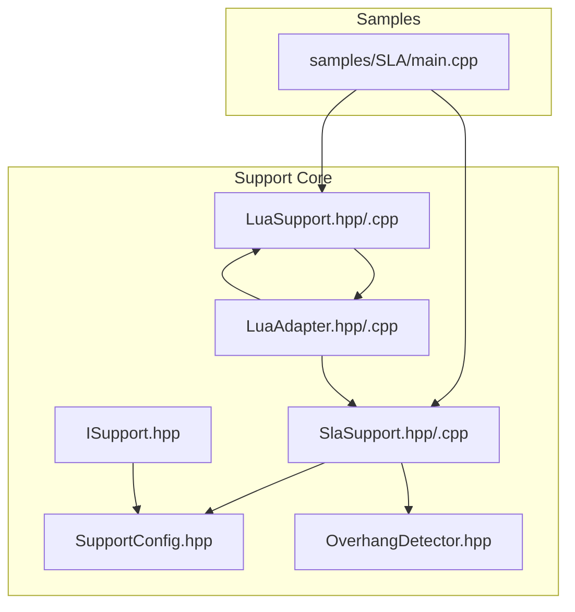
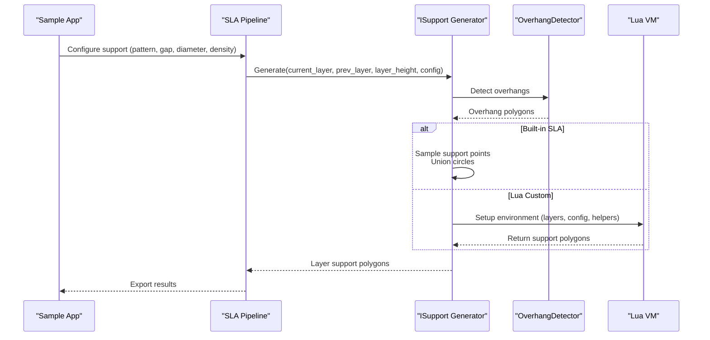
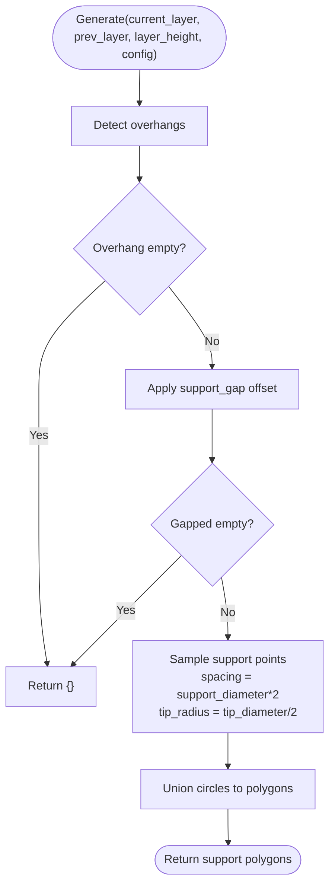
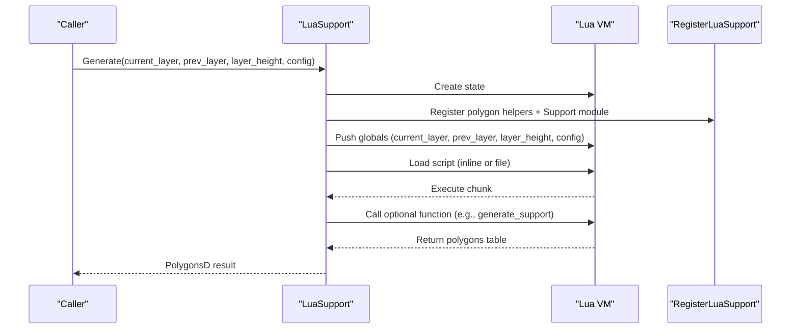
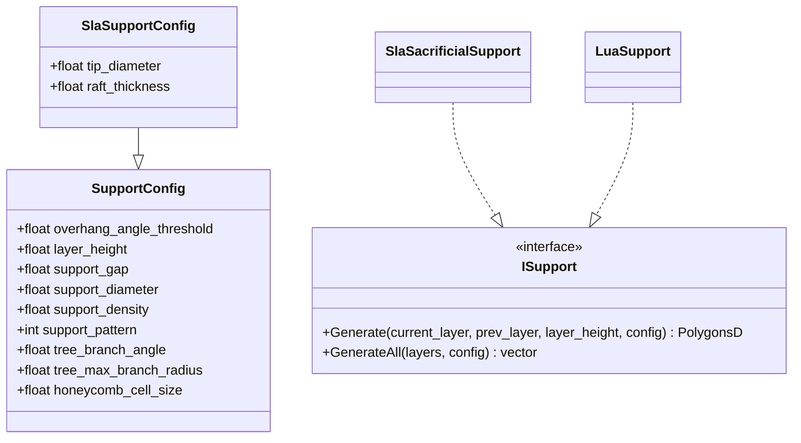
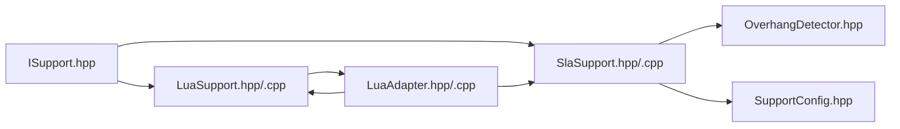

# SLA Support Scripts

<cite>
**Referenced Files in This Document**
- [SlaSupport.hpp](file://support/SlaSupport.hpp)
- [SlaSupport.cpp](file://support/SlaSupport.cpp)
- [LuaSupport.hpp](file://support/LuaSupport.hpp)
- [LuaSupport.cpp](file://support/LuaSupport.cpp)
- [LuaAdapter.hpp](file://support/LuaAdapter.hpp)
- [LuaAdapter.cpp](file://support/LuaAdapter.cpp)
- [ISupport.hpp](file://support/ISupport.hpp)
- [OverhangDetector.hpp](file://support/OverhangDetector.hpp)
- [SupportConfig.hpp](file://support/SupportConfig.hpp)
- [main.cpp](file://samples/SLA/main.cpp)
</cite>

## Table of Contents
1. [Introduction](#introduction)
2. [Project Structure](#project-structure)
3. [Core Components](#core-components)
4. [Architecture Overview](#architecture-overview)
5. [Detailed Component Analysis](#detailed-component-analysis)
6. [Dependency Analysis](#dependency-analysis)
7. [Performance Considerations](#performance-considerations)
8. [Troubleshooting Guide](#troubleshooting-guide)
9. [Conclusion](#conclusion)
10. [Appendices](#appendices)

## Introduction
This document explains the SLA support structure Lua scripts and the underlying C++ support generation system. It focuses on SLA-specific requirements: minimal contact points, easy removal strategies, and resin waste reduction. It documents the SLA support APIs for thin supports, point contacts, and optimized densities, and provides guidance for implementing lightweight patterns, removable designs, and automated removal aids while minimizing post-processing effort.

## Project Structure
The SLA support system is implemented under the support module and exposed to Lua through a dedicated adapter. The SLA pipeline sample demonstrates how to configure and run support generation with both built-in and Lua-based strategies.

**Diagram sources**
- [SlaSupport.hpp:1-46](file://support/SlaSupport.hpp#L1-L46)
- [SlaSupport.cpp:1-135](file://support/SlaSupport.cpp#L1-L135)
- [LuaSupport.hpp:1-85](file://support/LuaSupport.hpp#L1-L85)
- [LuaSupport.cpp:1-180](file://support/LuaSupport.cpp#L1-L180)
- [LuaAdapter.hpp:1-34](file://support/LuaAdapter.hpp#L1-L34)
- [LuaAdapter.cpp:1-278](file://support/LuaAdapter.cpp#L1-L278)
- [ISupport.hpp:1-49](file://support/ISupport.hpp#L1-L49)
- [OverhangDetector.hpp:1-54](file://support/OverhangDetector.hpp#L1-L54)
- [SupportConfig.hpp:1-47](file://support/SupportConfig.hpp#L1-L47)
- [main.cpp:1-259](file://samples/SLA/main.cpp#L1-L259)

**Section sources**
- [SlaSupport.hpp:1-46](file://support/SlaSupport.hpp#L1-L46)
- [LuaSupport.hpp:1-85](file://support/LuaSupport.hpp#L1-L85)
- [LuaAdapter.hpp:1-34](file://support/LuaAdapter.hpp#L1-L34)
- [ISupport.hpp:1-49](file://support/ISupport.hpp#L1-L49)
- [OverhangDetector.hpp:1-54](file://support/OverhangDetector.hpp#L1-L54)
- [SupportConfig.hpp:1-47](file://support/SupportConfig.hpp#L1-L47)
- [main.cpp:1-259](file://samples/SLA/main.cpp#L1-L259)

## Core Components
- SLA sacrificial support generator: produces thin column supports with small tips for easy removal and larger bases for adhesion. It samples support points from overhang regions and unions them into per-layer polygons.
- Lua-based custom support generator: allows users to replace or extend built-in algorithms via Lua scripts. It exposes layer data, configuration, helper functions, and a Support module for programmatic geometry operations.
- Support interface and configuration: defines a common interface for all support generators and shared configuration fields, including SLA-specific parameters such as tip diameter and raft thickness.
- Overhang detection: identifies unsupported areas between adjacent layers based on an angle threshold.

Key responsibilities:
- Generate minimal, easily removable support structures for SLA printing.
- Provide APIs for thin supports, point contacts, and density optimization.
- Enable scripting for advanced or custom support patterns.

**Section sources**
- [SlaSupport.hpp:13-42](file://support/SlaSupport.hpp#L13-L42)
- [SlaSupport.cpp:38-123](file://support/SlaSupport.cpp#L38-L123)
- [LuaSupport.hpp:21-64](file://support/LuaSupport.hpp#L21-L64)
- [LuaSupport.cpp:19-90](file://support/LuaSupport.cpp#L19-L90)
- [ISupport.hpp:16-44](file://support/ISupport.hpp#L16-L44)
- [SupportConfig.hpp:11-43](file://support/SupportConfig.hpp#L11-L43)
- [OverhangDetector.hpp:14-49](file://support/OverhangDetector.hpp#L14-L49)

## Architecture Overview
The SLA support pipeline integrates built-in and scriptable support generators behind a unified interface. The SLA sample configures support parameters and can invoke either the built-in SLA sacrificial strategy or a Lua-defined strategy.

**Diagram sources**
- [main.cpp:118-124](file://samples/SLA/main.cpp#L118-L124)
- [SlaSupport.cpp:81-123](file://support/SlaSupport.cpp#L81-L123)
- [LuaSupport.cpp:113-177](file://support/LuaSupport.cpp#L113-L177)
- [OverhangDetector.hpp:31-41](file://support/OverhangDetector.hpp#L31-L41)

## Detailed Component Analysis

### SLA Sacrificial Support Generator
The SLA sacrificial support generator creates thin, low-contact supports suitable for resin printing. It detects overhangs, applies a gap to avoid model contact, samples circular support points at a controlled spacing, and unions them into final cross-sections.

- Thin supports: Uses a small tip radius derived from configuration to minimize contact area.
- Easy removal: Small tips reduce adhesion strength at the model surface.
- Resin waste reduction: Sparse point sampling and unioning limit material usage.
- Gap control: Offsets overhang contours inward by a configured gap to ensure clearance.

**Diagram sources**
- [SlaSupport.cpp:81-123](file://support/SlaSupport.cpp#L81-L123)

**Section sources**
- [SlaSupport.hpp:13-42](file://support/SlaSupport.hpp#L13-L42)
- [SlaSupport.cpp:38-123](file://support/SlaSupport.cpp#L38-L123)
- [SupportConfig.hpp:36-43](file://support/SupportConfig.hpp#L36-L43)

### Lua-Based Custom Support Generator
The Lua support generator enables full customization of support generation. It sets up a Lua environment with current and previous layer polygons, layer height, and a configuration table. It also registers polygon helpers and a Support module exposing factory functions and utilities.

- Script sources: Supports inline scripts or external files.
- Function contract: The script may return polygons directly or define a function (default name provided) that returns polygons.
- Environment: Provides current_layer, prev_layer, layer_height, and config tables; helper functions are available for polygon manipulation.
- Error handling: Throws runtime errors on load or execution failures.

**Diagram sources**
- [LuaSupport.cpp:113-177](file://support/LuaSupport.cpp#L113-L177)
- [LuaAdapter.cpp:265-276](file://support/LuaAdapter.cpp#L265-L276)

**Section sources**
- [LuaSupport.hpp:21-64](file://support/LuaSupport.hpp#L21-L64)
- [LuaSupport.cpp:19-90](file://support/LuaSupport.cpp#L19-L90)
- [LuaSupport.cpp:113-177](file://support/LuaSupport.cpp#L113-L177)
- [LuaAdapter.hpp:13-30](file://support/LuaAdapter.hpp#L13-L30)

### Support Interface and Configuration
All support generators implement a common interface, enabling interchangeable use of built-in and Lua-based strategies. Configuration includes general fields and SLA-specific extensions.

- Interface: Defines per-layer generation and a default batch generator.
- General config: Includes overhang angle threshold, layer height, gap, diameter, density, pattern, tree/honeycomb parameters.
- SLA config: Adds tip diameter and raft thickness for thin, removable supports.

**Diagram sources**
- [ISupport.hpp:16-44](file://support/ISupport.hpp#L16-L44)
- [SupportConfig.hpp:11-43](file://support/SupportConfig.hpp#L11-L43)
- [SlaSupport.hpp:20-42](file://support/SlaSupport.hpp#L20-L42)
- [LuaSupport.hpp:40-64](file://support/LuaSupport.hpp#L40-L64)

**Section sources**
- [ISupport.hpp:16-44](file://support/ISupport.hpp#L16-L44)
- [SupportConfig.hpp:11-43](file://support/SupportConfig.hpp#L11-L43)

### Overhang Detection
Overhang detection determines where supports are needed by comparing adjacent layers and filtering by an angle threshold.

- Inputs: Current and previous layer polygons, layer height, and angle threshold.
- Output: Polygon regions requiring support.
- Usage: Consumed by SLA sacrificial support to locate overhangs before sampling support points.

**Section sources**
- [OverhangDetector.hpp:14-49](file://support/OverhangDetector.hpp#L14-L49)

## Dependency Analysis
The SLA support system has clear separation between algorithmic components and scripting interfaces.

**Diagram sources**
- [ISupport.hpp:1-49](file://support/ISupport.hpp#L1-L49)
- [SlaSupport.hpp:1-46](file://support/SlaSupport.hpp#L1-L46)
- [LuaSupport.hpp:1-85](file://support/LuaSupport.hpp#L1-L85)
- [LuaAdapter.hpp:1-34](file://support/LuaAdapter.hpp#L1-L34)
- [OverhangDetector.hpp:1-54](file://support/OverhangDetector.hpp#L1-L54)
- [SupportConfig.hpp:1-47](file://support/SupportConfig.hpp#L1-L47)

**Section sources**
- [SlaSupport.cpp:1-135](file://support/SlaSupport.cpp#L1-L135)
- [LuaSupport.cpp:1-180](file://support/LuaSupport.cpp#L1-L180)
- [LuaAdapter.cpp:1-278](file://support/LuaAdapter.cpp#L1-L278)

## Performance Considerations
- Minimal contact points: Use small tip diameters and sparse spacing to reduce resin consumption and improve removability.
- Efficient geometry operations: Prefer unioning small circles rather than dense infill patterns to keep polygon counts low.
- Gap tuning: A moderate gap reduces unnecessary support volume while maintaining print reliability.
- Density optimization: Lower support density reduces material usage; combine with strategic placement to maintain structural integrity.
- Batch processing: Use the batch generator to process all layers efficiently without repeated setup overhead.

[No sources needed since this section provides general guidance]

## Troubleshooting Guide
Common issues and resolutions when using SLA support scripts:

- Lua load or runtime errors:
  - Cause: Syntax errors, missing functions, or invalid return types in the script.
  - Resolution: Validate script syntax, ensure the expected function exists, and confirm it returns a table of polygons.
- No supports generated:
  - Cause: Overhang detection returned no regions due to angle threshold or gap settings.
  - Resolution: Adjust overhang angle threshold and support gap; verify layer height consistency.
- Excessive resin usage:
  - Cause: Large tip diameter or dense spacing.
  - Resolution: Reduce tip diameter and increase spacing; lower support density.
- Difficult removal:
  - Cause: Tips too large or insufficient gap.
  - Resolution: Decrease tip diameter and increase gap slightly to weaken adhesion at the model surface.

**Section sources**
- [LuaSupport.cpp:141-177](file://support/LuaSupport.cpp#L141-L177)
- [SlaSupport.cpp:81-123](file://support/SlaSupport.cpp#L81-L123)

## Conclusion
The SLA support system emphasizes minimal contact points, easy removal, and reduced resin waste. The built-in SLA sacrificial generator offers a robust baseline, while the Lua-based generator enables advanced customization. By tuning tip diameter, spacing, gap, and density—and leveraging overhang detection—you can achieve reliable prints with minimal post-processing effort.

[No sources needed since this section summarizes without analyzing specific files]

## Appendices

### SLA-Specific Support API Reference
- Factory functions exposed to Lua:
  - new_plane, new_tree, new_honeycomb, new_sla, new_lua, new_lua_file
- Utilities:
  - generate(support_obj, current_layer, prev_layer, layer_height, config_table) -> polygons table
  - detect_overhang(current_layer, prev_layer, layer_height, angle_deg) -> polygons table
  - default_config() -> config table

Configuration fields available to scripts:
- overhang_angle_threshold, layer_height, support_gap, support_diameter, support_density, support_pattern, tree_branch_angle, tree_max_branch_radius, honeycomb_cell_size

**Section sources**
- [LuaAdapter.hpp:13-30](file://support/LuaAdapter.hpp#L13-L30)
- [LuaAdapter.cpp:43-108](file://support/LuaAdapter.cpp#L43-L108)
- [LuaAdapter.cpp:215-241](file://support/LuaAdapter.cpp#L215-L241)

### Example: Configuring SLA Support in the Sample
The sample demonstrates setting support parameters and invoking the SLA pipeline with built-in sacrificial supports and Lua customization hooks.

- Built-in sacrificial support pattern:
  - enable_support set
  - overhang_angle, support_gap, support_diameter, support_density configured
  - support_pattern set to sacrificial
- Lua customization:
  - support_lua_script and support_lua_func configured to override support generation

**Section sources**
- [main.cpp:118-124](file://samples/SLA/main.cpp#L118-L124)
- [main.cpp:162-168](file://samples/SLA/main.cpp#L162-L168)