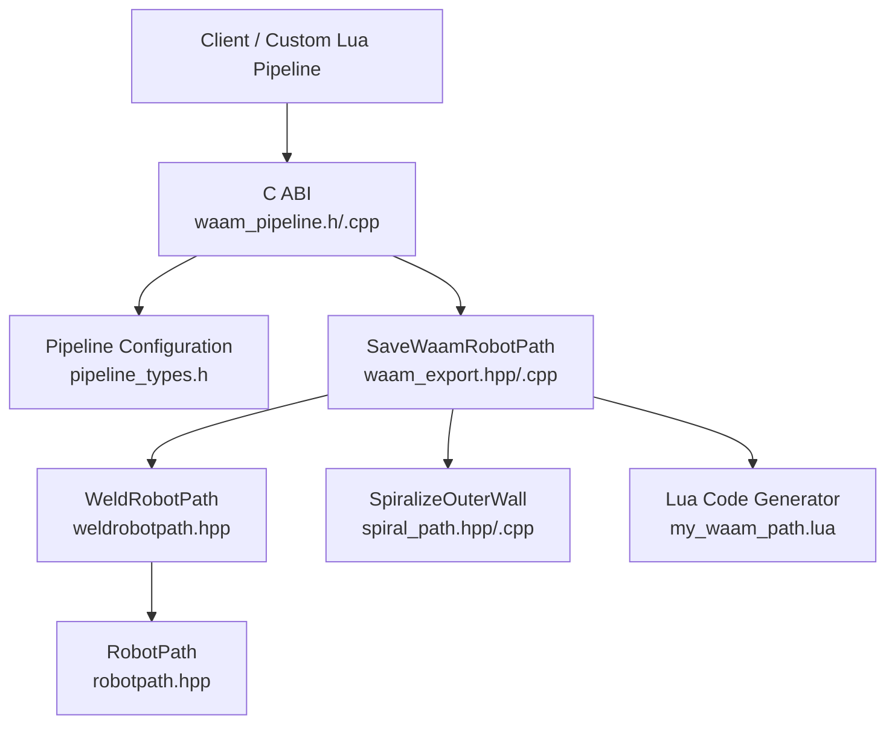
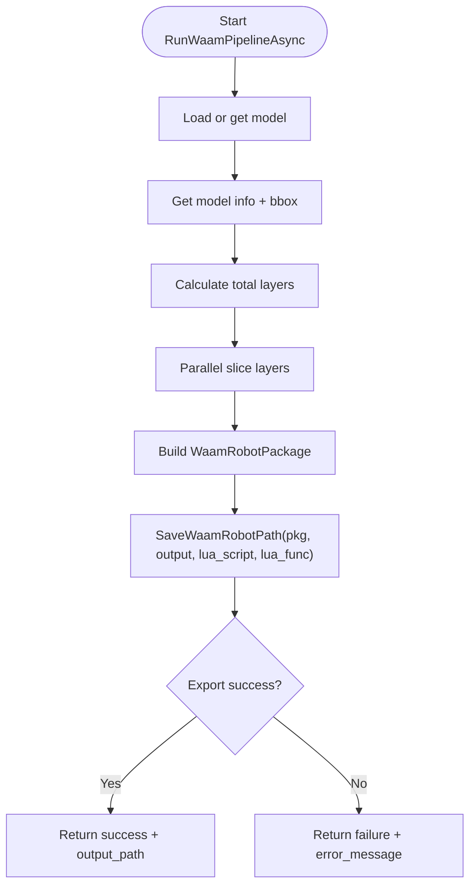
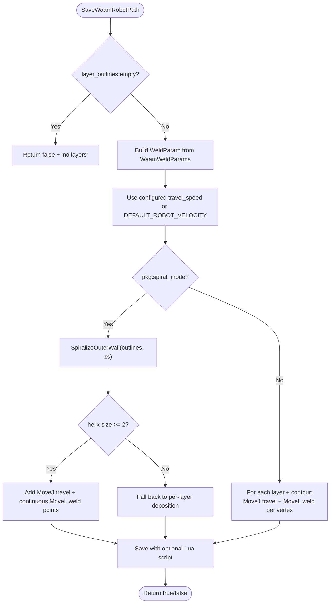
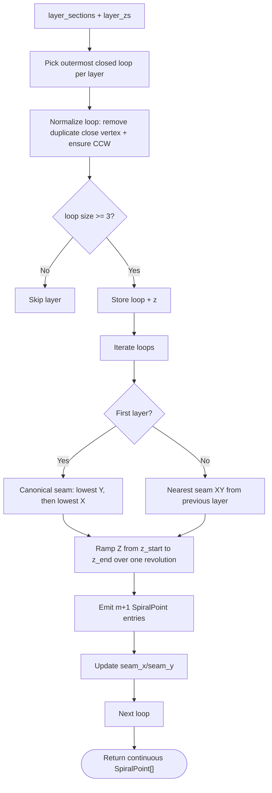
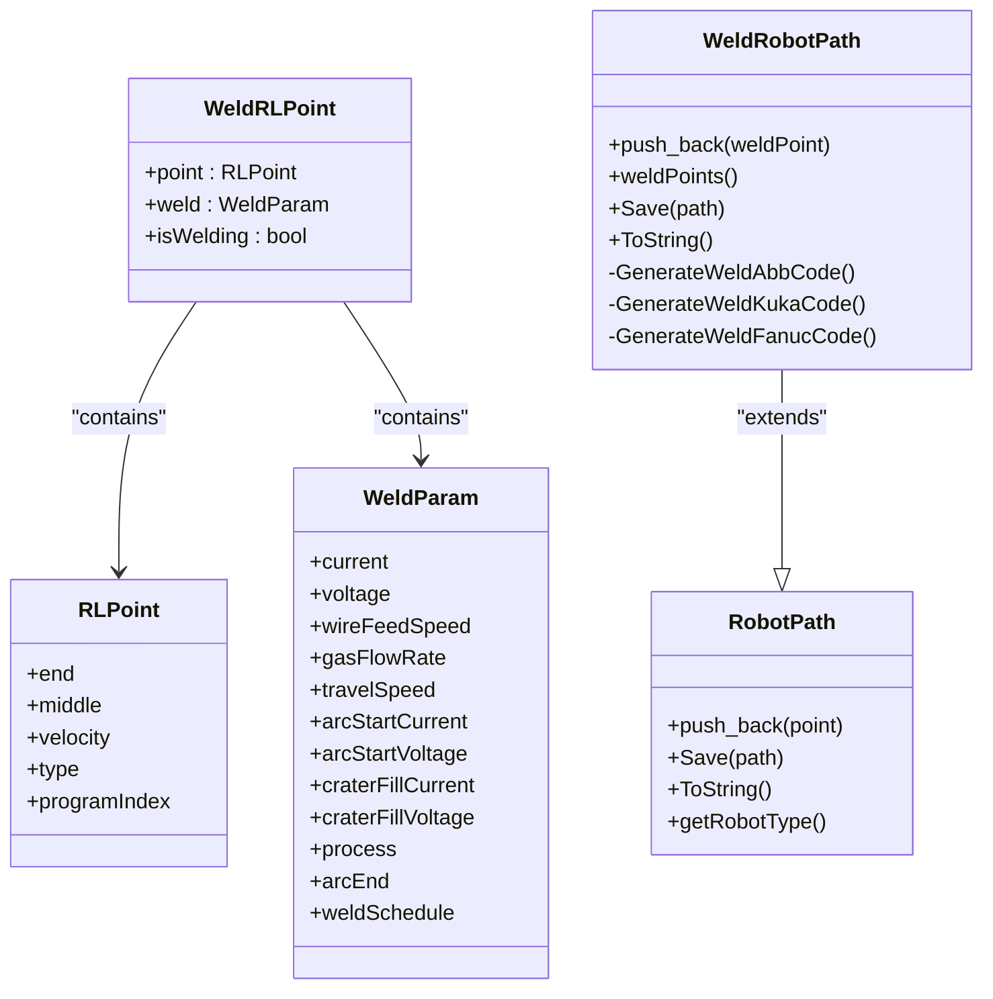
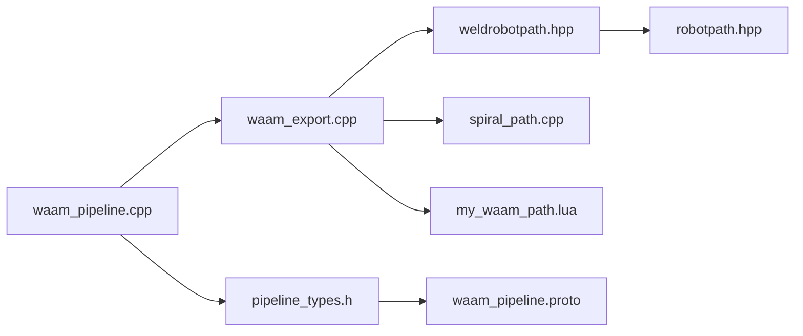

# WAAM Path Scripts

<cite>
**Referenced Files in This Document**   
- [waam_pipeline.h](file://DllHsBaSlicer/waam_pipeline.h)
- [waam_pipeline.cpp](file://DllHsBaSlicer/waam_pipeline.cpp)
- [pipeline_types.h](file://pipelinetypes/pipeline_types.h)
- [waam_export.hpp](file://LibHsBaSlicer/Path/waam_export.hpp)
- [waam_export.cpp](file://LibHsBaSlicer/Path/waam_export.cpp)
- [spiral_path.hpp](file://LibHsBaSlicer/Path/spiral_path.hpp)
- [spiral_path.cpp](file://LibHsBaSlicer/Path/spiral_path.cpp)
- [weldrobotpath.hpp](file://paths/weldrobotpath.hpp)
- [robotpath.hpp](file://paths/robotpath.hpp)
- [hsba_pipeline.d.lua](file://types/hsba_pipeline.d.lua)
- [my_waam_path.lua](file://samples/WAAM/scripts/my_waam_path.lua)
- [my_waam_pipeline.lua](file://samples/Custom/scripts/my_waam_pipeline.lua)
- [waam_pipeline.proto](file://proto/waam_pipeline.proto)
</cite>

## Table of Contents
1. [Introduction](#introduction)
2. [Project Structure](#project-structure)
3. [Core Components](#core-components)
4. [Architecture Overview](#architecture-overview)
5. [Detailed Component Analysis](#detailed-component-analysis)
6. [Dependency Analysis](#dependency-analysis)
7. [Performance Considerations](#performance-considerations)
8. [Troubleshooting Guide](#troubleshooting-guide)
9. [Conclusion](#conclusion)
10. [Appendices](#appendices)

## Introduction
This document explains the Wire Arc Additive Manufacturing path generation system in HsBaSlicer, focusing on how WAAM-specific path planning is implemented through C++ pipelines and Lua scripts. It covers:

- WAAM path planning requirements: per-layer deposition contours, wire feed control, arc stability, multi-pass strategies, and thermal considerations.
- Specialized APIs for robot path generation, welding parameter integration, and optional spiral/vase-mode outer-wall deposition.
- Examples of implementing different path patterns using built-in export and custom Lua code generators.
- Guidance for optimizing deposition efficiency, minimizing distortion, and ensuring weld quality.

WAAM differs from bed-based processes because its output is a robot language program (ABB, KUKA, or FANUC), not a layer zip archive. The pipeline slices the model into bead layers, builds a `WeldRobotPath`, and optionally runs a Lua script to generate brand-specific robot code.

## Project Structure
The WAAM path generation stack spans three main areas:

- C ABI pipeline entry points and configuration.
- Core path export logic and data structures.
- Robot path classes and optional Lua post-processing.



**Diagram sources**
- [waam_pipeline.h:17-57](file://DllHsBaSlicer/waam_pipeline.h#L17-L57)
- [waam_pipeline.cpp:174-284](file://DllHsBaSlicer/waam_pipeline.cpp#L174-L284)
- [waam_export.hpp:17-72](file://LibHsBaSlicer/Path/waam_export.hpp#L17-L72)
- [waam_export.cpp:61-189](file://LibHsBaSlicer/Path/waam_export.cpp#L61-L189)
- [spiral_path.hpp:16-58](file://LibHsBaSlicer/Path/spiral_path.hpp#L16-L58)
- [weldrobotpath.hpp:16-96](file://paths/weldrobotpath.hpp#L16-L96)
- [robotpath.hpp:15-104](file://paths/robotpath.hpp#L15-L104)
- [my_waam_path.lua:17-45](file://samples/WAAM/scripts/my_waam_path.lua#L17-L45)

**Section sources**
- [waam_pipeline.h:17-57](file://DllHsBaSlicer/waam_pipeline.h#L17-L57)
- [waam_pipeline.cpp:174-284](file://DllHsBaSlicer/waam_pipeline.cpp#L174-L284)
- [waam_export.hpp:17-72](file://LibHsBaSlicer/Path/waam_export.hpp#L17-L72)
- [waam_export.cpp:61-189](file://LibHsBaSlicer/Path/waam_export.cpp#L61-L189)
- [spiral_path.hpp:16-58](file://LibHsBaSlicer/Path/spiral_path.hpp#L16-L58)
- [weldrobotpath.hpp:16-96](file://paths/weldrobotpath.hpp#L16-L96)
- [robotpath.hpp:15-104](file://paths/robotpath.hpp#L15-L104)
- [my_waam_path.lua:17-45](file://samples/WAAM/scripts/my_waam_path.lua#L17-L45)

## Core Components
The WAAM path system is composed of:

- **WAAM Pipeline C ABI**: Entry points for synchronous and asynchronous execution, progress reporting, and result handling.
- **WAAM Export API**: Builds a `WeldRobotPath` from per-layer contours and welding parameters; supports spiral mode and Lua code generation.
- **Welding Data Model**: Defines welding process types, arc end behavior, and per-point welding parameters.
- **Robot Path Abstraction**: Provides base robot motion types and brand-specific code generation.
- **Spiral Outer Wall Generator**: Produces a continuous helical path for vase-like walls.
- **Lua Scripting System**: Allows custom robot code generation and integrates with the pipeline via typed definitions.

Key responsibilities:

| Component | Responsibility |
|---|---|
| `waam_pipeline.h` / `waam_pipeline.cpp` | Expose C ABI for WAAM slicing and robot path export; manage progress and results. |
| `waam_export.hpp` / `waam_export.cpp` | Convert package data into a `WeldRobotPath`; handle spiral mode and Lua post-processing. |
| `weldrobotpath.hpp` | Define welding parameters, arc end behavior, and weld-aware robot points. |
| `robotpath.hpp` | Define robot motion types, brands, and base path generation. |
| `spiral_path.hpp` / `spiral_path.cpp` | Generate continuous Z-rising outer-wall paths from closed per-layer contours. |
| `hsba_pipeline.d.lua` | Provide IDE type hints for Lua pipeline functions and WAAM export inputs. |
| `my_waam_path.lua` | Example custom robot code generator returning a complete robot program string. |

**Section sources**
- [waam_pipeline.h:17-57](file://DllHsBaSlicer/waam_pipeline.h#L17-L57)
- [waam_pipeline.cpp:174-284](file://DllHsBaSlicer/waam_pipeline.cpp#L174-L284)
- [waam_export.hpp:17-72](file://LibHsBaSlicer/Path/waam_export.hpp#L17-L72)
- [waam_export.cpp:61-189](file://LibHsBaSlicer/Path/waam_export.cpp#L61-L189)
- [weldrobotpath.hpp:16-96](file://paths/weldrobotpath.hpp#L16-L96)
- [robotpath.hpp:15-104](file://paths/robotpath.hpp#L15-L104)
- [spiral_path.hpp:16-58](file://LibHsBaSlicer/Path/spiral_path.hpp#L16-L58)
- [spiral_path.cpp:88-163](file://LibHsBaSlicer/Path/spiral_path.cpp#L88-L163)
- [hsba_pipeline.d.lua:261-278](file://types/hsba_pipeline.d.lua#L261-L278)
- [my_waam_path.lua:17-45](file://samples/WAAM/scripts/my_waam_path.lua#L17-L45)

## Architecture Overview
The WAAM pipeline follows a clear flow: preprocess → slice → build robot path → export.

```mermaid
sequenceDiagram
participant Client as "Client"
participant CABI as "WAAM C ABI"
participant Slice as "Slice Layer"
participant Export as "SaveWaamRobotPath"
participant Spiral as "SpiralizeOuterWall"
participant WeldPath as "WeldRobotPath"
participant Lua as "Lua Code Generator"
Client->>CABI : "Run WAAM pipeline"
CABI->>Slice : "Build topology + parallel slice layers"
Slice-->>CABI : "Per-layer outlines + Z heights"
CABI->>Export : "Build WaamRobotPackage"
alt Spiral mode enabled
Export->>Spiral : "SpiralizeOuterWall(outlines, zs)"
Spiral-->>Export : "Continuous 3D polyline"
Export->>WeldPath : "Add travel + continuous weld points"
else Standard per-layer mode
Export->>WeldPath : "Add MoveJ travel + MoveL weld points per contour"
end
opt Custom Lua script provided
Export->>Lua : "export_waam() returns robot program text"
Lua-->>Export : "String"
else Built-in brand generator
Export->>WeldPath : "Generate ABB/KUKA/FANUC code"
end
Export-->>CABI : "Success/failure"
CABI-->>Client : "Result with output_path"
```

**Diagram sources**
- [waam_pipeline.cpp:174-284](file://DllHsBaSlicer/waam_pipeline.cpp#L174-L284)
- [waam_export.cpp:61-189](file://LibHsBaSlicer/Path/waam_export.cpp#L61-L189)
- [spiral_path.cpp:88-163](file://LibHsBaSlicer/Path/spiral_path.cpp#L88-L163)
- [weldrobotpath.hpp:65-96](file://paths/weldrobotpath.hpp#L65-L96)
- [robotpath.hpp:61-104](file://paths/robotpath.hpp#L61-L104)
- [my_waam_path.lua:17-45](file://samples/WAAM/scripts/my_waam_path.lua#L17-L45)

## Detailed Component Analysis

### WAAM Pipeline C ABI
The C ABI exposes default configuration creation, synchronous execution, asynchronous execution, and result freeing. Internally, it:

- Loads or fetches the model.
- Computes total layers from bounding box and layer heights.
- Slices layers in parallel.
- Builds a `WaamRobotPackage`.
- Calls `SaveWaamRobotPath`.
- Reports progress at key stages.



**Diagram sources**
- [waam_pipeline.cpp:174-284](file://DllHsBaSlicer/waam_pipeline.cpp#L174-L284)

**Section sources**
- [waam_pipeline.h:17-57](file://DllHsBaSlicer/waam_pipeline.h#L17-L57)
- [waam_pipeline.cpp:174-284](file://DllHsBaSlicer/waam_pipeline.cpp#L174-L284)
- [pipeline_types.h:592-617](file://pipelinetypes/pipeline_types.h#L592-L617)

### WAAM Export API
`SaveWaamRobotPath` converts a `WaamRobotPackage` into a robot program. It:

- Validates that at least one layer exists.
- Builds a base `WeldParam` from `WaamWeldParams`.
- Chooses travel velocity from configured travel speed or a default.
- Supports two modes:
  - Spiral/vase mode: merges outer contours into a single rising weld bead.
  - Standard mode: deposits along each contour vertex.
- Optionally runs a Lua script to generate brand-specific robot code.



**Diagram sources**
- [waam_export.cpp:61-189](file://LibHsBaSlicer/Path/waam_export.cpp#L61-L189)

**Section sources**
- [waam_export.hpp:17-72](file://LibHsBaSlicer/Path/waam_export.hpp#L17-L72)
- [waam_export.cpp:61-189](file://LibHsBaSlicer/Path/waam_export.cpp#L61-L189)

### Spiral Outer Wall Generator
The spiralizer selects the outermost closed contour per layer, normalizes orientation, aligns seams across layers, and emits a continuous 3D polyline where Z ramps between layers.

Key behaviors:

- Uses signed area to determine polygon orientation.
- Removes duplicate closing vertices.
- Picks the largest absolute signed-area polygon per layer.
- Aligns seam XY position across layers to keep a fixed seam line.
- Emits m+1 points per loop so the final point closes onto the next layer’s seam at the correct Z.



**Diagram sources**
- [spiral_path.cpp:18-85](file://LibHsBaSlicer/Path/spiral_path.cpp#L18-L85)
- [spiral_path.cpp:88-163](file://LibHsBaSlicer/Path/spiral_path.cpp#L88-L163)

**Section sources**
- [spiral_path.hpp:16-58](file://LibHsBaSlicer/Path/spiral_path.hpp#L16-L58)
- [spiral_path.cpp:88-163](file://LibHsBaSlicer/Path/spiral_path.cpp#L88-L163)

### Welding Robot Path Classes
The welding path system extends the base robot path abstraction with welding semantics.

Important concepts:

- `WeldProcessType`: MIG/MAG, TIG, Plasma, Laser.
- `ArcEndType`: Normal, CraterFill, SlowRetract.
- `WeldParam`: current, voltage, wire feed speed, gas flow rate, travel speed, start/crater parameters, process, arc end, schedule.
- `WeldRLPoint`: base `RLPoint` plus welding parameters and an `isWelding` flag.
- `WeldRobotPath`: accumulates weld points and generates brand-specific code.



**Diagram sources**
- [robotpath.hpp:44-104](file://paths/robotpath.hpp#L44-L104)
- [weldrobotpath.hpp:16-96](file://paths/weldrobotpath.hpp#L16-L96)

**Section sources**
- [robotpath.hpp:15-104](file://paths/robotpath.hpp#L15-L104)
- [weldrobotpath.hpp:16-96](file://paths/weldrobotpath.hpp#L16-L96)

### Lua Scripting System for WAAM
The Lua scripting system supports two WAAM-related roles:

1. **Custom robot code generator**: A Lua function `export_waam()` receives global variables such as `header`, `startProgramFunc`, `endProgramFunc`, and `points`, and must return a complete robot program string.
2. **Custom pipeline usage**: A custom WAAM pipeline can call `HsBa.saveWaamPackage` with a table containing outlines, zHeights, weld parameters, robot type, bead width, config JSON, output path, optional script path, and function name.

Typical environment:

| Global / Field | Meaning |
|---|---|
| `header` | Program header comment or metadata. |
| `startProgramFunc` | Program start identifier. |
| `endProgramFunc` | Program end identifier. |
| `points` | Array of `{ end={x,y,z}, middle={x,y,z}, velocity, type }`. |
| `HsBa.saveWaamPackage(input)` | Generates robot program from WAAM package input. |

Example pattern:

- Use `HsBa.saveWaamPackage` to generate a robot program from sliced contours.
- Provide a custom Lua file when you need brand-specific syntax beyond built-in support.
- Ensure `export_waam()` returns a string, not a table.

**Section sources**
- [hsba_pipeline.d.lua:261-278](file://types/hsba_pipeline.d.lua#L261-L278)
- [hsba_pipeline.d.lua:594-623](file://types/hsba_pipeline.d.lua#L594-L623)
- [my_waam_path.lua:17-45](file://samples/WAAM/scripts/my_waam_path.lua#L17-L45)
- [my_waam_pipeline.lua:62-93](file://samples/Custom/scripts/my_waam_pipeline.lua#L62-L93)

## Dependency Analysis
The WAAM path generation has clear dependency boundaries:

- The C ABI depends on the export API and slicing utilities.
- The export API depends on welding path classes and the spiral generator.
- The spiral generator depends only on 2D polygons and layer Z heights.
- The Lua system is optional but tightly integrated into both pipeline entry points and export saving.



**Diagram sources**
- [waam_pipeline.cpp:174-284](file://DllHsBaSlicer/waam_pipeline.cpp#L174-L284)
- [waam_export.cpp:61-189](file://LibHsBaSlicer/Path/waam_export.cpp#L61-L189)
- [weldrobotpath.hpp:16-96](file://paths/weldrobotpath.hpp#L16-L96)
- [robotpath.hpp:15-104](file://paths/robotpath.hpp#L15-L104)
- [spiral_path.cpp:88-163](file://LibHsBaSlicer/Path/spiral_path.cpp#L88-L163)
- [pipeline_types.h:592-617](file://pipelinetypes/pipeline_types.h#L592-L617)
- [waam_pipeline.proto:46-88](file://proto/waam_pipeline.proto#L46-L88)

**Section sources**
- [waam_pipeline.cpp:174-284](file://DllHsBaSlicer/waam_pipeline.cpp#L174-L284)
- [waam_export.cpp:61-189](file://LibHsBaSlicer/Path/waam_export.cpp#L61-L189)
- [weldrobotpath.hpp:16-96](file://paths/weldrobotpath.hpp#L16-L96)
- [robotpath.hpp:15-104](file://paths/robotpath.hpp#L15-L104)
- [spiral_path.cpp:88-163](file://LibHsBaSlicer/Path/spiral_path.cpp#L88-L163)
- [pipeline_types.h:592-617](file://pipelinetypes/pipeline_types.h#L592-L617)
- [waam_pipeline.proto:46-88](file://proto/waam_pipeline.proto#L46-L88)

## Performance Considerations
Optimizing WAAM path generation involves balancing deposition efficiency, thermal management, and weld quality:

- **Wire feed control**: Match wire feed speed to travel speed to maintain consistent heat input and bead geometry.
- **Arc stability**: Use appropriate current, voltage, and shielding gas flow; enable crater fill behavior to avoid arc termination defects.
- **Multi-pass deposition**: For wide beads, use multiple passes within a layer; adjust intra-layer spacing based on deposited bead width.
- **Thermal management**: Control interpass temperature to reduce residual stress and distortion; allow cooling pauses for large builds.
- **Spiral mode**: Prefer spiral/vase mode for tall, uniform cross-section walls to eliminate per-layer arc restarts and improve wall continuity.
- **Path optimization**: Minimize rapid moves and unnecessary direction changes; prefer linear moves for welding segments.
- **Layer height vs bead width**: Keep layer height proportional to bead width to avoid underfill or excessive overlap.

[No sources needed since this section provides general guidance]

## Troubleshooting Guide
Common issues and their likely causes:

| Symptom | Likely Cause | Resolution |
|---|---|---|
| Export fails with no layers | `layer_outlines` is empty | Verify slicing produced valid contours; check model height and layer height settings. |
| Spiral mode produces no path | No closed outer contours or degenerate loops | Ensure each layer has at least one valid closed polygon; verify seam alignment. |
| Robot program has incorrect brand syntax | Wrong `robot_type` or missing Lua script | Set `robot_type` to ABB/KUKA/FANUC or provide a custom Lua generator. |
| Poor weld quality at layer transitions | Frequent arc restarts or mismatched parameters | Use spiral mode for continuous walls; tune current, voltage, wire feed, and travel speed. |
| Distortion or warping | High heat input or insufficient interpass control | Reduce travel speed or increase wire feed carefully; add interpass temperature control and cooling strategy. |
| Lua generator does not run | Missing script path or wrong function name | Provide `path_lua_script` and `path_lua_func`; ensure `export_waam()` returns a string. |

**Section sources**
- [waam_export.cpp:61-189](file://LibHsBaSlicer/Path/waam_export.cpp#L61-L189)
- [waam_pipeline.cpp:174-284](file://DllHsBaSlicer/waam_pipeline.cpp#L174-L284)
- [my_waam_path.lua:17-45](file://samples/WAAM/scripts/my_waam_path.lua#L17-L45)

## Conclusion
The HsBaSlicer WAAM path generation system provides a robust foundation for robot-based additive manufacturing. It separates slicing, welding parameter integration, path construction, and code generation, while supporting both standard per-layer deposition and continuous spiral deposition. For production use, tune welding parameters, choose appropriate path patterns, and leverage Lua scripts when brand-specific robot code requires customization.

[No sources needed since this section summarizes without analyzing specific files]

## Appendices

### WAAM Configuration Fields
The WAAM pipeline configuration includes material, process, protection, robot controller, and output options.

| Field | Default | Description |
|---|---:|---|
| `layer_height` / `first_layer_height` | 0.8 / 1.0 | Bead/layer height and first layer height in mm. |
| `bead_width` | 1.2 | Deposited bead width in mm. |
| `travel_speed` / `wire_feed_speed` | 8.0 / 5.0 | Torch travel speed in mm/s and wire feed speed in m/min. |
| `arc_current` / `arc_voltage` | 180.0 / 22.0 | Welding current in A and arc voltage in V. |
| `gas_flow_rate` | 15.0 | Shielding gas flow rate in L/min. |
| `material` | Steel | Feedstock material. |
| `welding_process` | Arc | Welding process: arc or laser. |
| `protection` / `protect_gas` | Shield gas / Argon | Protection method and gas type. |
| `interpass_temperature` | 100.0 | Interpass temperature in °C. |
| `robot_type` | ABB | Target robot controller. |
| `path_lua_script` / `path_lua_func` | NULL | Optional custom robot-code generator script and function name. |
| `spiral_mode` | 0 | Deposit outer wall as one continuous rising bead. |
| `output_path` | NULL | Output robot program path. |

**Section sources**
- [pipeline_types.h:592-617](file://pipelinetypes/pipeline_types.h#L592-L617)
- [waam_pipeline.proto:46-88](file://proto/waam_pipeline.proto#L46-L88)

### Example Patterns for WAAM Path Generation

#### Zigzag Paths
Zigzag filling is available through the shared polygon fill API. In WAAM, zigzag patterns are typically used for infill or multi-pass fills rather than primary deposition contours.

Recommended approach:

- Use `HsBa.fill` with zigzag options to generate intra-layer fills.
- Combine with contour deposition for walls and zigzag for internal volume.
- Adjust spacing and angle to balance deposition efficiency and thermal distribution.

**Section sources**
- [hsba_pipeline.d.lua:53-62](file://types/hsba_pipeline.d.lua#L53-L62)
- [hsba_pipeline.d.lua:396-402](file://types/hsba_pipeline.d.lua#L396-L402)

#### Spiral Paths
Spiral paths are ideal for tall, uniform cross-section parts. The system provides both a built-in spiralizer and a Lua API for spiralization.

Recommended approach:

- Enable `spiral_mode` in the WAAM pipeline configuration.
- Use `HsBa.spiralize` in custom Lua pipelines when you need explicit control over sections and Z heights.
- Ensure each layer has a closed outer contour for reliable seam alignment.

**Section sources**
- [spiral_path.hpp:16-58](file://LibHsBaSlicer/Path/spiral_path.hpp#L16-L58)
- [spiral_path.cpp:88-163](file://LibHsBaSlicer/Path/spiral_path.cpp#L88-L163)
- [hsba_pipeline.d.lua:248-252](file://types/hsba_pipeline.d.lua#L248-L252)
- [hsba_pipeline.d.lua:428-432](file://types/hsba_pipeline.d.lua#L428-L432)

#### Adaptive Width Paths
Adaptive width paths are not directly exposed as a named WAAM API in the referenced files, but they can be implemented by adjusting bead width, spacing, and pass count based on local contour geometry.

Recommended approach:

- Compute local contour width from polygon geometry.
- Adjust `beadWidth` or number of passes per region.
- Use `offsetOperation` or `compositeOffsetFill` to create variable-width fills.
- Map adaptive decisions into per-region `WaamRobotPackage` data or custom Lua logic.

**Section sources**
- [hsba_pipeline.d.lua:35-51](file://types/hsba_pipeline.d.lua#L35-L51)
- [waam_export.hpp:40-52](file://LibHsBaSlicer/Path/waam_export.hpp#L40-L52)