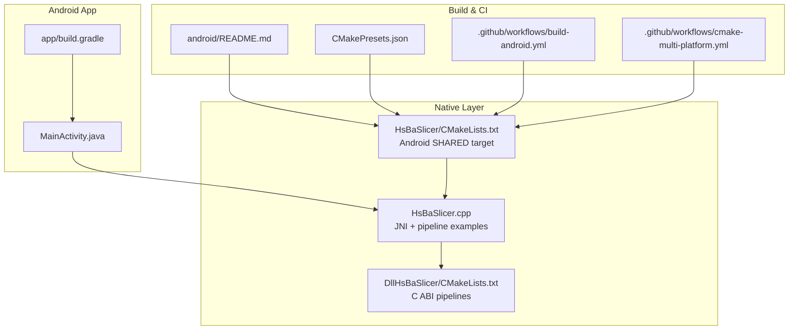
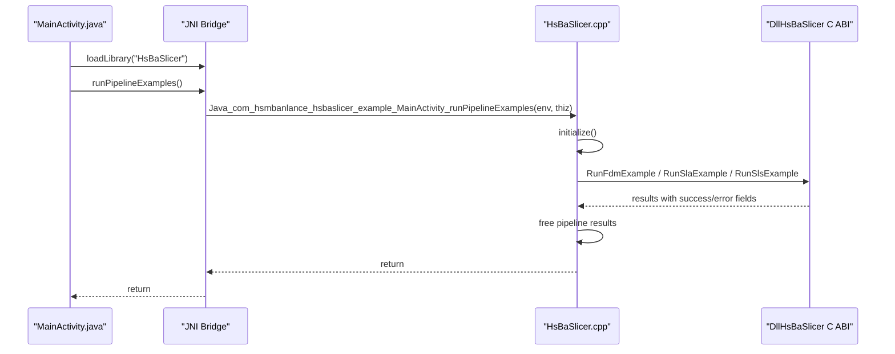
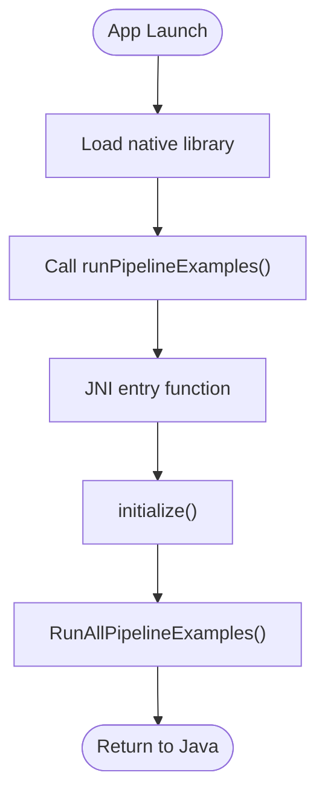
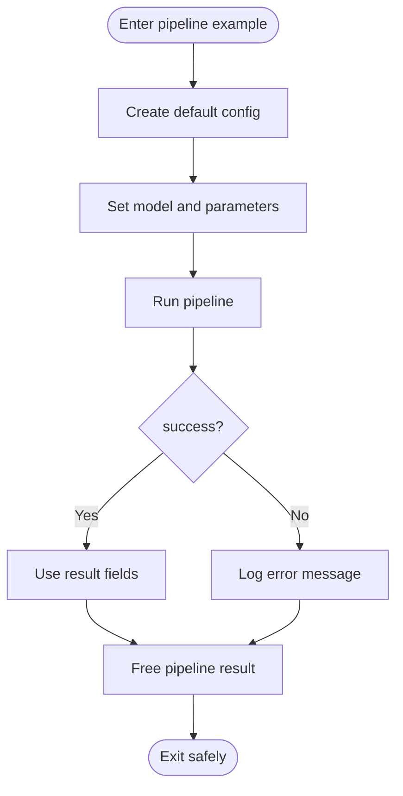
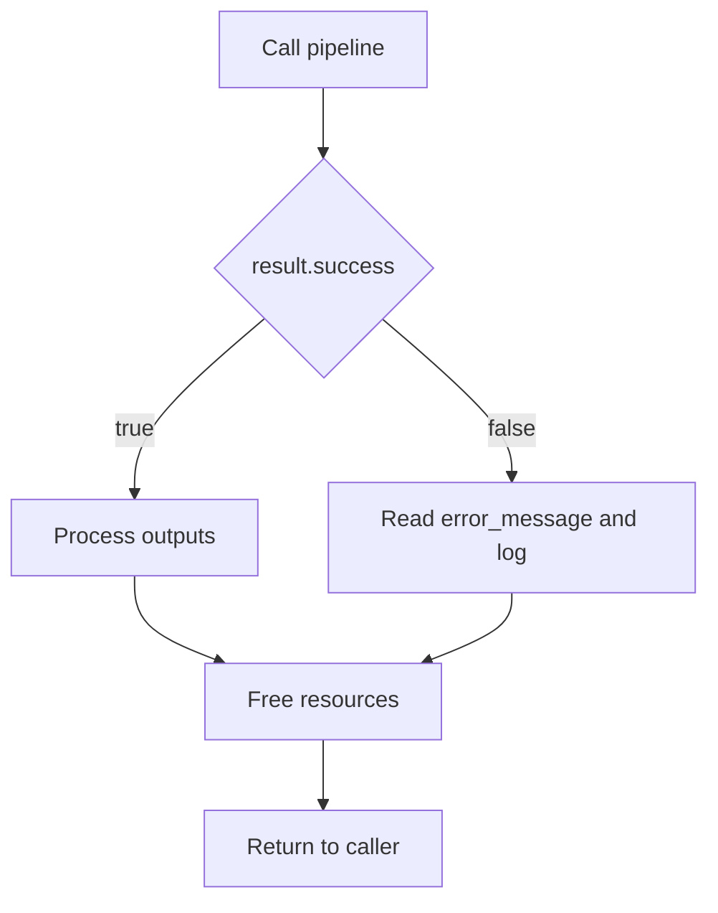
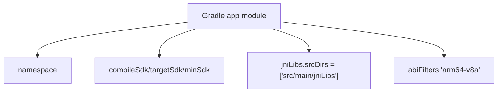
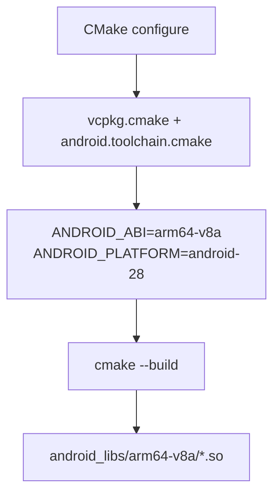
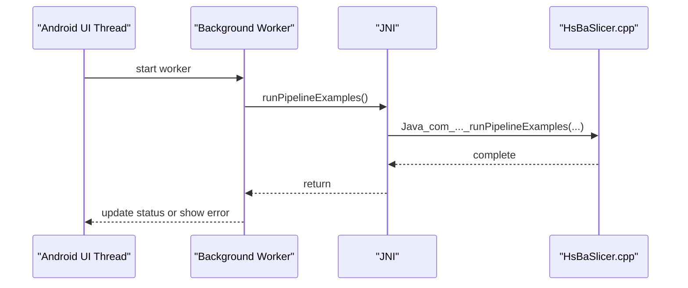
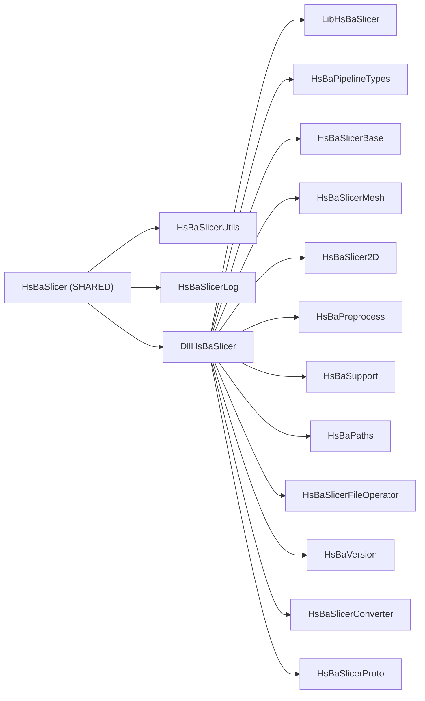

# Android Integration

<cite>
**Referenced Files in This Document**   
- [HsBaSlicer.cpp](file://HsBaSlicer/HsBaSlicer.cpp)
- [HsBaSlicer.h](file://HsBaSlicer/HsBaSlicer.h)
- [HsBaSlicer CMakeLists.txt](file://HsBaSlicer/CMakeLists.txt)
- [DllHsBaSlicer CMakeLists.txt](file://DllHsBaSlicer/CMakeLists.txt)
- [MainActivity.java](file://android/app/src/main/java/com/hsmbanlance/hsbaslicer/example/MainActivity.java)
- [app build.gradle](file://android/app/build.gradle)
- [settings.gradle](file://android/settings.gradle)
- [gradle.properties](file://android/gradle.properties)
- [Android README.md](file://android/README.md)
- [CMakePresets.json](file://CMakePresets.json)
- [build-android.yml](file://.github/workflows/build-android.yml)
- [cmake-multi-platform.yml](file://.github/workflows/cmake-multi-platform.yml)
</cite>

## Table of Contents
1. [Introduction](#introduction)
2. [Project Structure](#project-structure)
3. [Core Components](#core-components)
4. [Architecture Overview](#architecture-overview)
5. [Detailed Component Analysis](#detailed-component-analysis)
6. [Dependency Analysis](#dependency-analysis)
7. [Performance Considerations](#performance-considerations)
8. [Troubleshooting Guide](#troubleshooting-guide)
9. [Conclusion](#conclusion)
10. [Appendices](#appendices)

## Introduction
This document explains how to integrate HsBaSlicer into an Android application. It covers the JNI bridge between Java and C++, memory management across language boundaries, resource cleanup, error handling patterns, Gradle configuration for packaging native libraries, NDK setup requirements, and mobile-specific optimizations such as background processing and performance tuning.

The repository provides:
- A minimal Android app skeleton that loads a shared library named `HsBaSlicer`.
- A C++ entry point that exposes a JNI function invoked from Java.
- Pipeline examples (FDM, SLA, SLS) that demonstrate calling slicing functions and freeing returned resources.
- Build scripts and CI workflows that cross-compile the native code for ARM64 using CMake, vcpkg, and the Android NDK.

## Project Structure
At a high level, the Android integration consists of:
- Java layer: an Activity that loads the native library and calls a JNI method.
- Native layer: a shared library built on Android that wraps pipeline example logic and depends on the DllHsBaSlicer C ABI.
- Build system: Gradle for APK packaging and CMake for cross-compilation to ARM64.

**Diagram sources**
- [MainActivity.java:17-27](file://android/app/src/main/java/com/hsmbanlance/hsbaslicer/example/MainActivity.java#L17-L27)
- [HsBaSlicer.cpp:230-240](file://HsBaSlicer/HsBaSlicer.cpp#L230-L240)
- [HsBaSlicer CMakeLists.txt:12-39](file://HsBaSlicer/CMakeLists.txt#L12-L39)
- [DllHsBaSlicer CMakeLists.txt:82-100](file://DllHsBaSlicer/CMakeLists.txt#L82-L100)
- [Android README.md:7-19](file://android/README.md#L7-L19)
- [CMakePresets.json:118-129](file://CMakePresets.json#L118-L129)
- [build-android.yml:79-95](file://.github/workflows/build-android.yml#L79-L95)
- [cmake-multi-platform.yml:260-276](file://.github/workflows/cmake-multi-platform.yml#L260-L276)

**Section sources**
- [MainActivity.java:1-45](file://android/app/src/main/java/com/hsmbanlance/hsbaslicer/example/MainActivity.java#L1-L45)
- [HsBaSlicer.cpp:1-305](file://HsBaSlicer/HsBaSlicer.cpp#L1-L305)
- [HsBaSlicer CMakeLists.txt:1-78](file://HsBaSlicer/CMakeLists.txt#L1-L78)
- [DllHsBaSlicer CMakeLists.txt:52-100](file://DllHsBaSlicer/CMakeLists.txt#L52-L100)
- [Android README.md:1-22](file://android/README.md#L1-L22)
- [CMakePresets.json:118-129](file://CMakePresets.json#L118-L129)
- [build-android.yml:79-95](file://.github/workflows/build-android.yml#L79-L95)
- [cmake-multi-platform.yml:260-287](file://.github/workflows/cmake-multi-platform.yml#L260-L287)

## Core Components
- MainActivity.java: Loads the native library via System.loadLibrary and declares a native method that triggers pipeline examples.
- HsBaSlicer.cpp: Provides the JNI entry function for Android, initializes the slicer, and runs FDM/SLA/SLS pipeline examples.
- HsBaSlicer CMakeLists.txt: Builds the Android shared library and copies dependent .so files into the same output directory.
- DllHsBaSlicer CMakeLists.txt: Defines the C ABI pipeline targets that the Android wrapper links against.
- Gradle configuration: Declares ABI filters and jniLibs source set for packaging.

Key responsibilities:
- Java side: UI thread coordination, exception handling around native calls, and library loading.
- Native side: initialization, pipeline execution, progress logging, result handling, and memory cleanup.
- Build side: cross-compilation to arm64-v8a and packaging into the APK.

**Section sources**
- [MainActivity.java:17-44](file://android/app/src/main/java/com/hsmbanlance/hsbaslicer/example/MainActivity.java#L17-L44)
- [HsBaSlicer.cpp:230-240](file://HsBaSlicer/HsBaSlicer.cpp#L230-L240)
- [HsBaSlicer CMakeLists.txt:12-39](file://HsBaSlicer/CMakeLists.txt#L12-L39)
- [DllHsBaSlicer CMakeLists.txt:82-100](file://DllHsBaSlicer/CMakeLists.txt#L82-L100)
- [app build.gradle:24-33](file://android/app/build.gradle#L24-L33)

## Architecture Overview
The runtime flow starts in Java, crosses the JNI boundary into C++, and executes pipeline examples that call into the DllHsBaSlicer C ABI.

**Diagram sources**
- [MainActivity.java:17-27](file://android/app/src/main/java/com/hsmbanlance/hsbaslicer/example/MainActivity.java#L17-L27)
- [HsBaSlicer.cpp:230-240](file://HsBaSlicer/HsBaSlicer.cpp#L230-L240)
- [DllHsBaSlicer CMakeLists.txt:82-100](file://DllHsBaSlicer/CMakeLists.txt#L82-L100)

## Detailed Component Analysis

### JNI Bridge and Lifecycle
- Java declares a native method and loads the library in a static initializer.
- The C++ file exports a JNI function following the naming convention for the package and class.
- On Android, the JNI function initializes the slicer and runs all pipeline examples.

**Diagram sources**
- [MainActivity.java:17-27](file://android/app/src/main/java/com/hsmbanlance/hsbaslicer/example/MainActivity.java#L17-L27)
- [HsBaSlicer.cpp:230-240](file://HsBaSlicer/HsBaSlicer.cpp#L230-L240)

**Section sources**
- [MainActivity.java:17-44](file://android/app/src/main/java/com/hsmbanlance/hsbaslicer/example/MainActivity.java#L17-L44)
- [HsBaSlicer.cpp:230-240](file://HsBaSlicer/HsBaSlicer.cpp#L230-L240)

### Memory Management Across Language Boundaries
- Pipeline examples allocate result structures and strings through the C ABI.
- Each example explicitly frees returned resources after use.
- Best practice: always check success flags and free non-null pointers before returning to Java.

**Diagram sources**
- [HsBaSlicer.cpp:49-106](file://HsBaSlicer/HsBaSlicer.cpp#L49-L106)
- [HsBaSlicer.cpp:112-156](file://HsBaSlicer/HsBaSlicer.cpp#L112-L156)
- [HsBaSlicer.cpp:162-208](file://HsBaSlicer/HsBaSlicer.cpp#L162-L208)

**Section sources**
- [HsBaSlicer.cpp:49-106](file://HsBaSlicer/HsBaSlicer.cpp#L49-L106)
- [HsBaSlicer.cpp:112-156](file://HsBaSlicer/HsBaSlicer.cpp#L112-L156)
- [HsBaSlicer.cpp:162-208](file://HsBaSlicer/HsBaSlicer.cpp#L162-L208)

### Error Handling Patterns
- Each pipeline returns a result structure containing a success flag and optional error_message.
- Examples log errors when success is false and still ensure cleanup.
- In Java, exceptions thrown by native calls are caught and displayed to the user.

**Diagram sources**
- [HsBaSlicer.cpp:80-105](file://HsBaSlicer/HsBaSlicer.cpp#L80-L105)
- [HsBaSlicer.cpp:143-155](file://HsBaSlicer/HsBaSlicer.cpp#L143-L155)
- [HsBaSlicer.cpp:195-207](file://HsBaSlicer/HsBaSlicer.cpp#L195-L207)
- [MainActivity.java:37-43](file://android/app/src/main/java/com/hsmbanlance/hsbaslicer/example/MainActivity.java#L37-L43)

**Section sources**
- [HsBaSlicer.cpp:80-105](file://HsBaSlicer/HsBaSlicer.cpp#L80-L105)
- [HsBaSlicer.cpp:143-155](file://HsBaSlicer/HsBaSlicer.cpp#L143-L155)
- [HsBaSlicer.cpp:195-207](file://HsBaSlicer/HsBaSlicer.cpp#L195-L207)
- [MainActivity.java:37-43](file://android/app/src/main/java/com/hsmbanlance/hsbaslicer/example/MainActivity.java#L37-L43)

### Gradle Build Configuration for APK Packaging
- The app module sets the namespace, compileSdk, minSdk, and targetSdk.
- jniLibs source set points to src/main/jniLibs.
- abiFilters restricts packaged ABIs to arm64-v8a.

**Diagram sources**
- [app build.gradle:5-15](file://android/app/build.gradle#L5-L15)
- [app build.gradle:24-33](file://android/app/build.gradle#L24-L33)

**Section sources**
- [app build.gradle:5-33](file://android/app/build.gradle#L5-L33)
- [settings.gradle:1-19](file://android/settings.gradle#L1-L19)
- [gradle.properties:1-4](file://android/gradle.properties#L1-L4)

### Cross-Compilation to ARM64 with CMake and NDK
- The project uses CMake with vcpkg and the Android NDK toolchain.
- Presets and CI workflows configure:
  - VCPKG_TARGET_TRIPLET=arm64-android
  - ANDROID_ABI=arm64-v8a
  - ANDROID_PLATFORM=android-28 (or android-21 in the skeleton README)
- The HsBaSlicer Android target builds as a SHARED library and outputs to android_libs/<ABI>.

**Diagram sources**
- [CMakePresets.json:118-129](file://CMakePresets.json#L118-L129)
- [build-android.yml:79-95](file://.github/workflows/build-android.yml#L79-L95)
- [cmake-multi-platform.yml:260-276](file://.github/workflows/cmake-multi-platform.yml#L260-L276)
- [HsBaSlicer CMakeLists.txt:12-23](file://HsBaSlicer/CMakeLists.txt#L12-L23)

**Section sources**
- [CMakePresets.json:118-129](file://CMakePresets.json#L118-L129)
- [build-android.yml:79-95](file://.github/workflows/build-android.yml#L79-L95)
- [cmake-multi-platform.yml:260-287](file://.github/workflows/cmake-multi-platform.yml#L260-L287)
- [HsBaSlicer CMakeLists.txt:12-39](file://HsBaSlicer/CMakeLists.txt#L12-L39)
- [Android README.md:7-19](file://android/README.md#L7-L19)

### Calling Slicing Functions from Java
- The Java Activity loads the library and invokes the JNI method.
- The JNI method initializes the slicer and runs FDM/SLA/SLS examples.
- For production, wrap long-running operations in background threads and report progress back to the UI.

**Diagram sources**
- [MainActivity.java:17-44](file://android/app/src/main/java/com/hsmbanlance/hsbaslicer/example/MainActivity.java#L17-L44)
- [HsBaSlicer.cpp:230-240](file://HsBaSlicer/HsBaSlicer.cpp#L230-L240)

**Section sources**
- [MainActivity.java:17-44](file://android/app/src/main/java/com/hsmbanlance/hsbaslicer/example/MainActivity.java#L17-L44)
- [HsBaSlicer.cpp:230-240](file://HsBaSlicer/HsBaSlicer.cpp#L230-L240)

### Handling Large Mesh Data Efficiently
- Avoid passing large meshes as Java objects; instead, keep data in native memory and pass handles or paths.
- Reuse buffers where possible and avoid unnecessary copies.
- Stream or chunk processing if supported by the pipeline APIs.
- Monitor memory usage and release intermediate results promptly.

[No sources needed since this section provides general guidance]

### Integrating with Android UI Components
- Display progress updates from native code via callbacks or periodic polling.
- Disable UI during heavy work and re-enable upon completion.
- Show user-friendly messages for errors and allow retry.

[No sources needed since this section provides general guidance]

## Dependency Analysis
The Android shared library depends on utility, logging, and the DllHsBaSlicer C ABI. The DllHsBaSlicer target links multiple internal libraries.

**Diagram sources**
- [HsBaSlicer CMakeLists.txt:25-29](file://HsBaSlicer/CMakeLists.txt#L25-L29)
- [DllHsBaSlicer CMakeLists.txt:82-100](file://DllHsBaSlicer/CMakeLists.txt#L82-L100)

**Section sources**
- [HsBaSlicer CMakeLists.txt:25-39](file://HsBaSlicer/CMakeLists.txt#L25-L39)
- [DllHsBaSlicer CMakeLists.txt:82-100](file://DllHsBaSlicer/CMakeLists.txt#L82-L100)

## Performance Considerations
- Background processing: run slicing on a background thread to keep the UI responsive.
- Memory constraints: minimize allocations, reuse buffers, and free results immediately after use.
- Threading: consider parallelizing independent stages if supported by the pipeline APIs.
- I/O: write large outputs incrementally and avoid keeping entire G-code in memory.
- Logging: reduce verbose logging in Release builds to lower overhead.
- ProGuard/R8: disable minification for native-heavy apps or add appropriate rules to preserve required symbols.

[No sources needed since this section provides general guidance]

## Troubleshooting Guide
Common issues and resolutions:
- UnsatisfiedLinkError: Ensure the correct ABI is packaged and loaded. Verify abiFilters matches the device architecture and that the .so exists under jniLibs/arm64-v8a.
- Missing dependencies at runtime: Confirm that dependent .so files are copied next to the main library. The Android build script copies DllHsBaSlicer artifacts into the same output directory.
- Crash on exit: Always free pipeline results and other allocated resources before returning to Java.
- Slow startup: Initialize only once and reuse the initialized state across calls.
- Build failures: Validate ANDROID_NDK path, ANDROID_PLATFORM, and ANDROID_ABI settings in CMake presets and CI workflows.

**Section sources**
- [HsBaSlicer CMakeLists.txt:31-39](file://HsBaSlicer/CMakeLists.txt#L31-L39)
- [HsBaSlicer.cpp:103-105](file://HsBaSlicer/HsBaSlicer.cpp#L103-L105)
- [HsBaSlicer.cpp:153-155](file://HsBaSlicer/HsBaSlicer.cpp#L153-L155)
- [HsBaSlicer.cpp:205-207](file://HsBaSlicer/HsBaSlicer.cpp#L205-L207)
- [app build.gradle:31-33](file://android/app/build.gradle#L31-L33)
- [build-android.yml:79-95](file://.github/workflows/build-android.yml#L79-L95)
- [cmake-multi-platform.yml:260-287](file://.github/workflows/cmake-multi-platform.yml#L260-L287)

## Conclusion
The Android integration for HsBaSlicer centers on a small JNI bridge that delegates to well-defined C ABI pipeline functions. Correctness hinges on proper initialization, careful memory management, and robust error handling. The Gradle and CMake configurations provide a clear path to cross-compile for ARM64 and package the resulting libraries into an APK. For production applications, move heavy work off the UI thread, manage memory carefully, and instrument progress and errors for a smooth user experience.

[No sources needed since this section summarizes without analyzing specific files]

## Appendices

### Android Skeleton Usage
- Build native libs for Android using CMake with vcpkg and the Android NDK toolchain.
- Copy produced .so files into the app’s jniLibs directory.
- Open the android folder in Android Studio and run or build the APK.

**Section sources**
- [Android README.md:7-19](file://android/README.md#L7-L19)

### CI and Presets
- CMakePresets defines an Android preset targeting arm64-v8a and android-28.
- CI workflows install Android command-line tools, configure CMake, and copy built .so files into the app’s jniLibs directory.

**Section sources**
- [CMakePresets.json:118-129](file://CMakePresets.json#L118-L129)
- [build-android.yml:79-95](file://.github/workflows/build-android.yml#L79-L95)
- [cmake-multi-platform.yml:260-287](file://.github/workflows/cmake-multi-platform.yml#L260-L287)