# Desktop Application Integration

<cite>
**Referenced Files in This Document**   
- [qt_wxwidgets_integration.md](file://docs/en/DllHsBaSlicer/qt_wxwidgets_integration.md)
- [game_engine_integration.md](file://docs/en/DllHsBaSlicer/game_engine_integration.md)
- [fdm_pipeline.h](file://DllHsBaSlicer/fdm_pipeline.h)
- [initialize.h](file://DllHsBaSlicer/initialize.h)
- [event_source_register.h](file://DllHsBaSlicer/event_source_register.h)
- [event_source_register.cpp](file://DllHsBaSlicer/event_source_register.cpp)
- [EventSourceFunction.hpp](file://LibHsBaSlicer/Extends/EventSourceFunction.hpp)
- [pipeline_types.h](file://pipelinetypes/pipeline_types.h)
- [thread_pool.hpp](file://base/thread_pool.hpp)
</cite>

## Table of Contents
1. [Introduction](#introduction)
2. [Project Structure](#project-structure)
3. [Core Components](#core-components)
4. [Architecture Overview](#architecture-overview)
5. [Detailed Component Analysis](#detailed-component-analysis)
6. [Dependency Analysis](#dependency-analysis)
7. [Performance Considerations](#performance-considerations)
8. [Troubleshooting Guide](#troubleshooting-guide)
9. [Conclusion](#conclusion)

## Introduction
This document explains how to integrate HsBaSlicer into desktop and game applications. It focuses on:
- Qt and wxWidgets integration patterns for embedding slicing workflows, handling events, and keeping the UI responsive.
- Cross-platform considerations for native windowing toolkits.
- Unity and Unreal Engine integration for real-time or background slicing with progress reporting.
- Multi-threading strategies for long-running slicing operations, including callback marshalling, cancellation-ready async APIs, and memory management.

The guidance is based on the DllHsBaSlicer C ABI, pipeline type definitions, event-source registration, and the official integration documentation included in the repository.

## Project Structure
For desktop and game integration, the relevant parts of the repository are:
- `docs/en/...` — official integration guides for Qt/wxWidgets and Unity/Unreal.
- `DllHsBaSlicer/*` — C ABI entry points such as initialization, FDM pipeline run functions, and event-source registration.
- `pipelinetypes/pipeline_types.h` — C-compatible configuration and result structs used by all integrations.
- `LibHsBaSlicer/Extends/EventSourceFunction.hpp` — internal event-source callback registration API.
- `base/thread_pool.hpp` — thread pool implementation that can be used by host applications for task scheduling.

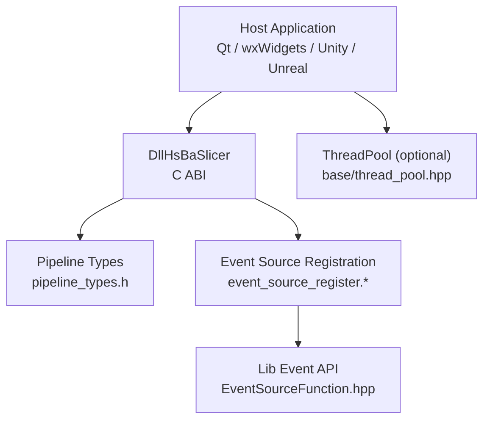

**Diagram sources**
- [fdm_pipeline.h:1-68](file://DllHsBaSlicer/fdm_pipeline.h#L1-L68)
- [initialize.h:1-22](file://DllHsBaSlicer/initialize.h#L1-L22)
- [event_source_register.h:1-22](file://DllHsBaSlicer/event_source_register.h#L1-L22)
- [event_source_register.cpp:1-34](file://DllHsBaSlicer/event_source_register.cpp#L1-L34)
- [EventSourceFunction.hpp:1-44](file://LibHsBaSlicer/Extends/EventSourceFunction.hpp#L1-L44)
- [pipeline_types.h:1-140](file://pipelinetypes/pipeline_types.h#L1-L140)
- [thread_pool.hpp:1-162](file://base/thread_pool.hpp#L1-L162)

**Section sources**
- [qt_wxwidgets_integration.md:1-13](file://docs/en/DllHsBaSlicer/qt_wxwidgets_integration.md#L1-L13)
- [game_engine_integration.md:1-18](file://docs/en/DllHsBaSlicer/game_engine_integration.md#L1-L18)

## Core Components
The integration surface is defined by a small set of stable C ABI components:

| Component | Purpose | Key Entry Points |
|---|---|---|
| Initialization | One-time DLL setup before any pipeline call | `initialize()` |
| FDM Pipeline | Synchronous and asynchronous FDM slicing | `HsBaCreateDefaultConfig`, `HsBaRunFdmPipeline`, `HsBaRunFdmPipelineAsync`, `HsBaFreePipelineResult` |
| Pipeline Types | C-compatible config/result structs and callbacks | `HsBaFdmPipelineConfig_t`, `HsBaFdmPipelineResult_t`, `HsBaProgressCallback`, `HsBaResultCallback` |
| Event Sources | Zipper and database event callbacks for scripting/file operations | `HsBaAddZipperEventCallback`, `HsBaAddDBEventCallback` |
| Host Threading | Optional worker/task scheduling for responsive UI | `HsBa::Slicer::ThreadPool` |

### Initialization
Before calling any pipeline function, the host application must call the DLL initialization function once during process startup. Repeated calls are safe and have no additional effect.

**Section sources**
- [initialize.h:14-19](file://DllHsBaSlicer/initialize.h#L14-L19)
- [qt_wxwidgets_integration.md:7-12](file://docs/en/DllHsBaSlicer/qt_wxwidgets_integration.md#L7-L12)

### FDM Pipeline ABI
The FDM pipeline exposes:
- A default configuration constructor.
- A synchronous blocking run function.
- An asynchronous non-blocking run function.
- A result-free function for releasing allocated strings.

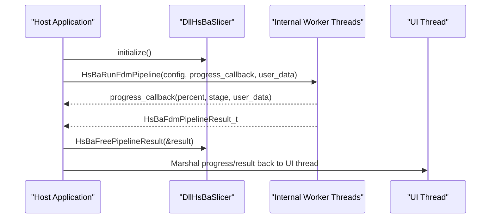

**Diagram sources**
- [fdm_pipeline.h:21-61](file://DllHsBaSlicer/fdm_pipeline.h#L21-L61)
- [pipeline_types.h:120-140](file://pipelinetypes/pipeline_types.h#L120-L140)

**Section sources**
- [fdm_pipeline.h:17-61](file://DllHsBaSlicer/fdm_pipeline.h#L17-L61)
- [pipeline_types.h:56-140](file://pipelinetypes/pipeline_types.h#L56-L140)

### Event-Source Registration
The library supports registering callbacks for zipper and database events. The C ABI forwards these to the internal LibHsBaSlicer event system.

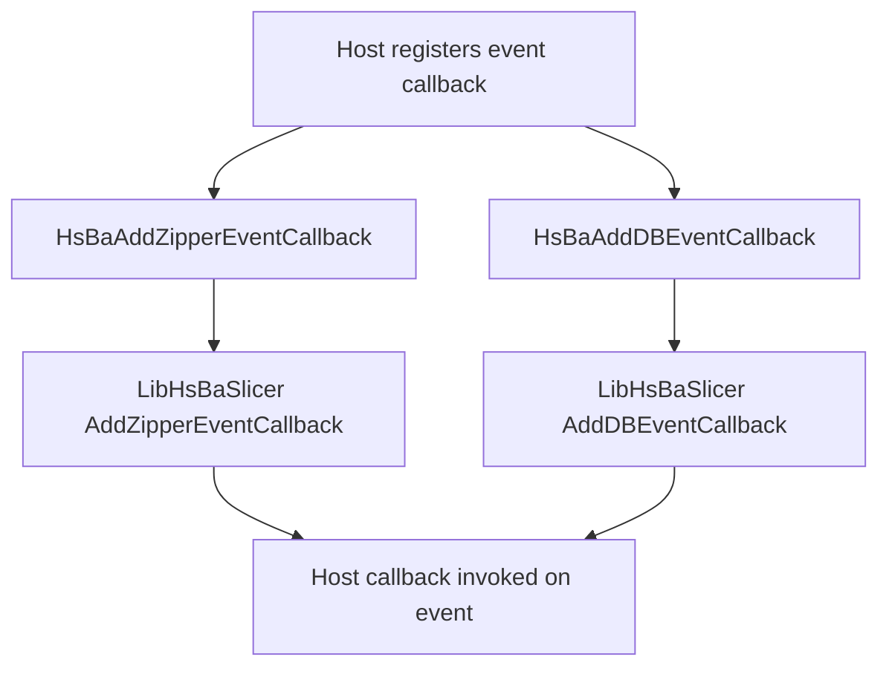

**Diagram sources**
- [event_source_register.h:15-17](file://DllHsBaSlicer/event_source_register.h#L15-L17)
- [event_source_register.cpp:9-34](file://DllHsBaSlicer/event_source_register.cpp#L9-L34)
- [EventSourceFunction.hpp:18-41](file://LibHsBaSlicer/Extends/EventSourceFunction.hpp#L18-L41)

**Section sources**
- [event_source_register.h:1-22](file://DllHsBaSlicer/event_source_register.h#L1-L22)
- [event_source_register.cpp:1-34](file://DllHsBaSlicer/event_source_register.cpp#L1-L34)
- [EventSourceFunction.hpp:1-44](file://LibHsBaSlicer/Extends/EventSourceFunction.hpp#L1-L44)

## Architecture Overview
At a high level, HsBaSlicer integration follows a consistent pattern across Qt, wxWidgets, Unity, and Unreal:

1. Initialize the DLL once.
2. Prepare a C-compatible pipeline configuration.
3. Run the pipeline synchronously or asynchronously.
4. Receive progress updates through a callback.
5. Copy result data off the native side.
6. Free native-allocated result memory.
7. Marshal UI updates back to the platform’s UI thread.

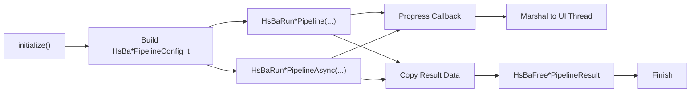

**Diagram sources**
- [initialize.h:14-19](file://DllHsBaSlicer/initialize.h#L14-L19)
- [fdm_pipeline.h:21-61](file://DllHsBaSlicer/fdm_pipeline.h#L21-L61)
- [pipeline_types.h:120-140](file://pipelinetypes/pipeline_types.h#L120-L140)

## Detailed Component Analysis

### Qt Integration Patterns
Qt integration emphasizes:
- Using a worker object moved to a `QThread`.
- Emitting signals from native callbacks so slots execute on the UI thread.
- Keeping UTF-8 string fields valid for the lifetime of the pipeline call.
- Optionally using `QtConcurrent::run` when fine-grained progress is not required.

Key responsibilities:
- Call `initialize()` once at application startup.
- Never call blocking slice functions on the main GUI thread.
- Convert UTF-8 C strings to Qt strings after copying them.
- Always call the free function after reading the result.

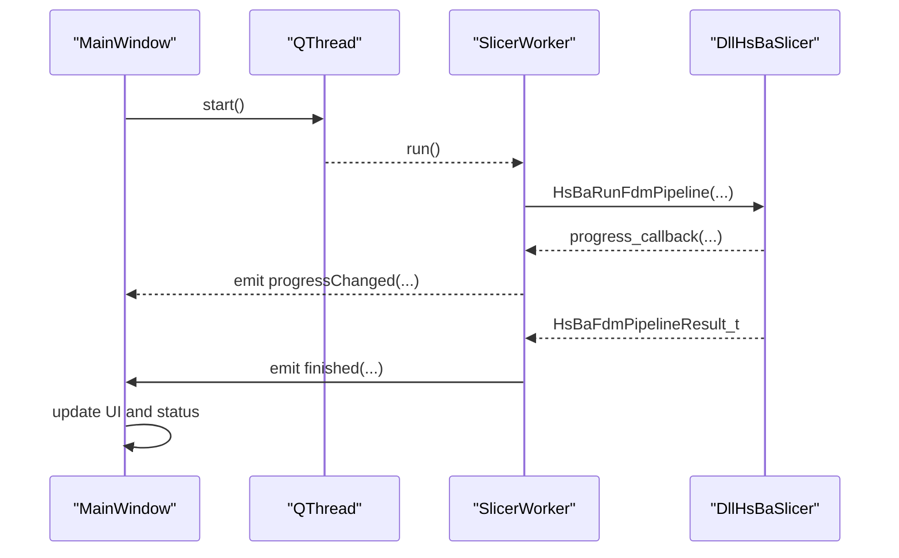

**Diagram sources**
- [qt_wxwidgets_integration.md:47-105](file://docs/en/DllHsBaSlicer/qt_wxwidgets_integration.md#L47-L105)
- [qt_wxwidgets_integration.md:108-150](file://docs/en/DllHsBaSlicer/qt_wxwidgets_integration.md#L108-L150)
- [fdm_pipeline.h:34-61](file://DllHsBaSlicer/fdm_pipeline.h#L34-L61)

**Section sources**
- [qt_wxwidgets_integration.md:7-12](file://docs/en/DllHsBaSlicer/qt_wxwidgets_integration.md#L7-L12)
- [qt_wxwidgets_integration.md:47-167](file://docs/en/DllHsBaSlicer/qt_wxwidgets_integration.md#L47-L167)

### wxWidgets Integration Patterns
wxWidgets integration uses:
- A separate worker thread for slicing.
- `CallAfter` to marshal progress and completion updates to the UI thread.
- UTF-8 conversion via `wxConvUTF8`.
- Careful ownership of the model path buffer while the pipeline runs.

Important rules:
- Do not update wxWidgets widgets directly inside the native callback.
- Use `CallAfter` to schedule UI updates on the wxWidgets event loop thread.
- Prefer a managed thread or thread pool over detached threads in production code.

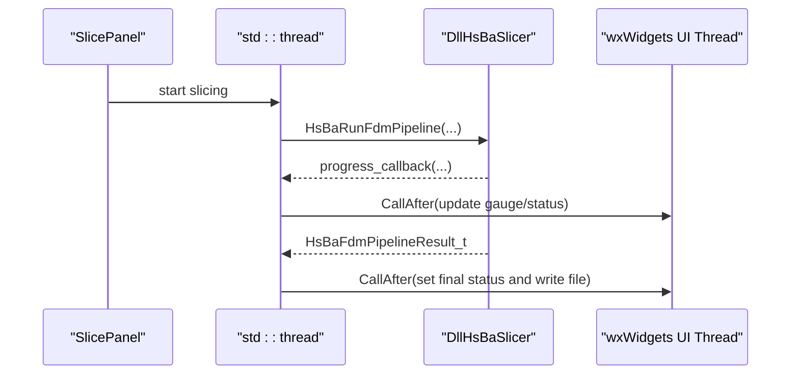

**Diagram sources**
- [qt_wxwidgets_integration.md:187-264](file://docs/en/DllHsBaSlicer/qt_wxwidgets_integration.md#L187-L264)
- [fdm_pipeline.h:34-61](file://DllHsBaSlicer/fdm_pipeline.h#L34-L61)

**Section sources**
- [qt_wxwidgets_integration.md:171-264](file://docs/en/DllHsBaSlicer/qt_wxwidgets_integration.md#L171-L264)

### Unity Integration Patterns
Unity integration uses C# P/Invoke to call the native DLL:
- Structs must match the layout and field order of the C ABI.
- Delegates passed to native code must be kept alive; otherwise garbage collection can crash the app when a callback fires.
- Native callbacks run on worker threads and must post updates to the Unity main thread.
- iOS uses a static library and requires `"__Internal"` as the DllImport name.

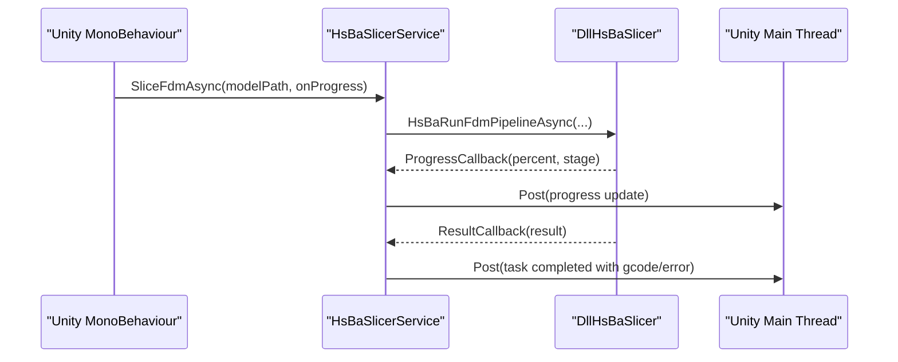

**Diagram sources**
- [game_engine_integration.md:21-123](file://docs/en/DllHsBaSlicer/game_engine_integration.md#L21-L123)
- [game_engine_integration.md:128-183](file://docs/en/DllHsBaSlicer/game_engine_integration.md#L128-L183)
- [game_engine_integration.md:186-213](file://docs/en/DllHsBaSlicer/game_engine_integration.md#L186-L213)

**Section sources**
- [game_engine_integration.md:21-213](file://docs/en/DllHsBaSlicer/game_engine_integration.md#L21-L213)

### Unreal Engine Integration Patterns
Unreal Engine integration uses a C++ plugin wrapper:
- A third-party module links against the prebuilt DLL/SO/DYLIB.
- A subsystem exposes Blueprint-callable functions.
- Slicing runs on a background thread; progress and completion delegates are broadcast on the GameThread.
- String encoding must be converted between UE TCHAR and UTF-8.

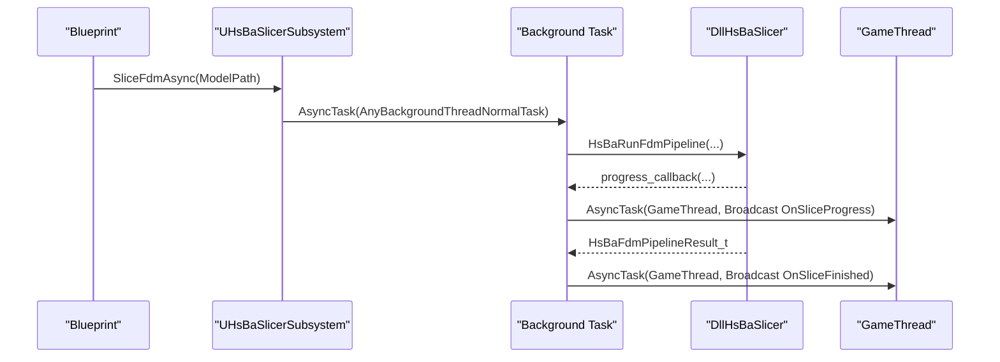

**Diagram sources**
- [game_engine_integration.md:216-362](file://docs/en/DllHsBaSlicer/game_engine_integration.md#L216-L362)
- [fdm_pipeline.h:34-61](file://DllHsBaSlicer/fdm_pipeline.h#L34-L61)

**Section sources**
- [game_engine_integration.md:216-362](file://docs/en/DllHsBaSlicer/game_engine_integration.md#L216-L362)

### Lua Extension Function Registration
Both Qt/wxWidgets and Unity/Unreal documentation show how to register custom Lua extension functions before running pipelines. These functions are injected when each stage creates its Lua environment.

Available registration targets include:
- 3D model operations.
- 2D polygon operations.
- File output operations.
- Event callbacks such as zipper compression events.

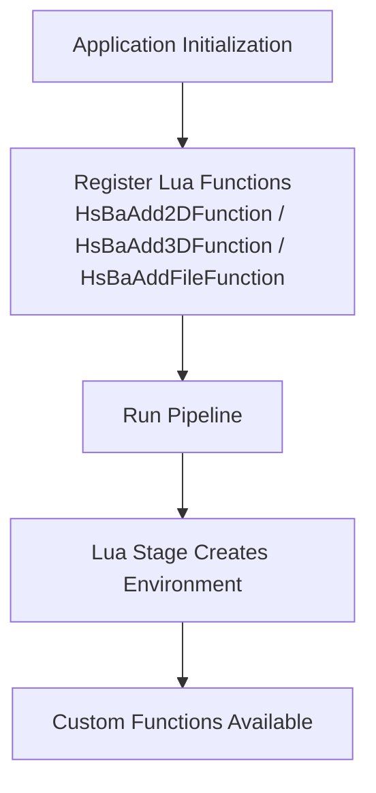

**Diagram sources**
- [qt_wxwidgets_integration.md:293-338](file://docs/en/DllHsBaSlicer/qt_wxwidgets_integration.md#L293-L338)
- [game_engine_integration.md:380-451](file://docs/en/DllHsBaSlicer/game_engine_integration.md#L380-L451)

**Section sources**
- [qt_wxwidgets_integration.md:293-338](file://docs/en/DllHsBaSlicer/qt_wxwidgets_integration.md#L293-L338)
- [game_engine_integration.md:380-451](file://docs/en/DllHsBaSlicer/game_engine_integration.md#L380-L451)

## Dependency Analysis
The integration layer depends on:
- The DllHsBaSlicer C ABI for initialization, pipeline execution, and result handling.
- `pipeline_types.h` for struct layouts, enums, and callback signatures.
- Event-source registration for advanced scripting and file operation hooks.
- Host framework threading primitives (Qt, wxWidgets, Unity, Unreal) for UI safety.

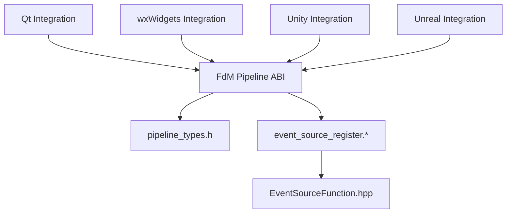

**Diagram sources**
- [fdm_pipeline.h:1-68](file://DllHsBaSlicer/fdm_pipeline.h#L1-L68)
- [pipeline_types.h:1-140](file://pipelinetypes/pipeline_types.h#L1-L140)
- [event_source_register.h:1-22](file://DllHsBaSlicer/event_source_register.h#L1-L22)
- [event_source_register.cpp:1-34](file://DllHsBaSlicer/event_source_register.cpp#L1-L34)
- [EventSourceFunction.hpp:1-44](file://LibHsBaSlicer/Extends/EventSourceFunction.hpp#L1-L44)

**Section sources**
- [fdm_pipeline.h:1-68](file://DllHsBaSlicer/fdm_pipeline.h#L1-L68)
- [pipeline_types.h:1-140](file://pipelinetypes/pipeline_types.h#L1-L140)
- [event_source_register.h:1-22](file://DllHsBaSlicer/event_source_register.h#L1-L22)
- [event_source_register.cpp:1-34](file://DllHsBaSlicer/event_source_register.cpp#L1-L34)
- [EventSourceFunction.hpp:1-44](file://LibHsBaSlicer/Extends/EventSourceFunction.hpp#L1-L44)

## Performance Considerations
For responsive desktop and game applications:
- Keep long-running slicing work off the UI thread.
- Use the asynchronous pipeline API where available to avoid blocking the caller.
- Avoid excessive UI updates; throttle progress updates if needed.
- Reuse configuration objects where appropriate, but ensure UTF-8 string pointers remain valid during the call.
- For heavy parallel workloads inside your own application, consider using the provided `ThreadPool` rather than creating unbounded threads.

The built-in thread pool provides:
- A configurable number of worker threads.
- Task submission returning futures.
- Pending and active task counts.
- A wait-all mechanism.
- Optional coroutine executor support.

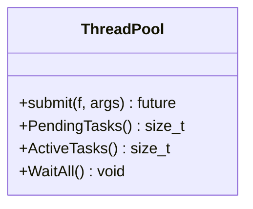

**Diagram sources**
- [thread_pool.hpp:29-162](file://base/thread_pool.hpp#L29-L162)

**Section sources**
- [thread_pool.hpp:1-162](file://base/thread_pool.hpp#L1-L162)

## Troubleshooting Guide

### Qt / wxWidgets
| Symptom | Cause & Fix |
|---|---|
| DLL not found at startup | Place the native DLL next to the executable or configure the build to copy it. |
| UI freezes during slicing | Blocking slice API is running on the UI thread; move it to a worker thread. |
| Crash updating widgets in a callback | Callbacks run on library threads; marshal updates via Qt signals/slots or wxWidgets `CallAfter`. |
| Non-ASCII paths fail | Pass UTF-8 encoded paths. |
| Garbled result strings or crash | Copy result strings before calling the free function. |

**Section sources**
- [qt_wxwidgets_integration.md:340-349](file://docs/en/DllHsBaSlicer/qt_wxwidgets_integration.md#L340-L349)

### Unity / Unreal Engine
| Symptom | Cause & Fix |
|---|---|
| Unity `DllNotFoundException` | Plugin in the wrong folder or platform not enabled; editor and device use different folders. |
| Unity crash after a callback | Delegate was garbage-collected; keep a strong reference to it. |
| Unreal packaged build cannot find the DLL | Missing runtime dependency; check packaging and binary directory. |
| iOS link failure | iOS requires the static library and `DllImport("__Internal")`; dylibs cannot be loaded. |
| Struct fields misaligned or random crashes | P/Invoke struct field order or types do not match the C ABI. |

**Section sources**
- [game_engine_integration.md:453-462](file://docs/en/DllHsBaSlicer/game_engine_integration.md#L453-L462)

## Conclusion
HsBaSlicer integrates cleanly into desktop and game applications through a small, stable C ABI. The most important integration rules are:
- Initialize the DLL once.
- Run blocking slicing operations off the UI thread.
- Marshal callbacks back to the UI thread before touching UI elements.
- Preserve UTF-8 string lifetimes during pipeline calls.
- Copy result data before freeing native memory.
- Use asynchronous APIs when available to improve responsiveness.
- Extend slicing behavior through Lua registration and event callbacks when needed.