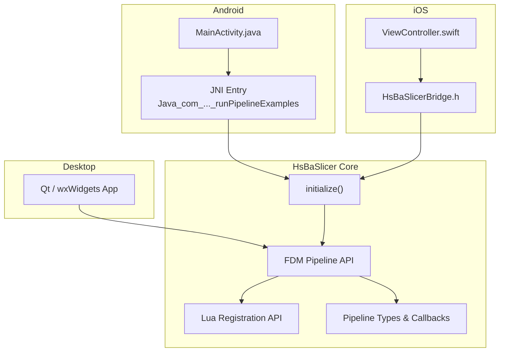
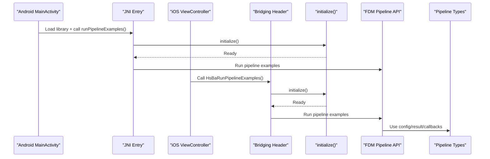
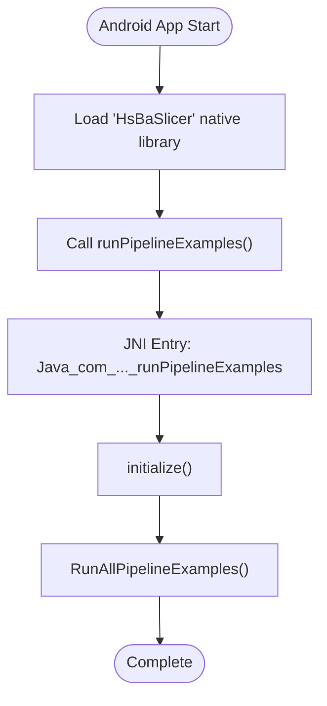
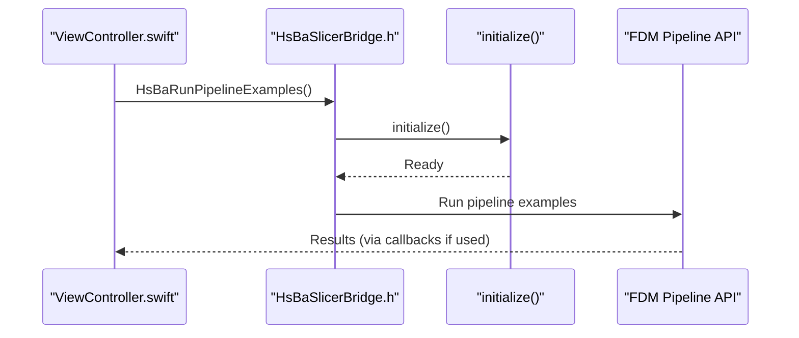
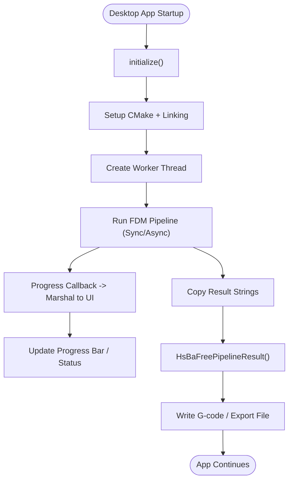
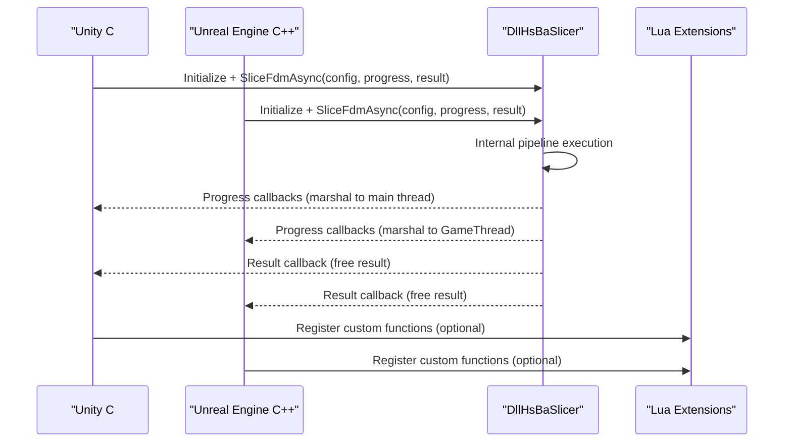
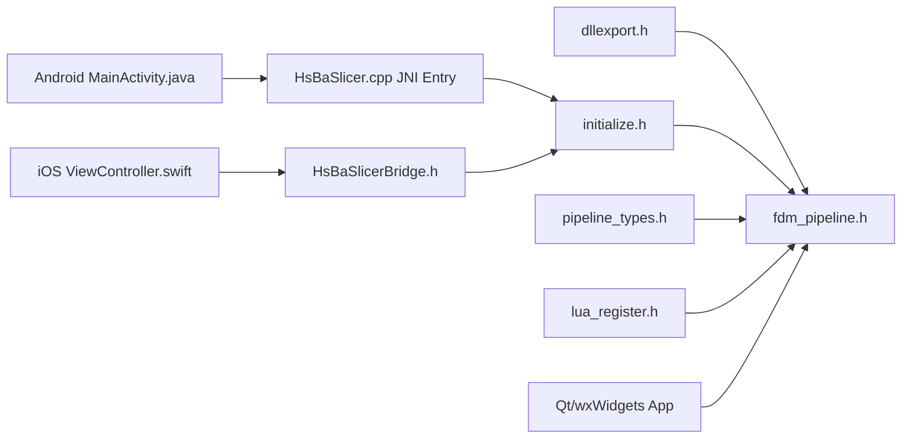

# Platform Integration Examples

<cite>
**Referenced Files in This Document**   
- [MainActivity.java](file://android/app/src/main/java/com/hsmbanlance/hsbaslicer/example/MainActivity.java)
- [README.md](file://android/README.md)
- [HsBaSlicer.cpp](file://HsBaSlicer/HsBaSlicer.cpp)
- [HsBaSlicerBridge.h](file://ios/HsBaSlicerExample/HsBaSlicerBridge.h)
- [ViewController.swift](file://ios/HsBaSlicerExample/ViewController.swift)
- [fdm_pipeline.h](file://DllHsBaSlicer/fdm_pipeline.h)
- [initialize.h](file://DllHsBaSlicer/initialize.h)
- [lua_register.h](file://DllHsBaSlicer/lua_register.h)
- [dllexport.h](file://DllHsBaSlicer/dllexport.h)
- [export.h](file://LibHsBaSlicer/export.h)
- [pipeline_types.h](file://pipelinetypes/pipeline_types.h)
- [qt_wxwidgets_integration.md](file://docs/en/DllHsBaSlicer/qt_wxwidgets_integration.md)
- [game_engine_integration.md](file://docs/en/DllHsBaSlicer/game_engine_integration.md)
</cite>

## Table of Contents
1. [Introduction](#introduction)
2. [Project Structure](#project-structure)
3. [Core Components](#core-components)
4. [Architecture Overview](#architecture-overview)
5. [Detailed Component Analysis](#detailed-component-analysis)
6. [Dependency Analysis](#dependency-analysis)
7. [Performance Considerations](#performance-considerations)
8. [Troubleshooting Guide](#troubleshooting-guide)
9. [Conclusion](#conclusion)

## Introduction
This document provides platform-specific integration examples for HsBaSlicer, focusing on:
- Android JNI integration with Java-to-C++ communication, memory management across language boundaries, and UI thread safety.
- iOS integration through a Swift/Objective-C bridging header, native app integration, and mobile-specific considerations.
- Desktop application integration patterns for Qt and wxWidgets.
- Build configuration, deployment strategies, and common pitfalls.

The guidance is grounded in the repository’s Android example, iOS example, DllHsBaSlicer C ABI headers, pipeline type definitions, and official desktop integration documentation.

## Project Structure
HsBaSlicer exposes a stable C ABI through `DllHsBaSlicer`, while higher-level libraries and modules are built around it. Platform entry points differ by target:
- Android uses a JNI function that calls into the shared library initialization and pipeline examples.
- iOS exposes a C function via a bridging header for Swift/Objective-C to call.
- Desktop applications link against the shared library or use provided integration guides.

**Diagram sources**
- [MainActivity.java:17-27](file://android/app/src/main/java/com/hsmbanlance/hsbaslicer/example/MainActivity.java#L17-L27)
- [HsBaSlicer.cpp:230-253](file://HsBaSlicer/HsBaSlicer.cpp#L230-L253)
- [HsBaSlicerBridge.h:19-25](file://ios/HsBaSlicerExample/HsBaSlicerBridge.h#L19-L25)
- [ViewController.swift:43-55](file://ios/HsBaSlicerExample/ViewController.swift#L43-L55)
- [fdm_pipeline.h:17-61](file://DllHsBaSlicer/fdm_pipeline.h#L17-L61)
- [initialize.h:14-19](file://DllHsBaSlicer/initialize.h#L14-L19)
- [lua_register.h:21-31](file://DllHsBaSlicer/lua_register.h#L21-L31)
- [pipeline_types.h:129-140](file://pipelinetypes/pipeline_types.h#L129-L140)

**Section sources**
- [MainActivity.java:1-45](file://android/app/src/main/java/com/hsmbanlance/hsbaslicer/example/MainActivity.java#L1-L45)
- [HsBaSlicer.cpp:227-264](file://HsBaSlicer/HsBaSlicer.cpp#L227-L264)
- [HsBaSlicerBridge.h:1-31](file://ios/HsBaSlicerExample/HsBaSlicerBridge.h#L1-L31)
- [ViewController.swift:1-86](file://ios/HsBaSlicerExample/ViewController.swift#L1-L86)

## Core Components
- C ABI export/import macros:
  - `HSBA_SLICER_API` for the shared library (DLL/SO/DYLIB).
  - `HSBA_SLICER_LIB_API` for the static/shared C++ library.
- Initialization:
  - `initialize()` registers Lua functions, pipelines, and one-time runtime setup; safe to call once at load time.
- FDM Pipeline API:
  - Default config creation, synchronous run, asynchronous run, and result freeing.
- Pipeline types and callbacks:
  - Structured configs/results per process (FDM, SLA, SLS, etc.).
  - Progress/result callback signatures for async usage.
- Lua extension registration:
  - Register custom Lua functions and event callbacks for pipeline stages.

Key responsibilities:
- `dllexport.h` and `export.h` define cross-platform symbol visibility.
- `initialize.h` defines the single entry point for library initialization.
- `fdm_pipeline.h` defines the primary slicing workflow API surface.
- `pipeline_types.h` defines all C-compatible structs, enums, and callback types.
- `lua_register.h` enables extensibility via Lua.

**Section sources**
- [dllexport.h:1-23](file://DllHsBaSlicer/dllexport.h#L1-L23)
- [export.h:1-22](file://LibHsBaSlicer/export.h#L1-L22)
- [initialize.h:1-22](file://DllHsBaSlicer/initialize.h#L1-L22)
- [fdm_pipeline.h:1-68](file://DllHsBaSlicer/fdm_pipeline.h#L1-L68)
- [pipeline_types.h:19-140](file://pipelinetypes/pipeline_types.h#L19-L140)
- [lua_register.h:1-38](file://DllHsBaSlicer/lua_register.h#L1-L38)

## Architecture Overview
The integration architecture separates platform code from the core slicing engine:
- Platform layers (Android, iOS, Desktop) call into the stable C ABI.
- The C ABI delegates to internal C++ implementations and Lua-driven extensions.
- Memory ownership crosses the boundary via explicit free functions and UTF-8 string handling.

**Diagram sources**
- [MainActivity.java:17-27](file://android/app/src/main/java/com/hsmbanlance/hsbaslicer/example/MainActivity.java#L17-L27)
- [HsBaSlicer.cpp:230-253](file://HsBaSlicer/HsBaSlicer.cpp#L230-L253)
- [HsBaSlicerBridge.h:19-25](file://ios/HsBaSlicerExample/HsBaSlicerBridge.h#L19-L25)
- [ViewController.swift:43-55](file://ios/HsBaSlicerExample/ViewController.swift#L43-L55)
- [fdm_pipeline.h:17-61](file://DllHsBaSlicer/fdm_pipeline.h#L17-L61)
- [initialize.h:14-19](file://DllHsBaSlicer/initialize.h#L14-L19)
- [pipeline_types.h:129-140](file://pipelinetypes/pipeline_types.h#L129-L140)

## Detailed Component Analysis

### Android JNI Integration
Android integrates via a JNI function that loads the native library and invokes pipeline examples. The example Activity demonstrates loading the library and calling the native method.

Key points:
- Library loading: `System.loadLibrary("HsBaSlicer")`.
- Native method declaration: `runPipelineExamples()`.
- Example flow: UI thread calls native method (example only; production should use background threads).

**Diagram sources**
- [MainActivity.java:17-27](file://android/app/src/main/java/com/hsmbanlance/hsbaslicer/example/MainActivity.java#L17-L27)
- [HsBaSlicer.cpp:230-240](file://HsBaSlicer/HsBaSlicer.cpp#L230-L240)

Memory management across the JNI boundary:
- Config fields like `model_name` and `model_path` must remain valid during the pipeline execution.
- Result strings (`gcode_content`, `error_message`) are allocated by the library and must be freed using the corresponding free function after copying.

Build and packaging:
- The Android skeleton explains building native libs and placing `.so` files under `jniLibs`.
- CI verifies the presence of required files and symbols.

**Section sources**
- [MainActivity.java:17-45](file://android/app/src/main/java/com/hsmbanlance/hsbaslicer/example/MainActivity.java#L17-L45)
- [HsBaSlicer.cpp:230-240](file://HsBaSlicer/HsBaSlicer.cpp#L230-L240)
- [README.md:1-22](file://android/README.md#L1-L22)

### iOS Integration (Swift/Objective-C Bridging)
iOS integrates via a bridging header exposing a C function for Swift/Objective-C. The example shows a simple UI that triggers the pipeline on a background queue and updates the UI on the main queue.

Key points:
- Bridging header declares `HsBaRunPipelineExamples()`.
- Swift calls the C function on a global background queue and marshals results back to the main queue.
- The function internally initializes the library and runs pipeline examples.

**Diagram sources**
- [HsBaSlicerBridge.h:19-25](file://ios/HsBaSlicerExample/HsBaSlicerBridge.h#L19-L25)
- [ViewController.swift:43-55](file://ios/HsBaSlicerExample/ViewController.swift#L43-L55)
- [HsBaSlicer.cpp:242-253](file://HsBaSlicer/HsBaSlicer.cpp#L242-L253)
- [fdm_pipeline.h:17-61](file://DllHsBaSlicer/fdm_pipeline.h#L17-L61)

Mobile-specific optimizations:
- Avoid blocking the UI thread; use background queues.
- Keep delegate/function references alive when crossing language boundaries (especially important for Unity/UE integrations documented below).
- On iOS, the library is typically static; ensure correct linking and symbol availability.

**Section sources**
- [HsBaSlicerBridge.h:1-31](file://ios/HsBaSlicerExample/HsBaSlicerBridge.h#L1-L31)
- [ViewController.swift:1-86](file://ios/HsBaSlicerExample/ViewController.swift#L1-L86)
- [HsBaSlicer.cpp:242-253](file://HsBaSlicer/HsBaSlicer.cpp#L242-L253)

### Desktop Application Integration (Qt and wxWidgets)
The desktop integration guide provides comprehensive instructions for integrating DllHsBaSlicer pipelines with Qt and wxWidgets.

General rules:
- Call `initialize()` once at startup before any pipeline call.
- Never run sync APIs on the UI thread; use worker threads.
- Progress/result callbacks fire on library threads; marshal back to the UI thread before touching widgets.
- String lifetimes: `const char*` fields in config structs must stay valid while the pipeline runs; dynamic strings inside results are released by `HsBaFree*PipelineResult()`.

Qt integration highlights:
- CMake project setup using `find_package(HsBaSlicer CONFIG REQUIRED)` or direct artifact paths.
- Worker thread wrapper using `QThread` + signals/slots.
- Main window usage showing progress bar updates and file output.
- Optional shortcut using `QtConcurrent::run`.

wxWidgets integration highlights:
- CMake setup including wxWidgets components.
- Marshalling via `CallAfter` to update UI safely.
- Thread-safe progress updates and result handling.

SLA/SLS pipelines follow the same pattern as FDM, with different config and result types.

Lua extension registration:
- Register custom Lua functions via `lua_register.h` before running pipelines.
- Functions are injected when each stage creates its Lua environment.

**Diagram sources**
- [qt_wxwidgets_integration.md:7-13](file://docs/en/DllHsBaSlicer/qt_wxwidgets_integration.md#L7-L13)
- [qt_wxwidgets_integration.md:47-106](file://docs/en/DllHsBaSlicer/qt_wxwidgets_integration.md#L47-L106)
- [qt_wxwidgets_integration.md:108-151](file://docs/en/DllHsBaSlicer/qt_wxwidgets_integration.md#L108-L151)
- [qt_wxwidgets_integration.md:171-264](file://docs/en/DllHsBaSlicer/qt_wxwidgets_integration.md#L171-L264)
- [qt_wxwidgets_integration.md:268-289](file://docs/en/DllHsBaSlicer/qt_wxwidgets_integration.md#L268-L289)
- [qt_wxwidgets_integration.md:293-338](file://docs/en/DllHsBaSlicer/qt_wxwidgets_integration.md#L293-L338)

**Section sources**
- [qt_wxwidgets_integration.md:1-349](file://docs/en/DllHsBaSlicer/qt_wxwidgets_integration.md#L1-L349)

### Game Engine Integration (Unity and Unreal Engine)
The game engine integration guide covers Unity (C# P/Invoke) and Unreal Engine (C++ plugin + Blueprint), including per-platform library placement, struct mapping, async callbacks, and Lua extension registration.

Key points:
- Per-platform artifacts: Windows DLL, Linux SO, macOS DYLIB, Android SO, iOS static library.
- Unity:
  - Binding declarations with `[StructLayout(LayoutKind.Sequential)]` and delegates.
  - High-level wrapper with async execution and main-thread marshalling.
  - MonoBehaviour usage demonstrating progress updates and result handling.
  - Notes on delegate lifecycle, IL2CPP struct layout, and Android/iOS placement.
- Unreal Engine:
  - ThirdParty module layout and build configuration.
  - C++ wrapper with async execution and GameThread marshalling.
  - Usage from Blueprint and packaging notes.

**Diagram sources**
- [game_engine_integration.md:7-18](file://docs/en/DllHsBaSlicer/game_engine_integration.md#L7-L18)
- [game_engine_integration.md:21-127](file://docs/en/DllHsBaSlicer/game_engine_integration.md#L21-L127)
- [game_engine_integration.md:128-213](file://docs/en/DllHsBaSlicer/game_engine_integration.md#L128-L213)
- [game_engine_integration.md:216-363](file://docs/en/DllHsBaSlicer/game_engine_integration.md#L216-L363)
- [game_engine_integration.md:366-452](file://docs/en/DllHsBaSlicer/game_engine_integration.md#L366-L452)

**Section sources**
- [game_engine_integration.md:1-462](file://docs/en/DllHsBaSlicer/game_engine_integration.md#L1-L462)

## Dependency Analysis
The integration stack depends on clearly defined C ABI headers and platform-specific entry points.

**Diagram sources**
- [dllexport.h:1-23](file://DllHsBaSlicer/dllexport.h#L1-L23)
- [fdm_pipeline.h:1-68](file://DllHsBaSlicer/fdm_pipeline.h#L1-L68)
- [initialize.h:1-22](file://DllHsBaSlicer/initialize.h#L1-L22)
- [pipeline_types.h:19-140](file://pipelinetypes/pipeline_types.h#L19-L140)
- [lua_register.h:1-38](file://DllHsBaSlicer/lua_register.h#L1-L38)
- [MainActivity.java:17-27](file://android/app/src/main/java/com/hsmbanlance/hsbaslicer/example/MainActivity.java#L17-L27)
- [HsBaSlicer.cpp:230-253](file://HsBaSlicer/HsBaSlicer.cpp#L230-L253)
- [HsBaSlicerBridge.h:19-25](file://ios/HsBaSlicerExample/HsBaSlicerBridge.h#L19-L25)
- [ViewController.swift:43-55](file://ios/HsBaSlicerExample/ViewController.swift#L43-L55)

**Section sources**
- [dllexport.h:1-23](file://DllHsBaSlicer/dllexport.h#L1-L23)
- [export.h:1-22](file://LibHsBaSlicer/export.h#L1-L22)
- [fdm_pipeline.h:1-68](file://DllHsBaSlicer/fdm_pipeline.h#L1-L68)
- [initialize.h:1-22](file://DllHsBaSlicer/initialize.h#L1-L22)
- [pipeline_types.h:19-140](file://pipelinetypes/pipeline_types.h#L19-L140)
- [lua_register.h:1-38](file://DllHsBaSlicer/lua_register.h#L1-L38)

## Performance Considerations
- Always run blocking pipeline calls off the UI thread to avoid freezing the interface.
- Use asynchronous APIs where available to improve responsiveness.
- Minimize data copies across language boundaries; keep UTF-8 strings valid for the duration of the call.
- Reuse configuration objects where possible to reduce allocation overhead.
- For mobile platforms, prefer background execution and avoid heavy work on the main thread.

[No sources needed since this section provides general guidance]

## Troubleshooting Guide
Common issues and resolutions:
- Android:
  - Ensure the native library is loaded and placed correctly under `jniLibs`.
  - Avoid calling blocking methods on the UI thread in production.
- iOS:
  - Verify the bridging header declares the expected function.
  - Ensure the static library is linked and symbols are available.
- Desktop:
  - If the DLL is not found at runtime, place it next to the executable or configure post-build copy commands.
  - Progress bar freezes indicate sync API on the UI thread; move to a worker thread.
  - Crashes updating widgets inside callbacks indicate missing marshalling to the UI thread.
  - Non-ASCII path failures indicate incorrect encoding; pass UTF-8 encoded paths.
  - Garbled result strings or crashes indicate premature freeing of results; copy first, then free.

**Section sources**
- [README.md:1-22](file://android/README.md#L1-L22)
- [qt_wxwidgets_integration.md:340-349](file://docs/en/DllHsBaSlicer/qt_wxwidgets_integration.md#L340-L349)
- [game_engine_integration.md:453-462](file://docs/en/DllHsBaSlicer/game_engine_integration.md#L453-L462)

## Conclusion
HsBaSlicer provides a robust, cross-platform C ABI for integrating slicing pipelines into Android, iOS, and desktop applications. By following the platform-specific examples and adhering to the guidelines for initialization, threading, memory management, and Lua extension registration, developers can build responsive and reliable applications that leverage HsBaSlicer’s capabilities across diverse environments.

[No sources needed since this section summarizes without analyzing specific files]