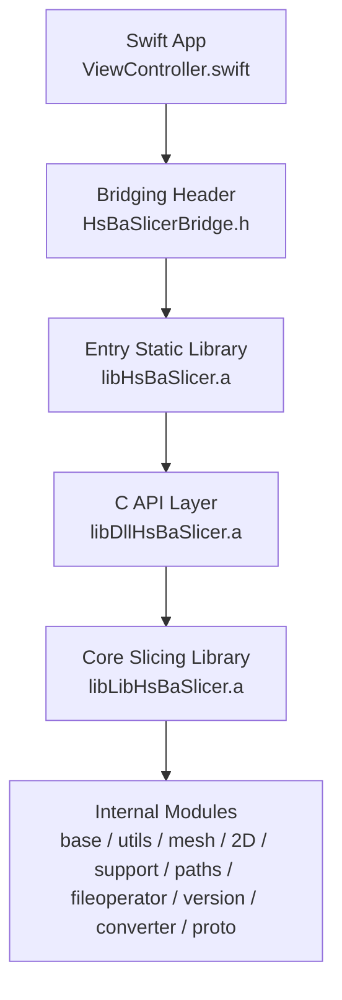
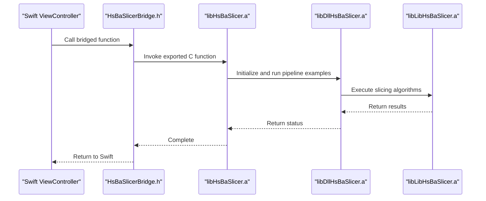
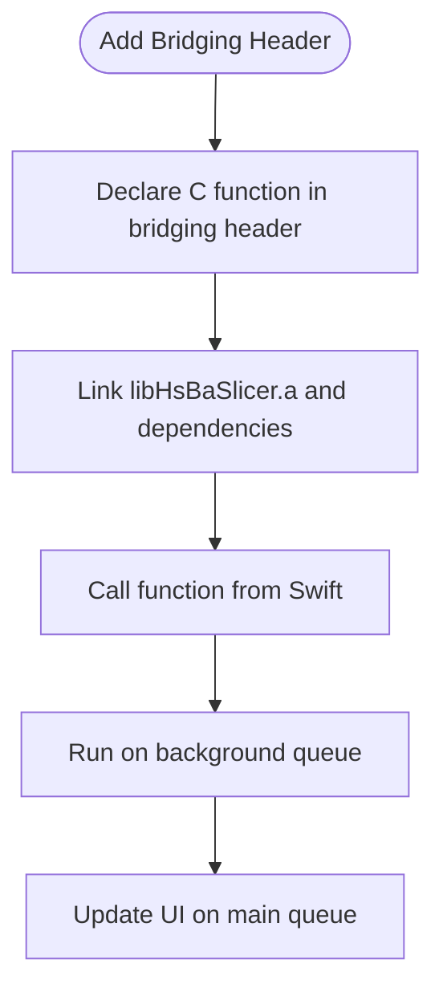
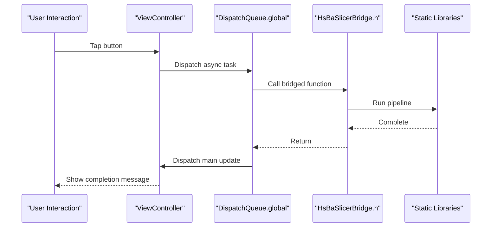
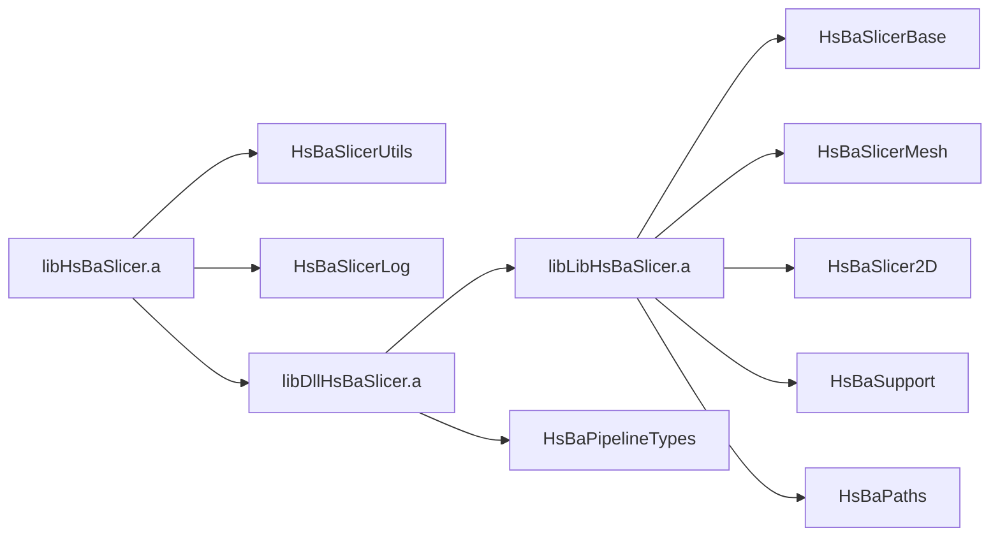

# iOS Integration

<cite>
**Referenced Files in This Document**
- [HsBaSlicerBridge.h](file://ios/HsBaSlicerExample/HsBaSlicerBridge.h)
- [ViewController.swift](file://ios/HsBaSlicerExample/ViewController.swift)
- [build-ios.yml](file://.github/workflows/build-ios.yml)
- [CMakeLists.txt](file://CMakeLists.txt)
- [HsBaSlicer CMakeLists.txt](file://HsBaSlicer/CMakeLists.txt)
- [DllHsBaSlicer CMakeLists.txt](file://DllHsBaSlicer/CMakeLists.txt)
- [LibHsBaSlicer CMakeLists.txt](file://LibHsBaSlicer/CMakeLists.txt)
- [export.h](file://LibHsBaSlicer/export.h)
- [dllexport.h](file://DllHsBaSlicer/dllexport.h)
</cite>

## Table of Contents
1. [Introduction](#introduction)
2. [Project Structure](#project-structure)
3. [Core Components](#core-components)
4. [Architecture Overview](#architecture-overview)
5. [Detailed Component Analysis](#detailed-component-analysis)
6. [Dependency Analysis](#dependency-analysis)
7. [Performance Considerations](#performance-considerations)
8. [Troubleshooting Guide](#troubleshooting-guide)
9. [Conclusion](#conclusion)
10. [Appendices](#appendices)

## Introduction
This document explains how to integrate HsBaSlicer into an iOS application. It covers Swift/Objective-C bridging, Xcode project integration, static library linking on iOS, deployment target configuration, asynchronous execution patterns, memory considerations, App Store deployment requirements, binary size optimization, and iOS-specific troubleshooting.

The repository provides:
- A C ABI bridge header for Swift bridging.
- An example Swift view controller that calls a pipeline entry function from the built static libraries.
- GitHub Actions workflows showing how to configure CMake for iOS with vcpkg and verify artifacts.
- CMake targets that build DllHsBaSlicer as a static library on iOS and link it into the HsBaSlicer example target.

## Project Structure
For iOS integration, the relevant parts are:
- `ios/HsBaSlicerExample`: Bridging header and Swift example app.
- `.github/workflows/build-ios.yml`: CI configuration for building iOS artifacts.
- Root `CMakeLists.txt`: Global platform detection, dependency selection, and install rules.
- `HsBaSlicer/CMakeLists.txt`: Builds the example entry point as a static library on iOS.
- `DllHsBaSlicer/CMakeLists.txt`: Builds the C API layer as a static library on iOS.
- `LibHsBaSlicer/CMakeLists.txt`: Core slicing algorithms library.
- `LibHsBaSlicer/export.h` and `DllHsBaSlicer/dllexport.h`: Export/import macros for shared/static builds.

**Diagram sources**
- [ViewController.swift:1-86](file://ios/HsBaSlicerExample/ViewController.swift#L1-L86)
- [HsBaSlicerBridge.h:1-32](file://ios/HsBaSlicerExample/HsBaSlicerBridge.h#L1-L32)
- [HsBaSlicer CMakeLists.txt:41-49](file://HsBaSlicer/CMakeLists.txt#L41-L49)
- [DllHsBaSlicer CMakeLists.txt:4-41](file://DllHsBaSlicer/CMakeLists.txt#L4-L41)
- [LibHsBaSlicer CMakeLists.txt:1-38](file://LibHsBaSlicer/CMakeLists.txt#L1-L38)

**Section sources**
- [HsBaSlicerBridge.h:1-32](file://ios/HsBaSlicerExample/HsBaSlicerBridge.h#L1-L32)
- [ViewController.swift:1-86](file://ios/HsBaSlicerExample/ViewController.swift#L1-L86)
- [build-ios.yml:42-57](file://.github/workflows/build-ios.yml#L42-L57)
- [CMakeLists.txt:149-157](file://CMakeLists.txt#L149-L157)
- [HsBaSlicer CMakeLists.txt:41-49](file://HsBaSlicer/CMakeLists.txt#L41-L49)
- [DllHsBaSlicer CMakeLists.txt:4-41](file://DllHsBaSlicer/CMakeLists.txt#L4-L41)
- [LibHsBaSlicer CMakeLists.txt:1-38](file://LibHsBaSlicer/CMakeLists.txt#L1-L38)

## Core Components
- Bridging header: Declares a C-compatible function exposed by the static library so Swift can call it through the Objective-C/Swift bridging mechanism.
- Swift example: Demonstrates calling the bridged function off the main thread and updating UI on the main queue.
- iOS build artifacts: On iOS, all libraries are static; the workflow verifies `libHsBaSlicer.a`, `libDllHsBaSlicer.a`, and `libLibHsBaSlicer.a`.
- CMake behavior: The root CMake detects mobile platforms, disables dynamic loader and some desktop-only features, and ensures tests are disabled during cross-compilation.

Key responsibilities:
- `HsBaSlicerBridge.h`: Provides the C ABI symbol visible to Swift.
- `ViewController.swift`: Runs pipeline examples asynchronously and updates UI safely.
- `build-ios.yml`: Configures CMake for iOS, sets vcpkg triplet, sysroot, architecture, and deployment target, then builds and verifies artifacts.
- `HsBaSlicer/CMakeLists.txt`: Builds the example entry point as a static library on iOS and links internal modules plus the C API layer.
- `DllHsBaSlicer/CMakeLists.txt`: Builds the C API layer as a static library on iOS and links core libraries.
- `LibHsBaSlicer/CMakeLists.txt`: Defines the core slicing library and its dependencies.

**Section sources**
- [HsBaSlicerBridge.h:1-32](file://ios/HsBaSlicerExample/HsBaSlicerBridge.h#L1-L32)
- [ViewController.swift:43-55](file://ios/HsBaSlicerExample/ViewController.swift#L43-L55)
- [build-ios.yml:59-111](file://.github/workflows/build-ios.yml#L59-L111)
- [HsBaSlicer CMakeLists.txt:41-49](file://HsBaSlicer/CMakeLists.txt#L41-L49)
- [DllHsBaSlicer CMakeLists.txt:4-41](file://DllHsBaSlicer/CMakeLists.txt#L4-L41)
- [LibHsBaSlicer CMakeLists.txt:1-38](file://LibHsBaSlicer/CMakeLists.txt#L1-L38)

## Architecture Overview
At runtime, the Swift app loads the statically linked HsBaSlicer libraries. The bridging header exposes a C function that initializes the slicer environment and runs example pipelines. Internally, this uses the C API layer (`DllHsBaSlicer`) which depends on the core slicing library (`LibHsBaSlicer`) and internal modules.

**Diagram sources**
- [ViewController.swift:43-55](file://ios/HsBaSlicerExample/ViewController.swift#L43-L55)
- [HsBaSlicerBridge.h:19-25](file://ios/HsBaSlicerExample/HsBaSlicerBridge.h#L19-L25)
- [HsBaSlicer CMakeLists.txt:41-49](file://HsBaSlicer/CMakeLists.txt#L41-L49)
- [DllHsBaSlicer CMakeLists.txt:4-41](file://DllHsBaSlicer/CMakeLists.txt#L4-L41)
- [LibHsBaSlicer CMakeLists.txt:1-38](file://LibHsBaSlicer/CMakeLists.txt#L1-L38)

## Detailed Component Analysis

### Swift/Objective-C Bridging Setup
- Use a bridging header to expose a C-compatible function from the static library.
- The provided bridging header declares a function that runs FDM/SLA/SLS pipeline examples.
- In your Xcode project, add the bridging header path under Build Settings > Swift Compiler - General > Objective-C Bridging Header.
- Ensure the static libraries are linked into your app target.

**Diagram sources**
- [HsBaSlicerBridge.h:19-25](file://ios/HsBaSlicerExample/HsBaSlicerBridge.h#L19-L25)
- [ViewController.swift:43-55](file://ios/HsBaSlicerExample/ViewController.swift#L43-L55)

**Section sources**
- [HsBaSlicerBridge.h:1-32](file://ios/HsBaSlicerExample/HsBaSlicerBridge.h#L1-L32)
- [ViewController.swift:43-55](file://ios/HsBaSlicerExample/ViewController.swift#L43-L55)

### Xcode Project Integration and Framework Linking
- Add the generated static libraries to your Xcode target’s Linked Frameworks and Libraries.
- For iOS, the project builds static archives rather than dynamic frameworks.
- Include the bridging header in your app target settings.
- If you use CMake-generated Xcode projects, ensure the iOS toolchain is configured correctly (see Deployment Target section).

Important notes:
- On iOS, `DllHsBaSlicer` is built as a static library because iOS apps cannot load arbitrary dylibs at runtime.
- The example entry point `HsBaSlicer` is also built as a static library on iOS and links the C API layer.

**Section sources**
- [DllHsBaSlicer CMakeLists.txt:4-41](file://DllHsBaSlicer/CMakeLists.txt#L4-L41)
- [HsBaSlicer CMakeLists.txt:41-49](file://HsBaSlicer/CMakeLists.txt#L41-L49)

### Deployment Target Considerations
- The CI workflow configures CMake for iOS with:
  - System name: iOS
  - Sysroot: iphoneos
  - Architecture: arm64
  - Deployment target: 26.5
- Adjust these values to match your app’s minimum supported iOS version and device architectures.

Recommended steps:
- Set your Xcode project’s iOS Deployment Target to the same or higher value used during static library generation.
- Ensure your app target supports the same architectures as the static libraries.

**Section sources**
- [build-ios.yml:42-52](file://.github/workflows/build-ios.yml#L42-L52)

### Calling Slicing Functions from Swift
- The example shows calling the bridged function from a background queue and updating the UI on the main queue.
- For production code:
  - Wrap long-running slicing operations in background tasks.
  - Report progress via callbacks or async streams if you extend the C API.
  - Avoid blocking the main thread.

**Diagram sources**
- [ViewController.swift:43-55](file://ios/HsBaSlicerExample/ViewController.swift#L43-L55)
- [HsBaSlicerBridge.h:19-25](file://ios/HsBaSlicerExample/HsBaSlicerBridge.h#L19-L25)

**Section sources**
- [ViewController.swift:43-55](file://ios/HsBaSlicerExample/ViewController.swift#L43-L55)

### Handling Asynchronous Operations
- Use GCD or async/await patterns to avoid blocking the UI.
- Keep heavy computations off the main thread.
- If you extend the C API, consider exposing progress callbacks or using coroutines internally where appropriate.

Best practices:
- Use high-priority queues for user-initiated tasks.
- Throttle repeated UI updates.
- Cancel or pause long-running operations when the app enters background.

**Section sources**
- [ViewController.swift:43-55](file://ios/HsBaSlicerExample/ViewController.swift#L43-L55)

### Managing Memory Efficiently on iOS
- Prefer value types and small data structures in Swift.
- Avoid retaining large model objects longer than necessary.
- Release resources promptly after slicing completes.
- Be mindful of peak memory usage during mesh processing and path generation.

Recommendations:
- Process models incrementally when possible.
- Clear intermediate buffers after each stage.
- Monitor memory pressure and reduce workload if needed.

[No sources needed since this section provides general guidance]

### App Store Deployment Requirements
- All libraries must be statically linked into your app bundle.
- Ensure no unsupported dynamic loading is used at runtime.
- Verify that your app complies with Apple’s privacy and entitlement policies.
- Confirm that your deployment target matches the minimum iOS version required by your app.

Verification checklist:
- Static libraries are included in the app bundle.
- No runtime dylib loading is attempted.
- Binary signatures and codesigning are correct.
- Info.plist and entitlements are properly configured.

**Section sources**
- [build-ios.yml:64-67](file://.github/workflows/build-ios.yml#L64-L67)

### Binary Size Optimization
- Disable optional features not needed on iOS:
  - Dynamic library loader is disabled on non-desktop platforms.
  - Bit7z compression is disabled on non-desktop platforms.
  - OpenCV, CGAL, OpenCASCADE, and OpenVDB are conditionally disabled on iOS.
- Remove unused modules and samples from the build.
- Use Release builds with optimizations enabled.

Relevant configuration highlights:
- Dynamic loader disabled on non-desktop platforms.
- Bit7z disabled on non-desktop platforms.
- Optional kernels disabled on iOS.

**Section sources**
- [CMakeLists.txt:229-240](file://CMakeLists.txt#L229-L240)
- [CMakeLists.txt:248-256](file://CMakeLists.txt#L248-L256)
- [CMakeLists.txt:277-280](file://CMakeLists.txt#L277-L280)
- [CMakeLists.txt:286-292](file://CMakeLists.txt#L286-L292)
- [CMakeLists.txt:313-318](file://CMakeLists.txt#L313-L318)
- [CMakeLists.txt:323-327](file://CMakeLists.txt#L323-L327)

## Dependency Analysis
The iOS build produces static libraries with clear dependency relationships:
- `libHsBaSlicer.a` (example entry) links `HsBaSlicerUtils`, `HsBaSlicerLog`, and `DllHsBaSlicer`.
- `libDllHsBaSlicer.a` (C API layer) links `LibHsBaSlicer` and multiple internal modules.
- `libLibHsBaSlicer.a` (core algorithms) links base, mesh, 2D, support, paths, utils, preprocess, fileoperator, version, converter, and proto.

**Diagram sources**
- [HsBaSlicer CMakeLists.txt:45-49](file://HsBaSlicer/CMakeLists.txt#L45-L49)
- [DllHsBaSlicer CMakeLists.txt:84-100](file://DllHsBaSlicer/CMakeLists.txt#L84-L100)
- [LibHsBaSlicer CMakeLists.txt:86-100](file://LibHsBaSlicer/CMakeLists.txt#L86-L100)

**Section sources**
- [HsBaSlicer CMakeLists.txt:45-49](file://HsBaSlicer/CMakeLists.txt#L45-L49)
- [DllHsBaSlicer CMakeLists.txt:84-100](file://DllHsBaSlicer/CMakeLists.txt#L84-L100)
- [LibHsBaSlicer CMakeLists.txt:86-100](file://LibHsBaSlicer/CMakeLists.txt#L86-L100)

## Performance Considerations
- Run slicing operations on background threads to keep the UI responsive.
- Avoid unnecessary copies of large meshes and path data.
- Reuse configuration objects where possible.
- Profile memory usage during mesh slicing and path generation.
- Consider reducing model complexity before slicing if acceptable.

[No sources needed since this section provides general guidance]

## Troubleshooting Guide

Common iOS-specific issues and resolutions:

- Missing bridging header symbol in Swift:
  - Ensure the bridging header declares the C function and is added to the app target.
  - Verify the static library exports the expected symbol.

- Static library not found during linking:
  - Confirm `libHsBaSlicer.a`, `libDllHsBaSlicer.a`, and `libLibHsBaSlicer.a` are present and linked.
  - Check that the iOS build produced static archives instead of dynamic libraries.

- Deployment target mismatch:
  - Align your Xcode deployment target with the value used during static library generation.
  - Ensure architectures match your device or simulator requirements.

- Feature availability differences:
  - Some features are disabled on iOS (dynamic loader, bit7z, OpenCV, CGAL, OpenCASCADE, OpenVDB).
  - If your code relies on these features, adjust the build configuration or provide alternatives.

- Tests disabled during cross-compilation:
  - Tests are disabled on iOS by default due to output limitations.
  - Focus on integration testing within your app.

Verification references:
- CI workflow checks for static libraries and exported symbols.
- CMake disables dynamic loader and optional features on non-desktop platforms.
- Example source files are verified in CI.

**Section sources**
- [build-ios.yml:59-111](file://.github/workflows/build-ios.yml#L59-L111)
- [CMakeLists.txt:229-240](file://CMakeLists.txt#L229-L240)
- [CMakeLists.txt:248-256](file://CMakeLists.txt#L248-L256)
- [CMakeLists.txt:277-280](file://CMakeLists.txt#L277-L280)
- [CMakeLists.txt:286-292](file://CMakeLists.txt#L286-L292)
- [CMakeLists.txt:313-318](file://CMakeLists.txt#L313-L318)
- [CMakeLists.txt:323-327](file://CMakeLists.txt#L323-L327)

## Conclusion
Integrating HsBaSlicer into iOS involves:
- Using a bridging header to expose a C function.
- Linking static libraries built for iOS.
- Running slicing operations off the main thread.
- Aligning deployment targets and architectures.
- Leveraging the project’s CMake configuration to disable non-essential features on iOS.
- Following App Store requirements and optimizing binary size.

The provided example and CI workflows demonstrate a practical path to build, link, and verify HsBaSlicer on iOS.

[No sources needed since this section summarizes without analyzing specific files]

## Appendices

### Export Macros Reference
- `HSBA_SLICER_LIB_API`: Used by `LibHsBaSlicer` for shared library export/import on Windows; empty on non-Windows.
- `HSBA_SLICER_API`: Used by `DllHsBaSlicer` for shared library export/import on Windows; empty on non-Windows.

On iOS, both layers are built as static libraries, so these macros do not affect symbol visibility beyond their intended platform behavior.

**Section sources**
- [export.h:1-22](file://LibHsBaSlicer/export.h#L1-L22)
- [dllexport.h:1-23](file://DllHsBaSlicer/dllexport.h#L1-L23)