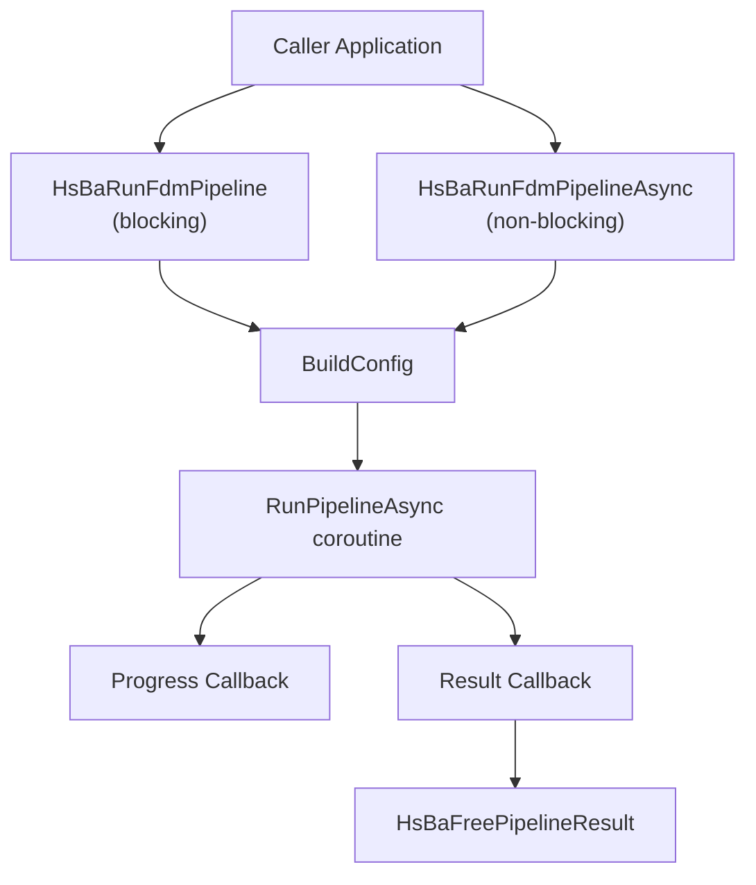
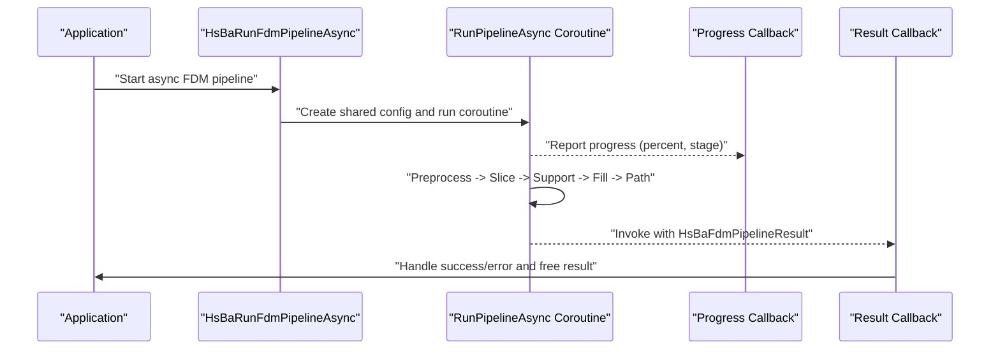
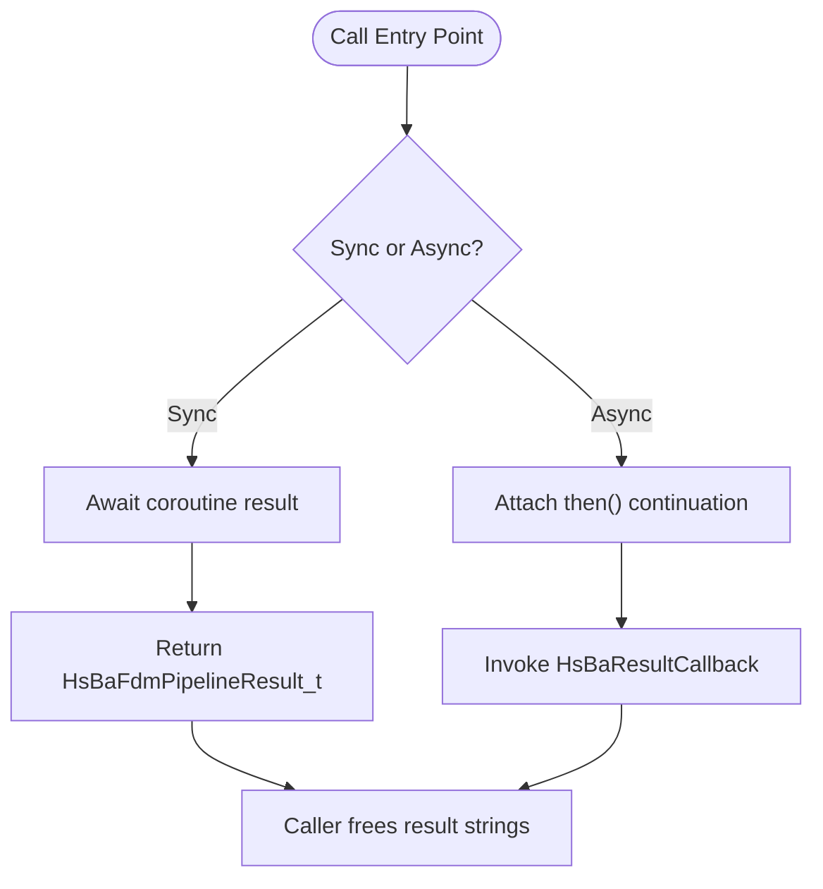
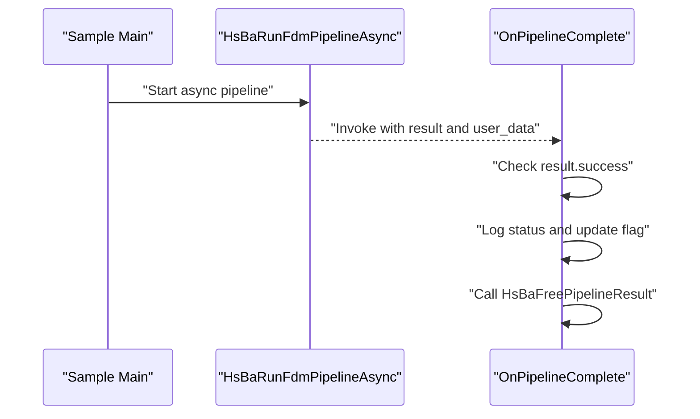
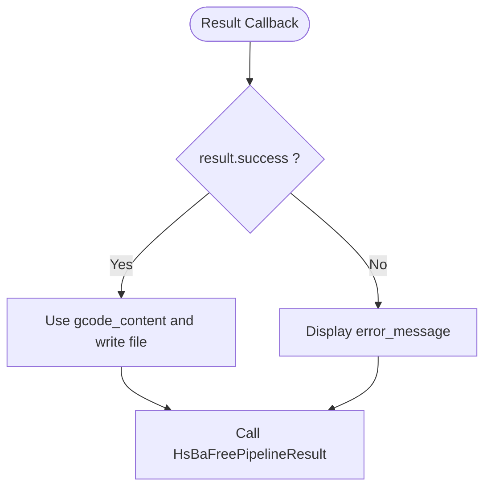
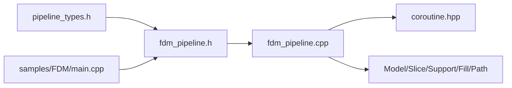

# Asynchronous Execution / 异步执行

<cite>
**Referenced Files in This Document**   
- [fdm_pipeline.h](file://DllHsBaSlicer/fdm_pipeline.h)
- [fdm_pipeline.cpp](file://DllHsBaSlicer/fdm_pipeline.cpp)
- [pipeline_types.h](file://pipelinetypes/pipeline_types.h)
- [coroutine.hpp](file://base/coroutine.hpp)
- [main.cpp](file://samples/FDM/main.cpp)
</cite>

## Table of Contents
1. [Introduction](#introduction)
2. [Project Structure](#project-structure)
3. [Core Components](#core-components)
4. [Architecture Overview](#architecture-overview)
5. [Detailed Component Analysis](#detailed-component-analysis)
6. [Dependency Analysis](#dependency-analysis)
7. [Performance Considerations](#performance-considerations)
8. [Troubleshooting Guide](#troubleshooting-guide)
9. [Conclusion](#conclusion)
10. [Appendices](#appendices)

## Introduction
This document explains asynchronous FDM pipeline execution in HsBaSlicer, focusing on the difference between synchronous and asynchronous modes, the `HsBaRunFdmPipelineAsync()` API, the completion callback mechanism, progress monitoring, thread safety, GUI integration patterns, error handling, and timeout management.

The FDM pipeline performs preprocessing, slicing, support generation, infill generation, and G-code path generation. It exposes both a blocking C ABI entry point for synchronous use and a non-blocking entry point for asynchronous use. Internally, the pipeline is implemented as a C++20 coroutine-based task that can be awaited synchronously or continued asynchronously via a completion callback.

## Project Structure
The asynchronous FDM pipeline is primarily defined by:
- The public C ABI header declaring configuration, result, callbacks, and async/sync functions.
- The implementation file containing the coroutine-based pipeline, synchronization wrapper, and async wrapper.
- The shared type definitions header defining FDM config/result structs and callback types.
- The coroutine framework providing `Task`, executors, and chaining.
- A sample program demonstrating synchronous, asynchronous, Lua customization, and spiral mode usage.

**Diagram sources**
- [fdm_pipeline.h:23-61](file://DllHsBaSlicer/fdm_pipeline.h#L23-L61)
- [fdm_pipeline.cpp:460-496](file://DllHsBaSlicer/fdm_pipeline.cpp#L460-L496)
- [pipeline_types.h:115-140](file://pipelinetypes/pipeline_types.h#L115-L140)

**Section sources**
- [fdm_pipeline.h:1-68](file://DllHsBaSlicer/fdm_pipeline.h#L1-L68)
- [fdm_pipeline.cpp:1-497](file://DllHsBaSlicer/fdm_pipeline.cpp#L1-L497)
- [pipeline_types.h:115-140](file://pipelinetypes/pipeline_types.h#L115-L140)
- [main.cpp:222-269](file://samples/FDM/main.cpp#L222-L269)

## Core Components
- **Configuration**: `HsBaFdmPipelineConfig_t` defines model, slice, fill, support, path, firmware, printer, Lua customization, and output settings.
- **Result**: `HsBaFdmPipelineResult_t` contains success flag, total layers, G-code content, error message, and elapsed seconds. Its string fields are heap-allocated by the library and must be freed by the caller using `HsBaFreePipelineResult`.
- **Callbacks**:
  - `HsBaProgressCallback(percent, stage, user_data)` reports pipeline progress.
  - `HsBaResultCallback(result, user_data)` receives the final result after asynchronous completion.
- **Entry Points**:
  - `HsBaRunFdmPipeline(config, progress_callback, user_data)` blocks until the pipeline completes.
  - `HsBaRunFdmPipelineAsync(config, progress_callback, user_data, result_callback, result_user_data)` starts the pipeline asynchronously and invokes the result callback when done.

**Section sources**
- [pipeline_types.h:53-140](file://pipelinetypes/pipeline_types.h#L53-L140)
- [fdm_pipeline.h:17-61](file://DllHsBaSlicer/fdm_pipeline.h#L17-L61)

## Architecture Overview
The FDM pipeline uses a coroutine-based internal task. Synchronous calls await the task; asynchronous calls attach a continuation to invoke the completion callback. Progress updates are emitted through the progress callback during pipeline stages.

**Diagram sources**
- [fdm_pipeline.cpp:216-447](file://DllHsBaSlicer/fdm_pipeline.cpp#L216-L447)
- [fdm_pipeline.cpp:469-486](file://DllHsBaSlicer/fdm_pipeline.cpp#L469-L486)
- [pipeline_types.h:129-140](file://pipelinetypes/pipeline_types.h#L129-L140)

## Detailed Component Analysis

### Synchronous vs Asynchronous Modes
- **Synchronous mode**: `HsBaRunFdmPipeline` builds an internal configuration, runs the coroutine task, awaits its result, and returns a C-compatible result struct. The calling thread blocks until completion.
- **Asynchronous mode**: `HsBaRunFdmPipelineAsync` heap-allocates the internal configuration to ensure lifetime safety during coroutine execution, creates the task, and attaches a continuation that converts the internal result into the C result and invokes the provided result callback.

Key differences:
- Blocking behavior: synchronous waits; asynchronous returns immediately.
- Resource ownership: both return results whose strings must be freed by the caller; asynchronous results are delivered via callback.
- Completion signaling: synchronous uses return value; asynchronous uses `HsBaResultCallback`.

**Diagram sources**
- [fdm_pipeline.cpp:460-486](file://DllHsBaSlicer/fdm_pipeline.cpp#L460-L486)
- [pipeline_types.h:115-140](file://pipelinetypes/pipeline_types.h#L115-L140)

**Section sources**
- [fdm_pipeline.cpp:460-496](file://DllHsBaSlicer/fdm_pipeline.cpp#L460-L496)
- [fdm_pipeline.h:23-61](file://DllHsBaSlicer/fdm_pipeline.h#L23-L61)

### Completion Callback Mechanism
The completion callback signature is:
- `void OnPipelineComplete(HsBaFdmPipelineResult_t result, void* user_data)`

Responsibilities:
- Inspect `result.success` to determine success or failure.
- Read `result.total_layers`, `result.elapsed_seconds`, and optionally `result.gcode_content`.
- Handle errors via `result.error_message`.
- Always call `HsBaFreePipelineResult(&result)` to release allocated strings.

Example pattern from the sample:
- Define `OnPipelineComplete` to log status and set a completion flag.
- Pass it to `HsBaRunFdmPipelineAsync` along with a progress callback and user data.
- In the main loop, wait for the completion flag and then process the outcome.

**Diagram sources**
- [main.cpp:227-243](file://samples/FDM/main.cpp#L227-L243)
- [fdm_pipeline.cpp:469-486](file://DllHsBaSlicer/fdm_pipeline.cpp#L469-L486)

**Section sources**
- [main.cpp:222-269](file://samples/FDM/main.cpp#L222-L269)
- [pipeline_types.h:115-140](file://pipelinetypes/pipeline_types.h#L115-L140)
- [fdm_pipeline.cpp:488-496](file://DllHsBaSlicer/fdm_pipeline.cpp#L488-L496)

### Non-blocking Pipeline Execution
To execute the FDM pipeline without blocking the caller:
- Prepare `HsBaFdmPipelineConfig_t` using defaults and custom values.
- Provide a progress callback if you need UI updates or telemetry.
- Provide a result callback to handle completion.
- Optionally pass user data pointers to both callbacks for context.

Practical steps:
- Initialize config with `HsBaCreateDefaultConfig`.
- Set model name/path and relevant parameters.
- Call `HsBaRunFdmPipelineAsync`.
- Continue application logic while waiting for the completion callback.

**Section sources**
- [fdm_pipeline.h:37-51](file://DllHsBaSlicer/fdm_pipeline.h#L37-L51)
- [main.cpp:245-269](file://samples/FDM/main.cpp#L245-L269)

### Progress Monitoring During Async Operations
Progress is reported through `HsBaProgressCallback`:
- `percent`: integer percentage from 0 to 100.
- `stage`: UTF-8 description of the current stage.
- `user_data`: your context pointer.

Internal progress points include:
- Model loading.
- Slicing per layer.
- Support generation.
- Fill generation.
- G-code path generation.
- Pipeline completion.

GUI integration tip:
- Update progress bars and labels on the UI thread.
- Avoid heavy work inside the progress callback; post UI updates instead.

**Section sources**
- [pipeline_types.h:129-135](file://pipelinetypes/pipeline_types.h#L129-L135)
- [fdm_pipeline.cpp:134-140](file://DllHsBaSlicer/fdm_pipeline.cpp#L134-L140)
- [fdm_pipeline.cpp:231-435](file://DllHsBaSlicer/fdm_pipeline.cpp#L231-L435)

### Proper Resource Cleanup
Memory ownership rules:
- `HsBaFdmPipelineResult_t.gcode_content` and `HsBaFdmPipelineResult_t.error_message` are allocated by the library.
- The caller must call `HsBaFreePipelineResult(&result)` after using the result.
- Do not manually free these strings; do not reuse the result after freeing.

Best practices:
- Wrap result handling in a scope guard or RAII helper.
- Ensure cleanup happens in both success and error paths.
- For async callbacks, free the result at the end of the callback.

**Section sources**
- [pipeline_types.h:115-127](file://pipelinetypes/pipeline_types.h#L115-L127)
- [fdm_pipeline.cpp:488-496](file://DllHsBaSlicer/fdm_pipeline.cpp#L488-L496)
- [main.cpp:227-243](file://samples/FDM/main.cpp#L227-L243)

### Thread Safety Considerations
- The internal pipeline uses C++20 coroutines and parallel layer processing where safe.
- Lua-based support and infill stages may require serial execution due to interpreter state constraints.
- Progress and result callbacks are invoked by the pipeline’s continuation mechanism.
- If your application has a single-threaded UI, marshal UI updates from the callback to the UI thread.
- Avoid mutating shared state from callbacks without proper synchronization.

Thread-safety guidance:
- Treat callback execution context as potentially non-UI.
- Use thread-safe queues or event posting for UI updates.
- Protect shared resources accessed from multiple callbacks.

**Section sources**
- [fdm_pipeline.cpp:216-447](file://DllHsBaSlicer/fdm_pipeline.cpp#L216-L447)
- [coroutine.hpp:44-70](file://base/coroutine.hpp#L44-L70)

### Integration Patterns for GUI Applications
Recommended pattern:
- Start async pipeline from the UI thread.
- Update UI from progress callback by dispatching to the UI thread.
- Handle completion in the result callback by dispatching to the UI thread.
- Show success dialog or error dialog based on `result.success`.
- Release result memory in the result callback.

Example flow:
- User clicks “Slice”.
- Application calls `HsBaRunFdmPipelineAsync`.
- Progress updates refresh the progress bar.
- Completion shows result summary and writes G-code if needed.

**Section sources**
- [main.cpp:38-47](file://samples/FDM/main.cpp#L38-L47)
- [main.cpp:227-269](file://samples/FDM/main.cpp#L227-L269)

### Error Handling Strategies in Asynchronous Workflows
Error signals:
- `result.success == 0` indicates failure.
- `result.error_message` contains a UTF-8 error description.
- Errors originate from pipeline stages such as model loading, slicing, support generation, fill generation, or path generation.

Handling strategy:
- Check `result.success` first.
- Log or display `result.error_message`.
- Avoid writing G-code when success is false.
- Always free the result.

**Diagram sources**
- [fdm_pipeline.cpp:437-446](file://DllHsBaSlicer/fdm_pipeline.cpp#L437-L446)
- [main.cpp:227-243](file://samples/FDM/main.cpp#L227-L243)

**Section sources**
- [fdm_pipeline.cpp:437-446](file://DllHsBaSlicer/fdm_pipeline.cpp#L437-L446)
- [pipeline_types.h:115-127](file://pipelinetypes/pipeline_types.h#L115-L127)

### Timeout Management
The FDM pipeline does not expose a built-in timeout parameter in the C ABI. To implement timeouts:
- Track start time before calling `HsBaRunFdmPipelineAsync`.
- Use a separate timer or polling loop to check elapsed time against a threshold.
- If exceeded, mark the operation as timed out and notify the user.
- Note: there is no cancellation handle returned by `HsBaRunFdmPipelineAsync`; the function reserves future cancellation capability.
- For long-running operations, consider wrapping the async call with an external watchdog that enforces deadlines.

Timeout pattern:
- Start timer.
- Launch async pipeline.
- Poll or schedule periodic checks.
- On timeout, stop waiting and report timeout.
- On completion, cancel timeout check and process result.

**Section sources**
- [fdm_pipeline.h:37-51](file://DllHsBaSlicer/fdm_pipeline.h#L37-L51)
- [main.cpp:245-269](file://samples/FDM/main.cpp#L245-L269)

## Dependency Analysis
The asynchronous FDM pipeline depends on:
- Public C ABI declarations.
- Shared type definitions for config/result/callbacks.
- Coroutine framework for task execution and chaining.
- Internal pipeline stages for model loading, slicing, support, fill, and path generation.

**Diagram sources**
- [pipeline_types.h:53-140](file://pipelinetypes/pipeline_types.h#L53-L140)
- [fdm_pipeline.h:1-68](file://DllHsBaSlicer/fdm_pipeline.h#L1-L68)
- [fdm_pipeline.cpp:1-497](file://DllHsBaSlicer/fdm_pipeline.cpp#L1-L497)
- [coroutine.hpp:44-90](file://base/coroutine.hpp#L44-L90)
- [main.cpp:1-337](file://samples/FDM/main.cpp#L1-L337)

**Section sources**
- [pipeline_types.h:53-140](file://pipelinetypes/pipeline_types.h#L53-L140)
- [fdm_pipeline.h:1-68](file://DllHsBaSlicer/fdm_pipeline.h#L1-L68)
- [fdm_pipeline.cpp:1-497](file://DllHsBaSlicer/fdm_pipeline.cpp#L1-L497)
- [coroutine.hpp:44-90](file://base/coroutine.hpp#L44-L90)
- [main.cpp:1-337](file://samples/FDM/main.cpp#L1-L337)

## Performance Considerations
- Parallel layer slicing and filling improve throughput when safe.
- Lua-based stages may be serialized due to interpreter constraints.
- Spiral/vase mode skips support and infill, reducing computation.
- Progress callbacks should be lightweight; avoid expensive operations in callbacks.
- Batch UI updates to reduce redraw overhead.

[No sources needed since this section provides general guidance]

## Troubleshooting Guide
Common issues and resolutions:
- **Callback never invoked**: Ensure `HsBaRunFdmPipelineAsync` is called and the event loop continues running so continuations can execute.
- **UI freezes**: Offload heavy work from callbacks; dispatch UI updates to the UI thread.
- **Memory leaks**: Always call `HsBaFreePipelineResult` in both success and error paths.
- **Errors in pipeline**: Inspect `result.error_message` and validate input configuration (model path, layer height, etc.).
- **Timeout not enforced**: Implement external timeout logic since the API does not provide cancellation handles.

**Section sources**
- [fdm_pipeline.cpp:488-496](file://DllHsBaSlicer/fdm_pipeline.cpp#L488-L496)
- [main.cpp:227-269](file://samples/FDM/main.cpp#L227-L269)

## Conclusion
Asynchronous FDM pipeline execution in HsBaSlicer is achieved through `HsBaRunFdmPipelineAsync`, which launches a coroutine-based pipeline and delivers results via `HsBaResultCallback`. Progress is reported through `HsBaProgressCallback`. Correct resource cleanup requires calling `HsBaFreePipelineResult`. For GUI applications, marshal UI updates to the UI thread and handle errors gracefully. Built-in cancellation is not exposed; implement external timeout mechanisms as needed.

[No sources needed since this section summarizes without analyzing specific files]

## Appendices

### API Reference Summary
- **Config**: `HsBaFdmPipelineConfig_t`
- **Result**: `HsBaFdmPipelineResult_t`
- **Progress Callback**: `HsBaProgressCallback(percent, stage, user_data)`
- **Result Callback**: `HsBaResultCallback(result, user_data)`
- **Sync Entry**: `HsBaRunFdmPipeline(config, progress_callback, user_data)`
- **Async Entry**: `HsBaRunFdmPipelineAsync(config, progress_callback, user_data, result_callback, result_user_data)`
- **Cleanup**: `HsBaFreePipelineResult(&result)`

**Section sources**
- [pipeline_types.h:53-140](file://pipelinetypes/pipeline_types.h#L53-L140)
- [fdm_pipeline.h:17-61](file://DllHsBaSlicer/fdm_pipeline.h#L17-L61)