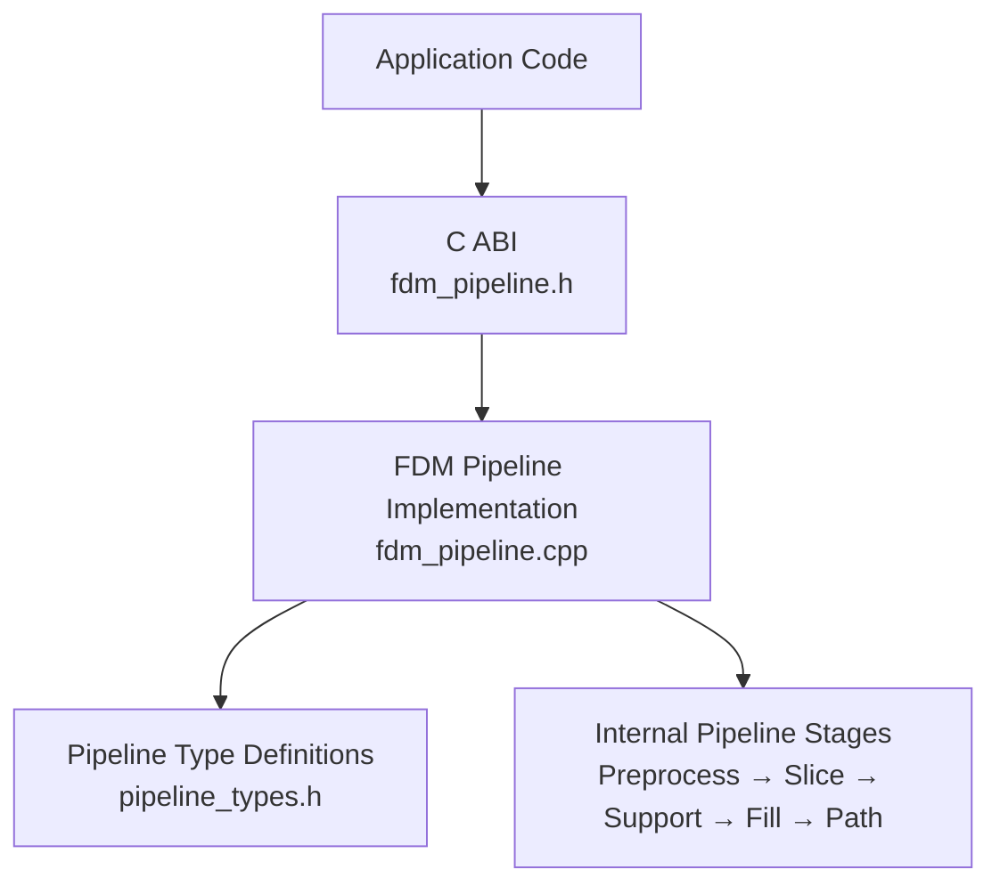
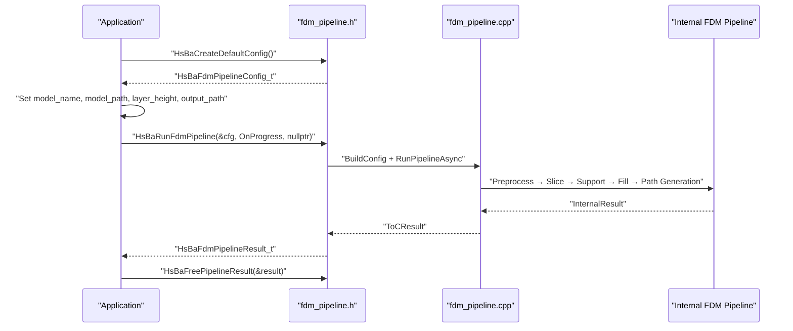
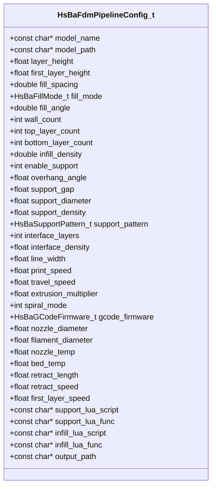
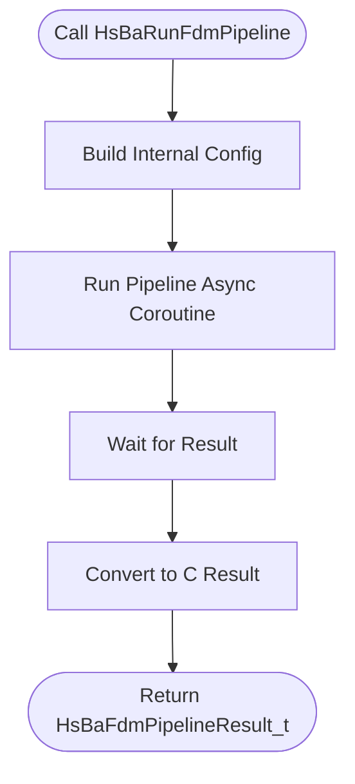
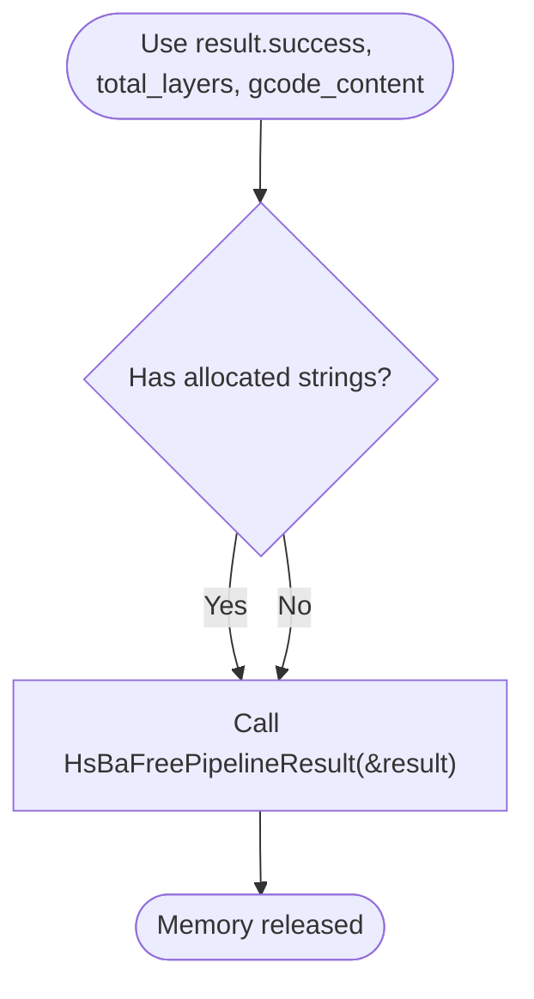
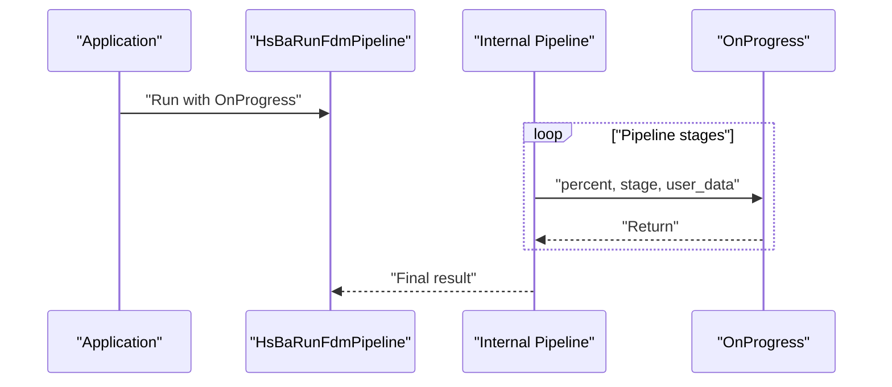
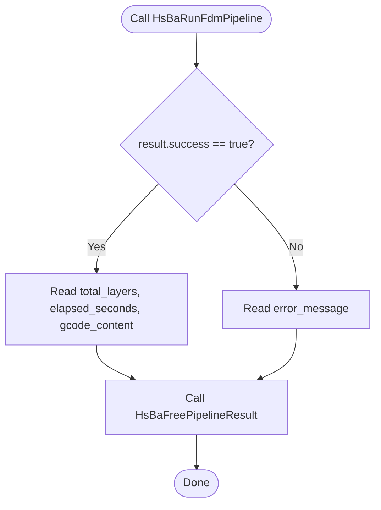
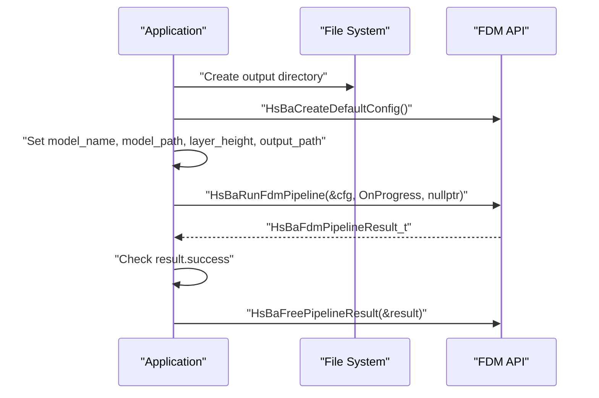
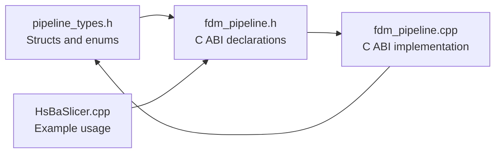

# Basic FDM Usage / FDM基础用法

<cite>
**Referenced Files in This Document**
- [pipeline_types.h](file://pipelinetypes/pipeline_types.h)
- [fdm_pipeline.h](file://DllHsBaSlicer/fdm_pipeline.h)
- [fdm_pipeline.cpp](file://DllHsBaSlicer/fdm_pipeline.cpp)
- [HsBaSlicer.cpp](file://HsBaSlicer/HsBaSlicer.cpp)
</cite>

## Table of Contents
1. [Introduction](#introduction)
2. [Project Structure](#project-structure)
3. [Core Components](#core-components)
4. [Architecture Overview](#architecture-overview)
5. [Detailed Component Analysis](#detailed-component-analysis)
6. [Dependency Analysis](#dependency-analysis)
7. [Performance Considerations](#performance-considerations)
8. [Troubleshooting Guide](#troubleshooting-guide)
9. [Conclusion](#conclusion)
10. [Appendices](#appendices)

## Introduction
This document explains the basic FDM slicing workflow in HsBaSlicer. It focuses on the simplest possible synchronous usage: loading a model, configuring default parameters, running the pipeline, handling progress, and freeing allocated memory. The primary C ABI entry points are `HsBaCreateDefaultConfig()`, `HsBaRunFdmPipeline()`, and `HsBaFreePipelineResult()`. The configuration structure is `HsBaFdmPipelineConfig_t`, which includes essential fields such as `model_name`, `model_path`, `layer_height`, and `output_path`.

The goal is to help you set up a minimal FDM slicing program quickly while understanding how the library allocates and releases memory, how progress callbacks work, and what error information is available.

## Project Structure
The FDM basic usage surface is exposed through a small C ABI layer that wraps the internal C++ pipeline implementation. The key files are:

- `pipelinetypes/pipeline_types.h`: Defines the C-compatible configuration and result structures, including `HsBaFdmPipelineConfig_t` and `HsBaFdmPipelineResult_t`.
- `DllHsBaSlicer/fdm_pipeline.h`: Declares the exported C functions for creating defaults, running the pipeline synchronously or asynchronously, and freeing results.
- `DllHsBaSlicer/fdm_pipeline.cpp`: Implements the C ABI and the internal coroutine-based FDM pipeline stages.
- `HsBaSlicer/HsBaSlicer.cpp`: Contains a complete example showing how to call the FDM API from an application.

**Diagram sources**
- [fdm_pipeline.h:1-68](file://DllHsBaSlicer/fdm_pipeline.h#L1-L68)
- [fdm_pipeline.cpp:1-497](file://DllHsBaSlicer/fdm_pipeline.cpp#L1-L497)
- [pipeline_types.h:53-127](file://pipelinetypes/pipeline_types.h#L53-L127)

**Section sources**
- [fdm_pipeline.h:1-68](file://DllHsBaSlicer/fdm_pipeline.h#L1-L68)
- [fdm_pipeline.cpp:1-497](file://DllHsBaSlicer/fdm_pipeline.cpp#L1-L497)
- [pipeline_types.h:53-127](file://pipelinetypes/pipeline_types.h#L53-L127)
- [HsBaSlicer.cpp:45-106](file://HsBaSlicer/HsBaSlicer.cpp#L45-L106)

## Core Components
The basic FDM workflow uses three main components:

1. **Configuration structure**: `HsBaFdmPipelineConfig_t` describes the input model, slicing settings, fill and support options, printer/G-code settings, Lua customization, and output path.
2. **API functions**:
   - `HsBaCreateDefaultConfig()` returns a fully initialized default configuration.
   - `HsBaRunFdmPipeline()` runs the full pipeline synchronously and returns a result.
   - `HsBaFreePipelineResult()` frees memory owned by the returned result.
3. **Progress callback**: `OnProgress` (or any function matching `HsBaProgressCallback`) receives percentage updates and stage descriptions during slicing.

Key fields in `HsBaFdmPipelineConfig_t` relevant to basic usage:

| Field | Meaning | Typical Use |
|---|---|---|
| `model_name` | Human-readable model name | Optional identifier; used with model registry |
| `model_path` | Path to the input 3D model file | Required for loading a model from disk |
| `layer_height` | Layer height in millimeters | Controls slice resolution |
| `first_layer_height` | First layer height in millimeters | Often slightly larger than normal layers |
| `wall_count` | Number of wall perimeters | Affects outer shell thickness |
| `top_layer_count` | Top solid layer count | Affects top surface quality |
| `bottom_layer_count` | Bottom solid layer count | Affects bottom surface quality |
| `infill_density` | Infill density between 0 and 1 | Controls internal fill amount |
| `enable_support` | Enable support generation | Turn off for vase/spiral mode |
| `overhang_angle` | Overhang angle threshold in degrees | Influences support detection |
| `support_pattern` | Support pattern type | Plane, tree, or honeycomb |
| `line_width` | Extrusion line width in millimeters | Matches nozzle size |
| `print_speed` | Print speed in mm/s | Affects print time |
| `travel_speed` | Travel speed in mm/s | Non-extrusion movement speed |
| `extrusion_multiplier` | Extrusion multiplier | Adjusts material flow |
| `spiral_mode` | Vase/spiral continuous wall mode | Disables support and infill when enabled |
| `gcode_firmware` | Target G-code firmware | Marlin, RepRap, or Klipper |
| `nozzle_diameter` | Nozzle diameter in millimeters | Used for volume calculations |
| `filament_diameter` | Filament diameter in millimeters | Used for volume calculations |
| `nozzle_temp` | Nozzle temperature in Celsius | Emitted into G-code header/metadata |
| `bed_temp` | Bed temperature in Celsius | Emitted into G-code header/metadata |
| `retract_length` | Retraction length in millimeters | Reduces stringing |
| `retract_speed` | Retraction speed in mm/s | Retraction behavior |
| `first_layer_speed` | First layer speed in mm/s | Improves first-layer adhesion |
| `support_lua_script` | Custom support Lua script path | Optional advanced customization |
| `support_lua_func` | Custom support Lua function name | Optional advanced customization |
| `infill_lua_script` | Custom infill Lua script path | Optional advanced customization |
| `infill_lua_func` | Custom infill Lua function name | Optional advanced customization |
| `output_path` | Output G-code file path | Optional; can be NULL |

**Section sources**
- [pipeline_types.h:53-113](file://pipelinetypes/pipeline_types.h#L53-L113)
- [pipeline_types.h:738-783](file://pipelinetypes/pipeline_types.h#L738-L783)

## Architecture Overview
At a high level, the basic FDM usage follows this sequence:

1. Create a default configuration.
2. Set `model_name`, `model_path`, and optional printing parameters.
3. Optionally set `output_path`.
4. Call `HsBaRunFdmPipeline()` with a progress callback.
5. Check `result.success`.
6. Read `result.total_layers`, `result.elapsed_seconds`, and optionally `result.gcode_content`.
7. Call `HsBaFreePipelineResult()` to free allocated strings.

**Diagram sources**
- [fdm_pipeline.h:17-61](file://DllHsBaSlicer/fdm_pipeline.h#L17-L61)
- [fdm_pipeline.cpp:455-496](file://DllHsBaSlicer/fdm_pipeline.cpp#L455-L496)
- [HsBaSlicer.cpp:55-104](file://HsBaSlicer/HsBaSlicer.cpp#L55-L104)

## Detailed Component Analysis

### Configuration Structure: `HsBaFdmPipelineConfig_t`
`HsBaFdmPipelineConfig_t` is the central configuration object for FDM slicing. It groups model inputs, slicing geometry, fill and support behavior, path generation, printer/G-code metadata, Lua customization hooks, and output configuration.

Important design notes:

- String fields like `model_name`, `model_path`, and `output_path` are C-style pointers. They may be NULL unless required by your workflow.
- Numeric fields use floating-point units consistent with millimeters, degrees, seconds, Celsius, and normalized densities.
- Enumerated fields include fill modes, support patterns, and G-code firmware targets.
- Default values are provided by `HsBaFdmConfigDefault()`, which is wrapped by `HsBaCreateDefaultConfig()`.

**Diagram sources**
- [pipeline_types.h:53-113](file://pipelinetypes/pipeline_types.h#L53-L113)

**Section sources**
- [pipeline_types.h:53-113](file://pipelinetypes/pipeline_types.h#L53-L113)

### Default Configuration: `HsBaCreateDefaultConfig()`
`HsBaCreateDefaultConfig()` returns a default `HsBaFdmPipelineConfig_t`. Internally it delegates to `HsBaFdmConfigDefault()`, which initializes all numeric fields to sensible defaults and sets string fields to NULL.

Typical default values include:

- `layer_height = 0.2f`
- `first_layer_height = 0.25f`
- `fill_spacing = 0.4`
- `fill_mode = HSBA_FILL_ZIGZAG`
- `fill_angle = 45.0`
- `wall_count = 3`
- `top_layer_count = 3`
- `bottom_layer_count = 3`
- `infill_density = 0.2`
- `enable_support = 1`
- `overhang_angle = 45.0f`
- `support_gap = 0.5f`
- `support_diameter = 2.0f`
- `support_density = 0.3f`
- `support_pattern = HSBA_SUPPORT_PLANE`
- `interface_layers = 2`
- `interface_density = 0.5f`
- `line_width = 0.4f`
- `print_speed = 50.0f`
- `travel_speed = 100.0f`
- `extrusion_multiplier = 1.0f`
- `spiral_mode = 0`
- `gcode_firmware = HSBA_GCODE_MARLIN`
- `nozzle_diameter = 0.4f`
- `filament_diameter = 1.75f`
- `nozzle_temp = 200.0f`
- `bed_temp = 60.0f`
- `retract_length = 1.0f`
- `retract_speed = 40.0f`
- `first_layer_speed = 20.0f`

You should call `HsBaCreateDefaultConfig()` before setting only the fields you need to change.

**Section sources**
- [fdm_pipeline.h:17-21](file://DllHsBaSlicer/fdm_pipeline.h#L17-L21)
- [fdm_pipeline.cpp:455-458](file://DllHsBaSlicer/fdm_pipeline.cpp#L455-L458)
- [pipeline_types.h:738-783](file://pipelinetypes/pipeline_types.h#L738-L783)

### Synchronous Execution: `HsBaRunFdmPipeline()`
`HsBaRunFdmPipeline()` is the main synchronous entry point. It takes:

- A pointer to `HsBaFdmPipelineConfig_t`.
- An optional progress callback.
- An optional user data pointer passed to the callback.

It blocks until the pipeline finishes and returns `HsBaFdmPipelineResult_t`.

Internally, it builds an internal configuration, starts a coroutine-based pipeline, waits for the result, and converts it to the C ABI result structure.

**Diagram sources**
- [fdm_pipeline.cpp:460-467](file://DllHsBaSlicer/fdm_pipeline.cpp#L460-L467)

**Section sources**
- [fdm_pipeline.h:23-35](file://DllHsBaSlicer/fdm_pipeline.h#L23-L35)
- [fdm_pipeline.cpp:460-467](file://DllHsBaSlicer/fdm_pipeline.cpp#L460-L467)

### Result Structure and Memory Management: `HsBaFdmPipelineResult_t` and `HsBaFreePipelineResult()`
`HsBaFdmPipelineResult_t` contains:

- `success`: Boolean-like flag indicating whether the pipeline succeeded.
- `total_layers`: Total number of generated layers.
- `gcode_content`: UTF-8 G-code content string allocated by the library.
- `error_message`: UTF-8 error message string allocated by the library if the pipeline failed.
- `elapsed_seconds`: Total elapsed time in seconds.

Memory ownership rule:

- The library allocates `gcode_content` and `error_message`.
- You must call `HsBaFreePipelineResult(&result)` after using the result.
- Do not manually `free()` these fields yourself; always use the provided free function.

**Diagram sources**
- [pipeline_types.h:115-127](file://pipelinetypes/pipeline_types.h#L115-L127)
- [fdm_pipeline.cpp:488-496](file://DllHsBaSlicer/fdm_pipeline.cpp#L488-L496)

**Section sources**
- [pipeline_types.h:115-127](file://pipelinetypes/pipeline_types.h#L115-L127)
- [fdm_pipeline.h:53-61](file://DllHsBaSlicer/fdm_pipeline.h#L53-L61)
- [fdm_pipeline.cpp:488-496](file://DllHsBaSlicer/fdm_pipeline.cpp#L488-L496)

### Progress Callback: `OnProgress`
The progress callback has the signature `HsBaProgressCallback`, which receives:

- `percent`: Integer percentage from 0 to 100.
- `stage`: UTF-8 description of the current pipeline stage.
- `user_data`: User-defined pointer passed to `HsBaRunFdmPipeline()`.

In the example application, `OnProgress` logs the percentage and stage. You can replace it with UI progress bars, telemetry, logging, or cancellation logic.

**Diagram sources**
- [pipeline_types.h:129-135](file://pipelinetypes/pipeline_types.h#L129-L135)
- [fdm_pipeline.cpp:134-140](file://DllHsBaSlicer/fdm_pipeline.cpp#L134-L140)
- [HsBaSlicer.cpp:37-42](file://HsBaSlicer/HsBaSlicer.cpp#L37-L42)

**Section sources**
- [pipeline_types.h:129-135](file://pipelinetypes/pipeline_types.h#L129-L135)
- [HsBaSlicer.cpp:37-42](file://HsBaSlicer/HsBaSlicer.cpp#L37-L42)

### Error Handling Patterns
Error handling in the basic FDM pipeline follows a simple pattern:

1. Call `HsBaRunFdmPipeline()`.
2. Check `result.success`.
3. If false, read `result.error_message`.
4. Do not assume `result.gcode_content` is valid when `success` is false.
5. Always call `HsBaFreePipelineResult()` regardless of success or failure.

The internal pipeline catches runtime errors and converts them into a failed result with an error message.

**Diagram sources**
- [fdm_pipeline.cpp:437-446](file://DllHsBaSlicer/fdm_pipeline.cpp#L437-L446)
- [HsBaSlicer.cpp:80-104](file://HsBaSlicer/HsBaSlicer.cpp#L80-L104)

**Section sources**
- [fdm_pipeline.cpp:437-446](file://DllHsBaSlicer/fdm_pipeline.cpp#L437-L446)
- [HsBaSlicer.cpp:80-104](file://HsBaSlicer/HsBaSlicer.cpp#L80-L104)

### Complete Minimal Workflow Example
The example in `HsBaSlicer.cpp` shows the minimal steps:

1. Create directories for output.
2. Call `HsBaCreateDefaultConfig()`.
3. Set `model_name` and `model_path`.
4. Optionally adjust slicing and printing parameters.
5. Set `output_path`.
6. Call `HsBaRunFdmPipeline()` with `OnProgress`.
7. Handle success or failure.
8. Call `HsBaFreePipelineResult()`.

**Diagram sources**
- [HsBaSlicer.cpp:49-106](file://HsBaSlicer/HsBaSlicer.cpp#L49-L106)

**Section sources**
- [HsBaSlicer.cpp:49-106](file://HsBaSlicer/HsBaSlicer.cpp#L49-L106)

## Dependency Analysis
The basic FDM usage depends on:

- The public C ABI declared in `fdm_pipeline.h`.
- The implementation in `fdm_pipeline.cpp`.
- The shared type definitions in `pipeline_types.h`.
- The example usage in `HsBaSlicer.cpp`.

**Diagram sources**
- [pipeline_types.h:53-127](file://pipelinetypes/pipeline_types.h#L53-L127)
- [fdm_pipeline.h:1-68](file://DllHsBaSlicer/fdm_pipeline.h#L1-L68)
- [fdm_pipeline.cpp:1-497](file://DllHsBaSlicer/fdm_pipeline.cpp#L1-L497)
- [HsBaSlicer.cpp:1-305](file://HsBaSlicer/HsBaSlicer.cpp#L1-L305)

**Section sources**
- [pipeline_types.h:53-127](file://pipelinetypes/pipeline_types.h#L53-L127)
- [fdm_pipeline.h:1-68](file://DllHsBaSlicer/fdm_pipeline.h#L1-L68)
- [fdm_pipeline.cpp:1-497](file://DllHsBaSlicer/fdm_pipeline.cpp#L1-L497)
- [HsBaSlicer.cpp:1-305](file://HsBaSlicer/HsBaSlicer.cpp#L1-L305)

## Performance Considerations
For basic usage, performance considerations are mostly about configuration choices rather than API changes:

- Smaller `layer_height` increases layer count and processing time.
- Enabling supports and infill adds computation.
- Spiral/vase mode disables support and infill, reducing work but changing output behavior.
- The internal pipeline parallelizes independent operations such as slicing and filling where safe.
- Progress callbacks do not block the pipeline; they report status back to the caller.

If you need asynchronous execution, use `HsBaRunFdmPipelineAsync()` instead of the synchronous version. That variant returns immediately and delivers the final result through a result callback.

[No sources needed since this section provides general guidance]

## Troubleshooting Guide
Common issues and resolutions:

| Problem | Likely Cause | Resolution |
|---|---|---|
| Model fails to load | Invalid `model_path` or unsupported format | Verify the path exists and the model file is readable |
| Zero layers or invalid model height | Model bounding box is invalid or too small | Check model geometry and ensure positive height |
| No G-code output | `success` is false | Read `error_message` and fix configuration or model |
| Memory leak | Forgetting to call `HsBaFreePipelineResult()` | Always call the free function after using the result |
| Empty G-code content | Result failed or no output was generated | Check `success` before reading `gcode_content` |
| Progress not updating | Callback is NULL or not implemented | Pass a valid `OnProgress` function |
| Wrong G-code behavior | Incorrect printer or firmware settings | Adjust `gcode_firmware`, `nozzle_diameter`, `filament_diameter`, and related fields |

**Section sources**
- [fdm_pipeline.cpp:231-257](file://DllHsBaSlicer/fdm_pipeline.cpp#L231-L257)
- [fdm_pipeline.cpp:437-446](file://DllHsBaSlicer/fdm_pipeline.cpp#L437-L446)
- [HsBaSlicer.cpp:80-104](file://HsBaSlicer/HsBaSlicer.cpp#L80-L104)

## Conclusion
The basic FDM pipeline in HsBaSlicer is designed for simplicity: create a default config, set the model and a few key parameters, run the pipeline synchronously, handle the result, and free memory. The most important rules are:

- Use `HsBaCreateDefaultConfig()` to avoid uninitialized fields.
- Set `model_path` to load a model.
- Use `HsBaRunFdmPipeline()` for blocking slicing.
- Check `result.success` before using `result.gcode_content`.
- Always call `HsBaFreePipelineResult()` after using the result.
- Implement `OnProgress` to observe slicing stages and percentages.

This approach gives you a reliable starting point for integrating FDM slicing into applications, tools, or automation scripts.

[No sources needed since this section summarizes without analyzing specific files]

## Appendices

### Step-by-Step Instructions for the Simplest FDM Slicing Workflow
1. Include the FDM pipeline header.
2. Initialize the application or library as required by your platform.
3. Call `HsBaCreateDefaultConfig()`.
4. Set `cfg.model_name` and `cfg.model_path`.
5. Optionally set `cfg.layer_height`, `cfg.first_layer_height`, and other printing parameters.
6. Optionally set `cfg.output_path`.
7. Define `OnProgress(percent, stage, user_data)` to log or display progress.
8. Call `HsBaRunFdmPipeline(&cfg, OnProgress, nullptr)`.
9. If `result.success` is true, write `result.gcode_content` to a file or process it.
10. Call `HsBaFreePipelineResult(&result)`.

**Section sources**
- [HsBaSlicer.cpp:49-104](file://HsBaSlicer/HsBaSlicer.cpp#L49-L104)
- [fdm_pipeline.h:17-61](file://DllHsBaSlicer/fdm_pipeline.h#L17-L61)
- [pipeline_types.h:53-127](file://pipelinetypes/pipeline_types.h#L53-L127)