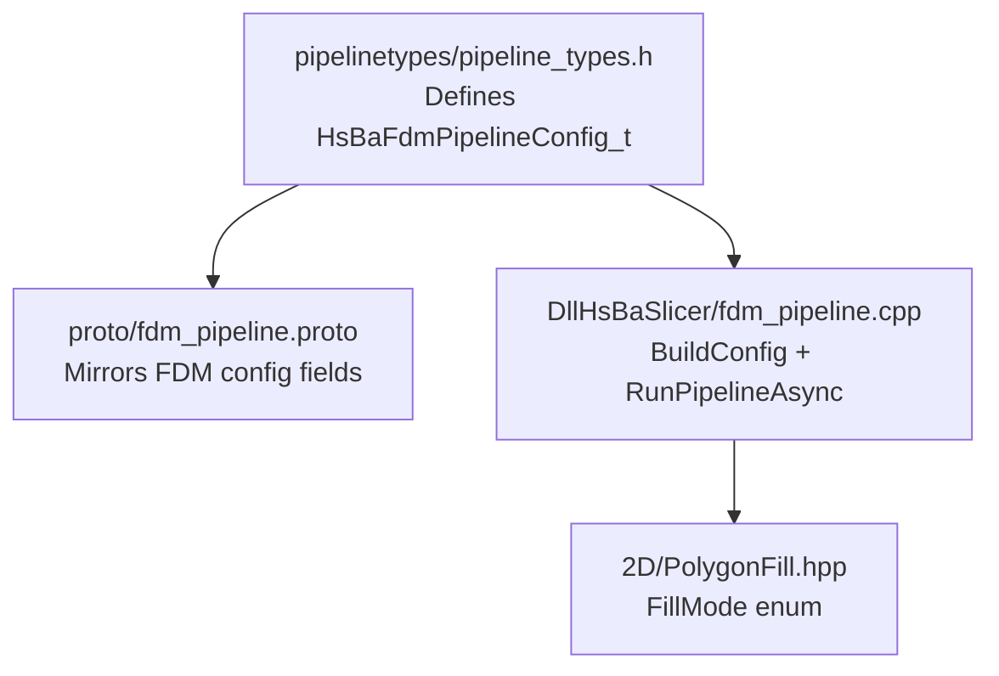
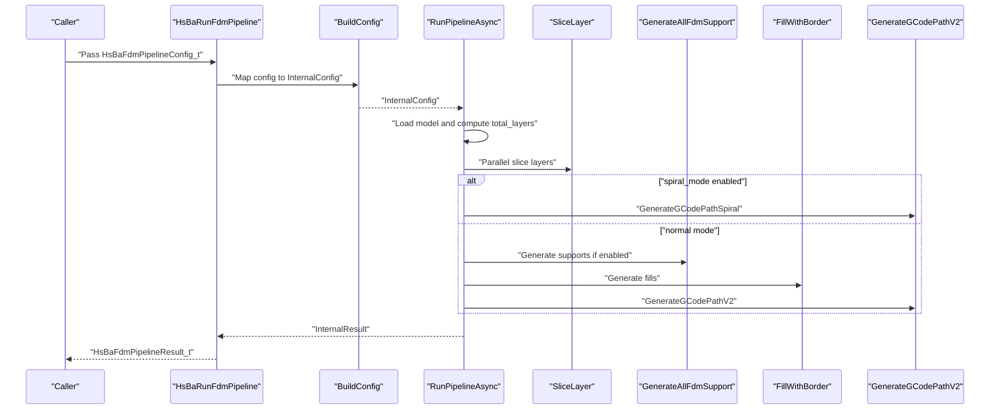
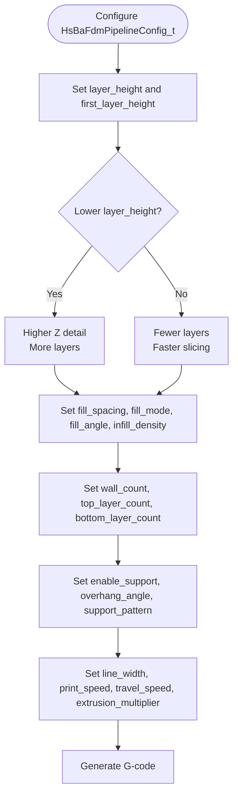
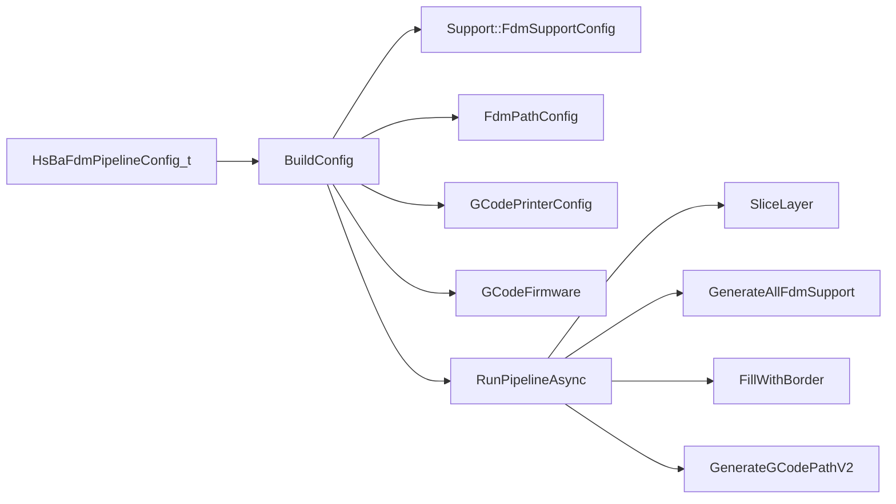

# Custom FDM Parameters / FDM自定义参数

<cite>
**Referenced Files in This Document**   
- [pipeline_types.h](file://pipelinetypes/pipeline_types.h)
- [fdm_pipeline.proto](file://proto/fdm_pipeline.proto)
- [fdm_pipeline.cpp](file://DllHsBaSlicer/fdm_pipeline.cpp)
- [PolygonFill.hpp](file://2D/PolygonFill.hpp)
</cite>

## Table of Contents
1. [Introduction](#introduction)
2. [Project Structure](#project-structure)
3. [Core Components](#core-components)
4. [Architecture Overview](#architecture-overview)
5. [Detailed Component Analysis](#detailed-component-analysis)
6. [Dependency Analysis](#dependency-analysis)
7. [Performance Considerations](#performance-considerations)
8. [Troubleshooting Guide](#troubleshooting-guide)
9. [Conclusion](#conclusion)
10. [Appendices](#appendices)

## Introduction
This document explains how to customize FDM process parameters through the `HsBaFdmPipelineConfig_t` configuration structure. It covers all requested fields, their default values, relationships, effects on print quality and speed, validation rules derived from the codebase, recommended ranges, and practical parameter combinations for high-detail prints, fast prototyping, and strong mechanical parts.

The documentation is based on:
- The C-compatible FDM configuration type definition and defaults.
- The protobuf message that mirrors these fields.
- The FDM pipeline implementation that maps configuration into slicing, support, infill, path generation, and G-code output.

## Project Structure
The FDM customization surface is defined in a single header and used by the FDM pipeline implementation:

**Diagram sources**
- [pipeline_types.h:56-113](file://pipelinetypes/pipeline_types.h#L56-L113)
- [fdm_pipeline.proto:26-72](file://proto/fdm_pipeline.proto#L26-L72)
- [fdm_pipeline.cpp:142-196](file://DllHsBaSlicer/fdm_pipeline.cpp#L142-L196)
- [PolygonFill.hpp:63-68](file://2D/PolygonFill.hpp#L63-L68)

**Section sources**
- [pipeline_types.h:56-113](file://pipelinetypes/pipeline_types.h#L56-L113)
- [fdm_pipeline.proto:26-72](file://proto/fdm_pipeline.proto#L26-L72)
- [fdm_pipeline.cpp:142-196](file://DllHsBaSlicer/fdm_pipeline.cpp#L142-L196)

## Core Components
The core configuration object is `HsBaFdmPipelineConfig_t`. Its relevant fields for this guide are:

| Field | Type | Default | Meaning |
|---|---|---:|---|
| `layer_height` | float | 0.2 mm | Standard layer height after the first layer. |
| `first_layer_height` | float | 0.25 mm | First-layer thickness; must be greater than or equal to zero and typically larger than `layer_height`. |
| `fill_spacing` | double | 0.4 mm | Base spacing between fill lines. |
| `fill_mode` | enum | HSBA_FILL_ZIGZAG | Fill pattern: line, simple zigzag, or advanced zigzag. |
| `fill_angle` | double | 45.0 degrees | Orientation of fill lines. |
| `wall_count` | int | 3 | Number of perimeters around each outline. |
| `top_layer_count` | int | 3 | Number of top solid layers. |
| `bottom_layer_count` | int | 3 | Number of bottom solid layers. |
| `infill_density` | double | 0.2 | Infill density in range [0,1]. |
| `enable_support` | int | 1 | Enable or disable support generation. |
| `overhang_angle` | float | 45.0 degrees | Overhang threshold used by support detection. |
| `support_pattern` | enum | HSBA_SUPPORT_PLANE | Support pattern: plane, tree, or honeycomb. |
| `line_width` | float | 0.4 mm | Extrusion line width. |
| `print_speed` | float | 50.0 mm/s | Printing travel speed for extrusion moves. |
| `travel_speed` | float | 100.0 mm/s | Non-extruding movement speed. |
| `extrusion_multiplier` | float | 1.0 | Global extrusion scaling factor. |

Additional related fields include support gap, support diameter, support density, interface layers, interface density, spiral mode, firmware target, nozzle and filament dimensions, temperatures, retraction settings, and Lua script hooks. These affect support behavior, G-code formatting, and material flow but are not the primary focus of this guide.

**Section sources**
- [pipeline_types.h:56-113](file://pipelinetypes/pipeline_types.h#L56-L113)
- [pipeline_types.h:742-783](file://pipelinetypes/pipeline_types.h#L742-L783)

## Architecture Overview
The FDM pipeline reads `HsBaFdmPipelineConfig_t`, converts it into internal configuration structures, then executes five main stages:

1. Preprocess and model loading.
2. Slicing into per-layer outlines.
3. Support generation (optional).
4. Infill generation (solid top/bottom, middle infill, or Lua custom fill).
5. Path generation and G-code export.

**Diagram sources**
- [fdm_pipeline.cpp:460-467](file://DllHsBaSlicer/fdm_pipeline.cpp#L460-L467)
- [fdm_pipeline.cpp:142-196](file://DllHsBaSlicer/fdm_pipeline.cpp#L142-L196)
- [fdm_pipeline.cpp:220-447](file://DllHsBaSlicer/fdm_pipeline.cpp#L220-L447)

**Section sources**
- [fdm_pipeline.cpp:220-447](file://DllHsBaSlicer/fdm_pipeline.cpp#L220-L447)

## Detailed Component Analysis

### Parameter Reference and Validation Rules

#### Layer Height and First Layer Height
- `layer_height`: Controls vertical resolution. Smaller values improve Z-axis smoothness but increase layer count and print time.
- `first_layer_height`: Controls adhesion quality. The layer count calculation uses `first_layer_height` for the first layer and `layer_height` for subsequent layers.

Validation and behavior:
- If model height is non-positive, the pipeline returns an invalid model height error.
- Total layers are computed as one plus the ceiling of remaining height divided by `layer_height`.
- Layer Z positions use `first_layer_height` for layer index zero and `first_layer_height + i * layer_height` for higher indices.

Recommended ranges:
- `layer_height`: 0.1–0.3 mm for most desktop printers.
- `first_layer_height`: 0.2–0.3 mm, usually slightly larger than `layer_height`.

Effects:
- Lower `layer_height` improves detail but increases processing and printing time.
- Higher `first_layer_height` can improve bed adhesion but may cause visible step at the base.

**Section sources**
- [fdm_pipeline.cpp:110-132](file://DllHsBaSlicer/fdm_pipeline.cpp#L110-L132)
- [fdm_pipeline.cpp:249-256](file://DllHsBaSlicer/fdm_pipeline.cpp#L249-L256)
- [pipeline_types.h:63-64](file://pipelinetypes/pipeline_types.h#L63-L64)

#### Fill Spacing, Fill Mode, Fill Angle, and Infill Density
- `fill_spacing`: Base distance between parallel fill lines.
- `fill_mode`: Enumerated fill pattern.
- `fill_angle`: Rotation angle of fill lines.
- `infill_density`: Normalized density in [0,1].

Validation and behavior:
- Middle-layer effective spacing is calculated as `fill_spacing / infill_density` when density is strictly between 0 and 1.
- Top and bottom solid layers use the original `fill_spacing`, ignoring `infill_density`.
- Solid regions are determined by `bottom_layer_count` and `top_layer_count`.
- Fill generation calls `FillWithBorder` with spacing, wall count, fill mode, and fill angle.

Recommended ranges:
- `fill_spacing`: 0.2–0.8 mm depending on line width and desired density.
- `fill_mode`: Line for predictable strength, Zigzag for balanced speed and strength.
- `fill_angle`: 45° or 90° for orthogonal cross-hatching across layers.
- `infill_density`: 0.1–0.6 for typical functional parts; 0.05–0.15 for lightweight prototypes.

Effects:
- Larger spacing reduces material and time but lowers stiffness.
- Higher density increases weight and strength.
- Changing fill angle can reduce weak planes and improve interlayer bonding.

**Section sources**
- [fdm_pipeline.cpp:316-342](file://DllHsBaSlicer/fdm_pipeline.cpp#L316-L342)
- [pipeline_types.h:67-73](file://pipelinetypes/pipeline_types.h#L67-L73)
- [PolygonFill.hpp:63-68](file://2D/PolygonFill.hpp#L63-L68)

#### Wall Count, Top Layer Count, Bottom Layer Count
- `wall_count`: Number of perimeter shells.
- `top_layer_count`: Number of fully filled top layers.
- `bottom_layer_count`: Number of fully filled bottom layers.

Validation and behavior:
- Layers below `bottom_layer_count` and above `total_layers - top_layer_count` are treated as solid.
- Solid layers use `fill_spacing`; middle layers use adjusted spacing based on `infill_density`.

Recommended ranges:
- `wall_count`: 2–4 for general parts; 3+ for stronger outer surfaces.
- `top_layer_count` and `bottom_layer_count`: 2–4 for good surface finish and bed adhesion.

Effects:
- More walls improve surface quality and shell strength.
- More top/bottom layers improve flatness and durability.

**Section sources**
- [fdm_pipeline.cpp:316-342](file://DllHsBaSlicer/fdm_pipeline.cpp#L316-L342)
- [pipeline_types.h:70-73](file://pipelinetypes/pipeline_types.h#L70-L73)

#### Support Generation
- `enable_support`: Boolean flag using integer 0/1.
- `overhang_angle`: Threshold angle for overhang detection.
- `support_pattern`: Plane, tree, or honeycomb.

Validation and behavior:
- When `spiral_mode` is enabled, support generation is skipped.
- When `enable_support` is false, support generation is skipped.
- Otherwise, built-in FDM support generation is used unless a Lua support script is provided.

Recommended ranges:
- `enable_support`: true for models with overhangs; false for simple boxes or vase mode.
- `overhang_angle`: 30°–60°; lower values generate more support.
- `support_pattern`: Tree for less contact area; Honeycomb for dense support; Plane for simple bases.

Effects:
- Enabling support prevents drooping but adds post-processing time and potential surface marks.
- Lower overhang angle increases support volume.

**Section sources**
- [fdm_pipeline.cpp:281-305](file://DllHsBaSlicer/fdm_pipeline.cpp#L281-L305)
- [pipeline_types.h:75-83](file://pipelinetypes/pipeline_types.h#L75-L83)

#### Line Width, Print Speed, Travel Speed, Extrusion Multiplier
- `line_width`: Width of extruded lines.
- `print_speed`: Speed during extrusion.
- `travel_speed`: Speed during non-extrusion moves.
- `extrusion_multiplier`: Global multiplier for extrusion amount.

Validation and behavior:
- These fields are mapped into both path configuration and printer configuration.
- They influence generated G-code paths and estimated print times.

Recommended ranges:
- `line_width`: Match nozzle diameter; commonly 0.4 mm for a 0.4 mm nozzle.
- `print_speed`: 30–120 mm/s depending on printer capability and material.
- `travel_speed`: 80–200 mm/s; keep higher than print speed.
- `extrusion_multiplier`: 0.9–1.1; adjust for under- or over-extrusion.

Effects:
- Larger line width increases strength and coverage but reduces detail.
- Higher speeds reduce print time but can degrade quality.
- Extrusion multiplier corrects volumetric flow errors.

**Section sources**
- [fdm_pipeline.cpp:172-189](file://DllHsBaSlicer/fdm_pipeline.cpp#L172-L189)
- [pipeline_types.h:85-89](file://pipelinetypes/pipeline_types.h#L85-L89)

#### Spiral Mode Interaction
- `spiral_mode`: When enabled, the outer wall becomes a continuous rising helix and per-layer infill/support are skipped.

Validation and behavior:
- Spiral mode bypasses support generation.
- Spiral mode bypasses infill generation.
- Spiral mode uses a dedicated G-code path generator.

Recommended usage:
- Use for vases and continuous-walled objects.
- Do not enable for parts requiring internal strength or supports.

**Section sources**
- [fdm_pipeline.cpp:283-305](file://DllHsBaSlicer/fdm_pipeline.cpp#L283-L305)
- [fdm_pipeline.cpp:345-349](file://DllHsBaSlicer/fdm_pipeline.cpp#L345-L349)
- [fdm_pipeline.cpp:388-408](file://DllHsBaSlicer/fdm_pipeline.cpp#L388-L408)
- [pipeline_types.h:90-92](file://pipelinetypes/pipeline_types.h#L90-L92)

### Practical Parameter Combinations

#### High-Detail Prints
Goal: Smooth surfaces, fine features, accurate geometry.

Recommended combination:
- `layer_height`: 0.1–0.15 mm
- `first_layer_height`: 0.2–0.25 mm
- `wall_count`: 3–4
- `top_layer_count`: 3–4
- `bottom_layer_count`: 3–4
- `fill_spacing`: 0.3–0.5 mm
- `fill_mode`: Zigzag
- `fill_angle`: 45° or alternating 45°/−45°
- `infill_density`: 0.1–0.2
- `enable_support`: true for overhangs
- `overhang_angle`: 45°
- `line_width`: 0.4 mm
- `print_speed`: 30–50 mm/s
- `travel_speed`: 100–150 mm/s
- `extrusion_multiplier`: 1.0

Expected effect:
- Improved surface quality and dimensional accuracy.
- Longer slice and print time.
- Good top/bottom finish due to multiple solid layers.

#### Fast Prototyping
Goal: Quick iteration with acceptable strength.

Recommended combination:
- `layer_height`: 0.2–0.3 mm
- `first_layer_height`: 0.25–0.3 mm
- `wall_count`: 2
- `top_layer_count`: 2
- `bottom_layer_count`: 2
- `fill_spacing`: 0.6–1.0 mm
- `fill_mode`: SimpleZigzag or Zigzag
- `fill_angle`: 45°
- `infill_density`: 0.05–0.15
- `enable_support`: false unless necessary
- `overhang_angle`: 60°
- `line_width`: 0.4 mm
- `print_speed`: 80–120 mm/s
- `travel_speed`: 150–200 mm/s
- `extrusion_multiplier`: 1.0

Expected effect:
- Faster slicing and printing.
- Lighter parts with reduced material usage.
- Acceptable prototype strength for fit checks.

#### Strong Mechanical Parts
Goal: Structural integrity and durability.

Recommended combination:
- `layer_height`: 0.15–0.2 mm
- `first_layer_height`: 0.2–0.25 mm
- `wall_count`: 3–4
- `top_layer_count`: 3–4
- `bottom_layer_count`: 3–4
- `fill_spacing`: 0.3–0.5 mm
- `fill_mode`: Zigzag
- `fill_angle`: 45° or 90°
- `infill_density`: 0.3–0.6
- `enable_support`: true
- `overhang_angle`: 45°
- `line_width`: 0.4 mm
- `print_speed`: 40–60 mm/s
- `travel_speed`: 100–150 mm/s
- `extrusion_multiplier`: 0.95–1.05

Expected effect:
- Higher stiffness and load-bearing capacity.
- Increased print time and material consumption.
- Better interlayer bonding with orthogonal fill angles.

[No sources needed since this section provides practical guidance based on previously analyzed fields]

### Parameter Relationships and Effects Summary

[No sources needed since this diagram shows conceptual workflow, not actual code structure]

## Dependency Analysis
The FDM configuration flows through several components:

**Diagram sources**
- [fdm_pipeline.cpp:142-196](file://DllHsBaSlicer/fdm_pipeline.cpp#L142-L196)
- [fdm_pipeline.cpp:220-447](file://DllHsBaSlicer/fdm_pipeline.cpp#L220-L447)

**Section sources**
- [fdm_pipeline.cpp:142-196](file://DllHsBaSlicer/fdm_pipeline.cpp#L142-L196)
- [fdm_pipeline.cpp:220-447](file://DllHsBaSlicer/fdm_pipeline.cpp#L220-L447)

## Performance Considerations
- Reducing `layer_height` increases total layers and processing time.
- Increasing `infill_density` increases fill computation and print time.
- Enabling support adds support generation time and post-processing effort.
- Higher `print_speed` and `travel_speed` reduce print time but may reduce quality.
- Spiral mode skips infill and support, significantly reducing processing and print time for suitable geometries.

[No sources needed since this section provides general guidance]

## Troubleshooting Guide
Common issues and their likely causes:

- Invalid model height: Occurs when model bounding box has non-positive height. Check model validity and orientation.
- Excessive print time: Likely caused by low `layer_height`, high `infill_density`, many walls, or slow speeds.
- Weak parts: Likely caused by low wall count, low infill density, large fill spacing, or inappropriate fill angle.
- Poor bed adhesion: Likely caused by incorrect `first_layer_height`, too small `wall_count`, or insufficient bottom layers.
- Overhangs failing: Likely caused by disabled support or too high `overhang_angle`.
- Under- or over-extrusion: Adjust `extrusion_multiplier`, verify `line_width`, and check nozzle and filament diameter settings.

**Section sources**
- [fdm_pipeline.cpp:249-256](file://DllHsBaSlicer/fdm_pipeline.cpp#L249-L256)
- [fdm_pipeline.cpp:281-305](file://DllHsBaSlicer/fdm_pipeline.cpp#L281-L305)
- [fdm_pipeline.cpp:316-342](file://DllHsBaSlicer/fdm_pipeline.cpp#L316-L342)

## Conclusion
Customizing `HsBaFdmPipelineConfig_t` allows precise control over FDM slicing and G-code generation. The most impactful fields are `layer_height`, `first_layer_height`, `fill_spacing`, `fill_mode`, `fill_angle`, `wall_count`, `top_layer_count`, `bottom_layer_count`, `infill_density`, `enable_support`, `overhang_angle`, `support_pattern`, `line_width`, `print_speed`, `travel_speed`, and `extrusion_multiplier`. Their interactions determine print quality, speed, material usage, and structural performance. Use the recommended ranges and combinations as starting points, then iterate based on test prints and application requirements.

[No sources needed since this section summarizes without analyzing specific files]

## Appendices

### Field Mapping Between C Struct and Protobuf
| C struct field | Protobuf field | Notes |
|---|---|---|
| `layer_height` | `fdm_pipe_config_layer_height` | Slice layer height |
| `first_layer_height` | `fdm_pipe_config_first_layer_height` | First layer thickness |
| `fill_spacing` | `fdm_pipe_config_fill_space` | Base fill spacing |
| `fill_mode` | `fdm_pipe_config_fill_type` | Fill pattern enum |
| `fill_angle` | `fdm_pipe_config_fill_angle` | Fill rotation |
| `wall_count` | `fdm_pipe_config_wall_count` | Perimeter count |
| `top_layer_count` | `fdm_pipe_config_top_layer_count` | Top solid layers |
| `bottom_layer_count` | `fdm_pipe_config_bottom_layer_count` | Bottom solid layers |
| `enable_support` | `fdm_pipe_config_support_enable` | Support toggle |
| `overhang_angle` | `fdm_pipe_config_support_angle` | Overhang threshold |
| `line_width` | `fdm_pipe_config_line_width` | Extrusion width |
| `print_speed` | `fdm_pipe_config_print_speed` | Print speed |
| `travel_speed` | `fdm_pipe_config_travel_speed` | Travel speed |
| `extrusion_multiplier` | `fdm_pipe_config_extrusion_multiplier` | Extrusion scale |

**Section sources**
- [pipeline_types.h:56-113](file://pipelinetypes/pipeline_types.h#L56-L113)
- [fdm_pipeline.proto:26-72](file://proto/fdm_pipeline.proto#L26-L72)