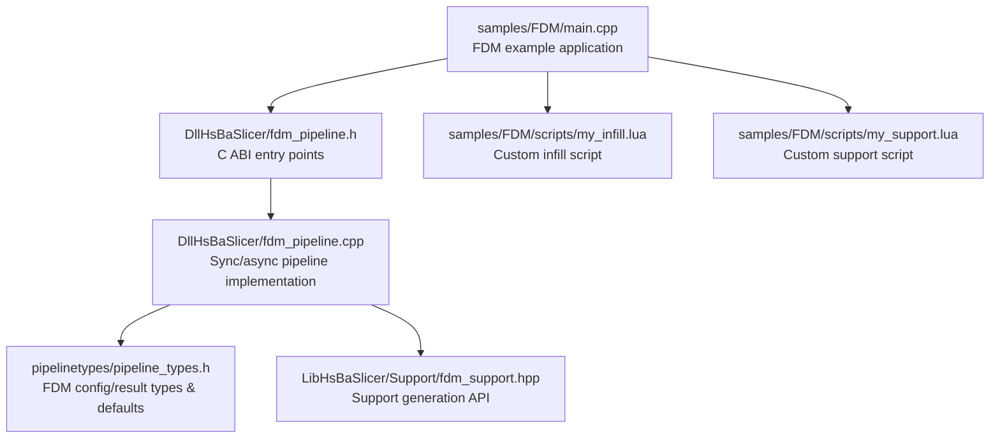
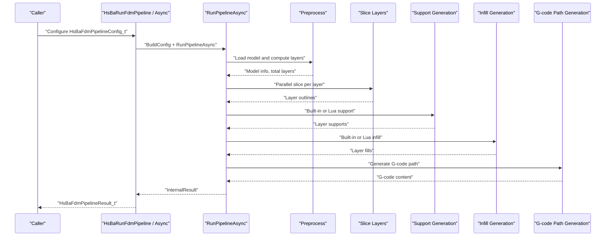
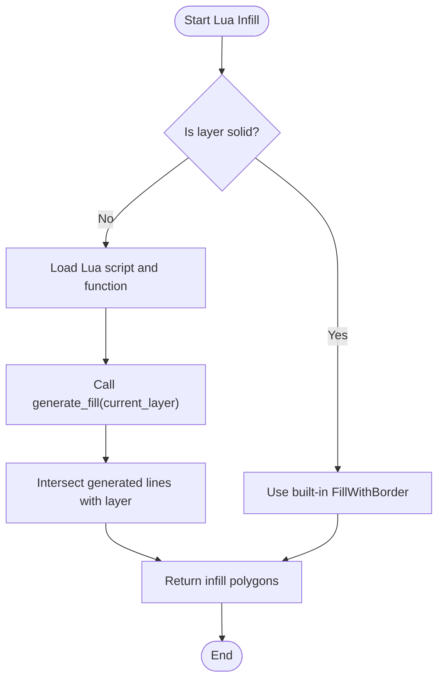
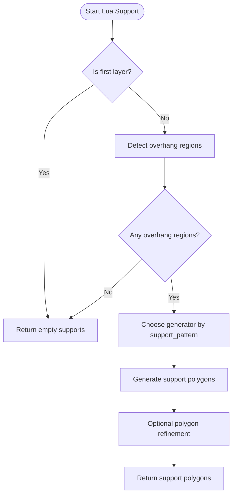
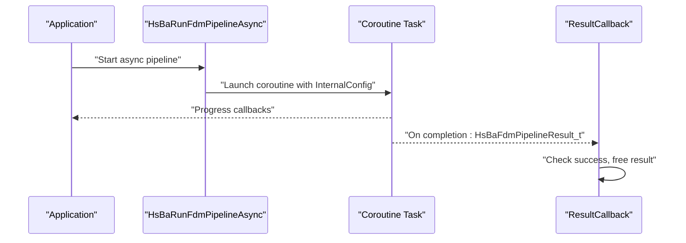
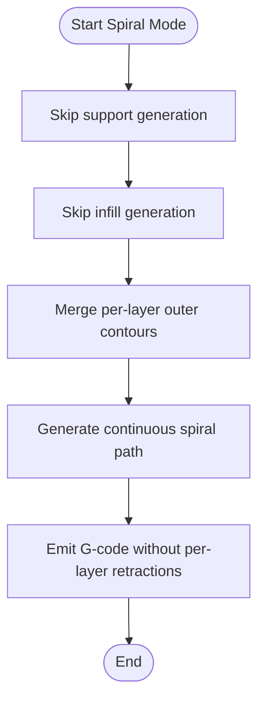
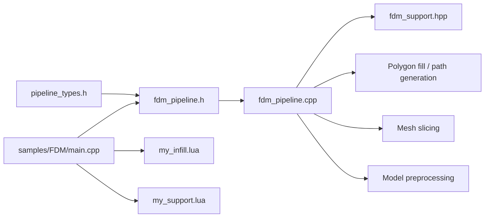

# FDM Examples / FDM示例

<cite>
**Referenced Files in This Document**   
- [pipeline_types.h](file://pipelinetypes/pipeline_types.h)
- [fdm_pipeline.h](file://DllHsBaSlicer/fdm_pipeline.h)
- [fdm_pipeline.cpp](file://DllHsBaSlicer/fdm_pipeline.cpp)
- [main.cpp](file://samples/FDM/main.cpp)
- [my_infill.lua](file://samples/FDM/scripts/my_infill.lua)
- [my_support.lua](file://samples/FDM/scripts/my_support.lua)
- [fdm_support.hpp](file://LibHsBaSlicer/Support/fdm_support.hpp)
</cite>

## Table of Contents
1. [Introduction](#introduction)
2. [Project Structure](#project-structure)
3. [Core Components](#core-components)
4. [Architecture Overview](#architecture-overview)
5. [Detailed Component Analysis](#detailed-component-analysis)
6. [Dependency Analysis](#dependency-analysis)
7. [Performance Considerations](#performance-considerations)
8. [Troubleshooting Guide](#troubleshooting-guide)
9. [Conclusion](#conclusion)
10. [Appendices](#appendices)

## Introduction
This document provides complete FDM (Fused Deposition Modeling) slicing workflow examples for HsBaSlicer. It focuses on:
- Basic pipeline usage with default configuration.
- Custom process parameters including layer height, fill density, wall count, and support generation.
- Lua-based custom infill patterns and support structures.
- Asynchronous pipeline execution for non-blocking operations.
- Spiral/vase mode printing techniques.
- Full source code example paths demonstrating `HsBaRunFdmPipeline`, configuration fields such as `layer_height`, `fill_mode`, `support_pattern`, and output handling.
- Performance considerations specific to FDM processes, including print speed optimization, extrusion control, and G-code generation efficiency.

The examples are based directly on the repository’s C ABI, sample application, and Lua scripts.

## Project Structure
The FDM examples live under the samples directory and use the public C ABI exposed by the DllHsBaSlicer module. The core types and defaults are defined in a standalone header so downstream code can configure pipelines without depending on the shared library.

**Diagram sources**
- [main.cpp:17-18](file://samples/FDM/main.cpp#L17-L18)
- [fdm_pipeline.h:17-61](file://DllHsBaSlicer/fdm_pipeline.h#L17-L61)
- [fdm_pipeline.cpp:17-26](file://DllHsBaSlicer/fdm_pipeline.cpp#L17-L26)
- [pipeline_types.h:53-127](file://pipelinetypes/pipeline_types.h#L53-L127)
- [fdm_support.hpp:17-67](file://LibHsBaSlicer/Support/fdm_support.hpp#L17-L67)

**Section sources**
- [main.cpp:1-337](file://samples/FDM/main.cpp#L1-L337)
- [fdm_pipeline.h:1-68](file://DllHsBaSlicer/fdm_pipeline.h#L1-L68)
- [pipeline_types.h:53-127](file://pipelinetypes/pipeline_types.h#L53-L127)

## Core Components
The FDM workflow is driven by a small set of C-compatible types and functions:

- Configuration structure: `HsBaFdmPipelineConfig_t`
  - Model inputs: `model_name`, `model_path`.
  - Slicing: `layer_height`, `first_layer_height`.
  - Fill: `fill_spacing`, `fill_mode`, `fill_angle`, `wall_count`, `top_layer_count`, `bottom_layer_count`, `infill_density`.
  - Support: `enable_support`, `overhang_angle`, `support_gap`, `support_diameter`, `support_density`, `support_pattern`, `interface_layers`, `interface_density`.
  - Path and printer: `line_width`, `print_speed`, `travel_speed`, `extrusion_multiplier`, `spiral_mode`.
  - G-code firmware: `gcode_firmware`, `nozzle_diameter`, `filament_diameter`, `nozzle_temp`, `bed_temp`, `retract_length`, `retract_speed`, `first_layer_speed`.
  - Lua customization: `support_lua_script`, `support_lua_func`, `infill_lua_script`, `infill_lua_func`.
  - Output: `output_path`.

- Result structure: `HsBaFdmPipelineResult_t`
  - `success`, `total_layers`, `gcode_content`, `error_message`, `elapsed_seconds`.

- Public API:
  - `HsBaCreateDefaultConfig()` returns a fully initialized default configuration.
  - `HsBaRunFdmPipeline(...)` runs synchronously.
  - `HsBaRunFdmPipelineAsync(...)` runs asynchronously via callbacks.
  - `HsBaFreePipelineResult(...)` frees result strings.

- Default values are provided by `HsBaFdmConfigDefault()`, which initializes all numeric fields and sets sensible defaults such as zigzag fill, plane support, Marlin firmware, and typical nozzle/filament sizes.

**Section sources**
- [pipeline_types.h:23-127](file://pipelinetypes/pipeline_types.h#L23-L127)
- [pipeline_types.h:738-783](file://pipelinetypes/pipeline_types.h#L738-L783)
- [fdm_pipeline.h:17-61](file://DllHsBaSlicer/fdm_pipeline.h#L17-L61)

## Architecture Overview
The FDM pipeline follows a clear five-stage flow: preprocess, slice, support, infill, and path generation. Both synchronous and asynchronous entry points wrap the same coroutine-based internal implementation.

**Diagram sources**
- [fdm_pipeline.cpp:216-447](file://DllHsBaSlicer/fdm_pipeline.cpp#L216-L447)
- [fdm_pipeline.h:23-51](file://DllHsBaSlicer/fdm_pipeline.h#L23-L51)

**Section sources**
- [fdm_pipeline.cpp:216-447](file://DllHsBaSlicer/fdm_pipeline.cpp#L216-L447)

## Detailed Component Analysis

### Basic Pipeline Usage with Default Configurations
The simplest workflow uses default configuration and writes the generated G-code to disk.

Key steps:
1. Create default configuration using `HsBaCreateDefaultConfig()`.
2. Set `model_name` and `model_path`.
3. Call `HsBaRunFdmPipeline` with a progress callback.
4. Check `result.success`, write `result.gcode_content` to a file, and log `result.total_layers` and `result.elapsed_seconds`.
5. Free the result using `HsBaFreePipelineResult`.

Example reference:
- [Basic example function:53-96](file://samples/FDM/main.cpp#L53-L96)

Configuration highlights:
- Defaults include `layer_height = 0.2`, `first_layer_height = 0.25`, `fill_mode = HSBA_FILL_ZIGZAG`, `wall_count = 3`, `infill_density = 0.2`, `support_pattern = HSBA_SUPPORT_PLANE`, and Marlin firmware.

Output handling:
- The sample writes G-code to `output/stanford_bunny_basic.gcode`.

**Section sources**
- [main.cpp:53-96](file://samples/FDM/main.cpp#L53-L96)
- [pipeline_types.h:738-783](file://pipelinetypes/pipeline_types.h#L738-L783)
- [fdm_pipeline.h:17-35](file://DllHsBaSlicer/fdm_pipeline.h#L17-L35)

### Custom Process Parameters: Layer Height, Fill Density, Wall Count, Support Pattern
You can customize slicing, filling, and support behavior through `HsBaFdmPipelineConfig_t`:

- Slicing:
  - `layer_height`: controls layer thickness.
  - `first_layer_height`: controls first-layer adhesion thickness.

- Fill:
  - `fill_spacing`: base spacing between fill lines.
  - `fill_mode`: e.g., line, simple zigzag, advanced zigzag.
  - `fill_angle`: rotation angle of fill lines.
  - `wall_count`: number of perimeter walls.
  - `top_layer_count` / `bottom_layer_count`: solid top/bottom layers.
  - `infill_density`: middle-layer density; lower density increases effective spacing.

- Support:
  - `enable_support`: turn support generation on/off.
  - `overhang_angle`: threshold for overhang detection.
  - `support_pattern`: plane, tree, or honeycomb.
  - `support_gap`, `support_diameter`, `support_density`, `interface_layers`, `interface_density`: fine-tune support geometry and interface layers.

- Path and printer:
  - `line_width`, `print_speed`, `travel_speed`, `extrusion_multiplier`.

- Firmware and extrusion:
  - `gcode_firmware`, `nozzle_diameter`, `filament_diameter`, `nozzle_temp`, `bed_temp`, `retract_length`, `retract_speed`, `first_layer_speed`.

Example reference:
- [Custom parameter example function:101-165](file://samples/FDM/main.cpp#L101-L165)

Behavioral notes from the pipeline:
- Middle-layer spacing is adjusted by `infill_density`; when density is between 0 and 1, spacing becomes `fill_spacing / infill_density`.
- Top and bottom layers are treated as solid fills regardless of `infill_density`.

**Section sources**
- [main.cpp:101-165](file://samples/FDM/main.cpp#L101-L165)
- [pipeline_types.h:53-113](file://pipelinetypes/pipeline_types.h#L53-L113)
- [fdm_pipeline.cpp:316-383](file://DllHsBaSlicer/fdm_pipeline.cpp#L316-L383)

### Lua-Based Custom Infill Patterns
Lua infill replaces the built-in fill algorithm for non-solid layers. The pipeline calls a user-defined function from a Lua script.

Script contract:
- Function name: configured via `infill_lua_func`, defaulting to `generate_fill`.
- Input: current layer polygons after wall removal.
- Output: polygon array representing infill.

Sample script:
- [Custom infill script:1-89](file://samples/FDM/scripts/my_infill.lua#L1-L89)

Implementation details:
- The script computes bounding box, generates parallel lines at a given angle and spacing, creates thin rectangles, and intersects them with the current layer to produce final infill polygons.
- The pipeline executes Lua infill serially because the Lua interpreter state is not thread-safe across layers.

Configuration usage:
- Set `infill_lua_script` and `infill_lua_func` in `HsBaFdmPipelineConfig_t`.
- Solid top/bottom layers still use the built-in fill even when Lua infill is enabled.

Example reference:
- [Lua custom pipeline setup:170-220](file://samples/FDM/main.cpp#L170-L220)

**Diagram sources**
- [fdm_pipeline.cpp:345-383](file://DllHsBaSlicer/fdm_pipeline.cpp#L345-L383)
- [my_infill.lua:20-87](file://samples/FDM/scripts/my_infill.lua#L20-L87)

**Section sources**
- [main.cpp:170-220](file://samples/FDM/main.cpp#L170-L220)
- [my_infill.lua:1-89](file://samples/FDM/scripts/my_infill.lua#L1-L89)
- [fdm_pipeline.cpp:345-383](file://DllHsBaSlicer/fdm_pipeline.cpp#L345-L383)

### Lua-Based Custom Support Structures
Lua support allows you to replace the built-in support generator with a custom algorithm.

Script contract:
- Function name: configured via `support_lua_func`, defaulting to `generate_support`.
- Environment includes layer data (`current_layer`, `prev_layer`), `layer_height`, and `config` containing support settings.
- Returns support polygons for the current layer.

Sample script:
- [Custom support script:1-83](file://samples/FDM/scripts/my_support.lua#L1-L83)

Implementation details:
- Detects overhang regions using `Support.detect_overhang`.
- Selects a generator based on `config.support_pattern`: plane, tree, or honeycomb.
- Generates support using `Support.generate` and optionally refines results with polygon operations.

Configuration usage:
- Set `support_lua_script` and `support_lua_func` in `HsBaFdmPipelineConfig_t`.
- When `cfg.spiral_mode` is true, support generation is skipped entirely.

Example reference:
- [Lua custom pipeline setup:170-220](file://samples/FDM/main.cpp#L170-L220)

**Diagram sources**
- [my_support.lua:32-79](file://samples/FDM/scripts/my_support.lua#L32-L79)
- [fdm_support.hpp:27-67](file://LibHsBaSlicer/Support/fdm_support.hpp#L27-L67)
- [fdm_pipeline.cpp:281-310](file://DllHsBaSlicer/fdm_pipeline.cpp#L281-L310)

**Section sources**
- [main.cpp:170-220](file://samples/FDM/main.cpp#L170-L220)
- [my_support.lua:1-83](file://samples/FDM/scripts/my_support.lua#L1-L83)
- [fdm_support.hpp:17-67](file://LibHsBaSlicer/Support/fdm_support.hpp#L17-L67)
- [fdm_pipeline.cpp:281-310](file://DllHsBaSlicer/fdm_pipeline.cpp#L281-L310)

### Asynchronous Pipeline Execution for Non-Blocking Operations
Asynchronous execution avoids blocking the caller while the pipeline runs.

Key steps:
1. Configure `HsBaFdmPipelineConfig_t`.
2. Call `HsBaRunFdmPipelineAsync` with:
   - Progress callback for stage updates.
   - Result callback that receives `HsBaFdmPipelineResult_t`.
3. In the result callback, check `result.success`, handle `gcode_content`, and call `HsBaFreePipelineResult`.

Example reference:
- [Async pipeline example:245-269](file://samples/FDM/main.cpp#L245-L269)
- [Progress callback:38-47](file://samples/FDM/main.cpp#L38-L47)
- [Result callback:227-243](file://samples/FDM/main.cpp#L227-L243)

Internal behavior:
- The async wrapper heap-allocates the internal configuration to keep it alive during coroutine execution.
- The task’s completion handler converts the internal result into the C ABI result and invokes the user-provided result callback.

**Diagram sources**
- [fdm_pipeline.cpp:469-486](file://DllHsBaSlicer/fdm_pipeline.cpp#L469-L486)
- [main.cpp:227-269](file://samples/FDM/main.cpp#L227-L269)

**Section sources**
- [main.cpp:227-269](file://samples/FDM/main.cpp#L227-L269)
- [fdm_pipeline.h:37-51](file://DllHsBaSlicer/fdm_pipeline.h#L37-L51)
- [fdm_pipeline.cpp:469-486](file://DllHsBaSlicer/fdm_pipeline.cpp#L469-L486)

### Spiral/Vase Mode Printing Techniques
Spiral/vase mode produces a single continuous rising outer wall without per-layer travel, retraction, infill, or support.

Key configuration:
- `spiral_mode = 1` enables vase mode.
- Typical settings: `layer_height`, `first_layer_height`, `line_width`, `print_speed`.

Behavior:
- Support generation is skipped.
- Infill generation is skipped.
- Path generation merges per-layer outer contours into one continuous helix using `GenerateGCodePathSpiral`.

Example reference:
- [Spiral pipeline example:274-318](file://samples/FDM/main.cpp#L274-L318)

**Diagram sources**
- [fdm_pipeline.cpp:281-310](file://DllHsBaSlicer/fdm_pipeline.cpp#L281-L310)
- [fdm_pipeline.cpp:345-383](file://DllHsBaSlicer/fdm_pipeline.cpp#L345-L383)
- [fdm_pipeline.cpp:388-409](file://DllHsBaSlicer/fdm_pipeline.cpp#L388-L409)
- [main.cpp:274-318](file://samples/FDM/main.cpp#L274-L318)

**Section sources**
- [main.cpp:274-318](file://samples/FDM/main.cpp#L274-L318)
- [fdm_pipeline.cpp:281-409](file://DllHsBaSlicer/fdm_pipeline.cpp#L281-L409)

## Dependency Analysis
The FDM pipeline depends on several modules:

- Configuration and defaults: `pipelinetypes/pipeline_types.h`
- Public C ABI: `DllHsBaSlicer/fdm_pipeline.h`
- Implementation: `DllHsBaSlicer/fdm_pipeline.cpp`
- Support generation: `LibHsBaSlicer/Support/fdm_support.hpp`
- Sample application: `samples/FDM/main.cpp`
- Lua scripts: `samples/FDM/scripts/my_infill.lua`, `samples/FDM/scripts/my_support.lua`

**Diagram sources**
- [pipeline_types.h:53-127](file://pipelinetypes/pipeline_types.h#L53-L127)
- [fdm_pipeline.h:1-68](file://DllHsBaSlicer/fdm_pipeline.h#L1-L68)
- [fdm_pipeline.cpp:17-26](file://DllHsBaSlicer/fdm_pipeline.cpp#L17-L26)
- [fdm_support.hpp:17-67](file://LibHsBaSlicer/Support/fdm_support.hpp#L17-L67)
- [main.cpp:17-18](file://samples/FDM/main.cpp#L17-L18)

**Section sources**
- [pipeline_types.h:53-127](file://pipelinetypes/pipeline_types.h#L53-L127)
- [fdm_pipeline.h:1-68](file://DllHsBaSlicer/fdm_pipeline.h#L1-L68)
- [fdm_pipeline.cpp:17-26](file://DllHsBaSlicer/fdm_pipeline.cpp#L17-L26)
- [fdm_support.hpp:17-67](file://LibHsBaSlicer/Support/fdm_support.hpp#L17-L67)
- [main.cpp:1-337](file://samples/FDM/main.cpp#L1-L337)

## Performance Considerations
FDM performance is influenced by slicing parallelism, fill strategy, support complexity, and G-code generation.

Key observations from the implementation:
- Slicing is parallelized across layers using `ParallelForLayers`, since each layer slice only reads shared topology.
- Built-in fill generation also uses `ParallelForLayers` for pure per-layer computation.
- Lua infill runs serially because the Lua interpreter state is not shared across threads.
- Spiral/vase mode skips support and infill, reducing computational load and producing fewer G-code moves.
- Print speed, travel speed, and extrusion multiplier affect both simulation time and resulting G-code efficiency.
- Firmware selection (`HSBA_GCODE_MARLIN`, `HSBA_GCODE_REPRAP`, `HSBA_GCODE_KLIPPER`) changes G-code formatting but not geometric computation.

Optimization recommendations:
- Increase `print_speed` and `travel_speed` cautiously to reduce print time while maintaining quality.
- Tune `infill_density` and `fill_spacing` to balance material usage and strength.
- Use `wall_count` to improve surface quality; too many walls increase path length.
- Prefer built-in fill for performance; use Lua infill only when custom patterns are required.
- Enable support only where needed; consider `support_pattern` (plane/tree/honeycomb) for different trade-offs.
- Use spiral mode for vase-like objects to eliminate per-layer retractions and infill/support overhead.

[No sources needed since this section provides general guidance]

## Troubleshooting Guide
Common issues and how to address them:

- Model loading failure:
  - Ensure `model_path` is valid and accessible.
  - The pipeline reports an error message if model loading fails.

- Invalid model height:
  - If the model has zero or negative height, the pipeline returns an error.

- G-code generation failure:
  - Spiral mode may fail if contour merging cannot produce a valid path.
  - Normal mode may fail if path generation cannot combine outlines, fills, and supports.

- Memory management:
  - Always call `HsBaFreePipelineResult` after using `HsBaFdmPipelineResult_t`.
  - The result contains UTF-8 strings allocated by the pipeline; do not manually free them before calling the free function.

- Lua script errors:
  - Verify `support_lua_script` and `infill_lua_script` paths exist.
  - Ensure the Lua function names match `support_lua_func` and `infill_lua_func`.
  - For infill, remember that solid top/bottom layers bypass Lua infill.

- Progress and async callbacks:
  - Progress callbacks provide percentage and stage descriptions.
  - In async mode, ensure the result callback is not null and frees the result properly.

**Section sources**
- [fdm_pipeline.cpp:231-257](file://DllHsBaSlicer/fdm_pipeline.cpp#L231-L257)
- [fdm_pipeline.cpp:388-432](file://DllHsBaSlicer/fdm_pipeline.cpp#L388-L432)
- [fdm_pipeline.cpp:488-496](file://DllHsBaSlicer/fdm_pipeline.cpp#L488-L496)
- [main.cpp:69-95](file://samples/FDM/main.cpp#L69-L95)
- [main.cpp:227-243](file://samples/FDM/main.cpp#L227-L243)

## Conclusion
The HsBaSlicer FDM pipeline provides a robust, configurable, and extensible slicing workflow. You can start with default configurations, tune slicing and fill parameters, replace support and infill with Lua scripts, run the pipeline asynchronously, and enable spiral/vase mode for continuous-wall printing. The C ABI exposes clear entry points and result handling, while the internal implementation leverages parallel slicing and fill generation for performance. By carefully tuning layer height, fill density, wall count, support pattern, print speed, and extrusion settings, you can optimize both quality and efficiency for a wide range of FDM applications.

[No sources needed since this section summarizes without analyzing specific files]

## Appendices

### FDM Configuration Field Reference
| Field | Type | Description | Default |
|-------|------|-------------|---------|
| `model_name` | `const char*` | Model name | NULL |
| `model_path` | `const char*` | Model file path | NULL |
| `layer_height` | `float` | Layer height in mm | 0.2 |
| `first_layer_height` | `float` | First layer height in mm | 0.25 |
| `fill_spacing` | `double` | Fill line spacing in mm | 0.4 |
| `fill_mode` | `HsBaFillMode_t` | Fill pattern type | `HSBA_FILL_ZIGZAG` |
| `fill_angle` | `double` | Fill angle in degrees | 45.0 |
| `wall_count` | `int` | Number of perimeter walls | 3 |
| `top_layer_count` | `int` | Solid top layers | 3 |
| `bottom_layer_count` | `int` | Solid bottom layers | 3 |
| `infill_density` | `double` | Middle-layer density [0,1] | 0.2 |
| `enable_support` | `int` | Enable support generation | 1 |
| `overhang_angle` | `float` | Overhang threshold in degrees | 45.0 |
| `support_gap` | `float` | Gap between support and model in mm | 0.5 |
| `support_diameter` | `float` | Support column diameter in mm | 2.0 |
| `support_density` | `float` | Support fill density [0,1] | 0.3 |
| `support_pattern` | `HsBaSupportPattern_t` | Support pattern type | `HSBA_SUPPORT_PLANE` |
| `interface_layers` | `int` | Interface layer count | 2 |
| `interface_density` | `float` | Interface layer density [0,1] | 0.5 |
| `line_width` | `float` | Extrusion line width in mm | 0.4 |
| `print_speed` | `float` | Print speed in mm/s | 50.0 |
| `travel_speed` | `float` | Travel speed in mm/s | 100.0 |
| `extrusion_multiplier` | `float` | Extrusion multiplier | 1.0 |
| `spiral_mode` | `int` | Enable vase/spiral mode | 0 |
| `gcode_firmware` | `HsBaGCodeFirmware_t` | Target G-code firmware | `HSBA_GCODE_MARLIN` |
| `nozzle_diameter` | `float` | Nozzle diameter in mm | 0.4 |
| `filament_diameter` | `float` | Filament diameter in mm | 1.75 |
| `nozzle_temp` | `float` | Nozzle temperature in °C | 200.0 |
| `bed_temp` | `float` | Bed temperature in °C | 60.0 |
| `retract_length` | `float` | Retraction length in mm | 1.0 |
| `retract_speed` | `float` | Retraction speed in mm/s | 40.0 |
| `first_layer_speed` | `float` | First layer speed in mm/s | 20.0 |
| `support_lua_script` | `const char*` | Custom support Lua script path | NULL |
| `support_lua_func` | `const char*` | Custom support Lua function name | NULL |
| `infill_lua_script` | `const char*` | Custom infill Lua script path | NULL |
| `infill_lua_func` | `const char*` | Custom infill Lua function name | NULL |
| `output_path` | `const char*` | Output G-code file path | NULL |

**Section sources**
- [pipeline_types.h:53-127](file://pipelinetypes/pipeline_types.h#L53-L127)
- [pipeline_types.h:738-783](file://pipelinetypes/pipeline_types.h#L738-L783)