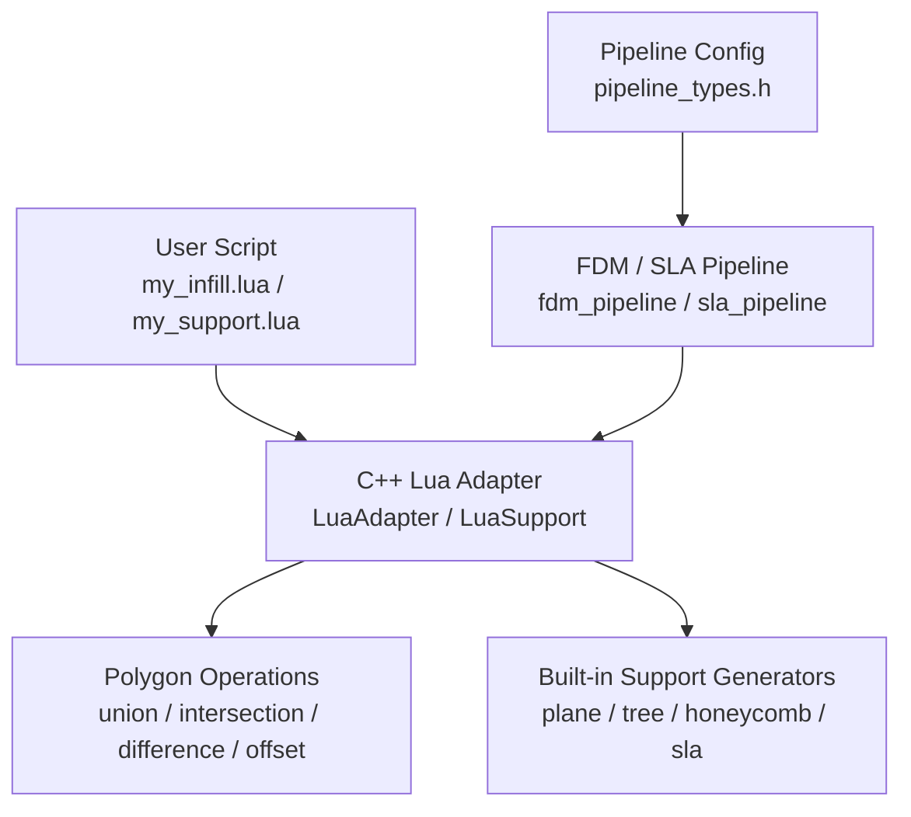
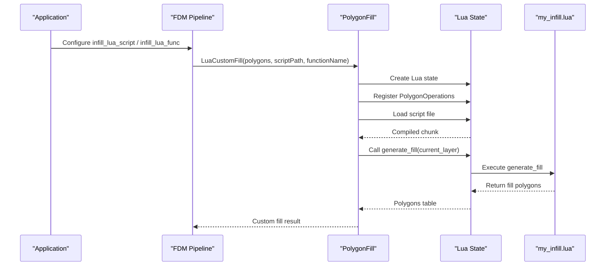
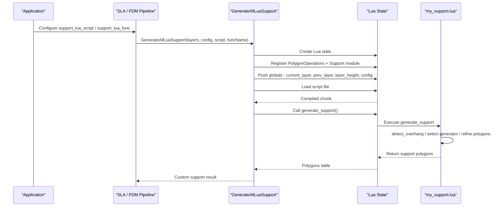
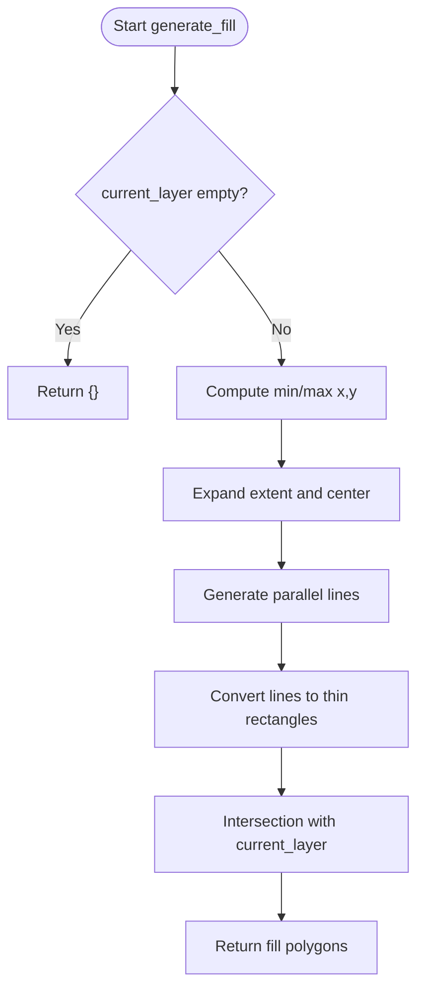
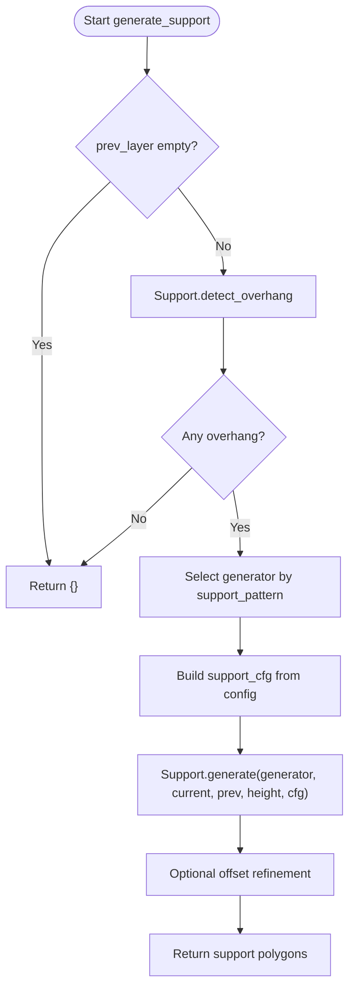
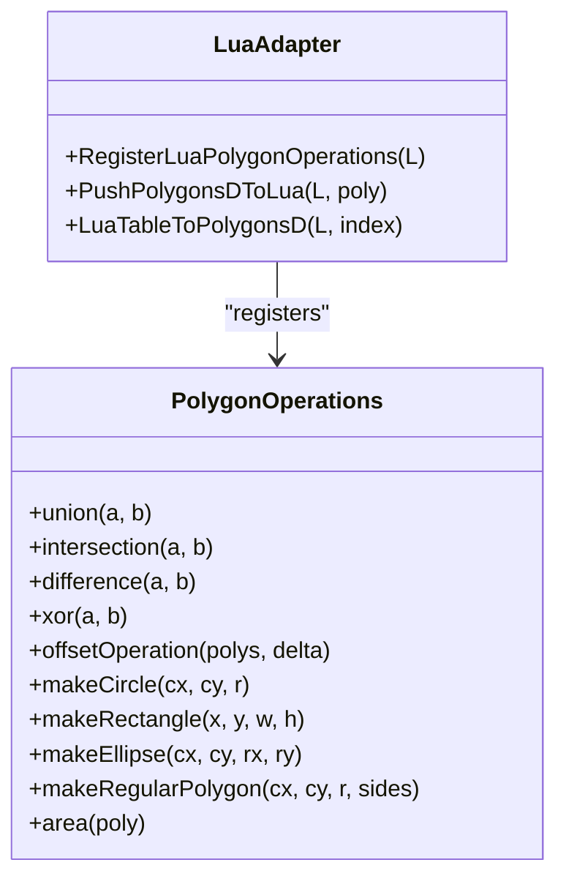
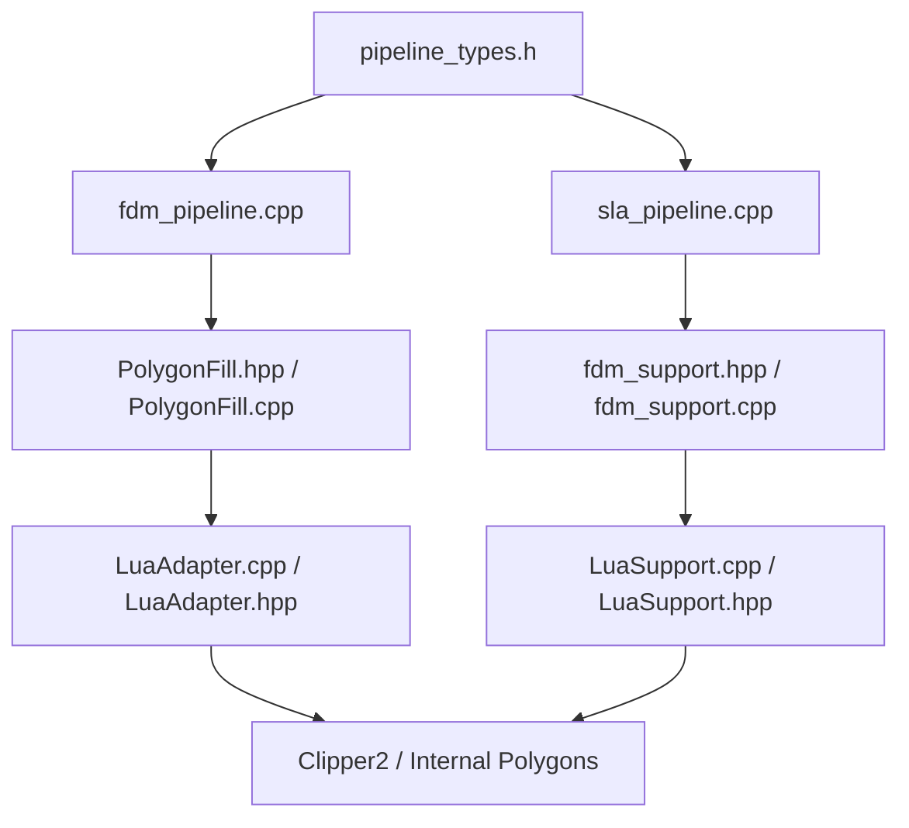

# Lua Custom Scripts / Lua自定义脚本

<cite>
**Referenced Files in This Document**   
- [my_infill.lua](file://samples/FDM/scripts/my_infill.lua)
- [my_support.lua](file://samples/FDM/scripts/my_support.lua)
- [LuaAdapter.cpp](file://2D/LuaAdapter.cpp)
- [LuaAdapter.hpp](file://2D/LuaAdapter.hpp)
- [PolygonFill.cpp](file://2D/PolygonFill.cpp)
- [PolygonFill.hpp](file://2D/PolygonFill.hpp)
- [LuaSupport.cpp](file://support/LuaSupport.cpp)
- [LuaSupport.hpp](file://support/LuaSupport.hpp)
- [fdm_support.hpp](file://LibHsBaSlicer/Support/fdm_support.hpp)
- [fdm_support.cpp](file://LibHsBaSlicer/Support/fdm_support.cpp)
- [pipeline_types.h](file://pipelinetypes/pipeline_types.h)
- [hsba_slicer.cppm](file://ModuleHsBaSlicer/hsba_slicer.cppm)
- [fdm_pipeline.cpp](file://DllHsBaSlicer/fdm_pipeline.cpp)
- [sla_pipeline.cpp](file://DllHsBaSlicer/sla_pipeline.cpp)
- [main.cpp](file://samples/FDM/main.cpp)
</cite>

## Table of Contents
1. [Introduction](#introduction)
2. [Project Structure](#project-structure)
3. [Core Components](#core-components)
4. [Architecture Overview](#architecture-overview)
5. [Detailed Component Analysis](#detailed-component-analysis)
6. [Dependency Analysis](#dependency-analysis)
7. [Performance Considerations](#performance-considerations)
8. [Troubleshooting Guide](#troubleshooting-guide)
9. [Conclusion](#conclusion)
10. [Appendices](#appendices)

## Introduction
This document explains how to implement custom FDM slicing algorithms using Lua scripts in HsBaSlicer. It focuses on two extension points:

- Custom infill generation through `generate_fill`.
- Custom support structure creation through `generate_support`.

It covers script file structure, function signatures, data types, polygon manipulation APIs, script loading mechanisms, error handling, debugging techniques, and performance best practices. The examples use the provided sample scripts `my_infill.lua` and `my_support.lua`, while the implementation details are traced back to the C++ adapter layers that bridge the slicing pipeline and the Lua runtime.

## Project Structure
The Lua scripting system for FDM is implemented across several modules:

- Sample scripts define user-facing behavior:
  - `samples/FDM/scripts/my_infill.lua`: custom infill algorithm.
  - `samples/FDM/scripts/my_support.lua`: custom support algorithm.
- Core adapters expose polygon operations and support generators to Lua:
  - `2D/LuaAdapter.cpp` and `2D/LuaAdapter.hpp`: polygon table conversion and `PolygonOperations` registration.
  - `support/LuaSupport.cpp` and `support/LuaSupport.hpp`: Lua-based support generator.
- Slicing pipeline integration:
  - `2D/PolygonFill.cpp` and `2D/PolygonFill.hpp`: custom infill entry point `LuaCustomFill`.
  - `LibHsBaSlicer/Support/fdm_support.cpp` and `fdm_support.hpp`: `GenerateAllLuaSupport`.
  - `DllHsBaSlicer/fdm_pipeline.cpp` and `DllHsBaSlicer/sla_pipeline.cpp`: pipeline configuration and script loading.
  - `ModuleHsBaSlicer/hsba_slicer.cppm`: module-level wrappers and external registration helpers.
- Configuration and example usage:
  - `pipelinetypes/pipeline_types.h`: C API config fields such as `infill_lua_script`, `infill_lua_func`, `support_lua_script`, `support_lua_func`.
  - `samples/FDM/main.cpp`: sets up FDM pipeline with custom Lua infill.

**Diagram sources**
- [my_infill.lua:1-89](file://samples/FDM/scripts/my_infill.lua#L1-L89)
- [my_support.lua:1-83](file://samples/FDM/scripts/my_support.lua#L1-L83)
- [LuaAdapter.cpp:311-329](file://2D/LuaAdapter.cpp#L311-L329)
- [LuaSupport.cpp:67-90](file://support/LuaSupport.cpp#L67-L90)
- [fdm_pipeline.cpp:312-337](file://DllHsBaSlicer/fdm_pipeline.cpp#L312-L337)
- [pipeline_types.h:108-113](file://pipelinetypes/pipeline_types.h#L108-L113)

**Section sources**
- [my_infill.lua:1-89](file://samples/FDM/scripts/my_infill.lua#L1-L89)
- [my_support.lua:1-83](file://samples/FDM/scripts/my_support.lua#L1-L83)
- [LuaAdapter.cpp:1-493](file://2D/LuaAdapter.cpp#L1-L493)
- [LuaSupport.cpp:1-180](file://support/LuaSupport.cpp#L1-L180)
- [fdm_pipeline.cpp:308-337](file://DllHsBaSlicer/fdm_pipeline.cpp#L308-L337)
- [pipeline_types.h:108-113](file://pipelinetypes/pipeline_types.h#L108-L113)

## Core Components
This section summarizes the key components used by custom Lua scripts.

### Custom Infill Entry Point
- Function name: `generate_fill`.
- Input: current layer polygons passed as a Lua table.
- Output: fill polygons returned as a Lua table.
- Integration:
  - `2D/PolygonFill.hpp` declares `LuaCustomFill` and `LuaCustomFillString`.
  - `ModuleHsBaSlicer/hsba_slicer.cppm` exposes `luaCustomFill`.
  - `DllHsBaSlicer/fdm_pipeline.cpp` selects Lua infill when `cfg.infill_lua_script` is set.

### Custom Support Entry Point
- Function name: `generate_support`.
- Global variables available in Lua:
  - `current_layer`: current layer polygons.
  - `prev_layer`: previous layer polygons (empty for first layer).
  - `layer_height`: layer height in millimeters.
  - `config`: support configuration table.
- Integration:
  - `support/LuaSupport.cpp` constructs Lua environment and calls the configured function.
  - `LibHsBaSlicer/Support/fdm_support.cpp` provides `GenerateAllLuaSupport`.
  - `DllHsBaSlicer/sla_pipeline.cpp` reads and executes support Lua scripts.

### Polygon Manipulation API
- Exposed via `PolygonOperations` in Lua:
  - Boolean operations: `union`, `intersection`, `difference`, `xor`.
  - Offset operation: `offsetOperation(polys, delta)`.
  - Geometry primitives: `makeCircle`, `makeRectangle`, `makeRegularPolygon`, `makeEllipse`.
  - Utilities: `area`, `convexHullOperation`, `concaveHullOperation`, `textToPolygons`.
- Implementation:
  - `2D/LuaAdapter.cpp` registers these functions and converts between Lua tables and internal polygon types.

### Built-in Support Generators
- Available through `Support` module in Lua:
  - `Support.new_plane()`, `Support.new_tree()`, `Support.new_honeycomb()`, `Support.new_sla()`.
  - `Support.generate(obj, current, prev, height, cfg)` returns support polygons.
  - `Support.detect_overhang(current, prev, height, angle)` detects overhang regions.
  - `Support.default_config()` returns default support configuration.
- Implementation:
  - `support/LuaSupport.cpp` sets up the environment and registers the `Support` module.

**Section sources**
- [PolygonFill.hpp:106-136](file://2D/PolygonFill.hpp#L106-L136)
- [hsba_slicer.cppm:485-498](file://ModuleHsBaSlicer/hsba_slicer.cppm#L485-L498)
- [fdm_pipeline.cpp:312-337](file://DllHsBaSlicer/fdm_pipeline.cpp#L312-L337)
- [LuaSupport.cpp:67-90](file://support/LuaSupport.cpp#L67-L90)
- [LuaAdapter.cpp:311-329](file://2D/LuaAdapter.cpp#L311-L329)
- [fdm_support.hpp:52-67](file://LibHsBaSlicer/Support/fdm_support.hpp#L52-L67)

## Architecture Overview
The following diagram shows how the FDM pipeline integrates custom Lua scripts during slicing.

**Diagram sources**
- [fdm_pipeline.cpp:312-337](file://DllHsBaSlicer/fdm_pipeline.cpp#L312-L337)
- [PolygonFill.hpp:106-136](file://2D/PolygonFill.hpp#L106-L136)
- [LuaAdapter.cpp:487-491](file://2D/LuaAdapter.cpp#L487-L491)
- [my_infill.lua:20-87](file://samples/FDM/scripts/my_infill.lua#L20-L87)

For support generation, the flow is similar but includes global context and built-in support generators:

**Diagram sources**
- [sla_pipeline.cpp:391-413](file://DllHsBaSlicer/sla_pipeline.cpp#L391-L413)
- [fdm_support.cpp:61-69](file://LibHsBaSlicer/Support/fdm_support.cpp#L61-L69)
- [LuaSupport.cpp:113-178](file://support/LuaSupport.cpp#L113-L178)
- [my_support.lua:32-80](file://samples/FDM/scripts/my_support.lua#L32-L80)

## Detailed Component Analysis

### Custom Infill Algorithm: `generate_fill`
The infill script defines a single function that receives the current layer polygons and returns fill polygons.

#### Function Signature and Data Types
- Function name: `generate_fill`.
- Parameter: `current_layer` — a 1-indexed array of polygons, where each polygon is an array of `{x, y}` points.
- Return value: array of polygons representing the generated fill.

#### Example Behavior in `my_infill.lua`
- If `current_layer` is empty, return an empty table.
- Compute bounding box from input polygons.
- Generate parallel lines at a configurable angle and spacing.
- Convert lines into thin rectangles.
- Intersect generated lines with the current layer to clip fill to valid regions.
- Return clipped fill polygons.

**Diagram sources**
- [my_infill.lua:20-87](file://samples/FDM/scripts/my_infill.lua#L20-L87)

#### Integration with Slicing Pipeline
- The FDM pipeline checks `cfg.infill_lua_script` and `cfg.infill_lua_func`.
- If present, it calls `LuaCustomFillByFile` with the contour polygons and script path.
- The default function name is `generate_fill`.
- The pipeline notes that Lua infill uses a shared interpreter and must remain serial, unlike pure per-layer C++ fills.

**Section sources**
- [my_infill.lua:1-89](file://samples/FDM/scripts/my_infill.lua#L1-L89)
- [fdm_pipeline.cpp:312-337](file://DllHsBaSlicer/fdm_pipeline.cpp#L312-L337)
- [PolygonFill.hpp:106-136](file://2D/PolygonFill.hpp#L106-L136)

### Custom Support Algorithm: `generate_support`
The support script has access to richer context than infill, including previous layer data, layer height, and a configuration table.

#### Global Variables
- `current_layer`: current layer polygons.
- `prev_layer`: previous layer polygons; empty for the first layer.
- `layer_height`: layer height in millimeters.
- `config`: support configuration table containing fields like:
  - `overhang_angle_threshold`
  - `support_diameter`
  - `support_gap`
  - `support_density`
  - `support_pattern`

#### Example Behavior in `my_support.lua`
- Skip support generation for the first layer.
- Detect overhang regions using `Support.detect_overhang`.
- Select a built-in generator based on `config.support_pattern`:
  - `0`: plane support.
  - `1`: tree support.
  - `2`: honeycomb support.
- Build a support configuration table and call `Support.generate`.
- Optionally refine results using `PolygonOperations.offsetOperation`.

**Diagram sources**
- [my_support.lua:32-80](file://samples/FDM/scripts/my_support.lua#L32-L80)

#### Integration with Slicing Pipeline
- For SLA pipelines, the code reads the Lua script file and passes its content to `GenerateAllLuaSupport`.
- For FDM pipelines, `GenerateAllLuaSupport` creates a `LuaSupport` instance and composes external 2D and 3D function registrations.
- The function name defaults to `generate_support`.

**Section sources**
- [my_support.lua:1-83](file://samples/FDM/scripts/my_support.lua#L1-L83)
- [sla_pipeline.cpp:391-413](file://DllHsBaSlicer/sla_pipeline.cpp#L391-L413)
- [fdm_support.cpp:61-69](file://LibHsBaSlicer/Support/fdm_support.cpp#L61-L69)
- [LuaSupport.cpp:113-178](file://support/LuaSupport.cpp#L113-L178)

### Polygon Manipulation API: `PolygonOperations`
The `PolygonOperations` table exposes geometry utilities commonly used in custom algorithms.

#### Available Functions
- Boolean operations:
  - `union(polys_a, polys_b)`
  - `intersection(polys_a, polys_b)`
  - `difference(polys_a, polys_b)`
  - `xor(polys_a, polys_b)`
- Offset:
  - `offsetOperation(polys, delta)`
- Primitives:
  - `makeCircle(cx, cy, r[, segments])`
  - `makeRectangle(x, y, width, height)`
  - `makeEllipse(cx, cy, rx, ry[, segments[, rotation]])`
  - `makeRegularPolygon(cx, cy, radius, sides[, rotation])`
- Utilities:
  - `area(poly)`
  - `convexHullOperation(polys)`
  - `concaveHullOperation(polys, additional_points)`
  - `textToPolygons(text, font_file, font_size[, x[, y[, curve_segments]]])`

#### Data Type Conventions
- Polygons are represented as arrays of arrays of `{x, y}` numeric pairs.
- Conversion between Lua tables and internal polygon types is handled by `LuaTableToPolygonsD`, `PushPolygonsDToLua`, and related helpers.

**Diagram sources**
- [LuaAdapter.cpp:311-329](file://2D/LuaAdapter.cpp#L311-L329)
- [LuaAdapter.cpp:332-491](file://2D/LuaAdapter.cpp#L332-L491)

**Section sources**
- [LuaAdapter.cpp:1-493](file://2D/LuaAdapter.cpp#L1-L493)
- [LuaAdapter.hpp:1-84](file://2D/LuaAdapter.hpp#L1-L84)

### Built-in Support Module: `Support`
The `Support` module provides factory functions and generation utilities for common support patterns.

#### Available Functions
- Generator factories:
  - `Support.new_plane()`
  - `Support.new_tree()`
  - `Support.new_honeycomb()`
  - `Support.new_sla()`
- Generation:
  - `Support.generate(obj, current_layer, prev_layer, layer_height, cfg)`
- Detection:
  - `Support.detect_overhang(current_layer, prev_layer, layer_height, angle)`
- Configuration:
  - `Support.default_config()`

#### Usage Pattern
Scripts typically:
1. Detect overhang regions.
2. Choose a generator based on configuration.
3. Populate a configuration table with parameters like gap, diameter, density, and pattern.
4. Call `Support.generate` to produce support polygons.
5. Optionally post-process results with `PolygonOperations`.

**Section sources**
- [my_support.lua:19-27](file://samples/FDM/scripts/my_support.lua#L19-L27)
- [LuaSupport.cpp:67-90](file://support/LuaSupport.cpp#L67-L90)

## Dependency Analysis
The Lua scripting system depends on several layers:

- **Configuration layer**:
  - `pipelinetypes/pipeline_types.h` defines C API fields for Lua script paths and function names.
- **Pipeline layer**:
  - `DllHsBaSlicer/fdm_pipeline.cpp` and `DllHsBaSlicer/sla_pipeline.cpp` read configuration and invoke Lua-based stages.
- **Adapter layer**:
  - `2D/PolygonFill.cpp` and `2D/PolygonFill.hpp` provide `LuaCustomFill`.
  - `LibHsBaSlicer/Support/fdm_support.cpp` and `fdm_support.hpp` provide `GenerateAllLuaSupport`.
  - `support/LuaSupport.cpp` and `support/LuaSupport.hpp` manage Lua state, environment setup, and script execution.
- **Geometry layer**:
  - `2D/LuaAdapter.cpp` and `2D/LuaAdapter.hpp` convert between Lua tables and polygon types and register `PolygonOperations`.

**Diagram sources**
- [pipeline_types.h:108-113](file://pipelinetypes/pipeline_types.h#L108-L113)
- [fdm_pipeline.cpp:308-337](file://DllHsBaSlicer/fdm_pipeline.cpp#L308-L337)
- [sla_pipeline.cpp:391-413](file://DllHsBaSlicer/sla_pipeline.cpp#L391-L413)
- [PolygonFill.hpp:106-136](file://2D/PolygonFill.hpp#L106-L136)
- [fdm_support.hpp:52-67](file://LibHsBaSlicer/Support/fdm_support.hpp#L52-L67)
- [LuaAdapter.cpp:487-491](file://2D/LuaAdapter.cpp#L487-L491)
- [LuaSupport.cpp:113-178](file://support/LuaSupport.cpp#L113-L178)

**Section sources**
- [pipeline_types.h:108-113](file://pipelinetypes/pipeline_types.h#L108-L113)
- [fdm_pipeline.cpp:308-337](file://DllHsBaSlicer/fdm_pipeline.cpp#L308-L337)
- [sla_pipeline.cpp:391-413](file://DllHsBaSlicer/sla_pipeline.cpp#L391-L413)
- [PolygonFill.hpp:106-136](file://2D/PolygonFill.hpp#L106-L136)
- [fdm_support.hpp:52-67](file://LibHsBaSlicer/Support/fdm_support.hpp#L52-L67)
- [LuaAdapter.cpp:487-491](file://2D/LuaAdapter.cpp#L487-L491)
- [LuaSupport.cpp:113-178](file://support/LuaSupport.cpp#L113-L178)

## Performance Considerations
- **Serial execution for Lua infill**:
  - The FDM pipeline explicitly notes that Lua infill uses a shared interpreter and must stay serial, whereas pure C++ fill computation can be parallelized per layer.
- **Avoid heavy per-layer work in Lua**:
  - Prefer using built-in `PolygonOperations` and `Support` generators rather than implementing expensive geometry logic in Lua.
- **Minimize polygon count**:
  - Large numbers of small polygons increase conversion overhead between Lua tables and internal polygon types.
- **Reuse configuration values**:
  - Store computed constants locally instead of recomputing them inside loops.
- **Use efficient clipping**:
  - Use `PolygonOperations.intersection` to clip generated shapes to valid regions rather than manual point-in-polygon checks.
- **Profile script execution**:
  - Measure time spent in Lua script execution versus C++ pipeline stages to identify bottlenecks.

[No sources needed since this section provides general guidance]

## Troubleshooting Guide
Common issues and debugging strategies for custom Lua scripts:

### Script Loading Errors
- Causes:
  - Invalid script path.
  - Syntax errors in Lua script.
  - Missing function name or incorrect function signature.
- Handling:
  - `support/LuaSupport.cpp` throws a runtime error if `luaL_loadfile` or `luaL_loadbuffer` fails.
  - Error messages include the Lua error string.

### Runtime Errors in `generate_fill` or `generate_support`
- Causes:
  - Incorrect argument types.
  - Accessing undefined globals.
  - Returning invalid polygon structures.
- Handling:
  - `2D/LuaAdapter.cpp` uses helper functions to validate arguments and report errors with function names.
  - `support/LuaSupport.cpp` wraps function calls with `lua_pcall` and reports errors.

### Debugging Techniques
- Validate polygon structure:
  - Ensure polygons are arrays of `{x, y}` numeric pairs.
- Use `PolygonOperations.area` to verify polygon validity.
- Inspect intermediate results:
  - For development, consider adding logging or exporting intermediate polygons if supported by your build configuration.
- Check pipeline configuration:
  - Verify `infill_lua_script`, `infill_lua_func`, `support_lua_script`, and `support_lua_func` are correctly set.

**Section sources**
- [LuaSupport.cpp:130-178](file://support/LuaSupport.cpp#L130-L178)
- [LuaAdapter.cpp:16-53](file://2D/LuaAdapter.cpp#L16-L53)
- [main.cpp:191-192](file://samples/FDM/main.cpp#L191-L192)

## Conclusion
HsBaSlicer provides a flexible Lua scripting system for extending FDM slicing with custom infill and support algorithms. The system exposes polygon manipulation tools through `PolygonOperations` and built-in support generators through the `Support` module. Scripts integrate cleanly with the slicing pipeline via well-defined entry points (`generate_fill` and `generate_support`) and configuration fields. By following the documented conventions, leveraging built-in geometry operations, and observing performance guidelines, developers can implement efficient and maintainable custom algorithms.

[No sources needed since this section summarizes without analyzing specific files]

## Appendices

### Configuration Fields for Lua Scripts
- FDM pipeline configuration:
  - `infill_lua_script`: path to custom infill Lua script.
  - `infill_lua_func`: name of infill function (default `generate_fill`).
  - `support_lua_script`: path to custom support Lua script.
  - `support_lua_func`: name of support function (default `generate_support`).

**Section sources**
- [pipeline_types.h:108-113](file://pipelinetypes/pipeline_types.h#L108-L113)

### Example Integration in Application Code
- Setting custom infill script in FDM pipeline:
  - `cfg.infill_lua_script = "scripts/my_infill.lua"`
  - `cfg.infill_lua_func = "generate_fill"`

**Section sources**
- [main.cpp:191-192](file://samples/FDM/main.cpp#L191-L192)