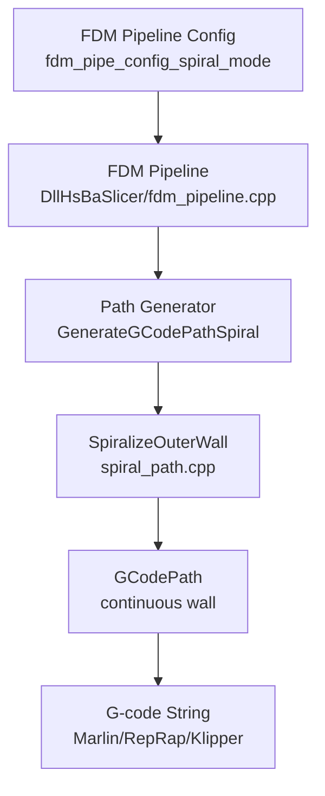
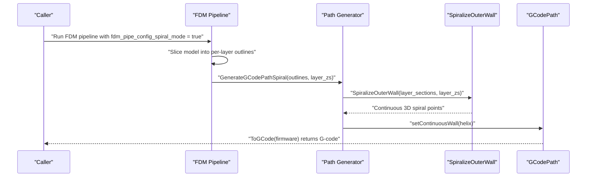
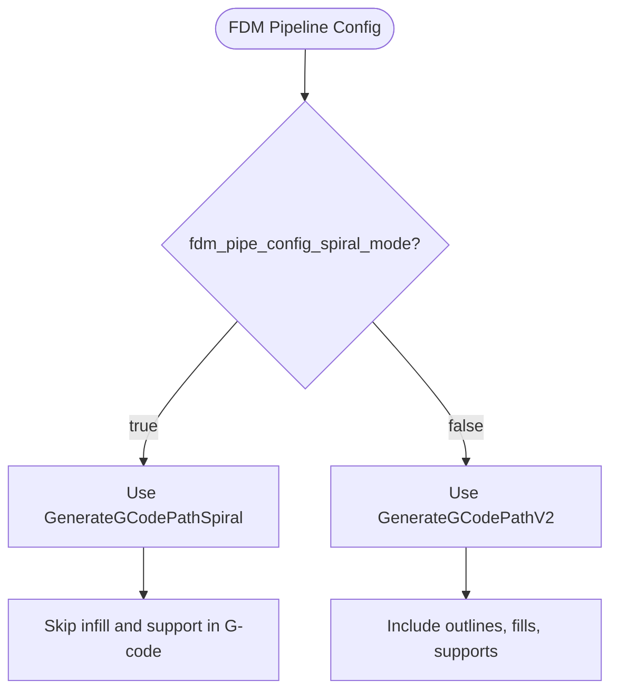
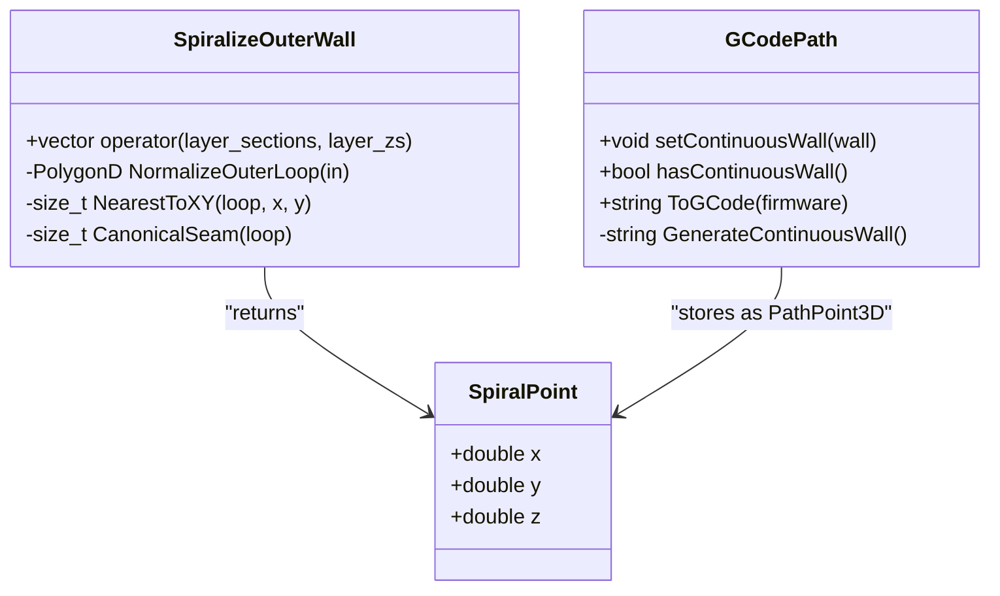
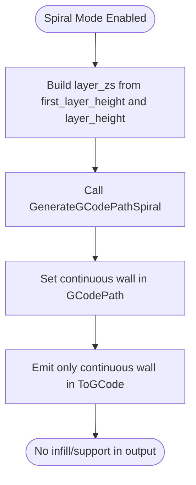
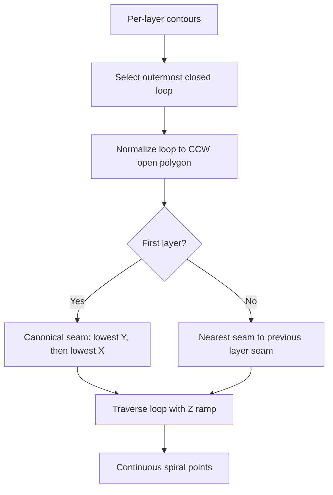
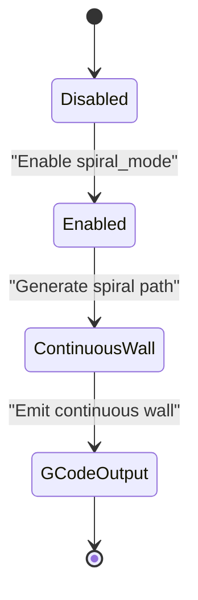

# Spiral/Vase Mode / 螺旋花瓶模式

<cite>
**Referenced Files in This Document**
- [fdm_pipeline.proto](file://proto/fdm_pipeline.proto)
- [fdm_pipeline.cpp](file://DllHsBaSlicer/fdm_pipeline.cpp)
- [path_generator.hpp](file://LibHsBaSlicer/Path/path_generator.hpp)
- [path_generator.cpp](file://LibHsBaSlicer/Path/path_generator.cpp)
- [spiral_path.hpp](file://LibHsBaSlicer/Path/spiral_path.hpp)
- [spiral_path.cpp](file://LibHsBaSlicer/Path/spiral_path.cpp)
- [gcodepath.hpp](file://paths/gcodepath.hpp)
- [gcodepath.cpp](file://paths/gcodepath.cpp)
- [README.md](file://docs/en/DllHsBaSlicer/README.md)
- [path_generator_test.cpp](file://tests/PathsOut/path_generator_test.cpp)
</cite>

## Table of Contents
1. [Introduction](#introduction)
2. [Project Structure](#project-structure)
3. [Core Components](#core-components)
4. [Architecture Overview](#architecture-overview)
5. [Detailed Component Analysis](#detailed-component-analysis)
6. [Dependency Analysis](#dependency-analysis)
7. [Performance Considerations](#performance-considerations)
8. [Troubleshooting Guide](#troubleshooting-guide)
9. [Conclusion](#conclusion)
10. [Appendices](#appendices)

## Introduction
This document explains spiral/vase mode printing in FDM processes as implemented by the HsBaSlicer codebase. Spiral/vase mode is a G-code generation strategy that prints the outer wall as one continuous, rising helical path without layer breaks, while automatically skipping infill and support structures. It is especially useful for decorative objects, planters, vases, and models requiring smooth vertical surfaces with minimal seams.

The key configuration field controlling this behavior is `fdm_pipe_config_spiral_mode` in the FDM pipeline protocol buffer. When enabled, the slicer switches from normal per-layer path generation to a continuous spiralized outer-wall path.

## Project Structure
Spiral/vase mode spans several layers:

- Protocol definition declares the `spiral_mode` flag.
- The FDM pipeline reads the flag and chooses between normal and spiral path generation.
- Spiral path generation computes a continuous 3D helix from per-layer outer contours.
- G-code output emits the continuous wall first, then any remaining per-layer data.

**Diagram sources**
- [fdm_pipeline.proto:26-72](file://proto/fdm_pipeline.proto#L26-L72)
- [fdm_pipeline.cpp:385-409](file://DllHsBaSlicer/fdm_pipeline.cpp#L385-L409)
- [path_generator.cpp:120-140](file://LibHsBaSlicer/Path/path_generator.cpp#L120-L140)
- [spiral_path.cpp:88-163](file://LibHsBaSlicer/Path/spiral_path.cpp#L88-L163)
- [gcodepath.cpp:291-350](file://paths/gcodepath.cpp#L291-L350)

**Section sources**
- [fdm_pipeline.proto:26-72](file://proto/fdm_pipeline.proto#L26-L72)
- [fdm_pipeline.cpp:385-409](file://DllHsBaSlicer/fdm_pipeline.cpp#L385-L409)

## Core Components
Spiral/vase mode relies on these core components:

| Component | Responsibility | Key Behavior |
|---|---|---|
| `fdm_pipe_config_spiral_mode` | Configuration flag | Enables spiral/vase mode; when true, skips infill/support and merges outer walls into a continuous helix. |
| `GenerateGCodePathSpiral` | Spiral path entry point | Converts per-layer outer contours into a continuous 3D wall and stores it in `GCodePath`. |
| `SpiralizeOuterWall` | Spiral algorithm | Selects the outermost closed loop per layer, aligns seams, and ramps Z continuously across layers. |
| `GCodePath::setContinuousWall` | Continuous wall storage | Holds the helical wall so `ToGCode` can emit it before per-layer data. |
| `GCodePath::GenerateContinuousWall` | Continuous wall G-code emission | Writes an extrusion-continuous helix with no retractions between wall points. |

**Section sources**
- [fdm_pipeline.proto:71-72](file://proto/fdm_pipeline.proto#L71-L72)
- [path_generator.hpp:64-70](file://LibHsBaSlicer/Path/path_generator.hpp#L64-L70)
- [path_generator.cpp:120-140](file://LibHsBaSlicer/Path/path_generator.cpp#L120-L140)
- [spiral_path.hpp:31-58](file://LibHsBaSlicer/Path/spiral_path.hpp#L31-L58)
- [gcodepath.hpp:87-100](file://paths/gcodepath.hpp#L87-L100)
- [gcodepath.cpp:291-350](file://paths/gcodepath.cpp#L291-L350)

## Architecture Overview
The spiral/vase mode workflow begins with slicing the model into per-layer outlines. If `spiral_mode` is enabled, the pipeline does not use normal fill or support paths for G-code generation. Instead, it builds a single continuous wall whose Z rises layer by layer.

**Diagram sources**
- [fdm_pipeline.cpp:385-409](file://DllHsBaSlicer/fdm_pipeline.cpp#L385-L409)
- [path_generator.cpp:120-140](file://LibHsBaSlicer/Path/path_generator.cpp#L120-L140)
- [spiral_path.cpp:88-163](file://LibHsBaSlicer/Path/spiral_path.cpp#L88-L163)
- [gcodepath.cpp:291-350](file://paths/gcodepath.cpp#L291-L350)

## Detailed Component Analysis

### Spiral/Vase Mode Configuration Field
The configuration field is defined in the FDM pipeline protocol buffer:

- Field name: `fdm_pipe_config_spiral_mode`
- Type: boolean
- Purpose: Enable spiralize outer wall (vase mode), skip infill/support
- Effect: When true, the pipeline uses `GenerateGCodePathSpiral` instead of normal per-layer path generation.

**Diagram sources**
- [fdm_pipeline.proto:71-72](file://proto/fdm_pipeline.proto#L71-L72)
- [fdm_pipeline.cpp:385-409](file://DllHsBaSlicer/fdm_pipeline.cpp#L385-L409)

**Section sources**
- [fdm_pipeline.proto:26-72](file://proto/fdm_pipeline.proto#L26-L72)
- [fdm_pipeline.cpp:385-409](file://DllHsBaSlicer/fdm_pipeline.cpp#L385-L409)
- [README.md:174-186](file://docs/en/DllHsBaSlicer/README.md#L174-L186)

### Continuous Outer Wall Without Layer Breaks
Spiral mode generates a continuous 3D deposition path where each point carries its own Z coordinate. The wall is emitted as one unbroken extrusion line, avoiding travel moves and retractions between wall points.

Key implementation details:

- `SpiralPoint` holds X, Y, and Z for each point on the continuous wall.
- `SpiralizeOuterWall` selects the outermost closed contour per layer.
- The seam vertex is aligned across layers to keep a fixed seam line.
- Z ramps linearly from the current layer height to the next layer height over one full revolution.
- The last layer is traversed flat because there is no next layer to connect to.

**Diagram sources**
- [spiral_path.hpp:24-29](file://LibHsBaSlicer/Path/spiral_path.hpp#L24-L29)
- [spiral_path.cpp:88-163](file://LibHsBaSlicer/Path/spiral_path.cpp#L88-L163)
- [gcodepath.hpp:51-60](file://paths/gcodepath.hpp#L51-L60)
- [gcodepath.hpp:87-100](file://paths/gcodepath.hpp#L87-L100)

**Section sources**
- [spiral_path.hpp:16-58](file://LibHsBaSlicer/Path/spiral_path.hpp#L16-L58)
- [spiral_path.cpp:16-85](file://LibHsBaSlicer/Path/spiral_path.cpp#L16-L85)
- [spiral_path.cpp:88-163](file://LibHsBaSlicer/Path/spiral_path.cpp#L88-L163)
- [gcodepath.hpp:51-60](file://paths/gcodepath.hpp#L51-L60)
- [gcodepath.cpp:291-330](file://paths/gcodepath.cpp#L291-L330)

### Automatic Disabling of Infill and Support Structures
When spiral mode is enabled, the FDM pipeline bypasses normal per-layer path generation and calls `GenerateGCodePathSpiral`. This function creates a `GCodePath` containing only the continuous wall. As a result:

- No per-layer infill polygons are included.
- No per-layer support polygons are included.
- Only the continuous outer wall is printed.

**Diagram sources**
- [fdm_pipeline.cpp:388-409](file://DllHsBaSlicer/fdm_pipeline.cpp#L388-L409)
- [path_generator.cpp:120-140](file://LibHsBaSlicer/Path/path_generator.cpp#L120-L140)
- [gcodepath.cpp:332-350](file://paths/gcodepath.cpp#L332-L350)

**Section sources**
- [fdm_pipeline.cpp:385-409](file://DllHsBaSlicer/fdm_pipeline.cpp#L385-L409)
- [path_generator.cpp:120-140](file://LibHsBaSlicer/Path/path_generator.cpp#L120-L140)
- [gcodepath.cpp:332-350](file://paths/gcodepath.cpp#L332-L350)

### Seamless Vertical Transitions
The seamless transition is achieved by:

1. Choosing the outermost closed polygon per layer.
2. Normalizing the polygon to an open CCW loop.
3. Selecting a canonical seam for the first layer.
4. Aligning subsequent layers’ seams to the previous layer’s seam in XY.
5. Emitting points around the loop while interpolating Z between layers.

**Diagram sources**
- [spiral_path.cpp:16-85](file://LibHsBaSlicer/Path/spiral_path.cpp#L16-L85)
- [spiral_path.cpp:88-163](file://LibHsBaSlicer/Path/spiral_path.cpp#L88-L163)

**Section sources**
- [spiral_path.cpp:16-85](file://LibHsBaSlicer/Path/spiral_path.cpp#L16-L85)
- [spiral_path.cpp:88-163](file://LibHsBaSlicer/Path/spiral_path.cpp#L88-L163)

### Visual Characteristics and Use Cases
Spiral/vase mode produces:

- A single continuous outer wall.
- Smooth vertical transitions without visible layer lines at seams.
- Hollow objects with uniform wall thickness determined by line width and nozzle settings.
- No internal structure unless explicitly added through other pipeline stages outside vase mode.

Recommended use cases:

- Decorative vases and sculptures.
- Planters and pots.
- Objects requiring smooth exterior surfaces.
- Models where structural strength is provided by geometry rather than infill.

[No sources needed since this section provides general guidance]

### Parameter Optimization Tips for Spiral Mode
The following parameters affect spiral/vase mode quality and performance:

| Parameter | Recommended Approach | Reason |
|---|---|---|
| Layer height | Use smaller layer heights for smoother vertical surfaces | Smaller steps reduce stair-stepping along the continuous wall. |
| Print speed | Reduce print speed for tall or complex spirals | Continuous extrusion requires stable flow; high speeds may cause under-extrusion or surface defects. |
| Nozzle diameter | Match line width to nozzle diameter | Ensures consistent wall thickness and avoids over- or under-extrusion. |
| Line width | Typically equal to nozzle diameter | Produces a solid single-wall object. |
| Extrusion multiplier | Tune based on material and nozzle | Adjusts volumetric flow for the continuous helix. |
| Retraction | Retractions occur only at start/end of the continuous wall | The wall itself must remain extrusion-continuous. |

Relevant printer configuration fields include:

- `nozzle_diameter`
- `filament_diameter`
- `nozzle_temp`
- `bed_temp`
- `retract_length`
- `retract_speed`
- `print_speed`
- `travel_speed`
- `first_layer_speed`
- `layer_height`
- `line_width`
- `extrusion_multiplier`
- `relative_extrusion`

**Section sources**
- [gcodepath.hpp:33-49](file://paths/gcodepath.hpp#L33-L49)
- [README.md:174-186](file://docs/en/DllHsBaSlicer/README.md#L174-L186)

### Limitations and Compatibility Considerations
Spiral/vase mode has specific limitations due to its continuous-wall design:

- **No infill**: Internal volume is hollow unless the model geometry itself provides mass.
- **No supports**: Overhangs cannot be supported by generated support structures in vase mode.
- **Best for prismatic shapes**: Uniform cross-section models produce geometrically exact spirals; varying cross-sections still work but seam alignment prioritizes continuity over perfect surface matching.
- **Layer count matters**: Each valid layer contributes one revolution; too few layers can make the spiral appear coarse.
- **Compatibility with firmware**: The continuous wall is emitted as standard G-code compatible with Marlin, RepRap, and Klipper targets.

**Diagram sources**
- [fdm_pipeline.proto:71-72](file://proto/fdm_pipeline.proto#L71-L72)
- [path_generator.cpp:120-140](file://LibHsBaSlicer/Path/path_generator.cpp#L120-L140)
- [gcodepath.cpp:332-350](file://paths/gcodepath.cpp#L332-L350)

**Section sources**
- [spiral_path.hpp:31-58](file://LibHsBaSlicer/Path/spiral_path.hpp#L31-L58)
- [spiral_path.cpp:88-163](file://LibHsBaSlicer/Path/spiral_path.cpp#L88-L163)
- [gcodepath.cpp:291-350](file://paths/gcodepath.cpp#L291-L350)

## Dependency Analysis
Spiral/vase mode depends on a clear chain of modules:

**Diagram sources**
- [fdm_pipeline.proto:26-72](file://proto/fdm_pipeline.proto#L26-L72)
- [fdm_pipeline.cpp:385-409](file://DllHsBaSlicer/fdm_pipeline.cpp#L385-L409)
- [path_generator.cpp:120-140](file://LibHsBaSlicer/Path/path_generator.cpp#L120-L140)
- [spiral_path.cpp:88-163](file://LibHsBaSlicer/Path/spiral_path.cpp#L88-L163)
- [gcodepath.cpp:291-350](file://paths/gcodepath.cpp#L291-L350)

**Section sources**
- [fdm_pipeline.proto:26-72](file://proto/fdm_pipeline.proto#L26-L72)
- [fdm_pipeline.cpp:385-409](file://DllHsBaSlicer/fdm_pipeline.cpp#L385-L409)
- [path_generator.cpp:120-140](file://LibHsBaSlicer/Path/path_generator.cpp#L120-L140)
- [spiral_path.cpp:88-163](file://LibHsBaSlicer/Path/spiral_path.cpp#L88-L163)
- [gcodepath.cpp:291-350](file://paths/gcodepath.cpp#L291-L350)

## Performance Considerations
- Spiral mode reduces G-code complexity by emitting one continuous wall instead of per-layer outlines, fills, and supports.
- Continuous extrusion avoids retractions between wall points, improving flow stability.
- For tall models, consider reducing print speed to maintain consistent extrusion pressure.
- Small layer heights improve surface finish but increase total path length and print time.
- Large nozzle diameters increase wall thickness and may require slower speeds to avoid blobbing.

[No sources needed since this section provides general guidance]

## Troubleshooting Guide
Common issues and their likely causes in spiral/vase mode:

| Symptom | Likely Cause | Resolution |
|---|---|---|
| Visible seam jumps | Seam alignment failed or invalid layer contour | Ensure each layer has a valid closed outer contour; check model slicing. |
| Under-extrusion on tall spirals | Print speed too high or extrusion multiplier too low | Reduce print speed and tune extrusion multiplier. |
| Poor surface finish | Layer height too large | Reduce layer height for smoother vertical transitions. |
| Missing wall | No valid outer contour in layers | Verify model geometry and slicing results. |
| G-code contains unexpected retractions inside wall | Continuous wall was not used | Confirm `spiral_mode` is enabled and `GenerateGCodePathSpiral` is called. |

Verification references:

- Tests confirm that spiral mode produces a continuous wall and outputs non-empty G-code.
- Tests also verify that normal V2 path generation does not have a continuous wall.

**Section sources**
- [path_generator_test.cpp:93-119](file://tests/PathsOut/path_generator_test.cpp#L93-L119)
- [gcodepath.cpp:291-350](file://paths/gcodepath.cpp#L291-L350)

## Conclusion
Spiral/vase mode in HsBaSlicer is a focused FDM feature that replaces normal per-layer path generation with a single continuous helical outer wall. Controlled by `fdm_pipe_config_spiral_mode`, it automatically skips infill and support structures, aligns seams across layers, and emits an extrusion-continuous wall suitable for decorative and smooth-surface applications. Proper tuning of layer height, print speed, nozzle settings, and extrusion multiplier is essential for reliable results.

[No sources needed since this section summarizes without analyzing specific files]

## Appendices

### API Entry Points for Spiral Mode
- `GenerateGCodePathSpiral`: Main entry point for spiral path generation.
- `SpiralizeOuterWall`: Core algorithm producing continuous 3D spiral points.
- `GCodePath::setContinuousWall`: Stores the continuous wall for G-code emission.
- `GCodePath::hasContinuousWall`: Checks whether spiral mode output is active.

**Section sources**
- [path_generator.hpp:64-70](file://LibHsBaSlicer/Path/path_generator.hpp#L64-L70)
- [path_generator.cpp:120-140](file://LibHsBaSlicer/Path/path_generator.cpp#L120-L140)
- [spiral_path.hpp:31-58](file://LibHsBaSlicer/Path/spiral_path.hpp#L31-L58)
- [gcodepath.hpp:87-100](file://paths/gcodepath.hpp#L87-L100)