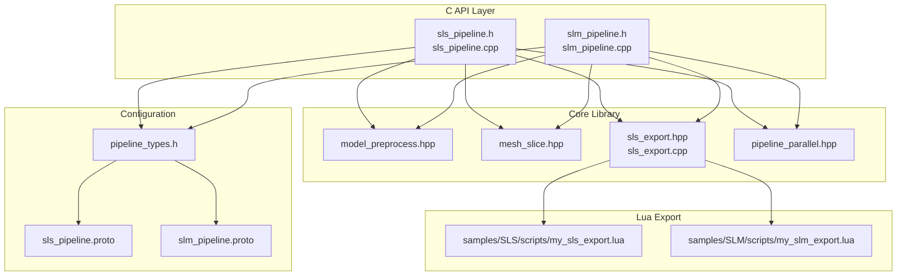
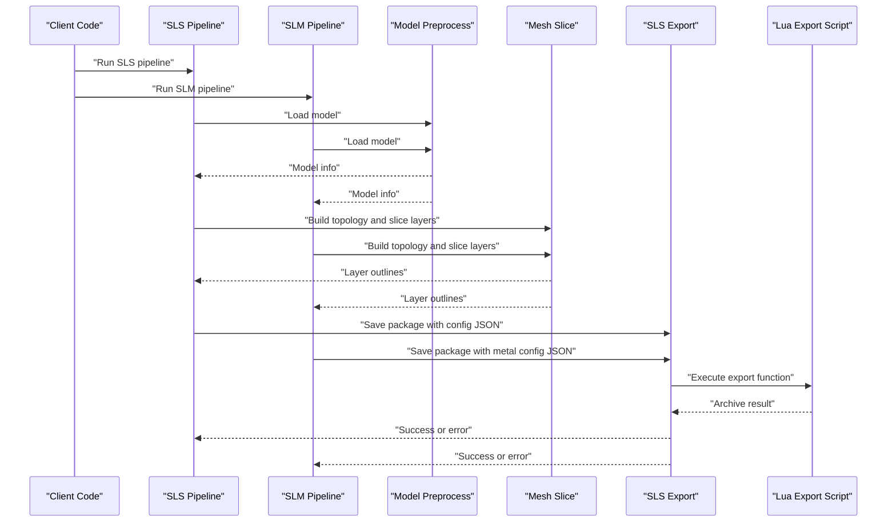
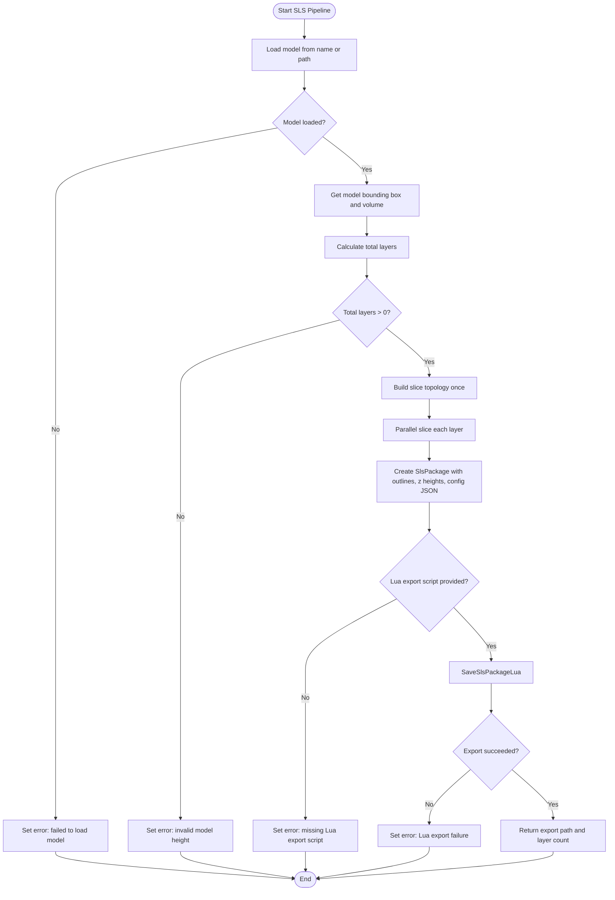
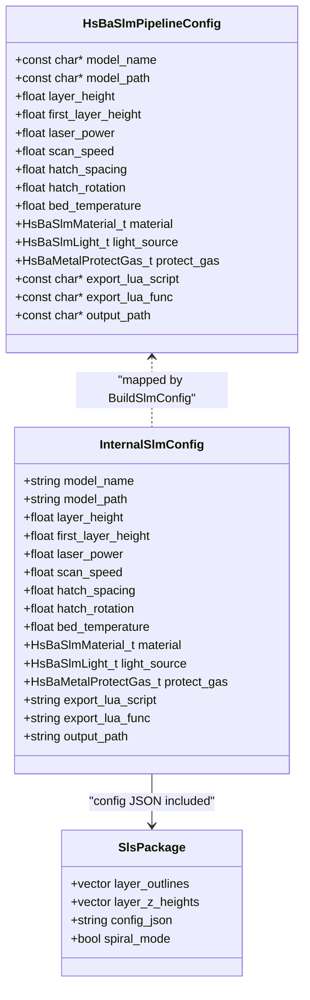
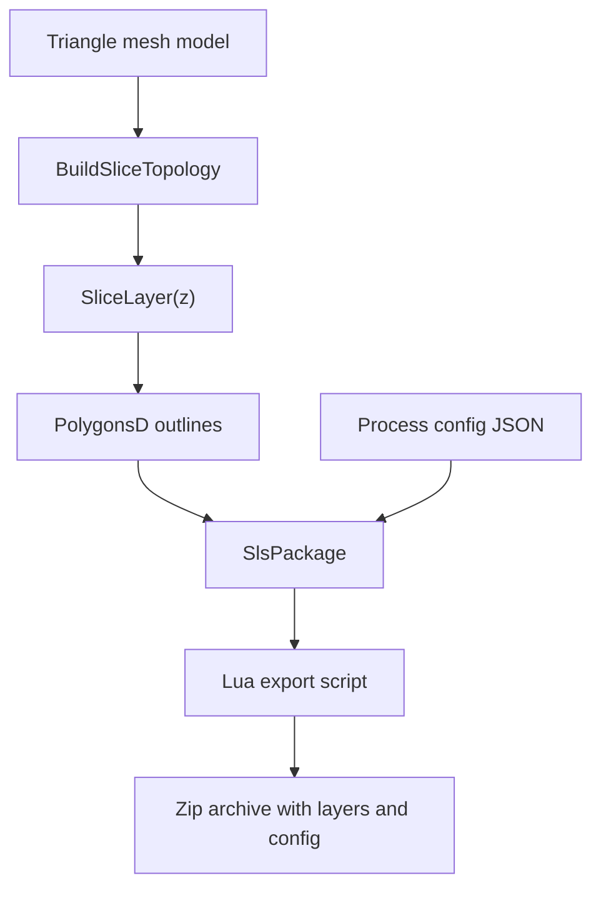
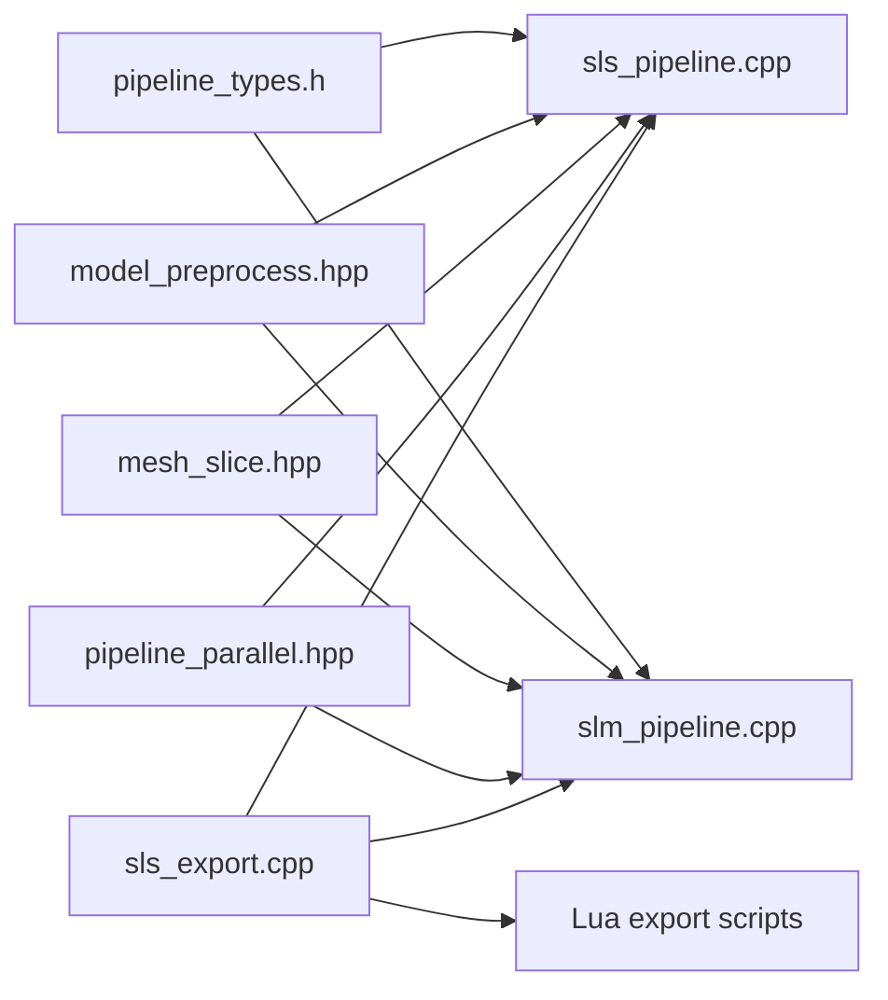
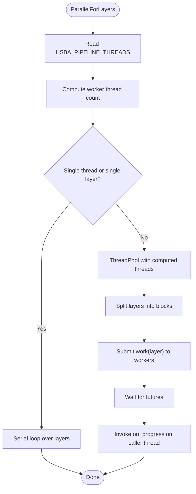

# Metal Processing Examples / 金属加工示例

<cite>
**Referenced Files in This Document**   
- [pipeline_types.h](file://pipelinetypes/pipeline_types.h)
- [slm_pipeline.h](file://DllHsBaSlicer/slm_pipeline.h)
- [slm_pipeline.cpp](file://DllHsBaSlicer/slm_pipeline.cpp)
- [sls_pipeline.h](file://DllHsBaSlicer/sls_pipeline.h)
- [sls_pipeline.cpp](file://DllHsBaSlicer/sls_pipeline.cpp)
- [slm_pipeline.proto](file://proto/slm_pipeline.proto)
- [sls_pipeline.proto](file://proto/sls_pipeline.proto)
- [sls_export.hpp](file://LibHsBaSlicer/Path/sls_export.hpp)
- [sls_export.cpp](file://LibHsBaSlicer/Path/sls_export.cpp)
- [mesh_slice.hpp](file://LibHsBaSlicer/Slice/mesh_slice.hpp)
- [model_preprocess.hpp](file://LibHsBaSlicer/Preprocess/model_preprocess.hpp)
- [pipeline_parallel.hpp](file://DllHsBaSlicer/pipeline_parallel.hpp)
- [my_slm_export.lua](file://samples/SLM/scripts/my_slm_export.lua)
- [my_sls_export.lua](file://samples/SLS/scripts/my_sls_export.lua)
</cite>

## Table of Contents
1. [Introduction](#introduction)
2. [Project Structure for Metal Processing](#project-structure-for-metal-processing)
3. [Core Components](#core-components)
4. [Architecture Overview](#architecture-overview)
5. [Detailed Component Analysis](#detailed-component-analysis)
6. [Dependency Analysis](#dependency-analysis)
7. [Performance Considerations](#performance-considerations)
8. [Troubleshooting Guide](#troubleshooting-guide)
9. [Conclusion](#conclusion)
10. [Appendices](#appendices)

## Introduction
This document provides metal processing examples focused on SLM (Selective Laser Melting) and SLS (Selective Laser Sintering) workflows implemented in HsBaSlicer. It explains how the codebase models powder bed slicing, energy source configuration, material definitions, layer generation, and Lua-driven export packaging.

The repository does not implement a full thermal stress simulation or part orientation optimizer; instead, it exposes configurable parameters such as laser power, scan speed, hatch spacing, hatch rotation, layer height, first layer height, and build plate temperature. Metal-specific metadata is carried into a JSON configuration that the Lua export script archives. Post-processing guidance is therefore framed around interpreting these exported configurations rather than built-in heat treatment or support removal logic.

## Project Structure for Metal Processing
Metal processing in this project is centered on two pipeline modules:

- SLS pipeline: generic powder-bed slicing with laser and bed temperature parameters.
- SLM pipeline: metal-specific extension of the SLS flow, adding material, energy source, and shielding gas.

**Diagram sources**
- [sls_pipeline.h:17-56](file://DllHsBaSlicer/sls_pipeline.h#L17-L56)
- [sls_pipeline.cpp:181-296](file://DllHsBaSlicer/sls_pipeline.cpp#L181-L296)
- [slm_pipeline.h:17-56](file://DllHsBaSlicer/slm_pipeline.h#L17-L56)
- [slm_pipeline.cpp:236-348](file://DllHsBaSlicer/slm_pipeline.cpp#L236-L348)
- [sls_export.hpp:17-56](file://LibHsBaSlicer/Path/sls_export.hpp#L17-L56)
- [sls_export.cpp:79-143](file://LibHsBaSlicer/Path/sls_export.cpp#L79-L143)
- [mesh_slice.hpp:22-103](file://LibHsBaSlicer/Slice/mesh_slice.hpp#L22-L103)
- [model_preprocess.hpp:22-82](file://LibHsBaSlicer/Preprocess/model_preprocess.hpp#L22-L82)
- [pipeline_parallel.hpp:22-117](file://DllHsBaSlicer/pipeline_parallel.hpp#L22-L117)
- [pipeline_types.h:247-401](file://pipelinetypes/pipeline_types.h#L247-L401)
- [sls_pipeline.proto:5-32](file://proto/sls_pipeline.proto#L5-L32)
- [slm_pipeline.proto:9-64](file://proto/slm_pipeline.proto#L9-L64)

**Section sources**
- [sls_pipeline.h:17-56](file://DllHsBaSlicer/sls_pipeline.h#L17-L56)
- [slm_pipeline.h:17-56](file://DllHsBaSlicer/slm_pipeline.h#L17-L56)
- [pipeline_types.h:247-401](file://pipelinetypes/pipeline_types.h#L247-L401)

## Core Components
The metal processing workflow is composed of five core components:

| Component | Responsibility | Key Source |
|---|---|---|
| Pipeline configuration types | C-compatible structs and enums for SLS and SLM parameters | [pipeline_types.h:247-401](file://pipelinetypes/pipeline_types.h#L247-L401) |
| SLS pipeline | Loads model, slices layers, exports via Lua | [sls_pipeline.cpp:181-296](file://DllHsBaSlicer/sls_pipeline.cpp#L181-L296) |
| SLM pipeline | Adds metal material, light source, and shielding gas to SLS flow | [slm_pipeline.cpp:236-348](file://DllHsBaSlicer/slm_pipeline.cpp#L236-L348) |
| Mesh slicing | Builds reusable topology and slices per-layer polygons | [mesh_slice.hpp:79-103](file://LibHsBaSlicer/Slice/mesh_slice.hpp#L79-L103) |
| Lua export packaging | Serializes layer outlines and config JSON into zip output | [sls_export.cpp:79-143](file://LibHsBaSlicer/Path/sls_export.cpp#L79-L143) |

### SLS Configuration Fields
The SLS configuration defines powder-bed slicing and laser parameters:

| Field | Type | Default Value | Meaning |
|---|---:|---:|---|
| `layer_height` | float | 0.1 mm | Standard layer thickness after the first layer |
| `first_layer_height` | float | 0.15 mm | Initial layer thickness used for bed adhesion |
| `laser_power` | float | 30.0 W | Laser power applied during sintering |
| `scan_speed` | float | 2000.0 mm/s | Laser scanning speed |
| `hatch_spacing` | float | 0.15 mm | Distance between adjacent hatch lines |
| `hatch_rotation` | float | 90.0 degrees | Hatch angle rotation between layers |
| `bed_temperature` | float | 180.0 °C | Powder bed preheat temperature |
| `export_lua_script` | string | required | Lua script path for custom export |
| `export_lua_func` | string | optional | Lua function name, default `export_sls` |
| `output_path` | string | optional | Output file path |

**Section sources**
- [pipeline_types.h:259-283](file://pipelinetypes/pipeline_types.h#L259-L283)
- [sls_pipeline.cpp:39-55](file://DllHsBaSlicer/sls_pipeline.cpp#L39-L55)

### SLM Configuration Fields
The SLM configuration extends SLS with metal-specific metadata:

| Field | Type | Default Value | Meaning |
|---|---:|---:|---|
| `material` | enum | `HSBA_SLM_MATERIAL_TITANIUM` | Metal powder material |
| `light_source` | enum | `HSBA_SLM_LIGHT_LASER` | Energy source type |
| `protect_gas` | enum | `HSBA_METAL_GAS_ARGON` | Shielding gas |
| Other fields | Same as SLS | Same defaults | Layer, laser, hatch, and bed temperature |

Supported materials include iron, aluminum, and titanium. Supported light sources include laser and electron beam. Supported shielding gases include argon, helium, nitrogen, and carbon dioxide.

**Section sources**
- [pipeline_types.h:320-376](file://pipelinetypes/pipeline_types.h#L320-L376)
- [slm_pipeline.cpp:39-58](file://DllHsBaSlicer/slm_pipeline.cpp#L39-L58)
- [slm_pipeline.proto:9-31](file://proto/slm_pipeline.proto#L9-L31)

## Architecture Overview
Both SLS and SLM pipelines follow the same three-stage architecture: preprocess, slice, and Lua export. The main difference is that SLM adds metal metadata into the generated configuration JSON.

**Diagram sources**
- [sls_pipeline.cpp:181-296](file://DllHsBaSlicer/sls_pipeline.cpp#L181-L296)
- [slm_pipeline.cpp:236-348](file://DllHsBaSlicer/slm_pipeline.cpp#L236-L348)
- [sls_export.cpp:79-143](file://LibHsBaSlicer/Path/sls_export.cpp#L79-L143)

## Detailed Component Analysis

### SLS Workflow
The SLS pipeline performs:

1. Model loading through the internal model pool.
2. Bounding box and volume query to compute total layers.
3. Parallel slicing using a shared topology.
4. Lua-based export that packages layer outlines and configuration JSON.

**Diagram sources**
- [sls_pipeline.cpp:93-115](file://DllHsBaSlicer/sls_pipeline.cpp#L93-L115)
- [sls_pipeline.cpp:181-296](file://DllHsBaSlicer/sls_pipeline.cpp#L181-L296)

**Section sources**
- [sls_pipeline.cpp:93-115](file://DllHsBaSlicer/sls_pipeline.cpp#L93-L115)
- [sls_pipeline.cpp:181-296](file://DllHsBaSlicer/sls_pipeline.cpp#L181-L296)

### SLM Workflow
The SLM workflow mirrors SLS but adds:

- Material selection: iron, aluminum, titanium.
- Energy source selection: laser or electron beam.
- Shielding gas selection: argon, helium, nitrogen, carbon dioxide.
- Metal-specific JSON fields embedded into the exported configuration.

**Diagram sources**
- [pipeline_types.h:353-376](file://pipelinetypes/pipeline_types.h#L353-L376)
- [slm_pipeline.cpp:39-58](file://DllHsBaSlicer/slm_pipeline.cpp#L39-L58)
- [sls_export.hpp:24-33](file://LibHsBaSlicer/Path/sls_export.hpp#L24-L33)

**Section sources**
- [pipeline_types.h:320-376](file://pipelinetypes/pipeline_types.h#L320-L376)
- [slm_pipeline.cpp:128-196](file://DllHsBaSlicer/slm_pipeline.cpp#L128-L196)
- [slm_pipeline.cpp:236-348](file://DllHsBaSlicer/slm_pipeline.cpp#L236-L348)

### Powder Bed Simulation Algorithms
The current implementation does not simulate powder particle physics, melt pool dynamics, or thermal gradients. Instead, it simulates the geometric powder bed process by:

- Computing layer count from model bounding box and layer heights.
- Building a reusable triangle mesh topology.
- Slicing at discrete Z heights to produce closed polygon outlines.
- Packaging polygon outlines and configuration JSON for downstream machine control.

**Diagram sources**
- [mesh_slice.hpp:79-103](file://LibHsBaSlicer/Slice/mesh_slice.hpp#L79-L103)
- [sls_export.cpp:79-143](file://LibHsBaSlicer/Path/sls_export.cpp#L79-L143)

**Section sources**
- [mesh_slice.hpp:22-103](file://LibHsBaSlicer/Slice/mesh_slice.hpp#L22-L103)
- [sls_export.cpp:79-143](file://LibHsBaSlicer/Path/sls_export.cpp#L79-L143)

### Energy Source Configuration for Laser and Electron Beam Systems
Energy source configuration is exposed through:

- `laser_power`: energy source power in watts.
- `scan_speed`: travel speed of the energy source.
- `light_source`: distinguishes laser melting from electron-beam melting.
- `protect_gas`: shielding gas environment for metal processes.

For SLM, the energy source and shielding gas are explicitly modeled. For SLS, only laser power and scan speed are present, consistent with polymer or generic powder sintering.

**Section sources**
- [pipeline_types.h:331-351](file://pipelinetypes/pipeline_types.h#L331-L351)
- [slm_pipeline.cpp:143-171](file://DllHsBaSlicer/slm_pipeline.cpp#L143-L171)
- [slm_pipeline.proto:17-31](file://proto/slm_pipeline.proto#L17-L31)

### Material Property Definitions for Metallic Powders
The codebase defines material identity rather than full thermophysical property tables. Materials are represented as enumerated values:

| Enum Value | Meaning |
|---|---|
| `HSBA_SLM_MATERIAL_IRON` | Iron-based powder |
| `HSBA_SLM_MATERIAL_ALUMINUM` | Aluminum-based powder |
| `HSBA_SLM_MATERIAL_TITANIUM` | Titanium-based powder |
| `HSBA_SLM_MATERIAL_UNKNOWN` | Unspecified material |

These values are serialized into the configuration JSON so downstream systems can select appropriate thermal and mechanical properties.

**Section sources**
- [pipeline_types.h:320-329](file://pipelinetypes/pipeline_types.h#L320-L329)
- [slm_pipeline.cpp:128-141](file://DllHsBaSlicer/slm_pipeline.cpp#L128-L141)
- [slm_pipeline.proto:9-15](file://proto/slm_pipeline.proto#L9-L15)

### Part Orientation Optimization
Part orientation optimization is not implemented inside the SLS or SLM pipeline files analyzed here. The preprocessing API supports translation, rotation, and scaling, which means an external orientation optimizer can transform the model before running the slicing pipeline.

Recommended usage pattern:

1. Run an orientation optimizer outside the slicer.
2. Apply rotation and translation to the model using the preprocessing API.
3. Run SLS or SLM slicing with the transformed model.

**Section sources**
- [model_preprocess.hpp:50-75](file://LibHsBaSlicer/Preprocess/model_preprocess.hpp#L50-L75)

### Build Plate Preparation
Build plate preparation is represented by:

- `bed_temperature`: platform or powder bed temperature.
- `first_layer_height`: thicker initial layer for better adhesion.
- `layer_height`: standard layer thickness.

The pipeline does not generate a separate build plate geometry; it assumes the machine controls the physical bed and recoater.

**Section sources**
- [pipeline_types.h:265-274](file://pipelinetypes/pipeline_types.h#L265-L274)
- [pipeline_types.h:363-370](file://pipelinetypes/pipeline_types.h#L363-L370)
- [sls_pipeline.cpp:39-55](file://DllHsBaSlicer/sls_pipeline.cpp#L39-L55)
- [slm_pipeline.cpp:39-58](file://DllHsBaSlicer/slm_pipeline.cpp#L39-L58)

### Thermal Stress Compensation
Thermal stress compensation is not implemented in the analyzed source files. The system does not apply shrinkage compensation, distortion prediction, or adaptive path planning based on thermal analysis. Compensation must be performed either:

- Before slicing, by modifying the CAD model.
- After slicing, by a downstream CAM or compensation tool that consumes the exported layer polygons and configuration JSON.

**Section sources**
- [sls_export.cpp:79-143](file://LibHsBaSlicer/Path/sls_export.cpp#L79-L143)
- [slm_pipeline.cpp:173-196](file://DllHsBaSlicer/slm_pipeline.cpp#L173-L196)

### SLM-Specific Parameters
SLM-specific parameters covered by the codebase include:

| Parameter | Typical Role |
|---|---|
| `laser_power` | Controls energy input per unit length |
| `scan_speed` | Controls exposure time along scan paths |
| `hatch_spacing` | Controls overlap between adjacent scan lines |
| `hatch_rotation` | Reduces directional defects by rotating hatch angles |
| `bed_temperature` | Reduces thermal gradients and residual stress |
| `material` | Identifies metal powder for downstream property mapping |
| `light_source` | Selects laser or electron beam process |
| `protect_gas` | Defines inert or reactive shielding atmosphere |

**Section sources**
- [pipeline_types.h:353-376](file://pipelinetypes/pipeline_types.h#L353-L376)
- [slm_pipeline.cpp:173-196](file://DllHsBaSlicer/slm_pipeline.cpp#L173-L196)

### SLS Sintering Parameters
SLS sintering parameters covered by the codebase include:

| Parameter | Typical Role |
|---|---|
| `laser_power` | Controls sintering energy |
| `scan_speed` | Controls dwell time under the laser |
| `hatch_spacing` | Controls inter-line coverage |
| `hatch_rotation` | Reduces anisotropic sintering behavior |
| `bed_temperature` | Keeps powder near sintering temperature |

Temperature profiles and cooling strategies are not modeled as explicit multi-zone thermal profiles. They are represented by a single bed temperature value.

**Section sources**
- [pipeline_types.h:265-274](file://pipelinetypes/pipeline_types.h#L265-L274)
- [sls_pipeline.cpp:125-145](file://DllHsBaSlicer/sls_pipeline.cpp#L125-L145)

### Post-Processing Requirements for Metal Parts
The slicer does not perform post-processing. However, the exported package contains enough information for downstream systems to plan post-processing:

- Heat treatment: use material and energy source metadata to select annealing, stress-relief, or HIP procedures.
- Support removal: if supports are added downstream, use layer outlines to identify contact regions.
- Surface finishing: use polygon outlines and layer count to estimate surface area and machining strategy.

The sample Lua scripts demonstrate how to archive configuration and layer data, which is the foundation for any automated post-processing workflow.

**Section sources**
- [my_slm_export.lua:15-62](file://samples/SLM/scripts/my_slm_export.lua#L15-L62)
- [my_sls_export.lua:23-79](file://samples/SLS/scripts/my_sls_export.lua#L23-L79)

## Dependency Analysis
The following diagram shows how SLS and SLM depend on shared preprocessing, slicing, and export components.

**Diagram sources**
- [sls_pipeline.cpp:17-23](file://DllHsBaSlicer/sls_pipeline.cpp#L17-L23)
- [slm_pipeline.cpp:17-23](file://DllHsBaSlicer/slm_pipeline.cpp#L17-L23)
- [sls_export.cpp:7-18](file://LibHsBaSlicer/Path/sls_export.cpp#L7-L18)

**Section sources**
- [sls_pipeline.cpp:17-23](file://DllHsBaSlicer/sls_pipeline.cpp#L17-L23)
- [slm_pipeline.cpp:17-23](file://DllHsBaSlicer/slm_pipeline.cpp#L17-L23)

## Performance Considerations
Key performance characteristics observed in the codebase:

- Layer slicing is parallelized across a thread pool.
- A shared slicing topology is built once and reused for all layers.
- Progress callbacks are invoked serially after parallel blocks complete.
- Worker thread count can be controlled via the `HSBA_PIPELINE_THREADS` environment variable.
- SLS and SLM share the same parallel slicing helper.

**Diagram sources**
- [pipeline_parallel.hpp:41-117](file://DllHsBaSlicer/pipeline_parallel.hpp#L41-L117)

**Section sources**
- [pipeline_parallel.hpp:22-117](file://DllHsBaSlicer/pipeline_parallel.hpp#L22-L117)
- [sls_pipeline.cpp:226-242](file://DllHsBaSlicer/sls_pipeline.cpp#L226-L242)
- [slm_pipeline.cpp:272-294](file://DllHsBaSlicer/slm_pipeline.cpp#L272-L294)

## Troubleshooting Guide
Common issues visible in the pipeline implementations:

| Issue | Cause | Resolution |
|---|---|---|
| Failed to load model | Invalid model name or path | Verify `model_name` and `model_path`; ensure the model exists in the internal pool or filesystem |
| Invalid model height | Zero or negative bounding box height | Check model geometry and units |
| Missing Lua export script | `export_lua_script` is empty | Provide a valid Lua script path |
| Lua export failure | Export script error or missing dependencies | Inspect `error_message` and verify Lua script functions |
| Database registration skipped | SQLite or database adapter unavailable | Treat as non-fatal warning; archive still created |

Error handling is centralized around `RuntimeError`, progress reporting, and result structures containing success flags, elapsed time, and messages.

**Section sources**
- [sls_pipeline.cpp:193-216](file://DllHsBaSlicer/sls_pipeline.cpp#L193-L216)
- [sls_pipeline.cpp:244-282](file://DllHsBaSlicer/sls_pipeline.cpp#L244-L282)
- [slm_pipeline.cpp:243-268](file://DllHsBaSlicer/slm_pipeline.cpp#L243-L268)
- [slm_pipeline.cpp:296-334](file://DllHsBaSlicer/slm_pipeline.cpp#L296-L334)
- [sls_export.cpp:134-143](file://LibHsBaSlicer/Path/sls_export.cpp#L134-L143)
- [my_sls_export.lua:50-71](file://samples/SLS/scripts/my_sls_export.lua#L50-L71)
- [my_slm_export.lua:35-54](file://samples/SLM/scripts/my_slm_export.lua#L35-L54)

## Conclusion
HsBaSlicer implements SLS and SLM workflows as geometric powder-bed slicing pipelines rather than full thermal-metallurgical simulators. SLS provides generic laser and bed temperature parameters, while SLM adds metal material, energy source, and shielding gas metadata. The core strength lies in robust model preprocessing, parallel layer slicing, and flexible Lua-driven export packaging.

For advanced metal processing needs such as thermal stress compensation, part orientation optimization, and detailed temperature profile control, the recommended approach is to integrate external tools before or after the slicer and consume the exported layer polygons and configuration JSON.

## Appendices

### SLS vs SLM Configuration Comparison
| Aspect | SLS | SLM |
|---|---|---|
| Process type | Generic powder-bed sintering | Metal powder melting |
| Material field | Not present | Present |
| Energy source field | Only power and speed | Power, speed, and light source |
| Shielding gas | Not present | Present |
| Bed temperature | Yes | Yes |
| Export format | Lua-defined zip + database | Lua-defined zip + database |

**Section sources**
- [pipeline_types.h:247-401](file://pipelinetypes/pipeline_types.h#L247-L401)
- [sls_pipeline.proto:5-32](file://proto/sls_pipeline.proto#L5-L32)
- [slm_pipeline.proto:9-64](file://proto/slm_pipeline.proto#L9-L64)