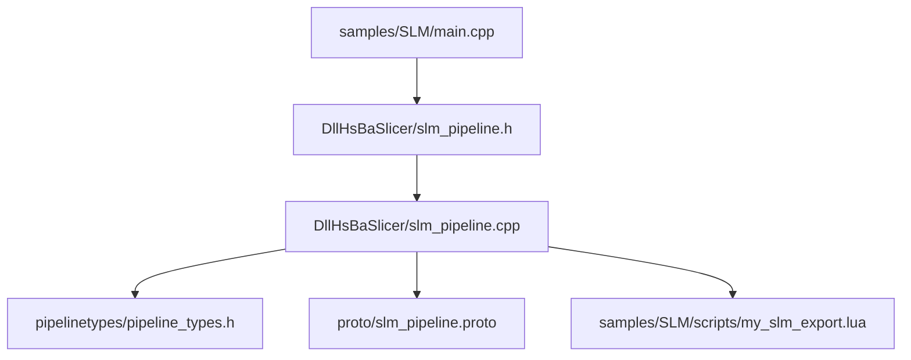
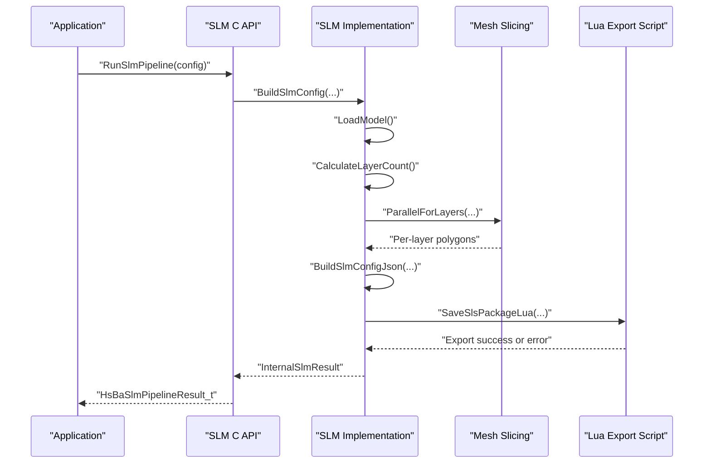
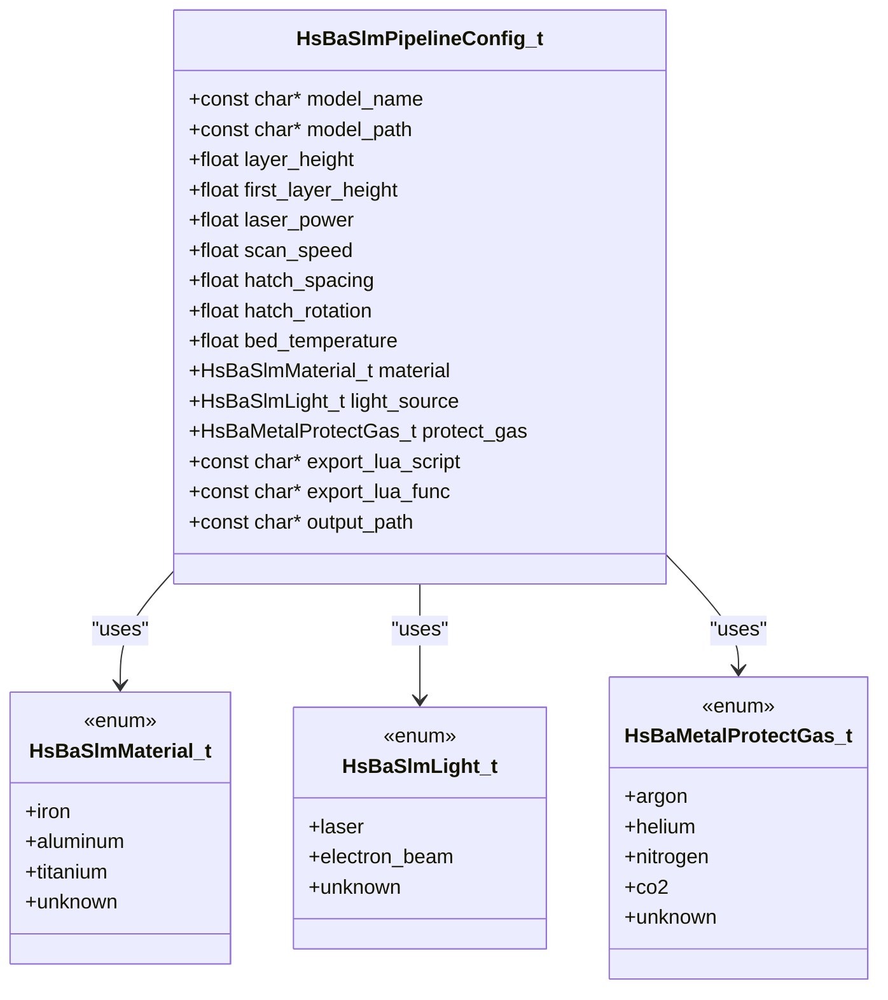
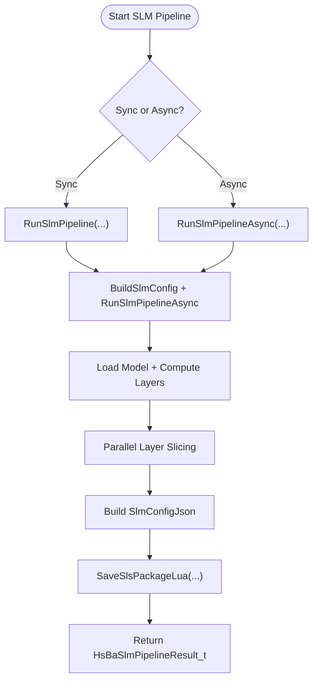
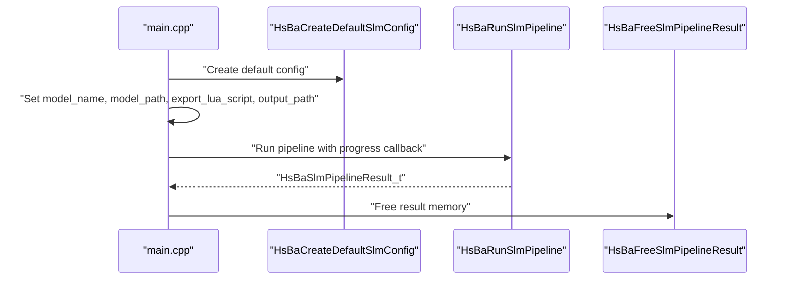
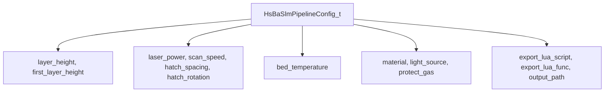
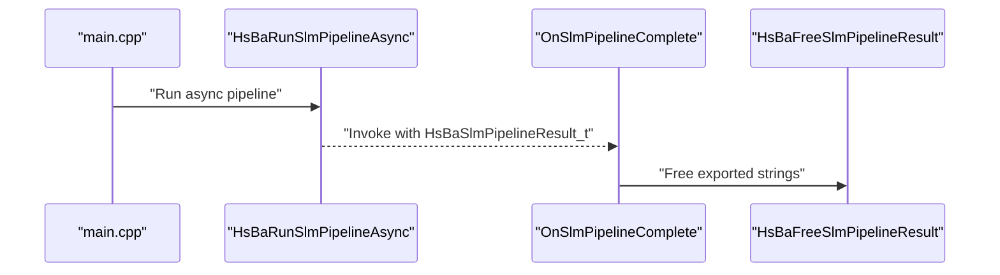
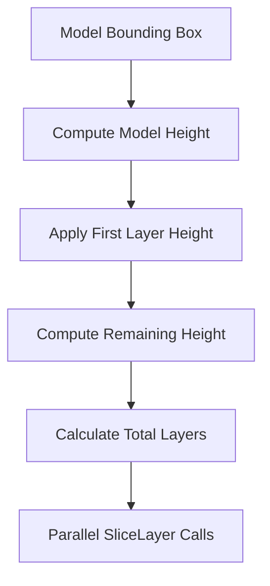
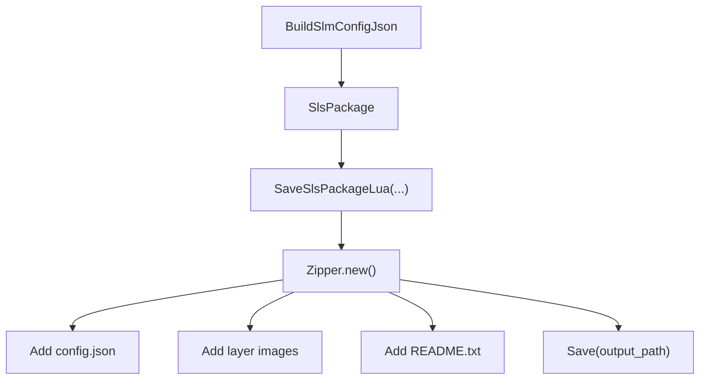
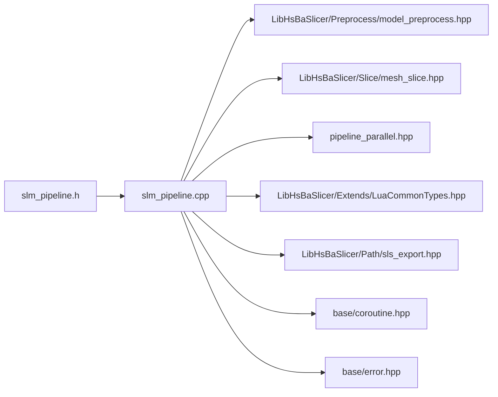

# SLM Examples / SLM示例

<cite>
**Referenced Files in This Document**   
- [slm_pipeline.h](file://DllHsBaSlicer/slm_pipeline.h)
- [slm_pipeline.cpp](file://DllHsBaSlicer/slm_pipeline.cpp)
- [pipeline_types.h](file://pipelinetypes/pipeline_types.h)
- [slm_pipeline.proto](file://proto/slm_pipeline.proto)
- [main.cpp](file://samples/SLM/main.cpp)
- [my_slm_export.lua](file://samples/SLM/scripts/my_slm_export.lua)
</cite>

## Table of Contents
1. [Introduction](#introduction)
2. [Project Structure](#project-structure)
3. [Core Components](#core-components)
4. [Architecture Overview](#architecture-overview)
5. [Detailed Component Analysis](#detailed-component-analysis)
6. [Dependency Analysis](#dependency-analysis)
7. [Performance Considerations](#performance-considerations)
8. [Troubleshooting Guide](#troubleshooting-guide)
9. [Conclusion](#conclusion)
10. [Appendices](#appendices)

## Introduction
This document provides a complete, code-sourced guide to the HsBaSlicer Selective Laser Melting (SLM) workflow. It explains how to prepare a model, configure metal-specific parameters, run synchronous and asynchronous pipelines, understand powder-bed slicing behavior, optimize energy sources for different metals, manage thermal conditions through bed temperature and shielding gas, and integrate machine-specific export scripts that produce zip archives or proprietary formats.

The SLM pipeline mirrors the SLS powder-bed flow: preprocess → slice → Lua-driven export. Unlike FDM or SLA, it does not generate built-in G-code; instead, it writes a JSON configuration containing process parameters and per-layer polygon outlines, leaving final machine format generation to the user’s Lua export script.

## Project Structure
The SLM example is implemented across three main areas:

- C ABI header and implementation: `DllHsBaSlicer/slm_pipeline.h` and `slm_pipeline.cpp`.
- Shared C-compatible types and defaults: `pipelinetypes/pipeline_types.h`.
- Example application and Lua export script: `samples/SLM/main.cpp` and `samples/SLM/scripts/my_slm_export.lua`.
- Protocol buffer definition used by serialization layers: `proto/slm_pipeline.proto`.

**Diagram sources**
- [main.cpp:20-70](file://samples/SLM/main.cpp#L20-L70)
- [slm_pipeline.h:17-56](file://DllHsBaSlicer/slm_pipeline.h#L17-L56)
- [slm_pipeline.cpp:236-348](file://DllHsBaSlicer/slm_pipeline.cpp#L236-L348)
- [pipeline_types.h:312-376](file://pipelinetypes/pipeline_types.h#L312-L376)
- [slm_pipeline.proto:33-55](file://proto/slm_pipeline.proto#L33-L55)
- [my_slm_export.lua:15-33](file://samples/SLM/scripts/my_slm_export.lua#L15-L33)

**Section sources**
- [slm_pipeline.h:1-63](file://DllHsBaSlicer/slm_pipeline.h#L1-L63)
- [slm_pipeline.cpp:1-397](file://DllHsBaSlicer/slm_pipeline.cpp#L1-L397)
- [pipeline_types.h:312-376](file://pipelinetypes/pipeline_types.h#L312-L376)
- [slm_pipeline.proto:1-65](file://proto/slm_pipeline.proto#L1-L65)
- [main.cpp:1-196](file://samples/SLM/main.cpp#L1-L196)
- [my_slm_export.lua:1-63](file://samples/SLM/scripts/my_slm_export.lua#L1-L63)

## Core Components
The SLM workflow is centered on four core components:

| Component | Responsibility | Key Source |
|---|---|---|
| `HsBaSlmPipelineConfig_t` | Defines model path, layer geometry, laser/scan parameters, bed temperature, material, light source, shielding gas, Lua export target, and output path. | [pipeline_types.h:353-376](file://pipelinetypes/pipeline_types.h#L353-L376) |
| Default initializer | Provides safe defaults: titanium material, laser source, argon gas, 0.06 mm layer height, 0.08 mm first layer, 200 W power, 1000 mm/s scan speed, 0.1 mm hatch spacing, 67° rotation, 100°C bed temperature. | [pipeline_types.h:849-872](file://pipelinetypes/pipeline_types.h#L849-L872) |
| Pipeline API | Exposes synchronous and asynchronous execution, progress callbacks, and result cleanup. | [slm_pipeline.h:17-56](file://DllHsBaSlicer/slm_pipeline.h#L17-L56) |
| Pipeline implementation | Loads models, slices layers in parallel, builds JSON config, runs Lua export, and reports timing and errors. | [slm_pipeline.cpp:236-348](file://DllHsBaSlicer/slm_pipeline.cpp#L236-L348) |

### `HsBaSlmPipelineConfig_t` Field Reference

| Field | Type | Meaning | Default Value |
|---|---|---|---|
| `model_name` | `const char*` | Logical model name used by the model registry. | NULL |
| `model_path` | `const char*` | Filesystem path to the input mesh. | NULL |
| `layer_height` | `float` | Standard layer thickness in millimeters. | 0.06 |
| `first_layer_height` | `float` | First layer thickness in millimeters. | 0.08 |
| `laser_power` | `float` | Energy source power in watts. | 200.0 |
| `scan_speed` | `float` | Scan speed in millimeters per second. | 1000.0 |
| `hatch_spacing` | `float` | Distance between adjacent hatch lines in millimeters. | 0.1 |
| `hatch_rotation` | `float` | Hatch angle rotation in degrees. | 67.0 |
| `bed_temperature` | `float` | Build platform or powder bed temperature in Celsius. | 100.0 |
| `material` | `HsBaSlmMaterial_t` | Metal powder type. | `HSBA_SLM_MATERIAL_TITANIUM` |
| `light_source` | `HsBaSlmLight_t` | Energy source type. | `HSBA_SLM_LIGHT_LASER` |
| `protect_gas` | `HsBaMetalProtectGas_t` | Shielding gas. | `HSBA_METAL_GAS_ARGON` |
| `export_lua_script` | `const char*` | Required Lua export script path. | NULL |
| `export_lua_func` | `const char*` | Lua function name invoked during export. | NULL |
| `output_path` | `const char*` | Output file path; can be NULL. | NULL |

**Section sources**
- [pipeline_types.h:312-376](file://pipelinetypes/pipeline_types.h#L312-L376)
- [pipeline_types.h:849-872](file://pipelinetypes/pipeline_types.h#L849-L872)

## Architecture Overview
The SLM pipeline follows a three-stage architecture:

1. **Preprocess**: Load or retrieve the CAD model and compute bounding box information.
2. **Slice**: Build shared slicing topology and compute per-layer polygons in parallel.
3. **Export**: Generate a JSON configuration containing process parameters and call the Lua export script to package outputs.

**Diagram sources**
- [slm_pipeline.cpp:236-348](file://DllHsBaSlicer/slm_pipeline.cpp#L236-L348)
- [slm_pipeline.h:23-50](file://DllHsBaSlicer/slm_pipeline.h#L23-L50)
- [main.cpp:56-83](file://samples/SLM/main.cpp#L56-L83)

## Detailed Component Analysis

### SLM Configuration Structure and Defaults
The `HsBaSlmPipelineConfig_t` structure is the central configuration object for SLM. It extends the SLS powder-bed concept with metal-specific fields:

- Material enum: iron, aluminum, titanium, unknown.
- Light source enum: laser, electron beam, unknown.
- Protect gas enum: argon, helium, nitrogen, CO₂, unknown.

The default initializer sets titanium as the default material, laser as the default energy source, and argon as the default shielding gas. These defaults are important because they influence the generated JSON configuration passed to the Lua export script.

**Diagram sources**
- [pipeline_types.h:312-376](file://pipelinetypes/pipeline_types.h#L312-L376)
- [pipeline_types.h:320-351](file://pipelinetypes/pipeline_types.h#L320-L351)

**Section sources**
- [pipeline_types.h:312-376](file://pipelinetypes/pipeline_types.h#L312-L376)
- [pipeline_types.h:849-872](file://pipelinetypes/pipeline_types.h#L849-L872)

### Synchronous and Asynchronous Pipeline Execution
The C API exposes two execution modes:

- **Synchronous**: `HsBaRunSlmPipeline` blocks until the pipeline completes.
- **Asynchronous**: `HsBaRunSlmPipelineAsync` returns immediately and invokes a completion callback when finished.

Both modes share the same internal pipeline logic. The async mode wraps the task in a coroutine-based future and forwards the result to the caller-provided callback.

**Diagram sources**
- [slm_pipeline.h:23-50](file://DllHsBaSlicer/slm_pipeline.h#L23-L50)
- [slm_pipeline.cpp:356-396](file://DllHsBaSlicer/slm_pipeline.cpp#L356-L396)
- [slm_pipeline.cpp:236-348](file://DllHsBaSlicer/slm_pipeline.cpp#L236-L348)

**Section sources**
- [slm_pipeline.h:17-56](file://DllHsBaSlicer/slm_pipeline.h#L17-L56)
- [slm_pipeline.cpp:356-396](file://DllHsBaSlicer/slm_pipeline.cpp#L356-L396)

### Basic Pipeline Usage Example
The basic example demonstrates minimal configuration:

- Create default SLM config.
- Set model name and path.
- Provide Lua export script and function.
- Set output path.
- Run the pipeline synchronously.
- Check success, total layers, export path, elapsed time, and error message.

**Diagram sources**
- [main.cpp:56-83](file://samples/SLM/main.cpp#L56-L83)

**Section sources**
- [main.cpp:56-83](file://samples/SLM/main.cpp#L56-L83)

### Custom Parameter Configuration Example
The custom parameter example shows how to override metal-specific and slicing parameters:

- Layer height: 0.05 mm.
- First layer height: 0.06 mm.
- Laser power: 280 W.
- Scan speed: 1200 mm/s.
- Hatch spacing: 0.09 mm.
- Hatch rotation: 67°.
- Bed temperature: 150°C.
- Material: aluminum.
- Light source: laser.
- Protect gas: argon.

These values are written into the generated JSON configuration and consumed by the Lua export script.

**Diagram sources**
- [main.cpp:89-131](file://samples/SLM/main.cpp#L89-L131)
- [pipeline_types.h:353-376](file://pipelinetypes/pipeline_types.h#L353-L376)

**Section sources**
- [main.cpp:89-131](file://samples/SLM/main.cpp#L89-L131)

### Asynchronous Pipeline Execution Example
The async example demonstrates non-blocking execution:

- Create default config.
- Set required export fields.
- Register a completion callback.
- Poll a flag until completion.
- Free the result inside the callback.

**Diagram sources**
- [main.cpp:137-176](file://samples/SLM/main.cpp#L137-L176)
- [slm_pipeline.cpp:370-385](file://DllHsBaSlicer/slm_pipeline.cpp#L370-L385)

**Section sources**
- [main.cpp:137-176](file://samples/SLM/main.cpp#L137-L176)

### Powder Bed Simulation and Slicing Behavior
SLM uses a powder-bed approach similar to SLS:

- No floor or raft is generated.
- No support structures are generated by default.
- The powder bed itself provides mechanical and thermal support.
- Slicing computes independent layers from shared topology.
- Layer count is calculated from model height, first layer height, and standard layer height.

**Diagram sources**
- [slm_pipeline.cpp:96-118](file://DllHsBaSlicer/slm_pipeline.cpp#L96-L118)
- [slm_pipeline.cpp:272-294](file://DllHsBaSlicer/slm_pipeline.cpp#L272-L294)

**Section sources**
- [slm_pipeline.cpp:96-118](file://DllHsBaSlicer/slm_pipeline.cpp#L96-L118)
- [slm_pipeline.cpp:272-294](file://DllHsBaSlicer/slm_pipeline.cpp#L272-L294)

### Energy Source Optimization for Different Metals
The SLM configuration separates energy source power from material selection:

- `laser_power` controls energy input.
- `scan_speed` controls dwell time and heat input rate.
- `hatch_spacing` controls overlap and local energy density.
- `light_source` selects laser or electron beam.
- `material` identifies the metal powder.

In this codebase, these parameters are serialized into JSON and handed to the Lua export script. The actual machine-specific optimization strategy is therefore implemented in the export script or downstream machine controller rather than hard-coded in the slicer.

| Metal | Typical Consideration | Relevant Fields |
|---|---|---|
| Titanium | High melting point, reactive; often requires controlled atmosphere and moderate-to-high power. | `material`, `laser_power`, `protect_gas` |
| Aluminum | High reflectivity and thermal conductivity; may require higher power and adjusted hatch spacing. | `material`, `laser_power`, `hatch_spacing` |
| Steel/Iron | Broad alloy range; scanning strategy and interlayer rotation affect residual stress and porosity. | `material`, `scan_speed`, `hatch_rotation` |

**Section sources**
- [pipeline_types.h:320-351](file://pipelinetypes/pipeline_types.h#L320-L351)
- [slm_pipeline.cpp:173-196](file://DllHsBaSlicer/slm_pipeline.cpp#L173-L196)
- [main.cpp:89-131](file://samples/SLM/main.cpp#L89-L131)

### Thermal Management Strategies
Thermal management in SLM is represented by:

- `bed_temperature`: preheats the build platform or powder bed to reduce thermal gradients.
- `protect_gas`: shields molten metal from oxidation and contamination.
- `hatch_rotation`: rotates hatch angles between layers to distribute thermal stress.

The available gases include argon, helium, nitrogen, and CO₂. Argon is commonly used for reactive metals such as titanium and aluminum. Nitrogen may be suitable for certain steels but can cause nitriding depending on alloy composition.

| Gas | Common Use Case | Notes |
|---|---|---|
| Argon | Inert shielding for reactive metals | Most common for titanium and aluminum. |
| Helium | Higher thermal conductivity | Can improve melt pool dynamics but is expensive. |
| Nitrogen | Cost-effective for some steels | May alter metallurgy for reactive alloys. |
| CO₂ | Specialized applications | Less common in modern metal AM. |

**Section sources**
- [pipeline_types.h:341-351](file://pipelinetypes/pipeline_types.h#L341-L351)
- [slm_pipeline.cpp:156-171](file://DllHsBaSlicer/slm_pipeline.cpp#L156-L171)

### Export Script Integration
The SLM pipeline delegates final output formatting to a Lua export script. The built-in example creates a zip archive containing:

- A JSON configuration file with version, process type, slice settings, laser settings, bed temperature, material, light source, and protect gas.
- Per-layer polygon data.
- A README describing the package contents.
- Optional SQLite registration of export history.

**Diagram sources**
- [slm_pipeline.cpp:173-196](file://DllHsBaSlicer/slm_pipeline.cpp#L173-L196)
- [slm_pipeline.cpp:296-334](file://DllHsBaSlicer/slm_pipeline.cpp#L296-L334)
- [my_slm_export.lua:15-33](file://samples/SLM/scripts/my_slm_export.lua#L15-L33)

**Section sources**
- [slm_pipeline.cpp:173-196](file://DllHsBaSlicer/slm_pipeline.cpp#L173-L196)
- [slm_pipeline.cpp:296-334](file://DllHsBaSlicer/slm_pipeline.cpp#L296-L334)
- [my_slm_export.lua:1-63](file://samples/SLM/scripts/my_slm_export.lua#L1-L63)

## Dependency Analysis
The SLM module depends on several internal subsystems:

- Model loading and preprocessing.
- Mesh slicing.
- Parallel layer processing.
- Lua environment and export packaging.
- Error handling and coroutines.

**Diagram sources**
- [slm_pipeline.cpp:17-23](file://DllHsBaSlicer/slm_pipeline.cpp#L17-L23)

**Section sources**
- [slm_pipeline.cpp:17-23](file://DllHsBaSlicer/slm_pipeline.cpp#L17-L23)

## Performance Considerations
Key performance characteristics visible in the implementation:

- **Parallel slicing**: Each layer is sliced independently using a parallel loop over layers.
- **Shared topology**: Slicing topology is built once and reused across layers.
- **Progress reporting**: Progress updates are emitted at model load, slicing start, per-layer progress, slicing completion, and pipeline completion.
- **Timing measurement**: Elapsed seconds are measured around the full pipeline execution.
- **Memory ownership**: C API results allocate owned C strings that must be freed by the caller.

Optimization opportunities include:

- Tuning `layer_height` and `first_layer_height` to balance resolution and layer count.
- Adjusting `hatch_spacing` to control computational load and energy density.
- Using async execution to avoid blocking the calling thread.
- Reusing model names to avoid repeated loading when possible.

**Section sources**
- [slm_pipeline.cpp:272-294](file://DllHsBaSlicer/slm_pipeline.cpp#L272-L294)
- [slm_pipeline.cpp:344-347](file://DllHsBaSlicer/slm_pipeline.cpp#L344-L347)
- [slm_pipeline.cpp:388-396](file://DllHsBaSlicer/slm_pipeline.cpp#L388-L396)

## Troubleshooting Guide
Common issues and their likely causes:

| Symptom | Likely Cause | Resolution |
|---|---|---|
| Pipeline fails to load model | Invalid `model_path` or missing model registry entry. | Verify `model_name` and `model_path`; ensure the model exists. |
| Invalid model height error | Model has zero or negative height. | Check mesh bounds and coordinate system. |
| Missing Lua export script | `export_lua_script` is empty. | Provide a valid Lua script path. |
| Lua export fails | Export function name mismatch or script error. | Verify `export_lua_func` and script content. |
| Memory leak after async result | Caller did not free result strings. | Call `HsBaFreeSlmPipelineResult` after receiving the result. |

Error messages are propagated through `error_message` in the result struct, and the pipeline catches runtime errors and converts them into structured failure results.

**Section sources**
- [slm_pipeline.cpp:243-268](file://DllHsBaSlicer/slm_pipeline.cpp#L243-L268)
- [slm_pipeline.cpp:299-334](file://DllHsBaSlicer/slm_pipeline.cpp#L299-L334)
- [slm_pipeline.cpp:338-347](file://DllHsBaSlicer/slm_pipeline.cpp#L338-L347)
- [slm_pipeline.cpp:388-396](file://DllHsBaSlicer/slm_pipeline.cpp#L388-L396)

## Conclusion
The HsBaSlicer SLM pipeline provides a clean separation between geometric slicing and machine-specific output generation. The `HsBaSlmPipelineConfig_t` structure captures all essential metal-specific parameters, while the Lua export script owns the final format. For practical SLM workflows:

- Start with `HsBaCreateDefaultSlmConfig`.
- Override layer geometry, energy source, and thermal parameters.
- Choose material, light source, and shielding gas based on the metal and machine capabilities.
- Implement or customize the Lua export script for your machine’s proprietary format.
- Use synchronous execution for simple automation and asynchronous execution for responsive applications.

## Appendices

### Complete SLM Configuration Field Summary

| Category | Field | Type | Default |
|---|---|---|---|
| Model | `model_name` | `const char*` | NULL |
| Model | `model_path` | `const char*` | NULL |
| Slice | `layer_height` | `float` | 0.06 |
| Slice | `first_layer_height` | `float` | 0.08 |
| Energy | `laser_power` | `float` | 200.0 |
| Energy | `scan_speed` | `float` | 1000.0 |
| Energy | `hatch_spacing` | `float` | 0.1 |
| Energy | `hatch_rotation` | `float` | 67.0 |
| Thermal | `bed_temperature` | `float` | 100.0 |
| Metal | `material` | `HsBaSlmMaterial_t` | `HSBA_SLM_MATERIAL_TITANIUM` |
| Energy Source | `light_source` | `HsBaSlmLight_t` | `HSBA_SLM_LIGHT_LASER` |
| Atmosphere | `protect_gas` | `HsBaMetalProtectGas_t` | `HSBA_METAL_GAS_ARGON` |
| Export | `export_lua_script` | `const char*` | NULL |
| Export | `export_lua_func` | `const char*` | NULL |
| Output | `output_path` | `const char*` | NULL |

**Section sources**
- [pipeline_types.h:353-376](file://pipelinetypes/pipeline_types.h#L353-L376)
- [pipeline_types.h:849-872](file://pipelinetypes/pipeline_types.h#L849-L872)