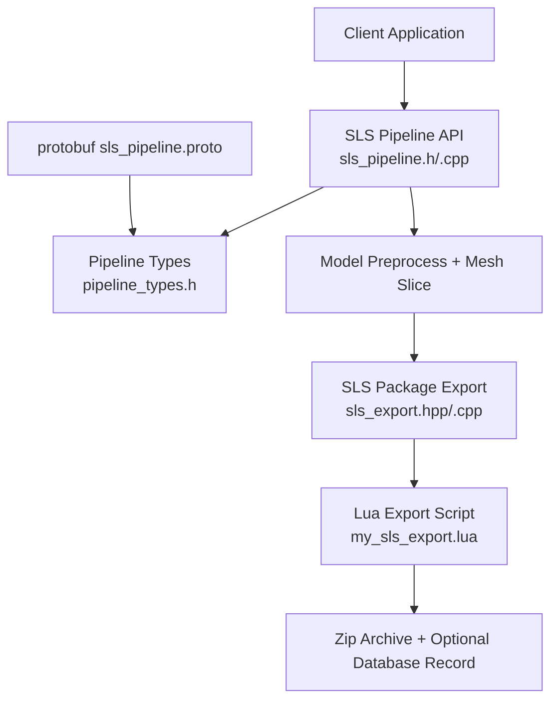
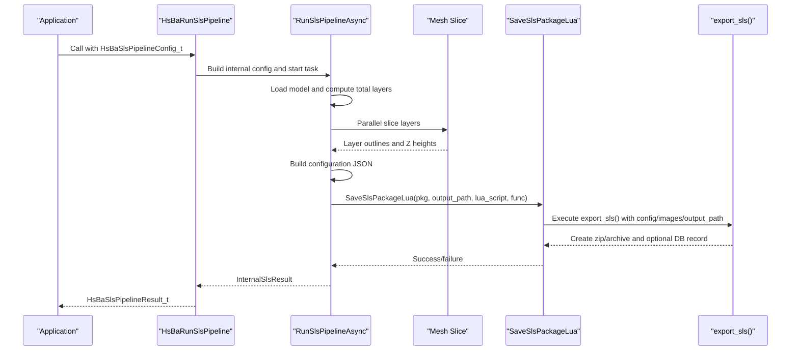
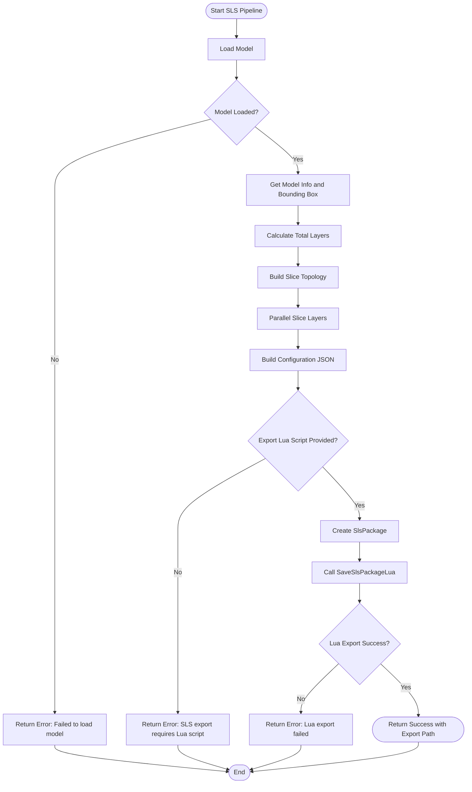
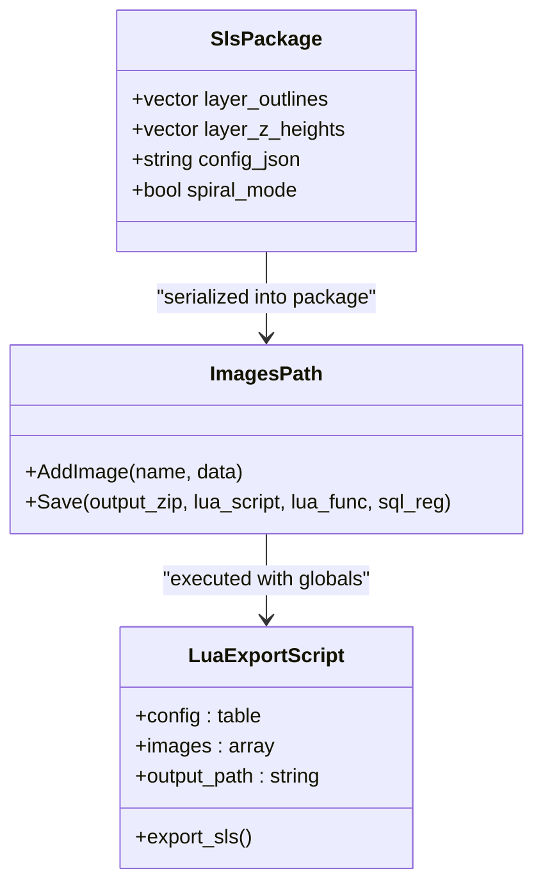
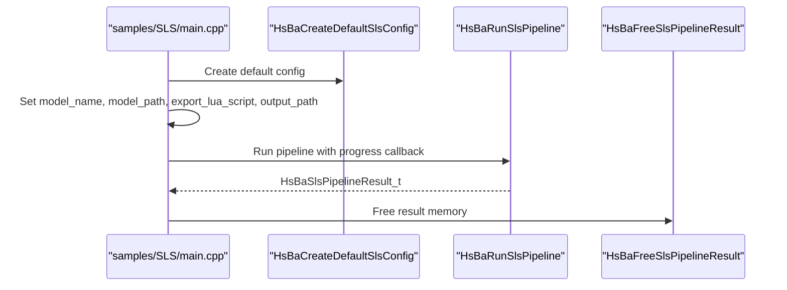
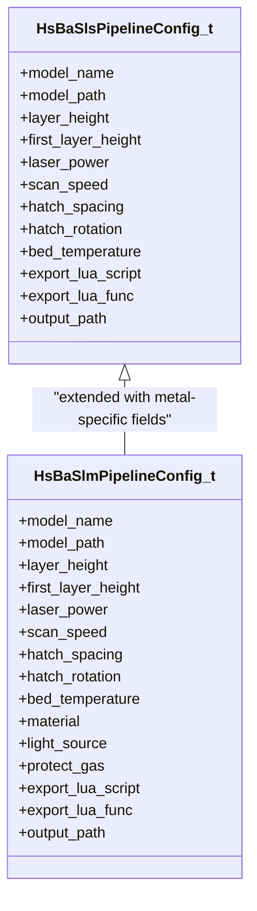
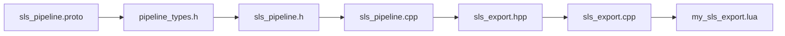

# SLS Examples / SLS示例

<cite>
**Referenced Files in This Document**   
- [pipeline_types.h](file://pipelinetypes/pipeline_types.h)
- [sls_pipeline.h](file://DllHsBaSlicer/sls_pipeline.h)
- [sls_pipeline.cpp](file://DllHsBaSlicer/sls_pipeline.cpp)
- [sls_export.hpp](file://LibHsBaSlicer/Path/sls_export.hpp)
- [sls_export.cpp](file://LibHsBaSlicer/Path/sls_export.cpp)
- [sls_pipeline.proto](file://proto/sls_pipeline.proto)
- [main.cpp](file://samples/SLS/main.cpp)
- [my_sls_export.lua](file://samples/SLS/scripts/my_sls_export.lua)
</cite>

## Table of Contents
1. [Introduction](#introduction)
2. [Project Structure](#project-structure)
3. [Core Components](#core-components)
4. [Architecture Overview](#architecture-overview)
5. [Detailed Component Analysis](#detailed-component-analysis)
6. [Dependency Analysis](#dependency-analysis)
7. [Performance Considerations](#performance-considerations)
8. [Troubleshooting Guide](#troubleshooting-guide)
9. [Conclusion](#conclusion)
10. [Appendices](#appendices)

## Introduction
This document provides detailed SLS (Selective Laser Sintering) examples and implementation guidance for the HsBaSlicer repository. It focuses on:
- The `HsBaSlsPipelineConfig_t` structure and its sintering-related parameters.
- Basic SLS pipeline execution, custom parameter configuration, and export script development.
- Differences between polymer and metal powder-bed workflows as represented by the SLS and SLM pipelines.
- Thermal behavior concepts such as temperature profiles, heating rates, cooling strategies, and powder bed preparation, mapped to the available configuration fields.
- Support removal and surface finishing procedures specific to SLS parts.

The SLS pipeline is a powder-bed process: it does not generate floor/raft or support structures because the surrounding powder provides both mechanical support and thermal stability. The final machine output format is fully controlled by a Lua export script.

## Project Structure
The SLS workflow spans several modules:
- C ABI types and defaults are defined in the standalone pipeline type header.
- The DllHsBaSlicer module exposes synchronous and asynchronous SLS pipeline entry points.
- The LibHsBaSlicer module serializes slice data into an SLS package and invokes the Lua export script.
- Samples demonstrate basic, custom-parameter, and async SLS usage.
- A protobuf definition mirrors the SLS configuration for external serialization.

**Diagram sources**
- [sls_pipeline.h:17-56](file://DllHsBaSlicer/sls_pipeline.h#L17-L56)
- [sls_pipeline.cpp:182-296](file://DllHsBaSlicer/sls_pipeline.cpp#L182-L296)
- [sls_export.hpp:17-56](file://LibHsBaSlicer/Path/sls_export.hpp#L17-L56)
- [sls_export.cpp:79-133](file://LibHsBaSlicer/Path/sls_export.cpp#L79-L133)
- [pipeline_types.h:247-283](file://pipelinetypes/pipeline_types.h#L247-L283)
- [sls_pipeline.proto:5-23](file://proto/sls_pipeline.proto#L5-L23)

**Section sources**
- [sls_pipeline.h:1-63](file://DllHsBaSlicer/sls_pipeline.h#L1-L63)
- [sls_pipeline.cpp:1-345](file://DllHsBaSlicer/sls_pipeline.cpp#L1-L345)
- [sls_export.hpp:1-61](file://LibHsBaSlicer/Path/sls_export.hpp#L1-L61)
- [sls_export.cpp:1-146](file://LibHsBaSlicer/Path/sls_export.cpp#L1-L146)
- [pipeline_types.h:247-283](file://pipelinetypes/pipeline_types.h#L247-L283)
- [sls_pipeline.proto:1-33](file://proto/sls_pipeline.proto#L1-L33)

## Core Components
The core SLS components are:
- `HsBaSlsPipelineConfig_t`: C-compatible configuration structure for model, slicing, laser, bed temperature, Lua export, and output path.
- `HsBaSlsPipelineResult_t`: Result structure containing success flag, layer count, exported file path, error message, and elapsed time.
- `SlsPackage`: Internal package carrying per-layer polygon outlines, Z heights, configuration JSON, and optional spiral mode data.
- SLS pipeline API functions: default config creation, synchronous run, asynchronous run, and result cleanup.

Key responsibilities:
- The pipeline loads the model, computes total layers, slices layers in parallel, builds a configuration JSON, and delegates final packaging to a Lua export script.
- The export script receives configuration, per-layer polygon JSON, and optional spiral path data, then writes the final archive and can register database records.

**Section sources**
- [pipeline_types.h:247-310](file://pipelinetypes/pipeline_types.h#L247-L310)
- [sls_export.hpp:17-56](file://LibHsBaSlicer/Path/sls_export.hpp#L17-L56)
- [sls_pipeline.h:17-56](file://DllHsBaSlicer/sls_pipeline.h#L17-L56)

## Architecture Overview
The SLS architecture follows a three-stage flow: preprocess, slice, and Lua-driven export.

**Diagram sources**
- [sls_pipeline.cpp:182-296](file://DllHsBaSlicer/sls_pipeline.cpp#L182-L296)
- [sls_export.cpp:79-133](file://LibHsBaSlicer/Path/sls_export.cpp#L79-L133)
- [my_sls_export.lua:23-79](file://samples/SLS/scripts/my_sls_export.lua#L23-L79)

## Detailed Component Analysis

### HsBaSlsPipelineConfig_t Structure
The SLS configuration structure contains:
- Model configuration: model name and model path.
- Slice configuration: layer height and first layer height.
- Laser configuration: laser power, scan speed, hatch spacing, hatch rotation, and bed temperature.
- Lua export configuration: required export script path and optional function name.
- Output configuration: optional output path.

Default values are provided by the inline initializer and are also reflected in the internal implementation defaults.

| Field | Type | Default Value | Meaning |
|---|---|---:|---|
| `model_name` | `const char*` | NULL | Logical model identifier. |
| `model_path` | `const char*` | NULL | Path to the input CAD/mesh file. |
| `layer_height` | `float` | 0.1 mm | Standard layer thickness. |
| `first_layer_height` | `float` | 0.15 mm | First layer thickness. |
| `laser_power` | `float` | 30.0 W | Laser energy source power. |
| `scan_speed` | `float` | 2000.0 mm/s | Laser scanning speed. |
| `hatch_spacing` | `float` | 0.15 mm | Distance between hatch lines. |
| `hatch_rotation` | `float` | 90.0 degrees | Rotation angle between layers. |
| `bed_temperature` | `float` | 180.0 °C | Powder bed temperature. |
| `export_lua_script` | `const char*` | Required | Lua script path for SLS export. |
| `export_lua_func` | `const char*` | NULL | Lua function name; defaults to `export_sls`. |
| `output_path` | `const char*` | NULL | Final output file path. |

Important notes:
- The SLS pipeline requires a Lua export script; there is no built-in standard output format.
- The configuration is converted into a JSON string passed to the Lua export script under the `config` global table.
- The same structure is mirrored in the protobuf message `sls_pipe_config`.

**Section sources**
- [pipeline_types.h:247-283](file://pipelinetypes/pipeline_types.h#L247-L283)
- [pipeline_types.h:831-845](file://pipelinetypes/pipeline_types.h#L831-L845)
- [sls_pipeline.cpp:39-55](file://DllHsBaSlicer/sls_pipeline.cpp#L39-L55)
- [sls_pipeline.proto:5-23](file://proto/sls_pipeline.proto#L5-L23)

### SLS Pipeline Execution Flow
The synchronous and asynchronous APIs share the same internal pipeline:
1. Load or retrieve the model.
2. Compute bounding box and total layer count.
3. Build slice topology once and slice layers in parallel.
4. Build configuration JSON including slice, laser, and bed temperature information.
5. Validate that a Lua export script is provided.
6. Serialize layer outlines and Z heights into the SLS package.
7. Invoke the Lua export function to create the final output.

**Diagram sources**
- [sls_pipeline.cpp:182-296](file://DllHsBaSlicer/sls_pipeline.cpp#L182-L296)

**Section sources**
- [sls_pipeline.cpp:93-115](file://DllHsBaSlicer/sls_pipeline.cpp#L93-L115)
- [sls_pipeline.cpp:125-145](file://DllHsBaSlicer/sls_pipeline.cpp#L125-L145)
- [sls_pipeline.cpp:147-179](file://DllHsBaSlicer/sls_pipeline.cpp#L147-L179)
- [sls_pipeline.cpp:182-296](file://DllHsBaSlicer/sls_pipeline.cpp#L182-L296)

### SLS Export Package and Lua Interface
The SLS export package carries:
- Per-layer polygon outlines.
- Per-layer Z heights.
- Configuration JSON.
- Optional spiral path data when spiral mode is enabled.

The Lua export script receives:
- `config.path` and `config.configStr`.
- `images`, an array of `{path, data}` entries for each layer.
- `output_path`, the requested output file path.
- Registered libraries such as Zipper, Cipher, SQLiteAdapter, and optionally MySQL/PostgreSQL adapters.

**Diagram sources**
- [sls_export.hpp:17-56](file://LibHsBaSlicer/Path/sls_export.hpp#L17-L56)
- [sls_export.cpp:79-133](file://LibHsBaSlicer/Path/sls_export.cpp#L79-L133)
- [my_sls_export.lua:8-21](file://samples/SLS/scripts/my_sls_export.lua#L8-L21)

**Section sources**
- [sls_export.hpp:17-56](file://LibHsBaSlicer/Path/sls_export.hpp#L17-L56)
- [sls_export.cpp:26-75](file://LibHsBaSlicer/Path/sls_export.cpp#L26-L75)
- [sls_export.cpp:79-133](file://LibHsBaSlicer/Path/sls_export.cpp#L79-L133)
- [my_sls_export.lua:23-79](file://samples/SLS/scripts/my_sls_export.lua#L23-L79)

### Basic SLS Pipeline Example
The sample demonstrates:
- Creating a default SLS configuration.
- Setting model name and path.
- Providing the Lua export script and function.
- Running the pipeline synchronously.
- Checking success, layer count, export path, elapsed time, and freeing the result.

**Diagram sources**
- [main.cpp:56-92](file://samples/SLS/main.cpp#L56-L92)
- [sls_pipeline.h:17-56](file://DllHsBaSlicer/sls_pipeline.h#L17-L56)

**Section sources**
- [main.cpp:56-92](file://samples/SLS/main.cpp#L56-L92)

### Custom SLS Parameter Configuration
The sample shows how to override:
- Layer height and first layer height.
- Laser power, scan speed, hatch spacing, hatch rotation.
- Bed temperature.
- Lua export script and function.
- Output path.

These parameters directly affect the generated configuration JSON and therefore the machine instructions produced by the Lua export script.

**Section sources**
- [main.cpp:97-140](file://samples/SLS/main.cpp#L97-L140)
- [sls_pipeline.cpp:125-145](file://DllHsBaSlicer/sls_pipeline.cpp#L125-L145)

### Async SLS Pipeline Example
The sample demonstrates:
- Starting the pipeline asynchronously.
- Using a completion callback to receive the result.
- Waiting for completion in a simple polling loop.
- Freeing the result inside the callback.

**Section sources**
- [main.cpp:146-190](file://samples/SLS/main.cpp#L146-L190)
- [sls_pipeline.h:36-47](file://DllHsBaSlicer/sls_pipeline.h#L36-L47)
- [sls_pipeline.cpp:318-334](file://DllHsBaSlicer/sls_pipeline.cpp#L318-L334)

### Polymer vs Metal SLS Workflows
Within this codebase:
- SLS represents a generic powder-bed sintering workflow using laser power, scan speed, hatch spacing, hatch rotation, and bed temperature.
- SLM extends the same preprocessing and slicing flow but adds metal-specific enums for material, light source, and shielding gas. These are folded into the configuration handed to the export script.

Key differences reflected in the types:
- SLS uses `HsBaSlsPipelineConfig_t`.
- SLM uses `HsBaSlmPipelineConfig_t` with additional fields:
  - `material`: iron, aluminum, titanium, unknown.
  - `light_source`: laser, electron beam, unknown.
  - `protect_gas`: argon, helium, nitrogen, carbon dioxide, unknown.

**Diagram sources**
- [pipeline_types.h:247-283](file://pipelinetypes/pipeline_types.h#L247-L283)
- [pipeline_types.h:312-376](file://pipelinetypes/pipeline_types.h#L312-L376)

**Section sources**
- [pipeline_types.h:247-283](file://pipelinetypes/pipeline_types.h#L247-L283)
- [pipeline_types.h:312-376](file://pipelinetypes/pipeline_types.h#L312-L376)

### Temperature Profiles, Heating Rates, Cooling Strategies, and Powder Bed Preparation
The current SLS configuration exposes:
- `bed_temperature`: the powder bed temperature.
- `laser_power`, `scan_speed`, `hatch_spacing`, `hatch_rotation`: laser energy delivery parameters.
- `layer_height`, `first_layer_height`: slicing resolution.

The pipeline converts these into a JSON configuration that includes:
- Slice section with layer height, first layer height, and total layers.
- Laser section with power, scan speed, hatch spacing, and hatch rotation.
- Bed temperature.

Because the repository does not define explicit multi-zone temperature profiles, heating rate ramps, or cooling curves in the C++ configuration, those advanced thermal controls should be modeled at the export-script level:
- Use the exported configuration JSON to drive machine-specific thermal profiles.
- Extend the Lua export script to include preheating, ramp-up, dwell, and controlled-cooling segments based on material behavior.
- For polymers, emphasize lower bed temperatures and slower thermal gradients to reduce warpage.
- For metals, emphasize higher bed temperatures, inert shielding gas, and controlled cooling to manage residual stress and distortion.

Powder bed preparation can be represented in the export script by adding metadata such as powder type, particle size distribution, bed density, and recoater settings alongside the slice and laser configuration.

**Section sources**
- [sls_pipeline.cpp:125-145](file://DllHsBaSlicer/sls_pipeline.cpp#L125-L145)
- [sls_export.hpp:17-56](file://LibHsBaSlicer/Path/sls_export.hpp#L17-L56)

### Process Optimization Techniques
Optimization opportunities visible in the implementation:
- Parallel layer slicing reduces total slicing time.
- Shared slice topology avoids redundant geometry processing.
- Spiral/vase mode can expose a continuous outer-wall path for specialized export scripts.
- Lua export scripts can optimize machine instruction generation, packing strategy, and database registration.

Recommended optimization practices:
- Tune hatch spacing and hatch rotation to balance part strength, surface quality, and build time.
- Adjust scan speed and laser power to match material absorption and thermal conductivity.
- Use appropriate bed temperature to minimize thermal gradients.
- Prefer finer layer heights for high-resolution surfaces, accepting longer build times.
- Use spiral mode only when the downstream machine supports continuous deposition paths.

**Section sources**
- [sls_pipeline.cpp:220-242](file://DllHsBaSlicer/sls_pipeline.cpp#L220-L242)
- [sls_export.hpp:24-33](file://LibHsBaSlicer/Path/sls_export.hpp#L24-L33)

### Export Script Development
The sample export script demonstrates:
- Creating a zip archive.
- Writing the configuration JSON.
- Writing per-layer polygon outlines.
- Adding a README describing the package contents.
- Optionally registering a database record using SQLite.

Best practices for SLS export scripts:
- Always validate `config.configStr` before parsing.
- Iterate over `images` safely and handle empty layers.
- Use `output_path` if provided; otherwise fall back to a stable default.
- Wrap database operations in error handling so export failures do not crash the pipeline.
- Include machine-specific metadata such as material, powder batch, and thermal profile references.

**Section sources**
- [my_sls_export.lua:23-79](file://samples/SLS/scripts/my_sls_export.lua#L23-L79)
- [sls_export.cpp:114-133](file://LibHsBaSlicer/Path/sls_export.cpp#L114-L133)

### Support Removal and Surface Finishing Procedures Specific to SLS Parts
SLS parts are built in a powder bed, so:
- No dedicated support structures are generated by the slicer.
- Unsintered powder acts as temporary support during printing.
- Post-processing typically involves:
  - Removing loose powder from the part and internal channels.
  - Cleaning with compressed air, brushing, or ultrasonic cleaning.
  - Bead blasting or media tumbling for surface smoothing.
  - Heat treatment or annealing to relieve residual stresses.
  - Hot isostatic pressing for dense metal parts where applicable.
  - Chemical smoothing or coating for polymer parts depending on application requirements.

These steps are outside the slicer’s automatic pipeline and should be documented in the export README or handled by downstream post-processing software.

[No sources needed since this section provides general procedural guidance]

## Dependency Analysis
The SLS pipeline has clear layered dependencies:
- The public API depends on the C ABI header.
- The implementation depends on model loading, mesh slicing, and the SLS export package.
- The export package depends on image/path utilities, spiral path utilities, and Lua adapter registration.
- The Lua export script depends on registered libraries such as Zipper and SQLiteAdapter.

**Diagram sources**
- [sls_pipeline.h:1-63](file://DllHsBaSlicer/sls_pipeline.h#L1-L63)
- [sls_pipeline.cpp:1-345](file://DllHsBaSlicer/sls_pipeline.cpp#L1-L345)
- [sls_export.hpp:1-61](file://LibHsBaSlicer/Path/sls_export.hpp#L1-L61)
- [sls_export.cpp:1-146](file://LibHsBaSlicer/Path/sls_export.cpp#L1-L146)
- [pipeline_types.h:247-283](file://pipelinetypes/pipeline_types.h#L247-L283)
- [sls_pipeline.proto:1-33](file://proto/sls_pipeline.proto#L1-L33)

**Section sources**
- [sls_pipeline.cpp:5-23](file://DllHsBaSlicer/sls_pipeline.cpp#L5-L23)
- [sls_export.cpp:14-18](file://LibHsBaSlicer/Path/sls_export.cpp#L14-L18)

## Performance Considerations
- Parallel slicing improves throughput by processing independent layers concurrently.
- Building slice topology once avoids repeated geometry computation.
- The export phase is dominated by I/O and Lua script execution; efficient scripting reduces overall pipeline time.
- Excessive layer counts from very small layer heights increase memory and processing time.
- Spiral mode adds extra computation for continuous path generation and should be used only when beneficial.

[No sources needed since this section provides general guidance]

## Troubleshooting Guide
Common issues and their likely causes:
- Model loading failure: invalid model path or unsupported geometry.
- Invalid model height: zero or negative bounding box results in zero layers.
- Missing Lua export script: SLS requires a Lua export script; the pipeline will fail without it.
- Lua export failure: errors inside the export script or missing libraries.
- Result memory not freed: the caller must call the free function after using the result.

Relevant error handling locations:
- Model load validation.
- Total layer count validation.
- Lua export script requirement check.
- Lua export error propagation.
- Result cleanup function.

**Section sources**
- [sls_pipeline.cpp:193-216](file://DllHsBaSlicer/sls_pipeline.cpp#L193-L216)
- [sls_pipeline.cpp:244-282](file://DllHsBaSlicer/sls_pipeline.cpp#L244-L282)
- [sls_pipeline.cpp:336-344](file://DllHsBaSlicer/sls_pipeline.cpp#L336-L344)

## Conclusion
The HsBaSlicer SLS pipeline provides a clean, extensible workflow for powder-bed sintering:
- The `HsBaSlsPipelineConfig_t` structure captures essential slicing and laser parameters.
- The pipeline performs model loading, parallel slicing, and Lua-driven export.
- Polymer and metal workflows differ primarily in material-specific configuration and post-processing requirements.
- Advanced thermal profiles, heating rates, cooling strategies, and powder bed preparation are best implemented through the Lua export script and downstream machine control.
- Support removal and surface finishing are post-process steps tailored to SLS parts.

[No sources needed since this section summarizes without analyzing specific files]

## Appendices

### API Reference Summary
- `HsBaCreateDefaultSlsConfig`: creates a default SLS configuration.
- `HsBaRunSlsPipeline`: runs the SLS pipeline synchronously.
- `HsBaRunSlsPipelineAsync`: runs the SLS pipeline asynchronously.
- `HsBaFreeSlsPipelineResult`: frees memory allocated in the SLS result.

**Section sources**
- [sls_pipeline.h:17-56](file://DllHsBaSlicer/sls_pipeline.h#L17-L56)

### Configuration JSON Schema
The pipeline generates a JSON configuration containing:
- `version`: configuration version.
- `process`: process type, `"SLS"`.
- `slice`: layer height, first layer height, total layers.
- `laser`: power, scan speed, hatch spacing, hatch rotation.
- `bed_temperature`: powder bed temperature.

**Section sources**
- [sls_pipeline.cpp:125-145](file://DllHsBaSlicer/sls_pipeline.cpp#L125-L145)