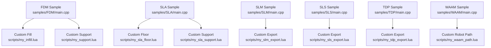
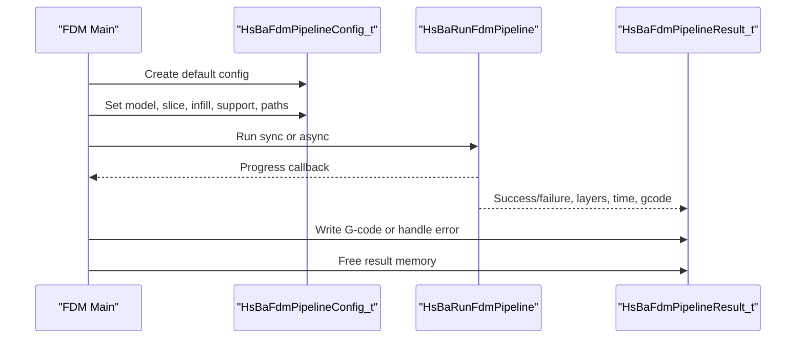
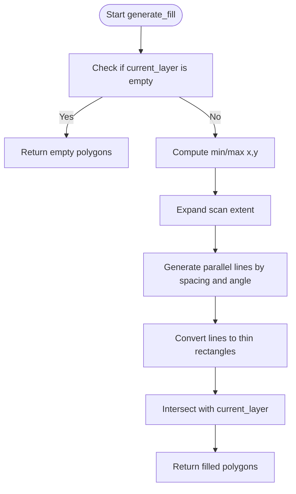
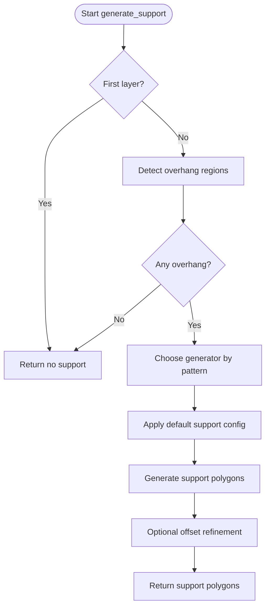
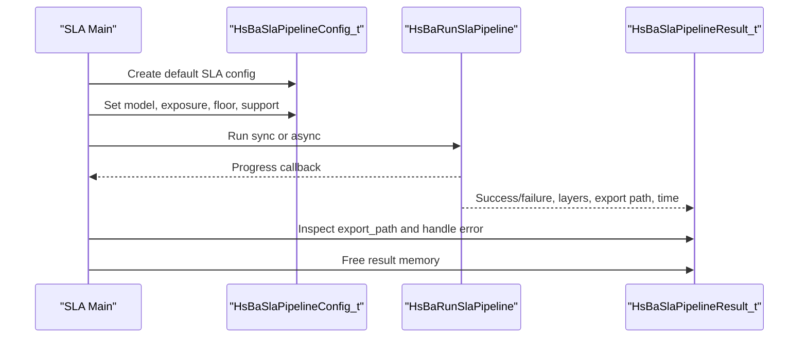
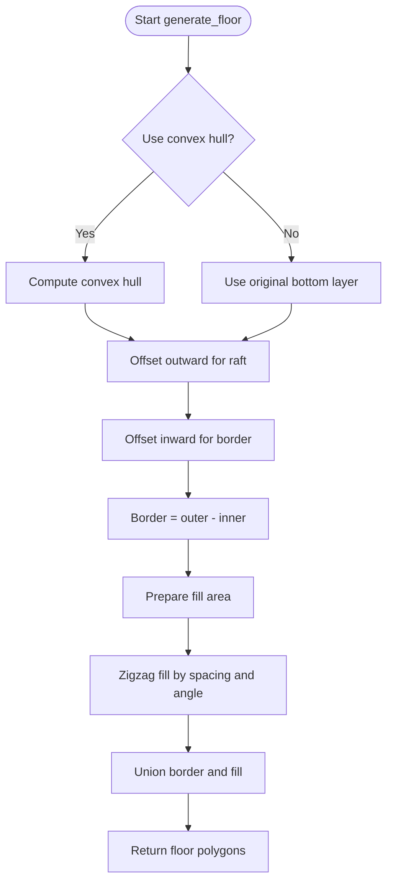
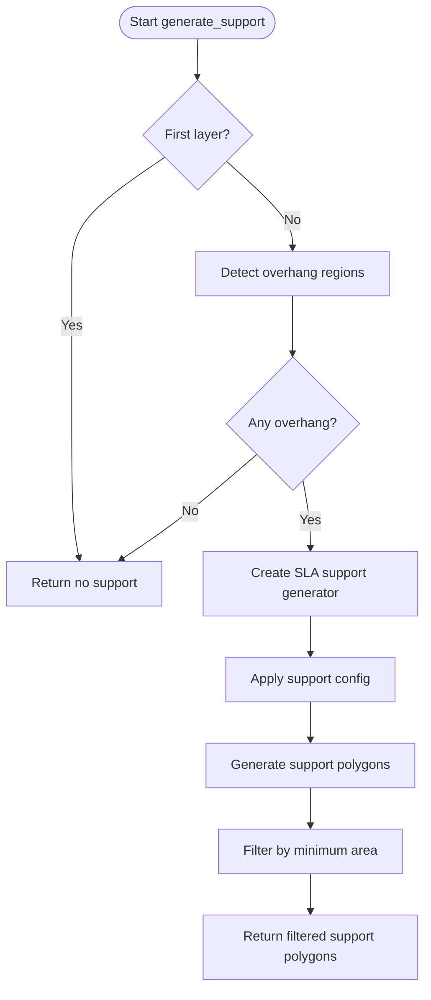
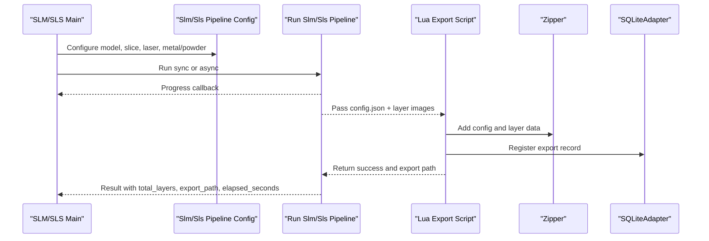
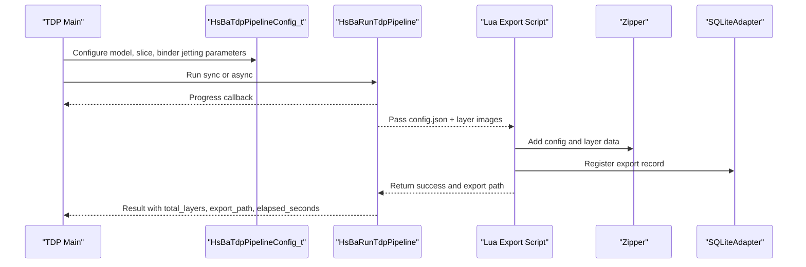
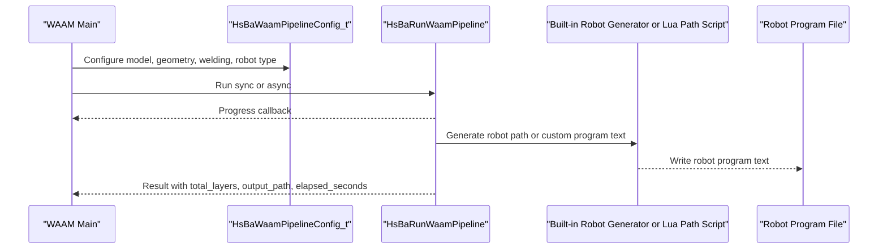

# Process-Specific Examples / 工艺特定示例

<cite>
**Referenced Files in This Document**   
- [FDM main.cpp](file://samples/FDM/main.cpp)
- [FDM my_infill.lua](file://samples/FDM/scripts/my_infill.lua)
- [FDM my_support.lua](file://samples/FDM/scripts/my_support.lua)
- [SLA main.cpp](file://samples/SLA/main.cpp)
- [SLA my_sla_floor.lua](file://samples/SLA/scripts/my_sla_floor.lua)
- [SLA my_sla_support.lua](file://samples/SLA/scripts/my_sla_support.lua)
- [SLM main.cpp](file://samples/SLM/main.cpp)
- [SLM my_slm_export.lua](file://samples/SLM/scripts/my_slm_export.lua)
- [SLS main.cpp](file://samples/SLS/main.cpp)
- [SLS my_sls_export.lua](file://samples/SLS/scripts/my_sls_export.lua)
- [TDP main.cpp](file://samples/TDP/main.cpp)
- [TDP my_tdp_export.lua](file://samples/TDP/scripts/my_tdp_export.lua)
- [WAAM main.cpp](file://samples/WAAM/main.cpp)
- [WAAM my_waam_path.lua](file://samples/WAAM/scripts/my_waam_path.lua)
</cite>

## Table of Contents
1. [Introduction](#introduction)
2. [Project Structure for Process-Specific Examples](#project-structure-for-process-specific-examples)
3. [FDM: Infill, Support, and G-code Export](#fdm-infill-support-and-g-code-export)
4. [SLA: Floor Generation, Sacrificial Supports, and Layer Image Export](#sla-floor-generation-sacrificial-supports-and-layer-image-export)
5. [Metal Processing: SLM Powder Bed Simulation and SLS Sintering Parameters](#metal-processing-slm-powder-bed-simulation-and-sls-sintering-parameters)
6. [Thermal Processing: TDP Binder Jetting and WAAM Wire Arc Deposition](#thermal-processing-tdp-binder-jetting-and-waam-wire-arc-deposition)
7. [Cross-Process Configuration Reference](#cross-process-configuration-reference)
8. [Performance Considerations by Manufacturing Technology](#performance-considerations-by-manufacturing-technology)
9. [Troubleshooting Guide](#troubleshooting-guide)
10. [Conclusion](#conclusion)

## Introduction
This document provides process-specific examples that demonstrate HsBaSlicer capabilities across FDM, SLA, metal powder bed, binder jetting, and wire arc deposition technologies. Each example includes:
- A complete sample entry point showing how to configure and run the pipeline.
- Lua scripts for custom fill, support, floor, export, or robot path generation.
- Expected outputs such as G-code, zip archives, or robot programs.
- Performance considerations specific to each manufacturing process.

The examples are based on the repository’s sample applications under `samples/<Technology>/main.cpp` and their associated Lua scripts.

## Project Structure for Process-Specific Examples
Each manufacturing technology has a dedicated sample directory containing:
- A C++ entry point that configures the corresponding pipeline.
- One or more Lua scripts for customization.
- An expected output path configured in the sample.

**Diagram sources**
- [FDM main.cpp:1-337](file://samples/FDM/main.cpp#L1-L337)
- [SLA main.cpp:1-259](file://samples/SLA/main.cpp#L1-L259)
- [SLM main.cpp:1-196](file://samples/SLM/main.cpp#L1-L196)
- [SLS main.cpp:1-209](file://samples/SLS/main.cpp#L1-L209)
- [TDP main.cpp:1-225](file://samples/TDP/main.cpp#L1-L225)
- [WAAM main.cpp:1-237](file://samples/WAAM/main.cpp#L1-L237)

**Section sources**
- [FDM main.cpp:1-337](file://samples/FDM/main.cpp#L1-L337)
- [SLA main.cpp:1-259](file://samples/SLA/main.cpp#L1-L259)
- [SLM main.cpp:1-196](file://samples/SLM/main.cpp#L1-L196)
- [SLS main.cpp:1-209](file://samples/SLS/main.cpp#L1-L209)
- [TDP main.cpp:1-225](file://samples/TDP/main.cpp#L1-L225)
- [WAAM main.cpp:1-237](file://samples/WAAM/main.cpp#L1-L237)

## FDM: Infill, Support, and G-code Export
### What the FDM Example Demonstrates
- Basic synchronous slicing with default configuration.
- Custom process parameters including layer height, wall count, top/bottom layers, infill density, and print speed.
- Lua-driven custom infill and support generation.
- Asynchronous pipeline execution.
- Spiral/vase mode where outer walls become one continuous rising extrusion path.

### Key Configuration Fields Used
- Model: `model_name`, `model_path`.
- Slice: `layer_height`, `first_layer_height`.
- Infill: `fill_spacing`, `fill_mode`, `fill_angle`, `infill_density`.
- Walls: `wall_count`.
- Top/Bottom: `top_layer_count`, `bottom_layer_count`.
- Support: `enable_support`, `overhang_angle`, `support_pattern`.
- Paths: `line_width`, `print_speed`, `travel_speed`, `extrusion_multiplier`.
- Output: `output_path`.
- Spiral: `spiral_mode`.

### Expected Outputs
- Basic G-code file: `output/stanford_bunny_basic.gcode`.
- Custom G-code file: `output/stanford_bunny_custom.gcode`.
- Lua-customized G-code file: `output/stanford_bunny_lua.gcode`.
- Spiral G-code file: `output/stanford_bunny_spiral.gcode`.

### FDM Pipeline Flow

**Diagram sources**
- [FDM main.cpp:53-96](file://samples/FDM/main.cpp#L53-L96)
- [FDM main.cpp:101-165](file://samples/FDM/main.cpp#L101-L165)
- [FDM main.cpp:170-220](file://samples/FDM/main.cpp#L170-L220)
- [FDM main.cpp:245-269](file://samples/FDM/main.cpp#L245-L269)
- [FDM main.cpp:274-318](file://samples/FDM/main.cpp#L274-L318)

### Custom Infill Pattern
The FDM custom infill script demonstrates:
- Computing bounding box from current-layer polygons.
- Generating parallel lines at a configurable angle.
- Converting lines into thin rectangles.
- Intersecting generated lines with the current layer to produce valid infill polygons.

**Diagram sources**
- [FDM my_infill.lua:20-87](file://samples/FDM/scripts/my_infill.lua#L20-L87)

### Custom Support Creation
The FDM custom support script demonstrates:
- Skipping support for the first layer.
- Detecting overhang regions using `Support.detect_overhang`.
- Selecting a generator based on `support_pattern`: plane, tree, honeycomb, or SLA-style.
- Applying a default support configuration with gap, diameter, density, and layer height.
- Optionally shrinking support contact areas.

**Diagram sources**
- [FDM my_support.lua:32-79](file://samples/FDM/scripts/my_support.lua#L32-L79)

**Section sources**
- [FDM main.cpp:53-96](file://samples/FDM/main.cpp#L53-L96)
- [FDM main.cpp:101-165](file://samples/FDM/main.cpp#L101-L165)
- [FDM main.cpp:170-220](file://samples/FDM/main.cpp#L170-L220)
- [FDM main.cpp:245-269](file://samples/FDM/main.cpp#L245-L269)
- [FDM main.cpp:274-318](file://samples/FDM/main.cpp#L274-L318)
- [FDM my_infill.lua:1-89](file://samples/FDM/scripts/my_infill.lua#L1-L89)
- [FDM my_support.lua:1-83](file://samples/FDM/scripts/my_support.lua#L1-L83)

## SLA: Floor Generation, Sacrificial Supports, and Layer Image Export
### What the SLA Example Demonstrates
- Basic SLA slicing with default configuration.
- Custom exposure, lift, and retract parameters.
- Floor/raft generation with convex hull, border loops, and zigzag fill.
- Sacrificial support generation using SLA-specific support patterns.
- Zip export containing configuration JSON and per-layer contour images.

### Key Configuration Fields Used
- Model: `model_name`, `model_path`.
- Slice: `layer_height`, `first_layer_height`.
- Exposure: `bottom_exposure_time`, `normal_exposure_time`.
- Lift/Retract: `bottom_lift_distance`, `lift_distance`, `lift_speed`, `retract_speed`.
- Floor: `floor_raft_offset`, `floor_border_width`, `floor_fill_spacing`, `floor_border_count`, `floor_use_convex_hull`.
- Support: `enable_support`, `overhang_angle`, `support_gap`, `support_diameter`, `support_density`, `support_pattern`.
- Output: `output_path`.

### Expected Outputs
- Basic zip archive: `output/sla_basic_output.zip`.
- Custom zip archive: `output/sla_custom_output.zip`.
- Lua-customized zip archive: `output/sla_lua_custom_output.zip`.
- Async zip archive: `output/sla_async_output.zip`.

### SLA Pipeline Flow

**Diagram sources**
- [SLA main.cpp:52-84](file://samples/SLA/main.cpp#L52-L84)
- [SLA main.cpp:89-144](file://samples/SLA/main.cpp#L89-L144)
- [SLA main.cpp:149-191](file://samples/SLA/main.cpp#L149-L191)
- [SLA main.cpp:217-239](file://samples/SLA/main.cpp#L217-L239)

### Floor Generation Algorithm
The SLA custom floor script demonstrates:
- Using convex hull when enabled.
- Offsetting outward to create raft boundary.
- Creating inner boundary via inward offset.
- Generating border rings by difference between outer and inner boundaries.
- Filling interior area with zigzag fill.
- Merging border and fill into final floor polygons.

**Diagram sources**
- [SLA my_sla_floor.lua:35-62](file://samples/SLA/scripts/my_sla_floor.lua#L35-L62)

### Sacrificial Support Algorithm
The SLA custom support script demonstrates:
- Skipping the first layer.
- Detecting overhang regions.
- Using SLA sacrificial support generator.
- Filtering small support features by area.

**Diagram sources**
- [SLA my_sla_support.lua:34-72](file://samples/SLA/scripts/my_sla_support.lua#L34-L72)

**Section sources**
- [SLA main.cpp:52-84](file://samples/SLA/main.cpp#L52-L84)
- [SLA main.cpp:89-144](file://samples/SLA/main.cpp#L89-L144)
- [SLA main.cpp:149-191](file://samples/SLA/main.cpp#L149-L191)
- [SLA main.cpp:217-239](file://samples/SLA/main.cpp#L217-L239)
- [SLA my_sla_floor.lua:1-64](file://samples/SLA/scripts/my_sla_floor.lua#L1-L64)
- [SLA my_sla_support.lua:1-76](file://samples/SLA/scripts/my_sla_support.lua#L1-L76)

## Metal Processing: SLM Powder Bed Simulation and SLS Sintering Parameters
### What the Metal Examples Demonstrate
- SLM (Selective Laser Melting): metal powder bed processing without floor or supports; laser, material, and shielding gas parameters; Lua-driven export producing a zip archive plus optional database registration.
- SLS (Selective Laser Sintering): powder bed sintering without floor or supports; laser power, scan speed, hatch spacing, hatch rotation, and bed temperature; Lua-driven export producing a zip archive plus optional database registration.

### SLM Configuration Highlights
- Model: `model_name`, `model_path`.
- Slice: `layer_height`, `first_layer_height`.
- Laser/Scan: `laser_power`, `scan_speed`, `hatch_spacing`, `hatch_rotation`, `bed_temperature`.
- Metal: `material`, `light_source`, `protect_gas`.
- Export: `export_lua_script`, `export_lua_func`, `output_path`.

### SLS Configuration Highlights
- Model: `model_name`, `model_path`.
- Slice: `layer_height`, `first_layer_height`.
- Laser: `laser_power`, `scan_speed`, `hatch_spacing`, `hatch_rotation`, `bed_temperature`.
- Export: `export_lua_script`, `export_lua_func`, `output_path`.

### Expected Outputs
- SLM basic zip: `output/slm_basic_output.zip`.
- SLM custom zip: `output/slm_custom_output.zip`.
- SLM async zip: `output/slm_async_output.zip`.
- SLS basic zip: `output/sls_basic_output.zip`.
- SLS custom zip: `output/sls_custom_output.zip`.
- SLS async zip: `output/sls_async_output.zip`.

### Metal Powder Bed Processing Flow

**Diagram sources**
- [SLM main.cpp:56-84](file://samples/SLM/main.cpp#L56-L84)
- [SLM main.cpp:89-132](file://samples/SLM/main.cpp#L89-L132)
- [SLM main.cpp:156-177](file://samples/SLM/main.cpp#L156-L177)
- [SLM my_slm_export.lua:15-59](file://samples/SLM/scripts/my_slm_export.lua#L15-L59)
- [SLS main.cpp:56-92](file://samples/SLS/main.cpp#L56-L92)
- [SLS main.cpp:97-140](file://samples/SLS/main.cpp#L97-L140)
- [SLS main.cpp:166-190](file://samples/SLS/main.cpp#L166-L190)
- [SLS my_sls_export.lua:23-76](file://samples/SLS/scripts/my_sls_export.lua#L23-L76)

### SLM Export Behavior
The SLM export script:
- Creates a zip archive.
- Adds `config.json` containing slicing, laser, and metal process configuration.
- Adds per-layer polygon outlines.
- Writes a README describing contents.
- Attempts SQLite registration of export history.

### SLS Export Behavior
The SLS export script:
- Creates a zip archive.
- Adds `config.json` containing slicing and laser configuration.
- Adds per-layer polygon outlines.
- Writes a README describing layer JSON format.
- Attempts SQLite registration of export history.

**Section sources**
- [SLM main.cpp:56-84](file://samples/SLM/main.cpp#L56-L84)
- [SLM main.cpp:89-132](file://samples/SLM/main.cpp#L89-L132)
- [SLM main.cpp:156-177](file://samples/SLM/main.cpp#L156-L177)
- [SLM my_slm_export.lua:1-63](file://samples/SLM/scripts/my_slm_export.lua#L1-L63)
- [SLS main.cpp:56-92](file://samples/SLS/main.cpp#L56-L92)
- [SLS main.cpp:97-140](file://samples/SLS/main.cpp#L97-L140)
- [SLS main.cpp:166-190](file://samples/SLS/main.cpp#L166-L190)
- [SLS my_sls_export.lua:1-80](file://samples/SLS/scripts/my_sls_export.lua#L1-L80)

## Thermal Processing: TDP Binder Jetting and WAAM Wire Arc Deposition
### What the Thermal Examples Demonstrate
- TDP (Three-Dimensional Printing / binder jetting): liquid binder jetting onto a powder bed; head count, drop spacing, binder saturation, curing time, bed temperature, and binder mode; Lua-driven export producing a zip archive plus optional database registration; spiral mode exposing a continuous rising deposition path.
- WAAM (Wire Arc Additive Manufacturing): robot-based bead deposition along per-layer contours; built-in robot program generation for ABB/KUKA/FANUC; welding parameters including arc current, voltage, wire feed speed, gas flow rate, and interpass temperature; optional Lua path script generating custom robot code; spiral mode merging outer walls into one continuous rising weld bead.

### TDP Configuration Highlights
- Model: `model_name`, `model_path`.
- Slice: `layer_height`, `first_layer_height`.
- Binder Jetting: `head_count`, `drop_spacing`, `binder_saturation`, `ink_curing_time`, `bed_temperature`, `binder_mode`.
- Export: `export_lua_script`, `export_lua_func`, `output_path`.
- Spiral: `spiral_mode`.

### WAAM Configuration Highlights
- Model: `model_name`, `model_path`.
- Geometry: `layer_height`, `first_layer_height`, `bead_width`, `travel_speed`.
- Welding: `material`, `welding_process`, `protection`, `protect_gas`, `arc_current`, `arc_voltage`, `wire_feed_speed`, `gas_flow_rate`, `interpass_temperature`.
- Robot: `robot_type`.
- Custom Path: `path_lua_script`, `path_lua_func`.
- Output: `output_path`.
- Spiral: `spiral_mode`.

### Expected Outputs
- TDP basic zip: `output/3dp_basic_output.zip`.
- TDP custom zip: `output/3dp_custom_output.zip`.
- TDP async zip: `output/3dp_async_output.zip`.
- TDP spiral zip: `output/3dp_spiral_output.zip`.
- WAAM basic robot program: `output/waam_basic_output.txt`.
- WAAM custom robot program: `output/waam_custom_output.txt`.
- WAAM async robot program: `output/waam_async_output.txt`.
- WAAM spiral robot program: `output/waam_spiral_output.txt`.

### TDP Binder Jetting Flow

**Diagram sources**
- [TDP main.cpp:55-82](file://samples/TDP/main.cpp#L55-L82)
- [TDP main.cpp:87-125](file://samples/TDP/main.cpp#L87-L125)
- [TDP main.cpp:149-170](file://samples/TDP/main.cpp#L149-L170)
- [TDP main.cpp:175-205](file://samples/TDP/main.cpp#L175-L205)
- [TDP my_tdp_export.lua:15-59](file://samples/TDP/scripts/my_tdp_export.lua#L15-L59)

### WAAM Robot Program Generation Flow

**Diagram sources**
- [WAAM main.cpp:54-81](file://samples/WAAM/main.cpp#L54-L81)
- [WAAM main.cpp:86-131](file://samples/WAAM/main.cpp#L86-L131)
- [WAAM main.cpp:155-178](file://samples/WAAM/main.cpp#L155-L178)
- [WAAM main.cpp:183-217](file://samples/WAAM/main.cpp#L183-L217)
- [WAAM my_waam_path.lua:17-42](file://samples/WAAM/scripts/my_waam_path.lua#L17-L42)

### WAAM Custom Robot Path Script
The WAAM custom path script demonstrates:
- Reading header information such as program name start/end.
- Iterating through points with end position, velocity, and move type.
- Generating generic robot motion commands.
- Returning a complete robot program string instead of a zip archive.

**Section sources**
- [TDP main.cpp:55-82](file://samples/TDP/main.cpp#L55-L82)
- [TDP main.cpp:87-125](file://samples/TDP/main.cpp#L87-L125)
- [TDP main.cpp:149-170](file://samples/TDP/main.cpp#L149-L170)
- [TDP main.cpp:175-205](file://samples/TDP/main.cpp#L175-L205)
- [TDP my_tdp_export.lua:1-63](file://samples/TDP/scripts/my_tdp_export.lua#L1-L63)
- [WAAM main.cpp:54-81](file://samples/WAAM/main.cpp#L54-L81)
- [WAAM main.cpp:86-131](file://samples/WAAM/main.cpp#L86-L131)
- [WAAM main.cpp:155-178](file://samples/WAAM/main.cpp#L155-L178)
- [WAAM main.cpp:183-217](file://samples/WAAM/main.cpp#L183-L217)
- [WAAM my_waam_path.lua:1-46](file://samples/WAAM/scripts/my_waam_path.lua#L1-L46)

## Cross-Process Configuration Reference
The following table summarizes key configuration fields used across the samples. Values shown are those set in the sample code rather than library defaults.

| Technology | Category | Field | Example Value | Purpose |
|---|---|---|---:|---|
| FDM | Model | `model_name` | `"stanford_bunny"` | Logical model identifier |
| FDM | Model | `model_path` | `"models/stanford_bunny.stl"` | Input mesh path |
| FDM | Slice | `layer_height` | `0.2f` | Layer thickness |
| FDM | Slice | `first_layer_height` | `0.25f` | First layer thickness |
| FDM | Infill | `fill_spacing` | `0.4` | Distance between infill lines |
| FDM | Infill | `fill_mode` | `HSBA_FILL_ZIGZAG` | Infill pattern selection |
| FDM | Infill | `fill_angle` | `45.0` | Infill line angle |
| FDM | Infill | `infill_density` | `0.15` | Middle-layer fill ratio |
| FDM | Walls | `wall_count` | `3` | Number of perimeter walls |
| FDM | Top/Bottom | `top_layer_count` | `5` | Solid top layers |
| FDM | Top/Bottom | `bottom_layer_count` | `4` | Solid bottom layers |
| FDM | Support | `enable_support` | `1` | Enable support structures |
| FDM | Support | `overhang_angle` | `50.0f` | Overhang threshold |
| FDM | Support | `support_pattern` | `HSBA_SUPPORT_TREE` | Support algorithm |
| FDM | Paths | `line_width` | `0.4f` | Extrusion line width |
| FDM | Paths | `print_speed` | `60.0f` | Print travel speed |
| FDM | Paths | `travel_speed` | `120.0f` | Travel-only speed |
| FDM | Paths | `extrusion_multiplier` | `1.0f` | Extrusion scaling |
| FDM | Output | `output_path` | `"output/stanford_bunny.gcode"` | G-code destination |
| FDM | Spiral | `spiral_mode` | `1` | Continuous outer-wall mode |
| SLA | Slice | `layer_height` | `0.05f` | Layer thickness |
| SLA | Slice | `first_layer_height` | `0.1f` | First layer thickness |
| SLA | Exposure | `bottom_exposure_time` | `60.0f` | Bottom cure time |
| SLA | Exposure | `normal_exposure_time` | `2.5f` | Normal cure time |
| SLA | Lift | `bottom_lift_distance` | `5.0f` | Bottom peel distance |
| SLA | Lift | `lift_distance` | `3.0f` | Normal peel distance |
| SLA | Lift | `lift_speed` | `60.0f` | Peel speed |
| SLA | Lift | `retract_speed` | `150.0f` | Resin retraction speed |
| SLA | Floor | `floor_raft_offset` | `3.0f` | Raft expansion |
| SLA | Floor | `floor_border_width` | `1.5f` | Raft border width |
| SLA | Floor | `floor_fill_spacing` | `0.5f` | Raft fill spacing |
| SLA | Floor | `floor_border_count` | `3` | Raft border loops |
| SLA | Floor | `floor_use_convex_hull` | `1` | Simplify footprint |
| SLA | Support | `support_pattern` | `HSBA_SLA_SUPPORT_SACRIFICIAL` | Sacrificial support |
| SLM | Slice | `layer_height` | `0.05f` | Layer thickness |
| SLM | Slice | `first_layer_height` | `0.06f` | First layer thickness |
| SLM | Laser | `laser_power` | `280.0f` | Laser energy |
| SLM | Laser | `scan_speed` | `1200.0f` | Scan velocity |
| SLM | Laser | `hatch_spacing` | `0.09f` | Hatch distance |
| SLM | Laser | `hatch_rotation` | `67.0f` | Hatch angle change |
| SLM | Laser | `bed_temperature` | `150.0f` | Bed preheat |
| SLM | Metal | `material` | `HSBA_SLM_MATERIAL_ALUMINUM` | Metal alloy |
| SLM | Metal | `light_source` | `HSBA_SLM_LIGHT_LASER` | Energy source |
| SLM | Metal | `protect_gas` | `HSBA_METAL_GAS_ARGON` | Shielding gas |
| SLS | Slice | `layer_height` | `0.08f` | Layer thickness |
| SLS | Slice | `first_layer_height` | `0.12f` | First layer thickness |
| SLS | Laser | `laser_power` | `45.0f` | Laser energy |
| SLS | Laser | `scan_speed` | `3500.0f` | Scan velocity |
| SLS | Laser | `hatch_spacing` | `0.12f` | Hatch distance |
| SLS | Laser | `hatch_rotation` | `67.0f` | Hatch angle change |
| SLS | Laser | `bed_temperature` | `175.0f` | Bed preheat |
| TDP | Slice | `layer_height` | `0.09f` | Layer thickness |
| TDP | Slice | `first_layer_height` | `0.11f` | First layer thickness |
| TDP | Binder | `head_count` | `256` | Printhead nozzle count |
| TDP | Binder | `drop_spacing` | `0.04f` | Drop pitch |
| TDP | Binder | `binder_saturation` | `0.75f` | Binder coverage |
| TDP | Binder | `ink_curing_time` | `1.5f` | Cure delay |
| TDP | Binder | `bed_temperature` | `45.0f` | Bed temperature |
| TDP | Binder | `binder_mode` | `HSBA_TDP_FULL_COLOR` | Color/full binder mode |
| WAAM | Geometry | `layer_height` | `0.6f` | Bead layer height |
| WAAM | Geometry | `first_layer_height` | `0.8f` | First bead layer height |
| WAAM | Geometry | `bead_width` | `1.0f` | Deposit width |
| WAAM | Geometry | `travel_speed` | `6.0f` | Non-deposit travel speed |
| WAAM | Welding | `material` | `HSBA_WAAM_MATERIAL_ALUMINUM` | Wire material |
| WAAM | Welding | `welding_process` | `HSBA_WAAM_WELD_ARC` | Arc process |
| WAAM | Welding | `protection` | `HSBA_WAAM_PROTECTION_SHIELD_GAS` | Protection method |
| WAAM | Welding | `protect_gas` | `HSBA_METAL_GAS_ARGON` | Shielding gas |
| WAAM | Welding | `arc_current` | `220.0f` | Welding current |
| WAAM | Welding | `arc_voltage` | `26.0f` | Welding voltage |
| WAAM | Welding | `wire_feed_speed` | `8.0f` | Wire feed rate |
| WAAM | Welding | `gas_flow_rate` | `18.0f` | Gas flow |
| WAAM | Welding | `interpass_temperature` | `120.0f` | Interpass heat |
| WAAM | Robot | `robot_type` | `HSBA_WAAM_ROBOT_ABB` or `HSBA_WAAM_ROBOT_KUKA` | Target robot brand |
| WAAM | Spiral | `spiral_mode` | `1` | Continuous rising bead |

**Section sources**
- [FDM main.cpp:101-165](file://samples/FDM/main.cpp#L101-L165)
- [SLA main.cpp:89-144](file://samples/SLA/main.cpp#L89-L144)
- [SLM main.cpp:89-132](file://samples/SLM/main.cpp#L89-L132)
- [SLS main.cpp:97-140](file://samples/SLS/main.cpp#L97-L140)
- [TDP main.cpp:87-125](file://samples/TDP/main.cpp#L87-L125)
- [WAAM main.cpp:86-131](file://samples/WAAM/main.cpp#L86-L131)

## Performance Considerations by Manufacturing Technology
### FDM Performance Notes
- Higher `wall_count` increases perimeter path length and G-code size.
- Lower `fill_spacing` increases infill density and computation time.
- Tree or honeycomb supports generally cost more compute time than plane supports.
- Spiral mode reduces layer transitions and can reduce G-code complexity for vase-like parts.
- Asynchronous execution allows UI or other tasks to continue while slicing runs.

### SLA Performance Notes
- Smaller `layer_height` increases layer count and image export volume.
- Larger `floor_raft_offset` and `floor_border_count` increase raft geometry.
- Sacrificial supports add extra per-layer geometry and may increase export size.
- Exporting SVG layer images produces larger archives than polygon-only formats.

### SLM and SLS Performance Notes
- Both processes avoid floor and support generation, reducing geometry complexity compared to FDM/SLA.
- Laser parameters do not directly change mesh slicing but affect downstream process planning.
- Lua export scripts control archive size and database overhead.
- Database registration failure is non-fatal in the sample scripts.

### TDP Performance Notes
- High `head_count` and small `drop_spacing` increase binder jetting resolution but also increase data volume.
- Spiral mode exposes an additional continuous path while still keeping per-layer images.
- Export scripts should avoid unnecessary compression or logging to keep runtime predictable.

### WAAM Performance Notes
- Larger `bead_width` and thicker layers reduce layer count but increase per-bead path complexity.
- Built-in robot generators are optimized for target brands; custom Lua path scripts trade portability for flexibility.
- Spiral mode merges outer walls into one continuous bead, reducing arc restarts and travel moves.
- Robot program files are plain text and scale with path point count.

[No sources needed since this section provides general guidance derived from sample behavior]

## Troubleshooting Guide
### Common Issues and Resolutions
- **Missing input model**: Ensure `model_path` points to a valid STL file relative to the working directory.
- **Lua script not found**: Verify `support_lua_script`, `infill_lua_script`, `floor_lua_script`, `export_lua_script`, or `path_lua_script` paths exist.
- **Lua function name mismatch**: The configured `_lua_func` must match the exported function name in the script.
- **G-code write failure**: Check `output_path` permissions and disk space.
- **Zip export failure**: Ensure the Lua export script returns a table with `success` and `export_path`, not a raw string.
- **Database registration skipped**: SQLite connection errors are caught and logged; they do not fail the pipeline in the sample scripts.
- **Asynchronous pipeline never completes**: Confirm the completion callback frees the result and updates the done flag correctly.

**Section sources**
- [FDM main.cpp:67-96](file://samples/FDM/main.cpp#L67-L96)
- [FDM main.cpp:139-165](file://samples/FDM/main.cpp#L139-L165)
- [FDM main.cpp:195-220](file://samples/FDM/main.cpp#L195-L220)
- [FDM main.cpp:227-243](file://samples/FDM/main.cpp#L227-L243)
- [SLA main.cpp:67-84](file://samples/SLA/main.cpp#L67-L84)
- [SLA main.cpp:130-144](file://samples/SLA/main.cpp#L130-L144)
- [SLA main.cpp:178-191](file://samples/SLA/main.cpp#L178-L191)
- [SLA main.cpp:198-215](file://samples/SLA/main.cpp#L198-L215)
- [SLM main.cpp:70-84](file://samples/SLM/main.cpp#L70-L84)
- [SLM main.cpp:118-132](file://samples/SLM/main.cpp#L118-L132)
- [SLM main.cpp:137-154](file://samples/SLM/main.cpp#L137-L154)
- [SLM my_slm_export.lua:35-54](file://samples/SLM/scripts/my_slm_export.lua#L35-L54)
- [SLS main.cpp:75-92](file://samples/SLS/main.cpp#L75-L92)
- [SLS main.cpp:126-140](file://samples/SLS/main.cpp#L126-L140)
- [SLS main.cpp:147-164](file://samples/SLS/main.cpp#L147-L164)
- [SLS my_sls_export.lua:51-71](file://samples/SLS/scripts/my_sls_export.lua#L51-L71)
- [TDP main.cpp:68-82](file://samples/TDP/main.cpp#L68-L82)
- [TDP main.cpp:111-125](file://samples/TDP/main.cpp#L111-L125)
- [TDP main.cpp:130-147](file://samples/TDP/main.cpp#L130-L147)
- [TDP my_tdp_export.lua:35-54](file://samples/TDP/scripts/my_tdp_export.lua#L35-L54)
- [WAAM main.cpp:67-81](file://samples/WAAM/main.cpp#L67-L81)
- [WAAM main.cpp:116-131](file://samples/WAAM/main.cpp#L116-L131)
- [WAAM main.cpp:136-153](file://samples/WAAM/main.cpp#L136-L153)

## Conclusion
HsBaSlicer provides consistent pipeline APIs across multiple manufacturing technologies while allowing process-specific customization through Lua scripts. The samples demonstrate:
- FDM infill and support generation with G-code export.
- SLA floor and sacrificial support generation with layer image export.
- Metal powder bed processing for SLM and SLS with Lua-driven export.
- Thermal binder jetting for TDP and robot-based WAAM with program generation.

When extending these examples, prioritize correct configuration fields, robust Lua script contracts, and clear expected outputs for each manufacturing process.

[No sources needed since this section summarizes without analyzing specific files]