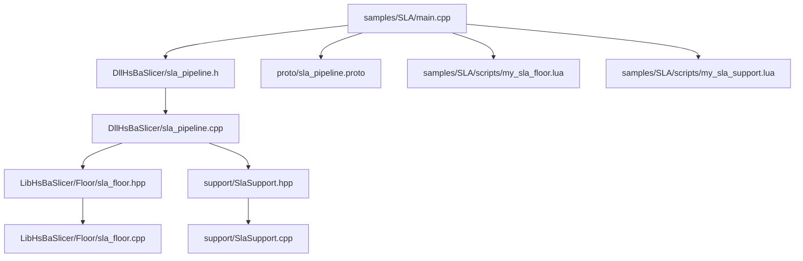
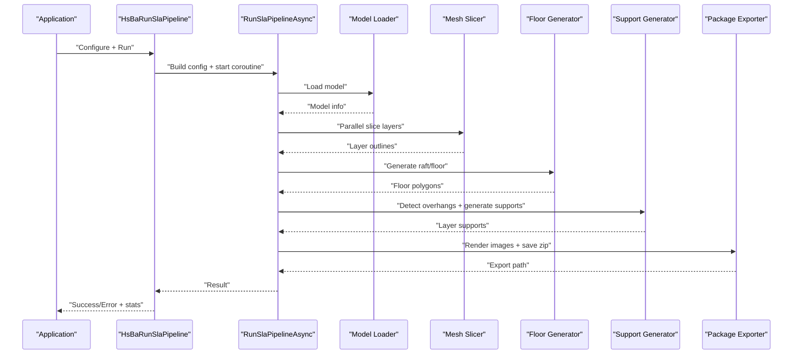
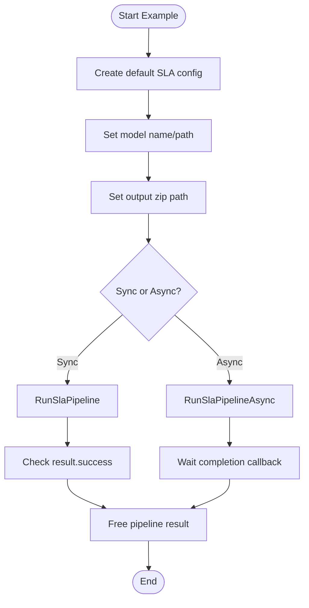
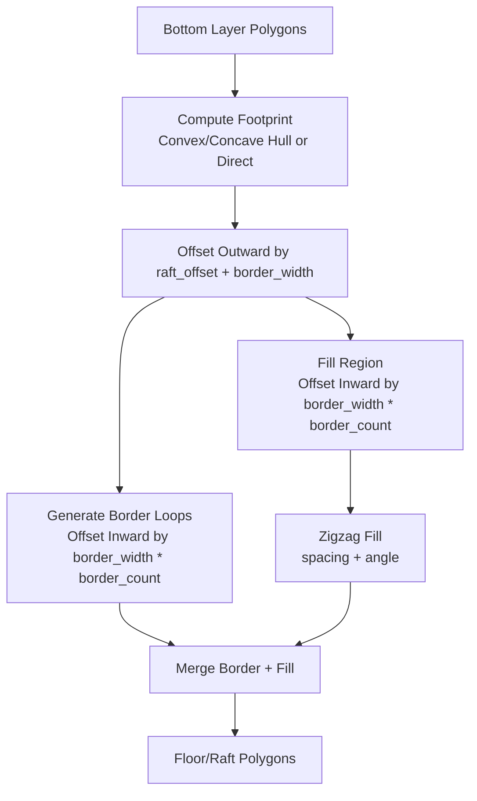
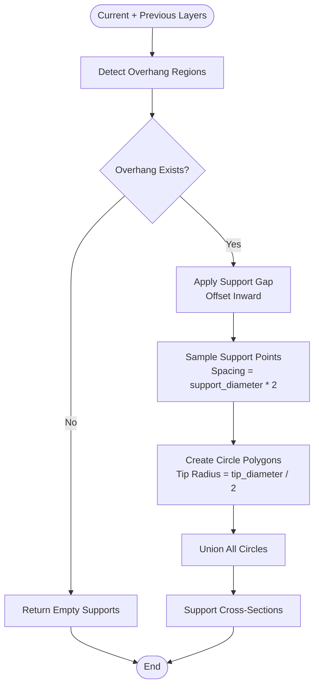
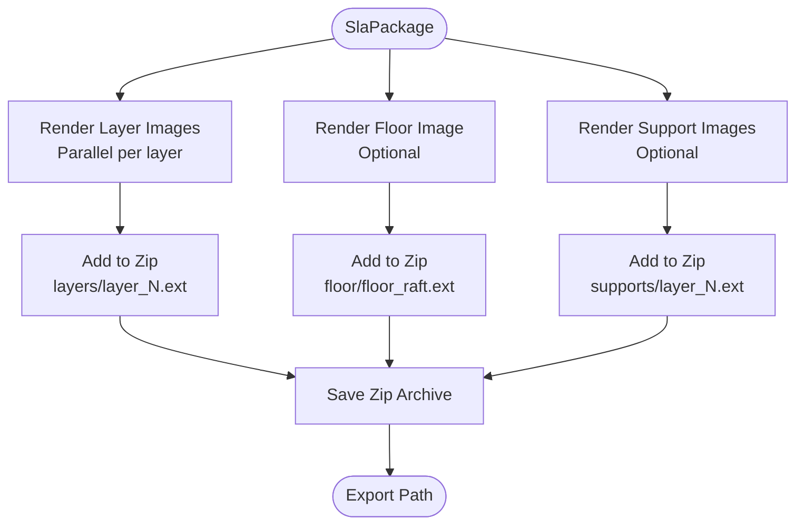
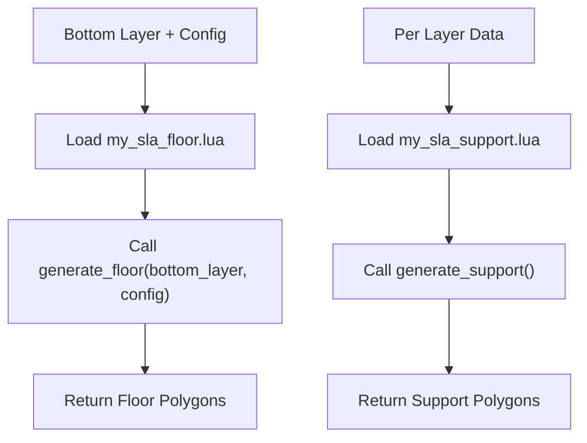
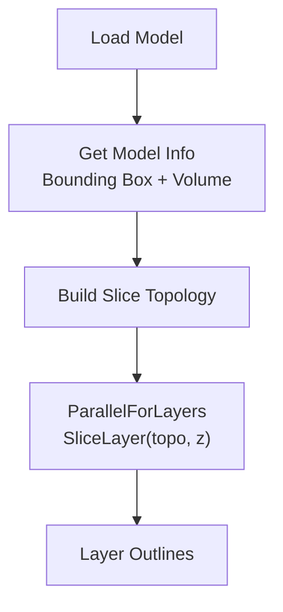
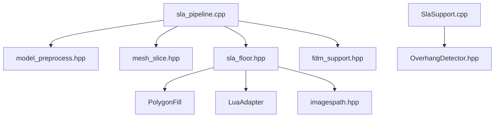

# SLA Examples / SLA示例

<cite>
**Referenced Files in This Document**   
- [main.cpp](file://samples/SLA/main.cpp)
- [my_sla_floor.lua](file://samples/SLA/scripts/my_sla_floor.lua)
- [my_sla_support.lua](file://samples/SLA/scripts/my_sla_support.lua)
- [sla_pipeline.h](file://DllHsBaSlicer/sla_pipeline.h)
- [sla_pipeline.cpp](file://DllHsBaSlicer/sla_pipeline.cpp)
- [sla_floor.hpp](file://LibHsBaSlicer/Floor/sla_floor.hpp)
- [sla_floor.cpp](file://LibHsBaSlicer/Floor/sla_floor.cpp)
- [SlaSupport.hpp](file://support/SlaSupport.hpp)
- [SlaSupport.cpp](file://support/SlaSupport.cpp)
- [sla_pipeline.proto](file://proto/sla_pipeline.proto)
</cite>

## Table of Contents
1. [Introduction](#introduction)
2. [Project Structure](#project-structure)
3. [Core Components](#core-components)
4. [Architecture Overview](#architecture-overview)
5. [Detailed Component Analysis](#detailed-component-analysis)
6. [Dependency Analysis](#dependency-analysis)
7. [Performance Considerations](#performance-considerations)
8. [Troubleshooting Guide](#troubleshooting-guide)
9. [Conclusion](#conclusion)
10. [Appendices](#appendices)

## Introduction
This document provides complete, code-sourced examples for Stereolithography (SLA) resin-based 3D printing workflows in HsBaSlicer. It covers:
- SLA pipeline execution with synchronous and asynchronous APIs
- Floor/raft generation algorithms
- Sacrificial support structure creation
- Layer image export for UV curing processes
- SLA-specific configuration parameters such as exposure settings, layer thickness, lift/retract motion, floor geometry, and support geometry
- Lua scripting for custom floor patterns and support geometries
- Mesh processing for high-resolution models
- Post-processing considerations including overhang management, support removal strategies, and surface quality optimization

The examples are grounded in the repository’s SLA sample program, C ABI headers, internal pipeline implementation, floor/raft generator, sacrificial support generator, and protocol definitions.

## Project Structure
The SLA example workflow is centered around a small sample application that configures and runs the SLA slicing pipeline, plus two Lua scripts demonstrating custom floor and support generation. The core SLA logic lives in the Dll and Lib layers, while protocol definitions describe the serialized configuration shape.

**Diagram sources**
- [main.cpp:1-259](file://samples/SLA/main.cpp#L1-L259)
- [sla_pipeline.h:1-63](file://DllHsBaSlicer/sla_pipeline.h#L1-L63)
- [sla_pipeline.cpp:1-532](file://DllHsBaSlicer/sla_pipeline.cpp#L1-L532)
- [sla_floor.hpp:1-200](file://LibHsBaSlicer/Floor/sla_floor.hpp#L1-L200)
- [sla_floor.cpp:1-609](file://LibHsBaSlicer/Floor/sla_floor.cpp#L1-L609)
- [SlaSupport.hpp:1-46](file://support/SlaSupport.hpp#L1-L46)
- [SlaSupport.cpp:1-135](file://support/SlaSupport.cpp#L1-L135)
- [sla_pipeline.proto:1-67](file://proto/sla_pipeline.proto#L1-L67)

**Section sources**
- [main.cpp:1-259](file://samples/SLA/main.cpp#L1-L259)
- [sla_pipeline.h:1-63](file://DllHsBaSlicer/sla_pipeline.h#L1-L63)
- [sla_pipeline.proto:1-67](file://proto/sla_pipeline.proto#L1-L67)

## Core Components
The SLA workflow consists of five main stages:
1. Preprocess: load model and compute bounding box/volume
2. Slice: generate per-layer outlines using mesh slicing
3. Floor/Raft: generate contact area, border loops, and fill
4. Support: detect overhangs and generate sacrificial supports
5. Export: render layer images and package into a zip with configuration JSON

Key components:
- SLA C API: `HsBaCreateDefaultSlaConfig`, `HsBaRunSlaPipeline`, `HsBaRunSlaPipelineAsync`, `HsBaFreeSlaPipelineResult`
- Internal pipeline: builds configuration, slices layers, generates floor/support, exports package
- Floor/raft generator: footprint computation, offset borders, zigzag fill, Lua customization
- Sacrificial support generator: overhang detection, gap handling, point sampling, circle union
- Package exporter: parallel image rendering, zip packaging, optional Lua export hook

**Section sources**
- [sla_pipeline.h:17-56](file://DllHsBaSlicer/sla_pipeline.h#L17-L56)
- [sla_pipeline.cpp:298-483](file://DllHsBaSlicer/sla_pipeline.cpp#L298-L483)
- [sla_floor.hpp:21-195](file://LibHsBaSlicer/Floor/sla_floor.hpp#L21-L195)
- [sla_floor.cpp:33-117](file://LibHsBaSlicer/Floor/sla_floor.cpp#L33-L117)
- [SlaSupport.hpp:13-42](file://support/SlaSupport.hpp#L13-L42)
- [SlaSupport.cpp:38-123](file://support/SlaSupport.cpp#L38-L123)

## Architecture Overview
The SLA pipeline exposes a simple C ABI for external applications. Internally, it uses coroutines and parallelization to slice layers and render images efficiently.

**Diagram sources**
- [sla_pipeline.cpp:298-483](file://DllHsBaSlicer/sla_pipeline.cpp#L298-L483)
- [sla_floor.cpp:468-606](file://LibHsBaSlicer/Floor/sla_floor.cpp#L468-L606)
- [SlaSupport.cpp:81-123](file://support/SlaSupport.cpp#L81-L123)

## Detailed Component Analysis

### SLA Pipeline Execution
The sample demonstrates four usage patterns:
- Basic default configuration
- Custom process parameters (layer height, exposure, lift/retract, floor, support)
- Lua-customized floor and support generation
- Asynchronous pipeline execution

**Diagram sources**
- [main.cpp:52-84](file://samples/SLA/main.cpp#L52-L84)
- [main.cpp:89-144](file://samples/SLA/main.cpp#L89-L144)
- [main.cpp:149-191](file://samples/SLA/main.cpp#L149-L191)
- [main.cpp:217-239](file://samples/SLA/main.cpp#L217-L239)

**Section sources**
- [main.cpp:52-84](file://samples/SLA/main.cpp#L52-L84)
- [main.cpp:89-144](file://samples/SLA/main.cpp#L89-L144)
- [main.cpp:149-191](file://samples/SLA/main.cpp#L149-L191)
- [main.cpp:217-239](file://samples/SLA/main.cpp#L217-L239)
- [sla_pipeline.h:23-47](file://DllHsBaSlicer/sla_pipeline.h#L23-L47)

### Floor/Raft Generation Algorithms
The floor generator computes a contact footprint from the bottom layer, optionally simplifying via convex hull or concave hull simulation. It then creates:
- An outward-offset raft boundary
- Inward border loops based on border width and count
- Zigzag fill inside the last border loop

**Diagram sources**
- [sla_floor.cpp:33-117](file://LibHsBaSlicer/Floor/sla_floor.cpp#L33-L117)

**Section sources**
- [sla_floor.hpp:21-78](file://LibHsBaSlicer/Floor/sla_floor.hpp#L21-L78)
- [sla_floor.cpp:33-117](file://LibHsBaSlicer/Floor/sla_floor.cpp#L33-L117)

### Sacrificial Support Structure Creation
The SLA sacrificial support generator detects overhang regions between current and previous layers, applies a gap, samples support points at a spacing derived from support diameter, and unions circles to form support cross-sections.

**Diagram sources**
- [SlaSupport.cpp:38-123](file://support/SlaSupport.cpp#L38-L123)

**Section sources**
- [SlaSupport.hpp:13-42](file://support/SlaSupport.hpp#L13-L42)
- [SlaSupport.cpp:38-123](file://support/SlaSupport.cpp#L38-L123)

### Layer Image Export for UV Curing Processes
The pipeline renders each layer’s outline and optional support polygons into images (PNG/JPG/SVG), packages them under `layers/`, `supports/`, and `floor/`, and includes a `config.json` describing exposure, lift, floor, and support settings.

**Diagram sources**
- [sla_floor.cpp:468-606](file://LibHsBaSlicer/Floor/sla_floor.cpp#L468-L606)

**Section sources**
- [sla_floor.hpp:157-195](file://LibHsBaSlicer/Floor/sla_floor.hpp#L157-L195)
- [sla_floor.cpp:468-606](file://LibHsBaSlicer/Floor/sla_floor.cpp#L468-L606)

### Lua Scripting for Custom Floor Patterns and Support Geometries
Custom Lua scripts can replace default floor and support generation. The floor script receives the bottom layer polygons and a configuration table, returning floor polygons. The support script has access to global variables like `current_layer`, `prev_layer`, `layer_height`, and `config`, and can use built-in polygon operations and support helpers.

**Diagram sources**
- [my_sla_floor.lua:1-64](file://samples/SLA/scripts/my_sla_floor.lua#L1-L64)
- [my_sla_support.lua:1-76](file://samples/SLA/scripts/my_sla_support.lua#L1-L76)
- [sla_floor.cpp:148-228](file://LibHsBaSlicer/Floor/sla_floor.cpp#L148-L228)

**Section sources**
- [my_sla_floor.lua:1-64](file://samples/SLA/scripts/my_sla_floor.lua#L1-L64)
- [my_sla_support.lua:1-76](file://samples/SLA/scripts/my_sla_support.lua#L1-L76)
- [sla_floor.hpp:81-116](file://LibHsBaSlicer/Floor/sla_floor.hpp#L81-L116)
- [sla_floor.cpp:148-228](file://LibHsBaSlicer/Floor/sla_floor.cpp#L148-L228)

### SLA-Specific Configuration Parameters
The SLA pipeline supports extensive configuration for resin printing:

| Category | Parameter | Description | Typical Range/Values |
|---|---|---|---|
| Slicing | `layer_height` | Normal layer thickness | e.g., 0.05 mm |
| Slicing | `first_layer_height` | First layer thickness | e.g., 0.1 mm |
| Exposure | `bottom_exposure_time` | Bottom layer exposure time | e.g., 60 s |
| Exposure | `normal_exposure_time` | Normal layer exposure time | e.g., 2.5 s |
| Lift/Retract | `bottom_lift_distance` | Bottom lift distance | e.g., 5 mm |
| Lift/Retract | `lift_distance` | Normal lift distance | e.g., 3 mm |
| Lift/Retract | `lift_speed` | Z-axis lift speed | e.g., 60 mm/s |
| Lift/Retract | `retract_speed` | Retract speed | e.g., 150 mm/s |
| Floor | `floor_raft_offset` | Raft outward offset | e.g., 2–3 mm |
| Floor | `floor_border_width` | Border ring width | e.g., 1–1.5 mm |
| Floor | `floor_fill_spacing` | Fill line spacing | e.g., 0.5 mm |
| Floor | `floor_fill_angle` | Fill pattern angle | e.g., 0° |
| Floor | `floor_border_count` | Number of border loops | e.g., 2–3 |
| Floor | `floor_use_convex_hull` | Use convex hull for footprint | boolean |
| Support | `enable_support` | Enable support generation | boolean |
| Support | `overhang_angle` | Overhang threshold angle | e.g., 45° |
| Support | `support_gap` | Gap between model and support | e.g., 0.5 mm |
| Support | `support_diameter` | Support column diameter | e.g., 2 mm |
| Support | `support_density` | Support density factor | e.g., 0.3 |
| Support | `support_pattern` | Support pattern type | sacrificial/cone |
| Image | `image_type` | Output image format | PNG/JPG/SVG |
| Image | `image_width` | Image width in pixels | 0 = auto |
| Image | `image_height` | Image height in pixels | 0 = auto |

These fields are defined in the protocol message and mapped into the internal configuration used by the pipeline.

**Section sources**
- [sla_pipeline.proto:5-58](file://proto/sla_pipeline.proto#L5-L58)
- [sla_pipeline.cpp:49-85](file://DllHsBaSlicer/sla_pipeline.cpp#L49-L85)
- [main.cpp:99-125](file://samples/SLA/main.cpp#L99-L125)

### Mesh Processing for High-Resolution Models
The pipeline loads the CAD model once, builds slicing topology, and slices layers in parallel. This reduces repeated topology construction overhead and improves performance for high-resolution meshes.

**Diagram sources**
- [sla_pipeline.cpp:310-358](file://DllHsBaSlicer/sla_pipeline.cpp#L310-L358)

**Section sources**
- [sla_pipeline.cpp:310-358](file://DllHsBaSlicer/sla_pipeline.cpp#L310-L358)

### Post-Processing Considerations
- Overhang management: Adjust `overhang_angle` and `support_gap` to balance print reliability and post-processing effort.
- Support removal strategies: Sacrificial supports are designed with small tips for easier removal; consider increasing `support_diameter` for stronger supports if needed.
- Surface quality optimization: Tune `layer_height` and `normal_exposure_time`; reduce `floor_fill_spacing` for smoother floors; adjust `fill_angle_deg` to minimize visible fill lines.

[No sources needed since this section provides general guidance]

## Dependency Analysis
The SLA pipeline depends on several modules:
- Model preprocessing and slicing
- 2D polygon operations and fill algorithms
- Overhang detection
- Image rendering and zip packaging
- Lua scripting integration

**Diagram sources**
- [sla_pipeline.cpp:19-27](file://DllHsBaSlicer/sla_pipeline.cpp#L19-L27)
- [sla_floor.cpp:18-27](file://LibHsBaSlicer/Floor/sla_floor.cpp#L18-L27)
- [SlaSupport.cpp:10-11](file://support/SlaSupport.cpp#L10-L11)

**Section sources**
- [sla_pipeline.cpp:19-27](file://DllHsBaSlicer/sla_pipeline.cpp#L19-L27)
- [sla_floor.cpp:18-27](file://LibHsBaSlicer/Floor/sla_floor.cpp#L18-L27)
- [SlaSupport.cpp:10-11](file://support/SlaSupport.cpp#L10-L11)

## Performance Considerations
- Parallel slicing: Layers are sliced independently using a parallel loop, improving throughput for large models.
- Parallel image rendering: Layer and support images are rendered concurrently using a thread pool, controlled by `HSBA_PIPELINE_THREADS`.
- Memory management: The pipeline uses efficient data structures and avoids unnecessary copies where possible.
- Lua overhead: Custom Lua scripts add initialization and parsing costs; prefer built-in generators when performance is critical.

[No sources needed since this section provides general guidance]

## Troubleshooting Guide
Common issues and resolutions:
- Model loading failure: Ensure `model_path` exists and is readable.
- Invalid model height: Check model bounds and ensure non-zero height.
- Lua script errors: Verify script syntax, function names, and return types.
- Export failures: Check write permissions for `output_path` and available disk space.
- Support not generated: Confirm `enable_support` is true and overhang detection finds regions.

**Section sources**
- [sla_pipeline.cpp:318-334](file://DllHsBaSlicer/sla_pipeline.cpp#L318-L334)
- [sla_pipeline.cpp:400-419](file://DllHsBaSlicer/sla_pipeline.cpp#L400-L419)
- [sla_floor.cpp:167-190](file://LibHsBaSlicer/Floor/sla_floor.cpp#L167-L190)

## Conclusion
HsBaSlicer’s SLA pipeline provides a robust, configurable framework for resin-based 3D printing workflows. It supports advanced features like parallel slicing, customizable floor and support generation via Lua, and efficient image export for UV curing processes. By tuning exposure, lift, floor, and support parameters, users can optimize print quality, reliability, and post-processing effort.

[No sources needed since this section summarizes without analyzing specific files]

## Appendices

### Complete SLA Pipeline Execution Example
The sample program demonstrates:
- Creating default configuration
- Setting model and output paths
- Running synchronously or asynchronously
- Handling progress callbacks and results

**Section sources**
- [main.cpp:52-84](file://samples/SLA/main.cpp#L52-L84)
- [main.cpp:89-144](file://samples/SLA/main.cpp#L89-L144)
- [main.cpp:149-191](file://samples/SLA/main.cpp#L149-L191)
- [main.cpp:217-239](file://samples/SLA/main.cpp#L217-L239)

### Lua Custom Floor Pattern Example
The floor script demonstrates:
- Using convex hull for footprint simplification
- Generating raft outer boundary via offset
- Creating border loops and zigzag fill
- Returning combined floor polygons

**Section sources**
- [my_sla_floor.lua:35-62](file://samples/SLA/scripts/my_sla_floor.lua#L35-L62)
- [sla_floor.hpp:81-116](file://LibHsBaSlicer/Floor/sla_floor.hpp#L81-L116)

### Lua Custom Support Geometry Example
The support script demonstrates:
- Detecting overhang regions
- Using built-in SLA support generator
- Filtering supports by area threshold
- Returning filtered support polygons

**Section sources**
- [my_sla_support.lua:34-72](file://samples/SLA/scripts/my_sla_support.lua#L34-L72)
- [sla_floor.cpp:148-228](file://LibHsBaSlicer/Floor/sla_floor.cpp#L148-L228)