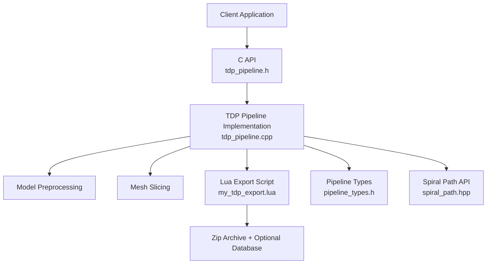
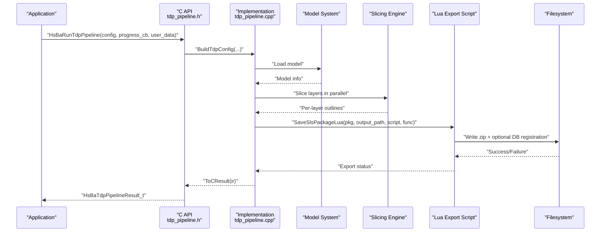
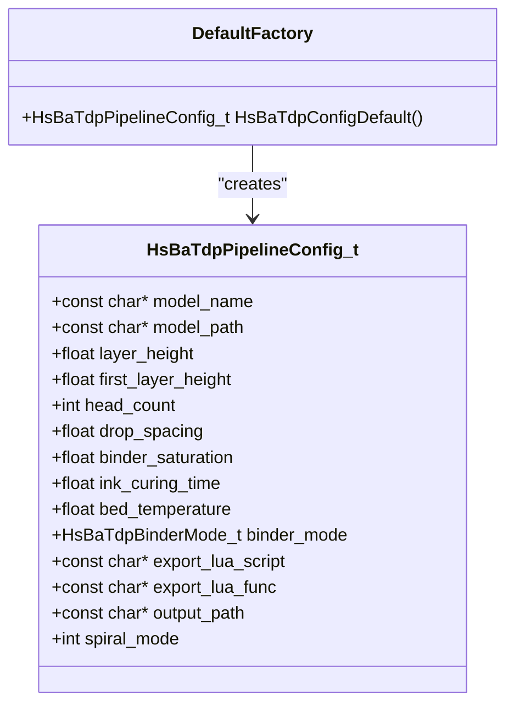
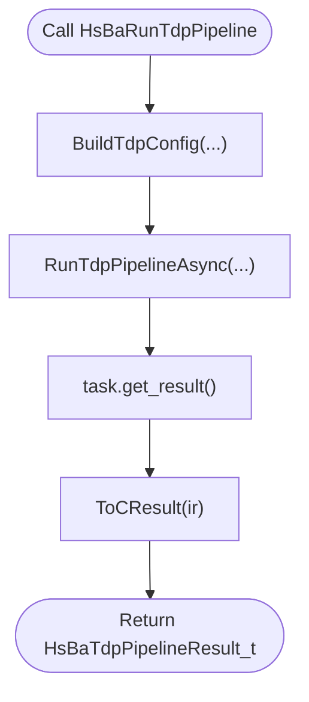
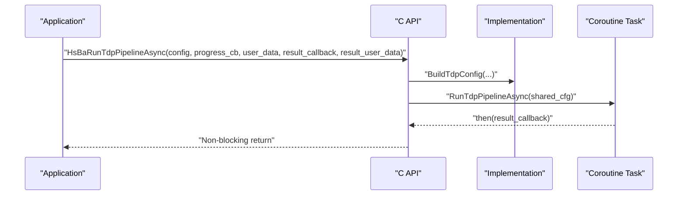
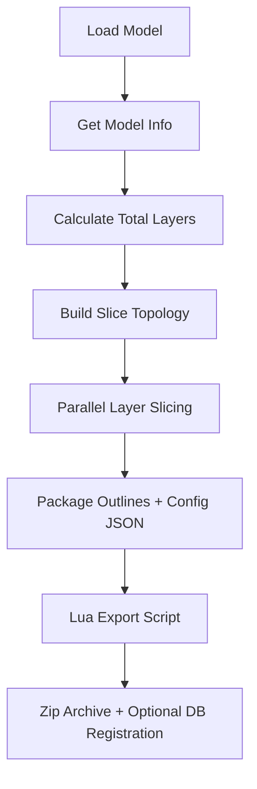
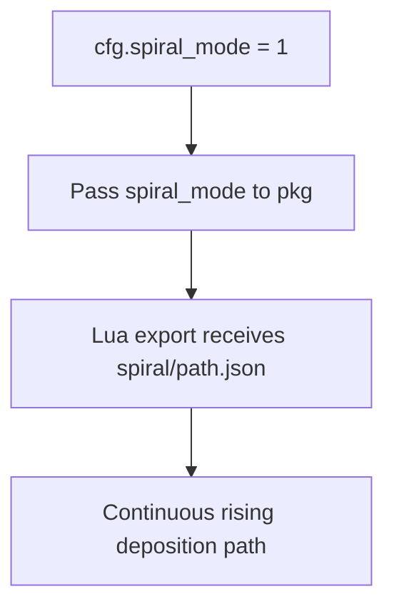
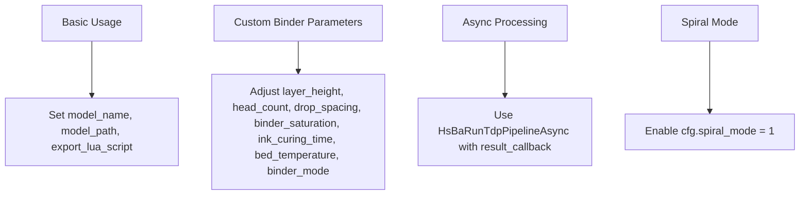
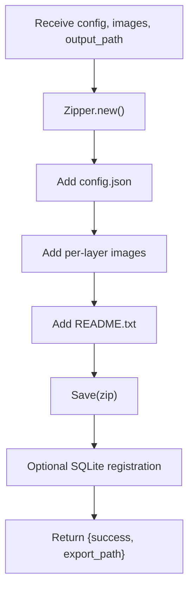
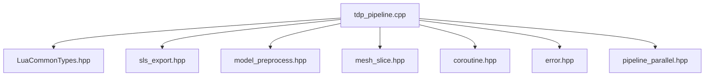

# TDP (Thermal Deposition Processing) Examples / TDP热沉积加工示例

<cite>
**Referenced Files in This Document**   
- [tdp_pipeline.h](file://DllHsBaSlicer/tdp_pipeline.h)
- [tdp_pipeline.cpp](file://DllHsBaSlicer/tdp_pipeline.cpp)
- [pipeline_types.h](file://pipelinetypes/pipeline_types.h)
- [param_reflect.hpp](file://fileoperator/param_reflect.hpp)
- [spiral_path.hpp](file://LibHsBaSlicer/Path/spiral_path.hpp)
- [main.cpp](file://samples/TDP/main.cpp)
- [my_tdp_export.lua](file://samples/TDP/scripts/my_tdp_export.lua)
- [tdp_pipeline.proto](file://proto/tdp_pipeline.proto)
</cite>

## Table of Contents
1. [Introduction](#introduction)
2. [Project Structure](#project-structure)
3. [Core Components](#core-components)
4. [Architecture Overview](#architecture-overview)
5. [Detailed Component Analysis](#detailed-component-analysis)
6. [Dependency Analysis](#dependency-analysis)
7. [Performance Considerations](#performance-considerations)
8. [Troubleshooting Guide](#troubleshooting-guide)
9. [Conclusion](#conclusion)
10. [Appendices](#appendices)

## Introduction
This document explains the TDP (Thermal Deposition Processing) examples in HsBaSlicer, focusing on the binder jetting workflow: powder bed preparation, liquid binder deposition per layer, and curing operations. It documents the `HsBaTdpPipelineConfig` configuration structure, both synchronous and asynchronous pipeline execution patterns through `HsBaRunTdpPipeline` and `HsBaRunTdpPipelineAsync`, spiral mode for continuous rising deposition paths, and the Lua export script interface used to customize output formats and provide machine-specific instructions.

The 3DP/TDP pipeline is a powder-bed process where a liquid binder is jetted onto a powder bed layer by layer. The C++ side slices the model into per-layer outlines and passes binder-related parameters to a Lua export script. The Lua script controls the final output format, typically packaging per-layer JSON data and process configuration into a zip archive, optionally registering exports in a database.

## Project Structure
The TDP example surface is implemented across three main areas:
- Public C API header defining the TDP pipeline interface.
- C++ implementation providing default configuration, synchronous/asynchronous execution, slicing, and Lua-based export.
- Sample application demonstrating basic usage, custom binder parameters, async processing, and spiral mode.
- A sample Lua export script showing how to package outputs and register them.

**Diagram sources**
- [tdp_pipeline.h:17-56](file://DllHsBaSlicer/tdp_pipeline.h#L17-L56)
- [tdp_pipeline.cpp:202-316](file://DllHsBaSlicer/tdp_pipeline.cpp#L202-L316)
- [pipeline_types.h:903-921](file://pipelinetypes/pipeline_types.h#L903-L921)
- [spiral_path.hpp:16-40](file://LibHsBaSlicer/Path/spiral_path.hpp#L16-L40)
- [my_tdp_export.lua:15-60](file://samples/TDP/scripts/my_tdp_export.lua#L15-L60)

**Section sources**
- [tdp_pipeline.h:1-63](file://DllHsBaSlicer/tdp_pipeline.h#L1-L63)
- [tdp_pipeline.cpp:1-365](file://DllHsBaSlicer/tdp_pipeline.cpp#L1-L365)
- [pipeline_types.h:903-921](file://pipelinetypes/pipeline_types.h#L903-L921)
- [main.cpp:52-225](file://samples/TDP/main.cpp#L52-L225)
- [my_tdp_export.lua:1-63](file://samples/TDP/scripts/my_tdp_export.lua#L1-L63)

## Core Components
The core components for TDP are:
- Configuration structure `HsBaTdpPipelineConfig_t` with defaults provided by `HsBaTdpConfigDefault`.
- C API functions `HsBaRunTdpPipeline` (synchronous) and `HsBaRunTdpPipelineAsync` (asynchronous).
- Internal pipeline stages: model loading, slicing, and Lua-driven export.
- Spiral mode flag enabling continuous rising deposition path generation.

Key responsibilities:
- `HsBaCreateDefaultTdpConfig`: returns a fully initialized default configuration.
- `HsBaRunTdpPipeline`: blocks until the pipeline completes and returns a result.
- `HsBaRunTdpPipelineAsync`: starts non-blocking execution and invokes a completion callback.
- `HsBaFreeTdpPipelineResult`: frees memory allocated in the returned result.

Configuration fields include:
- `model_name`, `model_path`: identify the input model.
- `layer_height`, `first_layer_height`: control layer thickness and first layer offset.
- `head_count`, `drop_spacing`, `binder_saturation`, `ink_curing_time`, `bed_temperature`: binder jetting parameters.
- `binder_mode`: selects single, full color, or sintering modes.
- `export_lua_script`, `export_lua_func`, `output_path`: control Lua export behavior and destination.
- `spiral_mode`: enables continuous rising spiralized outer-wall path exposure.

**Section sources**
- [pipeline_types.h:903-921](file://pipelinetypes/pipeline_types.h#L903-L921)
- [param_reflect.hpp:256-282](file://fileoperator/param_reflect.hpp#L256-L282)
- [tdp_pipeline.h:17-56](file://DllHsBaSlicer/tdp_pipeline.h#L17-L56)
- [tdp_pipeline.cpp:39-57](file://DllHsBaSlicer/tdp_pipeline.cpp#L39-L57)

## Architecture Overview
The TDP pipeline architecture follows a three-stage flow: preprocess, slice, and export via Lua.

**Diagram sources**
- [tdp_pipeline.h:23-50](file://DllHsBaSlicer/tdp_pipeline.h#L23-L50)
- [tdp_pipeline.cpp:202-316](file://DllHsBaSlicer/tdp_pipeline.cpp#L202-L316)
- [my_tdp_export.lua:15-60](file://samples/TDP/scripts/my_tdp_export.lua#L15-L60)

## Detailed Component Analysis

### HsBaTdpPipelineConfig Structure
The configuration structure defines all parameters required for binder jetting and export behavior. Defaults are set by `HsBaTdpConfigDefault`, which initializes numeric fields and sets string pointers to NULL.

Important fields and their roles:
- `layer_height`: standard layer thickness.
- `first_layer_height`: initial layer height offset.
- `head_count`: number of print heads.
- `drop_spacing`: spacing between binder drops.
- `binder_saturation`: binder saturation level.
- `ink_curing_time`: curing time per layer.
- `bed_temperature`: build bed temperature.
- `binder_mode`: selection among single, full color, and sintering modes.
- `export_lua_script`: path to Lua export script.
- `export_lua_func`: name of Lua function to call.
- `output_path`: destination file path for exported package.
- `spiral_mode`: enable continuous rising spiralized path.

**Diagram sources**
- [pipeline_types.h:903-921](file://pipelinetypes/pipeline_types.h#L903-L921)
- [param_reflect.hpp:256-282](file://fileoperator/param_reflect.hpp#L256-L282)

**Section sources**
- [pipeline_types.h:903-921](file://pipelinetypes/pipeline_types.h#L903-L921)
- [param_reflect.hpp:256-282](file://fileoperator/param_reflect.hpp#L256-L282)

### Synchronous Execution: HsBaRunTdpPipeline
`synchronous` execution blocks until the pipeline finishes. Internally it builds an internal config, runs the async coroutine, waits for the result, and converts it to a C-compatible result struct.

**Diagram sources**
- [tdp_pipeline.cpp:329-336](file://DllHsBaSlicer/tdp_pipeline.cpp#L329-L336)

**Section sources**
- [tdp_pipeline.cpp:329-336](file://DllHsBaSlicer/tdp_pipeline.cpp#L329-L336)

### Asynchronous Execution: HsBaRunTdpPipelineAsync
`asynchronous` execution starts the pipeline without blocking. It wraps the internal config in a shared pointer, launches the coroutine, and schedules a completion callback when done.

**Diagram sources**
- [tdp_pipeline.cpp:338-354](file://DllHsBaSlicer/tdp_pipeline.cpp#L338-L354)

**Section sources**
- [tdp_pipeline.cpp:338-354](file://DllHsBaSlicer/tdp_pipeline.cpp#L338-L354)

### Binder Jetting Workflow
The binder jetting workflow consists of:
1. Loading the model and computing bounding box information.
2. Calculating total layers based on `first_layer_height` and `layer_height`.
3. Building slice topology once and slicing each layer in parallel.
4. Packaging per-layer outlines and binder parameters into a Lua-exported zip archive.
5. Optionally registering the export in a database via the Lua script.

**Diagram sources**
- [tdp_pipeline.cpp:212-304](file://DllHsBaSlicer/tdp_pipeline.cpp#L212-L304)
- [my_tdp_export.lua:15-60](file://samples/TDP/scripts/my_tdp_export.lua#L15-L60)

**Section sources**
- [tdp_pipeline.cpp:212-304](file://DllHsBaSlicer/tdp_pipeline.cpp#L212-L304)
- [my_tdp_export.lua:15-60](file://samples/TDP/scripts/my_tdp_export.lua#L15-L60)

### Spiral Mode Functionality
Spiral mode exposes a continuous, Z-rising spiralized outer-wall path to the export script. While per-layer images remain available, spiral mode adds a helical outer contour suitable for extrusion-style deposition processes.

**Diagram sources**
- [tdp_pipeline.cpp:281-287](file://DllHsBaSlicer/tdp_pipeline.cpp#L281-L287)
- [spiral_path.hpp:16-40](file://LibHsBaSlicer/Path/spiral_path.hpp#L16-L40)
- [main.cpp:175-189](file://samples/TDP/main.cpp#L175-L189)

**Section sources**
- [tdp_pipeline.cpp:281-287](file://DllHsBaSlicer/tdp_pipeline.cpp#L281-L287)
- [spiral_path.hpp:16-40](file://LibHsBaSlicer/Path/spiral_path.hpp#L16-L40)
- [main.cpp:175-189](file://samples/TDP/main.cpp#L175-L189)

### Practical Usage Examples
The sample application demonstrates four usage patterns:
- Basic usage: minimal configuration with default parameters.
- Custom binder parameters: adjusting head count, drop spacing, saturation, curing time, bed temperature, and binder mode.
- Async processing: non-blocking execution with a completion callback.
- Spiral mode: enabling continuous rising deposition path generation.

**Diagram sources**
- [main.cpp:55-82](file://samples/TDP/main.cpp#L55-L82)
- [main.cpp:87-125](file://samples/TDP/main.cpp#L87-L125)
- [main.cpp:149-170](file://samples/TDP/main.cpp#L149-L170)
- [main.cpp:175-205](file://samples/TDP/main.cpp#L175-L205)

**Section sources**
- [main.cpp:55-82](file://samples/TDP/main.cpp#L55-L82)
- [main.cpp:87-125](file://samples/TDP/main.cpp#L87-L125)
- [main.cpp:149-170](file://samples/TDP/main.cpp#L149-L170)
- [main.cpp:175-205](file://samples/TDP/main.cpp#L175-L205)

### Lua Export Script Interface
The Lua export script receives:
- `config`: table containing `path` and `configStr` (JSON content with process configuration).
- `images`: array of per-layer polygon JSON files.
- `output_path`: destination file path passed from C++.

The script packages the configuration JSON and per-layer images into a zip archive and optionally registers the export in a SQLite database. It must return a table with `success` and `export_path`; returning a string would overwrite the zip file.

**Diagram sources**
- [my_tdp_export.lua:15-60](file://samples/TDP/scripts/my_tdp_export.lua#L15-L60)

**Section sources**
- [my_tdp_export.lua:1-63](file://samples/TDP/scripts/my_tdp_export.lua#L1-L63)

## Dependency Analysis
The TDP pipeline depends on several modules:
- Model preprocessing and slicing utilities.
- Lua common types and export helpers.
- Coroutine framework for async execution.
- Error handling utilities.
- Parallel layer slicing.

**Diagram sources**
- [tdp_pipeline.cpp:17-24](file://DllHsBaSlicer/tdp_pipeline.cpp#L17-L24)

**Section sources**
- [tdp_pipeline.cpp:17-24](file://DllHsBaSlicer/tdp_pipeline.cpp#L17-L24)

## Performance Considerations
- Parallel slicing improves throughput by processing independent layers concurrently.
- Building slice topology once avoids redundant computation.
- Using coroutines allows non-blocking execution while maintaining clear error handling.
- Lua export scripts can be optimized to minimize I/O overhead during zip creation and database registration.

[No sources needed since this section provides general guidance]

## Troubleshooting Guide
Common issues and resolutions:
- Missing Lua export script: ensure `export_lua_script` is set; otherwise the pipeline fails early.
- Invalid model height: if the model has zero or negative height, layer calculation fails.
- Lua export failure: check the Lua script’s return value and error messages; avoid returning strings instead of tables.
- Result memory management: always call `HsBaFreeTdpPipelineResult` after using the result to free allocated strings.

**Section sources**
- [tdp_pipeline.cpp:266-271](file://DllHsBaSlicer/tdp_pipeline.cpp#L266-L271)
- [tdp_pipeline.cpp:298-302](file://DllHsBaSlicer/tdp_pipeline.cpp#L298-L302)
- [tdp_pipeline.cpp:356-364](file://DllHsBaSlicer/tdp_pipeline.cpp#L356-L364)

## Conclusion
The TDP examples in HsBaSlicer provide a complete binder jetting workflow: model preprocessing, parallel layer slicing, and Lua-driven export. The `HsBaTdpPipelineConfig` structure supports detailed customization of layer geometry, binder parameters, and export behavior. Both synchronous and asynchronous execution patterns are supported, and spiral mode enables continuous rising deposition paths for improved wall quality. The Lua export script interface offers flexibility for machine-specific output formats and database registration.

[No sources needed since this section summarizes without analyzing specific files]

## Appendices

### API Reference Summary
- `HsBaCreateDefaultTdpConfig`: creates default TDP configuration.
- `HsBaRunTdpPipeline`: synchronous pipeline execution.
- `HsBaRunTdpPipelineAsync`: asynchronous pipeline execution.
- `HsBaFreeTdpPipelineResult`: frees pipeline result memory.

**Section sources**
- [tdp_pipeline.h:17-56](file://DllHsBaSlicer/tdp_pipeline.h#L17-L56)
- [tdp_pipeline.cpp:324-364](file://DllHsBaSlicer/tdp_pipeline.cpp#L324-L364)

### Configuration Field Reference
| Field | Type | Description | Default Value |
|-------|------|-------------|---------------|
| `model_name` | const char* | Name of the model | NULL |
| `model_path` | const char* | Path to the model file | NULL |
| `layer_height` | float | Standard layer thickness | 0.1f |
| `first_layer_height` | float | First layer height offset | 0.12f |
| `head_count` | int | Number of print heads | 128 |
| `drop_spacing` | float | Spacing between binder drops | 0.05f |
| `binder_saturation` | float | Binder saturation level | 0.6f |
| `ink_curing_time` | float | Curing time per layer | 1.0f |
| `bed_temperature` | float | Build bed temperature | 40.0f |
| `binder_mode` | HsBaTdpBinderMode_t | Single/full color/sintering mode | HSBA_TDP_SINGLE |
| `export_lua_script` | const char* | Lua export script path | NULL |
| `export_lua_func` | const char* | Lua function name | NULL |
| `output_path` | const char* | Destination file path | NULL |
| `spiral_mode` | int | Enable continuous rising spiral path | 0 |

**Section sources**
- [pipeline_types.h:903-921](file://pipelinetypes/pipeline_types.h#L903-L921)
- [param_reflect.hpp:256-282](file://fileoperator/param_reflect.hpp#L256-L282)

### Proto Definition Reference
The protobuf definition includes fields for output path and spiral mode, aligning with the C API configuration.

**Section sources**
- [tdp_pipeline.proto:33-46](file://proto/tdp_pipeline.proto#L33-L46)