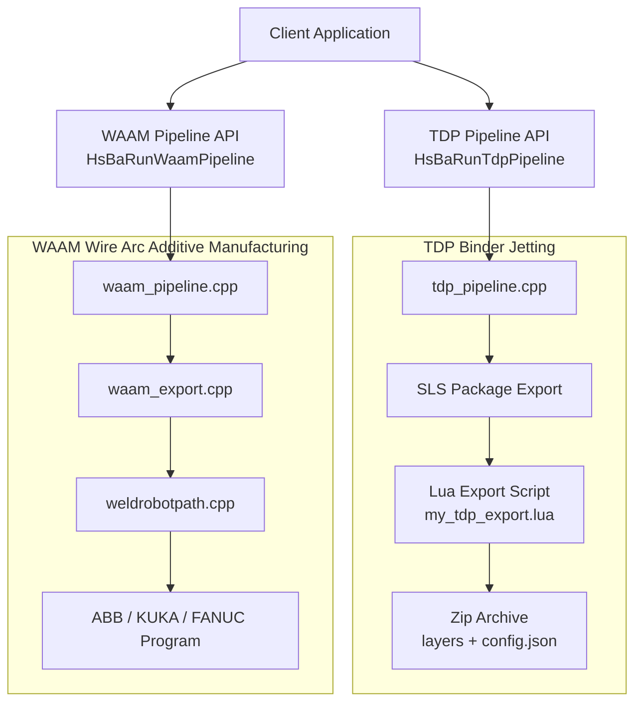
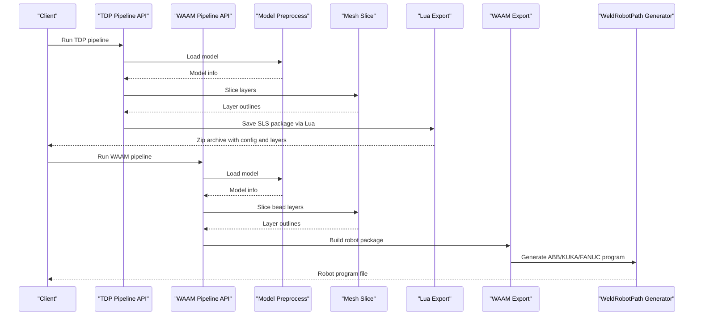
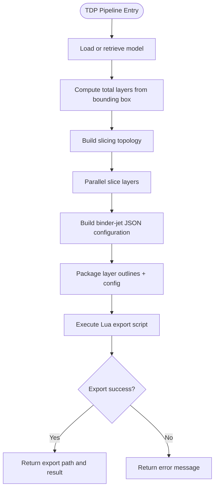
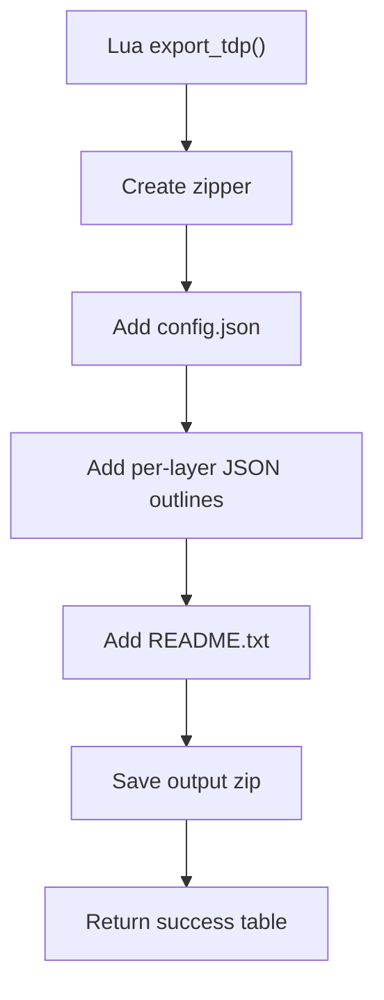
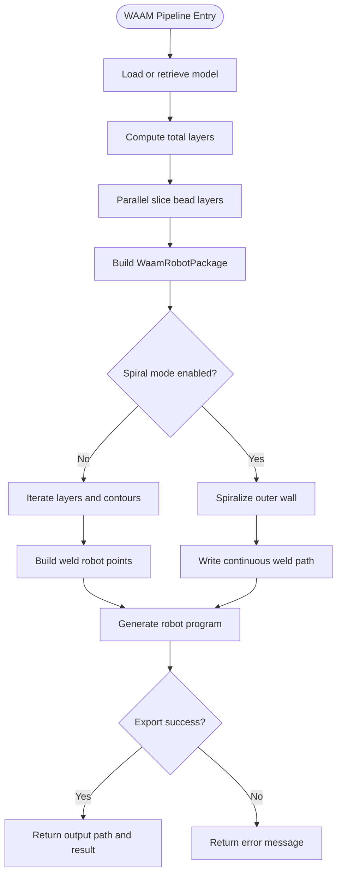
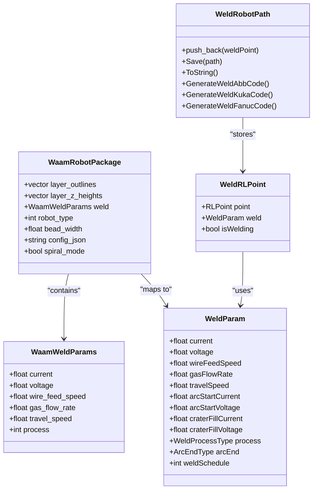
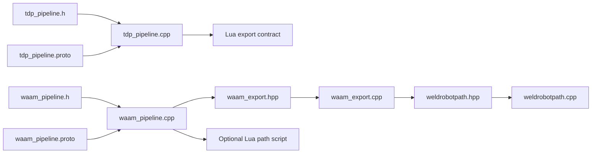
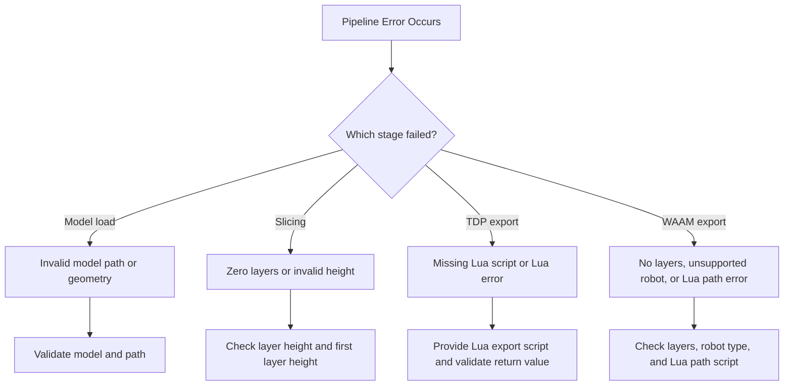

# Thermal Processing Examples / 热加工示例

<cite>
**Referenced Files in This Document**   
- [tdp_pipeline.h](file://DllHsBaSlicer/tdp_pipeline.h)
- [tdp_pipeline.cpp](file://DllHsBaSlicer/tdp_pipeline.cpp)
- [waam_pipeline.h](file://DllHsBaSlicer/waam_pipeline.h)
- [waam_pipeline.cpp](file://DllHsBaSlicer/waam_pipeline.cpp)
- [tdp_pipeline.proto](file://proto/tdp_pipeline.proto)
- [waam_pipeline.proto](file://proto/waam_pipeline.proto)
- [waam_export.hpp](file://LibHsBaSlicer/Path/waam_export.hpp)
- [waam_export.cpp](file://LibHsBaSlicer/Path/waam_export.cpp)
- [weldrobotpath.hpp](file://paths/weldrobotpath.hpp)
- [weldrobotpath.cpp](file://paths/weldrobotpath.cpp)
- [my_tdp_export.lua](file://samples/TDP/scripts/my_tdp_export.lua)
</cite>

## Table of Contents
1. [Introduction](#introduction)
2. [Project Structure](#project-structure)
3. [Core Components](#core-components)
4. [Architecture Overview](#architecture-overview)
5. [Detailed Component Analysis](#detailed-component-analysis)
6. [Dependency Analysis](#dependency-analysis)
7. [Performance Considerations](#performance-considerations)
8. [Troubleshooting Guide](#troubleshooting-guide)
9. [Conclusion](#conclusion)
10. [Appendices](#appendices)

## Introduction
This document provides detailed thermal processing examples for two additive manufacturing workflows implemented in the repository:

- **TDP (Thermal Deposition Processing) binder jetting**: powder-bed slicing, per-layer binder-jet outlines, and curing parameters packaged for a Lua export script.
- **WAAM (Wire Arc Additive Manufacturing)**: wire arc deposition with robot program generation for ABB, KUKA, and FANUC controllers, including spiral/vase mode, welding parameter mapping, and multi-axis path output.

The focus is on how the code transforms CAD models into process-specific outputs, how thermal-related configuration fields are carried through the pipeline, and where users can extend or customize behavior through Lua scripts.

## Project Structure
The thermal processing features are centered around two C ABI pipelines and their supporting libraries:

| Area | Responsibility | Key Files |
|---|---|---|
| TDP binder jetting pipeline | Loads model, slices layers, builds binder-jet configuration JSON, exports via Lua | `tdp_pipeline.h`, `tdp_pipeline.cpp`, `tdp_pipeline.proto` |
| WAAM robot path pipeline | Loads model, slices bead layers, builds robot package, generates ABB/KUKA/FANUC programs | `waam_pipeline.h`, `waam_pipeline.cpp`, `waam_pipeline.proto`, `waam_export.hpp`, `waam_export.cpp` |
| Welding robot path generator | Converts weld points into brand-specific robot code with arc start/end and crater handling | `weldrobotpath.hpp`, `weldrobotpath.cpp` |
| TDP example export script | Demonstrates packaging layer outlines and process config into a zip archive | `samples/TDP/scripts/my_tdp_export.lua` |

**Diagram sources**  
- [tdp_pipeline.cpp:203-315](file://DllHsBaSlicer/tdp_pipeline.cpp#L203-L315)
- [waam_pipeline.cpp:174-283](file://DllHsBaSlicer/waam_pipeline.cpp#L174-L283)
- [waam_export.cpp:61-189](file://LibHsBaSlicer/Path/waam_export.cpp#L61-L189)
- [weldrobotpath.cpp:79-100](file://paths/weldrobotpath.cpp#L79-L100)
- [my_tdp_export.lua:15-34](file://samples/TDP/scripts/my_tdp_export.lua#L15-L34)

**Section sources**  
- [tdp_pipeline.h:17-56](file://DllHsBaSlicer/tdp_pipeline.h#L17-L56)
- [waam_pipeline.h:17-57](file://DllHsBaSlicer/waam_pipeline.h#L17-L57)
- [tdp_pipeline.proto:15-37](file://proto/tdp_pipeline.proto#L15-L37)
- [waam_pipeline.proto:49-79](file://proto/waam_pipeline.proto#L49-L79)

## Core Components
The thermal processing system exposes two primary APIs:

### TDP Binder Jetting API
- Default configuration creation.
- Synchronous full pipeline execution.
- Asynchronous non-blocking execution.
- Result memory management.

The TDP pipeline treats binder jetting as a bed-based process: it slices the model into layers, computes total layers from bounding box height, and passes per-layer outlines plus binder/curing configuration to a Lua export script.

### WAAM Wire Arc Additive Manufacturing API
- Default configuration creation.
- Synchronous full pipeline execution.
- Asynchronous non-blocking execution.
- Result memory management.

The WAAM pipeline also slices the model into layers, but its output is not a layer zip; it is a robot language program. The pipeline maps welding current, voltage, wire feed speed, shielding gas flow, travel speed, material, protection, interpass temperature, and robot controller type into a robot path generator.

**Section sources**  
- [tdp_pipeline.h:17-56](file://DllHsBaSlicer/tdp_pipeline.h#L17-L56)
- [waam_pipeline.h:17-57](file://DllHsBaSlicer/waam_pipeline.h#L17-L57)
- [tdp_pipeline.cpp:324-364](file://DllHsBaSlicer/tdp_pipeline.cpp#L324-L364)
- [waam_pipeline.cpp:292-332](file://DllHsBaSlicer/waam_pipeline.cpp#L292-L332)

## Architecture Overview
Both pipelines follow a similar three-stage control flow: preprocess, slice, and export. The difference lies in what “export” means:

- TDP export produces a Lua-driven package containing per-layer binder-jet outlines and a JSON configuration describing head count, drop spacing, binder saturation, curing time, bed temperature, binder mode, and spiral mode.
- WAAM export produces a robot program that encodes MoveJ/MoveL/Circ moves and arc start/end sequences with welding parameters.

**Diagram sources**  
- [tdp_pipeline.cpp:203-315](file://DllHsBaSlicer/tdp_pipeline.cpp#L203-L315)
- [waam_pipeline.cpp:174-283](file://DllHsBaSlicer/waam_pipeline.cpp#L174-L283)
- [waam_export.cpp:61-189](file://LibHsBaSlicer/Path/waam_export.cpp#L61-L189)
- [weldrobotpath.cpp:79-100](file://paths/weldrobotpath.cpp#L79-L100)

## Detailed Component Analysis

### TDP Binder Jetting Workflow
The TDP workflow supports powder-bed slicing and binder application through a Lua export contract. The core implementation:

1. Loads or retrieves the model.
2. Computes total layers from model bounding box, first-layer height, and layer height.
3. Builds slicing topology once and slices each layer in parallel.
4. Builds a JSON configuration containing:
   - Version, process name, slice settings.
   - Binder settings: head count, drop spacing, saturation, curing time, mode.
   - Bed temperature.
   - Spiral mode flag.
5. Packages layer outlines and configuration into an SLS-style package and calls the Lua export function.
6. Returns success, total layers, export path, elapsed time, and error message.

#### TDP Configuration Fields
| Field | Meaning | Typical Use in Thermal Processing |
|---|---|---|
| `layer_height` | Normal layer thickness | Controls powder layer thickness and binder penetration depth. |
| `first_layer_height` | First layer thickness | Improves bed adhesion and initial thermal contact. |
| `head_count` | Number of print head nozzles | Affects binder deposition density and throughput. |
| `drop_spacing` | Distance between binder drops | Controls local heat input and binder distribution. |
| `binder_saturation` | Binder saturation value | Influences local energy absorption and curing behavior. |
| `ink_curing_time` | Per-layer curing time | Directly controls cooling and thermal stabilization between layers. |
| `bed_temperature` | Powder bed temperature | Reduces thermal gradients and warpage during deposition. |
| `binder_mode` | Full color, single channel, or sintering-assisted | Selects thermal strategy for binder jetting. |
| `spiral_mode` | Continuous spiralized deposition path | Can reduce per-layer retraction and improve thermal continuity. |

**Diagram sources**  
- [tdp_pipeline.cpp:95-117](file://DllHsBaSlicer/tdp_pipeline.cpp#L95-L117)
- [tdp_pipeline.cpp:142-164](file://DllHsBaSlicer/tdp_pipeline.cpp#L142-L164)
- [tdp_pipeline.cpp:203-315](file://DllHsBaSlicer/tdp_pipeline.cpp#L203-L315)

#### TDP Example Export Contract
The sample TDP export script demonstrates how the exported package should be structured:

- It receives a global `config` table containing the configuration path and JSON string.
- It receives an `images` array of per-layer polygon data.
- It writes a README describing the binder jetting package contents.
- It saves a zip archive containing the configuration and layer files.

**Diagram sources**  
- [my_tdp_export.lua:15-34](file://samples/TDP/scripts/my_tdp_export.lua#L15-L34)

**Section sources**  
- [tdp_pipeline.cpp:39-57](file://DllHsBaSlicer/tdp_pipeline.cpp#L39-L57)
- [tdp_pipeline.cpp:142-164](file://DllHsBaSlicer/tdp_pipeline.cpp#L142-L164)
- [tdp_pipeline.cpp:203-315](file://DllHsBaSlicer/tdp_pipeline.cpp#L203-L315)
- [tdp_pipeline.proto:8-37](file://proto/tdp_pipeline.proto#L8-L37)
- [my_tdp_export.lua:1-34](file://samples/TDP/scripts/my_tdp_export.lua#L1-L34)

### WAAM Wire Arc Additive Manufacturing Workflow
The WAAM workflow converts sliced contours into a robot program. Its core steps are:

1. Load or retrieve the model.
2. Compute total layers from bounding box and layer heights.
3. Slice bead layers in parallel.
4. Build a `WaamRobotPackage` containing:
   - Per-layer outlines.
   - Z heights.
   - Bead width.
   - Welding parameters: current, voltage, wire feed speed, gas flow rate, travel speed, process type.
   - Robot controller type.
   - Spiral mode flag.
5. Call `SaveWaamRobotPath`, which either uses built-in ABB/KUKA/FANUC generation or a custom Lua path script.
6. Return success, total layers, output path, elapsed time, and error message.

#### WAAM Configuration Fields
| Field | Meaning | Typical Use in Thermal Processing |
|---|---|---|
| `layer_height` | Bead/layer height | Controls vertical thermal buildup and interpass cooling. |
| `first_layer_height` | First-layer height | Improves substrate bonding and initial heat transfer. |
| `bead_width` | Deposited bead width | Controls lateral heat spread and overlap strategy. |
| `travel_speed` | Torch travel speed | Primary control for linear heat input. |
| `wire_feed_speed` | Wire feed speed | Controls filler metal and energy balance. |
| `arc_current` | Welding current | Major contributor to heat input. |
| `arc_voltage` | Arc voltage | Affects arc length and heat distribution. |
| `gas_flow_rate` | Shielding gas flow | Protects molten pool and influences cooling rate. |
| `material` | Feedstock material | Determines thermal conductivity and melting behavior. |
| `welding_process` | Arc or laser | Changes thermal source characteristics. |
| `protection` | Shielding gas or vacuum | Controls oxidation and cooling environment. |
| `protect_gas` | Argon, helium, nitrogen, CO₂ | Affects arc stability and thermal properties. |
| `interpass_temperature` | Interpass temperature | Controls accumulated thermal history and residual stress. |
| `robot_type` | ABB, KUKA, FANUC, or unknown | Selects robot program format. |
| `spiral_mode` | Continuous rising outer-wall bead | Reduces arc restarts and improves thermal continuity. |

**Diagram sources**  
- [waam_pipeline.cpp:99-121](file://DllHsBaSlicer/waam_pipeline.cpp#L99-L121)
- [waam_pipeline.cpp:174-283](file://DllHsBaSlicer/waam_pipeline.cpp#L174-L283)
- [waam_export.cpp:61-189](file://LibHsBaSlicer/Path/waam_export.cpp#L61-L189)

#### WAAM Robot Path Generation
The WAAM export layer converts the package into a `WeldRobotPath`, which then generates brand-specific code. The key behaviors include:

- Mapping internal robot types to ABB, KUKA, or FANUC.
- Mapping welding process codes to MIG/MAG or Laser.
- Building `WeldParam` values from WAAM welding settings.
- Supporting spiral mode by creating a continuous helix along outer walls.
- Generating arc start, continuous weld moves, and arc end with crater handling.

**Diagram sources**  
- [waam_export.hpp:23-52](file://LibHsBaSlicer/Path/waam_export.hpp#L23-L52)
- [weldrobotpath.hpp:35-57](file://paths/weldrobotpath.hpp#L35-L57)
- [weldrobotpath.hpp:65-96](file://paths/weldrobotpath.hpp#L65-L96)

**Section sources**  
- [waam_pipeline.cpp:37-61](file://DllHsBaSlicer/waam_pipeline.cpp#L37-L61)
- [waam_pipeline.cpp:131-157](file://DllHsBaSlicer/waam_pipeline.cpp#L131-L157)
- [waam_pipeline.cpp:174-283](file://DllHsBaSlicer/waam_pipeline.cpp#L174-L283)
- [waam_pipeline.proto:9-79](file://proto/waam_pipeline.proto#L9-L79)
- [waam_export.hpp:23-72](file://LibHsBaSlicer/Path/waam_export.hpp#L23-L72)
- [waam_export.cpp:21-57](file://LibHsBaSlicer/Path/waam_export.cpp#L21-L57)
- [weldrobotpath.hpp:16-57](file://paths/weldrobotpath.hpp#L16-L57)
- [weldrobotpath.hpp:65-96](file://paths/weldrobotpath.hpp#L65-L96)

## Dependency Analysis
The thermal processing components have clear separation between pipeline orchestration, export logic, and robot code generation.

**Diagram sources**  
- [tdp_pipeline.h:1-63](file://DllHsBaSlicer/tdp_pipeline.h#L1-L63)
- [tdp_pipeline.cpp:1-365](file://DllHsBaSlicer/tdp_pipeline.cpp#L1-L365)
- [waam_pipeline.h:1-64](file://DllHsBaSlicer/waam_pipeline.h#L1-L64)
- [waam_pipeline.cpp:1-333](file://DllHsBaSlicer/waam_pipeline.cpp#L1-L333)
- [waam_export.hpp:1-77](file://LibHsBaSlicer/Path/waam_export.hpp#L1-L77)
- [waam_export.cpp:1-192](file://LibHsBaSlicer/Path/waam_export.cpp#L1-L192)
- [weldrobotpath.hpp:1-100](file://paths/weldrobotpath.hpp#L1-L100)
- [weldrobotpath.cpp:1-483](file://paths/weldrobotpath.cpp#L1-L483)

**Section sources**  
- [tdp_pipeline.cpp:203-315](file://DllHsBaSlicer/tdp_pipeline.cpp#L203-L315)
- [waam_pipeline.cpp:174-283](file://DllHsBaSlicer/waam_pipeline.cpp#L174-L283)
- [waam_export.cpp:61-189](file://LibHsBaSlicer/Path/waam_export.cpp#L61-L189)
- [weldrobotpath.cpp:79-100](file://paths/weldrobotpath.cpp#L79-L100)

## Performance Considerations
From the implementation perspective, both pipelines optimize thermal processing preparation rather than real-time thermal simulation:

- **Parallel slicing**: Both TDP and WAAM build the slicing topology once and slice layers in parallel. This reduces preprocessing time when generating many layers.
- **Coroutine-based execution**: The asynchronous pipeline functions use coroutine tasks, allowing progress callbacks without blocking the caller.
- **Spiral mode**: For WAAM, spiral mode merges outer-wall contours into one continuous rising weld bead, reducing arc restarts and potentially improving thermal continuity.
- **Default velocity fallback**: If travel speed is zero or invalid, the WAAM exporter falls back to a default robot velocity, preventing degenerate motion commands.

Practical implications for thermal processing:

- Higher layer counts increase preprocessing time due to parallel slicing.
- Spiral mode may reduce total arc-on time but requires closed outer-wall contours.
- Excessive drop spacing or low binder saturation in TDP can lead to uneven curing and higher thermal gradients.
- High arc current or low travel speed in WAAM increases heat input and may require lower interpass temperatures or slower deposition strategies.

[No sources needed since this section provides general guidance]

## Troubleshooting Guide
Common failure modes visible in the code:

| Issue | Cause | Resolution |
|---|---|---|
| TDP export fails because no Lua script is provided | `export_lua_script` is empty | Provide a valid Lua export script path and function name. |
| TDP export fails via Lua script | Lua script returns unexpected value or throws error | Ensure the Lua script returns a table or nil, not a raw string that would overwrite output. |
| WAAM export fails because there are no layers | Package has zero layer outlines | Verify model loading and slicing produce valid layer contours. |
| WAAM spiral mode does not produce a continuous path | Outer-wall contours are missing or degenerate | Ensure at least one closed contour per layer; otherwise the exporter falls back to per-layer deposition. |
| Unsupported robot type | Robot type is not ABB, KUKA, or FANUC | Use a custom Lua path script or select a supported robot type. |
| Invalid model height | Bounding box height is zero or negative | Check model geometry and coordinate system. |

**Diagram sources**  
- [tdp_pipeline.cpp:266-302](file://DllHsBaSlicer/tdp_pipeline.cpp#L266-L302)
- [waam_pipeline.cpp:256-270](file://DllHsBaSlicer/waam_pipeline.cpp#L256-L270)
- [waam_export.cpp:67-75](file://LibHsBaSlicer/Path/waam_export.cpp#L67-L75)
- [weldrobotpath.cpp:97-99](file://paths/weldrobotpath.cpp#L97-L99)

**Section sources**  
- [tdp_pipeline.cpp:266-302](file://DllHsBaSlicer/tdp_pipeline.cpp#L266-L302)
- [waam_pipeline.cpp:256-270](file://DllHsBaSlicer/waam_pipeline.cpp#L256-L270)
- [waam_export.cpp:67-75](file://LibHsBaSlicer/Path/waam_export.cpp#L67-L75)
- [weldrobotpath.cpp:97-99](file://paths/weldrobotpath.cpp#L97-L99)

## Conclusion
The repository implements two distinct thermal processing workflows:

- **TDP binder jetting** focuses on powder-bed slicing and binder application, exposing thermal-relevant configuration such as curing time, bed temperature, drop spacing, and binder saturation through a Lua export contract.
- **WAAM wire arc additive manufacturing** focuses on converting sliced contours into robot programs, with explicit support for welding current, voltage, wire feed speed, shielding gas, interpass temperature, and multiple robot controllers.

For thermal processing practitioners, the most useful extension points are:

- Customizing TDP binder-jet behavior through the Lua export script.
- Customizing WAAM path generation through a Lua path script when built-in robot types are insufficient.
- Tuning thermal inputs through layer height, travel speed, arc current, voltage, gas flow, and interpass temperature.
- Using spiral mode to improve thermal continuity for outer-wall deposition.

[No sources needed since this section summarizes without analyzing specific files]

## Appendices

### TDP Thermal Profile Management Guidance
- Use `ink_curing_time` to control per-layer cooling and stabilize binder curing.
- Use `bed_temperature` to reduce thermal shock and warpage during powder deposition.
- Adjust `drop_spacing` and `binder_saturation` to balance binder coverage and local heat absorption.
- Enable `spiral_mode` if the export script supports continuous deposition paths.

**Section sources**  
- [tdp_pipeline.cpp:142-164](file://DllHsBaSlicer/tdp_pipeline.cpp#L142-L164)
- [tdp_pipeline.proto:15-37](file://proto/tdp_pipeline.proto#L15-L37)

### WAAM Heat Input Control and Distortion Compensation Guidance
- Increase `interpass_temperature` to reduce thermal gradients and residual stress accumulation.
- Reduce `arc_current` or increase `travel_speed` to lower linear heat input.
- Use appropriate `protect_gas` and `gas_flow_rate` to stabilize the arc and control cooling.
- Use spiral mode for thin-walled parts to avoid repeated arc starts and reduce distortion.
- Validate robot posture and multi-axis movement by inspecting generated ABB/KUKA/FANUC code before running on hardware.

**Section sources**  
- [waam_pipeline.cpp:37-61](file://DllHsBaSlicer/waam_pipeline.cpp#L37-L61)
- [waam_pipeline.proto:49-79](file://proto/waam_pipeline.proto#L49-L79)
- [waam_export.cpp:82-130](file://LibHsBaSlicer/Path/waam_export.cpp#L82-L130)
- [weldrobotpath.cpp:225-304](file://paths/weldrobotpath.cpp#L225-L304)