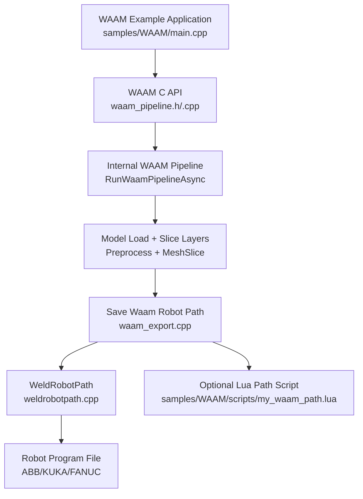
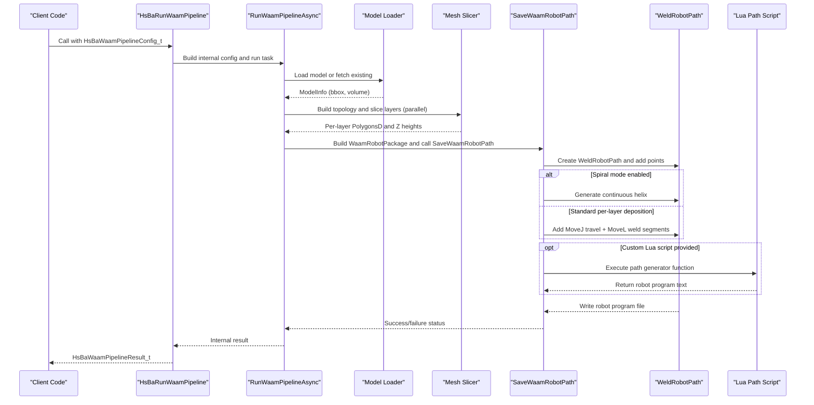
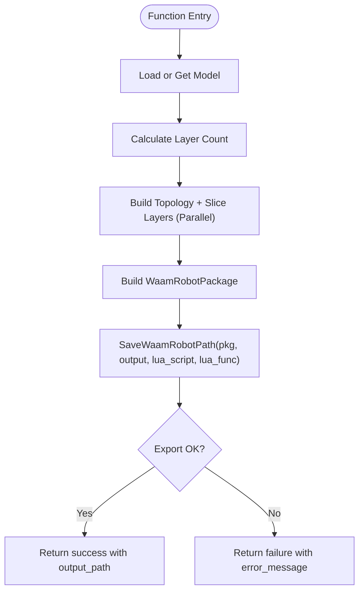
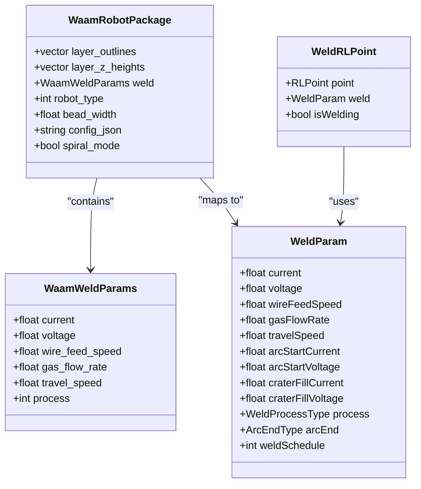
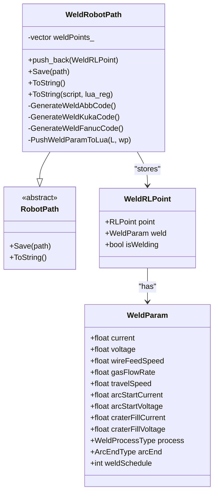
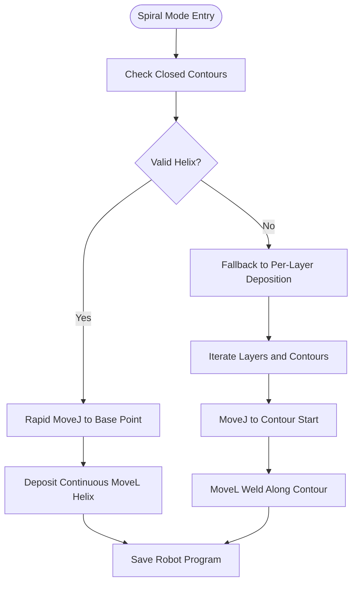
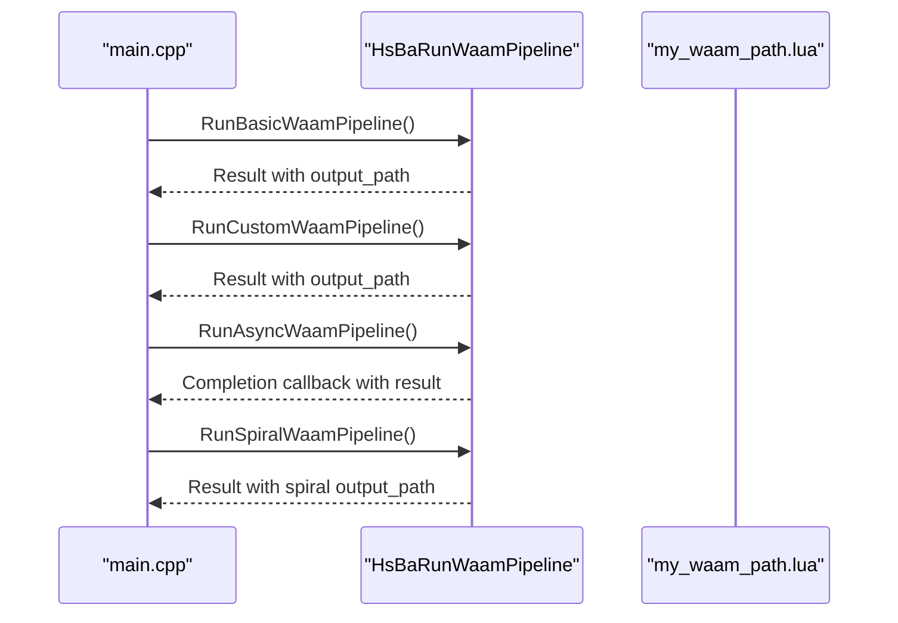
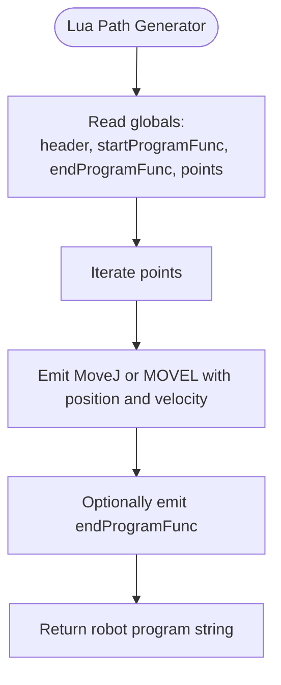
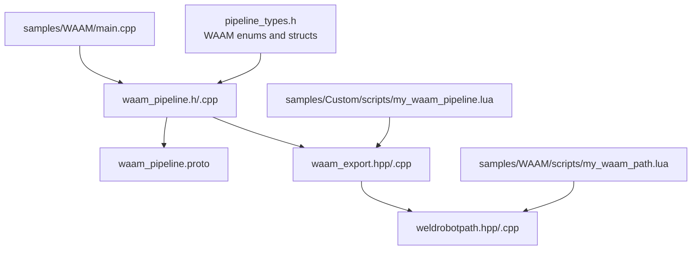

# WAAM (Wire Arc Additive Manufacturing) Examples / WAAM电弧增材制造示例

<cite>
**Referenced Files in This Document**   
- [main.cpp](file://samples/WAAM/main.cpp)
- [my_waam_path.lua](file://samples/WAAM/scripts/my_waam_path.lua)
- [my_waam_pipeline.lua](file://samples/Custom/scripts/my_waam_pipeline.lua)
- [waam_pipeline.h](file://DllHsBaSlicer/waam_pipeline.h)
- [waam_pipeline.cpp](file://DllHsBaSlicer/waam_pipeline.cpp)
- [waam_export.hpp](file://LibHsBaSlicer/Path/waam_export.hpp)
- [waam_export.cpp](file://LibHsBaSlicer/Path/waam_export.cpp)
- [weldrobotpath.hpp](file://paths/weldrobotpath.hpp)
- [weldrobotpath.cpp](file://paths/weldrobotpath.cpp)
- [pipeline_types.h](file://pipelinetypes/pipeline_types.h)
- [waam_pipeline.proto](file://proto/waam_pipeline.proto)
</cite>

## Table of Contents
1. [Introduction](#introduction)
2. [Project Structure](#project-structure)
3. [Core Components](#core-components)
4. [Architecture Overview](#architecture-overview)
5. [Detailed Component Analysis](#detailed-component-analysis)
6. [Dependency Analysis](#dependency-analysis)
7. [Performance Considerations](#performance-considerations)
8. [Troubleshooting Guide](#troubleshooting-guide)
9. [Conclusion](#conclusion)
10. [Appendices](#appendices)

## Introduction
This document explains the Wire Arc Additive Manufacturing (WAAM) examples and implementation in HsBaSlicer. WAAM is a robot-based deposition process: metal is deposited bead-by-bead along per-layer contours, and the output is a robot language program for ABB, KUKA, or FANUC controllers, rather than a layer zip archive. The documentation covers:

- Welding parameter configuration: current, voltage, travel speed, wire feed rate, shielding gas, material, protection method, interpass temperature.
- Multi-axis movement planning via robot path generation.
- Robot program generation with arc start/stop handling, crater fill, and optional Lua customization.
- Spiral/vase mode that merges outer walls into one continuous rising weld bead.
- Integration patterns for robotic systems through built-in code generators or custom Lua scripts.
- Safety, quality assurance, and post-processing considerations specific to WAAM.

## Project Structure
The WAAM feature spans several modules:

- C ABI entry points for synchronous and asynchronous pipeline execution.
- Internal pipeline orchestration using model loading, slicing, and parallel layer processing.
- Export package types and robot path saving logic.
- Brand-specific robot program generation with welding parameters.
- Sample applications demonstrating basic usage, custom parameters, async execution, and spiral mode.
- Optional Lua path generator and fully Lua-driven custom pipeline example.

**Diagram sources**
- [main.cpp:54-81](file://samples/WAAM/main.cpp#L54-L81)
- [waam_pipeline.h:17-57](file://DllHsBaSlicer/waam_pipeline.h#L17-L57)
- [waam_pipeline.cpp:174-284](file://DllHsBaSlicer/waam_pipeline.cpp#L174-L284)
- [waam_export.cpp:61-179](file://LibHsBaSlicer/Path/waam_export.cpp#L61-L179)
- [weldrobotpath.cpp:72-101](file://paths/weldrobotpath.cpp#L72-L101)
- [my_waam_path.lua:17-45](file://samples/WAAM/scripts/my_waam_path.lua#L17-L45)

**Section sources**
- [waam_pipeline.h:17-57](file://DllHsBaSlicer/waam_pipeline.h#L17-L57)
- [waam_pipeline.cpp:174-284](file://DllHsBaSlicer/waam_pipeline.cpp#L174-L284)
- [waam_export.hpp:17-72](file://LibHsBaSlicer/Path/waam_export.hpp#L17-L72)
- [waam_export.cpp:61-179](file://LibHsBaSlicer/Path/waam_export.cpp#L61-L179)
- [weldrobotpath.hpp:34-96](file://paths/weldrobotpath.hpp#L34-L96)
- [weldrobotpath.cpp:72-101](file://paths/weldrobotpath.cpp#L72-L101)

## Core Components
The WAAM system consists of:

- C ABI for WAAM pipeline configuration and execution.
- Internal pipeline orchestrator that loads models, slices layers, and exports robot paths.
- Export package structures carrying layer outlines, Z heights, welding parameters, robot type, bead width, and spiral mode.
- Welding robot path class generating brand-specific programs with arc start/end control and crater fill.
- Samples showing basic setup, custom welding parameters, async execution, and spiral mode.
- Optional Lua path generator and fully Lua-driven custom pipeline example.

Key responsibilities:

- Configuration mapping from C ABI to internal structs.
- Layer count calculation based on model height, first layer height, and layer height.
- Parallel slicing of independent layers.
- Building a WeldRobotPath from per-layer contours.
- Generating ABB, KUKA, or FANUC robot code with welding directives.
- Supporting spiral mode for continuous rising beads.

**Section sources**
- [pipeline_types.h:523-625](file://pipelinetypes/pipeline_types.h#L523-L625)
- [waam_pipeline.cpp:99-157](file://DllHsBaSlicer/waam_pipeline.cpp#L99-L157)
- [waam_export.hpp:17-72](file://LibHsBaSlicer/Path/waam_export.hpp#L17-L72)
- [weldrobotpath.hpp:34-96](file://paths/weldrobotpath.hpp#L34-L96)

## Architecture Overview
The WAAM pipeline follows a clear sequence: preprocess, slice, export.

**Diagram sources**
- [waam_pipeline.h:23-51](file://DllHsBaSlicer/waam_pipeline.h#L23-L51)
- [waam_pipeline.cpp:174-284](file://DllHsBaSlicer/waam_pipeline.cpp#L174-L284)
- [waam_export.cpp:61-179](file://LibHsBaSlicer/Path/waam_export.cpp#L61-L179)
- [weldrobotpath.cpp:72-101](file://paths/weldrobotpath.cpp#L72-L101)

## Detailed Component Analysis

### WAAM C API and Pipeline Orchestration
The C API exposes:

- Default configuration creation.
- Synchronous pipeline execution.
- Asynchronous pipeline execution with completion callback.
- Result memory management.

Internally, the pipeline:

- Loads or retrieves the model.
- Computes total layers from model height, first layer height, and layer height.
- Builds slicing topology once and slices layers in parallel.
- Constructs a WaamRobotPackage with welding parameters and robot type.
- Calls SaveWaamRobotPath to generate the robot program.

**Diagram sources**
- [waam_pipeline.cpp:174-284](file://DllHsBaSlicer/waam_pipeline.cpp#L174-L284)

**Section sources**
- [waam_pipeline.h:17-57](file://DllHsBaSlicer/waam_pipeline.h#L17-L57)
- [waam_pipeline.cpp:99-157](file://DllHsBaSlicer/waam_pipeline.cpp#L99-L157)
- [waam_pipeline.cpp:174-284](file://DllHsBaSlicer/waam_pipeline.cpp#L174-L284)

### WAAM Export Package and Robot Path Generation
The export module defines:

- WaamWeldParams: current, voltage, wire feed speed, gas flow rate, travel speed, process type.
- WaamRobotPackage: layer outlines, Z heights, weld params, robot type, bead width, optional config JSON, spiral mode flag.
- SaveWaamRobotPath: validates input, builds base welding parameters, creates WeldRobotPath, handles spiral mode, iterates contours, writes output.

**Diagram sources**
- [waam_export.hpp:17-72](file://LibHsBaSlicer/Path/waam_export.hpp#L17-L72)
- [weldrobotpath.hpp:34-96](file://paths/weldrobotpath.hpp#L34-L96)

**Section sources**
- [waam_export.hpp:17-72](file://LibHsBaSlicer/Path/waam_export.hpp#L17-L72)
- [waam_export.cpp:45-57](file://LibHsBaSlicer/Path/waam_export.cpp#L45-L57)
- [waam_export.cpp:61-179](file://LibHsBaSlicer/Path/waam_export.cpp#L61-L179)

### Welding Robot Path and Brand-Specific Code Generation
WeldRobotPath extends RobotPath and adds:

- Welding parameters per point.
- Arc start/end control.
- Crater fill handling.
- Brand-specific code generation for ABB, KUKA, FANUC.
- Lua integration exposing points and weld parameters.

**Diagram sources**
- [weldrobotpath.hpp:34-96](file://paths/weldrobotpath.hpp#L34-L96)
- [weldrobotpath.cpp:72-101](file://paths/weldrobotpath.cpp#L72-L101)

**Section sources**
- [weldrobotpath.hpp:34-96](file://paths/weldrobotpath.hpp#L34-L96)
- [weldrobotpath.cpp:72-101](file://paths/weldrobotpath.cpp#L72-L101)
- [weldrobotpath.cpp:225-305](file://paths/weldrobotpath.cpp#L225-L305)
- [weldrobotpath.cpp:307-394](file://paths/weldrobotpath.cpp#L307-L394)
- [weldrobotpath.cpp:396-481](file://paths/weldrobotpath.cpp#L396-L481)

### Spiral Mode and Continuous Rising Bead
Spiral mode merges outer walls across layers into one continuous, Z-rising weld bead. It requires at least one closed contour per layer; otherwise, it falls back to standard per-layer deposition.

**Diagram sources**
- [waam_export.cpp:82-130](file://LibHsBaSlicer/Path/waam_export.cpp#L82-L130)
- [waam_export.cpp:132-179](file://LibHsBaSlicer/Path/waam_export.cpp#L132-L179)

**Section sources**
- [waam_export.hpp:40-52](file://LibHsBaSlicer/Path/waam_export.hpp#L40-L52)
- [waam_export.cpp:82-130](file://LibHsBaSlicer/Path/waam_export.cpp#L82-L130)

### Examples and Usage Patterns
The sample application demonstrates four patterns:

1. Basic WAAM pipeline with built-in ABB robot program generation.
2. Custom welding parameters with KUKA robot program generation.
3. Async pipeline with a custom Lua path generator.
4. Spiral mode producing a continuous rising bead.

**Diagram sources**
- [main.cpp:54-81](file://samples/WAAM/main.cpp#L54-L81)
- [main.cpp:86-131](file://samples/WAAM/main.cpp#L86-L131)
- [main.cpp:155-178](file://samples/WAAM/main.cpp#L155-L178)
- [main.cpp:183-217](file://samples/WAAM/main.cpp#L183-L217)

**Section sources**
- [main.cpp:54-81](file://samples/WAAM/main.cpp#L54-L81)
- [main.cpp:86-131](file://samples/WAAM/main.cpp#L86-L131)
- [main.cpp:155-178](file://samples/WAAM/main.cpp#L155-L178)
- [main.cpp:183-217](file://samples/WAAM/main.cpp#L183-L217)

### Lua Path Generator and Custom Pipeline
Two Lua-based approaches are supported:

- Path generator script: replaces built-in brand-specific code generation when `path_lua_script` is set. The script receives global variables including header, startProgramFunc, endProgramFunc, and points array, and returns a string containing the full robot program.
- Fully Lua-driven custom pipeline: the entire workflow (model load, slicing, robot path generation) is defined by a Lua entry function calling HsBa.saveWaamPackage.

**Diagram sources**
- [my_waam_path.lua:17-45](file://samples/WAAM/scripts/my_waam_path.lua#L17-L45)

**Section sources**
- [my_waam_path.lua:1-45](file://samples/WAAM/scripts/my_waam_path.lua#L1-L45)
- [my_waam_pipeline.lua:22-93](file://samples/Custom/scripts/my_waam_pipeline.lua#L22-L93)

## Dependency Analysis
The WAAM components have clear dependencies:

- C ABI depends on internal pipeline types and export functions.
- Internal pipeline depends on model preprocessing, mesh slicing, and parallel utilities.
- Export depends on WeldRobotPath and optional Lua scripting.
- WeldRobotPath depends on brand-specific code generation and Lua integration.

**Diagram sources**
- [pipeline_types.h:523-625](file://pipelinetypes/pipeline_types.h#L523-L625)
- [waam_pipeline.h:17-57](file://DllHsBaSlicer/waam_pipeline.h#L17-L57)
- [waam_pipeline.cpp:174-284](file://DllHsBaSlicer/waam_pipeline.cpp#L174-L284)
- [waam_export.hpp:17-72](file://LibHsBaSlicer/Path/waam_export.hpp#L17-L72)
- [weldrobotpath.hpp:34-96](file://paths/weldrobotpath.hpp#L34-L96)
- [waam_pipeline.proto:49-88](file://proto/waam_pipeline.proto#L49-L88)
- [main.cpp:54-81](file://samples/WAAM/main.cpp#L54-L81)
- [my_waam_path.lua:17-45](file://samples/WAAM/scripts/my_waam_path.lua#L17-L45)
- [my_waam_pipeline.lua:22-93](file://samples/Custom/scripts/my_waam_pipeline.lua#L22-L93)

**Section sources**
- [pipeline_types.h:523-625](file://pipelinetypes/pipeline_types.h#L523-L625)
- [waam_pipeline.proto:49-88](file://proto/waam_pipeline.proto#L49-L88)

## Performance Considerations
- Parallel slicing: layers are sliced independently after building the topology once, improving throughput for multi-layer models.
- Spiral mode reduces arc restarts and travel moves by merging outer walls into a single continuous bead.
- Travel speed fallback: if travel speed is zero or negative, the exporter uses a default robot velocity constant.
- Memory management: C ABI results allocate strings that must be freed by the caller.

Recommendations:

- Use spiral mode for tall, axisymmetric geometries to minimize arc interruptions.
- Tune travel speed and wire feed speed to match thermal input and deposition rate.
- Validate model geometry before enabling spiral mode to ensure closed outer contours.

[No sources needed since this section provides general guidance]

## Troubleshooting Guide
Common issues and resolutions:

- Invalid model height: layer count calculation returns zero or negative; verify model bounds and layer heights.
- No layers in export package: SaveWaamRobotPath fails if layer_outlines is empty; ensure slicing produced valid polygons.
- Unsupported robot type: WeldRobotPath throws an exception for unknown robot types; provide a Lua path script or use ABB/KUKA/FANUC.
- Lua script errors: runtime or load errors during Lua execution; check script syntax and global variable access.
- Spiral mode fallback: if no closed contours exist, spiral mode falls back to per-layer deposition; inspect layer outlines.

**Section sources**
- [waam_pipeline.cpp:199-204](file://DllHsBaSlicer/waam_pipeline.cpp#L199-L204)
- [waam_export.cpp:67-75](file://LibHsBaSlicer/Path/waam_export.cpp#L67-L75)
- [weldrobotpath.cpp:97-99](file://paths/weldrobotpath.cpp#L97-L99)
- [weldrobotpath.cpp:163-175](file://paths/weldrobotpath.cpp#L163-L175)
- [waam_export.cpp:129-130](file://LibHsBaSlicer/Path/waam_export.cpp#L129-L130)

## Conclusion
HsBaSlicer’s WAAM implementation provides a robust pipeline for robot-based metal deposition. It supports configurable welding parameters, multi-axis movement planning, and brand-specific robot program generation. Spiral mode enables efficient continuous deposition for suitable geometries. Optional Lua scripting allows customization of both path generation and full pipeline workflows. Proper configuration, validation, and safety practices are essential for high-quality WAAM outputs.

[No sources needed since this section summarizes without analyzing specific files]

## Appendices

### WAAM Configuration Reference
The following table summarizes key WAAM configuration fields and their roles:

| Field | Type | Default | Description |
| --- | --- | --- | --- |
| model_name | string | NULL | Model name used internally |
| model_path | string | NULL | STL or CAD model file path |
| layer_height | float | 0.8 mm | Bead/layer height |
| first_layer_height | float | 1.0 mm | First layer height |
| bead_width | float | 1.2 mm | Deposited bead width |
| travel_speed | float | 8.0 mm/s | Torch travel speed |
| wire_feed_speed | float | 5.0 m/min | Wire feed speed |
| arc_current | float | 180.0 A | Welding current |
| arc_voltage | float | 22.0 V | Arc voltage |
| gas_flow_rate | float | 15.0 L/min | Shielding gas flow rate |
| material | enum | STEEL | Feedstock wire material |
| welding_process | enum | ARC | Welding process type |
| protection | enum | SHIELD_GAS | Protection method |
| protect_gas | enum | ARGON | Shielding gas type |
| interpass_temperature | float | 100.0 °C | Interpass temperature |
| robot_type | enum | ABB | Target robot controller |
| path_lua_script | string | NULL | Optional custom path generator |
| path_lua_func | string | NULL | Optional Lua function name |
| spiral_mode | int | 0 | Continuous rising bead mode |
| output_path | string | NULL | Output robot program path |

**Section sources**
- [pipeline_types.h:573-600](file://pipelinetypes/pipeline_types.h#L573-L600)
- [waam_pipeline.cpp:37-61](file://DllHsBaSlicer/waam_pipeline.cpp#L37-L61)
- [waam_pipeline.proto:49-79](file://proto/waam_pipeline.proto#L49-L79)

### Safety, Quality Assurance, and Post-Processing Notes
- Safety: Ensure proper shielding gas selection and flow rate for the chosen material and process. Verify interpass temperature limits to avoid excessive heat accumulation.
- Quality assurance: Validate layer outlines and spiral mode behavior before production runs. Inspect arc start/end sequences and crater fill settings for each brand.
- Post-processing: Robot programs may require teaching positions, tool offsets, and work object frames on the actual robot controller. Apply stress relief, machining, or heat treatment as required by material specifications.

[No sources needed since this section provides general guidance]