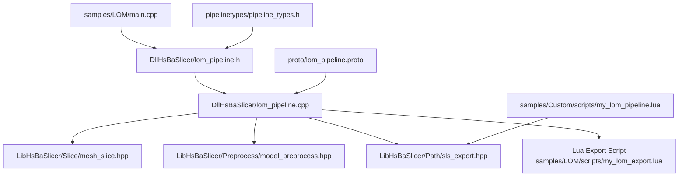
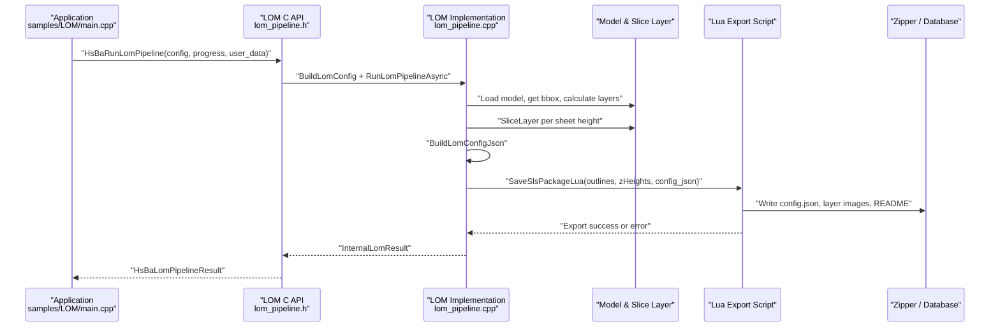
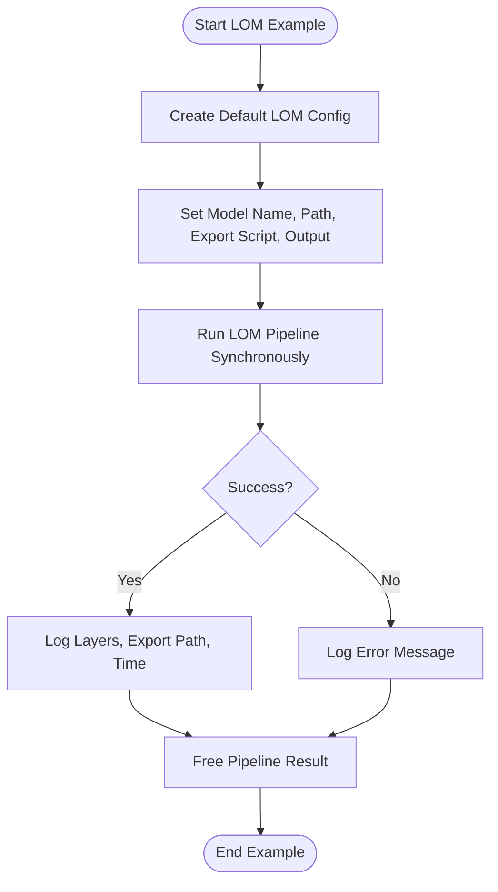
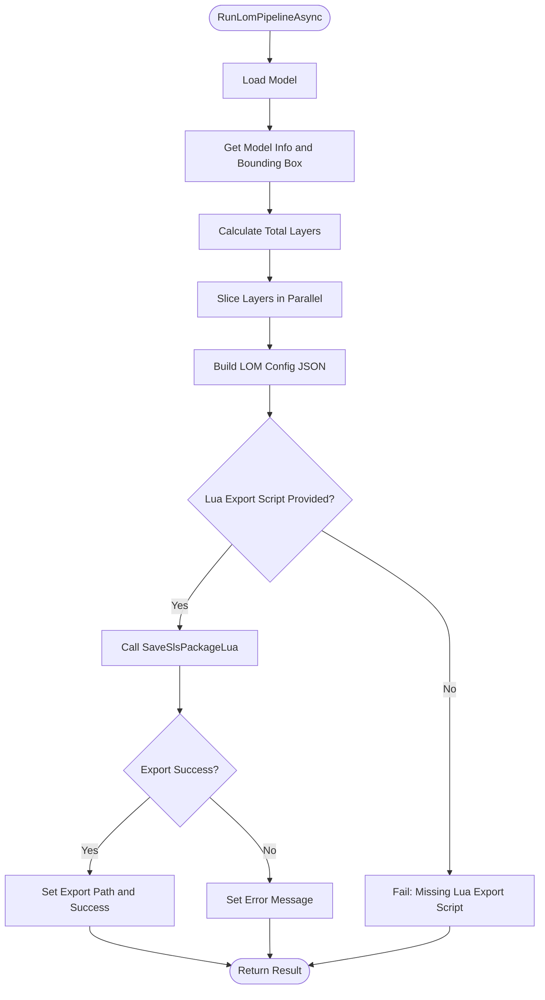
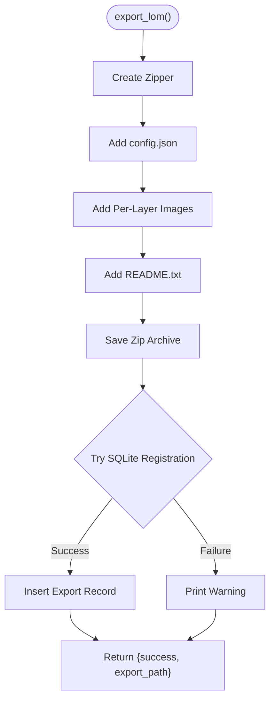
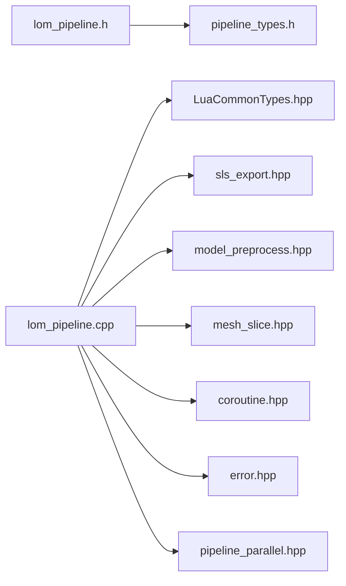

# LOM (Laminated Object Manufacturing) Samples

<cite>
**Referenced Files in This Document**   
- [main.cpp](file://samples/LOM/main.cpp)
- [my_lom_export.lua](file://samples/LOM/scripts/my_lom_export.lua)
- [lom_pipeline.h](file://DllHsBaSlicer/lom_pipeline.h)
- [lom_pipeline.cpp](file://DllHsBaSlicer/lom_pipeline.cpp)
- [pipeline_types.h](file://pipelinetypes/pipeline_types.h)
- [lom_pipeline.proto](file://proto/lom_pipeline.proto)
- [my_lom_pipeline.lua](file://samples/Custom/scripts/my_lom_pipeline.lua)
</cite>

## Table of Contents
1. [Introduction](#introduction)
2. [Project Structure](#project-structure)
3. [Core Components](#core-components)
4. [Architecture Overview](#architecture-overview)
5. [Detailed Component Analysis](#detailed-component-analysis)
6. [Dependency Analysis](#dependency-analysis)
7. [Performance Considerations](#performance-considerations)
8. [Troubleshooting Guide](#troubleshooting-guide)
9. [Conclusion](#conclusion)
10. [Appendices](#appendices)

## Introduction
This document explains the LOM (Laminated Object Manufacturing) samples and implementation in HsBaSlicer. LOM is a sheet-bonding process: each layer corresponds to a physical sheet, contours are cut from the sheet, and layers are bonded together. In this codebase, the C++ pipeline slices the model into per-sheet contour outlines and passes those outlines plus LOM-specific configuration to a Lua export script. The sample export script packages the configuration and per-layer contours into a zip archive and optionally registers the export in a SQLite database.

The documentation covers:
- Sheet lamination workflow: slicing, cutting parameters, bonding parameters, and export packaging.
- LOM-specific configuration fields for sheet thickness, laser cutting, sealing, cutting mode, and bonding.
- How different sheet materials can be represented through configuration rather than hard-coded material handling.
- Practical guidance on optimizing cut paths, kerf management, waste reduction, post-processing, and quality control.

## Project Structure
The LOM feature spans several modules:
- A C ABI header exposing LOM pipeline functions.
- An implementation that loads models, slices them into layers, builds a JSON configuration, and calls a Lua export function.
- Sample applications showing basic, custom-parameter, and async usage.
- A sample Lua export script that writes a zip package and optional database record.
- Protocol buffer definitions describing the same configuration for serialization.
- A fully Lua-driven custom LOM pipeline example.

**Diagram sources**
- [main.cpp:55-175](file://samples/LOM/main.cpp#L55-L175)
- [lom_pipeline.h:17-56](file://DllHsBaSlicer/lom_pipeline.h#L17-L56)
- [lom_pipeline.cpp:193-305](file://DllHsBaSlicer/lom_pipeline.cpp#L193-L305)
- [my_lom_export.lua:10-57](file://samples/LOM/scripts/my_lom_export.lua#L10-L57)
- [pipeline_types.h:407-448](file://pipelinetypes/pipeline_types.h#L407-L448)
- [lom_pipeline.proto:7-36](file://proto/lom_pipeline.proto#L7-L36)
- [my_lom_pipeline.lua:19-90](file://samples/Custom/scripts/my_lom_pipeline.lua#L19-L90)

**Section sources**
- [main.cpp:1-194](file://samples/LOM/main.cpp#L1-L194)
- [lom_pipeline.h:1-63](file://DllHsBaSlicer/lom_pipeline.h#L1-L63)
- [lom_pipeline.cpp:1-354](file://DllHsBaSlicer/lom_pipeline.cpp#L1-L354)
- [my_lom_export.lua:1-58](file://samples/LOM/scripts/my_lom_export.lua#L1-L58)
- [pipeline_types.h:407-448](file://pipelinetypes/pipeline_types.h#L407-L448)
- [lom_pipeline.proto:1-46](file://proto/lom_pipeline.proto#L1-L46)
- [my_lom_pipeline.lua:1-92](file://samples/Custom/scripts/my_lom_pipeline.lua#L1-L92)

## Core Components
The LOM system has three main parts:
1. Configuration types and defaults.
2. Pipeline execution with slicing and Lua export.
3. Sample application and Lua export script.

### LOM Configuration Fields
The LOM configuration defines sheet geometry, cutting behavior, sealing, cutting mode, and export settings.

| Field | Type / Enum | Meaning | Default Value |
|---|---|---|---:|
| `model_name` | string | Model identifier used by the slicer | NULL |
| `model_path` | string | STL or supported model file path | NULL |
| `layer_height` | float | Sheet thickness in millimeters | 0.2 |
| `first_layer_height` | float | First sheet thickness in millimeters | 0.2 |
| `cut_speed` | float | Laser cut speed in mm/s | 300.0 |
| `cut_margin` | float | Contour offset from part outline in mm | 0.5 |
| `cut_power` | float | Laser cut power normalized to [0,1] | 0.8 |
| `bond_temperature` | float | Bonding temperature in °C | 150.0 |
| `bond_pressure` | float | Bonding pressure in MPa | 1.0 |
| `bond_time` | float | Bonding time per layer in seconds | 5.0 |
| `seal_contour` | int | Whether to seal or contour-cut the part edge | 1 |
| `cut_mode` | enum | Sheet cutting mode | `HSBA_LOM_CUT_CONTOUR` |
| `export_lua_script` | string | Required Lua export script path | NULL |
| `export_lua_func` | string | Lua export function name | "export_lom" |
| `output_path` | string | Output zip path; may be empty | NULL |

The default initializer sets these values explicitly, so callers should use `HsBaCreateDefaultLomConfig()` and then override only the fields they need.

**Section sources**
- [pipeline_types.h:407-448](file://pipelinetypes/pipeline_types.h#L407-L448)
- [pipeline_types.h:874-897](file://pipelinetypes/pipeline_types.h#L874-L897)
- [lom_pipeline.proto:7-36](file://proto/lom_pipeline.proto#L7-L36)

### LOM Cut Modes
LOM supports two cutting modes:
- `HSBA_LOM_CUT_CONTOUR`: contour cutting around the part outline.
- `HSBA_LOM_CUT_HALFTONE`: halftone or pocket-style cutting.

The internal JSON builder maps the enum to `"contour"` or `"halftone"` for the export script.

**Section sources**
- [pipeline_types.h:407-414](file://pipelinetypes/pipeline_types.h#L407-L414)
- [lom_pipeline.cpp:128-153](file://DllHsBaSlicer/lom_pipeline.cpp#L128-L153)
- [lom_pipeline.proto:7-11](file://proto/lom_pipeline.proto#L7-L11)

### Pipeline API
The C ABI exposes:
- `HsBaCreateDefaultLomConfig()`: create a default LOM config.
- `HsBaRunLomPipeline(...)`: synchronous run.
- `HsBaRunLomPipelineAsync(...)`: asynchronous run with a completion callback.
- `HsBaFreeLomPipelineResult(...)`: free exported strings.

The result structure contains success, total layers, export path, error message, and elapsed time.

**Section sources**
- [lom_pipeline.h:17-56](file://DllHsBaSlicer/lom_pipeline.h#L17-L56)
- [pipeline_types.h:438-461](file://pipelinetypes/pipeline_types.h#L438-L461)

## Architecture Overview
The LOM pipeline follows a consistent flow: preprocess, slice, build configuration, and export via Lua.

**Diagram sources**
- [main.cpp:55-175](file://samples/LOM/main.cpp#L55-L175)
- [lom_pipeline.h:23-50](file://DllHsBaSlicer/lom_pipeline.h#L23-L50)
- [lom_pipeline.cpp:193-305](file://DllHsBaSlicer/lom_pipeline.cpp#L193-L305)
- [my_lom_export.lua:10-57](file://samples/LOM/scripts/my_lom_export.lua#L10-L57)

## Detailed Component Analysis

### LOM Sample Application
The sample application demonstrates three usage patterns:
1. Basic pipeline with minimal configuration.
2. Custom cut and bond parameters.
3. Asynchronous pipeline with a completion callback.

Key behaviors:
- It creates a default LOM config and overrides model path, export script, output path, and process parameters.
- It logs progress and results.
- It frees the returned result to avoid memory leaks.

**Diagram sources**
- [main.cpp:55-82](file://samples/LOM/main.cpp#L55-L82)
- [main.cpp:87-130](file://samples/LOM/main.cpp#L87-L130)
- [main.cpp:154-175](file://samples/LOM/main.cpp#L154-L175)

**Section sources**
- [main.cpp:55-175](file://samples/LOM/main.cpp#L55-L175)

### LOM Pipeline Implementation
The implementation performs:
- Model loading and validation.
- Bounding box inspection and layer count calculation.
- Parallel slicing across layers.
- JSON configuration generation.
- Lua export invocation.

Important details:
- Layer count uses first layer height plus remaining height divided by regular layer height.
- Layer Z positions start at the model’s minimum Z and add the computed layer height.
- Slicing is parallelized because each layer is independent.
- If no Lua export script is provided, the pipeline fails early.
- If no output path is provided, it derives one from the model name.

**Diagram sources**
- [lom_pipeline.cpp:193-305](file://DllHsBaSlicer/lom_pipeline.cpp#L193-L305)
- [lom_pipeline.cpp:96-118](file://DllHsBaSlicer/lom_pipeline.cpp#L96-L118)
- [lom_pipeline.cpp:128-153](file://DllHsBaSlicer/lom_pipeline.cpp#L128-L153)

**Section sources**
- [lom_pipeline.cpp:96-118](file://DllHsBaSlicer/lom_pipeline.cpp#L96-L118)
- [lom_pipeline.cpp:128-153](file://DllHsBaSlicer/lom_pipeline.cpp#L128-L153)
- [lom_pipeline.cpp:193-305](file://DllHsBaSlicer/lom_pipeline.cpp#L193-L305)

### LOM Lua Export Script
The sample export script:
- Creates a zipper.
- Adds the generated configuration JSON.
- Adds per-layer image data.
- Writes a README describing the package contents.
- Saves the zip archive.
- Optionally connects to SQLite and records the export metadata.

Important contract:
- The function must return a table with `success` and `export_path`.
- Returning a string instead of a table can overwrite the written zip file.

**Diagram sources**
- [my_lom_export.lua:10-57](file://samples/LOM/scripts/my_lom_export.lua#L10-L57)

**Section sources**
- [my_lom_export.lua:1-58](file://samples/LOM/scripts/my_lom_export.lua#L1-L58)

### Fully Lua-Driven Custom LOM Pipeline
The custom Lua pipeline shows how to drive the entire LOM workflow from Lua:
- Load the model.
- Compute layer count.
- Slice each layer.
- Build a process configuration JSON.
- Package using the shared SLS package helper.

This approach is useful when you want full control over slicing, configuration, and export without writing C++.

**Section sources**
- [my_lom_pipeline.lua:1-92](file://samples/Custom/scripts/my_lom_pipeline.lua#L1-L92)

## Dependency Analysis
The LOM module depends on:
- Common Lua object registration.
- Model preprocessing.
- Mesh slicing.
- SLS-style package export utilities.
- Coroutine-based task execution.
- Progress reporting.

**Diagram sources**
- [lom_pipeline.h:9-10](file://DllHsBaSlicer/lom_pipeline.h#L9-L10)
- [lom_pipeline.cpp:17-23](file://DllHsBaSlicer/lom_pipeline.cpp#L17-L23)

**Section sources**
- [lom_pipeline.h:1-63](file://DllHsBaSlicer/lom_pipeline.h#L1-L63)
- [lom_pipeline.cpp:17-23](file://DllHsBaSlicer/lom_pipeline.cpp#L17-L23)

## Performance Considerations
- **Parallel slicing**: The implementation slices layers in parallel because each layer reads the shared topology without modifying it. This reduces total slicing time for models with many layers.
- **Layer count formula**: Using a separate first layer height allows better control over the bottom sheet while keeping subsequent sheets uniform.
- **Progress reporting**: The pipeline reports progress during model loading, slicing, and export, which helps UI responsiveness and long-running jobs.
- **Memory ownership**: The C API transfers ownership of exported strings to the caller; always call `HsBaFreeLomPipelineResult` after use.

Recommendations:
- Use reasonable sheet thickness: too thin increases layer count and processing time; too thick reduces vertical resolution.
- Avoid excessively large models if you do not need high detail; consider simplifying CAD before slicing.
- Reuse the same Lua export script for batch runs to reduce script load overhead.

[No sources needed since this section provides general guidance]

## Troubleshooting Guide
Common issues and their likely causes:

| Symptom | Likely Cause | Resolution |
|---|---|---|
| Pipeline fails with missing Lua export script | `export_lua_script` is empty | Provide a valid Lua export script path. |
| Invalid model height | Model bounding box has zero or negative height | Verify the model file and its orientation. |
| Lua export returns an error | Lua script failed or returned unexpected value | Ensure the Lua function returns a table with `success` and `export_path`. |
| No output file created | Output path was empty and derivation failed, or Lua script did not save | Set `output_path` explicitly or verify the Lua script saves the zip. |
| Memory leak in application | Caller did not free pipeline result | Call `HsBaFreeLomPipelineResult` after reading the result. |

**Section sources**
- [lom_pipeline.cpp:200-225](file://DllHsBaSlicer/lom_pipeline.cpp#L200-L225)
- [lom_pipeline.cpp:253-291](file://DllHsBaSlicer/lom_pipeline.cpp#L253-L291)
- [lom_pipeline.cpp:345-353](file://DllHsBaSlicer/lom_pipeline.cpp#L345-L353)
- [my_lom_export.lua:10-17](file://samples/LOM/scripts/my_lom_export.lua#L10-L17)

## Conclusion
The HsBaSlicer LOM implementation provides a clear separation between geometric slicing and manufacturing configuration. The C++ side computes per-sheet contours and generates a JSON configuration containing sheet thickness, laser cutting parameters, sealing, cutting mode, and bonding parameters. The Lua export script owns the final packaging format, making it flexible for different downstream workflows such as zip archives and database registration.

For real-world LOM production:
- Treat `layer_height` and `first_layer_height` as sheet thickness controls.
- Tune `cut_speed`, `cut_margin`, and `cut_power` for your sheet material.
- Use `seal_contour` and `cut_mode` to balance edge quality and material usage.
- Configure `bond_temperature`, `bond_pressure`, and `bond_time` for your adhesive and press equipment.
- Extend or replace the Lua export script to integrate with your CAM, ERP, or archival systems.

[No sources needed since this section summarizes without analyzing specific files]

## Appendices

### LOM Configuration Reference Table
| Category | Field | Unit / Range | Purpose |
|---|---|---:|---|
| Geometry | `layer_height` | mm | Regular sheet thickness |
| Geometry | `first_layer_height` | mm | Bottom sheet thickness |
| Cutting | `cut_speed` | mm/s | Laser travel speed during cutting |
| Cutting | `cut_margin` | mm | Offset added to contour to account for kerf and alignment |
| Cutting | `cut_power` | [0,1] | Normalized laser power |
| Edge | `seal_contour` | boolean | Seal or contour-cut part edges |
| Mode | `cut_mode` | enum | Contour or halftone cutting |
| Bonding | `bond_temperature` | °C | Adhesive activation temperature |
| Bonding | `bond_pressure` | MPa | Press pressure applied per layer |
| Bonding | `bond_time` | s | Dwell time for bonding |
| Export | `export_lua_script` | path | Required Lua export script |
| Export | `export_lua_func` | name | Lua function to call |
| Output | `output_path` | path | Destination zip or file |

**Section sources**
- [pipeline_types.h:419-436](file://pipelinetypes/pipeline_types.h#L419-L436)
- [pipeline_types.h:874-897](file://pipelinetypes/pipeline_types.h#L874-L897)
- [lom_pipeline.proto:13-36](file://proto/lom_pipeline.proto#L13-L36)

### Material Handling Guidance
The repository does not define a dedicated LOM material enum. Instead, material-specific requirements are expressed through configuration:
- Paper: typically lower `bond_temperature`, moderate `bond_pressure`, and smaller `cut_power`.
- Plastic: may require higher `bond_temperature` and careful `cut_power` to avoid melting.
- Metal foil or composite sheet: may require higher `bond_pressure`, controlled `bond_temperature`, and adjusted `cut_speed` and `cut_power`.

Recommended practice:
- Keep `cut_margin` slightly larger than expected kerf to ensure clean separation.
- Use `seal_contour` when edge sealing improves part integrity.
- Validate bonding parameters on test coupons before running full builds.
- Track material batches in the Lua export script or external database.

[No sources needed since this section provides general guidance]

### Kerf Optimization and Waste Management
Kerf is the material removed by the cutting tool. In LOM:
- Increase `cut_margin` to compensate for kerf when dimensional accuracy matters.
- Reduce unnecessary cut area by choosing `HSBA_LOM_CUT_CONTOUR` for simple parts and reserving `HSBA_LOM_CUT_HALFTONE` for cases where pocket cutting improves support or material removal.
- Nest multiple small parts in one sheet layout outside the slicer to minimize sheet waste.
- Reuse offcuts when possible, especially for paper and thin plastic.
- Record actual measured kerf and adjust `cut_margin` iteratively.

[No sources needed since this section provides general guidance]

### Post-Processing and Quality Control
Typical LOM post-processing includes:
- Removing loose sheet fragments.
- Cleaning residual adhesive.
- Trimming excess edges.
- Heat pressing or curing according to the configured bonding parameters.
- Dimensional inspection against CAD tolerances.

Quality control checkpoints:
- Verify layer count matches expected model height and sheet thickness.
- Inspect first layer adhesion separately because `first_layer_height` may differ.
- Measure critical dimensions and compare with nominal values.
- Check edge quality for burn marks, incomplete cuts, or delamination.
- Log export metadata including output path, layer count, and timestamps.

**Section sources**
- [my_lom_export.lua:30-49](file://samples/LOM/scripts/my_lom_export.lua#L30-L49)