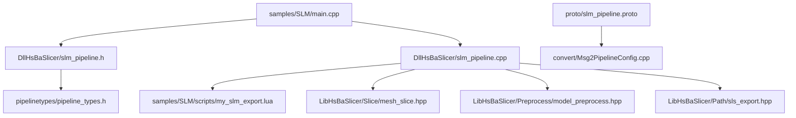
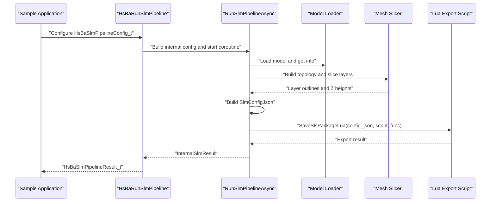
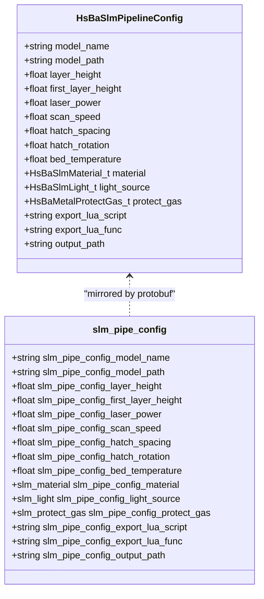
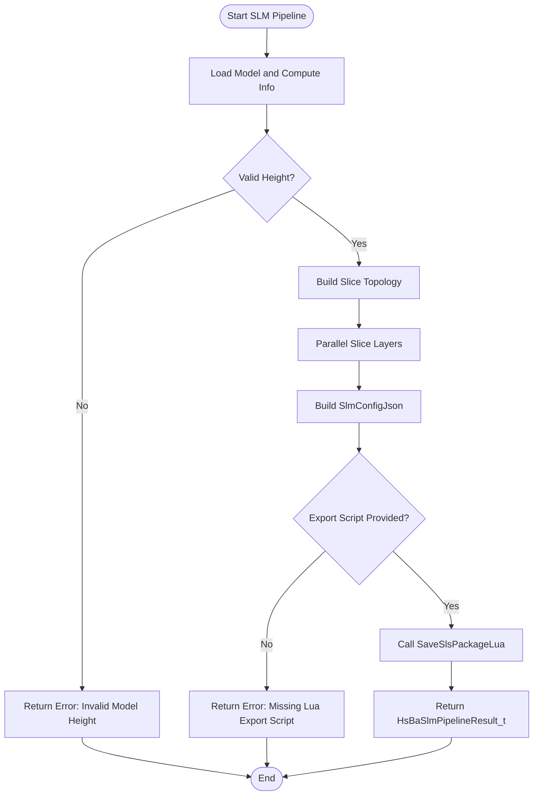
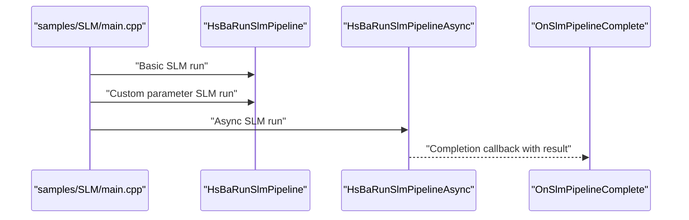
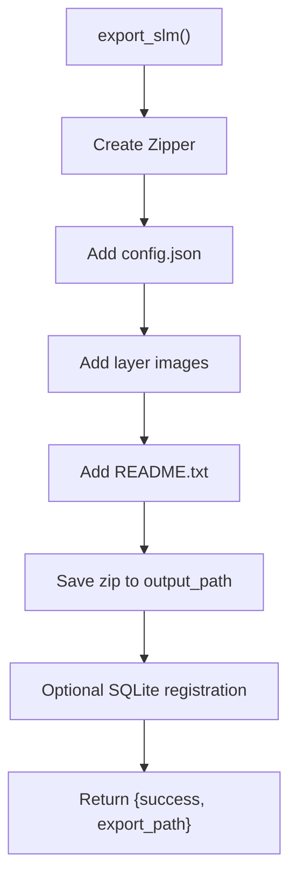
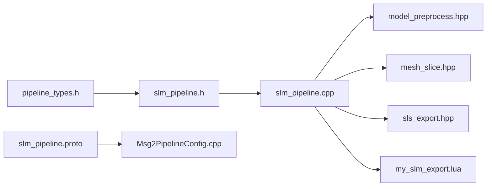

# SLM (Selective Laser Melting) Samples

<cite>
**Referenced Files in This Document**
- [slm_pipeline.h](file://DllHsBaSlicer/slm_pipeline.h)
- [slm_pipeline.cpp](file://DllHsBaSlicer/slm_pipeline.cpp)
- [pipeline_types.h](file://pipelinetypes/pipeline_types.h)
- [slm_pipeline.proto](file://proto/slm_pipeline.proto)
- [Msg2PipelineConfig.cpp](file://convert/Msg2PipelineConfig.cpp)
- [main.cpp](file://samples/SLM/main.cpp)
- [CMakeLists.txt](file://samples/SLM/CMakeLists.txt)
- [my_slm_export.lua](file://samples/SLM/scripts/my_slm_export.lua)
- [README.md](file://docs/en/DllHsBaSlicer/README.md)
</cite>

## Table of Contents
1. [Introduction](#introduction)
2. [Project Structure](#project-structure)
3. [Core Components](#core-components)
4. [Architecture Overview](#architecture-overview)
5. [Detailed Component Analysis](#detailed-component-analysis)
6. [Dependency Analysis](#dependency-analysis)
7. [Performance Considerations](#performance-considerations)
8. [Troubleshooting Guide](#troubleshooting-guide)
9. [Conclusion](#conclusion)
10. [Appendices](#appendices)

## Introduction
This document explains the SLM (Selective Laser Melting) samples and pipeline in HsBaSlicer. SLM is modeled as a metal powder-bed process that mirrors the SLS flow: preprocess, slice, and Lua-driven export. The main difference from SLS is that SLM carries metal-specific parameters such as material, energy source, and shielding gas, which are serialized into a configuration JSON passed to the export script.

The repository provides:
- A C ABI for configuring and running the SLM pipeline synchronously or asynchronously.
- Protocol buffer definitions for cross-language configuration and results.
- A sample executable demonstrating basic usage, custom laser/metal parameters, and async execution.
- A sample Lua export script that archives layer outlines and the generated configuration JSON.

## Project Structure
The SLM-related code is spread across several modules:

**Diagram sources**
- [main.cpp:1-196](file://samples/SLM/main.cpp#L1-L196)
- [slm_pipeline.h:1-63](file://DllHsBaSlicer/slm_pipeline.h#L1-L63)
- [slm_pipeline.cpp:1-397](file://DllHsBaSlicer/slm_pipeline.cpp#L1-L397)
- [pipeline_types.h:320-401](file://pipelinetypes/pipeline_types.h#L320-L401)
- [slm_pipeline.proto:1-65](file://proto/slm_pipeline.proto#L1-L65)
- [Msg2PipelineConfig.cpp:247-269](file://convert/Msg2PipelineConfig.cpp#L247-L269)
- [my_slm_export.lua:1-63](file://samples/SLM/scripts/my_slm_export.lua#L1-L63)

**Section sources**
- [main.cpp:1-196](file://samples/SLM/main.cpp#L1-L196)
- [CMakeLists.txt:1-46](file://samples/SLM/CMakeLists.txt#L1-L46)

## Core Components
The SLM pipeline exposes a small, focused C ABI:

| Function | Purpose |
|---|---|
| `HsBaCreateDefaultSlmConfig` | Creates an SLM configuration with default values. |
| `HsBaRunSlmPipeline` | Runs the full SLM pipeline synchronously. |
| `HsBaRunSlmPipelineAsync` | Runs the full SLM pipeline asynchronously with a result callback. |
| `HsBaFreeSlmPipelineResult` | Frees memory owned by the returned result structure. |

The configuration structure includes slicing geometry, laser/scan parameters, bed temperature, metal material, energy source, shielding gas, and export settings. The result structure reports success, total layers, exported path, error message, and elapsed time.

Key defaults visible in the implementation include:
- Layer height: 0.06 mm
- First layer height: 0.08 mm
- Laser power: 200 W
- Scan speed: 1000 mm/s
- Hatch spacing: 0.1 mm
- Hatch rotation: 67 degrees
- Bed temperature: 100 °C
- Material: titanium
- Light source: laser
- Protect gas: argon

These defaults are used when constructing the internal configuration and when building the configuration JSON handed to the Lua export script.

**Section sources**
- [slm_pipeline.h:17-56](file://DllHsBaSlicer/slm_pipeline.h#L17-L56)
- [pipeline_types.h:320-401](file://pipelinetypes/pipeline_types.h#L320-L401)
- [slm_pipeline.cpp:39-58](file://DllHsBaSlicer/slm_pipeline.cpp#L39-L58)
- [README.md:224-255](file://docs/en/DllHsBaSlicer/README.md#L224-L255)

## Architecture Overview
The SLM pipeline follows three stages:

1. **Preprocess**: Load the model and compute bounding box information.
2. **Slice**: Build slice topology once and slice each layer independently; layers are processed in parallel.
3. **Export**: Serialize a configuration JSON containing slicing, laser, material, light source, and protect gas fields, then call the configured Lua export function to package layer outlines and metadata.

**Diagram sources**
- [slm_pipeline.cpp:236-348](file://DllHsBaSlicer/slm_pipeline.cpp#L236-L348)
- [slm_pipeline.cpp:356-396](file://DllHsBaSlicer/slm_pipeline.cpp#L356-L396)
- [my_slm_export.lua:15-62](file://samples/SLM/scripts/my_slm_export.lua#L15-L62)

## Detailed Component Analysis

### SLM Configuration Data Model
The SLM configuration is defined as a C-compatible struct and mirrored in protocol buffers. It separates geometric slicing parameters from metal-process parameters.

| Category | Field | Type / Enum | Meaning |
|---|---|---|---|
| Geometry | `layer_height` | float (mm) | Standard layer thickness. |
| Geometry | `first_layer_height` | float (mm) | First-layer thickness. |
| Laser | `laser_power` | float (W) | Energy source power. |
| Laser | `scan_speed` | float (mm/s) | Scan speed. |
| Laser | `hatch_spacing` | float (mm) | Hatch line spacing. |
| Laser | `hatch_rotation` | float (degrees) | Inter-layer hatch rotation angle. |
| Thermal | `bed_temperature` | float (°C) | Powder bed temperature. |
| Metal | `material` | `HsBaSlmMaterial_t` | Iron, aluminum, titanium, or unknown. |
| Energy | `light_source` | `HsBaSlmLight_t` | Laser or electron beam. |
| Gas | `protect_gas` | `HsBaMetalProtectGas_t` | Argon, helium, nitrogen, CO₂, or unknown. |
| Export | `export_lua_script` | string | Required Lua export script path. |
| Export | `export_lua_func` | string | Lua function name; defaults to `export_slm`. |
| Output | `output_path` | string | Optional output file path. |

The protocol buffer definition uses similar fields under the `slm_pipe_config` message, enabling conversion between protobuf messages and the C ABI.

**Diagram sources**
- [pipeline_types.h:353-376](file://pipelinetypes/pipeline_types.h#L353-L376)
- [slm_pipeline.proto:33-55](file://proto/slm_pipeline.proto#L33-L55)

**Section sources**
- [pipeline_types.h:320-401](file://pipelinetypes/pipeline_types.h#L320-L401)
- [slm_pipeline.proto:1-65](file://proto/slm_pipeline.proto#L1-L65)
- [Msg2PipelineConfig.cpp:247-269](file://convert/Msg2PipelineConfig.cpp#L247-L269)

### SLM Pipeline Implementation
The implementation builds an internal configuration, loads the model, computes total layers, slices layers in parallel, constructs a JSON configuration, and delegates packaging to the Lua export script.

Key processing steps:
- Model loading and validation.
- Total layer calculation based on bounding box, first layer height, and standard layer height.
- Parallel slicing using shared topology.
- JSON construction including version, process type, slice settings, laser settings, bed temperature, material, light source, and protect gas.
- Lua export via `SaveSlsPackageLua`, using either the provided function name or the default `export_slm`.

**Diagram sources**
- [slm_pipeline.cpp:96-118](file://DllHsBaSlicer/slm_pipeline.cpp#L96-L118)
- [slm_pipeline.cpp:173-196](file://DllHsBaSlicer/slm_pipeline.cpp#L173-L196)
- [slm_pipeline.cpp:236-348](file://DllHsBaSlicer/slm_pipeline.cpp#L236-L348)

**Section sources**
- [slm_pipeline.cpp:96-118](file://DllHsBaSlicer/slm_pipeline.cpp#L96-L118)
- [slm_pipeline.cpp:173-196](file://DllHsBaSlicer/slm_pipeline.cpp#L173-L196)
- [slm_pipeline.cpp:236-348](file://DllHsBaSlicer/slm_pipeline.cpp#L236-L348)

### Sample Usage
The SLM sample demonstrates:
- Basic pipeline execution with minimal configuration.
- Custom laser and metal parameters.
- Asynchronous execution with a completion callback.

The sample sets:
- Model name and path.
- Layer heights.
- Laser power, scan speed, hatch spacing, hatch rotation, and bed temperature.
- Material, light source, and protect gas.
- Lua export script path, function name, and output path.

**Diagram sources**
- [main.cpp:56-84](file://samples/SLM/main.cpp#L56-L84)
- [main.cpp:89-132](file://samples/SLM/main.cpp#L89-L132)
- [main.cpp:137-177](file://samples/SLM/main.cpp#L137-L177)

**Section sources**
- [main.cpp:1-196](file://samples/SLM/main.cpp#L1-L196)
- [CMakeLists.txt:1-46](file://samples/SLM/CMakeLists.txt#L1-L46)

### Lua Export Script
The sample Lua export script packages:
- The generated configuration JSON.
- Per-layer polygon outline files.
- A README describing the archive contents.
- An optional SQLite registration entry recording output path and layer count.

The script expects:
- `config.path` and `config.configStr`.
- `images` array with per-layer data.
- `output_path` for the final zip file.
- A function named `export_slm`.

**Diagram sources**
- [my_slm_export.lua:15-62](file://samples/SLM/scripts/my_slm_export.lua#L15-L62)

**Section sources**
- [my_slm_export.lua:1-63](file://samples/SLM/scripts/my_slm_export.lua#L1-L63)

## Dependency Analysis
The SLM module depends on preprocessing, slicing, and Lua packaging utilities. The configuration flows from the public C ABI into internal structures, then into protobuf converters and the Lua export environment.

**Diagram sources**
- [pipeline_types.h:320-401](file://pipelinetypes/pipeline_types.h#L320-L401)
- [slm_pipeline.h:1-63](file://DllHsBaSlicer/slm_pipeline.h#L1-L63)
- [slm_pipeline.cpp:17-23](file://DllHsBaSlicer/slm_pipeline.cpp#L17-L23)
- [slm_pipeline.proto:1-65](file://proto/slm_pipeline.proto#L1-L65)
- [Msg2PipelineConfig.cpp:247-269](file://convert/Msg2PipelineConfig.cpp#L247-L269)
- [my_slm_export.lua:1-63](file://samples/SLM/scripts/my_slm_export.lua#L1-L63)

**Section sources**
- [slm_pipeline.cpp:17-23](file://DllHsBaSlicer/slm_pipeline.cpp#L17-L23)
- [Msg2PipelineConfig.cpp:247-269](file://convert/Msg2PipelineConfig.cpp#L247-L269)

## Performance Considerations
- **Parallel slicing**: The implementation builds slice topology once and slices layers in parallel, reducing per-layer overhead.
- **Coroutine-based execution**: Both synchronous and asynchronous APIs use coroutines internally, allowing non-blocking operation while preserving simple caller interfaces.
- **Configuration JSON generation**: The JSON is built once per run and passed to the Lua exporter, avoiding repeated serialization.
- **Memory management**: The C ABI returns heap-allocated strings in the result structure; callers must free them using `HsBaFreeSlmPipelineResult`.

Practical implications:
- For large models, prefer asynchronous execution to avoid blocking the UI thread.
- Tune layer height and first layer height carefully; too thin layers increase total layers and processing time.
- Keep hatch spacing reasonable; excessively small hatch spacing increases path length and slicing/export workload.

[No sources needed since this section provides general guidance]

## Troubleshooting Guide
Common issues and their likely causes in the SLM pipeline:

| Symptom | Likely Cause | Resolution |
|---|---|---|
| Pipeline fails with invalid model height | Model has zero or negative height. | Verify model bounds and ensure valid geometry. |
| Pipeline fails because export script is missing | `export_lua_script` is empty or not set. | Provide a valid Lua export script path. |
| Lua export fails | Export function name incorrect or script errors. | Use `export_slm` or set `export_lua_func` correctly; check script logic. |
| No output file created | Output path invalid or Lua save failed. | Check `output_path` and filesystem permissions. |
| Result strings not freed | Caller did not call `HsBaFreeSlmPipelineResult`. | Always free the result after use. |

Error handling in the implementation:
- Model loading failures return a descriptive error message.
- Invalid model height returns an explicit error.
- Missing Lua export script returns an error indicating the requirement.
- Lua export failures propagate the Lua error message.
- All exceptions are caught and converted into a failure result with an error message.

**Section sources**
- [slm_pipeline.cpp:243-268](file://DllHsBaSlicer/slm_pipeline.cpp#L243-L268)
- [slm_pipeline.cpp:296-334](file://DllHsBaSlicer/slm_pipeline.cpp#L296-L334)
- [slm_pipeline.cpp:338-347](file://DllHsBaSlicer/slm_pipeline.cpp#L338-L347)
- [slm_pipeline.cpp:388-396](file://DllHsBaSlicer/slm_pipeline.cpp#L388-L396)

## Conclusion
The HsBaSlicer SLM sample provides a clear, extensible workflow for metal powder-bed processes. It reuses the SLS architecture while adding metal-specific configuration fields and delegating final packaging to a Lua script. Users can control slicing geometry, laser/scan parameters, bed temperature, material, energy source, and shielding gas through a well-defined C ABI and protobuf schema. The sample demonstrates basic, custom-parameter, and asynchronous usage patterns, making it suitable for integration into larger applications.

[No sources needed since this section summarizes without analyzing specific files]

## Appendices

### SLM Parameter Reference
| Parameter | Default | Unit | Description |
|---|---:|---:|---|
| `layer_height` | 0.06 | mm | Standard layer thickness. |
| `first_layer_height` | 0.08 | mm | First-layer thickness. |
| `laser_power` | 200.0 | W | Energy source power. |
| `scan_speed` | 1000.0 | mm/s | Scan speed. |
| `hatch_spacing` | 0.1 | mm | Hatch line spacing. |
| `hatch_rotation` | 67.0 | degrees | Inter-layer hatch rotation angle. |
| `bed_temperature` | 100.0 | °C | Powder bed temperature. |
| `material` | titanium | enum | Iron, aluminum, titanium, or unknown. |
| `light_source` | laser | enum | Laser or electron beam. |
| `protect_gas` | argon | enum | Argon, helium, nitrogen, CO₂, or unknown. |

**Section sources**
- [slm_pipeline.cpp:39-58](file://DllHsBaSlicer/slm_pipeline.cpp#L39-L58)
- [README.md:241-255](file://docs/en/DllHsBaSlicer/README.md#L241-L255)

### SLM Sample Build Notes
The SLM sample target links against `DllHsBaSlicer`, includes public headers, and copies required resources such as the model file and Lua scripts to the executable output directory. On mobile platforms, it builds as a static library so the code remains compiled and verified even without a console executable.

**Section sources**
- [CMakeLists.txt:1-46](file://samples/SLM/CMakeLists.txt#L1-L46)