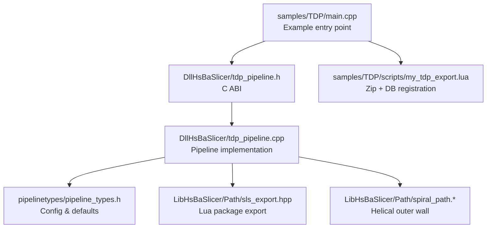
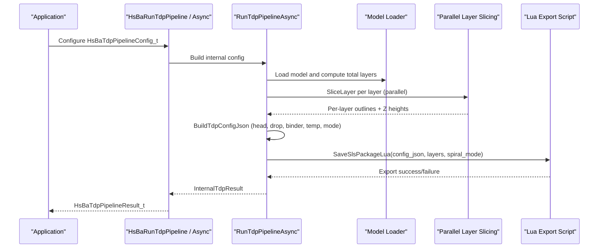
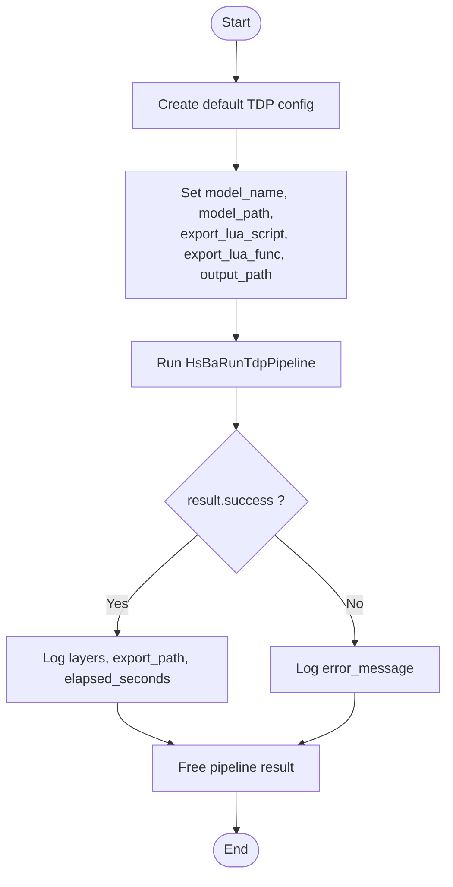
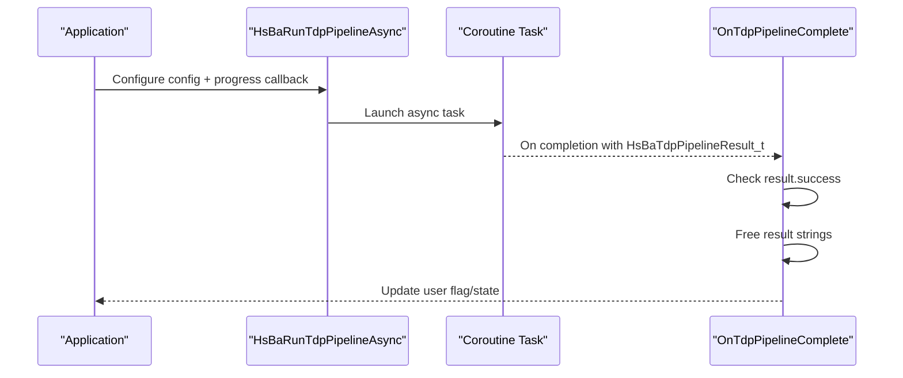
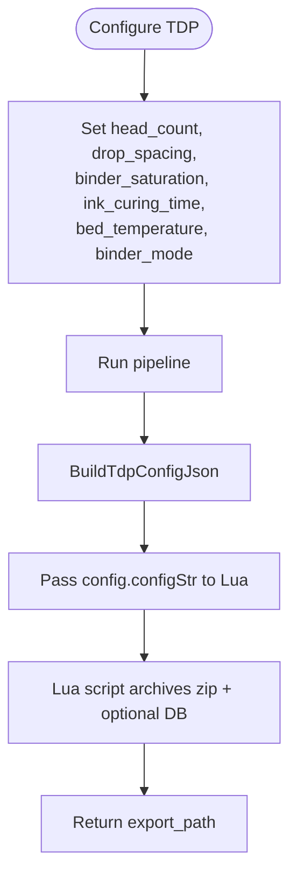
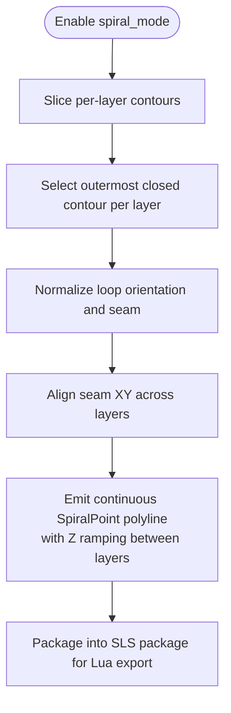
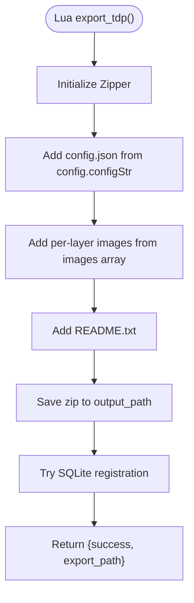
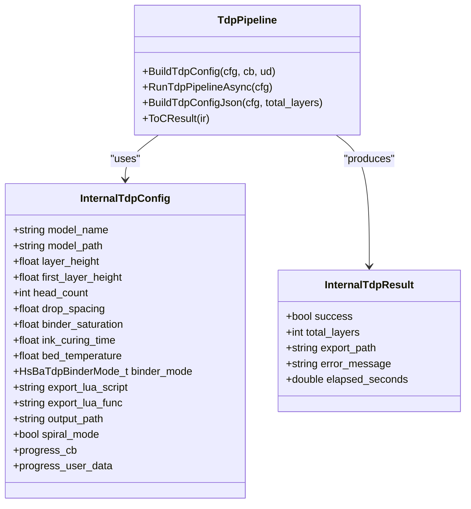
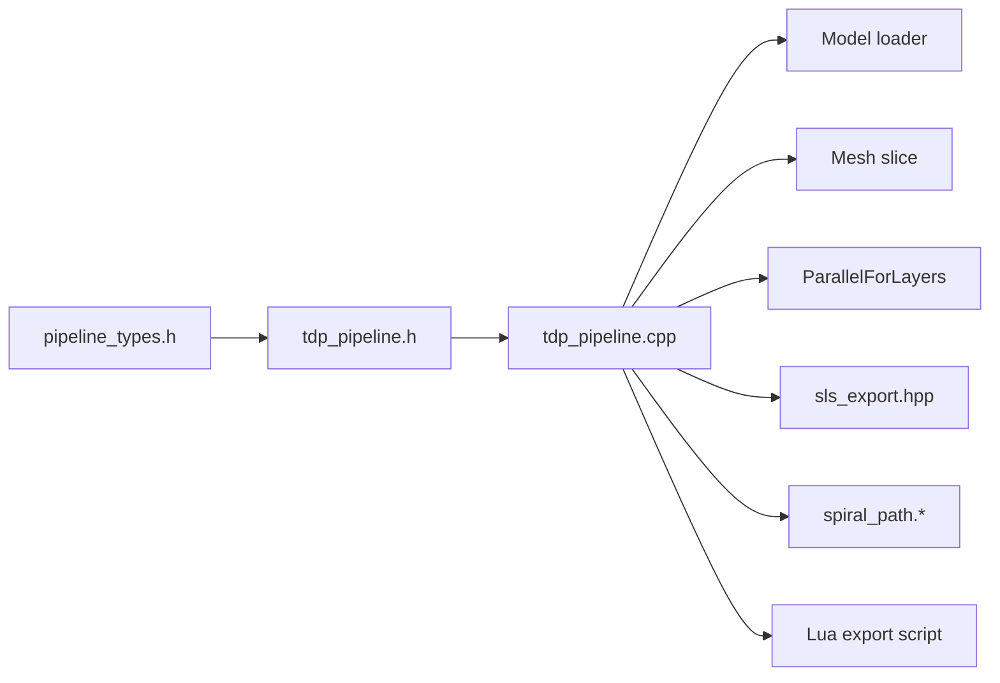

# TDP (Tape Deposition Process) Samples

<cite>
**Referenced Files in This Document**
- [main.cpp](file://samples/TDP/main.cpp)
- [my_tdp_export.lua](file://samples/TDP/scripts/my_tdp_export.lua)
- [tdp_pipeline.h](file://DllHsBaSlicer/tdp_pipeline.h)
- [tdp_pipeline.cpp](file://DllHsBaSlicer/tdp_pipeline.cpp)
- [pipeline_types.h](file://pipelinetypes/pipeline_types.h)
- [spiral_path.hpp](file://LibHsBaSlicer/Path/spiral_path.hpp)
- [spiral_path.cpp](file://LibHsBaSlicer/Path/spiral_path.cpp)
</cite>

## Table of Contents
1. [Introduction](#introduction)
2. [Project Structure](#project-structure)
3. [Core Components](#core-components)
4. [Architecture Overview](#architecture-overview)
5. [Detailed Component Analysis](#detailed-component-analysis)
6. [Dependency Analysis](#dependency-analysis)
7. [Performance Considerations](#performance-considerations)
8. [Troubleshooting Guide](#troubleshooting-guide)
9. [Conclusion](#conclusion)

## Introduction
This document explains the TDP (Tape Deposition Process) samples in HsBaSlicer. In this repository, the TDP sample is implemented as a 3DP binder-jetting pipeline: it slices a model into per-layer outlines, builds a JSON configuration describing head, drop, binder saturation, curing time, bed temperature, and binder mode, and then exports the result through a Lua script. The sample also demonstrates synchronous execution, asynchronous execution, custom binder parameters, and spiral mode for generating a continuous rising deposition path.

The documentation covers:
- Basic pipeline setup using the C API.
- Advanced configurations including full-color, single-channel, and sintering binder modes.
- Spiral mode that generates a continuous outer-wall helical path.
- Synchronous and asynchronous execution patterns.
- How the Lua export script receives process parameters and layer data.
- Troubleshooting common configuration issues.
- Performance optimization tips based on the actual implementation.

## Project Structure
The TDP sample consists of:
- A C++ example program demonstrating four usage patterns.
- A Lua export script that packages layer outlines and process configuration into a zip archive.
- A C ABI header exposing the TDP pipeline functions.
- A C++ implementation that performs preprocessing, slicing, parallel layer processing, and Lua-driven export.
- Shared pipeline type definitions with default values and enums.
- A spiral path generator used to create continuous rising paths.

**Diagram sources**
- [main.cpp:55-205](file://samples/TDP/main.cpp#L55-L205)
- [tdp_pipeline.h:17-56](file://DllHsBaSlicer/tdp_pipeline.h#L17-L56)
- [tdp_pipeline.cpp:203-316](file://DllHsBaSlicer/tdp_pipeline.cpp#L203-L316)
- [pipeline_types.h:467-521](file://pipelinetypes/pipeline_types.h#L467-L521)
- [spiral_path.hpp:16-58](file://LibHsBaSlicer/Path/spiral_path.hpp#L16-L58)

**Section sources**
- [main.cpp:1-225](file://samples/TDP/main.cpp#L1-L225)
- [tdp_pipeline.h:1-63](file://DllHsBaSlicer/tdp_pipeline.h#L1-L63)
- [tdp_pipeline.cpp:1-365](file://DllHsBaSlicer/tdp_pipeline.cpp#L1-L365)
- [pipeline_types.h:467-521](file://pipelinetypes/pipeline_types.h#L467-L521)
- [spiral_path.hpp:1-63](file://LibHsBaSlicer/Path/spiral_path.hpp#L1-L63)

## Core Components
The TDP workflow is centered around these components:

- **C API**: `HsBaCreateDefaultTdpConfig`, `HsBaRunTdpPipeline`, `HsBaRunTdpPipelineAsync`, and `HsBaFreeTdpPipelineResult`.
- **Configuration struct**: `HsBaTdpPipelineConfig_t` with fields such as `head_count`, `drop_spacing`, `binder_saturation`, `ink_curing_time`, `bed_temperature`, `binder_mode`, and `spiral_mode`.
- **Internal pipeline**: Loads models, computes layers, slices in parallel, builds a JSON config, and calls the Lua export function.
- **Lua export script**: Receives `config.configStr`, per-layer images, and writes a zip archive plus optional database registration.
- **Spiral path generator**: Produces a continuous helical outer-wall path when spiral mode is enabled.

Key responsibilities:
- Slicing is performed per layer; each layer’s outline is independent and can be processed in parallel.
- Export is fully Lua-driven; the C++ side only prepares the package and passes it to the script.
- Spiral mode exposes a continuous rising path suitable for extrusion-style deposition or continuous binder/wire deposition.

**Section sources**
- [tdp_pipeline.h:17-56](file://DllHsBaSlicer/tdp_pipeline.h#L17-L56)
- [pipeline_types.h:467-521](file://pipelinetypes/pipeline_types.h#L467-L521)
- [tdp_pipeline.cpp:142-186](file://DllHsBaSlicer/tdp_pipeline.cpp#L142-L186)
- [my_tdp_export.lua:15-60](file://samples/TDP/scripts/my_tdp_export.lua#L15-L60)
- [spiral_path.hpp:16-58](file://LibHsBaSlicer/Path/spiral_path.hpp#L16-L58)

## Architecture Overview
The TDP pipeline follows a three-stage flow: Preprocess -> Slice -> Export via Lua.

**Diagram sources**
- [tdp_pipeline.cpp:203-316](file://DllHsBaSlicer/tdp_pipeline.cpp#L203-L316)
- [tdp_pipeline.cpp:329-354](file://DllHsBaSlicer/tdp_pipeline.cpp#L329-L354)
- [pipeline_types.h:467-521](file://pipelinetypes/pipeline_types.h#L467-L521)

## Detailed Component Analysis

### TDP Configuration Fields and Defaults
The TDP configuration structure defines all process parameters passed to the Lua export script. The following table summarizes the fields, types, and default values from the shared type definitions.

| Field | Type | Default Value | Description |
|---|---|---:|---|
| `model_name` | `const char*` | NULL | Logical model name used for logging and output naming. |
| `model_path` | `const char*` | NULL | Path to the input model file. |
| `layer_height` | `float` | 0.1 mm | Standard layer height. |
| `first_layer_height` | `float` | 0.12 mm | First layer height. |
| `head_count` | `int` | 128 | Print-head nozzle count. |
| `drop_spacing` | `float` | 0.05 mm | Binder drop spacing. |
| `binder_saturation` | `float` | 0.6 | Binder saturation in range [0,1]. |
| `ink_curing_time` | `float` | 1.0 s | Per-layer curing time. |
| `bed_temperature` | `float` | 40.0 °C | Powder bed temperature. |
| `binder_mode` | `HsBaTdpBinderMode_t` | `HSBA_TDP_SINGLE` | Binder jetting mode: full-color, single, or sintering. |
| `export_lua_script` | `const char*` | NULL | Required Lua export script path. |
| `export_lua_func` | `const char*` | NULL | Lua function name; defaults to `export_tdp`. |
| `output_path` | `const char*` | NULL | Output file path; can be NULL. |
| `spiral_mode` | `int` | 0 | Enable continuous rising spiralized outer contour (0=false, 1=true). |

Binder mode enum:
- `HSBA_TDP_FULL_COLOR`: Full-color binder jetting.
- `HSBA_TDP_SINGLE`: Single-channel binder.
- `HSBA_TDP_SINTERING`: Binder jetting followed by sintering.

**Section sources**
- [pipeline_types.h:467-521](file://pipelinetypes/pipeline_types.h#L467-L521)
- [pipeline_types.h:903-921](file://pipelinetypes/pipeline_types.h#L903-L921)

### Synchronous Execution Pattern
The basic synchronous pattern creates a default configuration, sets required fields, runs the pipeline, checks the result, and frees memory.

**Diagram sources**
- [main.cpp:55-82](file://samples/TDP/main.cpp#L55-L82)
- [tdp_pipeline.h:36-37](file://DllHsBaSlicer/tdp_pipeline.h#L36-L37)
- [tdp_pipeline.cpp:329-336](file://DllHsBaSlicer/tdp_pipeline.cpp#L329-L336)

**Section sources**
- [main.cpp:55-82](file://samples/TDP/main.cpp#L55-L82)
- [tdp_pipeline.h:36-37](file://DllHsBaSlicer/tdp_pipeline.h#L36-L37)

### Asynchronous Execution Pattern
Asynchronous execution uses a completion callback to receive the final result while the main thread continues other work.

**Diagram sources**
- [main.cpp:130-170](file://samples/TDP/main.cpp#L130-L170)
- [tdp_pipeline.cpp:338-354](file://DllHsBaSlicer/tdp_pipeline.cpp#L338-L354)

**Section sources**
- [main.cpp:130-170](file://samples/TDP/main.cpp#L130-L170)
- [tdp_pipeline.cpp:338-354](file://DllHsBaSlicer/tdp_pipeline.cpp#L338-L354)

### Custom Binder Parameters
The sample demonstrates setting head count, drop spacing, binder saturation, ink curing time, bed temperature, and binder mode. These values are converted into a JSON configuration string and passed to the Lua export script.

**Diagram sources**
- [main.cpp:87-125](file://samples/TDP/main.cpp#L87-L125)
- [tdp_pipeline.cpp:142-164](file://DllHsBaSlicer/tdp_pipeline.cpp#L142-L164)
- [tdp_pipeline.cpp:281-291](file://DllHsBaSlicer/tdp_pipeline.cpp#L281-L291)

**Section sources**
- [main.cpp:87-125](file://samples/TDP/main.cpp#L87-L125)
- [tdp_pipeline.cpp:142-164](file://DllHsBaSlicer/tdp_pipeline.cpp#L142-L164)

### Spiral Mode and Continuous Deposition Path
Spiral mode enables generation of a continuous rising outer-wall path. Internally, the pipeline sets `pkg.spiral_mode`, and the Lua export script can use this information to produce a continuous deposition path. The spiral algorithm selects the outermost closed contour per layer, aligns seams across layers, and emits a continuous polyline where Z ramps between layers.

**Diagram sources**
- [main.cpp:175-205](file://samples/TDP/main.cpp#L175-L205)
- [tdp_pipeline.cpp:283-291](file://DllHsBaSlicer/tdp_pipeline.cpp#L283-L291)
- [spiral_path.hpp:16-58](file://LibHsBaSlicer/Path/spiral_path.hpp#L16-L58)
- [spiral_path.cpp:88-163](file://LibHsBaSlicer/Path/spiral_path.cpp#L88-L163)

**Section sources**
- [main.cpp:175-205](file://samples/TDP/main.cpp#L175-L205)
- [spiral_path.hpp:16-58](file://LibHsBaSlicer/Path/spiral_path.hpp#L16-L58)
- [spiral_path.cpp:88-163](file://LibHsBaSlicer/Path/spiral_path.cpp#L88-L163)

### Lua Export Script Behavior
The Lua export script receives:
- `config.path` and `config.configStr`: JSON configuration containing slice settings, binder parameters, bed temperature, and spiral mode.
- `images`: Array of per-layer polygon JSON files.
- `output_path`: Output zip path provided by C++.

The script:
- Creates a zip archive.
- Adds the configuration JSON.
- Adds per-layer images.
- Adds a README describing contents.
- Optionally registers the export in a SQLite database.
- Returns a table with `success` and `export_path`.

Important note: The script must return a table; returning a string would overwrite the written zip file.

**Diagram sources**
- [my_tdp_export.lua:15-60](file://samples/TDP/scripts/my_tdp_export.lua#L15-L60)

**Section sources**
- [my_tdp_export.lua:1-63](file://samples/TDP/scripts/my_tdp_export.lua#L1-L63)

### Pipeline Implementation Details
The C++ implementation:
- Installs common Lua object types.
- Loads the model and computes total layers.
- Builds slicing topology once and slices layers in parallel.
- Validates that an export Lua script is provided.
- Builds a JSON configuration string with binder parameters.
- Packages layer outlines, Z heights, and spiral mode into an SLS package.
- Calls `SaveSlsPackageLua` to execute the Lua export function.
- Captures errors and elapsed time.

**Diagram sources**
- [tdp_pipeline.cpp:30-57](file://DllHsBaSlicer/tdp_pipeline.cpp#L30-L57)
- [tdp_pipeline.cpp:142-186](file://DllHsBaSlicer/tdp_pipeline.cpp#L142-L186)
- [tdp_pipeline.cpp:188-200](file://DllHsBaSlicer/tdp_pipeline.cpp#L188-L200)

**Section sources**
- [tdp_pipeline.cpp:30-57](file://DllHsBaSlicer/tdp_pipeline.cpp#L30-L57)
- [tdp_pipeline.cpp:142-186](file://DllHsBaSlicer/tdp_pipeline.cpp#L142-L186)
- [tdp_pipeline.cpp:203-316](file://DllHsBaSlicer/tdp_pipeline.cpp#L203-L316)

## Dependency Analysis
The TDP sample depends on:
- Shared pipeline types for configuration and results.
- Model loading and slicing utilities.
- Parallel layer slicing.
- Lua export packaging.
- Spiral path generation for continuous deposition.

**Diagram sources**
- [pipeline_types.h:467-521](file://pipelinetypes/pipeline_types.h#L467-L521)
- [tdp_pipeline.h:1-63](file://DllHsBaSlicer/tdp_pipeline.h#L1-L63)
- [tdp_pipeline.cpp:17-23](file://DllHsBaSlicer/tdp_pipeline.cpp#L17-L23)
- [spiral_path.hpp:1-63](file://LibHsBaSlicer/Path/spiral_path.hpp#L1-L63)

**Section sources**
- [tdp_pipeline.cpp:17-23](file://DllHsBaSlicer/tdp_pipeline.cpp#L17-L23)
- [pipeline_types.h:467-521](file://pipelinetypes/pipeline_types.h#L467-L521)

## Performance Considerations
Based on the implementation:
- **Parallel slicing**: Layers are sliced in parallel using `ParallelForLayers`, which improves throughput for large models.
- **Topology reuse**: The slicing topology is built once and reused for all layers, avoiding redundant computation.
- **Progress reporting**: Progress callbacks provide stage updates, enabling UI responsiveness during long-running tasks.
- **Memory management**: Owned C strings are managed via a helper to prevent leaks when crossing the C ABI boundary.
- **Spiral mode cost**: Spiral path generation adds geometric processing but produces a continuous path that reduces retractions and travel jumps.

Recommendations:
- Use asynchronous execution for UI-heavy applications to keep the interface responsive.
- Tune `layer_height` and `first_layer_height` to balance resolution and performance.
- Adjust `head_count` and `drop_spacing` according to printer capabilities; overly fine drop spacing may increase data volume without improving quality.
- Monitor `elapsed_seconds` to profile pipeline performance and identify bottlenecks.

[No sources needed since this section provides general guidance]

## Troubleshooting Guide
Common issues and resolutions:

- **Missing export Lua script**:
  - Symptom: Error message indicating that 3DP export requires a Lua export script.
  - Resolution: Ensure `export_lua_script` is set to a valid path and `export_lua_func` points to a function that returns a table with `success` and `export_path`.

- **Invalid model height**:
  - Symptom: Error message indicating invalid model height.
  - Resolution: Verify that the model has positive height and that `layer_height` and `first_layer_height` are reasonable.

- **Lua script returns wrong type**:
  - Symptom: Export fails or zip file is overwritten.
  - Resolution: The Lua script must return a table, not a string. Returning a string can overwrite the generated zip.

- **Database registration skipped**:
  - Symptom: Warning about database registration failure.
  - Resolution: Database operations are optional; ensure SQLite adapter is available if you need history tracking.

- **Spiral mode produces unexpected path**:
  - Symptom: Spiral path does not match expectations.
  - Resolution: Spiral mode selects the outermost closed contour per layer and aligns seams; ensure layers have valid closed contours and consistent orientation.

**Section sources**
- [tdp_pipeline.cpp:266-302](file://DllHsBaSlicer/tdp_pipeline.cpp#L266-L302)
- [tdp_pipeline.cpp:306-315](file://DllHsBaSlicer/tdp_pipeline.cpp#L306-L315)
- [my_tdp_export.lua:35-54](file://samples/TDP/scripts/my_tdp_export.lua#L35-L54)

## Conclusion
The TDP samples demonstrate a complete binder-jetting workflow: configure the pipeline, slice layers, build process-specific JSON, and export via Lua. The C API supports both synchronous and asynchronous execution, while the Lua export script controls the final output format. Spiral mode enables continuous rising deposition paths, useful for extrusion-style processes. For best results, tune layer height, binder parameters, and spiral mode according to your printer capabilities, and use asynchronous execution to maintain application responsiveness.

[No sources needed since this section summarizes without analyzing specific files]