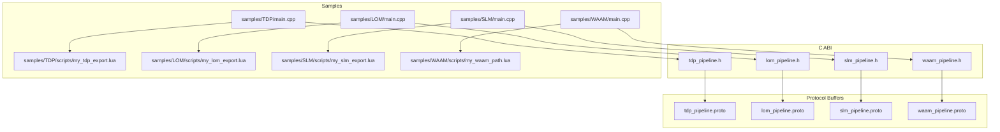
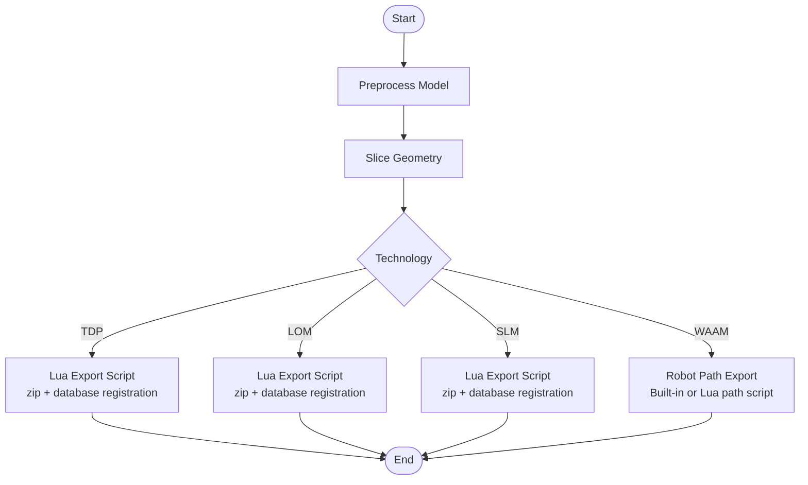
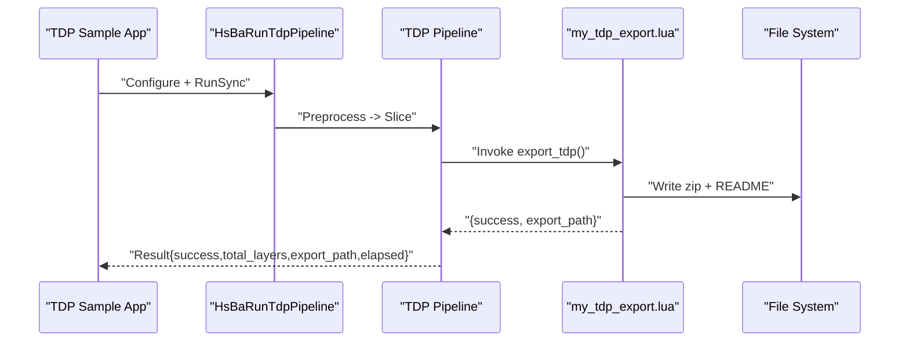
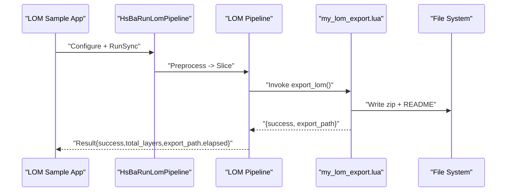
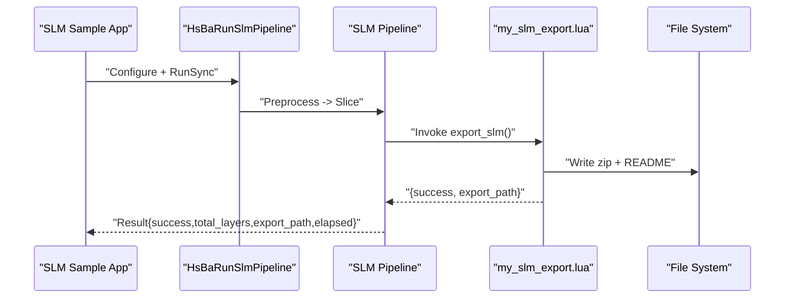
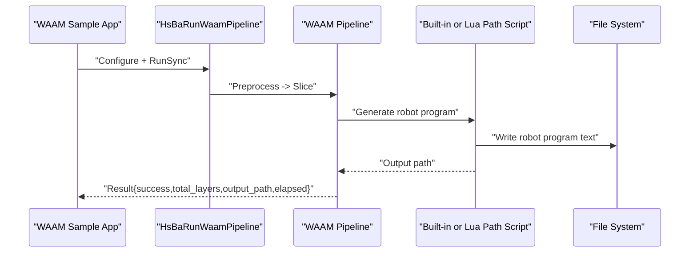
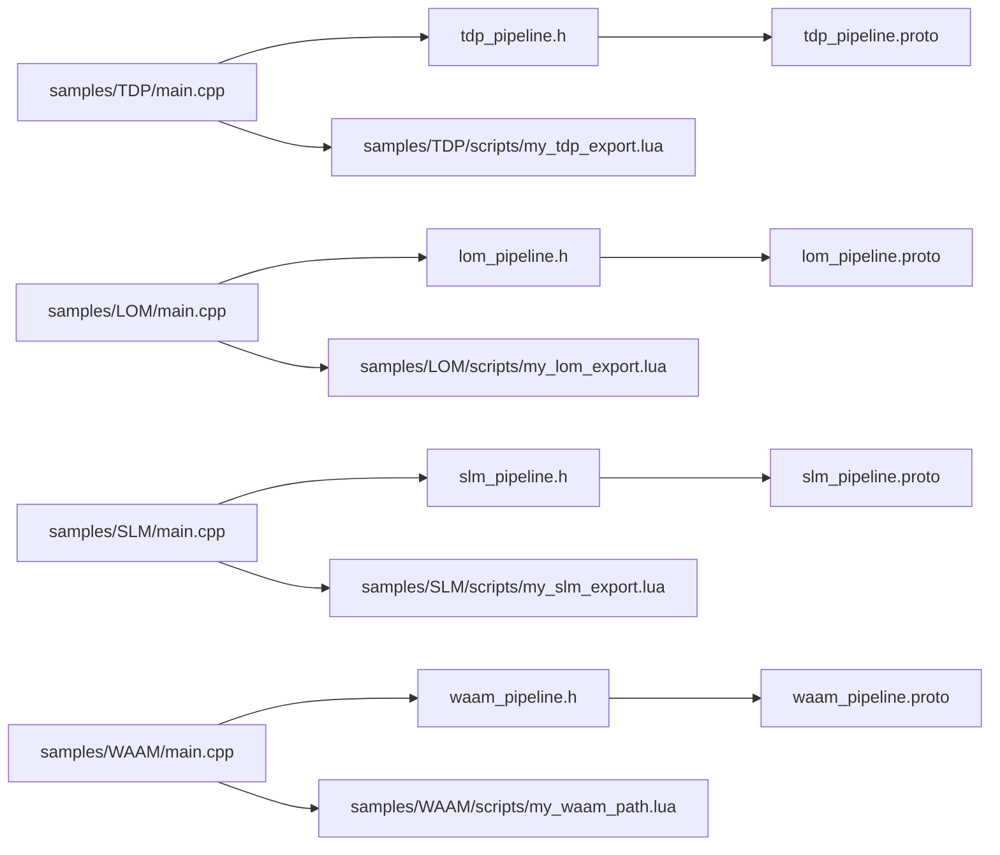

# Technology-Specific Samples

<cite>
**Referenced Files in This Document**   
- [tdp_pipeline.h](file://DllHsBaSlicer/tdp_pipeline.h)
- [lom_pipeline.h](file://DllHsBaSlicer/lom_pipeline.h)
- [slm_pipeline.h](file://DllHsBaSlicer/slm_pipeline.h)
- [waam_pipeline.h](file://DllHsBaSlicer/waam_pipeline.h)
- [tdp_pipeline.proto](file://proto/tdp_pipeline.proto)
- [lom_pipeline.proto](file://proto/lom_pipeline.proto)
- [slm_pipeline.proto](file://proto/slm_pipeline.proto)
- [waam_pipeline.proto](file://proto/waam_pipeline.proto)
- [samples/TDP/main.cpp](file://samples/TDP/main.cpp)
- [samples/LOM/main.cpp](file://samples/LOM/main.cpp)
- [samples/SLM/main.cpp](file://samples/SLM/main.cpp)
- [samples/WAAM/main.cpp](file://samples/WAAM/main.cpp)
- [samples/TDP/scripts/my_tdp_export.lua](file://samples/TDP/scripts/my_tdp_export.lua)
- [samples/LOM/scripts/my_lom_export.lua](file://samples/LOM/scripts/my_lom_export.lua)
- [samples/SLM/scripts/my_slm_export.lua](file://samples/SLM/scripts/my_slm_export.lua)
- [samples/WAAM/scripts/my_waam_path.lua](file://samples/WAAM/scripts/my_waam_path.lua)
</cite>

## Table of Contents
1. [Introduction](#introduction)
2. [Project Structure](#project-structure)
3. [Core Components](#core-components)
4. [Architecture Overview](#architecture-overview)
5. [Detailed Component Analysis](#detailed-component-analysis)
6. [Dependency Analysis](#dependency-analysis)
7. [Performance Considerations](#performance-considerations)
8. [Troubleshooting Guide](#troubleshooting-guide)
9. [Conclusion](#conclusion)

## Introduction
This document provides technology-specific samples for four manufacturing processes implemented in HsBaSlicer: TDP (Tape Deposition Process / binder jetting), LOM (Laminated Object Manufacturing), SLM (Selective Laser Melting), and WAAM (Wire Arc Additive Manufacturing). For each process, it explains the pipeline entry points, configuration options, material and process parameters, output formats, and how to adapt the generic slicing pipeline to the unique requirements of the technology.

The repository exposes C ABI functions for synchronous and asynchronous execution, protocol buffer definitions for configuration and results, and sample applications that demonstrate minimal usage, custom parameterization, async execution, and spiral/vase-mode behavior where applicable. Export scripts are Lua-based for most technologies; WAAM additionally supports a built-in robot code generator or a custom Lua path script.

## Project Structure
The relevant implementation is split across three layers:
- C ABI headers define the public pipeline API for each technology.
- Protocol buffer files define typed configuration and result messages.
- Sample applications show how to configure and run pipelines, plus Lua export/path scripts.

**Diagram sources**
- [tdp_pipeline.h:1-63](file://DllHsBaSlicer/tdp_pipeline.h#L1-L63)
- [lom_pipeline.h:1-63](file://DllHsBaSlicer/lom_pipeline.h#L1-L63)
- [slm_pipeline.h:1-63](file://DllHsBaSlicer/slm_pipeline.h#L1-L63)
- [waam_pipeline.h:1-64](file://DllHsBaSlicer/waam_pipeline.h#L1-L64)
- [tdp_pipeline.proto:1-47](file://proto/tdp_pipeline.proto#L1-L47)
- [lom_pipeline.proto:1-46](file://proto/lom_pipeline.proto#L1-L46)
- [slm_pipeline.proto:1-65](file://proto/slm_pipeline.proto#L1-L65)
- [waam_pipeline.proto:1-89](file://proto/waam_pipeline.proto#L1-L89)
- [samples/TDP/main.cpp:1-225](file://samples/TDP/main.cpp#L1-L225)
- [samples/LOM/main.cpp:1-194](file://samples/LOM/main.cpp#L1-L194)
- [samples/SLM/main.cpp:1-196](file://samples/SLM/main.cpp#L1-L196)
- [samples/WAAM/main.cpp:1-237](file://samples/WAAM/main.cpp#L1-L237)
- [samples/TDP/scripts/my_tdp_export.lua:1-63](file://samples/TDP/scripts/my_tdp_export.lua#L1-L63)
- [samples/LOM/scripts/my_lom_export.lua:1-58](file://samples/LOM/scripts/my_lom_export.lua#L1-L58)
- [samples/SLM/scripts/my_slm_export.lua:1-63](file://samples/SLM/scripts/my_slm_export.lua#L1-L63)
- [samples/WAAM/scripts/my_waam_path.lua:1-46](file://samples/WAAM/scripts/my_waam_path.lua#L1-L46)

**Section sources**
- [tdp_pipeline.h:1-63](file://DllHsBaSlicer/tdp_pipeline.h#L1-L63)
- [lom_pipeline.h:1-63](file://DllHsBaSlicer/lom_pipeline.h#L1-L63)
- [slm_pipeline.h:1-63](file://DllHsBaSlicer/slm_pipeline.h#L1-L63)
- [waam_pipeline.h:1-64](file://DllHsBaSlicer/waam_pipeline.h#L1-L64)
- [samples/TDP/main.cpp:1-225](file://samples/TDP/main.cpp#L1-L225)
- [samples/LOM/main.cpp:1-194](file://samples/LOM/main.cpp#L1-L194)
- [samples/SLM/main.cpp:1-196](file://samples/SLM/main.cpp#L1-L196)
- [samples/WAAM/main.cpp:1-237](file://samples/WAAM/main.cpp#L1-L237)

## Core Components
Each technology exposes a consistent C ABI surface:
- A default configuration constructor.
- A synchronous run function returning a result struct.
- An asynchronous run function with progress and completion callbacks.
- A result-freeing function.

| Technology | Default Config Function | Sync Run Function | Async Run Function | Result Free Function |
|---|---|---|---|---|
| TDP | `HsBaCreateDefaultTdpConfig` | `HsBaRunTdpPipeline` | `HsBaRunTdpPipelineAsync` | `HsBaFreeTdpPipelineResult` |
| LOM | `HsBaCreateDefaultLomConfig` | `HsBaRunLomPipeline` | `HsBaRunLomPipelineAsync` | `HsBaFreeLomPipelineResult` |
| SLM | `HsBaCreateDefaultSlmConfig` | `HsBaRunSlmPipeline` | `HsBaRunSlmPipelineAsync` | `HsBaFreeSlmPipelineResult` |
| WAAM | `HsBaCreateDefaultWaamConfig` | `HsBaRunWaamPipeline` | `HsBaRunWaamPipelineAsync` | `HsBaFreeWaamPipelineResult` |

All APIs accept a configuration pointer, an optional progress callback, and optional user data. The synchronous functions return a result object containing success status, layer count, output path, error message, and elapsed time.

**Section sources**
- [tdp_pipeline.h:17-56](file://DllHsBaSlicer/tdp_pipeline.h#L17-L56)
- [lom_pipeline.h:17-56](file://DllHsBaSlicer/lom_pipeline.h#L17-L56)
- [slm_pipeline.h:17-56](file://DllHsBaSlicer/slm_pipeline.h#L1-L56)
- [waam_pipeline.h:17-57](file://DllHsBaSlicer/waam_pipeline.h#L17-L57)

## Architecture Overview
The generic pipeline structure is adapted per technology as follows:
- TDP, LOM, and SLM follow a Preprocess → Slice → Export flow, where the export step is driven by a Lua script that packages per-layer geometry and process configuration into a zip archive and optionally registers metadata in a database.
- WAAM follows a Preprocess → Slice → Robot Path Export flow. It can generate built-in robot programs (ABB/KUKA/FANUC) or delegate to a custom Lua path script that returns a complete robot program text.

**Diagram sources**
- [tdp_pipeline.h:23-30](file://DllHsBaSlicer/tdp_pipeline.h#L23-L30)
- [lom_pipeline.h:23-30](file://DllHsBaSlicer/lom_pipeline.h#L23-L30)
- [slm_pipeline.h:23-30](file://DllHsBaSlicer/slm_pipeline.h#L23-L30)
- [waam_pipeline.h:23-31](file://DllHsBaSlicer/waam_pipeline.h#L23-L31)

## Detailed Component Analysis

### TDP (Tape Deposition Process / Binder Jetting)
TDP is modeled as a powder-bed binder jetting process. The pipeline slices per layer and hands binder-jet outlines and head/curing parameters to a Lua export script. Output is a zip archive whose contents are controlled by the script.

Key configuration fields (from proto):
- Model identity: model name and path.
- Layering: layer height and first layer height.
- Head and binder parameters: head nozzle count, drop spacing, binder saturation, ink curing time, bed temperature.
- Binder mode: full color, single channel, sintering-assisted.
- Export control: Lua script path, Lua function name, output path.
- Spiral mode: expose a continuous rising spiralized deposition path to the export script while still keeping per-layer images.

Typical workflow:
1. Create default config.
2. Set model path and Lua export script/function.
3. Optionally set binder/head parameters and spiral mode.
4. Run sync or async pipeline.
5. Inspect result and free memory.

**Diagram sources**
- [samples/TDP/main.cpp:55-82](file://samples/TDP/main.cpp#L55-L82)
- [samples/TDP/scripts/my_tdp_export.lua:15-60](file://samples/TDP/scripts/my_tdp_export.lua#L15-L60)

Configuration table (selected fields):
| Field | Meaning | Notes |
|---|---|---|
| tdp_pipe_config_model_name | Model identifier | Used for logging/metadata |
| tdp_pipe_config_model_path | STL or mesh input path | Required |
| tdp_pipe_config_layer_height | Layer thickness | Millimeters |
| tdp_pipe_config_first_layer_height | First layer thickness | Millimeters |
| tdp_pipe_config_head_count | Nozzle count | Controls print head resolution |
| tdp_pipe_config_drop_spacing | Drop spacing | Millimeters |
| tdp_pipe_config_binder_saturation | Binder saturation | Range [0,1] |
| tdp_pipe_config_ink_curing_time | Per-layer curing time | Seconds |
| tdp_pipe_config_bed_temperature | Bed temperature | Celsius |
| tdp_pipe_config_binder_mode | Full color / single / sintering | Enum |
| tdp_pipe_config_export_lua_script | Export script path | Required |
| tdp_pipe_config_export_lua_func | Export function name | Required |
| tdp_pipe_config_output_path | Zip output path | Required |
| tdp_pipe_config_spiral_mode | Continuous spiral path | Boolean flag |

Material considerations:
- Binder saturation and curing time affect interlayer bonding and dimensional stability.
- Bed temperature influences powder handling and binder penetration.
- Head count and drop spacing determine resolution and throughput.

Output format:
- Zip archive containing:
  - config.json with process parameters.
  - Per-layer polygon JSON files under layers/.
  - Optional README and database registration entries.

Adapting the generic pipeline:
- Use the TDP C ABI functions.
- Provide a Lua export script that archives config and layer images.
- Enable spiral mode when a continuous rising deposition path is desired.

**Section sources**
- [tdp_pipeline.h:17-56](file://DllHsBaSlicer/tdp_pipeline.h#L17-L56)
- [tdp_pipeline.proto:8-37](file://proto/tdp_pipeline.proto#L8-L37)
- [samples/TDP/main.cpp:55-205](file://samples/TDP/main.cpp#L55-L205)
- [samples/TDP/scripts/my_tdp_export.lua:1-63](file://samples/TDP/scripts/my_tdp_export.lua#L1-L63)

### LOM (Laminated Object Manufacturing)
LOM models sheet-bonding and contour-cutting. Each “layer” corresponds to a physical sheet thickness; contours are cut then bonded. Cut and bond parameters are passed via the Lua export script’s configuration JSON.

Key configuration fields (from proto):
- Model identity: model name and path.
- Sheet thickness: layer height and first layer height.
- Cutting parameters: cut speed, cut margin, cut power, seal contour, cut mode (contour or halftone).
- Bonding parameters: bond temperature, bond pressure, bond time.
- Export control: Lua script path, Lua function name, output path.

Typical workflow:
1. Create default config.
2. Set model path and Lua export script/function.
3. Configure cut/bond parameters.
4. Run sync or async pipeline.
5. Inspect result and free memory.

**Diagram sources**
- [samples/LOM/main.cpp:55-82](file://samples/LOM/main.cpp#L55-L82)
- [samples/LOM/scripts/my_lom_export.lua:10-55](file://samples/LOM/scripts/my_lom_export.lua#L10-L55)

Configuration table (selected fields):
| Field | Meaning | Notes |
|---|---|---|
| lom_pipe_config_model_name | Model identifier | Used for logging/metadata |
| lom_pipe_config_model_path | STL or mesh input path | Required |
| lom_pipe_config_layer_height | Sheet thickness | Millimeters |
| lom_pipe_config_first_layer_height | First sheet thickness | Millimeters |
| lom_pipe_config_cut_speed | Laser cut speed | Millimeters per second |
| lom_pipe_config_cut_margin | Contour offset | Millimeters |
| lom_pipe_config_cut_power | Laser cut power | Range [0,1] |
| lom_pipe_config_seal_contour | Seal part edge | Boolean flag |
| lom_pipe_config_cut_mode | Contour or halftone | Enum |
| lom_pipe_config_bond_temperature | Bonding temperature | Celsius |
| lom_pipe_config_bond_pressure | Bonding pressure | Megapascals |
| lom_pipe_config_bond_time | Bonding time per layer | Seconds |
| lom_pipe_config_export_lua_script | Export script path | Required |
| lom_pipe_config_export_lua_func | Export function name | Required |
| lom_pipe_config_output_path | Zip output path | Required |

Material considerations:
- Cut power and speed must match sheet material properties.
- Bond temperature, pressure, and time must be tuned to adhesive behavior.
- Halftone cutting may reduce material waste but affects structural integrity.

Output format:
- Zip archive containing:
  - config.json with sheet, cut, and bond parameters.
  - Per-sheet contour JSON files under layers/.
  - Optional README and database registration entries.

Adapting the generic pipeline:
- Use the LOM C ABI functions.
- Provide a Lua export script that archives config and per-sheet contours.
- Choose cut mode based on part geometry and material constraints.

**Section sources**
- [lom_pipeline.h:17-56](file://DllHsBaSlicer/lom_pipeline.h#L17-L56)
- [lom_pipeline.proto:7-36](file://proto/lom_pipeline.proto#L7-L36)
- [samples/LOM/main.cpp:55-175](file://samples/LOM/main.cpp#L55-L175)
- [samples/LOM/scripts/my_lom_export.lua:1-58](file://samples/LOM/scripts/my_lom_export.lua#L1-L58)

### SLM (Selective Laser Melting)
SLM mirrors the SLS flow without floor/raft/support structures and adds metal-specific parameters such as powder material, energy source, and shielding gas. The output is controlled by a Lua export script that packages per-layer polygons and process configuration into a zip archive.

Key configuration fields (from proto):
- Model identity: model name and path.
- Layering: layer height and first layer height.
- Laser/scan parameters: laser power, scan speed, hatch spacing, hatch rotation, bed temperature.
- Metal-specific parameters: material (iron/aluminum/titanium/unknown), light source (laser/e-beam), protect gas (argon/helium/nitrogen/co2/unknown).
- Export control: Lua script path, Lua function name, output path.

Typical workflow:
1. Create default config.
2. Set model path and Lua export script/function.
3. Configure laser/scan and metal parameters.
4. Run sync or async pipeline.
5. Inspect result and free memory.

**Diagram sources**
- [samples/SLM/main.cpp:56-84](file://samples/SLM/main.cpp#L56-L84)
- [samples/SLM/scripts/my_slm_export.lua:15-60](file://samples/SLM/scripts/my_slm_export.lua#L15-L60)

Configuration table (selected fields):
| Field | Meaning | Notes |
|---|---|---|
| slm_pipe_config_model_name | Model identifier | Used for logging/metadata |
| slm_pipe_config_model_path | STL or mesh input path | Required |
| slm_pipe_config_layer_height | Layer thickness | Millimeters |
| slm_pipe_config_first_layer_height | First layer thickness | Millimeters |
| slm_pipe_config_laser_power | Laser power | Watts |
| slm_pipe_config_scan_speed | Scan speed | Millimeters per second |
| slm_pipe_config_hatch_spacing | Hatch spacing | Millimeters |
| slm_pipe_config_hatch_rotation | Hatch rotation angle | Degrees |
| slm_pipe_config_bed_temperature | Powder bed temperature | Celsius |
| slm_pipe_config_material | Metal powder material | Enum |
| slm_pipe_config_light_source | Energy source | Enum |
| slm_pipe_config_protect_gas | Shielding gas | Enum |
| slm_pipe_config_export_lua_script | Export script path | Required |
| slm_pipe_config_export_lua_func | Export function name | Required |
| slm_pipe_config_output_path | Zip output path | Required |

Material considerations:
- Material selection affects thermal conductivity and melting behavior.
- Laser power and scan speed must balance melt pool size and cooling rate.
- Hatch spacing and rotation influence density and residual stress distribution.
- Shielding gas choice impacts oxidation and porosity.

Output format:
- Zip archive containing:
  - config.json with slicing, laser, and metal process parameters.
  - Per-layer polygon JSON files under layers/.
  - Optional README and database registration entries.

Adapting the generic pipeline:
- Use the SLM C ABI functions.
- Provide a Lua export script that archives config and per-layer polygons.
- Tune metal-specific parameters according to material datasheets.

**Section sources**
- [slm_pipeline.h:17-56](file://DllHsBaSlicer/slm_pipeline.h#L17-L56)
- [slm_pipeline.proto:9-55](file://proto/slm_pipeline.proto#L9-L55)
- [samples/SLM/main.cpp:56-177](file://samples/SLM/main.cpp#L56-L177)
- [samples/SLM/scripts/my_slm_export.lua:1-63](file://samples/SLM/scripts/my_slm_export.lua#L1-L63)

### WAAM (Wire Arc Additive Manufacturing)
WAAM deposits metal bead-by-bead along per-layer contours and outputs a robot language program rather than a layer zip archive. Built-in generators support ABB, KUKA, and FANUC controllers; alternatively, a custom Lua path script can replace the built-in generator.

Key configuration fields (from proto):
- Model identity: model name and path.
- Layering: layer height and first layer height.
- Bead and motion parameters: bead width, travel speed.
- Welding parameters: wire feed speed, arc current, arc voltage, gas flow rate, interpass temperature.
- Material/process/environment: material (steel/aluminum/titanium/copper/unknown), welding process (arc/laser/unknown), protection (shielding gas/vacuum/unknown), protect gas type.
- Robot controller: ABB RAPID, KUKA KRL, FANUC TP, or unknown (requires Lua path script).
- Path generation: optional Lua path script and function.
- Output path: robot program file path.
- Spiral mode: merge outer walls into one continuous rising bead (vase mode).

Typical workflow:
1. Create default config.
2. Set model path and robot type.
3. Configure welding and environment parameters.
4. Optionally provide a custom Lua path script.
5. Run sync or async pipeline.
6. Inspect result and free memory.

**Diagram sources**
- [samples/WAAM/main.cpp:54-81](file://samples/WAAM/main.cpp#L54-L81)
- [samples/WAAM/scripts/my_waam_path.lua:17-43](file://samples/WAAM/scripts/my_waam_path.lua#L17-L43)

Configuration table (selected fields):
| Field | Meaning | Notes |
|---|---|---|
| waam_pipe_config_model_name | Model identifier | Used for logging/metadata |
| waam_pipe_config_model_path | STL or mesh input path | Required |
| waam_pipe_config_layer_height | Bead/layer height | Millimeters |
| waam_pipe_config_first_layer_height | First layer height | Millimeters |
| waam_pipe_config_bead_width | Deposited bead width | Millimeters |
| waam_pipe_config_travel_speed | Torch travel speed | Millimeters per second |
| waam_pipe_config_wire_feed_speed | Wire feed speed | Meters per minute |
| waam_pipe_config_arc_current | Welding current | Amperes |
| waam_pipe_config_arc_voltage | Arc voltage | Volts |
| waam_pipe_config_gas_flow_rate | Shielding gas flow | Liters per minute |
| waam_pipe_config_interpass_temperature | Interpass temperature | Celsius |
| waam_pipe_config_material | Feedstock material | Enum |
| waam_pipe_config_welding_process | Welding process | Enum |
| waam_pipe_config_protection | Atmosphere protection | Enum |
| waam_pipe_config_protect_gas | Shielding gas type | Enum |
| waam_pipe_config_robot_type | Target robot controller | Enum |
| waam_pipe_config_path_lua_script | Custom path script path | Optional |
| waam_pipe_config_path_lua_func | Custom path script function | Optional |
| waam_pipe_config_output_path | Robot program output path | Required |
| waam_pipe_config_spiral_mode | Continuous rising bead | Boolean flag |

Material considerations:
- Material and welding process determine heat input and metallurgical outcomes.
- Protection method and gas type affect oxidation and weld quality.
- Interpass temperature controls microstructure and residual stress.

Output format:
- Robot program text file (e.g., ABB RAPID, KUKA KRL, FANUC TP) or custom text generated by a Lua path script.

Adapting the generic pipeline:
- Use the WAAM C ABI functions.
- Select a built-in robot generator or supply a Lua path script.
- Enable spiral mode for vase-like parts to produce a single continuous weld bead.

**Section sources**
- [waam_pipeline.h:17-57](file://DllHsBaSlicer/waam_pipeline.h#L17-L57)
- [waam_pipeline.proto:9-79](file://proto/waam_pipeline.proto#L9-L79)
- [samples/WAAM/main.cpp:54-217](file://samples/WAAM/main.cpp#L54-L217)
- [samples/WAAM/scripts/my_waam_path.lua:1-46](file://samples/WAAM/scripts/my_waam_path.lua#L1-L46)

## Dependency Analysis
The following diagram shows how sample applications depend on C ABI headers and Lua scripts, and how protocol buffers define the underlying configuration types.

**Diagram sources**
- [samples/TDP/main.cpp:1-225](file://samples/TDP/main.cpp#L1-L225)
- [samples/LOM/main.cpp:1-194](file://samples/LOM/main.cpp#L1-L194)
- [samples/SLM/main.cpp:1-196](file://samples/SLM/main.cpp#L1-L196)
- [samples/WAAM/main.cpp:1-237](file://samples/WAAM/main.cpp#L1-L237)
- [tdp_pipeline.h:1-63](file://DllHsBaSlicer/tdp_pipeline.h#L1-L63)
- [lom_pipeline.h:1-63](file://DllHsBaSlicer/lom_pipeline.h#L1-L63)
- [slm_pipeline.h:1-63](file://DllHsBaSlicer/slm_pipeline.h#L1-L63)
- [waam_pipeline.h:1-64](file://DllHsBaSlicer/waam_pipeline.h#L1-L64)
- [tdp_pipeline.proto:1-47](file://proto/tdp_pipeline.proto#L1-L47)
- [lom_pipeline.proto:1-46](file://proto/lom_pipeline.proto#L1-L46)
- [slm_pipeline.proto:1-65](file://proto/slm_pipeline.proto#L1-L65)
- [waam_pipeline.proto:1-89](file://proto/waam_pipeline.proto#L1-L89)
- [samples/TDP/scripts/my_tdp_export.lua:1-63](file://samples/TDP/scripts/my_tdp_export.lua#L1-L63)
- [samples/LOM/scripts/my_lom_export.lua:1-58](file://samples/LOM/scripts/my_lom_export.lua#L1-L58)
- [samples/SLM/scripts/my_slm_export.lua:1-63](file://samples/SLM/scripts/my_slm_export.lua#L1-L63)
- [samples/WAAM/scripts/my_waam_path.lua:1-46](file://samples/WAAM/scripts/my_waam_path.lua#L1-L46)

**Section sources**
- [samples/TDP/main.cpp:1-225](file://samples/TDP/main.cpp#L1-L225)
- [samples/LOM/main.cpp:1-194](file://samples/LOM/main.cpp#L1-L194)
- [samples/SLM/main.cpp:1-196](file://samples/SLM/main.cpp#L1-L196)
- [samples/WAAM/main.cpp:1-237](file://samples/WAAM/main.cpp#L1-L237)

## Performance Considerations
- Layer height and first layer height directly impact build time and surface quality. Smaller layers increase accuracy but raise total layer count.
- For TDP, higher head counts and smaller drop spacing improve resolution at the cost of throughput; binder saturation and curing time influence cycle time.
- For LOM, cut speed and power must be balanced against material thickness; excessive power can damage adjacent sheets.
- For SLM, laser power and scan speed govern melt pool dynamics; hatch spacing and rotation affect density and thermal gradients.
- For WAAM, travel speed, wire feed speed, and arc parameters determine deposition rate and bead geometry; interpass temperature management reduces distortion.
- Spiral/vase mode reduces retraction and restart overhead by producing a continuous path, improving efficiency for suitable geometries.

[No sources needed since this section provides general guidance]

## Troubleshooting Guide
Common issues and remedies:
- Missing or invalid Lua export/script paths: Ensure export_lua_script/export_lua_func (TDP/LOM/SLM) or path_lua_script/path_lua_func (WAAM) are correctly set and accessible.
- Incorrect output paths: Verify write permissions and directory existence for zip archives or robot program files.
- Asynchronous pipeline not completing: Confirm that the completion callback is invoked and that the result is freed to avoid leaks.
- Database registration failures: In Lua export scripts, SQLite operations are wrapped in pcall; warnings indicate skipped registration, which does not prevent zip creation.
- Spiral mode incompatibility: Spiral mode requires suitable geometry; unsupported shapes may produce unexpected toolpaths.

**Section sources**
- [samples/TDP/main.cpp:130-170](file://samples/TDP/main.cpp#L130-L170)
- [samples/LOM/main.cpp:135-175](file://samples/LOM/main.cpp#L135-L175)
- [samples/SLM/main.cpp:137-177](file://samples/SLM/main.cpp#L137-L177)
- [samples/WAAM/main.cpp:136-178](file://samples/WAAM/main.cpp#L136-L178)
- [samples/TDP/scripts/my_tdp_export.lua:35-54](file://samples/TDP/scripts/my_tdp_export.lua#L35-L54)
- [samples/LOM/scripts/my_lom_export.lua:30-49](file://samples/LOM/scripts/my_lom_export.lua#L30-L49)
- [samples/SLM/scripts/my_slm_export.lua:35-54](file://samples/SLM/scripts/my_slm_export.lua#L35-L54)

## Conclusion
HsBaSlicer provides a unified pipeline interface adapted for TDP, LOM, SLM, and WAAM. TDP, LOM, and SLM use Lua-driven export scripts to package per-layer geometry and process configuration into zip archives, while WAAM generates robot program text through built-in generators or custom Lua path scripts. Configuration is strongly typed via protocol buffers, and sample applications demonstrate basic usage, custom parameterization, asynchronous execution, and spiral/vase-mode operation. By selecting appropriate process parameters and export strategies, users can tailor the generic pipeline to each manufacturing technology’s unique requirements.

[No sources needed since this section summarizes without analyzing specific files]