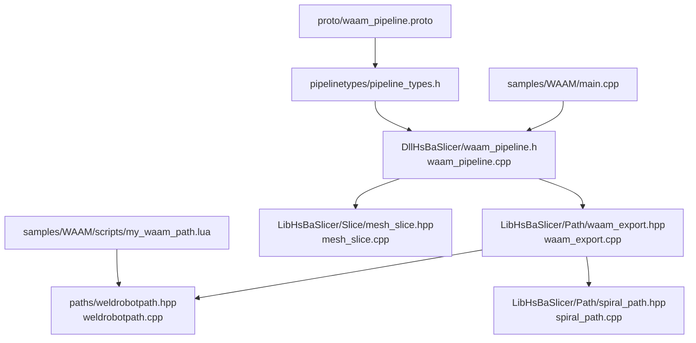
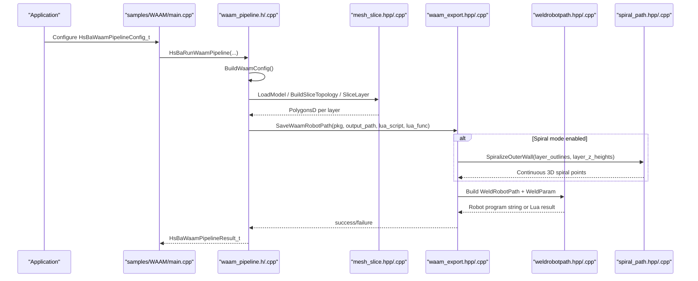
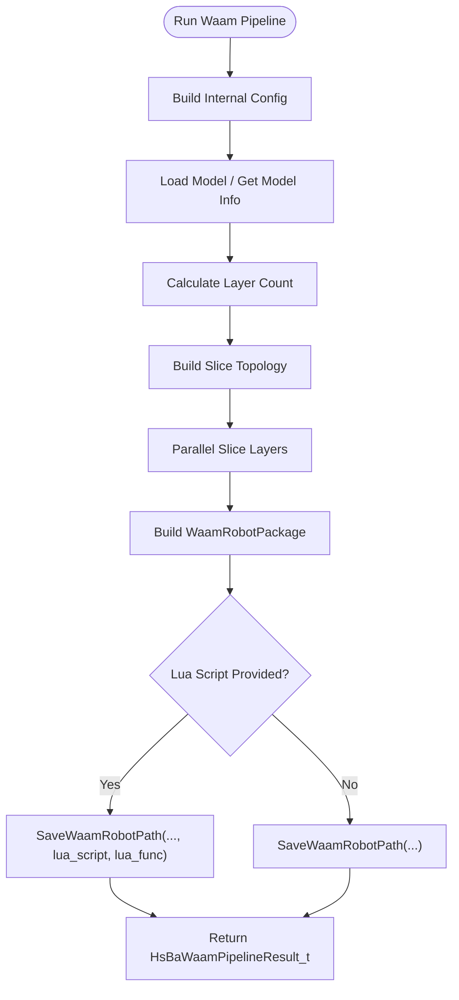
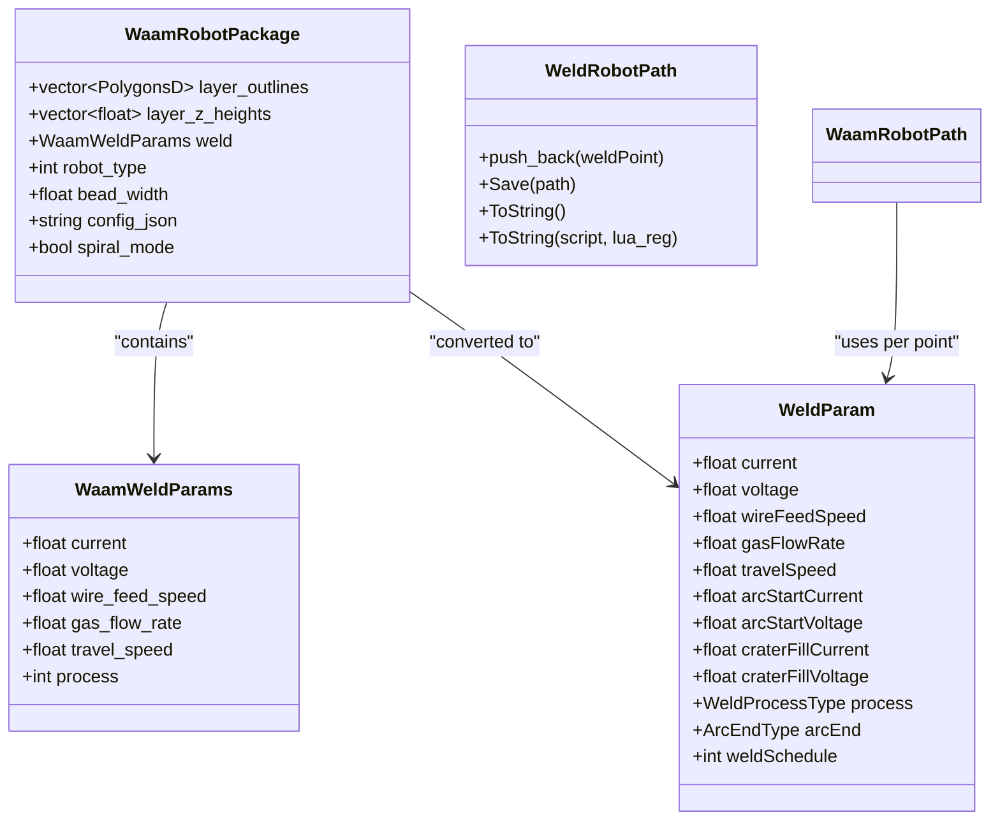
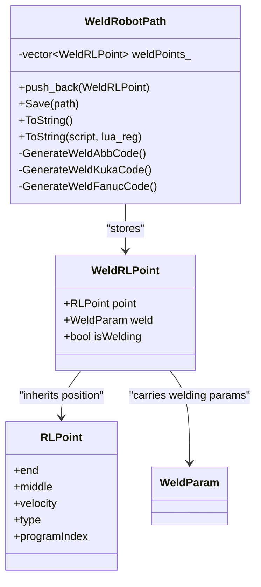
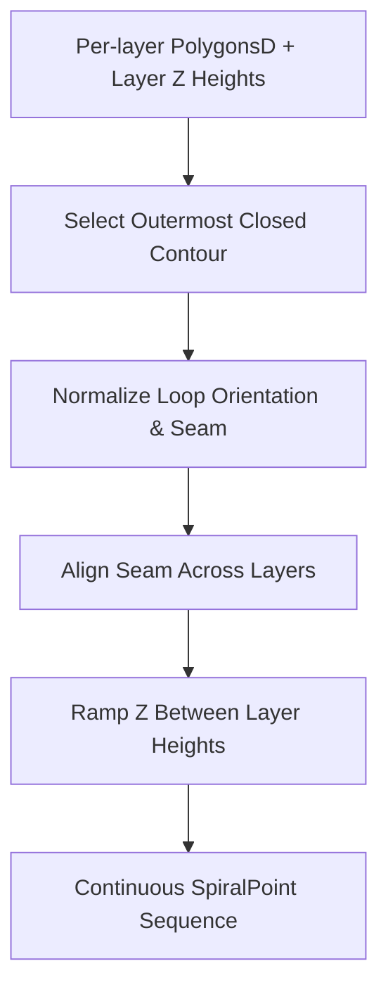
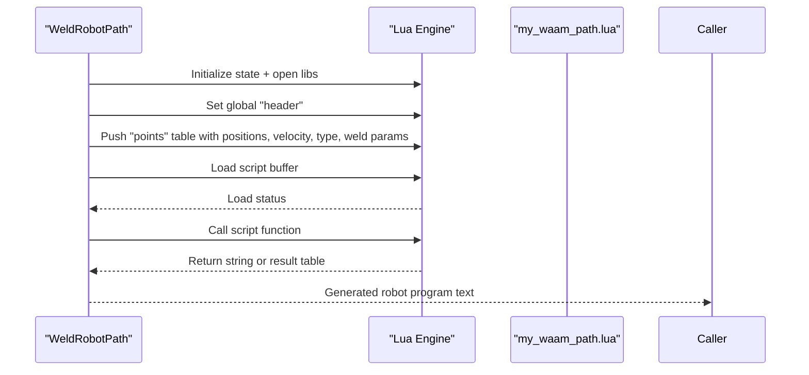
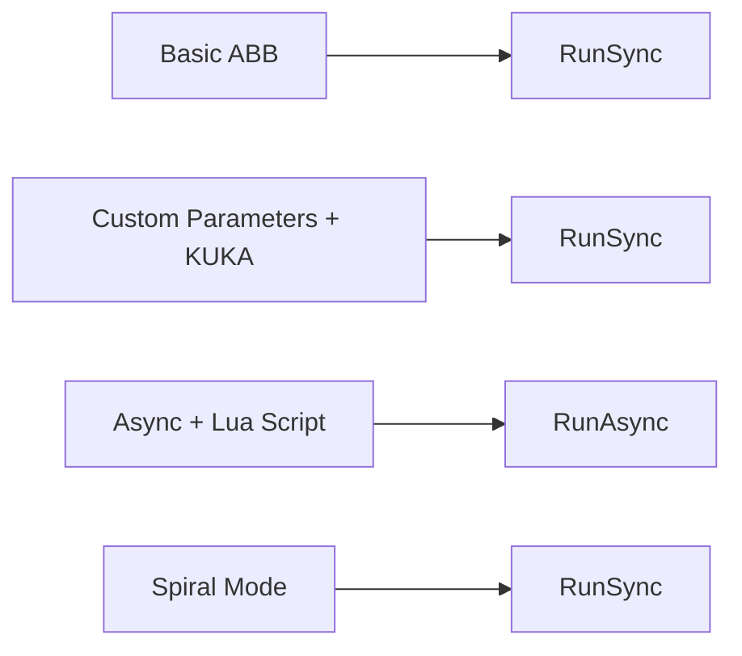
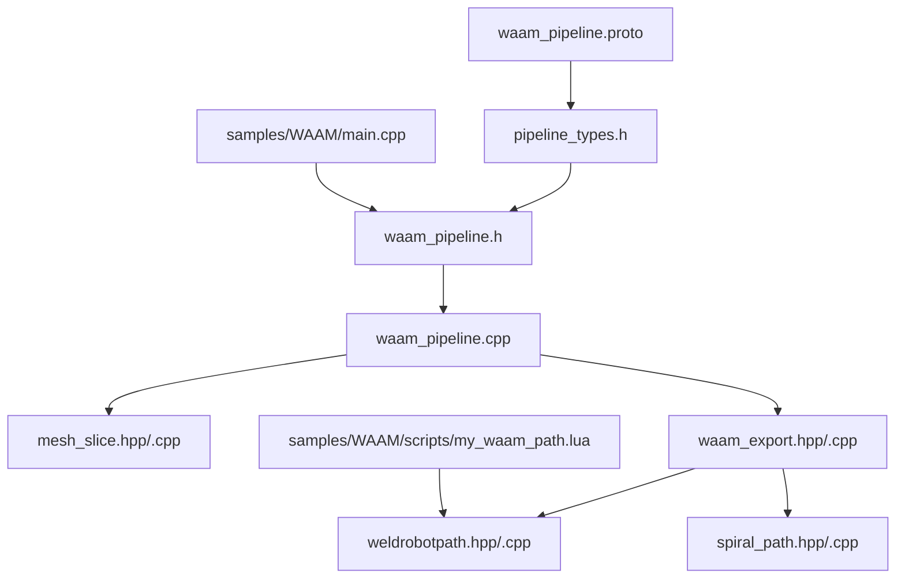
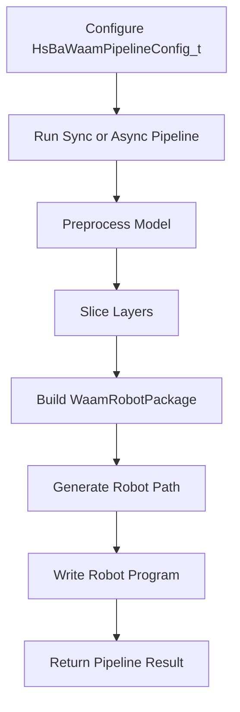

# WAAM (Wire Arc Additive Manufacturing) Samples

<cite>
**Referenced Files in This Document**   
- [waam_pipeline.h](file://DllHsBaSlicer/waam_pipeline.h)
- [waam_pipeline.cpp](file://DllHsBaSlicer/waam_pipeline.cpp)
- [waam_export.hpp](file://LibHsBaSlicer/Path/waam_export.hpp)
- [waam_export.cpp](file://LibHsBaSlicer/Path/waam_export.cpp)
- [weldrobotpath.hpp](file://paths/weldrobotpath.hpp)
- [weldrobotpath.cpp](file://paths/weldrobotpath.cpp)
- [mesh_slice.hpp](file://LibHsBaSlicer/Slice/mesh_slice.hpp)
- [mesh_slice.cpp](file://LibHsBaSlicer/Slice/mesh_slice.cpp)
- [spiral_path.hpp](file://LibHsBaSlicer/Path/spiral_path.hpp)
- [spiral_path.cpp](file://LibHsBaSlicer/Path/spiral_path.cpp)
- [pipeline_types.h](file://pipelinetypes/pipeline_types.h)
- [waam_pipeline.proto](file://proto/waam_pipeline.proto)
- [main.cpp](file://samples/WAAM/main.cpp)
- [my_waam_path.lua](file://samples/WAAM/scripts/my_waam_path.lua)
</cite>

## Table of Contents
1. [Introduction](#introduction)
2. [Project Structure](#project-structure)
3. [Core Components](#core-components)
4. [Architecture Overview](#architecture-overview)
5. [Detailed Component Analysis](#detailed-component-analysis)
6. [Dependency Analysis](#dependency-analysis)
7. [Performance Considerations](#performance-considerations)
8. [Troubleshooting Guide](#troubleshooting-guide)
9. [Conclusion](#conclusion)
10. [Appendices](#appendices)

## Introduction
This document explains the HsBaSlicer WAAM samples and implementation for wire arc additive manufacturing. WAAM is a robot-based metal deposition process: the slicer slices a 3D model into per-layer contours, then generates a robot program (ABB, KUKA, or FANUC) that moves a welding torch along those contours while depositing material. The pipeline supports:

- Standard per-layer contour deposition.
- Spiral/vase mode, where outer walls are merged into one continuous rising weld bead.
- Custom path generation through Lua scripts.
- Welding parameters such as travel speed, current, voltage, wire feed speed, shielding gas flow, material type, protection method, and interpass temperature.

The documentation focuses on how to configure WAAM-specific parameters, adapt generic slicing pipelines for WAAM’s requirements, implement custom path algorithms, and manage thermal and multi-pass considerations.

## Project Structure
The WAAM feature spans several modules:

- C ABI and sample entry point: `DllHsBaSlicer/waam_pipeline.*`, `samples/WAAM/main.cpp`.
- Export package and robot path generation: `LibHsBaSlicer/Path/waam_export.*`, `paths/weldrobotpath.*`.
- Slicing utilities reused by WAAM: `LibHsBaSlicer/Slice/mesh_slice.*`.
- Spiral path algorithm: `LibHsBaSlicer/Path/spiral_path.*`.
- Public types and enums: `pipelinetypes/pipeline_types.h`.
- Protocol buffer schema: `proto/waam_pipeline.proto`.
- Example Lua path script: `samples/WAAM/scripts/my_waam_path.lua`.

**Diagram sources**
- [main.cpp:1-237](file://samples/WAAM/main.cpp#L1-L237)
- [waam_pipeline.h:1-64](file://DllHsBaSlicer/waam_pipeline.h#L1-L64)
- [waam_pipeline.cpp:1-333](file://DllHsBaSlicer/waam_pipeline.cpp#L1-L333)
- [waam_export.hpp:1-77](file://LibHsBaSlicer/Path/waam_export.hpp#L1-L77)
- [waam_export.cpp:1-192](file://LibHsBaSlicer/Path/waam_export.cpp#L1-L192)
- [weldrobotpath.hpp:1-100](file://paths/weldrobotpath.hpp#L1-L100)
- [weldrobotpath.cpp:1-483](file://paths/weldrobotpath.cpp#L1-L483)
- [mesh_slice.hpp:1-108](file://LibHsBaSlicer/Slice/mesh_slice.hpp#L1-L108)
- [mesh_slice.cpp:1-119](file://LibHsBaSlicer/Slice/mesh_slice.cpp#L1-L119)
- [spiral_path.hpp:1-63](file://LibHsBaSlicer/Path/spiral_path.hpp#L1-L63)
- [spiral_path.cpp:1-167](file://LibHsBaSlicer/Path/spiral_path.cpp#L1-L167)
- [pipeline_types.h:523-625](file://pipelinetypes/pipeline_types.h#L523-L625)
- [waam_pipeline.proto:1-89](file://proto/waam_pipeline.proto#L1-L89)
- [my_waam_path.lua:1-46](file://samples/WAAM/scripts/my_waam_path.lua#L1-L46)

**Section sources**
- [main.cpp:1-237](file://samples/WAAM/main.cpp#L1-L237)
- [waam_pipeline.h:1-64](file://DllHsBaSlicer/waam_pipeline.h#L1-L64)
- [waam_pipeline.cpp:1-333](file://DllHsBaSlicer/waam_pipeline.cpp#L1-L333)
- [waam_export.hpp:1-77](file://LibHsBaSlicer/Path/waam_export.hpp#L1-L77)
- [waam_export.cpp:1-192](file://LibHsBaSlicer/Path/waam_export.cpp#L1-L192)
- [weldrobotpath.hpp:1-100](file://paths/weldrobotpath.hpp#L1-L100)
- [weldrobotpath.cpp:1-483](file://paths/weldrobotpath.cpp#L1-L483)
- [mesh_slice.hpp:1-108](file://LibHsBaSlicer/Slice/mesh_slice.hpp#L1-L108)
- [mesh_slice.cpp:1-119](file://LibHsBaSlicer/Slice/mesh_slice.cpp#L1-L119)
- [spiral_path.hpp:1-63](file://LibHsBaSlicer/Path/spiral_path.hpp#L1-L63)
- [spiral_path.cpp:1-167](file://LibHsBaSlicer/Path/spiral_path.cpp#L1-L167)
- [pipeline_types.h:523-625](file://pipelinetypes/pipeline_types.h#L523-L625)
- [waam_pipeline.proto:1-89](file://proto/waam_pipeline.proto#L1-L89)
- [my_waam_path.lua:1-46](file://samples/WAAM/scripts/my_waam_path.lua#L1-L46)

## Core Components
The WAAM workflow has four core components:

1. **WAAM Pipeline C ABI**: Provides synchronous and asynchronous APIs to run the full WAAM pipeline. It builds an internal configuration, loads the model, slices layers, and exports robot code.
2. **WAAM Export Package**: Carries per-layer deposition contours, Z heights, welding parameters, robot type, bead width, spiral mode, and optional configuration JSON.
3. **Weld Robot Path Generator**: Converts the export package into ABB/KUKA/FANUC robot programs with arc start/end, crater handling, and welding parameter directives. It also exposes a Lua execution interface for custom post-processing.
4. **Slicing and Spiral Utilities**: Reuse planar mesh slicing to generate per-layer contours and optionally produce a continuous helical outer-wall path for vase/spiral mode.

Key responsibilities:

- `waam_pipeline.*`: Orchestrates preprocessing, slicing, and export; maps C ABI fields to internal structures; reports progress and elapsed time.
- `waam_export.*`: Builds `WeldParam` from package settings, chooses spiral or per-layer deposition, and writes output files.
- `weldrobotpath.*`: Generates brand-specific robot code and pushes weld points plus parameters into Lua when needed.
- `mesh_slice.*`: Supplies safe/unsafe slicing and reusable topology slicing used by WAAM.
- `spiral_path.*`: Computes a continuous 3D spiral path from closed outer contours across layers.

**Section sources**
- [waam_pipeline.h:17-57](file://DllHsBaSlicer/waam_pipeline.h#L17-L57)
- [waam_pipeline.cpp:28-61](file://DllHsBaSlicer/waam_pipeline.cpp#L28-L61)
- [waam_export.hpp:17-72](file://LibHsBaSlicer/Path/waam_export.hpp#L17-L72)
- [weldrobotpath.hpp:16-96](file://paths/weldrobotpath.hpp#L16-L96)
- [mesh_slice.hpp:22-103](file://LibHsBaSlicer/Slice/mesh_slice.hpp#L22-L103)
- [spiral_path.hpp:16-58](file://LibHsBaSlicer/Path/spiral_path.hpp#L16-L58)

## Architecture Overview
The WAAM architecture follows a layered design:

- **Sample layer**: Demonstrates basic, custom-parameter, async/Lua, and spiral modes.
- **C ABI layer**: Exposes stable functions for creating default configs, running sync/async pipelines, and freeing results.
- **Pipeline orchestration layer**: Loads models, computes layer count, slices layers in parallel, and calls the export API.
- **Export layer**: Converts package data into `WeldRobotPath`, applies spiral logic if enabled, and saves to file.
- **Path generator layer**: Emits ABB/KUKA/FANUC code or runs a Lua script to generate custom robot text.
- **Geometry layer**: Provides slicing and spiralization utilities.

**Diagram sources**
- [main.cpp:54-217](file://samples/WAAM/main.cpp#L54-L217)
- [waam_pipeline.cpp:174-284](file://DllHsBaSlicer/waam_pipeline.cpp#L174-L284)
- [mesh_slice.hpp:89-103](file://LibHsBaSlicer/Slice/mesh_slice.hpp#L89-L103)
- [waam_export.cpp:61-179](file://LibHsBaSlicer/Path/waam_export.cpp#L61-L179)
- [weldrobotpath.cpp:72-194](file://paths/weldrobotpath.cpp#L72-L194)
- [spiral_path.cpp:88-163](file://LibHsBaSlicer/Path/spiral_path.cpp#L88-L163)

## Detailed Component Analysis

### WAAM Pipeline C ABI and Orchestration
The WAAM C ABI defines:

- Default config creation.
- Synchronous pipeline execution.
- Asynchronous pipeline execution.
- Result memory cleanup.

Internally, the pipeline:

- Copies C ABI fields into an internal configuration structure.
- Loads the model and computes total layers using first-layer height and regular layer height.
- Builds a reusable slicing topology once and slices each layer in parallel.
- Constructs a `WaamRobotPackage` with geometry, welding parameters, robot type, and spiral mode.
- Calls `SaveWaamRobotPath`, optionally passing a Lua script and function name.
- Reports progress at key stages and returns a result containing success flag, layer count, output path, error message, and elapsed seconds.

**Diagram sources**
- [waam_pipeline.cpp:131-157](file://DllHsBaSlicer/waam_pipeline.cpp#L131-L157)
- [waam_pipeline.cpp:174-284](file://DllHsBaSlicer/waam_pipeline.cpp#L174-L284)

**Section sources**
- [waam_pipeline.h:17-57](file://DllHsBaSlicer/waam_pipeline.h#L17-L57)
- [waam_pipeline.cpp:28-61](file://DllHsBaSlicer/waam_pipeline.cpp#L28-L61)
- [waam_pipeline.cpp:99-121](file://DllHsBaSlicer/waam_pipeline.cpp#L99-L121)
- [waam_pipeline.cpp:174-284](file://DllHsBaSlicer/waam_pipeline.cpp#L174-L284)

### WAAM Export Package and Robot Path Generation
The export package carries:

- Per-layer outlines.
- Per-layer Z heights.
- Welding parameters: current, voltage, wire feed speed, gas flow rate, travel speed, process type.
- Robot type: ABB, KUKA, FANUC, or Unknown.
- Bead width for intra-layer spacing.
- Optional configuration JSON.
- Spiral mode flag.

Export logic:

- Validates that there is at least one layer.
- Builds a base `WeldParam` from package settings.
- Chooses between spiral mode and standard per-layer deposition.
- In spiral mode, uses `SpiralizeOuterWall` to create a continuous rising path and emits a single MoveJ travel move followed by continuous MoveL weld points.
- In standard mode, emits a rapid MoveJ to each contour start, then deposits every vertex as a weld point.
- Saves via `WeldRobotPath::Save`, optionally invoking a Lua script.

**Diagram sources**
- [waam_export.hpp:23-52](file://LibHsBaSlicer/Path/waam_export.hpp#L23-L52)
- [weldrobotpath.hpp:34-96](file://paths/weldrobotpath.hpp#L34-L96)

**Section sources**
- [waam_export.hpp:17-72](file://LibHsBaSlicer/Path/waam_export.hpp#L17-L72)
- [waam_export.cpp:21-57](file://LibHsBaSlicer/Path/waam_export.cpp#L21-L57)
- [waam_export.cpp:61-179](file://LibHsBaSlicer/Path/waam_export.cpp#L61-L179)
- [weldrobotpath.hpp:34-96](file://paths/weldrobotpath.hpp#L34-L96)

### Weld Robot Path and Brand-Specific Code Generation
`WeldRobotPath` extends a base robot path class and adds:

- A vector of weld points.
- Brand-specific code generators for ABB, KUKA, and FANUC.
- Arc start/end control with crater fill options.
- Movement commands for non-welding travel.
- Lua integration that pushes header, points, velocity, type, `isWelding`, and weld parameters into the Lua environment.

For each weld segment:

- Arc start uses start current and start voltage.
- Continuous welding uses main current, voltage, wire feed speed, and gas flow.
- Arc end may use crater fill current/voltage depending on `ArcEndType`.
- Non-welding points use `MoveJ`, `MoveL`, or `MoveC` based on point type.

**Diagram sources**
- [weldrobotpath.hpp:51-96](file://paths/weldrobotpath.hpp#L51-L96)
- [weldrobotpath.cpp:54-194](file://paths/weldrobotpath.cpp#L54-L194)

**Section sources**
- [weldrobotpath.hpp:16-96](file://paths/weldrobotpath.hpp#L16-L96)
- [weldrobotpath.cpp:21-51](file://paths/weldrobotpath.cpp#L21-L51)
- [weldrobotpath.cpp:72-194](file://paths/weldrobotpath.cpp#L72-L194)
- [weldrobotpath.cpp:225-481](file://paths/weldrobotpath.cpp#L225-L481)

### Slicing and Spiral Path Utilities
WAAM reuses the slicing subsystem:

- `BuildSliceTopology` builds a reusable topology once.
- `SliceLayer` slices a single layer from the prebuilt topology and normalizes it to double-precision polygons.
- The WAAM pipeline slices all layers in parallel because each call only reads the shared topology.

Spiral mode uses `SpiralizeOuterWall`:

- Selects the outermost closed contour per layer by absolute signed area.
- Normalizes loops to CCW orientation and removes duplicate closing vertices.
- Aligns seams across layers so the spiral remains continuous.
- Ramps Z linearly over each revolution, producing a continuous 3D polyline.

**Diagram sources**
- [spiral_path.cpp:18-85](file://LibHsBaSlicer/Path/spiral_path.cpp#L18-L85)
- [spiral_path.cpp:88-163](file://LibHsBaSlicer/Path/spiral_path.cpp#L88-L163)

**Section sources**
- [mesh_slice.hpp:89-103](file://LibHsBaSlicer/Slice/mesh_slice.hpp#L89-L103)
- [mesh_slice.cpp:106-116](file://LibHsBaSlicer/Slice/mesh_slice.cpp#L106-L116)
- [spiral_path.hpp:16-58](file://LibHsBaSlicer/Path/spiral_path.hpp#L16-L58)
- [spiral_path.cpp:88-163](file://LibHsBaSlicer/Path/spiral_path.cpp#L88-L163)

### Lua Path Script Contract
The example Lua script demonstrates the contract for a WAAM path generator:

- Global variables provided:
  - `header`: string header comment.
  - `startProgramFunc`: optional program start name.
  - `endProgramFunc`: optional program end name.
  - `points`: array of point objects with `end`, `middle`, `velocity`, and `type`.
- Expected return value: a complete robot program string.
- The built-in `WeldRobotPath::ToString(script, lua_reg)` pushes these globals and executes the script.

The example script iterates over `points`, outputs `MOVEJ` for non-welding moves, and outputs a welding move with `[WELD ON]` for deposition.

**Diagram sources**
- [weldrobotpath.cpp:103-194](file://paths/weldrobotpath.cpp#L103-L194)
- [my_waam_path.lua:1-46](file://samples/WAAM/scripts/my_waam_path.lua#L1-L46)

**Section sources**
- [weldrobotpath.cpp:103-194](file://paths/weldrobotpath.cpp#L103-L194)
- [my_waam_path.lua:1-46](file://samples/WAAM/scripts/my_waam_path.lua#L1-L46)

### Sample Usage Patterns
The WAAM sample demonstrates four patterns:

1. **Basic ABB pipeline**: Uses built-in ABB code generator.
2. **Custom welding parameters with KUKA**: Sets material, process, protection, gas, current, voltage, wire feed, gas flow, interpass temperature, and robot type.
3. **Async pipeline with custom Lua generator**: Provides `path_lua_script` and `path_lua_func`, waits for completion callback.
4. **Spiral mode**: Enables `spiral_mode` to merge outer walls into one continuous rising bead.

**Diagram sources**
- [main.cpp:54-81](file://samples/WAAM/main.cpp#L54-L81)
- [main.cpp:86-131](file://samples/WAAM/main.cpp#L86-L131)
- [main.cpp:155-178](file://samples/WAAM/main.cpp#L155-L178)
- [main.cpp:183-217](file://samples/WAAM/main.cpp#L183-L217)

**Section sources**
- [main.cpp:54-217](file://samples/WAAM/main.cpp#L54-L217)

## Dependency Analysis
The WAAM module depends on:

- **Public C ABI types**: `HsBaWaamPipelineConfig_t`, `HsBaWaamPipelineResult_t`, and related enums.
- **Protocol buffer schema**: Defines enum names and message fields for serialization.
- **Slicing subsystem**: Provides reusable topology and layer slicing.
- **Spiral path algorithm**: Provides continuous outer-wall generation.
- **Weld robot path generator**: Produces brand-specific robot code and supports Lua customization.

**Diagram sources**
- [waam_pipeline.proto:1-89](file://proto/waam_pipeline.proto#L1-L89)
- [pipeline_types.h:523-625](file://pipelinetypes/pipeline_types.h#L523-L625)
- [waam_pipeline.h:1-64](file://DllHsBaSlicer/waam_pipeline.h#L1-L64)
- [waam_pipeline.cpp:1-333](file://DllHsBaSlicer/waam_pipeline.cpp#L1-L333)
- [mesh_slice.hpp:1-108](file://LibHsBaSlicer/Slice/mesh_slice.hpp#L1-L108)
- [waam_export.hpp:1-77](file://LibHsBaSlicer/Path/waam_export.hpp#L1-L77)
- [weldrobotpath.hpp:1-100](file://paths/weldrobotpath.hpp#L1-L100)
- [spiral_path.hpp:1-63](file://LibHsBaSlicer/Path/spiral_path.hpp#L1-L63)
- [main.cpp:1-237](file://samples/WAAM/main.cpp#L1-L237)
- [my_waam_path.lua:1-46](file://samples/WAAM/scripts/my_waam_path.lua#L1-L46)

**Section sources**
- [waam_pipeline.proto:1-89](file://proto/waam_pipeline.proto#L1-L89)
- [pipeline_types.h:523-625](file://pipelinetypes/pipeline_types.h#L523-L625)
- [waam_pipeline.cpp:1-333](file://DllHsBaSlicer/waam_pipeline.cpp#L1-L333)
- [waam_export.cpp:1-192](file://LibHsBaSlicer/Path/waam_export.cpp#L1-L192)
- [weldrobotpath.cpp:1-483](file://paths/weldrobotpath.cpp#L1-L483)

## Performance Considerations
WAAM performance characteristics include:

- **Parallel slicing**: The WAAM pipeline builds the slicing topology once and slices layers in parallel, reducing repeated topology construction cost.
- **Spiral mode efficiency**: Spiral mode avoids per-layer arc restarts and travel moves, which can reduce robot motion overhead and improve wall continuity.
- **Travel speed fallback**: If travel speed is zero or negative, the exporter falls back to a default robot velocity constant.
- **Error translation**: Slicing errors from external geometry libraries are translated into project exceptions, preventing crashes across the C ABI boundary.

Recommendations:

- Use reasonable layer height and bead width to balance build time and surface quality.
- Enable spiral mode for tall, prismatic parts with consistent outer walls.
- Tune travel speed, current, voltage, and wire feed speed to match material and machine capabilities.
- Monitor interpass temperature for materials sensitive to heat accumulation.

[No sources needed since this section provides general guidance]

## Troubleshooting Guide
Common issues and their likely causes:

- **Failed to load model**: Occurs when the model cannot be loaded from the configured path. Check `model_name` and `model_path`.
- **Invalid model height**: Occurs when the model bounding box yields zero or negative height. Verify model units and bounds.
- **No layers in WAAM package**: Occurs when the export package has no layer outlines. Ensure slicing produces valid contours.
- **Unsupported robot type**: Built-in code generation throws an unsupported error for unknown robot types; provide a supported robot type or supply a Lua path script.
- **Lua load or runtime error**: Occurs when the Lua script fails to load or execute. Inspect the script path, function name, and returned value.
- **Slicing exception**: External geometry failures are wrapped into IO or runtime errors; check model validity and tolerance settings.

Mitigation steps:

- Validate model files before running the pipeline.
- Confirm that `layer_height` and `first_layer_height` produce at least one layer.
- For unknown robots, set `path_lua_script` and `path_lua_func`.
- Test Lua scripts independently and ensure they return a string.
- Reduce tolerance or repair mesh if slicing fails due to geometry issues.

**Section sources**
- [waam_pipeline.cpp:181-204](file://DllHsBaSlicer/waam_pipeline.cpp#L181-L204)
- [waam_export.cpp:67-75](file://LibHsBaSlicer/Path/waam_export.cpp#L67-L75)
- [weldrobotpath.cpp:97-99](file://paths/weldrobotpath.cpp#L97-L99)
- [weldrobotpath.cpp:163-175](file://paths/weldrobotpath.cpp#L163-L175)
- [mesh_slice.cpp:28-43](file://LibHsBaSlicer/Slice/mesh_slice.cpp#L28-L43)

## Conclusion
The HsBaSlicer WAAM implementation provides a robust, extensible pipeline for wire arc additive manufacturing. It separates concerns between slicing, export packaging, robot path generation, and brand-specific code emission. Users can:

- Run basic WAAM workflows with built-in ABB/KUKA/FANUC generators.
- Customize welding parameters and material/process metadata.
- Replace the built-in generator with a Lua script for fully custom robot code.
- Use spiral mode for continuous outer-wall deposition.
- Adapt generic slicing pipelines by leveraging reusable topology and parallel layer slicing.

For advanced WAAM applications, focus on tuning travel speed, current, voltage, wire feed speed, shielding gas, and interpass temperature, and consider multi-pass strategies that combine spiral outer walls with controlled intra-layer deposition.

[No sources needed since this section summarizes without analyzing specific files]

## Appendices

### WAAM Configuration Fields Reference
The WAAM configuration includes geometry, welding, protection, robot, and customization fields.

| Field | Type | Meaning | Notes |
|---|---:|---|---|
| `model_name` | string | Model identifier | Used for logging and default output naming |
| `model_path` | string | Model file path | Required for loading geometry |
| `layer_height` | float | Bead/layer height in mm | Controls vertical step after first layer |
| `first_layer_height` | float | First layer height in mm | Base layer offset |
| `bead_width` | float | Deposited bead width in mm | Used for intra-layer spacing |
| `travel_speed` | float | Torch travel speed in mm/s | Falls back to default if not positive |
| `wire_feed_speed` | float | Wire feed speed in m/min | Consumed by weld parameters |
| `arc_current` | float | Welding current in A | Main arc current |
| `arc_voltage` | float | Arc voltage in V | Main arc voltage |
| `gas_flow_rate` | float | Shielding gas flow in L/min | Gas protection flow |
| `material` | enum | Feedstock material | Steel, aluminum, titanium, copper, unknown |
| `welding_process` | enum | Welding process | Arc or laser |
| `protection` | enum | Protection method | Shielding gas or vacuum |
| `protect_gas` | enum | Shielding gas type | Argon, helium, nitrogen, CO2, unknown |
| `interpass_temperature` | float | Interpass temperature in °C | Thermal management parameter |
| `robot_type` | enum | Target robot controller | ABB, KUKA, FANUC, unknown |
| `path_lua_script` | string | Custom Lua path generator | Replaces built-in code generator |
| `path_lua_func` | string | Lua function name | Default is `export_waam` |
| `output_path` | string | Output robot program path | Defaults to model name with suffix |
| `spiral_mode` | int | Continuous rising outer wall | 0=false, 1=true |

**Section sources**
- [pipeline_types.h:573-600](file://pipelinetypes/pipeline_types.h#L573-L600)
- [waam_pipeline.proto:49-79](file://proto/waam_pipeline.proto#L49-L79)

### WAAM Process Flow Summary
The WAAM process flow can be summarized as:

1. Configure `HsBaWaamPipelineConfig_t`.
2. Call `HsBaRunWaamPipeline` or `HsBaRunWaamPipelineAsync`.
3. Pipeline loads model, computes layers, slices contours.
4. Pipeline builds `WaamRobotPackage`.
5. Exporter either spiralizes outer walls or iterates per-layer contours.
6. `WeldRobotPath` generates brand-specific code or runs Lua script.
7. Result contains success, layer count, output path, error message, and elapsed time.

**Diagram sources**
- [waam_pipeline.cpp:174-284](file://DllHsBaSlicer/waam_pipeline.cpp#L174-L284)
- [waam_export.cpp:61-179](file://LibHsBaSlicer/Path/waam_export.cpp#L61-L179)
- [weldrobotpath.cpp:72-194](file://paths/weldrobotpath.cpp#L72-L194)