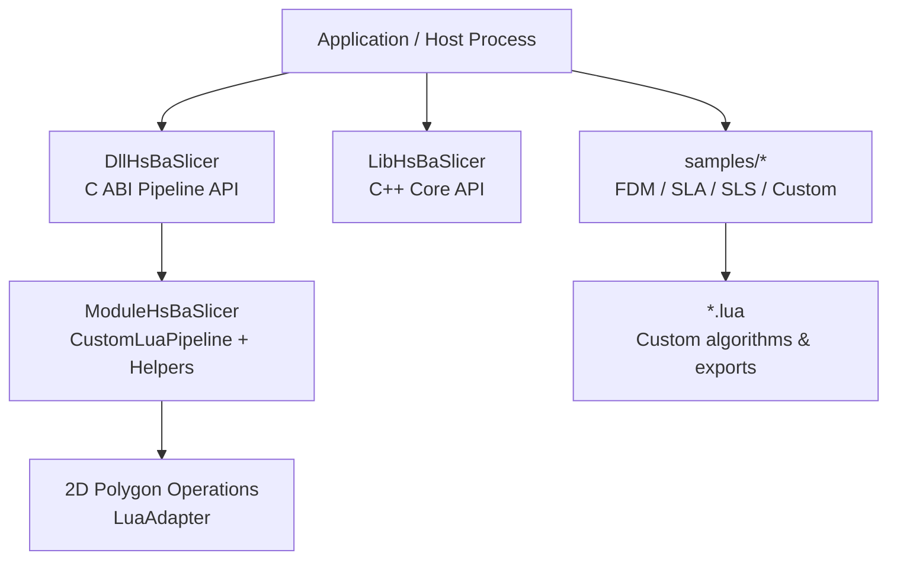
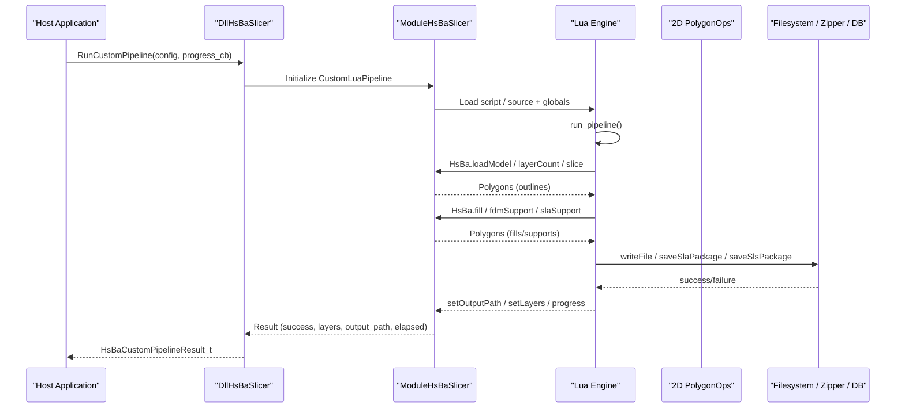
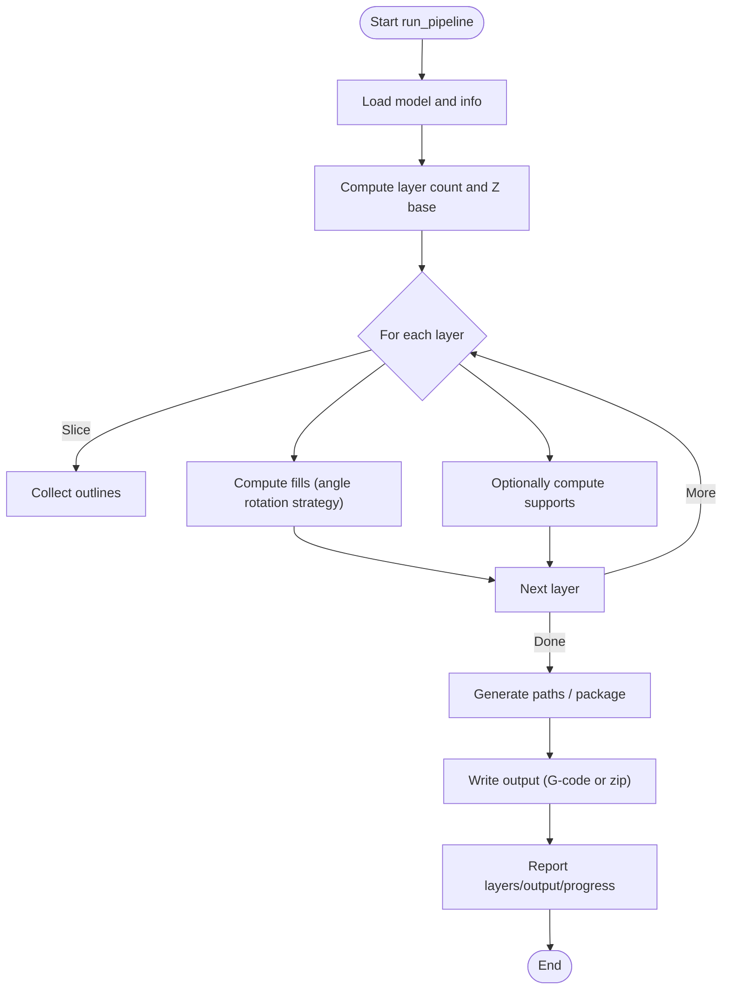
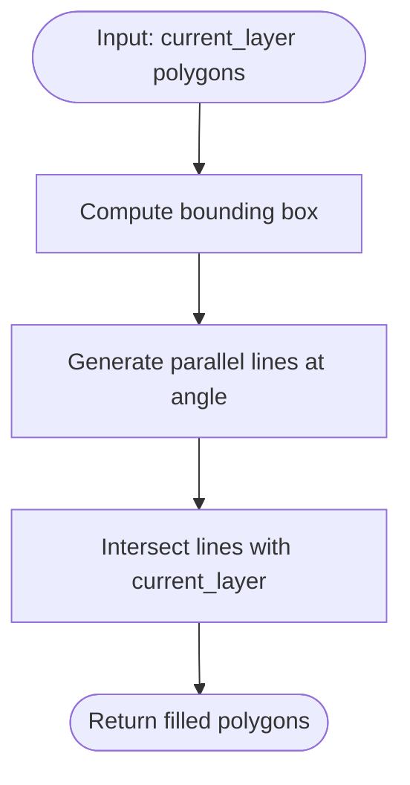
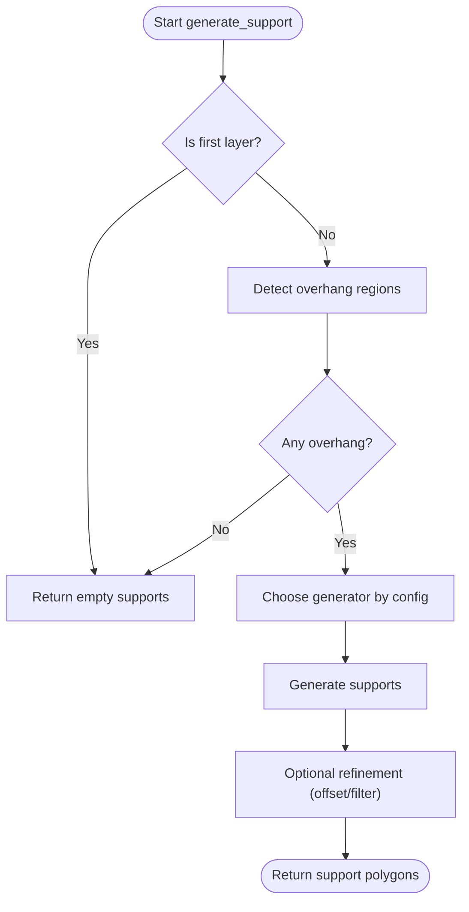
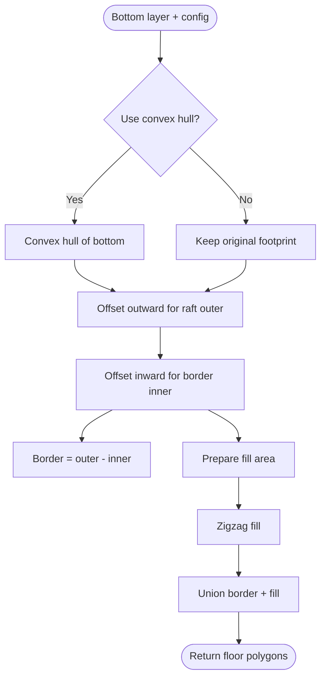
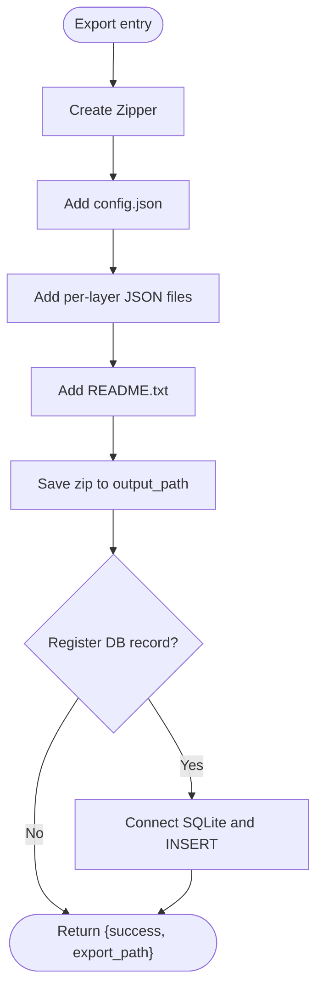
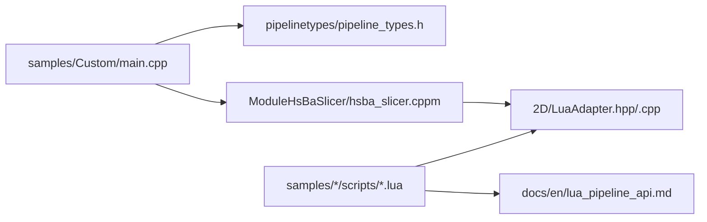

# Advanced Examples

<cite>
**Referenced Files in This Document**
- [README.md](file://README.md)
- [samples/Custom/main.cpp](file://samples/Custom/main.cpp)
- [samples/Custom/scripts/my_fdm_pipeline.lua](file://samples/Custom/scripts/my_fdm_pipeline.lua)
- [samples/Custom/scripts/my_sla_pipeline.lua](file://samples/Custom/scripts/my_sla_pipeline.lua)
- [samples/Custom/scripts/my_sls_pipeline.lua](file://samples/Custom/scripts/my_sls_pipeline.lua)
- [samples/Custom/scripts/my_sls_export.lua](file://samples/Custom/scripts/my_sls_export.lua)
- [samples/FDM/scripts/my_infill.lua](file://samples/FDM/scripts/my_infill.lua)
- [samples/FDM/scripts/my_support.lua](file://samples/FDM/scripts/my_support.lua)
- [samples/SLA/scripts/my_sla_floor.lua](file://samples/SLA/scripts/my_sla_floor.lua)
- [samples/SLA/scripts/my_sla_support.lua](file://samples/SLA/scripts/my_sla_support.lua)
- [samples/SLS/scripts/my_sls_export.lua](file://samples/SLS/scripts/my_sls_export.lua)
- [samples/TDP/scripts/my_tdp_export.lua](file://samples/TDP/scripts/my_tdp_export.lua)
- [samples/WAAM/scripts/my_waam_path.lua](file://samples/WAAM/scripts/my_waam_path.lua)
- [tests/PolygonFill/custom_fill.lua](file://tests/PolygonFill/custom_fill.lua)
- [2D/LuaAdapter.hpp](file://2D/LuaAdapter.hpp)
- [2D/LuaAdapter.cpp](file://2D/LuaAdapter.cpp)
- [ModuleHsBaSlicer/hsba_slicer.cppm](file://ModuleHsBaSlicer/hsba_slicer.cppm)
- [pipelinetypes/pipeline_types.h](file://pipelinetypes/pipeline_types.h)
- [docs/en/lua_pipeline_api.md](file://docs/en/lua_pipeline_api.md)
</cite>

## Table of Contents
1. [Introduction](#introduction)
2. [Project Structure](#project-structure)
3. [Core Components](#core-components)
4. [Architecture Overview](#architecture-overview)
5. [Detailed Component Analysis](#detailed-component-analysis)
6. [Dependency Analysis](#dependency-analysis)
7. [Performance Considerations](#performance-considerations)
8. [Troubleshooting Guide](#troubleshooting-guide)
9. [Conclusion](#conclusion)
10. [Appendices](#appendices)

## Introduction
This document provides advanced, production-oriented examples for HsBaSlicer with a focus on:
- Custom algorithm development via Lua scripting (fills, supports, floors, exports).
- Full pipeline customization using the fully Lua-driven Custom pipeline.
- Performance optimization techniques including parallel execution and memory management.
- Integration with external systems through Protobuf wire data and database registration.
- Advanced configuration management, logging setup, and debugging strategies.

The repository is a modular, cross-platform C++ framework for 3D-printing slicers, exposing both a static C++ API and a dynamic C ABI for external languages. The Custom pipeline allows scripts to orchestrate all slicing stages and outputs, while built-in pipelines keep stage order fixed but allow Lua replacement of specific stages such as fill, support, floor, or export.

**Section sources**
- [README.md:21-39](file://README.md#L21-L39)

## Project Structure
At a high level, advanced usage centers around:
- `DllHsBaSlicer` and `LibHsBaSlicer`: runtime pipeline interfaces and core slicing capabilities.
- `ModuleHsBaSlicer`: C++ module interface that exposes Custom Lua pipeline types and helpers.
- `2D`: polygon operations and Lua adapters bridging C++ polygons to Lua tables.
- `samples`: end-to-end examples for FDM, SLA, SLS, LOM, TDP, WAAM, and fully custom pipelines.
- `tests`: unit tests and small Lua scripts demonstrating custom fills and utilities.

**Diagram sources**
- [README.md:104-124](file://README.md#L104-L124)
- [ModuleHsBaSlicer/hsba_slicer.cppm:445-506](file://ModuleHsBaSlicer/hsba_slicer.cppm#L445-L506)
- [2D/LuaAdapter.hpp:1-84](file://2D/LuaAdapter.hpp#L1-L84)

**Section sources**
- [README.md:104-124](file://README.md#L104-L124)

## Core Components
- Custom Lua Pipeline: A fully script-driven workflow where the Lua entry function orchestrates model loading, slicing, support generation, filling, path generation, and file packaging.
- Lua Polygon Operations: A registered Lua table providing boolean operations, offsets, hulls, area, shape creation, and text-to-polygons.
- Export Pipelines: Scriptable exporters for SLS/SLM/TDP/WAAM, producing zip packages or robot program text.
- Configuration and Results: Structured configuration and result types passed between host and Lua, including progress callbacks and elapsed time reporting.

Key implementation anchors:
- Custom pipeline type and helper functions are exposed in the module interface.
- Polygon operations are implemented and registered in the 2D Lua adapter.
- Sample applications demonstrate synchronous/asynchronous execution, inline scripts, and Protobuf wire integration.

**Section sources**
- [ModuleHsBaSlicer/hsba_slicer.cppm:445-506](file://ModuleHsBaSlicer/hsba_slicer.cppm#L445-L506)
- [2D/LuaAdapter.cpp:251-269](file://2D/LuaAdapter.cpp#L251-L269)
- [samples/Custom/main.cpp:1-33](file://samples/Custom/main.cpp#L1-L33)

## Architecture Overview
The Custom pipeline architecture separates orchestration (Lua) from computation (C++):

**Diagram sources**
- [samples/Custom/main.cpp:100-131](file://samples/Custom/main.cpp#L100-L131)
- [samples/Custom/scripts/my_fdm_pipeline.lua:52-171](file://samples/Custom/scripts/my_fdm_pipeline.lua#L52-L171)
- [samples/Custom/scripts/my_sla_pipeline.lua:27-104](file://samples/Custom/scripts/my_sla_pipeline.lua#L27-L104)
- [samples/Custom/scripts/my_sls_pipeline.lua:30-101](file://samples/Custom/scripts/my_sls_pipeline.lua#L30-L101)

## Detailed Component Analysis

### Fully Lua-Driven Custom Pipeline (FDM, SLA, SLS)
The Custom pipeline lets scripts define every stage. The sample demonstrates:
- FDM: load model, compute layers, slice, fill with rotating angles, optional support, generate G-code, write file.
- SLA: load model, slice, generate SLA support, generate floor/raft, render and package images into zip.
- SLS: load model, slice, assemble process config, package layers and config into zip with a separate export script.

**Diagram sources**
- [samples/Custom/scripts/my_fdm_pipeline.lua:52-171](file://samples/Custom/scripts/my_fdm_pipeline.lua#L52-L171)
- [samples/Custom/scripts/my_sla_pipeline.lua:27-104](file://samples/Custom/scripts/my_sla_pipeline.lua#L27-L104)
- [samples/Custom/scripts/my_sls_pipeline.lua:30-101](file://samples/Custom/scripts/my_sls_pipeline.lua#L30-L101)

**Section sources**
- [samples/Custom/main.cpp:100-131](file://samples/Custom/main.cpp#L100-L131)
- [samples/Custom/scripts/my_fdm_pipeline.lua:52-171](file://samples/Custom/scripts/my_fdm_pipeline.lua#L52-L171)
- [samples/Custom/scripts/my_sla_pipeline.lua:27-104](file://samples/Custom/scripts/my_sla_pipeline.lua#L27-L104)
- [samples/Custom/scripts/my_sls_pipeline.lua:30-101](file://samples/Custom/scripts/my_sls_pipeline.lua#L30-L101)

### Custom Fill Algorithm (FDM)
The custom fill script computes diagonal lines across the bounding box and intersects them with the current layer to produce a patterned infill. It uses only PolygonOperations and returns polygons compatible with downstream path generation.

**Diagram sources**
- [samples/FDM/scripts/my_infill.lua:20-87](file://samples/FDM/scripts/my_infill.lua#L20-L87)

**Section sources**
- [samples/FDM/scripts/my_infill.lua:1-89](file://samples/FDM/scripts/my_infill.lua#L1-L89)

### Custom Support Algorithms (FDM and SLA)
Both FDM and SLA support scripts detect overhang regions and use built-in generators (plane/tree/honeycomb for FDM; sacrificial columns for SLA), then refine results via polygon operations.

**Diagram sources**
- [samples/FDM/scripts/my_support.lua:32-79](file://samples/FDM/scripts/my_support.lua#L32-L79)
- [samples/SLA/scripts/my_sla_support.lua:34-72](file://samples/SLA/scripts/my_sla_support.lua#L34-L72)

**Section sources**
- [samples/FDM/scripts/my_support.lua:1-83](file://samples/FDM/scripts/my_support.lua#L1-L83)
- [samples/SLA/scripts/my_sla_support.lua:1-76](file://samples/SLA/scripts/my_sla_support.lua#L1-L76)

### Custom Floor Generation (SLA)
The SLA floor script builds a raft/border and internal zigzag fill based on configuration, optionally simplifying the footprint with convex hull.

**Diagram sources**
- [samples/SLA/scripts/my_sla_floor.lua:35-62](file://samples/SLA/scripts/my_sla_floor.lua#L35-L62)

**Section sources**
- [samples/SLA/scripts/my_sla_floor.lua:1-64](file://samples/SLA/scripts/my_sla_floor.lua#L1-L64)

### Export Pipelines (SLS, SLM, TDP, WAAM)
Export scripts handle packaging and optional database registration:
- SLS/SLM/TDP: create zip with config and per-layer JSON, add README, optionally register SQLite history.
- WAAM: generate robot program text from points and velocity/type metadata.

**Diagram sources**
- [samples/Custom/scripts/my_sls_export.lua:21-75](file://samples/Custom/scripts/my_sls_export.lua#L21-L75)
- [samples/SLS/scripts/my_sls_export.lua:23-79](file://samples/SLS/scripts/my_sls_export.lua#L23-L79)
- [samples/TDP/scripts/my_tdp_export.lua:15-62](file://samples/TDP/scripts/my_tdp_export.lua#L15-L62)
- [samples/WAAM/scripts/my_waam_path.lua:17-42](file://samples/WAAM/scripts/my_waam_path.lua#L17-L42)

**Section sources**
- [samples/Custom/scripts/my_sls_export.lua:1-76](file://samples/Custom/scripts/my_sls_export.lua#L1-L76)
- [samples/SLS/scripts/my_sls_export.lua:1-80](file://samples/SLS/scripts/my_sls_export.lua#L1-L80)
- [samples/TDP/scripts/my_tdp_export.lua:1-63](file://samples/TDP/scripts/my_tdp_export.lua#L1-L63)
- [samples/WAAM/scripts/my_waam_path.lua:1-46](file://samples/WAAM/scripts/my_waam_path.lua#L1-L46)

### Inline and Test Custom Fill
Inline test scripts provide minimal fill patterns for validation and testing.

**Section sources**
- [tests/PolygonFill/custom_fill.lua:1-16](file://tests/PolygonFill/custom_fill.lua#L1-L16)

## Dependency Analysis
The following diagram maps key dependencies among components used in advanced examples:

**Diagram sources**
- [samples/Custom/main.cpp:1-33](file://samples/Custom/main.cpp#L1-L33)
- [pipelinetypes/pipeline_types.h:698-726](file://pipelinetypes/pipeline_types.h#L698-L726)
- [ModuleHsBaSlicer/hsba_slicer.cppm:445-506](file://ModuleHsBaSlicer/hsba_slicer.cppm#L445-L506)
- [2D/LuaAdapter.hpp:1-84](file://2D/LuaAdapter.hpp#L1-L84)
- [docs/en/lua_pipeline_api.md:161-181](file://docs/en/lua_pipeline_api.md#L161-L181)

**Section sources**
- [samples/Custom/main.cpp:1-33](file://samples/Custom/main.cpp#L1-L33)
- [pipelinetypes/pipeline_types.h:698-726](file://pipelinetypes/pipeline_types.h#L698-L726)
- [ModuleHsBaSlicer/hsba_slicer.cppm:445-506](file://ModuleHsBaSlicer/hsba_slicer.cppm#L445-L506)
- [2D/LuaAdapter.cpp:251-269](file://2D/LuaAdapter.cpp#L251-L269)
- [docs/en/lua_pipeline_api.md:161-181](file://docs/en/lua_pipeline_api.md#L161-L181)

## Performance Considerations
- Parallel Processing Patterns:
  - Use asynchronous pipeline execution to avoid blocking the host UI thread. The samples show how to run the Custom pipeline asynchronously and receive completion callbacks.
  - For large models, consider batching layer processing and updating progress frequently to keep the application responsive.
- Memory Management Strategies:
  - Always release returned result structures after use to prevent leaks.
  - Avoid returning strings from export scripts when writing zip archives; return tables to prevent overwriting binary outputs.
  - Reuse polygon buffers where possible and minimize intermediate allocations in Lua by operating on existing tables.
- Optimization Techniques:
  - Rotate fill angles periodically to reduce thermal warping and improve print quality.
  - Filter small support features by area thresholds to reduce unnecessary material usage.
  - Prefer vectorized polygon operations (union/difference/offset) provided by PolygonOperations rather than manual loops.
- Logging and Debugging:
  - Use the provided logger singleton to emit progress and diagnostic messages.
  - Enable polygon dump functions conditionally during development to inspect generated shapes.

[No sources needed since this section provides general guidance]

## Troubleshooting Guide
Common issues and resolutions:
- Export script returns string instead of table:
  - Symptom: zip file overwritten or corrupted.
  - Resolution: Ensure export scripts return tables (e.g., `{success=true, export_path=...}`) and do not return strings.
- Database registration failures:
  - Symptom: Warning logs about skipping DB registration.
  - Resolution: Wrap DB operations in error handlers; non-fatal errors should not abort export.
- Proto wire parsing errors:
  - Symptom: Failure to parse request/response bytes.
  - Resolution: Validate field numbers and wire types match the proto schema; ensure correct varint/length-delimited handling.
- Progress callback not invoked:
  - Symptom: No progress updates in host UI.
  - Resolution: Ensure Lua calls `HsBa.progress(percent, stage)` regularly and host registers a valid progress callback.

**Section sources**
- [samples/Custom/scripts/my_sls_export.lua:18-19](file://samples/Custom/scripts/my_sls_export.lua#L18-L19)
- [samples/Custom/scripts/my_sls_export.lua:47-66](file://samples/Custom/scripts/my_sls_export.lua#L47-L66)
- [samples/Custom/main.cpp:516-588](file://samples/Custom/main.cpp#L516-L588)

## Conclusion
Advanced HsBaSlicer usage leverages Lua for flexible algorithm development and full pipeline control. By combining:
- Custom fills, supports, and floors,
- Fully script-driven workflows,
- Robust export packaging and optional database registration,
- Asynchronous execution and careful memory management,
you can build production-ready, high-performance slicing applications tailored to diverse manufacturing processes.

[No sources needed since this section summarizes without analyzing specific files]

## Appendices

### API Reference Anchors
- Custom pipeline configuration and result types:
  - [HsBaCustomPipelineConfig_t:698-704](file://pipelinetypes/pipeline_types.h#L698-L704)
  - [HsBaCustomPipelineResult_t:711-719](file://pipelinetypes/pipeline_types.h#L711-L719)
- Module-level Custom Lua Pipeline class and helpers:
  - [CustomLuaPipeline:464-479](file://ModuleHsBaSlicer/hsba_slicer.cppm#L464-L479)
  - [luaCustomFill / luaCustomFloor / luaCustomSupport:485-498](file://ModuleHsBaSlicer/hsba_slicer.cppm#L485-L498)
- Lua polygon operations registry:
  - [RegisterLuaPolygonOperations:415-419](file://2D/LuaAdapter.cpp#L415-L419)
  - [booleanOperation / union / intersection / difference / xor / offsetOperation / convexHullOperation / concaveHullOperation / area / makeRectangle / makeCircle / makeEllipse / makeRegularPolygon / textToPolygons:251-269](file://2D/LuaAdapter.cpp#L251-L269)

**Section sources**
- [pipelinetypes/pipeline_types.h:698-726](file://pipelinetypes/pipeline_types.h#L698-L726)
- [ModuleHsBaSlicer/hsba_slicer.cppm:445-506](file://ModuleHsBaSlicer/hsba_slicer.cppm#L445-L506)
- [2D/LuaAdapter.cpp:251-269](file://2D/LuaAdapter.cpp#L251-L269)