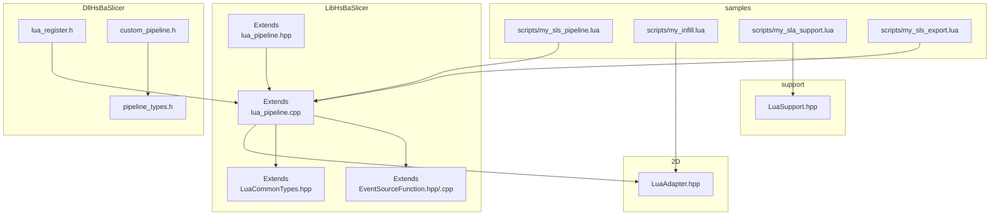
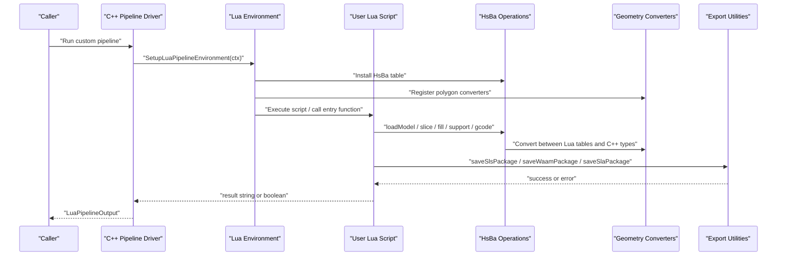
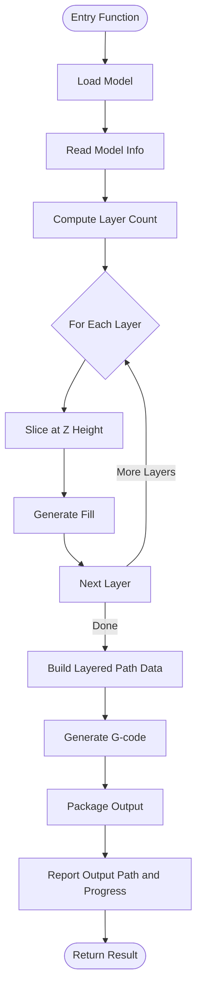
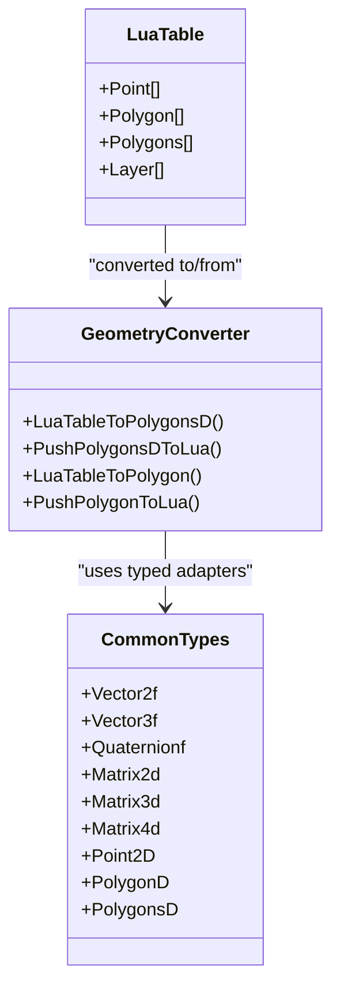
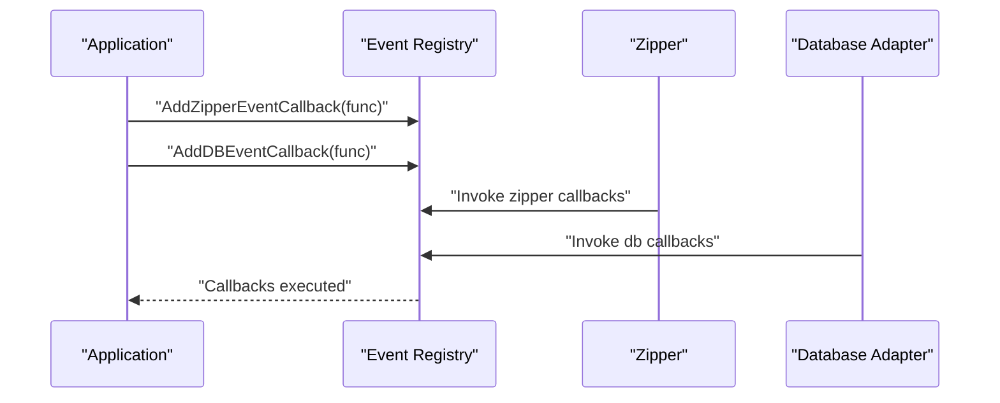
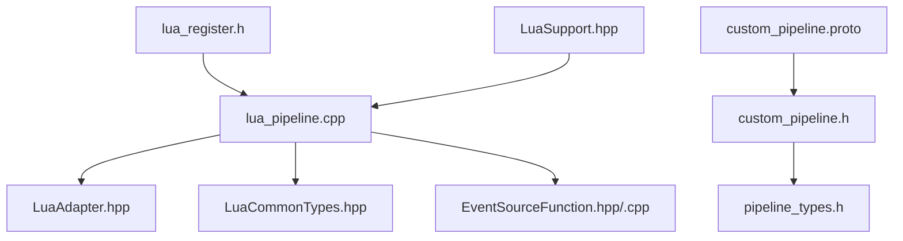

# Custom Algorithm Development

<cite>
**Referenced Files in This Document**
- [lua_pipeline_api.md](file://docs/en/lua_pipeline_api.md)
- [lua_pipeline.hpp](file://LibHsBaSlicer/Extends/lua_pipeline.hpp)
- [lua_pipeline.cpp](file://LibHsBaSlicer/Extends/lua_pipeline.cpp)
- [LuaCommonTypes.hpp](file://LibHsBaSlicer/Extends/LuaCommonTypes.hpp)
- [EventSourceFunction.hpp](file://LibHsBaSlicer/Extends/EventSourceFunction.hpp)
- [EventSourceFunction.cpp](file://LibHsBaSlicer/Extends/EventSourceFunction.cpp)
- [LuaAdapter.hpp](file://2D/LuaAdapter.hpp)
- [LuaSupport.hpp](file://support/LuaSupport.hpp)
- [lua_register.h](file://DllHsBaSlicer/lua_register.h)
- [custom_pipeline.h](file://DllHsBaSlicer/custom_pipeline.h)
- [pipeline_types.h](file://pipelinetypes/pipeline_types.h)
- [custom_pipeline.proto](file://proto/custom_pipeline.proto)
- [my_sls_pipeline.lua](file://samples/Custom/scripts/my_sls_pipeline.lua)
- [my_infill.lua](file://samples/FDM/scripts/my_infill.lua)
- [my_sla_support.lua](file://samples/SLA/scripts/my_sla_support.lua)
- [my_sls_export.lua](file://samples/SLS/scripts/my_sls_export.lua)
</cite>

## Table of Contents
1. [Introduction](#introduction)
2. [Project Structure](#project-structure)
3. [Core Components](#core-components)
4. [Architecture Overview](#architecture-overview)
5. [Detailed Component Analysis](#detailed-component-analysis)
6. [Dependency Analysis](#dependency-analysis)
7. [Performance Considerations](#performance-considerations)
8. [Troubleshooting Guide](#troubleshooting-guide)
9. [Conclusion](#conclusion)
10. [Appendices](#appendices)

## Introduction
This document explains how to develop custom algorithms in HsBaSlicer using Lua scripting. It covers the Lua API surface, data type conversions between C++ and Lua, event handling mechanisms, and how to implement custom slicing algorithms, fill patterns, support structures, and export formats. It also provides guidance for pipeline customization, parameter access, result processing, advanced Lua patterns, error handling, performance optimization, debugging, and profiling.

The repository exposes two primary scripting environments:
- Fully Lua-driven custom pipelines where the script controls the entire workflow through a global `HsBa` operation table.
- Built-in stage hooks that replace only one algorithm (for example, support or fill) while keeping the C++ stage order fixed.

Both environments share common geometry types and libraries such as polygon operations, fill generators, path optimizers, compression utilities, database adapters, and parameter persistence tools.

## Project Structure
At a high level, the Lua-based extension points are implemented under:
- LibHsBaSlicer/Extends: core Lua pipeline environment, common type registration, and event callback infrastructure.
- 2D: polygon conversion helpers and polygon operation registration.
- support: Lua-based custom support generator interface.
- DllHsBaSlicer: C ABI for registering external Lua functions and event callbacks into the runtime.
- samples: example scripts demonstrating custom pipelines, fill patterns, support generation, and export logic.

**Diagram sources**
- [lua_pipeline.cpp:1-800](file://LibHsBaSlicer/Extends/lua_pipeline.cpp#L1-L800)
- [lua_pipeline.hpp:1-88](file://LibHsBaSlicer/Extends/lua_pipeline.hpp#L1-L88)
- [LuaCommonTypes.hpp:1-187](file://LibHsBaSlicer/Extends/LuaCommonTypes.hpp#L1-L187)
- [EventSourceFunction.hpp:1-44](file://LibHsBaSlicer/Extends/EventSourceFunction.hpp#L1-L44)
- [EventSourceFunction.cpp:1-27](file://LibHsBaSlicer/Extends/EventSourceFunction.cpp#L1-L27)
- [LuaAdapter.hpp:1-84](file://2D/LuaAdapter.hpp#L1-L84)
- [LuaSupport.hpp:1-85](file://support/LuaSupport.hpp#L1-L85)
- [lua_register.h:1-37](file://DllHsBaSlicer/lua_register.h#L1-L37)
- [custom_pipeline.h:1-57](file://DllHsBaSlicer/custom_pipeline.h#L1-L57)
- [pipeline_types.h:698-726](file://pipelinetypes/pipeline_types.h#L698-L726)
- [my_sls_pipeline.lua:1-102](file://samples/Custom/scripts/my_sls_pipeline.lua#L1-L102)
- [my_infill.lua:1-89](file://samples/FDM/scripts/my_infill.lua#L1-L89)
- [my_sla_support.lua:1-76](file://samples/SLA/scripts/my_sla_support.lua#L1-L76)
- [my_sls_export.lua:1-80](file://samples/SLS/scripts/my_sls_export.lua#L1-L80)

**Section sources**
- [lua_pipeline.hpp:1-88](file://LibHsBaSlicer/Extends/lua_pipeline.hpp#L1-L88)
- [lua_pipeline.cpp:1-800](file://LibHsBaSlicer/Extends/lua_pipeline.cpp#L1-L800)
- [lua_pipeline_api.md:1-332](file://docs/en/lua_pipeline_api.md#L1-L332)

## Core Components
This section summarizes the key components used by Lua-based algorithms.

- Custom pipeline context and output:
  - Context fields include inline script, script file path, entry function name, JSON configuration, default output path, model name, model path, and progress callback.
  - Output captures success flag, total layers reported by the script, output path reported by the script, result string returned by the entry function, and error message on failure.

- Lua pipeline environment setup:
  - The environment installs standard libraries, common AnyObject types, pooled 2D/3D/File registrations, and creates the global `HsBa` operations table bound to the current run.
  - The run entry point executes the provided script or script file and calls the configured entry function.

- Shared geometry and conversion layer:
  - Common types register reflective metadata for Eigen vectors/matrices/quaternions and Clipper2 points/polygons.
  - Polygon conversion helpers push and read Lua tables representing polygons and polygon sets.

- Event source callbacks:
  - Zipper and database events expose callback lists that can be extended from C++.

- Custom support generator:
  - A Lua-based support generator replaces built-in algorithms and receives per-layer data plus configuration.

- External Lua function registration:
  - The C ABI allows registering 2D, 3D, and File Lua functions, as well as named event callbacks, before running pipelines.

**Section sources**
- [lua_pipeline.hpp:19-83](file://LibHsBaSlicer/Extends/lua_pipeline.hpp#L19-L83)
- [lua_pipeline.cpp:45-83](file://LibHsBaSlicer/Extends/lua_pipeline.cpp#L45-L83)
- [LuaCommonTypes.hpp:20-45](file://LibHsBaSlicer/Extends/LuaCommonTypes.hpp#L20-L45)
- [LuaCommonTypes.hpp:148-183](file://LibHsBaSlicer/Extends/LuaCommonTypes.hpp#L148-L183)
- [LuaAdapter.hpp:16-81](file://2D/LuaAdapter.hpp#L16-L81)
- [EventSourceFunction.hpp:18-41](file://LibHsBaSlicer/Extends/EventSourceFunction.hpp#L18-L41)
- [EventSourceFunction.cpp:9-26](file://LibHsBaSlicer/Extends/EventSourceFunction.cpp#L9-L26)
- [LuaSupport.hpp:21-67](file://support/LuaSupport.hpp#L21-L67)
- [lua_register.h:13-31](file://DllHsBaSlicer/lua_register.h#L13-L31)

## Architecture Overview
The Lua-based architecture separates concerns across three layers:
- Scripting layer: user-defined Lua scripts define pipeline logic, override specific stages, or implement export routines.
- Runtime layer: the Lua pipeline environment binds C++ functionality to Lua via the `HsBa` table and shared libraries.
- Data layer: geometry, models, paths, and packaging data flow through typed converters and adapters.

**Diagram sources**
- [lua_pipeline.hpp:53-83](file://LibHsBaSlicer/Extends/lua_pipeline.hpp#L53-L83)
- [lua_pipeline.cpp:208-800](file://LibHsBaSlicer/Extends/lua_pipeline.cpp#L208-L800)
- [lua_pipeline_api.md:48-133](file://docs/en/lua_pipeline_api.md#L48-L133)

## Detailed Component Analysis

### Custom Pipeline Environment and Control Flow
The fully Lua-driven custom pipeline is controlled by an entry function, typically `run_pipeline`. The script uses the global `HsBa` table to load models, compute layer counts, slice at heights, generate fills, produce G-code, and package outputs. Progress reporting and output metadata are communicated back to C++ through `HsBa.progress`, `HsBa.setLayers`, and `HsBa.setOutputPath`.

Key behaviors:
- Entry function returns a non-empty string for success with result text, true for success without text, or false/nil/error for failure.
- Context globals provide pipeline configuration, model information, and default output path.
- Model management supports translation, rotation, scaling, removal, and listing.
- Slicing APIs return floating-point polygons; integerization/unintegerization is available for compatibility with internal algorithms.
- Fill supports spacing, mode, angle, and border count.
- Support APIs accept layered inputs and configuration tables.
- Path and G-code generation accept layered outlines/fills/supports and printer parameters.
- Packaging APIs create process-specific packages and delegate export scripts.

**Diagram sources**
- [lua_pipeline.cpp:212-238](file://LibHsBaSlicer/Extends/lua_pipeline.cpp#L212-L238)
- [lua_pipeline.cpp:270-371](file://LibHsBaSlicer/Extends/lua_pipeline.cpp#L270-L371)
- [lua_pipeline.cpp:373-472](file://LibHsBaSlicer/Extends/lua_pipeline.cpp#L373-L472)
- [lua_pipeline.cpp:587-654](file://LibHsBaSlicer/Extends/lua_pipeline.cpp#L587-L654)
- [lua_pipeline.cpp:656-783](file://LibHsBaSlicer/Extends/lua_pipeline.cpp#L656-L783)
- [lua_pipeline_api.md:48-133](file://docs/en/lua_pipeline_api.md#L48-L133)

**Section sources**
- [lua_pipeline.hpp:19-83](file://LibHsBaSlicer/Extends/lua_pipeline.hpp#L19-L83)
- [lua_pipeline.cpp:208-800](file://LibHsBaSlicer/Extends/lua_pipeline.cpp#L208-L800)
- [lua_pipeline_api.md:19-133](file://docs/en/lua_pipeline_api.md#L19-L133)

### Data Type Conversions Between C++ and Lua
Geometry data flows through consistent Lua-table representations:
- Point: `{ x = number, y = number }`
- Polygon: array of points forming a closed contour
- Polygons: array of polygons
- Layers: array of polygon sets
- 3D point: `{ x = number, y = number, z = number }`

Conversion responsibilities:
- `LuaTableToPolygonsD` and `PushPolygonsDToLua` handle double-precision polygons.
- `LuaTableToPolygon` and `PushPolygonToLua` handle integer polygons.
- `HsBa.toInt` converts float polygons to integer polygons.
- `HsBa.toDouble` converts integer polygons to float polygons.
- Common types register reflective metadata for Eigen vectors/matrices/quaternions and Clipper2 points/polygons, enabling stable names and cast methods.

**Diagram sources**
- [LuaAdapter.hpp:16-81](file://2D/LuaAdapter.hpp#L16-L81)
- [lua_pipeline.cpp:171-206](file://LibHsBaSlicer/Extends/lua_pipeline.cpp#L171-L206)
- [lua_pipeline.cpp:431-446](file://LibHsBaSlicer/Extends/lua_pipeline.cpp#L431-L446)
- [LuaCommonTypes.hpp:110-140](file://LibHsBaSlicer/Extends/LuaCommonTypes.hpp#L110-L140)

**Section sources**
- [lua_pipeline_api.md:32-45](file://docs/en/lua_pipeline_api.md#L32-L45)
- [LuaAdapter.hpp:16-81](file://2D/LuaAdapter.hpp#L16-L81)
- [lua_pipeline.cpp:171-206](file://LibHsBaSlicer/Extends/lua_pipeline.cpp#L171-L206)
- [lua_pipeline.cpp:431-446](file://LibHsBaSlicer/Extends/lua_pipeline.cpp#L431-L446)
- [LuaCommonTypes.hpp:110-140](file://LibHsBaSlicer/Extends/LuaCommonTypes.hpp#L110-L140)

### Event Handling Mechanisms
Event handling is exposed through callback registries:
- Zipper events: compression progress and stage descriptions.
- Database events: query/update/delete lifecycle notifications.

Callbacks are registered from C++ and invoked during corresponding operations. Scripts can observe these events indirectly when using the provided libraries.

**Diagram sources**
- [EventSourceFunction.hpp:18-41](file://LibHsBaSlicer/Extends/EventSourceFunction.hpp#L18-L41)
- [EventSourceFunction.cpp:9-26](file://LibHsBaSlicer/Extends/EventSourceFunction.cpp#L9-L26)

**Section sources**
- [EventSourceFunction.hpp:18-41](file://LibHsBaSlicer/Extends/EventSourceFunction.hpp#L18-L41)
- [EventSourceFunction.cpp:9-26](file://LibHsBaSlicer/Extends/EventSourceFunction.cpp#L9-L26)

### Implementing Custom Slicing Algorithms
Custom slicing is performed by iterating over computed layers and calling slice at each height. The script builds layered outline and fill data, then passes it to G-code generation or other exporters.

Recommended pattern:
- Determine base Z from model bounding box.
- Compute layer count and per-layer Z values.
- Slice contours and optionally generate fills.
- Assemble layered path data with outlines, fills, supports, and Z heights.
- Generate G-code or another path format.

**Section sources**
- [lua_pipeline.cpp:373-472](file://LibHsBaSlicer/Extends/lua_pipeline.cpp#L373-L472)
- [lua_pipeline.cpp:587-654](file://LibHsBaSlicer/Extends/lua_pipeline.cpp#L587-L654)
- [lua_pipeline_api.md:89-124](file://docs/en/lua_pipeline_api.md#L89-L124)

### Implementing Custom Fill Patterns
Fill patterns can be implemented either through the `HsBa.fill` API or by providing a custom fill stage script. The built-in fill supports spacing, mode, angle, and border count. For advanced control, a custom fill script defines `generate_fill(current_layer)` and returns fill polygons.

Example approach:
- Use `PolygonOperations` to construct lines or shapes.
- Intersect generated fill primitives with the current layer.
- Return the resulting polygon set.

**Section sources**
- [lua_pipeline.cpp:448-472](file://LibHsBaSlicer/Extends/lua_pipeline.cpp#L448-L472)
- [lua_pipeline_api.md:98-105](file://docs/en/lua_pipeline_api.md#L98-L105)
- [my_infill.lua:1-89](file://samples/FDM/scripts/my_infill.lua#L1-L89)

### Implementing Custom Support Structures
Custom support generation can be done via:
- `HsBa.fdmSupport` or `HsBa.slaSupport` in the custom pipeline environment.
- A Lua-based support generator replacing the built-in algorithm.

The Lua support environment injects `current_layer`, `prev_layer`, `layer_height`, and `config`. The script should return support cross-section polygons.

**Section sources**
- [lua_pipeline.cpp:474-518](file://LibHsBaSlicer/Extends/lua_pipeline.cpp#L474-L518)
- [LuaSupport.hpp:21-67](file://support/LuaSupport.hpp#L21-L67)
- [lua_pipeline_api.md:106-117](file://docs/en/lua_pipeline_api.md#L106-L117)
- [my_sla_support.lua:1-76](file://samples/SLA/scripts/my_sla_support.lua#L1-L76)

### Implementing Custom Export Formats
Export scripts run at the packaging stage and receive:
- `config`: table containing config path and JSON content.
- `images`: array of layer images with paths and polygon JSON data.
- `output_path`: target output file path.

The agreed entry function varies by process (for example, `export_sls` for SLS). The script should return a table with `success` and `export_path`.

Packaging helpers:
- `HsBa.saveSlsPackage`
- `HsBa.saveWaamPackage`
- `HsBa.saveSlaPackage`

**Section sources**
- [lua_pipeline.cpp:656-783](file://LibHsBaSlicer/Extends/lua_pipeline.cpp#L656-L783)
- [lua_pipeline_api.md:125-133](file://docs/en/lua_pipeline_api.md#L125-L133)
- [lua_pipeline_api.md:246-260](file://docs/en/lua_pipeline_api.md#L246-L260)
- [my_sls_export.lua:1-80](file://samples/SLS/scripts/my_sls_export.lua#L1-L80)

### Advanced Lua Patterns for Complex Algorithm Logic
Useful patterns include:
- Parameter resolution with fallback defaults.
- Safe execution using `pcall` for optional features like database registration.
- Iterative processing with progress updates.
- Modular composition of small helper functions.

These patterns improve readability, maintainability, and resilience against non-critical failures.

**Section sources**
- [my_sls_pipeline.lua:22-28](file://samples/Custom/scripts/my_sls_pipeline.lua#L22-L28)
- [my_sls_pipeline.lua:40-62](file://samples/Custom/scripts/my_sls_pipeline.lua#L40-L62)
- [my_sls_export.lua:50-71](file://samples/SLS/scripts/my_sls_export.lua#L50-L71)

### Error Handling Strategies
Error handling guidelines:
- Validate required fields before invoking packaging APIs.
- Wrap optional operations in `pcall` to avoid failing the entire export.
- Return explicit success/failure structures from export scripts.
- Use `HsBa.progress` to communicate partial failures or skipped steps.

**Section sources**
- [lua_pipeline.cpp:680-688](file://LibHsBaSlicer/Extends/lua_pipeline.cpp#L680-L688)
- [lua_pipeline.cpp:731-743](file://LibHsBaSlicer/Extends/lua_pipeline.cpp#L731-L743)
- [lua_pipeline_api.md:256-260](file://docs/en/lua_pipeline_api.md#L256-L260)
- [my_sls_export.lua:50-71](file://samples/SLS/scripts/my_sls_export.lua#L50-L71)

### Performance Optimization Within Scripts
Optimization recommendations:
- Minimize repeated polygon conversions by batching operations.
- Prefer integerized polygons for boolean and fill computations where possible.
- Avoid unnecessary model transformations inside tight loops.
- Use efficient iteration patterns and preallocate arrays.
- Limit logging and heavy I/O during intensive computation phases.

**Section sources**
- [lua_pipeline_api.md:44-45](file://docs/en/lua_pipeline_api.md#L44-L45)
- [lua_pipeline.cpp:171-206](file://LibHsBaSlicer/Extends/lua_pipeline.cpp#L171-L206)

### Debugging Techniques for Lua-Based Algorithms
Debugging techniques:
- Print intermediate values such as layer counts, bounding boxes, and polygon sizes.
- Use `HsBa.renderImage` to visualize slices or fills.
- Log progress messages with descriptive stage names.
- Isolate problematic stages by commenting out optional features like database writes.

**Section sources**
- [lua_pipeline.cpp:773-783](file://LibHsBaSlicer/Extends/lua_pipeline.cpp#L773-L783)
- [my_sls_pipeline.lua:44-46](file://samples/Custom/scripts/my_sls_pipeline.lua#L44-L46)

### Profiling Approaches for Lua-Based Algorithms
Profiling approaches:
- Measure elapsed time around expensive loops using Lua’s clock or OS-level timers.
- Track progress percentages to correlate slow stages with UI feedback.
- Profile memory usage by limiting large temporary polygon sets.
- Compare performance between integerized and floating-point workflows.

[No sources needed since this section provides general guidance]

## Dependency Analysis
The Lua extension system depends on several modules:
- lua_pipeline.cpp wires together model preprocessing, slicing, support, fill, floor, path generation, and export packaging.
- LuaAdapter.hpp provides polygon conversion and operation registration.
- LuaCommonTypes.hpp registers reflective metadata for common types.
- EventSourceFunction provides callback registries for Zipper and database events.
- LuaSupport.hpp defines the interface for Lua-based custom support generation.
- lua_register.h exposes the C ABI for injecting external Lua functions and event callbacks.
- custom_pipeline.h and pipeline_types.h define the C ABI for running custom pipelines synchronously and asynchronously.
- custom_pipeline.proto defines the protobuf configuration for the fully Lua-driven custom pipeline.

**Diagram sources**
- [lua_pipeline.cpp:1-39](file://LibHsBaSlicer/Extends/lua_pipeline.cpp#L1-L39)
- [LuaAdapter.hpp:1-84](file://2D/LuaAdapter.hpp#L1-L84)
- [LuaCommonTypes.hpp:1-187](file://LibHsBaSlicer/Extends/LuaCommonTypes.hpp#L1-L187)
- [EventSourceFunction.hpp:1-44](file://LibHsBaSlicer/Extends/EventSourceFunction.hpp#L1-L44)
- [EventSourceFunction.cpp:1-27](file://LibHsBaSlicer/Extends/EventSourceFunction.cpp#L1-L27)
- [LuaSupport.hpp:1-85](file://support/LuaSupport.hpp#L1-L85)
- [lua_register.h:1-37](file://DllHsBaSlicer/lua_register.h#L1-L37)
- [custom_pipeline.h:1-57](file://DllHsBaSlicer/custom_pipeline.h#L1-L57)
- [pipeline_types.h:698-726](file://pipelinetypes/pipeline_types.h#L698-L726)
- [custom_pipeline.proto:1-25](file://proto/custom_pipeline.proto#L1-L25)

**Section sources**
- [lua_pipeline.cpp:1-39](file://LibHsBaSlicer/Extends/lua_pipeline.cpp#L1-L39)
- [lua_register.h:13-31](file://DllHsBaSlicer/lua_register.h#L13-L31)
- [custom_pipeline.h:17-55](file://DllHsBaSlicer/custom_pipeline.h#L17-L55)
- [pipeline_types.h:698-726](file://pipelinetypes/pipeline_types.h#L698-L726)
- [custom_pipeline.proto:5-25](file://proto/custom_pipeline.proto#L5-L25)

## Performance Considerations
- Prefer batched polygon operations to reduce Lua-to-C++ crossings.
- Reuse model instances by name to avoid reloading.
- Use integerized polygons for boolean and fill operations where supported.
- Avoid excessive string concatenation in tight loops; build strings incrementally.
- Defer heavy I/O until after critical computation phases.
- Use progress callbacks to keep UI responsive and detect stalls early.

[No sources needed since this section provides general guidance]

## Troubleshooting Guide
Common issues and resolutions:
- Missing required fields in packaging tables: ensure `output` and `script` are present where required.
- Wrong return value from export scripts: always return `{ success = true/false, export_path = "..." }`.
- Method name casing mismatches: keep object method names consistent with C++ bindings.
- Database registration failures: wrap optional database operations in `pcall` and treat them as non-fatal warnings.
- Empty or invalid model data: validate model bounding box and layer height before slicing.

**Section sources**
- [lua_pipeline.cpp:680-688](file://LibHsBaSlicer/Extends/lua_pipeline.cpp#L680-L688)
- [lua_pipeline.cpp:731-743](file://LibHsBaSlicer/Extends/lua_pipeline.cpp#L731-L743)
- [lua_pipeline_api.md:256-260](file://docs/en/lua_pipeline_api.md#L256-L260)
- [my_sls_export.lua:50-71](file://samples/SLS/scripts/my_sls_export.lua#L50-L71)

## Conclusion
HsBaSlicer’s Lua scripting system provides a powerful and flexible way to customize slicing algorithms, fill patterns, support structures, and export formats. By understanding the Lua API surface, data type conversions, event handling, and pipeline control flow, developers can implement robust, high-performance algorithms. Following the recommended patterns for error handling, performance optimization, debugging, and profiling will help ensure reliable and maintainable custom pipelines.

[No sources needed since this section summarizes without analyzing specific files]

## Appendices

### Full Example Reference
A minimal runnable custom-pipeline script demonstrates loading a model, computing layers, slicing, filling, generating G-code, writing output, and reporting progress.

**Section sources**
- [lua_pipeline_api.md:283-332](file://docs/en/lua_pipeline_api.md#L283-L332)
- [my_sls_pipeline.lua:1-102](file://samples/Custom/scripts/my_sls_pipeline.lua#L1-L102)